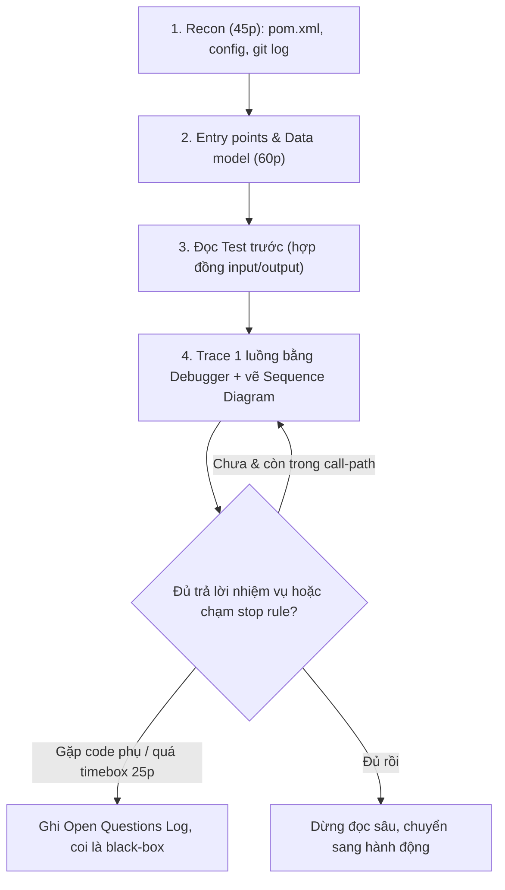

# READ-01 · Phương pháp đọc code lạ

> **TL;DR** — Đọc code lạ không phải đọc từ dòng 1 đến dòng cuối như đọc tiểu thuyết; mục tiêu là **vẽ được bản đồ luồng dữ liệu và điểm quyết định** trong ngân sách thời gian cố định. Chiến lược hiệu quả nhất là **Outside-In (Recon → Entry points → Đọc test → Trace 1 luồng bằng Debugger + vẽ Sequence Diagram)**, kết hợp ghi **Open Questions Log** để không chìm vào "hố thỏ" chi tiết phụ. Với một codebase 50.000 dòng trong 1 ngày, thành công nghĩa là hiểu chắc 10–15% đường xương sống thay vì đọc hời hợt 100% file.

## 🧭 Brief

| | |
| :--- | :--- |
| **Loại** | Bài học |
| **Giai đoạn** | Quý 0 · Bridge |
| **Chủ đề** | Đọc code không cần AI |

**Phạm vi bắt buộc**
- top-down vs bottom-up
- tìm entry point
- vẽ call-flow và sequence diagram
- đọc test trước
- dùng debugger để đọc code
- ghi chú câu hỏi mở

**Câu hỏi sâu — nội dung phải giúp trả lời được**
- Đọc 1 codebase 50k dòng trong 1 ngày, bắt đầu từ đâu?
- Khi nào nên dừng đọc sâu?

**Ý tưởng lab / demo**
- Bài tập vẽ call-flow của 1 request trong 1 project Spring Boot mẫu nhỏ

**Tài liệu gốc gợi ý**
- A Philosophy of Software Design
- source HikariCP, Guava trên GitHub

**Gói đầu ra**
- [x] `README.md` — lý thuyết theo [lesson-template](../../../docs/templates/lesson-template.md)
- [x] `exercises.md` — bài tập L1/L2/L3 theo [exercises-template](../../../docs/templates/exercises-template.md)
- [x] `solutions.md` — đáp án theo [solutions-template](../../../docs/templates/solutions-template.md)
- [x] `lab/` — code demo chạy được + `lab/README.md` theo [lab-template](../../../docs/templates/lab-template.md)
- [ ] _(người học)_ `my-notes.md` — **agent không tạo**

---

<!-- Nội dung bắt đầu từ đây -->

## 1. Vấn đề: tại sao phải biết cái này?

Một kỹ sư mới vào dự án legacy Java 7 / JBoss AS 7.1.1 (~50.000 dòng code, 400 class, tài liệu cũ 4 năm không cập nhật) nhận ticket: *"Đơn hàng hết tồn kho đôi khi vẫn tạo bản ghi ở bảng `ORDERS`."*
- Nếu **đọc kiểu tuần tự** từ thư mục `com.company.app` theo thứ tự alphabet A→Z: sau 4 giờ bạn đọc qua 35 class `dto/`, `constants/`, `util/` mà vẫn **chưa biết request vào từ đâu**.
- Nếu **dán toàn bộ file vào AI hỏi "code này làm gì"**: AI có thể tóm tắt trơn tru, nhưng bỏ sót một side-effect ngầm ở `Filter` hoặc một `TransactionProxy` tự gọi nội bộ — và khi production sự cố hoặc phải review PR 800 dòng do chính AI sinh ra, bạn không có năng lực tự kiểm chứng.

Đọc code có phương pháp giúp cắt thời gian khoanh vùng luồng nghiệp vụ từ **2–3 ngày xuống 2–4 giờ**, mà không cần đọc hết toàn bộ codebase.

---

## 2. Mô hình tư duy (mental model)

Hãy xem việc đọc một codebase lạ giống **khảo sát một tòa nhà văn phòng lạ để sửa đường ống nước bị rò**:
1. Bạn không gõ cửa kiểm tra từng phòng từ tầng 1 lên tầng 20.
2. Đầu tiên bạn xem **sơ đồ tòa nhà** (manifest, `pom.xml`, cấu trúc package) và tìm **cửa chính / đồng hồ tổng** (entry point).
3. Sau đó bạn **mở van thử nước chạy** (chạy test + đặt debugger) và **đi dọc đúng đường ống** từ vòi vào tới bể chứa (vẽ call-flow / sequence diagram).
4. Các phòng khóa cửa không nối với đường ống đó → **dán giấy note ghi câu hỏi mở** rồi bỏ qua.

**Chỗ ẩn dụ không còn đúng:**
Đường ống vật lý nằm cố định, còn trong code hướng đối tượng / Spring / Java EE, lời gọi `repo.save(...)` có thể đi vòng qua **dynamic proxy, filter chain, interceptor, hoặc event listener** trước khi chạm code thật — nhìn bằng mắt tĩnh dễ sót, nên **Debugger (call stack runtime)** là kính lúp bắt buộc.



---

## 3. Cơ chế bên trong (trọng tâm của bài)

### 3.1 Top-down vs Bottom-up vs Outside-In

| Chiến lược | Cách đi | Điểm mạnh | Điểm yếu khi đọc một mình |
| :--- | :--- | :--- | :--- |
| **Top-down** | Bắt đầu từ Entry point (`Controller` / `Servlet` / `main`) đi sâu dần xuống `Service` → `Repository` | Giữ được bức tranh nghiệp vụ ("ai kích hoạt cái gì, vì sao") | Dễ bị lạc nếu dừng đọc chi tiết mọi helper dọc đường |
| **Bottom-up** | Bắt đầu từ `Entity`, `Repository`, hàm tiện ích nhỏ rồi lần ngược call-site lên trên | Hiểu chắc cấu trúc dữ liệu gốc và các bất biến ở tầng thấp | Mất ngữ cảnh nghiệp vụ; dễ đọc nhầm code chết không ai gọi |
| **Outside-In (Khuyên dùng)** | Kết hợp: xem **Data model + `pom.xml`** (nắm vật liệu) + **Entry point & Test** (nắm đầu vào/ra), rồi trace **Top-down** đúng 1 luồng | Tránh đọc code chết, vừa thấy dữ liệu gốc vừa thấy luồng điều khiển | Cần kỷ luật dừng đúng lúc khi gặp nhánh rẽ phụ |

*(Liên hệ triết lý *A Philosophy of Software Design*: một module tốt là "deep module" — interface đơn giản ẩn độ phức tạp bên dưới. Khi đọc từ ngoài vào, hãy đọc **chữ ký interface + Javadoc + test** trước để hiểu *cái gì*, chỉ chui vào thân hàm khi cần biết *bằng cách nào*.)*

### 3.2 Quy trình trả lời câu hỏi sâu #1: "Đọc 1 codebase 50k dòng trong 1 ngày, bắt đầu từ đâu?"

Với một codebase ~50.000 dòng (khoảng 300–500 file Java), tốc độ đọc hiểu sâu của con người chỉ đạt khoảng **1.500–3.000 dòng/ngày**, nghĩa là bạn **không thể và không nên** đọc hết 50k dòng. Chia 1 ngày làm việc (~6–7 tiếng) theo 4 bước có **timebox cứng**:

1. **Pha 1 — Recon / Bản đồ 10.000m (45 phút):**
   - Đọc `README.md`, `pom.xml` / `build.gradle` (xem dependencies: dùng PostgreSQL hay Oracle? Spring, JBoss/EJB hay JDBC thuần? Có Redis, Kafka, Resilience4j không?).
   - Xem cây thư mục cấp 1–2 (`find` / `tree`) để phân biệt module nghiệp vụ vs boilerplate (`dto`, `config`, `util`).
   - Đọc config chạy thật (`application.yml`, `persistence.xml`, `web.xml`, `Dockerfile`) — nơi giấu connection pool, timeout, profile.
   - Chạy `git log -n 15 --stat` (hoặc `git shortlog -sn --since="6 months ago"`): biết file nào hay sửa gần đây (**hotspots**) và ai rành module nào nhất để hỏi.
2. **Pha 2 — Entry points & Core Data Model (60 phút):**
   - Tìm mọi **cổng vào** của hệ thống bằng grep:
     - HTTP: `@RestController`, `@RequestMapping`, `@Path`, `HttpServlet`, `web.xml`
     - Async / Batch: `@KafkaListener`, `@Scheduled`, `MessageListener`, `public static void main`
   - Tìm **Data model trung tâm**: các file migration SQL (`V1__*.sql`), `@Entity`, `record`/`DTO` cốt lõi. Trong hệ thống backend, hiểu 5 bảng DB chính tương đương hiểu 60% nghiệp vụ.
3. **Pha 3 — Đọc Test trước + Trace 1–2 luồng bằng Debugger (2–3 giờ):**
   - **Đọc Test trước code thật:** Test cho biết ngay *input hợp lệ là gì, kết quả mong đợi là gì, edge case nào từng bị bug* (và là chỗ duy nhất không nói dối nếu CI đang xanh).
   - Đặt **1 breakpoint** tại entry point của luồng quan trọng nhất, chạy test hoặc request mẫu ở chế độ Debug, bấm *Step Over* (F8) qua từng tầng để nhìn Call Stack thật.
   - Vẽ **1 Sequence Diagram** thô (trên giấy hoặc Mermaid) cho đúng luồng đó. Vẽ được bằng tay mà không phải nhìn lại màn hình = đã hiểu.
4. **Pha 4 — Ghi Open Questions Log & Rà điểm rủi ro (1 giờ cuối):**
   - Kiểm tra 4 chỗ hay giấu bug nhất: ranh giới Transaction, xử lý Exception (`catch` nuốt lỗi?), vòng lặp gọi DB/HTTP, và state dùng chung đa luồng.
   - Chốt danh sách **Open Questions Log** (tối đa 5–10 câu hỏi cụ thể) để hỏi người giữ repo hôm sau.

### 3.3 Kỹ thuật đọc bằng Debugger & Vẽ Sequence Diagram

Khi trace bằng Debugger trong IDE (IntelliJ / Eclipse / VS Code):
- **Không dùng Step Into (F7) mù quáng** vào thư viện chuẩn (`String`, `List`, `HashMap`, `Spring Proxy`) → dùng **Step Over (F8)** để giữ độ cao ở tầng nghiệp vụ, chỉ **Step Into** khi hàm đó là logic nghiệp vụ chưa rõ hoặc đang nghi ngờ bug; nếu lỡ chui sâu quá, bấm **Step Out (Shift+F8)**.
- **Dùng Breakpoint có điều kiện (Conditional Breakpoint):** ví dụ `cmd.sku().equals("SKU-OUT")` khi debug vòng lặp 1.000 phần tử.
- **Đọc Call Stack Panel (Frames):** chỉ cần dừng ở `OrderRepository.save()` và nhìn ngăn xếp Frames từ dưới lên là thấy toàn bộ chuỗi `RequestDispatcher → OrderController → TransactionProxy → OrderService → OrderRepository` — nhanh hơn tự tìm bằng `Ctrl+Click` rất nhiều khi có proxy/reflection!
- **Sequence Diagram tối thiểu cần ghi 4 thứ:** Actor/Entry → các Participant chính → lời gọi đồng bộ/bất đồng bộ + **ranh giới Transaction / Lock / External I/O** → nhánh lỗi (`alt` rollback vs commit).

### 3.4 Open Questions Log & Trả lời câu hỏi sâu #2: "Khi nào nên dừng đọc sâu?"

Người đọc mới hay mắc lỗi **chủ nghĩa hoàn hảo**: thấy hàm `calculateTax()` gọi `CurrencyTable.load()` lại nhảy vào đọc file XML loader 600 dòng, quên mất mục tiêu ban đầu. Hãy đặt **4 quy tắc dừng (Stop Criteria)**:

1. **Đạt câu hỏi mục tiêu:** Bạn đã biết chính xác chỗ cần sửa, điều kiện kích hoạt và tác động phụ (side effect) → **dừng đọc**, viết 1 characterization test kiểm chứng giả thuyết của mình.
2. **Chạm biên hạ tầng đáng tin cậy:** Khi call stack đã xuống tới driver/framework chuẩn (JDBC driver, Jackson, `ConcurrentHashMap`) và config đầu vào trông hợp lệ → coi đó là **black-box**, không đọc source framework trừ khi triệu chứng chỉ đích danh bug cấu hình/nội tại của nó (như [READ-02](../02-hikaricp-walkthrough/README.md) và [READ-03](../03-guava-cache-walkthrough/README.md)).
3. **Vượt quá timebox 20–25 phút cho 1 hàm/class:** Ghi ngay vào **Open Questions Log** theo mẫu:
   `[File:dòng] Câu hỏi cụ thể + giả định tạm thời của tôi + cách kiểm chứng`
   rồi tiếp tục đi dọc luồng chính.
4. **Lạc khỏi call-path hiện tại:** Bấm "Go to Definition" sang 1 module không nằm trên sequence diagram đang vẽ → quay lại ngay (dùng *Navigate Back* `Ctrl+Alt+Left` / `Alt+Left`).

---

## 4. Code minh họa

Trong [lab/](./lab/README.md) có một project mẫu giả lập cấu trúc Spring-style gồm 8 class (`RequestDispatcher` → `OrderController` → `TransactionProxy` → `OrderService` → `PricingPolicy` + `OrderRepository` + `InventoryGateway`).

### 4.1 Đọc Test trước vs lao thẳng vào đọc `src/main`

```java
// ✅ ĐỌC ĐÂY TRƯỚC (OrderFlowTest.java): mất 30 giây đã nắm 3 hợp đồng cốt lõi!
@Test
void vipOrderWithCouponCommitsAndReducesInventory() {
    var res = dispatcher.dispatch(
            "/api/orders",
            Map.of("X-Api-Key", "secret-dev-token", "X-Trace-Id", "t-1"),
            new OrderCommand("CUST-1", "VIP", "SKU-BOOK", 2, new BigDecimal("200"), "SAVE50"));

    assertThat(res.status()).isEqualTo(201);
    // 2 * 200 = 400 -> VIP 10% off = 360 -> SAVE50 = 310.00
    assertThat(res.finalAmount()).isEqualByComparingTo("310.00");
    assertThat(repo.findAllCommitted()).hasSize(1);
    assertThat(inventory.available("SKU-BOOK")).isEqualTo(8);
}
```
Chỉ từ 1 test trên, chưa mở bất kỳ class nào ở `src/main`, bạn đã biết:
- Entry point là `RequestDispatcher.dispatch("/api/orders", headers, cmd)`.
- Cần header `X-Api-Key: secret-dev-token`.
- Quy tắc tính tiền là **trừ % tier trước, trừ coupon 50 sau** (`400 → 360 → 310`).
- Có side-effect lên cả `OrderRepository` lẫn `InventoryGateway`, và khi hết tồn kho (`insufficientStockRollsBackStagedOrder`) thì DB phải rollback sạch (`findAllCommitted()` rỗng).

### 4.2 Legacy corner (Java 7 / JBoss AS 7.1.1)

Trên hệ thống **Java 7 / JBoss AS 7.1.1 / JDBC thuần** ở công ty (không có Spring Boot actuator, nhiều khi thiếu cả unit test):
1. **Tìm entry point bắt đầu từ cấu hình triển khai:** `WEB-INF/web.xml` (`<servlet-mapping>`, `<filter-mapping>`), `jboss-web.xml`, các annotation `@WebServlet` / `@Path` / `@Stateless` / `@MessageDriven`, hoặc file cấu hình Struts/JSF (`struts-config.xml`, `faces-config.xml`).
2. **Tìm nguồn dữ liệu từ `standalone.xml`:** xem `<datasources>` để biết `jndi-name` nào trỏ tới DB nào; grep chuỗi `java:jboss/datasources/...` hoặc `InitialContext.lookup` trong source Java.
3. **Khi không có test để đọc trước:** dùng *Remote Debug* (JPDA port `8787` trong `standalone.conf.bat` trên môi trường dev/staging) đặt breakpoint ngay tại `doPost()` / Servlet Filter và bấm 1 request trên trình duyệt/Postman — Call Stack sẽ phơi bày toàn bộ đường đi thật của legacy app.

---

## 5. Quan sát & đo đạc

Chạy lab để xem kết quả thực thi và lấy điểm đặt breakpoint:
```powershell
mvn -q verify
mvn -q compile exec:java
```

**Output thật khi chạy `OrderApplication` (`JDK 26.0.1 --release 21`):**
```text
[1] Happy path -> HttpResponseData[status=201, traceId=tr-001, body=CREATED:ORD-101, finalAmount=310.00]
[2] Out of stock -> HttpResponseData[status=409, traceId=tr-002, body=CONFLICT:Insufficient stock for SKU-OUT: available=0, finalAmount=null]
[3] Committed orders in DB -> [SavedOrder[orderId=ORD-101, customerId=CUST-1, sku=SKU-BOOK, quantity=2, total=310.00]]
```

**Thứ tự Call Stack thật nhìn thấy khi đặt breakpoint tại `OrderRepository.save()`:**
```text
OrderRepository.save (OrderRepository.java:25)
  <- OrderService.placeOrder (OrderService.java:32)
  <- TransactionProxy.executeInTransaction (TransactionProxy.java:18)
  <- OrderController.handleCreateOrder (OrderController.java:18)
  <- RequestDispatcher.dispatch (RequestDispatcher.java:29)
  <- OrderApplication.main (OrderApplication.java:27)
```

---

## 6. Trade-offs & khi nào KHÔNG dùng

| Lựa chọn | Được gì | Mất gì | Dùng khi |
| :--- | :--- | :--- | :--- |
| **Đọc tĩnh (grep + IDE navigate)** | Bao quát nhanh toàn repo, không cần môi trường chạy được | Dễ bị đánh lừa bởi dynamic proxy, reflection, polymorphism, config profile | Pha Recon 45' đầu hoặc trên codebase không build/run được ngay |
| **Đọc bằng Debugger** | Thấy 100% đường đi & giá trị biến thật tại runtime, xuyên qua proxy/filter | Chỉ thấy đúng nhánh input đang chạy, không thấy dead code hoặc nhánh lỗi chưa kích hoạt | Trace luồng chính & khoanh vùng bug ở Pha 3 |
| **Đọc Test trước** | Nắm contract, edge case, cách khởi tạo dependency nhanh nhất | Nếu codebase legacy có test cũ/sai hoặc không có test thì dễ hiểu lệch | Luôn ưu tiên làm trước nếu repo có test |

---

## 7. Cạm bẫy production (ít nhất 3)

1. **Đọc 100% theo đường dẫn "happy path" trên code tĩnh, bỏ sót Filter / Proxy / Aspect** — *Triệu chứng:* đọc `OrderController` → `OrderService` tưởng logic bình thường, nhưng lên production request bị chặn `401` hoặc `@Transactional` không rollback. *Nguyên nhân:* proxy/interceptor chặn trước hoặc bọc ngoài hàm mà không hiện trực tiếp trong thân class. *Cách tránh:* luôn đặt breakpoint ở tầng sâu (như `Repository.save`) rồi đọc ngược toàn bộ **Call Stack** để không bỏ sót lớp bọc trung gian.
2. **Sa lầy vào "Rabbit Hole" đọc từng dòng utility không liên quan** — *Triệu chứng:* hết 1 buổi sáng mới hiểu được cách format tiền tệ hay parser config mà chưa vẽ nổi luồng chính. *Nguyên nhân:* không đặt timebox và không có tiêu chí dừng đọc. *Cách tránh:* dùng quy tắc 25 phút + *Open Questions Log*, tạm coi hàm phụ là black-box theo chữ ký hàm.
3. **Đọc code cũ bị lỗi mà tưởng đó là nghiệp vụ đúng ("Bug-as-a-Spec")** — *Triệu chứng:* đọc thấy hàm tính thuế bỏ qua 1 trường hợp và viết code mới lặp lại đúng cái sai đó. *Nguyên nhân:* tin hoàn toàn vào code mà không đối chiếu test, DB data thật, hay hỏi lại nghiệp vụ. *Cách tránh:* ghi lại các điều kiện "trông lạ" vào Open Questions Log để xác nhận với PO/Tech Lead hoặc git blame (`git log -S` / `git blame`) xem lý do lịch sử của dòng code đó.

---

## 8. Liên hệ thực tế công việc

Ngay tuần này với codebase **Java 7 / JBoss AS 7.1.1** ở công ty, hãy chọn 1 endpoint hoặc màn hình bạn hay phải sửa nhất và thử áp dụng đúng 4 bước trong 45 phút (không mở AI giải thích code):
1. Mở `web.xml` / Servlet / Action tương ứng để xác định đúng entry point.
2. Mở bảng DB chính mà luồng đó ghi vào (câu `INSERT`/`UPDATE` JDBC).
3. Đặt 1 breakpoint trên môi trường dev hoặc trace tay từ entry point đến câu SQL, vẽ **1 Sequence Diagram** (~6–8 hộp) vào sổ tay.
4. Viết ra ít nhất **2 câu hỏi mở** (ví dụ: *"Tại sao đoạn này mở Connection mới thay vì dùng DataSource JNDI?"*) để kiểm chứng bằng `git blame` hoặc hỏi senior trong team.

---

## 9. Self-check — Explain-back

> Trả lời **không nhìn tài liệu**, nói to trong 5 phút. Không trả lời được = chưa xong. (Đáp án nằm trong [solutions.md](./solutions.md).)

1. So sánh Top-down, Bottom-up và Outside-In khi đọc code lạ; vì sao đọc codebase lớn nên kết hợp?
2. Bạn được giao tìm hiểu 1 codebase 50.000 dòng trong 1 ngày: liệt kê 4 pha và phân bổ thời gian cụ thể.
3. Tại sao nên **đọc test trước** khi đọc implementation? Nếu dự án legacy không có test thì thay bằng kỹ thuật gì?
4. Khi dùng Debugger để đọc code lạ, khác biệt thực tế giữa *Step Over*, *Step Into*, *Conditional Breakpoint* và việc nhìn *Call Stack Frames* là gì?
5. Kể 4 tín hiệu cho biết đã đến lúc **dừng đọc sâu** và bạn xử lý thế nào với những chi tiết chưa rõ khi dừng?

---

## 10. Cheatsheet 1 trang

```text
[1. RECON 45']      README -> pom.xml -> config (yml/xml) -> git log -n 15 --stat
[2. ENTRY & DATA]   grep Controller/Servlet/Listener/main + đọc Schema / @Entity
[3. TESTS FIRST]    Chạy & đọc test -> nắm contract, happy path, failure path
[4. TRACE & DRAW]   Breakpoint ở entry hoặc repo -> đọc Call Stack -> vẽ Sequence Diagram
[5. STOP & LOG]     Xong mục tiêu | Chạm thư viện chuẩn | Quá 25p | Lạc call-path -> ghi Open Questions Log
```

---

## 11. Tài liệu tham khảo

- John Ousterhout, *A Philosophy of Software Design* (2nd Ed.) — Chương 4 (*Modules Should Be Deep*) và Chương 13 (*Comments Should Describe Things that Aren't Obvious from the Code*): nền tảng nhận diện ranh giới interface vs implementation.
- Michael Feathers, *Working Effectively with Legacy Code* — Chương 16 (*I Don't Understand the Code Well Enough to Change It*): kỹ thuật *scratch refactoring* và vẽ sơ đồ hiểu code lạ.
- Felienne Hermans, *The Programmer's Brain* — mô hình nhận thức (chunking, beacon, flashcard/diagram) khi đọc code xa lạ.
- [Mermaid Sequence Diagram Syntax](https://mermaid.js.org/syntax/sequenceDiagram.html) — tài liệu cú pháp chuẩn để ghi lại call-flow bằng văn bản.

---
➡️ Tiếp theo: [exercises.md](./exercises.md) · [lab/](./lab/README.md) · Bài kế: [READ-02 · Đọc source HikariCP](../02-hikaricp-walkthrough/README.md)
