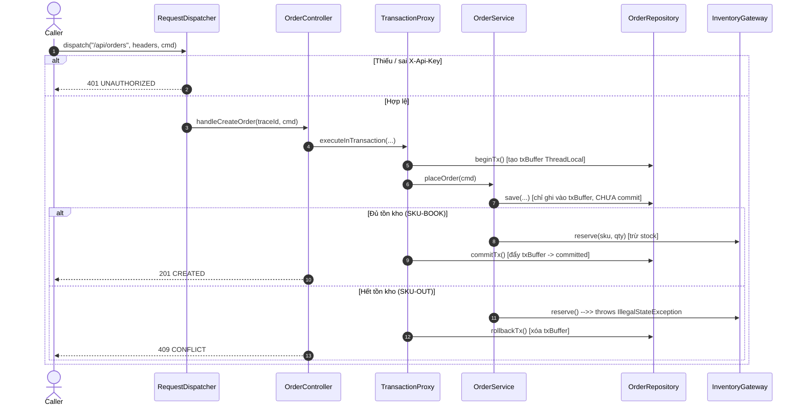

# READ-01 · Đáp án — Phương pháp đọc code lạ

> ⚠️ **Chỉ mở sau khi đã tự làm.** Đọc đáp án mà chưa tự làm = mất 80% giá trị bài tập.
> Mỗi đáp án được bọc trong `
` để tránh lộ khi lướt.

---

### E1

Xem đáp án

**Đáp án:**
1. Đọc thuần **Bottom-up** trong 3 giờ đầu khiến bạn ngộp trong hàng chục class tiện ích (`StringUtil`, `DateHelper`, DTO, Entity) mà **không biết bức tranh tổng thể**: hàm nào thật sự đang chạy ở production, hàm nào là code chết (dead code), và tại sao các rule đó tồn tại.
2. Nên kết hợp Bottom-up vào **Outside-In** ở hai thời điểm: (a) trong Pha 2 khi đọc **Database Schema / Core Entities** để hiểu cấu trúc dữ liệu gốc; và (b) khi từ Top-down đã xác định đúng class/bảng bị bug và cần tìm **tất cả các chỗ khác cũng ghi vào bảng đó** (dùng *Find Usages* lần ngược từ Repository lên Service/Controller).

**Giải thích:**
- **Đáp án sai phổ biến:** Cho rằng Bottom-up luôn tốt hơn vì "hiểu từ nền tảng lên" → Đúng khi học lý thuyết, nhưng **sai** khi đọc codebase lạ lớn vì bạn không phân biệt được code sống vs code chết.

---

### E2

Xem đáp án

**Đáp án:**
1. **Spring Boot 3:**
   - Class chứa `@SpringBootApplication` (`main()`).
   - Các class gắn `@RestController` / `@Controller` và `@RequestMapping` / `@GetMapping` / `@PostMapping` (hoặc RouterFunction).
   - Các listener/scheduler: `@KafkaListener`, `@RabbitListener`, `@Scheduled`, `CommandLineRunner` / `ApplicationRunner`.
2. **Legacy Java 7 / JBoss AS 7.1.1:**
   - `WEB-INF/web.xml` (`<servlet-mapping>`, `<filter-mapping>`, `<listener>`) và `jboss-web.xml`.
   - Annotation `@WebServlet`, `@Path` (JAX-RS), `@Stateless`/`@Singleton` (EJB), `@MessageDriven` (JMS), `@Schedule`.
   - Cấu hình framework cũ (`struts-config.xml`, `faces-config.xml`, `quartz-jobs.xml`) + `standalone.xml` (JNDI DataSource).

---

### E3

Xem đáp án

**Đáp án:**
1. **3 lợi ích đọc test trước:** (a) Thấy ngay **cách khởi tạo** object/dependency mà không phải tự đoán IoC wiring; (b) Nắm **hợp đồng input → output** và side-effect mong đợi; (c) Biết sẵn các **edge case / bug cũ** từng được fix.
2. **2 trường hợp test có thể đánh lừa:**
   - Test mock quá tay (Mockito stub trả về dữ liệu lý tưởng, che mất lỗi SQL/proxy/network thật ở production).
   - Test quá cũ không chạy trong CI (`@Ignore` / `@Disabled`) hoặc assert hành vi cũ đã lỗi thời, trong khi production chạy qua luồng config/profile khác.

---

### E4

Xem đáp án

**Đáp án:**
1. **Step Over (F8):** bỏ qua hàm chuẩn `UUID.randomUUID()` để giữ tầm nhìn ở luồng nghiệp vụ.
2. **Conditional Breakpoint:** đặt breakpoint trong vòng lặp với điều kiện `"SKU-OUT".equals(sku)`.
3. **Step Out (Shift+F8):** thoát ngay khỏi hàm `BigDecimal.multiply(...)` trở về frame cha.
4. **Call Stack (Frames panel):** dừng ở `OrderRepository.save()` và đọc danh sách frames từ dưới lên — thấy ngay toàn bộ chuỗi `RequestDispatcher` → `OrderController` → `TransactionProxy` → `OrderService`.

---

### E5

Xem đáp án

**Đáp án:**
Bạn đã vi phạm **2 Stop Criteria**:
1. **Lạc khỏi call-path hiện tại:** tính chữ ký HMAC-SHA256 không liên quan trực tiếp đến luồng giữ tồn kho khi lỗi thanh toán.
2. **Vượt quá timebox 20–25 phút** cho một hàm helper phụ.

**Cách xử lý đúng:** Dừng đọc `SignatureUtil.java` ngay lập tức, coi hàm đó là **black-box** (chỉ cần biết nó trả về chữ ký string), ghi một dòng vào *Open Questions Log* nếu vẫn nghi ngờ gì, và quay lại đúng call-path `OrderService` / `PaymentCallback` / `InventoryGateway`.

---

### E6

Xem đáp án

**Hướng giải:**

**Giải thích:**
- Transaction bắt đầu tại `Proxy -> Repo.beginTx()` và kết thúc tại `commitTx()` hoặc `rollbackTx()`.
- Khi `orderRepository.save()` chạy với `SKU-OUT`, bản ghi `ORD-102` chỉ được đưa vào `txBuffer` (`ThreadLocal`) chứ chưa vào `committed` map. Khi `inventoryGateway.reserve()` ném `IllegalStateException`, khối `catch (RuntimeException)` trong `TransactionProxy` gọi `repository.rollbackTx()` xóa sạch `txBuffer`, nên `findAllCommitted()` hoàn toàn không có `ORD-102`.

---

### E7

Xem đáp án

**Đáp án:**
1. Khi gọi thẳng `orderService.placeOrder(...)` bỏ qua `TransactionProxy` với `SKU-OUT`, `orderRepository.save(...)` thấy `txBuffer.get() == null` nên rơi vào chế độ auto-commit, ghi thẳng `ORD-101` vào `committed` **trước khi** `inventoryGateway.reserve(...)` ném `IllegalStateException`. Kết quả: request lỗi nhưng DB vẫn **dính 1 đơn hàng rác**!
2. Nếu chỉ đọc tĩnh file `OrderService.java`, hàm `placeOrder` trông y hệt nhau và không hề thấy dấu vết transaction ở đâu (vì ranh giới transaction nằm ở lớp bọc ngoài `TransactionProxy` — giống hệt `@Transactional` AOP proxy trong Spring). Đây là lý do **phải trace bằng Call Stack / Debugger** để xác nhận lời gọi có thật sự đi qua Proxy hay không.

**Code test tham khảo:** xem [lab/solutions/E7BypassedProxyCharacterizationTest.java](./lab/solutions/E7BypassedProxyCharacterizationTest.java).

---

### E8

Xem đáp án

**4 Open Questions mẫu đạt chuẩn:**

| Vị trí | Câu hỏi mở | Giả định tạm | Cách kiểm chứng |
| :--- | :--- | :--- | :--- |
| `InventoryGateway.java:18` | `available = stock.getOrDefault(...)` rồi `stock.put(sku, available - qty)` không atomic (check-then-act) — 2 thread đặt cùng lúc `SKU-LAPTOP` (tồn = 2) có thể bị oversell? | Code mẫu chạy đơn luồng nên chưa thấy lỗi; đa luồng sẽ race condition | Viết test 10 thread đặt song song `SKU-LAPTOP` dùng `CountDownLatch` |
| `OrderRepository.java:25` | Nếu caller gọi trực tiếp `OrderService` (hoặc self-invocation) ngoài `TransactionProxy`, `save()` tự rơi về auto-commit không rollback | Mọi caller đều phải đi qua `OrderController` → `TransactionProxy` | Xem bài E7 characterization test |
| `OrderRepository.java:19` | `beginTx()` ghi đè `txBuffer.set(new ArrayList<>())` không kiểm tra transaction đang mở sẵn — gọi lồng nhau sẽ làm mất staged writes trước đó? | Không có nested transaction | Kiểm tra mọi call site của `executeInTransaction` |
| `PricingPolicy.java:11` | `SAVE50` đang trừ sau VIP 10%; nghiệp vụ yêu cầu trừ coupon trước hay % tier trước? | Theo `OrderFlowTest`, trừ % VIP trước là đúng spec | Xác nhận với PO / spec tài chính |

---

### E9

Xem đáp án

Kế hoạch 6,5 giờ (390 phút) đọc codebase legacy 52k dòng

- **08:30 – 09:15 (45p) · Pha 1 — Recon & Hotspots:**
  - Đọc `pom.xml` (xác định Quartz version, JDBC driver DB gì, có JBoss EJB/JMS không).
  - Đọc `src/main/resources/` (`quartz.properties`, `standalone.xml` phần `<datasources>`).
  - Chạy `git log -n 20 --stat` và `git log --since="90 days ago" --name-only` để tìm file liên quan đến hóa đơn mới sửa gần đây.
- **09:15 – 10:15 (60p) · Pha 2 — Tìm đúng Entry Point của job 00:05 & Data Model:**
  - Không đọc `Servlet` trước! Grep từ khóa cron `"0 5 0"`, `implements Job`, `@Schedule`, `CronTrigger` để xác định class chạy lúc 00:05.
  - Đọc các bảng liên quan đến `INVOICE` trong `sql/` (tìm `UNIQUE` constraint, cột `status`, `created_at`, `batch_id`).
- **10:30 – 13:30 (180p) · Pha 3 — Trace Bottom-up từ bảng `INVOICE` + Top-down từ Job 00:05:**
  - Đọc ~15 unit test (kể cả các test `@Ignore`) chỉ để lấy cách dựng data/DTO mẫu.
  - Bật Remote Debug (`-agentlib:jdwp=...:8787`) hoặc đọc dọc từ `Job.execute()` xuống DAO: vẽ **1 Sequence Diagram** từ lúc job query danh sách cần lập hóa đơn → check trùng → `INSERT INTO INVOICE`.
  - Grep `INSERT INTO INVOICE` khắp repo (Bottom-up kiểm tra chéo): xem có luồng nào khác (ví dụ EJB hoặc Servlet) cùng ghi vào bảng này song song lúc 00:05 không, hoặc job chạy trên 2 node JBoss cluster mà không có lock!
- **14:30 – 16:00 (90p) · Pha 4 — Khoanh vùng giả thuyết & Open Questions Log:**
  - Chốt 3 giả thuyết thường gặp cho lỗi trùng hóa đơn lúc 00:05: (1) Job chạy trùng trên 2 node cluster không có Quartz JDBCJobStore / advisory lock; (2) Query lọc ngày bị lệch timezone UTC vs `+07:00` quanh 00:05; (3) Thiếu `UNIQUE` constraint / `INSERT` ngoài transaction hoặc retry không idempotent.
  - **Chủ động DỪNG KHÔNG ĐỌC** trong ngày 1: các Servlet UI báo cáo, helper xuất Excel/PDF, module quản lý user, và chi tiết bên trong JDBC/Quartz library.
  - Xuất báo cáo cuối ngày gồm: 1 Sequence Diagram + 3 giả thuyết (kèm cách kiểm chứng log/DB) + 5 Open Questions gửi Tech Lead.

---

## Self-check (từ README §9) — đáp án gợi ý

Xem

1. **Top-down vs Bottom-up vs Outside-In:** Top-down đi từ entry point xuống giúp hiểu nghiệp vụ nhưng dễ sa chi tiết; Bottom-up đi từ dữ liệu/hàm nhỏ lên giúp chắc nền nhưng dễ đọc nhầm dead code. Outside-In kết hợp xem Data model + Entry points/Tests rồi đi Top-down đúng luồng cần tìm, chỉ dùng Bottom-up khi cần truy ngược tất cả caller của một bảng/hàm lõi.
2. **Đọc codebase 50k dòng trong 1 ngày:** Chia 4 pha có timebox: Pha 1 Recon (45p: `pom.xml`, config, `git log`); Pha 2 Entry points & Core Data Model (60p); Pha 3 Đọc Test trước + Trace 1–2 luồng chính bằng Debugger & vẽ Sequence Diagram (2–3h); Pha 4 Rà điểm rủi ro + Open Questions Log (1h). Mục tiêu hiểu chắc ~10–15% đường xương sống.
3. **Đọc Test trước & khi thiếu test:** Test cho thấy cách khởi tạo object, input/output contract, và edge case nhanh gấp nhiều lần đọc code cài đặt. Nếu dự án legacy không có test, thay bằng chạy app với Remote Debugger (JPDA) đặt breakpoint tại Servlet/Entry point và gửi 1 request mẫu để đọc Call Stack thật.
4. **Thao tác Debugger:** *Step Over* bỏ qua chi tiết hàm con để giữ tầm nhìn ở tầng hiện tại; *Step Into* chui vào thân hàm nghi ngờ; *Conditional Breakpoint* dừng đúng phần tử cần xem trong vòng lặp lớn; *Call Stack Frames* cho thấy toàn bộ chuỗi gọi runtime xuyên qua Filter/Proxy/Interceptor mà đọc tĩnh dễ bỏ sót.
5. **4 tín hiệu dừng đọc sâu:** (1) Đã trả lời được câu hỏi mục tiêu; (2) Đã chạm ranh giới thư viện/framework chuẩn đáng tin cậy; (3) Vượt quá timebox ~20–25 phút cho 1 hàm; (4) Đang click sang module ngoài call-path. Khi dừng, ghi lại vào *Open Questions Log* (vị trí, câu hỏi, giả định tạm, cách kiểm chứng) và coi phần đó như black-box để tiếp tục.

