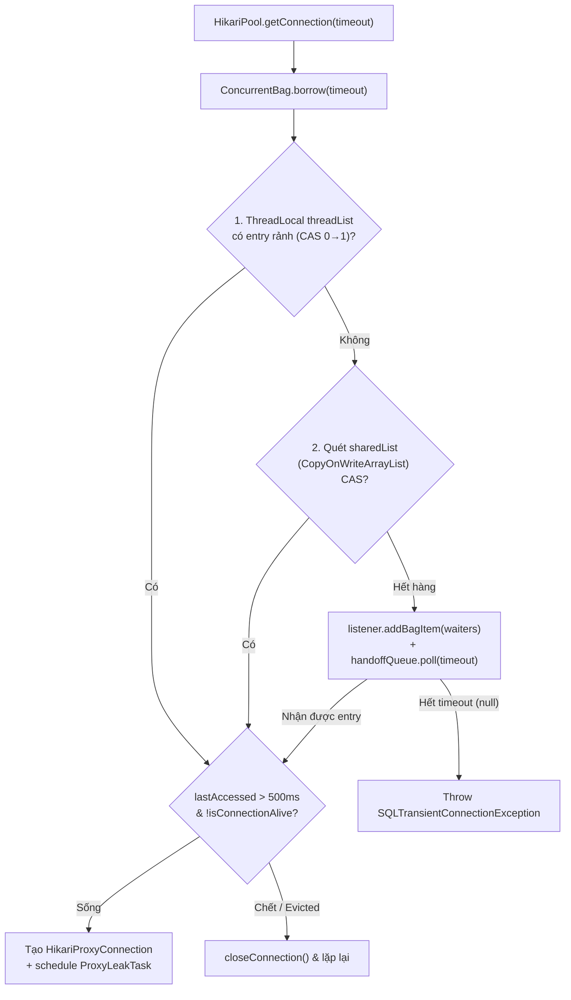

# READ-02 · Đọc source HikariCP

> **TL;DR** — HikariCP là mẫu mực để học đọc source Java thực chiến: toàn bộ cốt lõi chỉ xoay quanh 4 class chính (`HikariDataSource`, `HikariPool`, `ConcurrentBag`, `FastList`). Nó nhanh và ít tranh chấp không nhờ phép màu, mà nhờ `ConcurrentBag` dùng `ThreadLocal` fast-path + `CopyOnWriteArrayList` + `SynchronousQueue` để tránh khóa toàn pool, `FastList` quét ngược từ đuôi và bỏ range-check/modCount, cùng cơ chế `HouseKeeper` + `ProxyLeakTask` gọn nhẹ. Khi gặp `Connection is not available, request timed out` ở production, hiểu luồng `getConnection()` giúp bạn biết ngay đang nghẽn ở `borrow` hay kiểm tra `aliveBypassWindowMs`.

## 🧭 Brief

| | |
| :--- | :--- |
| **Loại** | Bài học |
| **Giai đoạn** | Quý 0 · Bridge |
| **Chủ đề** | Đọc code không cần AI |
| **Tiên quyết** | [READ-01](../01-code-reading-method/README.md) |

**Phạm vi bắt buộc**
- HikariPool, ConcurrentBag, getConnection flow
- housekeeper
- leak detection
- vì sao HikariCP nhanh (FastList, bytecode)

**Câu hỏi sâu — nội dung phải giúp trả lời được**
- getConnection() đi qua những bước nào khi pool hết connection?
- ConcurrentBag tránh lock contention bằng cách nào?

**Ý tưởng lab / demo**
- Debug step-through getConnection với pool size 2 và 5 thread đồng thời

**Tài liệu gốc gợi ý**
- A Philosophy of Software Design
- source HikariCP, Guava trên GitHub

**Gói đầu ra**
- [x] `README.md` — lý thuyết theo [lesson-template](../../../docs/templates/lesson-template.md)
- [x] `exercises.md` — bài tập L1/L2/L3 theo [exercises-template](../../../docs/templates/exercises-template.md)
- [x] `solutions.md` — đáp án theo [solutions-template](../../../docs/templates/solutions-template.md)
- [x] `lab/` — code demo chạy được + `lab/README.md` theo [lab-template](../../../docs/templates/lab-template.md)
- [ ] _(người học)_ `my-notes.md` — **agent không tạo**

---

<!-- Nội dung bắt đầu từ đây -->

## 1. Vấn đề: tại sao phải biết cái này?

Trong hệ thống backend chịu tải 1.500 req/s, một pool size `20` phải phục vụ hàng trăm worker thread HTTP cùng lúc. Với các connection pool đời cũ (như `Apache Commons DBCP 1` hoặc pool mặc định của JBoss AS 7 nếu cấu hình sai), mọi thao tác `borrow` và `return` cùng tranh chấp một global lock/deque, gây thread contention ngay ở tầng pool. Khi query chậm đột ngột, log ném:
`SQLTransientConnectionException: HikariPool-1 - Connection is not available, request timed out after 30001ms (total=20, active=20, idle=0, waiting=142)`

Nếu chỉ biết chỉnh thông số trong `application.yml` mà chưa từng đọc luồng chạy của `HikariPool` và `ConcurrentBag`, bạn dễ mắc 2 sai lầm:
1. Tăng `maximumPoolSize` từ 20 lên 200 (khiến DB sập vì context switch và lock contention — sẽ học sâu ở `DB-14` / `CD-02`), hoặc
2. Quên đóng `Connection` / `Statement` ở 1 nhánh `catch` làm rò rỉ connection mà không biết bật `leakDetectionThreshold` để chụp chính xác stack trace kẻ phạm tội.

---

## 2. Mô hình tư duy (mental model)

Áp dụng phương pháp từ [READ-01](../01-code-reading-method/README.md), hãy nhìn HikariCP như một **quầy mượn thẻ từ trong thư viện**:
- **`HikariDataSource`**: cổng lễ tân (implement `javax.sql.DataSource`).
- **`HikariPool`**: quản lý ca trực (kiểm tra thẻ còn dùng được không, gọi tạo thẻ mới khi thiếu, cấp thẻ proxy có gắn đồng hồ báo leak).
- **`ConcurrentBag`**: **giá để thẻ thông minh 3 tầng**:
  1. Trước hết, mỗi người đọc nhìn vào **túi áo của chính mình (`ThreadLocal`)** — vừa trả thẻ cách đây 1ms thì lấy lại đúng cái đó, không cần xếp hàng!
  2. Nếu túi áo trống (hoặc có người khác lấy mất rồi), nhìn lên **bảng chung (`sharedList`)** lấy đại 1 thẻ đang rảnh bằng phép gán nguyên tử CAS.
  3. Nếu bảng chung cũng hết sạch, đứng vào **điểm trao tay (`SynchronousQueue handoffQueue`)** chờ ai đó trả thẻ rồi chuyền thẳng tay.

**Chỗ ẩn dụ không còn đúng:**
Thẻ trong `ThreadLocal` không bị khóa độc quyền cho riêng thread đó! Nếu thread A bận việc khác, thread B khi quét `sharedList` vẫn có thể **cướp (steal)** thẻ nằm trong `ThreadLocal` của thread A bằng `compareAndSet(STATE_NOT_IN_USE, STATE_IN_USE)`. Điều này tránh tình trạng connection bị "ghim chết" ở một thread đang ngủ.



---

## 3. Cơ chế bên trong (trọng tâm của bài)

*(Mọi tên class, field và signature dưới đây đã đối chiếu trực tiếp qua `javap` từ `HikariCP-5.1.0.jar` trong `lab/`.)*

### 3.1 `HikariPool.getConnection(long)` — Trả lời câu hỏi sâu #1: "`getConnection()` đi qua những bước nào khi pool hết connection?"

Khi ứng dụng gọi `hikariDataSource.getConnection()`, nó ủy quyền vào `HikariPool.getConnection(hardTimeout)` (mặc định `connectionTimeout = 30.000 ms`):

1. **Qua cổng `suspendResumeLock.acquire()`:** Nếu không bật `allowPoolSuspension`, đây là `Faux` lock (no-op, 0 chi phí). Nếu pool đang `suspend`, thread bị chặn tại đây.
2. **Vào vòng lặp `do ... while (elapsed < hardTimeout)`:**
   - Gọi `PoolEntry poolEntry = connectionBag.borrow(timeout, MILLISECONDS)`.
   - **Khi pool hết connection (toàn bộ `maximumPoolSize` đều ở `STATE_IN_USE`):**
     1. Thread tìm trong `threadList` (`ThreadLocal`) thất bại (hoặc entry cũ đã bị thread khác steal sang `STATE_IN_USE`).
     2. Tăng bộ đếm `waiters` (`AtomicInteger`).
     3. Quét `sharedList` (`CopyOnWriteArrayList<PoolEntry>`): không thấy entry nào ở `STATE_NOT_IN_USE`.
     4. Gọi `listener.addBagItem(waiting)` → `HikariPool.addBagItem(int waiting)` kiểm tra nếu còn slot dưới `maximumPoolSize` thì đẩy `PoolEntryCreator` vào `addConnectionExecutor` để mở connection mới bất đồng bộ. Nếu pool đã chạm trần `maximumPoolSize`, không tạo thêm.
     5. Đứng chờ tại `handoffQueue.poll(remainingNanos, NANOSECONDS)` (`new SynchronousQueue<>(true)` — chế độ fair FIFO).
     6. Nếu trong lúc chờ có thread khác gọi `connection.close()` → `HikariPool.recycle(poolEntry)` → `connectionBag.requite(poolEntry)`: `requite` thấy `waiters.get() > 0` nên thử đẩy thẳng `poolEntry` vào `handoffQueue.offer(poolEntry)` (trao tay trực tiếp cho thread đang chờ đầu hàng, không tốn vòng quét!).
     7. Nếu hết `hardTimeout` mà `handoffQueue.poll` trả `null`: `borrow()` trả `null`, `HikariPool` thoát vòng lặp và ném `createTimeoutException(startTime)` (`SQLTransientConnectionException`) kèm số liệu `total, active, idle, waiting`.
3. **Kiểm tra hậu kiểm trước khi giao `PoolEntry`:**
   - Nếu `poolEntry.isMarkedEvicted()`: gọi `closeConnection(poolEntry, EVICTED_CONNECTION_MESSAGE)` rồi quay lại đầu vòng `do/while` mượn cái khác (với phần `timeout` còn lại).
   - Nếu `elapsedMillis(poolEntry.lastAccessed) > aliveBypassWindowMs` (mặc định **500 ms**): gọi `isConnectionAlive(poolEntry.connection)` (chạy `Connection.isValid` hoặc `connectionTestQuery`). Nếu mới dùng cách đây `< 500 ms` thì **bỏ qua ping DB**, tiết kiệm 1 round-trip mạng! Nếu ping thất bại → đóng connection chết và mượn lại.
4. **Bọc Proxy & Lên lịch Leak Detection:** Trả về `poolEntry.createProxyConnection(leakTaskFactory.schedule(poolEntry), now)` (chính là `HikariProxyConnection`).

### 3.2 `ConcurrentBag` — Trả lời câu hỏi sâu #2: "`ConcurrentBag` tránh lock contention bằng cách nào?"

Thay vì dùng `synchronized` hoặc `BlockingQueue` duy nhất như các pool cũ, `ConcurrentBag<T>` kết hợp 4 kỹ thuật lock-free / giảm tranh chấp:
1. **`ThreadLocal<List<Object>> threadList`:** Khi thread trả connection qua `requite(entry)`, ngoài việc đưa `entry` về `STATE_NOT_IN_USE`, `ConcurrentBag` lưu reference vào `threadList` (mặc định dùng `WeakReference` nếu chạy trên thread pool tùy biến để tránh leak, hoặc direct reference). Lần `borrow()` tiếp theo trên cùng thread đó quét ngược `threadList` từ cuối (`size - 1`) — gần như không có cache miss hay contention.
2. **CAS trên từng `PoolEntry` (`AtomicInteger state`):** Trạng thái của mỗi connection (`STATE_NOT_IN_USE = 0`, `STATE_IN_USE = 1`, `STATE_REMOVED = -1`, `STATE_RESERVED = -2`) được chuyển bằng `compareAndSet(0, 1)` ở cấp từng phần tử, **không khóa toàn bộ danh sách**.
3. **`CopyOnWriteArrayList<T> sharedList`:** Tập `PoolEntry` rất ít thay đổi (chỉ thêm/xóa khi pool mở rộng hoặc evict connection hết `maxLifetime`), còn thao tác đọc/duyệt xảy ra hàng chục nghìn lần/giây → `CopyOnWriteArrayList` cho phép duyệt hoàn toàn **lock-free** không lo `ConcurrentModificationException`.
4. **`SynchronousQueue<T> handoffQueue` + `AtomicInteger waiters`:** Khi `requite()` trả connection về mà `waiters.get() == 0`, thread trả về **không chạm vào `handoffQueue`**, kết thúc trong vài nanosecond. Chỉ khi có thread đang đợi (`waiters > 0`), `requite` mới `handoffQueue.offer(...)` để đánh thức trực tiếp 1 waiter.

### 3.3 `HouseKeeper` và `ProxyLeakTask` (Leak Detection)

- **`HikariPool$HouseKeeper`:** Chạy nền định kỳ (mặc định `housekeepingPeriodMs = 30.000 ms`) trên `houseKeepingExecutorService` (1 daemon thread):
  - **Phát hiện lệch đồng hồ (Clock Leap):** giữ biến `private volatile long previous`. Nếu phát hiện `now < previous` (đồng hồ bị chỉnh lùi) hoặc `now - previous > housekeepingPeriodMs + 10_000` (VM/GC/laptop bị treo dài hơn bình thường), gọi `softEvictConnections()` để dọn các connection có nguy cơ timeout phía DB.
  - **Dọn connection nhàn rỗi & bù `minimumIdle`:** Quét các `PoolEntry` đang `STATE_NOT_IN_USE`; nếu vượt `idleTimeout` (khi `minimumIdle < maximumPoolSize`), đóng bớt rồi gọi `fillPool(false)` để bù lại đúng `minimumIdle`.
- **`ProxyLeakTask` (Leak Detection):**
  - Nếu `leakDetectionThreshold == 0` (mặc định): dùng singleton `ProxyLeakTask.NO_LEAK` (zero allocation, zero scheduling).
  - Nếu `leakDetectionThreshold > 0` (ví dụ `2000 ms`): ngay lúc `borrow` thành công, `ProxyLeakTask` tạo `new Exception("Apparent connection leak detected")` để **chụp lại stack trace của thread đang gọi `getConnection()`**, rồi đặt hẹn giờ chạy sau `leakDetectionThreshold` ms.
  - Nếu caller gọi `conn.close()` đúng hạn → `ProxyConnection.close()` gọi `leakTask.cancel()` hủy timer. Nếu quá hạn mà chưa `close()` → `HouseKeeper` executor in log `WARN` kèm stack trace thủ phạm!

### 3.4 Vì sao HikariCP nhanh: `FastList` & Bytecode micro-optimizations

Trong JDBC thật, mỗi `Connection` mở rồi đóng nhiều `Statement` / `PreparedStatement` / `ResultSet`. HikariCP dùng `FastList<Statement>` bên trong `ProxyConnection` thay cho `java.util.ArrayList` vì 4 lý do:
1. **Không check `rangeCheck` khi `get(int)`** và **không giữ `modCount`** (bỏ chi phí tăng/kiểm tra `ConcurrentModificationException`).
2. **`remove(Object)` quét ngược từ đuôi (`size - 1` về `0`)** thay vì từ đầu (`0` lên `size - 1`) như `ArrayList`: phần lớn code JDBC đóng `Statement` theo thứ tự LIFO (cái mở sau đóng trước), nên quét từ đuôi tìm thấy ngay ở bước đầu tiên và không cần `System.arraycopy` dịch mảng!
3. **`removeLast()`** lấy và xóa phần tử cuối trong $O(1)$.
4. **Bytecode & Proxy gọn nhẹ:** thay vì dùng `java.lang.reflect.Proxy` (tốn boxing tham số thành `Object[]` mỗi lần gọi JDBC method), HikariCP sinh sẵn các lớp proxy bytecode bằng Javassist (`HikariProxyConnection`, `HikariProxyPreparedStatement`, ...) với phương thức ngắn để JIT C2 inline tối đa và giữ kích thước bytecode cực nhỏ (dưới ngưỡng `FreqInlineSize` / `MaxInlineSize` của HotSpot).

---

## 4. Code minh họa

### 4.1 Sai vs Đúng khi dùng HikariCP & Leak Detection

```java
// ❌ SAI: Không đóng Connection khi query ném exception hoặc leak ở nhánh sớm -> cạn pool!
Connection conn = dataSource.getConnection();
PreparedStatement ps = conn.prepareStatement("SELECT ..."); // nếu dòng này throw -> conn không bao giờ close()!
ps.close();
conn.close();

// ✅ ĐÚNG: try-with-resources (Java 7+) + bật leakDetectionThreshold ở staging/dev để bắt sớm
// HikariConfig: config.setLeakDetectionThreshold(2000);
try (Connection conn = dataSource.getConnection();
     PreparedStatement ps = conn.prepareStatement("SELECT 1");
     ResultSet rs = ps.executeQuery()) {
    rs.next();
}
```

### 4.2 Legacy corner (Java 7 / JBoss AS 7.1.1)

Trên **JBoss AS 7.1.1 + Java 7**, app server dùng **IronJacamar (JCA Connection Manager)** chứ không phải HikariCP, nhưng cơ chế đối chiếu giúp bạn debug production ngay lập tức:
1. Tương đương `leakDetectionThreshold` của HikariCP, JBoss AS 7 có `<cached-connection-manager debug="true" error="true"/>` trong `standalone.xml` (dùng trên môi trường dev/staging để báo log vị trí quên `conn.close()`).
2. Tương đương `aliveBypassWindowMs` của HikariCP, JBoss AS 7 có `<validation><background-validation>true</background-validation>` hoặc `<validate-on-match>` — nếu bật `<check-valid-connection-sql>` cho **mỗi lần mượn** mà không dùng background validation, mỗi request đều tốn thêm 1 round-trip `SELECT 1 FROM DUAL` sang Oracle/DB2!
3. Dù dùng JBoss datasource JNDI hay HikariCP, quy tắc vàng vẫn y hệt: **không bao giờ giữ `Connection` qua lời gọi HTTP/sleep dài** (trong lab: `pool size = 2`, giữ `150ms` với `connectionTimeout = 350ms` khiến thread thứ 5 nổ timeout ngay).

---

## 5. Quan sát & đo đạc

Chạy lab với HikariCP `5.1.0` + H2 thật:
```powershell
mvn -q verify
mvn -q compile exec:java
```

**Output thật khi chạy `HikariWalkthroughRunner` (JDK 26.0.1 `--release 21`, HikariCP 5.1.0):**
- **[1] Pool size = 2, 5 threads (hold 150ms, timeout 350ms):**
  - 4 thread hoàn thành (`~176–361ms`), thread thứ 5 hết `connectionTimeout = 350ms` và ném `SQLTransientConnectionException` (`timed out after 361ms (total=2, active=2, idle=0, waiting=0)`).
- **[3] `FastList` vs `ArrayList` (100k lần đóng 32 statement theo thứ tự LIFO):** `ArrayList: 251 ms` vs `FastList: 34 ms` (**~7,4× nhanh hơn** do quét ngược từ đuôi và so sánh tham chiếu `==`). *(Chi tiết ở [lab/README.md](./lab/README.md).)*
- **[2] Leak Detection (`leakDetectionThreshold = 2000ms`, giữ connection 2200ms):**
  ```text
  [leak-pool housekeeper] WARN com.zaxxer.hikari.pool.ProxyLeakTask - Connection leak detection triggered for conn2: url=jdbc:h2:mem:walkthrough2 user= on thread lab.codereading.hikari.HikariWalkthroughRunner.main(), stack trace follows
  java.lang.Exception: Apparent connection leak detected
      at com.zaxxer.hikari.HikariDataSource.getConnection(HikariDataSource.java:99)
      at lab.codereading.hikari.HikariWalkthroughRunner.runLeakDetectionDemo(HikariWalkthroughRunner.java:94)
  ```
  Và ngay khi `leaked.close()` chạy ở giây thứ 2.2, HikariCP ghi tiếp:
  `INFO com.zaxxer.hikari.pool.ProxyLeakTask - Previously reported leaked connection conn2 ... was returned to the pool (unleaked)`

---

## 6. Trade-offs & khi nào KHÔNG dùng

| Cơ chế / Cấu hình | Được gì | Mất gì | Dùng khi |
| :--- | :--- | :--- | :--- |
| **`ConcurrentBag` `ThreadLocal` + Stealing** | Giảm mạnh lock contention ở concurrency cao | Code phức tạp hơn `BlockingQueue` đơn giản; thread ít chạy có thể bị steal entry | Connection pool tốc độ cao như HikariCP |
| **`leakDetectionThreshold` (> 0)** | Bắt chính xác stack trace code quên đóng connection | Mỗi lần `getConnection()` tạo 1 `new Exception()` (chụp stack trace) + schedule task | Dev, Staging, hoặc Prod khi nghi ngờ leak (đặt lớn hơn query chậm nhất, vd `10_000–30_000 ms`) |
| **`aliveBypassWindowMs` (500ms mặc định)** | Tránh ping `SELECT 1` trên mọi lần mượn liên tiếp | Nếu DB vừa restart trong < 500ms, query đầu tiên có thể gặp socket lỗi rồi pool mới đóng | Mặc định hầu hết hệ thống; chỉ giảm/bật validation kỹ khi mạng chập chờn |

---

## 7. Cạm bẫy production (ít nhất 3)

1. **Đặt `leakDetectionThreshold` nhỏ hơn thời gian chạy query/batch hợp lệ** — *Triệu chứng:* log `WARN Apparent connection leak detected` ngập đĩa dù code vẫn có `try-with-resources` và ngay sau đó lại in `was returned to the pool (unleaked)`. *Nguyên nhân:* threshold (ví dụ `2000ms`) nhỏ hơn 1 báo cáo chạy `3500ms` (hoặc 1 batch giữ connection qua HTTP call). *Cách tránh:* đặt `leakDetectionThreshold` lớn hơn `statement_timeout` / query hợp lệ dài nhất, và không bao giờ gọi HTTP bên trong khối đang mượn DB connection.
2. **Tăng `maximumPoolSize` quá lớn để "hết lỗi timeout"** — *Triệu chứng:* lỗi `Connection is not available` tạm giảm nhưng CPU DB tăng vọt lên 100%, p99 latency cả app tăng gấp nhiều lần. *Nguyên nhân:* `ConcurrentBag` không giới hạn được contention ở tầng CPU/lock của Database; quá nhiều active connection gây thrashing trên DB. *Cách tránh:* giữ pool nhỏ hợp lý (chi tiết ở `DB-14` / `CD-02`) và rút ngắn thời gian giữ connection.
3. **Đóng `HikariProxyConnection` nhiều lần hoặc giữ reference `Statement` thô sau khi đóng connection** — *Triệu chứng:* ném `SQLException: Connection is closed` hoặc hành vi bất thường khi connection đã bị recycle sang thread khác. *Nguyên nhân:* `ProxyConnection` quản lý vòng đời `FastList<Statement>` và đặt trạng thái closed trên proxy wrapper, trong khi `PoolEntry` thật đã được `requite()` trả lại pool. *Cách tránh:* luôn gói cả `Connection`, `PreparedStatement`, `ResultSet` trong `try-with-resources`, không cache `Statement` ra ngoài scope hàm.

---

## 8. Liên hệ thực tế công việc

Trên hệ thống **Java 7 / JBoss AS 7.1.1 / JDBC thuần** ở công ty:
1. Kiểm tra `standalone.xml` phần `<datasources>`: xem `max-pool-size`, `blocking-timeout-millis` (tương đương `connectionTimeout`), và cài đặt validation (`background-validation` vs `validate-on-match`).
2. Rà lại một DAO/Service cũ hay bị nghi leak connection khi ném `SQLException`: chuyển khối `Connection / PreparedStatement / ResultSet` từ `finally` dài dòng sang **`try-with-resources` (có sẵn trên Java 7)**.

---

## 9. Self-check — Explain-back

> Trả lời **không nhìn tài liệu**, nói to trong 5 phút. Không trả lời được = chưa xong. (Đáp án nằm trong [solutions.md](./solutions.md).)

1. Mô tả từng bước `HikariPool.getConnection(timeout)` thực hiện từ lúc gọi đến khi trả về `HikariProxyConnection` (hoặc ném timeout exception khi pool hết connection).
2. `ConcurrentBag` dùng 3 cấu trúc dữ liệu nào để tránh global lock contention? Vì sao `ThreadLocal` trong HikariCP không làm connection bị "chết cứng" ở một thread?
3. `aliveBypassWindowMs` (500ms) có tác dụng gì trong `HikariPool`?
4. `ProxyLeakTask` hoạt động thế nào khi `leakDetectionThreshold > 0` vs `= 0`, và làm sao nó biết chính xác dòng code nào đã làm rò rỉ connection?
5. Kể 3 lý do khiến `FastList` của HikariCP nhanh hơn `ArrayList` trong ngữ cảnh quản lý `Statement`.

---

## 10. Cheatsheet 1 trang

| Thành phần HikariCP | Vai trò cốt lõi | Cơ chế nội tại cần nhớ |
| :--- | :--- | :--- |
| **`HikariPool`** | Điều phối mượn/trả, validate, timeout | Vòng lặp `borrow` → check `isMarkedEvicted` & `aliveBypassWindowMs` (500ms) → bọc `HikariProxyConnection` |
| **`ConcurrentBag`** | Lưu & phân phối `PoolEntry` không lock toàn cục | `ThreadLocal threadList` → CAS trên `CopyOnWriteArrayList sharedList` → `SynchronousQueue(fair=true) handoffQueue` |
| **`HouseKeeper`** | Bảo trì nền mỗi 30s | Check clock leap (`previous`), evict `idleTimeout`, bù `minimumIdle` |
| **`ProxyLeakTask`** | Phát hiện quên `close()` | Chụp `new Exception` lúc `borrow`, schedule `ScheduledFuture`, hủy khi `recycle()` |
| **`FastList`** | Lưu các `Statement` đang mở trên connection | Bỏ `rangeCheck` & `modCount`, `remove(Object)` quét ngược từ đuôi (tối ưu LIFO) |

---

## 11. Tài liệu tham khảo

- [HikariCP GitHub Repository (`brettwooldridge/HikariCP`)](https://github.com/brettwooldridge/HikariCP) — source gốc của `HikariPool.java`, `ConcurrentBag.java`, `FastList.java`, `ProxyLeakTask.java`.
- [HikariCP Wiki — Down the Rabbit Hole](https://github.com/brettwooldridge/HikariCP/wiki/Down-the-Rabbit-Hole) — giải thích thiết kế `FastList`, proxy bytecode và `ConcurrentBag`.
- [HikariCP Wiki — About Pool Sizing](https://github.com/brettwooldridge/HikariCP/wiki/About-Pool-Sizing) — lý do pool nhỏ hiệu quả hơn pool quá lớn.

---
➡️ Tiếp theo: [exercises.md](./exercises.md) · [lab/](./lab/README.md) · Bài kế: [READ-03 · Đọc source Guava Cache / Caffeine](../03-guava-cache-walkthrough/README.md)
