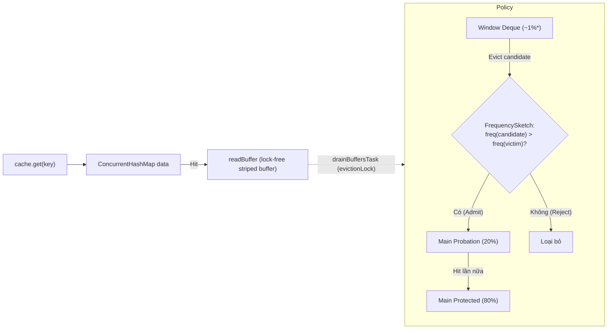

# READ-03 · Đọc source Guava Cache / Caffeine

> **TL;DR** — Guava Cache thiết kế theo kiểu Java 6 (`LocalCache$Segment extends ReentrantLock`, LRU thuần trong mỗi segment), còn Caffeine kế thừa trực tiếp từ tác giả Guava Cache (Ben Manes) để giải quyết 3 nút thắt: dùng `ConcurrentHashMap` + `readBuffer`/`writeBuffer` bất đồng bộ thay cho segment lock, dùng **W-TinyLFU** (`Window` + `FrequencySketch` + `Probation/Protected`) thay cho LRU thuần để chống rớt hit-rate khi bị scan dữ liệu lạnh, và thực thi `refreshAfterWrite` bất đồng bộ mặc định giúp trả giá trị cũ trong `0–4 ms` thay vì chặn mọi thread như `expireAfterWrite`. Trong lab Zipf + cold scan của bài này, hit-rate của Caffeine đạt **96,24%** so với **49,18%** của Guava Cache.

## 🧭 Brief

| | |
| :--- | :--- |
| **Loại** | Bài học |
| **Giai đoạn** | Quý 0 · Bridge |
| **Chủ đề** | Đọc code không cần AI |
| **Tiên quyết** | [READ-02](../02-hikaricp-walkthrough/README.md) |

**Phạm vi bắt buộc**
- cấu trúc segment
- eviction LRU/W-TinyLFU
- expireAfterWrite vs refreshAfterWrite
- loading và chống stampede trong cache cục bộ

**Câu hỏi sâu — nội dung phải giúp trả lời được**
- Vì sao Caffeine thay thế Guava Cache?
- refreshAfterWrite khác expireAfterWrite ra sao dưới tải?

**Ý tưởng lab / demo**
- Benchmark hit-rate LRU vs W-TinyLFU trên trace truy cập dạng Zipf

**Tài liệu gốc gợi ý**
- A Philosophy of Software Design
- source HikariCP, Guava trên GitHub

**Gói đầu ra**
- [x] `README.md` — lý thuyết theo [lesson-template](../../../docs/templates/lesson-template.md)
- [x] `exercises.md` — bài tập L1/L2/L3 theo [exercises-template](../../../docs/templates/exercises-template.md)
- [x] `solutions.md` — đáp án theo [solutions-template](../../../docs/templates/solutions-template.md)
- [x] `lab/` — code demo chạy được + `lab/README.md` theo [lab-template](../../../docs/templates/lab-template.md)
- [ ] _(người học)_ `my-notes.md` — **agent không tạo**

---

<!-- Nội dung bắt đầu từ đây -->

## 1. Vấn đề: tại sao phải biết cái này?

Một service đọc cấu hình/tỷ giá hoặc danh mục sản phẩm có `10.000 req/s` dùng cache in-memory `maximumSize = 1.000`, nhưng vẫn xảy ra 2 sự cố production kinh điển:
1. **Sụp hit-rate lúc nửa đêm:** Mỗi lần có batch job quét qua 5.000 mã sản phẩm ít dùng, cache dùng **LRU thuần** bị quét sạch các key hot đang phục vụ API → hit-rate rớt từ ~95% xuống dưới 50%, kéo tải DB tăng gấp 10 lần.
2. **Latency spike định kỳ đúng chu kỳ TTL:** Đặt `expireAfterWrite(5 phút)` cho 1 key cực hot mà query DB mất `120 ms`. Cứ đúng phút thứ 5, hàng trăm request cùng tới ngay khoảnh khắc key hết hạn đều bị kẹt chờ `120 ms`, làm p99 latency giật cục định kỳ.

Hiểu cấu trúc bên trong của Guava `LocalCache` và Caffeine `BoundedLocalCache` giúp bạn chọn đúng thư viện, hiểu cách chống stampede và chọn đúng giữa `expireAfterWrite` vs `refreshAfterWrite`.

---

## 2. Mô hình tư duy (mental model)

Hãy hình dung 2 nhà kho giữ hàng mẫu (dung lượng giới hạn 200 ô):
- **Guava Cache (Segmented LRU)** giống **4 phòng kho nhỏ độc lập** (`Segment`), mỗi phòng có 1 ổ khóa cửa riêng (`ReentrantLock`) và 1 kệ xếp theo thứ tự "vừa lấy gần nhất" (LRU). Ai vào lấy đồ phải ghi sổ, thỉnh thoảng người ghi sổ phải khóa cửa phòng để sắp xếp lại kệ. Nếu có một đoàn khách lạ đi ngang qua sờ thử 500 món đồ 1 lần duy nhất (cold scan), món mới sờ đó sẽ đẩy hết đồ quen của khách VIP ra khỏi kệ!
- **Caffeine (W-TinyLFU + Buffers)** giống **1 sảnh trưng bày mở (`ConcurrentHashMap`)** có nhân viên nhận phiếu ghi chú bỏ vào hòm thư riêng (`readBuffer` / `writeBuffer` không khóa). Trước khi một món đồ mới được lên kệ chính (**Main: Probation + Protected**), nó phải qua cửa thử việc (**Window**) và vượt qua **"sổ đếm tần suất" (`FrequencySketch`)**: nếu tần suất của món mới thua món sắp bị đẩy ra, món mới bị từ chối ngay — nhờ vậy đồ VIP không bao giờ bị "một lần lướt qua" đuổi mất!

**Chỗ ẩn dụ không còn đúng:**
"Hòm thư" `readBuffer` của Caffeine có dung lượng hữu hạn: nếu buffer đầy trong lúc tải ghi/đọc quá gắt và thread dọn dẹp (`evictionLock`) đang bận, các sự kiện đọc mới trong `readBuffer` có thể được bỏ qua có chủ đích (lossy ring buffer) — ưu tiên không làm chậm thread đọc thay vì chính xác tuyệt đối 100% thứ tự truy cập.



---

## 3. Cơ chế bên trong (trọng tâm của bài)

*(Mọi tên class, field và method dưới đây đã đối chiếu trực tiếp qua `javap` trên `guava-33.3.1-jre.jar` và `caffeine-3.1.8.jar` trong `lab/`.)*

### 3.1 Cấu trúc Segment của Guava vs kiến trúc Buffer của Caffeine

- **Guava Cache (`com.google.common.cache.LocalCache`):**
  - Chia bảng hash thành `Segment<K, V>[]` (số segment dựa trên `concurrencyLevel`, mặc định `4`).
  - Mỗi `LocalCache$Segment<K, V>` **kế thừa trực tiếp `java.util.concurrent.locks.ReentrantLock`**, giữ `AtomicReferenceArray<ReferenceEntry<K, V>> table`, cùng `recencyQueue`, `writeQueue`, `accessQueue`.
  - Dù thao tác đọc `get()` tránh lock ở bước tra `table`, nó ghi nhận vào `recencyQueue` và đếm `readCount`. Khi `readCount` đạt ngưỡng (hoặc ghi/miss/hết hạn), thread phải **giành `Segment` lock** để chạy `drainRecencyQueue()` + cập nhật `accessQueue` + evict ngay trên luồng của request!
- **Caffeine (`com.github.benmanes.caffeine.cache.BoundedLocalCache`):**
  - Dùng `ConcurrentHashMap<Object, Node<K, V>> data` của JDK làm kho lưu trữ chính (lock-free read, per-bin CAS/lock khi ghi).
  - Bổ sung `Buffer<Node<K, V>> readBuffer` (striped ring buffer theo thread để tránh false sharing & contention) và `MpscGrowableArrayQueue<Runnable> writeBuffer`.
  - Việc bảo trì eviction (`PerformCleanupTask` / `drainBuffersTask`) dùng `evictionLock.tryLock()` — chỉ **1 thread** thực hiện bảo trì lô (batch) thay vì mọi thread xếp hàng trên `Segment` lock; các tác vụ bảo trì có thể đẩy qua `executor` bất đồng bộ.

### 3.2 Eviction: LRU (Guava) vs W-TinyLFU (Caffeine) — Trả lời câu hỏi sâu #1: "Vì sao Caffeine thay thế Guava Cache?"

Ngoài hiệu năng concurrency tốt hơn nhờ bỏ `Segment` lock và thay bằng `ConcurrentHashMap` + striped buffers, lý do mang tính kiến trúc khiến Caffeine thay thế Guava Cache nằm ở **thuật toán eviction W-TinyLFU (Window TinyLFU)**:

1. **Nhược điểm của LRU thuần (Guava):** Mọi key mới nạp vào được đặt thẳng lên đầu danh sách LRU. Khi có một đợt quét tuần tự các key chỉ dùng 1 lần (*one-hit wonders* — như crawler, batch export), chúng chiếm đầy bộ nhớ và đuổi toàn bộ key truy cập thường xuyên.
2. **Cách W-TinyLFU khắc phục (trong `BoundedLocalCache` + `FrequencySketch`):**
   - **Window Cache (`accessOrderWindowDeque`, khởi đầu ~1% dung lượng, tự tinh chỉnh động bằng Hill Climber):** Nơi đón tất cả entry mới vào theo LRU, giúp bắt giữ các key có tính cục bộ thời gian (*temporal locality* — vừa xuất hiện sẽ được gọi lại liên tiếp ngay).
   - **Main Cache chia 2 phân khu SLRU:** `accessOrderProbationDeque` (20% Main) và `accessOrderProtectedDeque` (80% Main). Entry ở Probation được hit lại sẽ thăng hạng lên Protected; entry bị đẩy khỏi Protected rơi xuống lại Probation.
   - **Admission Filter bằng `FrequencySketch` (Count-Min Sketch 4-bit):** Khi một entry bị đẩy từ Window sang đối đầu với một nạn nhân (victim) ở Probation, Caffeine so sánh tần suất ước lượng trong `FrequencySketch` (`[0..15]`, tự động chia đôi mọi counter khi đạt `sampleSize` để giữ tính thời sự). **Chỉ khi `freq(candidate) > freq(victim)` thì entry mới mới được vào Main**, ngược lại entry mới bị loại ngay!

**Kết quả đo thực tế trong `lab/` (`maximumSize = 200`, 60.000 lượt truy cập Zipf + cold scan):**
- Guava Cache (Segmented LRU): **49,18% hit-rate** (`29.509` hits / `30.491` misses, `331 ms`).
- Caffeine (W-TinyLFU): **96,24% hit-rate** (`57.745` hits / `2.255` misses, `220 ms`).

Ngoài ra, Guava `Cache` dùng API Java 6 (`ListenableFuture`, `com.google.common.base.Function`), còn Caffeine thiết kế sẵn cho Java 8+ (`CompletableFuture`, `AsyncCache`, `Expiry` linh hoạt theo từng entry, và không kéo theo toàn bộ thư viện `guava.jar` nặng hàng MB).

### 3.3 `expireAfterWrite` vs `refreshAfterWrite` — Trả lời câu hỏi sâu #2: "Khác nhau ra sao dưới tải?"

| Tiêu chí | `expireAfterWrite(T)` | `refreshAfterWrite(T)` |
| :--- | :--- | :--- |
| **Khi quá hạn `T` có request tới** | Entry bị coi là đã chết (expired). **Caller phải chặn (block)** chờ loader tải lại xong mới có giá trị trả về. | Entry **vẫn còn hiệu lực để đọc**. Caller nhận **ngay lập tức giá trị cũ (stale)**, đồng thời chỉ **1** lần reload chạy cho key đó. |
| **Hành vi mặc định trong Caffeine** | `load` đồng bộ trên thread gọi (các thread cùng key chờ chung 1 kết quả). | Caffeine tự kích hoạt reload **bất đồng bộ** qua `executor` (mặc định `ForkJoinPool.commonPool()`), trả stale trong **0–4 ms**! |
| **Điểm khác biệt ẩn ở Guava Cache** | Gọi `load()` đồng bộ. | **Cảnh báo:** Guava mặc định `CacheLoader.reload(K, V)` gọi lại `load(K)` **ĐỒNG BỘ** trên thread đầu tiên tới sau `T` — muốn chạy ngầm phải tự override `reload()` trả về `ListenableFuture`! |
| **Khi nào dùng** | Dữ liệu nhạy cảm tính đúng thời điểm (token hết hạn, quyền truy cập, không được dùng giá trị cũ). | Dữ liệu cấu hình/danh mục/tỷ giá chấp nhận trễ nhẹ (eventual freshness), cần bảo vệ p99 latency phẳng lì. |

*(Lưu ý: nếu key không có ai truy cập trong thời gian dài sau `refreshAfterWrite`, nó sẽ giữ giá trị cũ mãi cho tới lần gọi tiếp theo — vì vậy trong production người ta thường **kết hợp cả hai**: `refreshAfterWrite(5m)` + `expireAfterWrite(30m)` để vừa phục vụ stale mượt lúc cao điểm vừa tự hết hạn hẳn nếu nguồn lâu ngày không dùng.)*

### 3.4 Loading & chống Cache Stampede cục bộ

Khi 16 thread cùng gọi `cache.get("cold-1")` tại thời điểm miss:
- **Anti-pattern (`getIfPresent` + `put`):** Tất cả 16 thread cùng thấy `null` và **cùng bắn 16 query xuống DB** (trong lab: `loader invoked 16 time(s)`).
- **Cách chuẩn (`LoadingCache.get(K)` hoặc `Cache.get(K, mappingFunction)`):**
  - Trong **Guava `LocalCache$Segment.lockedGetOrLoad`**: thread đầu tiên chèn một `LoadingValueReference` vào bảng hash (nhả lock `Segment` rồi mới chạy `loadSync`), các thread sau thấy `LoadingValueReference` đang chạy sẽ gọi `waitForLoadingValue(...)` đứng chờ chung một kết quả.
  - Trong **Caffeine `BoundedLocalCache`**: dùng `ConcurrentHashMap.computeIfAbsent` (hoặc `compute` cho `AsyncCache` với `CompletableFuture`), khóa đúng trên bucket/key đó để đảm bảo loader chạy **đúng 1 lần** (`loader invoked 1 time(s)` cho 16 threads trong lab).

---

## 4. Code minh họa

### 4.1 Chống Stampede & Cấu hình `refreshAfterWrite` đúng chuẩn (Caffeine)

```java
// ❌ SAI: getIfPresent + put tự viết -> 16 thread cùng miss, bắn 16 query xuống DB!
String val = cache.getIfPresent(key);
if (val == null) {
    val = loadFromDb(key);
    cache.put(key, val);
}

// ✅ ĐÚNG: Dùng LoadingCache hoặc cache.get(key, fn) để gom (coalesce) theo từng key
LoadingCache<String, String> cache = Caffeine.newBuilder()
        .maximumSize(10_000)
        .refreshAfterWrite(Duration.ofMinutes(5)) // làm mới ngầm không chặn caller
        .expireAfterWrite(Duration.ofMinutes(30)) // quá 30p chưa refresh thành công mới ép hết hạn
        .executor(customCacheExecutor)            // tách khỏi ForkJoinPool.commonPool() nếu loader là blocking I/O!
        .recordStats()
        .build(this::loadFromDb);
```

### 4.2 Legacy corner (Java 7 / JBoss AS 7.1.1)

Trên môi trường **Java 7 / JBoss AS 7.1.1**, Caffeine 3.x **không chạy được** (yêu cầu Java 11+; Caffeine 2.x hỗ trợ Java 8, vẫn không chạy trên Java 7), nên **Guava Cache** (tới Guava 20.0 hỗ trợ Java 7) hoặc `ConcurrentHashMap` thường là lựa chọn thực tế tại công ty:
1. Nếu dùng Guava Cache trên Java 7: **luôn dùng `LoadingCache.get(K)` / `Cache.get(K, Callable)`**, tuyệt đối không dùng `getIfPresent` + `put` để tránh stampede.
2. Nếu bật `refreshAfterWrite` trên Guava: **bắt buộc override `CacheLoader.reload(K key, V oldValue)`** nộp task vào một `ListeningExecutorService` (`MoreExecutors.listeningDecorator(executor)`) — nếu không, thread đầu tiên gọi sau thời điểm refresh vẫn bị block đồng bộ!
3. Nếu không có cả Guava trên classpath legacy và tự viết cache tạm bằng `ConcurrentHashMap`: luôn nhớ giới hạn kích thước (tránh OOM Heap — xem `JVM-09`, `INC-07`), không dùng `HashMap` không đồng bộ trong Singleton EJB/Servlet.

---

## 5. Quan sát & đo đạc

Chạy lab đối chiếu Guava Cache `33.3.1-jre` và Caffeine `3.1.8`:
```powershell
mvn -q verify
mvn -q compile exec:java
```

**Output thật khi chạy `CacheWalkthroughRunner` (`JDK 26.0.1 --release 21`):**
```text
[1] Zipf (skew=1.05, 2k keys) + periodic cold scans, maximumSize=200:
  Guava (Segmented LRU) -> hitRate=49.18% | hits=29509 | misses=30491 | time=331 ms
  Caffeine (W-TinyLFU)  -> hitRate=96.24% | hits=57745 | misses=2255 | time=220 ms

[2] expireAfterWrite(100ms) vs refreshAfterWrite(100ms) with 120ms slow loader:
  expireAfterWrite  -> 8 callers waited (max=134 ms, min=133 ms) | loads=2
  refreshAfterWrite -> 8 callers got stale immediately (max=4 ms, min=0 ms) | value after bg=v-2

[3] Cold-key stampede (16 concurrent threads requesting same missing key):
  LoadingCache.get(K)      -> loader invoked 1 time(s) for 16 threads
  Naive getIfPresent + put -> loader invoked 16 time(s) for 16 threads
```

---

## 6. Trade-offs & khi nào KHÔNG dùng

| Lựa chọn | Được gì | Mất gì | Dùng khi |
| :--- | :--- | :--- | :--- |
| **Caffeine** vs Guava Cache | Hit-rate vượt trội khi có scan (W-TinyLFU), lock-free buffer nhanh hơn, hỗ trợ async `CompletableFuture` gốc | Yêu cầu Java 11+ (bản 3.x) | Mọi service Java 11–21 mới |
| **`refreshAfterWrite`** vs `expireAfterWrite` | Giữ p99 latency phẳng lì (trả stale ngay ~0–4ms) | Caller có thể nhận dữ liệu cũ trong 1 nhịp refresh; loader chạy ngầm trên `ForkJoinPool.commonPool()` nếu không chỉ định `.executor(...)` | Config, catalog, tỷ giá chấp nhận eventual freshness |
| **In-memory cache** vs Redis phân tán | Latency nanosecond/microsecond, không tốn network round-trip | Mỗi pod giữ bản sao riêng (không đồng bộ tức thì giữa nhiều pod), tốn Heap/GC của JVM | Dữ liệu ít đổi, kích thước vừa phải (< vài trăm MB), đọc cực nhiều |

---

## 7. Cạm bẫy production (ít nhất 3)

1. **Dùng `refreshAfterWrite` trong Caffeine mà quên truyền `.executor(...)` riêng** — *Triệu chứng:* loader chạy query DB/HTTP chậm làm nghẽn `ForkJoinPool.commonPool()` mặc định (cũng giống cạm bẫy `parallelStream()` ở [JVM-01](../../../01-software-engineering/java-jvm/01-java-8-to-21-bridge/README.md)). *Nguyên nhân:* mặc định `Caffeine` gán `executor` là `ForkJoinPool.commonPool()`. *Cách tránh:* luôn truyền một `Executor` riêng có giới hạn thread cho cache thực hiện I/O.
2. **Quên giới hạn `maximumSize` / `maximumWeight` khi tạo cache** — *Triệu chứng:* Heap tăng tuyến tính theo ngày đến khi `OutOfMemoryError: Java heap space`. *Nguyên nhân:* `CacheBuilder.newBuilder().build()` hoặc `Caffeine.newBuilder().build()` không đặt kích thước tối đa sẽ hoạt động như một `ConcurrentHashMap` phình vô hạn nếu key đa dạng (ví dụ theo `userId` hoặc `requestId`). *Cách tránh:* luôn cấu hình `maximumSize(...)` (hoặc `maximumWeight(...)`) và bật `recordStats()` theo dõi `evictionCount` / `hitRate`.
3. **Tưởng `refreshAfterWrite` trên Guava tự chạy ngầm như Caffeine** — *Triệu chứng:* chuyển từ `expireAfterWrite` sang `refreshAfterWrite` trên Guava nhưng p99 vẫn bị spike đúng chu kỳ TTL. *Nguyên nhân:* `CacheLoader.reload` mặc định của Guava chạy đồng bộ trừ khi override trả về `ListenableFuture` trên thread pool riêng. *Cách tránh:* dùng Caffeine nếu ở Java 11+, hoặc override `reload()` bất đồng bộ nếu đang kẹt ở Guava trên Java 7.
4. **Dùng `getIfPresent` + `put` tự chế thay vì `cache.get(key, fn)`** — *Triệu chứng:* một key hot vừa expire hoặc miss lúc khởi động khiến DB bị dội hàng trăm query trùng lặp cùng lúc (cache stampede). *Cách tránh:* luôn nạp dữ liệu qua `LoadingCache.get(K)` hoặc `Cache.get(K, loader)` để tận dụng per-key coalescing (xem thêm `ARCH-07`).

---

## 8. Liên hệ thực tế công việc

Kiểm tra nhanh codebase Java 7 / JBoss AS 7.1.1 hiện tại ở công ty:
1. Grep `CacheBuilder`, `ConcurrentHashMap`, hoặc `static Map` đang dùng làm cache in-memory.
2. Kiểm tra xem chúng có giới hạn kích thước (`maximumSize`) không, có đang dùng mẫu `get` → `if (null)` → `put` gây stampede hay dùng `LoadingCache.get` không, và nếu có `HashMap` không đồng bộ thì thay ngay bằng `ConcurrentHashMap` / Guava `Cache` để tránh vòng lặp vô hạn (infinite loop) khi resize trên Java 7.

---

## 9. Self-check — Explain-back

> Trả lời **không nhìn tài liệu**, nói to trong 5 phút. Không trả lời được = chưa xong. (Đáp án nằm trong [solutions.md](./solutions.md).)

1. Nêu 3 điểm nâng cấp kiến trúc chính giúp Caffeine thay thế Guava Cache (về cấu trúc lưu trữ/lock, thuật toán eviction, và API/ecosystem).
2. Mô tả cách W-TinyLFU bảo vệ các hot key khỏi một đợt quét dữ liệu lạnh (cold scan) mà LRU thuần không làm được.
3. So sánh hành vi dưới tải đồng thời giữa `expireAfterWrite` và `refreshAfterWrite` (cả trên Caffeine lẫn bẫy ngầm trên Guava).
4. `LoadingCache.get(K)` chống cache stampede cục bộ bằng cơ chế gì trong Guava `Segment` và Caffeine `BoundedLocalCache`?
5. Vì sao khi dùng `refreshAfterWrite` trong Caffeine cho tác vụ DB/HTTP nên cấu hình thêm `.executor(...)` và kết hợp `expireAfterWrite`?

---

## 10. Cheatsheet 1 trang

| Hạng mục | Guava Cache (`LocalCache`) | Caffeine (`BoundedLocalCache`) |
| :--- | :--- | :--- |
| **Cấu trúc lock / concurrency** | `Segment extends ReentrantLock` + `recencyQueue` | `ConcurrentHashMap` + lock-free `readBuffer` / `writeBuffer` + `evictionLock.tryLock()` |
| **Thuật toán eviction** | Segmented LRU (dễ bị cold scan phá cache) | **W-TinyLFU** (`Window` + `FrequencySketch` 4-bit + `Probation` / `Protected`) |
| **Chống stampede cục bộ** | `lockedGetOrLoad` + `LoadingValueReference` | `ConcurrentHashMap.computeIfAbsent` / `CompletableFuture` |
| **`refreshAfterWrite`** | **Đồng bộ** mặc định (phải tự override `reload()` async) | **Bất đồng bộ** mặc định qua `executor` (trả stale ngay ~0–4ms) |
| **Java tối thiểu** | Java 7 (tới Guava 20) / Java 8+ (Guava mới) | Java 11+ (Caffeine 3.x) |

---

## 11. Tài liệu tham khảo

- [Caffeine GitHub Repository & Wiki (`ben-manes/caffeine`)](https://github.com/ben-manes/caffeine) — đặc biệt mục *Efficiency*, *Population*, *Refresh*.
- [Caffeine Design Paper — *TinyLFU: A Highly Efficient Cache Admission Policy*](https://arxiv.org/abs/1512.00727) (Einziger, Friedman, Manes) — cơ sở toán học của `FrequencySketch` và W-TinyLFU.
- [Guava Wiki — CachesExplained](https://github.com/google/guava/wiki/CachesExplained) — mô tả `LocalCache`, `refreshAfterWrite`, `CacheLoader.reload`, eviction.

---
➡️ Tiếp theo: [exercises.md](./exercises.md) · [lab/](./lab/README.md) · Chặng tiếp: [DSA-01 · Độ phức tạp & Big-O thực dụng](../../dsa/01-complexity-analysis/README.md)
