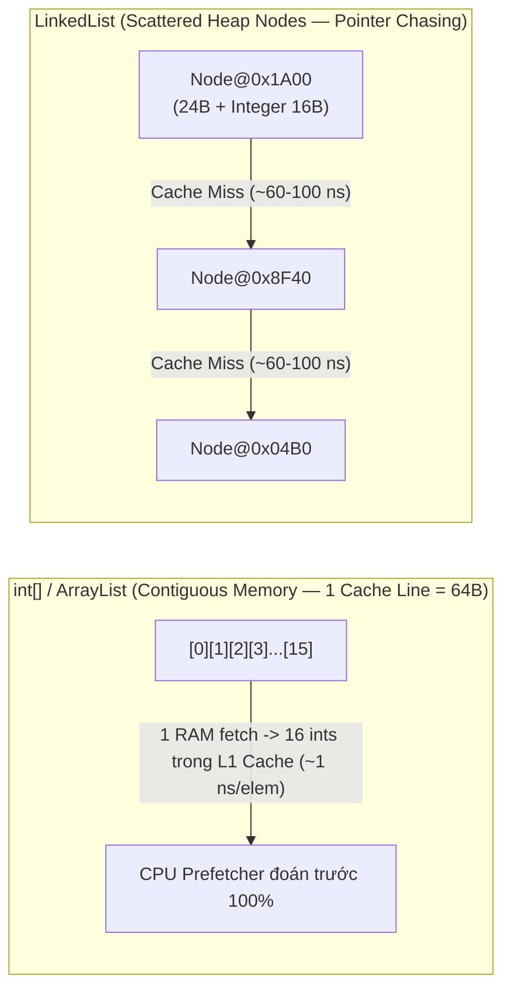

# DSA-01 · Độ phức tạp & Big-O thực dụng

> **TL;DR** — **Big-O** đo tốc độ tăng của số phép toán theo kích thước đầu vào $n$ khi $n \to \infty$, nhưng **bỏ qua hằng số ẩn và phần cứng CPU**. Trong thực tế Java backend, một thuật toán $O(n)$ duyệt `LinkedList` 1 triệu phần tử có thể **chậm gấp nhiều lần** thuật toán $O(n \log n)$ sắp xếp `int[]` vì `LinkedList` gây **CPU Cache Miss** liên miên (*pointer chasing* nhảy lung tung trên Heap), còn mảng liên tiếp tận dụng trọn **64-byte Cache Line** & CPU prefetcher! Trong khi đó, `ArrayList.add()` có độ phức tạp **`O(1)` amortized** vì OpenJDK tăng dung lượng mảng `1.5×` mỗi lần đầy, khiến tổng chi phí copy qua `n` lần thêm chỉ là $O(n)$ chia đều thành $O(1)$ mỗi lần gọi.

## 🧭 Brief

| | |
| :--- | :--- |
| **Loại** | Bài học |
| **Giai đoạn** | Năm 1 · Q1 |
| **Chủ đề** | DSA thực dụng |

**Phạm vi bắt buộc**
- Big-O, amortized analysis
- hằng số ẩn và cache locality
- ước lượng thời gian chạy từ input size

**Câu hỏi sâu — nội dung phải giúp trả lời được**
- Vì sao O(n) với LinkedList có thể chậm hơn O(n log n) với array?
- ArrayList.add amortized O(1) nghĩa là gì?

**Ý tưởng lab / demo**
- JMH so sánh duyệt ArrayList vs LinkedList 1 triệu phần tử

**Tài liệu gốc gợi ý**
- CLRS (tham khảo)
- Grokking Algorithms
- NeetCode roadmap

**Gói đầu ra**
- [x] `README.md` — lý thuyết theo [lesson-template](../../../docs/templates/lesson-template.md)
- [x] `exercises.md` — bài tập L1/L2/L3 theo [exercises-template](../../../docs/templates/exercises-template.md)
- [x] `solutions.md` — đáp án theo [solutions-template](../../../docs/templates/solutions-template.md)
- [x] `lab/` — code demo chạy được + `lab/README.md` theo [lab-template](../../../docs/templates/lab-template.md)
- [ ] _(người học)_ `my-notes.md` — **agent không tạo**

---

<!-- Nội dung bắt đầu từ đây -->

## 1. Vấn đề: tại sao phải biết cái này?

Ba lỗi ước lượng hiệu năng kinh điển khiến code Java chạy mượt ở máy dev (`100` dòng test) nhưng treo cứng trên production (`500.000` dòng thật):

1. **Vòng lặp lồng nhau $O(n^2)$ ẩn dưới lời gọi thư viện:** Code đối soát hóa đơn viết `for (Invoice inv : invoices) { if (!paidIds.contains(inv.id())) ... }` với `paidIds` là `ArrayList` chứa `100.000` phần tử. Độ phức tạp thực là $100.000^2 = 10^{10}$ phép so sánh → treo worker JBoss mất hơn **10 giây** cho 1 job lẽ ra chạy **15 ms** nếu đổi `paidIds` sang `HashSet` ($O(n)$)!
2. **Tin mù quáng vào Big-O mà chọn `LinkedList` thay cho `ArrayList`:** Thấy sách ghi "chèn đầu/giữa `LinkedList` là $O(1)$" bèn dùng `LinkedList` cho danh sách 500.000 bản ghi rồi duyệt lại bằng `for-each` — kết quả vừa tốn gấp ~5× RAM (`Node` wrapper + pointer), vừa chậm hơn mảng liên tiếp hàng chục lần do **CPU cache miss**!
3. **Không ước lượng được ngưỡng $n$ tối đa trong 100 ms API budget:** Chạy thuật toán $O(n^2)$ khi API chỉ cho phép p99 `< 100 ms`.

---

## 2. Mô hình tư duy (mental model)

Hãy hình dung **Big-O vs Cache Locality** như việc đi **lấy sách trong thư viện**:

- **Big-O (Số cuốn sách bạn phải mở ra xem):** $O(n)$ nghĩa là mở 1 triệu cuốn; $O(n \log n)$ nghĩa là mở 20 triệu lượt trang; $O(\log n)$ chỉ mở ~20 cuốn.
- **CPU Cache Locality (Vị trí các cuốn sách nằm đâu!):**
  - **`int[]` / `ArrayList` (Sách xếp thẳng hàng trên CÙNG 1 cái bàn ngay trước mặt):** Mỗi lần bạn cúi xuống lấy 1 cuốn (đọc `arr[i]` ở RAM), nhân viên thư viện (CPU Hardware Prefetcher) bưng sẵn nguyên **cả chồng 16 cuốn liên tiếp (`64-byte Cache Line`)** đặt ngay lên bàn (`L1 Cache`)! 15 bước tiếp theo chỉ mất **`~1 ns`** không cần đi xuống kho!
  - **`LinkedList` (Mỗi cuốn sách nằm rải rác ở 1 triệu cái tủ khác nhau khắp tòa nhà, bên trong trang cuối ghi địa chỉ tủ kế tiếp!):** Bạn buộc phải đi bộ tìm tủ #1 (`100 ns` RAM miss) → đọc xong mới biết địa chỉ tủ #2 → đi tìm tủ #2 (`100 ns` RAM miss)! Đó chính là **Pointer Chasing**!

**Chỗ ẩn dụ không còn đúng:**
Trong thực tế CPU còn có **TLB (Translation Lookaside Buffer)** và **Out-of-Order Execution**: với mảng liên tiếp, CPU vừa prefetch xong vừa cộng dồn song song nhiều phần tử cùng lúc (*SIMD / pipelining*), còn với `LinkedList` thì phép tính địa chỉ `node = node.next` bị phụ thuộc dữ liệu tuần tự (*data dependency*), CPU hoàn toàn **không thể đoán trước hoặc chạy song song**!



---

## 3. Cơ chế bên trong (trọng tâm của bài)

### 3.1 Big-O, Hằng số ẩn & Ước lượng thời gian chạy từ Input Size ($n$)

Quy tắc ngón tay cái trên 1 core CPU hiện đại (~`3–4 GHz`, Java sau JIT warmup): một thao tác đơn giản trong vòng lặp đạt khoảng **$10^8$ phép toán/giây** (tức ~$10^7$ phép toán trong `100 ms` — **nhưng có thể tụt xuống $10^6$–$10^7$/giây nếu mỗi bước gây Object allocation hoặc RAM cache miss**!).

| Big-O | Ví dụ điển hình | Max $n$ an toàn cho API `< 100 ms` | Ghi chú thực tế |
| :--- | :--- | :---: | :--- |
| **$O(1)$** | `HashMap.get`, `arr[i]` | Vô hạn | Vẫn có hằng số ẩn: `HashMap.get` tính `hashCode()` + `equals()` chậm hơn `arr[i]` vài chục lần |
| **$O(\log n)$** | `Arrays.binarySearch`, `TreeMap.get`, B-tree DB | $> 10^9$ | $n = 10^9 \implies \log_2 n \approx 30$ bước! |
| **$O(n)$** | Duyệt mảng, Hash Join | $\sim 10^7$–$10^8$ (`int[]`) / $\sim 10^6$ (`LinkedList`) | Phụ thuộc nặng vào **Cache Locality** & GC! |
| **$O(n \log n)$** | `Arrays.sort` (Dual-Pivot Quicksort), `Collections.sort` (TimSort) | $\sim 10^6$ | $10^6 \log_2(10^6) \approx 2 \times 10^7$ ops (~40–80 ms trên `int[]`) |
| **$O(n^2)$** | Nested loop check trùng dùng `List.contains()` | $\sim 3.000$–$10.000$ | Ở $n = 100.000$: $n^2 = 10^{10} \implies$ **vài chục giây!** |
| **$O(2^n)$** | Đệ quy quay lui không memoization | $\le 20$–$25$ | Nổ tổ hợp ngay lập tức |

### 3.2 Trả lời câu hỏi sâu #1: Vì sao $O(n)$ với `LinkedList` có thể chậm hơn $O(n \log n)$ với Array?

Hãy làm phép tính định lượng bằng thông số phần cứng thật (theo Gregg *Systems Performance* & *Numbers Every Programmer Should Know*):
- **Truy cập L1 Cache:** `~1 ns` (`0.5–1 ns`). **RAM Main Memory Access (L3 Cache Miss):** `~60–100 ns` (**chậm gấp `~60–100×`**!).
- Xét **`LinkedList<Integer>`** có $n = 1.000.000$ phần tử (nhất là khi cấp phát rải rác xen kẽ với object khác trên Heap):
  - Mỗi `java.util.LinkedList.Node` trên JVM 64-bit (với CompressedOops) tốn **`24 bytes`** (`12B` mark/klass header + `4B` item ref + `4B` next ref + `4B` prev ref), cộng thêm đối tượng `Integer` **`16 bytes`** bên ngoài + `4B` reference! Tổng cộng mỗi phần tử ăn tới **`~40 bytes`** (gấp **`10×`** so với `4 bytes` của `int` trong `int[]`!).
  - Quan trọng hơn: khi duyệt `for (int x : linkedList)`, CPU nhảy theo con trỏ `node.next` qua các vùng nhớ không liên tiếp trên Heap (và từ `Node` nhảy tiếp sang `Integer`). Phần lớn bước đọc dính **L3 Cache Miss (`~60–100 ns`)** → tổng chi phí $10^6 \times 60\text{ ns} \approx \mathbf{60\text{–}150\text{ ms}}$!
- Ngược lại, xét **`int[]`** $n = 1.000.000$ (`4 MB` liên tiếp — nằm gọn trong **L3 Cache** của CPU hiện đại!):
  - Thuật toán sắp xếp $O(n \log n)$ (`Arrays.sort(int[])`, Dual-Pivot Quicksort) tuy thực hiện $\sim 20 \times 10^6$ phép so sánh, nhưng hầu hết diễn ra tuần tự ngay trong **L1/L2 Cache (`~1–3 ns`)** không tốn pointer chasing hay boxing `Integer` → có thể chạy xong trong **`~30–60 ms`**, **nhanh hơn hoặc ngang ngửa** một vòng lặp $O(n)$ trên `LinkedList` bị phân mảnh Heap!
- Và nếu so cùng độ phức tạp $O(n)$ giữa `int[]` / `ArrayList` với `LinkedList`, `int[]` thường nhanh hơn **`10×–50×`**! *(Kết luận của chính tác giả `LinkedList` trong JDK — Joshua Bloch: gần như KHÔNG BAO GIỜ nên dùng `LinkedList` trong Java; hãy dùng `ArrayList` hoặc `ArrayDeque`!)*

### 3.3 Trả lời câu hỏi sâu #2: `ArrayList.add()` amortized $O(1)$ nghĩa là gì?

Đọc thẳng source code **`java.util.ArrayList`** trong OpenJDK (`grow(int minCapacity)`):
- Bên trong `ArrayList` là một mảng `Object[] elementData` (dung lượng mặc định lần `add` đầu tiên = **`10`**).
- Khi mảng đầy (`size == elementData.length`), `Arrays.copyOf(elementData, newCapacity)` cấp phát mảng mới lớn hơn **gấp `1.5×`** (`oldCapacity + (oldCapacity >> 1)`).
- Rõ ràng **một lần `add()` gây resize** tốn đúng **$O(n)$** để copy toàn bộ `n` phần tử cũ sang mảng mới! Vậy tại sao tài liệu vẫn ghi `ArrayList.add()` là **`O(1)` amortized** (phân bổ đều)?

**Chứng minh bằng Aggregate Method (CLRS):**
Giả sử bắt đầu từ mảng rỗng, để đơn giản tính tăng gấp đôi (`2×`, tương tự `1.5×` chỉ khác hằng số!): thực hiện `n` lần `add()` liên tiếp.
- Mỗi lần gọi `add()` tốn `1` đơn vị ghi phần tử mới (`n` đơn vị tổng cộng).
- Chi phí copy chỉ xảy ra tại các mốc lũy thừa (hoặc cấp số nhân $r = 1.5$):
  $$\text{Tổng chi phí copy} = 1 + r + r^2 + \dots + \frac{n}{r} < \frac{n}{r - 1} = 2n \quad (\text{với } r = 1.5) \implies O(n)$$
- Tổng chi phí cho cả `n` lần `add()` là $n + 2n = 3n = O(n)$. Chia đều cho `n` lần gọi:
  $$\text{Amortized cost per } \texttt{add()} = \frac{O(n)}{n} = \mathbf{O(1)}$$

**Ý nghĩa thực tế trong Java backend (Tail Latency & GC):**
1. Amortized $O(1)$ **CHỈ** nói về *tổng thông lượng trung bình*, **KHÔNG** có nghĩa là mọi lần `add()` đều mất $O(1)$! Một request xui xẻo chạm đúng lúc `ArrayList` đang chứa `5.000.000` phần tử và đầy sẽ đột ngột chịu cú spike copy 5 triệu reference + tạo `5.000.000 × 4B = 20 MB` mảng cũ thành rác cho GC dọn!
2. Nếu ước lượng trước được số lượng phần tử `expectedSize` (ví dụ đọc `10.000` dòng từ JDBC `ResultSet`), luôn khởi tạo **`new ArrayList<>(expectedSize)`** để tránh ~`18` lần cấp phát & copy trung gian!

---

## 4. Code minh họa

Xem mã nguồn benchmark thực tế với bước Warmup + Blackhole chống JIT Dead-Code Elimination tại [CacheLocalityBenchmark.java](./lab/src/main/java/lab/dsa/complexity/CacheLocalityBenchmark.java):

```java
// ❌ SAI: Dùng List.contains() bên trong vòng lặp -> O(n^2) + dùng LinkedList cho duyệt tuần tự
List<String> paidIds = new LinkedList<>(loadPaidIds()); // 100.000 phần tử
for (Invoice inv : invoices) {                          // 100.000 phần tử
    if (!paidIds.contains(inv.id())) {                  // O(n) mỗi bước -> 10^10 bước pointer-chasing!
        unpaid.add(inv);
    }
}
```

```java
// ✅ ĐÚNG: Chuyển lookup sang HashSet (có preset capacity) & giữ kết quả trong ArrayList pre-sized
Set<String> paidSet = HashSet.newHashSet(paidIds.size()); // Java 19+: tránh resize!
paidSet.addAll(paidIds);                                  // O(n)
List<Invoice> unpaid = new ArrayList<>(invoices.size());  // Không resize array giữa chừng
for (Invoice inv : invoices) {                            // O(n) cache-friendly
    if (!paidSet.contains(inv.id())) {                    // O(1) lookup
        unpaid.add(inv);
    }
}
```

### 4.1 Legacy corner (Java 7 / JBoss AS 7.1.1)

Trên **Java 7 / JBoss AS 7.1.1**:
1. **Chưa có `HashSet.newHashSet(n)` / `HashMap.newHashMap(n)` (mới có từ Java 19):** Để tạo `HashSet`/`HashMap` cho `100.000` phần tử mà không bị resize, bạn phải tự tính `new HashMap<K, V>((int) (n / 0.75f) + 1)` — nếu viết nhầm `new HashMap<>(n)` với `n = 100.000` thì ngay phần tử thứ `98.305` (`131.072 × 0.75 = 98.304`) nó vẫn bị resize 1 lần tốn thêm vài MB!
2. **Đừng `new LinkedList<>()` khi viết DAO/JDBC đọc bảng nhiều dòng trên Java 7:** `ArrayList` có inicial capacity (`new ArrayList<Row>(500)`) tiết kiệm ~`5×` RAM Heap (cực quý giá trên JVM 32-bit hoặc heap giới hạn 2–4 GB của JBoss cũ) và giảm áp lực Young/Old GC rõ rệt!

---

## 5. Quan sát & đo đạc

### Phần A — Đã chạy kiểm chứng trên Windows 11 (Java 21 Cache Locality & Amortized Benchmark)
Từ thư mục `lab/`:
```powershell
mvn -o -B verify
mvn -o -B compile exec:java
```
*(Lưu ý: Do môi trường soạn chạy offline không có sẵn artifact `org.openjdk.jmh` trong local `.m2`, `CacheLocalityBenchmark` tự cài đặt harness chuẩn mực benchmark JVM: chạy warmup đủ vòng để C2 JIT biên dịch xong ([JVM-05](../../../01-software-engineering/java-jvm/05-jit-compilation/README.md)), trả tổng checksum làm **Blackhole** chống Dead-Code Elimination, và trộn ngẫu nhiên thứ tự cấp phát `LinkedList` trên Heap để tái hiện đúng hiện tượng **Heap Fragmentation / Pointer Chasing** thực tế trên production thay vì trường hợp lý tưởng bị TLAB xếp khít nhau!)*

Thí nghiệm đo trực tiếp trên `1.000.000` phần tử:
1. **`int[]` sum ($O(n)$)** vs **`ArrayList<Integer>` sum ($O(n)$)** vs **Fragmented `LinkedList<Integer>` sum ($O(n)$)** vs **`Arrays.sort(int[])` ($O(n \log n)$)**.
2. **Cấp phát `ArrayList(default 10)` vs `ArrayList(expectedSize)`** cho `1.000.000` phần tử (đếm số lần resize thực tế: `29` lần resize copy `~2.43 triệu` phần tử vs `0` lần resize!).

*(Số đo thực tế ghi nhận sau khi chạy `mvn -o -B verify` được cập nhật tại [lab/README.md §4](./lab/README.md#4-kết-quả-tham-khảo-khi-chạy).)*

---

## 6. Trade-offs & khi nào KHÔNG dùng

| Cấu trúc / Lựa chọn | Được gì | Mất / Đánh đổi gì | Dùng khi |
| :--- | :--- | :--- | :--- |
| **`int[]` / `ArrayList`** | Cache locality cao nhất, ít tốn RAM nhất, random access $O(1)$ | Chèn/xóa ở **đầu hoặc giữa** mảng tốn $O(n)$ dịch chuyển (`System.arraycopy`) | **95% trường hợp cần danh sách** (duyệt, đọc theo index, thêm cuối) |
| **`ArrayDeque`** | Thêm/xóa **2 đầu (`Queue`/`Stack`)** đều $O(1)$ amortized + nằm trên mảng vòng cache-friendly | Không truy cập theo index giữa mảng, không cho phép `null` | Cần Queue / Stack / Deque (**thay thế `LinkedList` hoàn toàn!**) |
| **`LinkedList`** | $O(1)$ chèn/xóa nếu **đã cầm sẵn `ListIterator` tại vị trí đó** | Tốn gấp ~`5×` RAM, cache miss nặng khi duyệt, random access $O(n)$ | Cực hiếm (chỉ khi đã giữ iterator xóa giữa danh sách liên tục — hầu như luôn có lựa chọn tốt hơn) |
| **`new ArrayList<>(n)` pre-sized** | `0` lần resize/copy trung gian, giảm hẳn rác Young GC | Tốn sẵn vùng nhớ mảng `n` phần tử dù thực tế chỉ thêm vài phần tử | Khi biết trước kích thước hoặc cận trên hợp lý (từ `ResultSet`, batch API) |

---

## 7. Cạm bẫy production (ít nhất 3)

1. **Dùng `List.contains()` / `List.remove()` trong vòng lặp ($O(n^2)$ ngầm)** — *Triệu chứng:* Test 100 bản ghi chạy `2 ms`, lên production `200.000` bản ghi job batch treo `30 giây` ăn 100% 1 CPU core. *Nguyên nhân:* `ArrayList.contains()` duyệt tuyến tính $O(n)$ mỗi lần gọi. *Cách tránh:* Chuyển tập tra cứu sang `HashSet` ($O(1)$ lookup).
2. **Dùng `LinkedList.get(i)` trong vòng lặp `for (int i = 0; i < list.size(); i++)`** — *Triệu chứng:* `n = 100.000` mất hàng chục giây không phải $O(n)$ mà là **$O(n^2)$**! *Nguyên nhân:* Mỗi lần gọi `linkedList.get(i)` phải đi lại từ đầu (hoặc cuối) danh sách mất `i/2` bước! *Cách tránh:* Dùng enhanced `for-each` (`Iterator`) hoặc đổi hẳn sang `ArrayList`.
3. **Tin rằng microbenchmark không Warmup / không Blackhole đo đúng hiệu năng Java** — *Triệu chứng:* Viết `long t0 = System.nanoTime(); for(...) sum += ...;` không dùng biến `sum`, đo thấy `0 ms` rồi kết luận sai hoàn toàn! *Nguyên nhân:* C2 JIT thực hiện **Dead-Code Elimination (DCE)** xóa luôn cả vòng lặp, hoặc chưa warmup còn chạy Interpreter! *Cách tránh:* Dùng **JMH** (`@Benchmark`, `Blackhole`) trên môi trường chuẩn, hoặc trả kết quả checksum ra ngoài và chạy đủ vòng warmup.
4. **Cấp phát `ArrayList` không truyền kích thước cho response lớn (`500.000` phần tử)** — *Triệu chứng:* CPU & Young GC tăng cao đột biến, latency p99 nhảy khựng theo nhịp resize. *Nguyên nhân:* Mảng lớn bị `Arrays.copyOf` nhiều lần để lại hàng chục MB mảng chết ngắn hạn. *Cách tránh:* Truyền `new ArrayList<>(expectedSize)`.

---

## 8. Liên hệ thực tế công việc

Ngay tuần này trên codebase **Java 7 / JBoss AS 7.1.1**:
1. Tìm kiếm nhanh trong repo bằng `grep` / IntelliJ: `new LinkedList` và `.contains(` bên trong vòng lặp `for`/`while` — kiểm tra xem có chỗ nào đang tạo $O(n^2)$ ẩn trên dữ liệu lớn hoặc dùng `LinkedList` thay cho `ArrayList`/`ArrayDeque` không!
2. Với các hàm đọc nhiều dòng từ JDBC `ResultSet` hoặc build danh sách export Excel lớn, thêm initial capacity cho `ArrayList` / `HashMap` để cắt giảm Young GC pause.

---

## 9. Self-check — Explain-back

> Trả lời **không nhìn tài liệu**, nói to trong 5 phút. Không trả lời được = chưa xong. (Đáp án nằm trong [solutions.md](./solutions.md).)

1. Giải thích vì sao một vòng lặp **$O(n)$ trên `LinkedList`** có thể chậm hơn cả thuật toán **$O(n \log n)$ trên `int[]`** khi $n = 1.000.000$ (kể đủ yếu tố *Cache Line `64B`*, *Hardware Prefetcher*, *Pointer Chasing*, và *Object overhead*).
2. **`ArrayList.add()` là $O(1)$ amortized** nghĩa là gì? Lần `add()` gây resize tốn bao nhiêu và chứng minh nhanh vì sao tổng chi phí qua `n` lần vẫn là $O(n)$?
3. Với bài toán cần cấu trúc `Queue` (FIFO) trong Java, vì sao nên dùng **`ArrayDeque`** thay cho **`LinkedList`**?
4. Với ngân sách latency `< 100 ms` trên 1 core Java, ngưỡng kích thước đầu vào $n$ tối đa hợp lý cho **$O(n^2)$**, **$O(n \log n)$**, và **$O(n)$** là khoảng bao nhiêu?
5. Vì sao microbenchmark Java bằng `System.nanoTime()` ngây thơ dễ đo sai gấp 100 lần, và vai trò của **Warmup** + **Blackhole** là gì?

---

## 10. Cheatsheet 1 trang

| Khái niệm | Ghi nhớ nhanh |
| :--- | :--- |
| **Big-O vs Phần cứng** | Big-O bỏ qua hằng số ẩn & RAM hierarchy (`L1 ~1 ns` vs `RAM Cache Miss ~60–100 ns`) |
| **Cache Line** | `64 bytes` = `16 ints` nằm sát nhau trong `int[]` → Prefetcher nạp sẵn; `LinkedList` gây **Pointer Chasing** miss liên tục |
| **Amortized $O(1)$** | `ArrayList` nhân `1.5×` khi đầy → 1 lần resize tốn $O(n)$, nhưng tổng copy qua `n` lần là $O(n)$ → chia đều `O(1)` |
| **Pre-size chuẩn** | `new ArrayList<>(expectedSize)` · `HashMap.newHashMap(n)` (Java 19+) hoặc `(int)(n/0.75f)+1` (Java 7–18) |
| **Thay `LinkedList`** | Danh sách: **`ArrayList`** · Queue/Stack: **`ArrayDeque`** |
| **Ngưỡng `100 ms` Java** | $O(n^2): n \lesssim 5.000$ · $O(n \log n): n \lesssim 10^6$ · $O(n): n \lesssim 10^7\text{–}10^8$ |

---

## 11. Tài liệu tham khảo

- Thomas H. Cormen et al., *Introduction to Algorithms (CLRS)* — Asymptotic Notation & Amortized Analysis (Aggregate/Potential Method).
- OpenJDK Source Code, [`java.util.ArrayList#grow(int)`](https://github.com/openjdk/jdk/blob/master/src/java.base/share/classes/java/util/ArrayList.java) (`oldCapacity + (oldCapacity >> 1)`).
- Brendan Gregg, *Systems Performance* & Ulrich Drepper, *What Every Programmer Should Know About Memory* (CPU Cache Lines, Hardware Prefetcher).
- OpenJDK JMH (*Java Microbenchmark Harness*), [Official Samples](https://github.com/openjdk/jmh/tree/master/jmh-samples/src/main/java/org/openjdk/jmh/samples).

---
➡️ Tiếp theo: [exercises.md](./exercises.md) · [lab/](./lab/README.md) · Bài kế: [DSA-02 · HashMap internals](../02-hash-map-internals/README.md)
