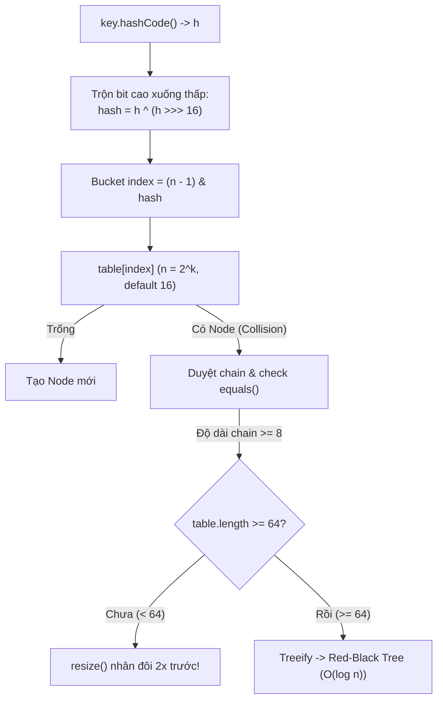

# DSA-02 · HashMap internals

> **TL;DR** — `HashMap` trong Java là một mảng `Node<K,V>[] table` có kích thước luôn là **lũy thừa của `2`** (mặc định `16`), tính vị trí bucket bằng phép AND bit `(n - 1) & (h ^ (h >>> 16))`. Khi nhiều key rơi cùng bucket (*collision*), trước Java 8 nối thành danh sách liên kết $O(n)$, còn **từ Java 8 sẽ chuyển thành Cây Đỏ-Đen (`TreeNode` — $O(\log n)$) khi độ dài chuỗi $\ge 8$ (`TREEIFY_THRESHOLD`) VÀ `table.length >= 64` (`MIN_TREEIFY_CAPACITY`)**. Nếu `hashCode()` trả hằng số, toàn bộ key dồn vào **1 bucket duy nhất** làm tụt hiệu năng gấp hàng trăm lần! Còn khi dùng `HashMap` đa luồng không đồng bộ, **Java 7** có thể tạo **vòng lặp vô hạn `A -> B -> A` ăn 100% CPU** lúc `resize()` đồng thời (Java 8 bỏ được vòng lặp nhưng vẫn mất dữ liệu — phải dùng `ConcurrentHashMap`).

## 🧭 Brief

| | |
| :--- | :--- |
| **Loại** | Bài học |
| **Giai đoạn** | Năm 1 · Q1 |
| **Chủ đề** | DSA thực dụng |
| **Tiên quyết** | [DSA-01](../01-complexity-analysis/README.md) |

**Phạm vi bắt buộc**
- hashing, bucket, collision
- treeify từ Java 8
- load factor và resize
- equals/hashCode contract
- HashMap không thread-safe

**Câu hỏi sâu — nội dung phải giúp trả lời được**
- Điều gì xảy ra khi hashCode luôn trả về hằng số?
- Vì sao HashMap Java 7 có thể vòng lặp vô hạn khi resize đồng thời?

**Ý tưởng lab / demo**
- Tự cài HashMap đơn giản + đo hiệu năng khi hashCode xấu

**Tài liệu gốc gợi ý**
- CLRS (tham khảo)
- Grokking Algorithms
- NeetCode roadmap

**Gói đầu ra**
- [x] `README.md` — lý thuyết theo [lesson-template](../../../docs/templates/lesson-template.md)
- [x] `exercises.md` — bài tập L1/L2/L3 theo [exercises-template](../../../docs/templates/exercises-template.md)
- [x] `solutions.md` — đáp án theo [solutions-template](../../../docs/templates/solutions-template.md)
- [x] `lab/` — code demo chạy được + `lab/README.md` theo [lab-template](../../../docs/templates/lab-template.md)
- [ ] _(người học)_ `my-notes.md` — **agent không tạo**

---

<!-- Nội dung bắt đầu từ đây -->

## 1. Vấn đề: tại sao phải biết cái này?

Ba sự cố production rất thật xuất phát từ việc dùng `HashMap` mà không hiểu cấu tạo bên trong:

1. **Treo 100% CPU toàn bộ worker threads trên JBoss Java 7 (vô tận không bao giờ nhả!):** Một dev dùng `static final Map<String, Config> CACHE = new HashMap<>();` dùng chung cho mọi HTTP request trên **JBoss AS 7.1.1 (Java 7)**. Khi `CACHE` đạt ngưỡng `threshold` và 2 request cùng gọi `put()` kích hoạt `resize()` đồng thời, danh sách liên kết trong bucket bị nối thành vòng tròn `A -> B -> A`. Từ giây đó, mọi thread gọi `CACHE.get(...)` đều kẹt vĩnh viễn trong vòng lặp `while (e != null)` ăn 100% CPU cho tới khi phải `kill -9` JBoss!
2. **Đưa class key tự viết vào `HashMap` rồi sửa 1 field sau khi `put()` → Memory Leak âm thầm:** Code đặt `OrderKey` vào `HashMap`, sau đó set lại `status` (vốn nằm trong `hashCode()`) → `map.get(key)` trả về `null`, `map.remove(key)` cũng không xóa được, map phình dần tới **`OutOfMemoryError`**!
3. **`hashCode()` viết ẩu trả về hằng số (hoặc HashDoS):** `50.000` key chui vào cùng 1 bucket khiến API lookup $O(1)$ biến thành chậm gấp hàng trăm lần.

---

## 2. Mô hình tư duy (mental model)

Hãy hình dung `HashMap` như **một dãy `16` ngăn tủ đánh số `0..15` (`Node[] table`)**:

- **Hàm băm (`hashCode` + trộn bit):** Là máy phân loại lấy tên chìa khóa (Key) tính ra một con số, rồi dùng phép lấy phần dư nhanh `(16 - 1) & hash` để chỉ định **ngăn tủ số mấy** (`0..15`).
- **Collision (Đụng độ):** Hai chìa khóa khác nhau nhưng bị máy phân loại ném vào **cùng 1 ngăn tủ**! Trong ngăn tủ đó, các hồ sơ được móc nối đuôi nhau thành một **sợi dây (`LinkedList`)**, muốn tìm đúng hồ sơ phải rà từng cái dùng **`equals()`**.
- **Treeify (Java 8+):** Nếu một ngăn tủ quá đông (`>= 8` hồ sơ) *và* tủ đủ rộng (`>= 64` ngăn), OpenJDK chuyển sợi dây trong ngăn đó thành **Cây tìm kiếm cân bằng Đỏ-Đen (`TreeNode`)** để tra cứu nhanh trong $O(\log k)$ thay vì $O(k)$!
- **Load Factor (`0.75`) & Resize (`2×`):** Khi tổng số hồ sơ vượt quá `75%` số ngăn (`12 / 16`), tủ chật quá rồi → mua tủ mới **gấp đôi (`32` ngăn)** và dọn toàn bộ hồ sơ sang!

**Chỗ ẩn dụ không còn đúng:**
Trong đời thực bạn có thể chia bất kỳ số ngăn tủ nào (vd `10` hay `17` ngăn); nhưng `HashMap` ép số ngăn **luôn là lũy thừa của 2** (`16, 32, 64, 128...`) vì phép chia lấy dư dùng **`(n - 1) & hash`** nhanh hơn phép chia `%` rất nhiều, và khi nhân đôi dung lượng chỉ cần kiểm tra đúng **1 bit `(e.hash & oldCap)`** để tách bucket cũ thành 2 nửa không cần băm lại `hashCode()`!



---

## 3. Cơ chế bên trong (trọng tâm của bài)

### 3.1 Hashing, Bit-perturbation & `(n - 1) & hash`

Trong OpenJDK (`java.util.HashMap`):
```java
static final int hash(Object key) {
    int h;
    return (key == null) ? 0 : (h = key.hashCode()) ^ (h >>> 16);
}
```
- **Tại sao phải XOR `h ^ (h >>> 16)`?**
  Vì `n` (`table.length`) thường nhỏ (như `16`, `64`, `256`), phép tính chỉ số bucket **`(n - 1) & hash`** chỉ giữ lại vài **bit thấp nhất** (vd 4 bit cuối với `n = 16`). Nếu `hashCode()` của key chỉ thay đổi ở các bit cao (như `Float`, tọa độ hoặc ID bit-shifted), mọi key đều ra cùng 4 bit cuối → đụng độ hàng loạt! Phép `h ^ (h >>> 16)` trộn 16 bit cao xuống 16 bit thấp chỉ trong ~2 chu kỳ CPU để giảm hẳn collision.
- **Tại sao `n` luôn là lũy thừa của 2?**
  Khi `n = 2^k`, thì `n - 1` ở dạng nhị phân là toàn bit `1` (vd `16 - 1 = 15 = 0b1111`), nên `(n - 1) & hash == hash % n` cho số không âm mà không cần lệnh chia nguyên `idiv` đắt đỏ. *(Nếu bạn truyền `new HashMap<>(10)`, OpenJDK dùng `tableSizeFor(10)` làm tròn lên thành **`16`**!)*

### 3.2 Treeify từ Java 8 (JEP 180), Load Factor & Resize

1. **Cơ chế Treeify (`TREEIFY_THRESHOLD = 8`, `MIN_TREEIFY_CAPACITY = 64`, `UNTREEIFY_THRESHOLD = 6`):**
   - Trong môi trường phân phối ngẫu nhiên tốt (Poisson $\lambda = 0.5$ ở load factor `0.75`), xác suất 1 bucket có tới 8 phần tử chỉ là $< 0.00000006$!
   - Nhưng nếu gặp dữ liệu xấu hoặc tấn công **HashDoS** (kẻ xấu cố tình gửi hàng nghìn HTTP parameter có cùng `hashCode`), Java 8 tự chuyển bucket có độ dài $\ge 8$ thành **Red-Black Tree (`TreeNode`)** — với điều kiện **`table.length >= 64`**. *(Nếu `table.length < 64`, Java 8 chọn `resize()` nhân đôi bảng trước vì thường va chạm do bảng quá nhỏ chứ chưa cần chi phí cây!)*
   - Khi xóa phần tử hoặc resize làm chuỗi cây rút xuống $\le 6$ (`UNTREEIFY_THRESHOLD`), cây quay lại LinkedList để tiết kiệm bộ nhớ (`TreeNode` tốn gấp đôi kích thước `Node` thường).
2. **Load Factor (`0.75f`) & Resize (`2×`):**
   - `threshold = (int)(capacity * loadFactor)` (mặc định `16 * 0.75 = 12`). Khi `++size > threshold`, `resize()` tạo mảng mới gấp đôi `2 × oldCap`.
   - **Tối ưu cực hay của Java 8 khi chuyển bucket cũ:** Vì `newCap = 2 * oldCap`, chỉ số mới `(2*oldCap - 1) & e.hash` hoặc bằng nguyên `oldIndex`, hoặc bằng `oldIndex + oldCap` — phụ thuộc duy nhất vào việc bit **`(e.hash & oldCap)`** là `0` hay `1`! Nó tách thành 2 chuỗi `loHead` (ở `j`) và `hiHead` (ở `j + oldCap`) không cần tính lại `hashCode()`.

### 3.3 Trả lời câu hỏi sâu #1: Điều gì xảy ra khi `hashCode()` luôn trả về hằng số?

Giả sử class `BadKey` luôn `return 42;` trong `hashCode()` (nhưng `equals()` vẫn so sánh đúng các field phân biệt):
1. Toàn bộ `N` key sau khi tính `(n - 1) & hash(key)` đều rơi vào **cùng 1 bucket duy nhất**! (Kể cả khi bảng `resize` lên `65.536` ngăn thì `65.535` ngăn bỏ trống, `1` ngăn gánh hết toàn bộ `N` phần tử!).
2. **Tác động hiệu năng:**
   - Trên **Java 7** (hoặc khi chưa đủ `MIN_TREEIFY_CAPACITY = 64`): Bucket là LinkedList đơn thuần → mọi thao tác `put` / `get` suy thoái từ $O(1)$ xuống **$O(n)$** (insert $N$ phần tử tốn tổng cộng **$O(n^2)$**!).
   - Trên **Java 8+**: Sau khi resize qua `64`, bucket biến thành **Red-Black Tree**:
     - Nếu `BadKey implements Comparable<BadKey>` (như `String`/`Integer`): cây sắp xếp bằng `compareTo()` ở **$O(\log n)$**.
     - Nếu `BadKey` **KHÔNG `implements Comparable`** (rất phổ biến với domain key tự viết!): OpenJDK phải dùng `tieBreakOrder` (so sánh tên class + `System.identityHashCode(a)` vs `System.identityHashCode(b)`). Nhưng khi `get(new BadKey("id-500"))` tạo một object key mới có `identityHashCode` khác với object lúc `put()`, **nó không dẫn hướng trái/phải trong cây được mà buộc phải duyệt tìm khắp các nhánh con** → lookup vẫn tụt về gần **$O(n)$**, chậm hơn `HashMap` bình thường hàng trăm đến hàng nghìn lần!

### 3.4 Hợp đồng `equals()` & `hashCode()` + Bẫy Key Biến Đổi (Mutable Key)

Quy tắc bất biến trong Java spec:
1. Nếu `a.equals(b) == true` thì **bắt buộc** `a.hashCode() == b.hashCode()`. *(Ngược lại không cần: 2 object khác nhau có thể trùng `hashCode` — đó là collision).*
2. Nếu bạn override `equals()` mà **quên** override `hashCode()` → 2 object bằng nhau về nghiệp vụ nhưng sinh ra 2 `hashCode` khác nhau (`Object.hashCode` theo địa chỉ/identity) → rơi vào 2 bucket khác nhau → `map.get(new Key("A"))` trả về **`null`** dù vừa `put(new Key("A"), val)`!
3. **Bẫy Mutable Key:** Nếu dùng đối tượng có field thay đổi được (như `List`, hoặc `Entity` có `setId`/`setStatus`) làm key và thay đổi field tham gia `hashCode()` **sau khi** đã `put()` vào map → `hashCode` đổi sang bucket mới trong khi Node vẫn nằm chết dí ở bucket cũ! Bạn vĩnh viễn không tìm thấy hoặc xóa được entry đó! **Luôn dùng Key bất biến (`String`, `Long`, `UUID`, `record` immutable).**

### 3.5 Trả lời câu hỏi sâu #2: Vì sao `HashMap` Java 7 có thể vòng lặp vô hạn khi `resize()` đồng thời?

Đây là bug phỏng vấn & production huyền thoại gắn liền với **Java 7 / JBoss AS 7.1.1**:
1. Trong **Java 7** (`HashMap#transfer`), khi chuyển phần tử từ mảng cũ sang mảng mới, Java 7 dùng kỹ thuật **Head Insertion** (chèn vào **đầu** bucket mới cho nhanh, không cần giữ con trỏ tail):
   ```java
   // Java 7 transfer() rút gọn — CHÍNH 4 DÒNG NÀY GÂY CHẾT SERVER!
   Entry<K,V> next = e.next;  // (1) Thread 1 dừng ngay sau dòng này! e=A, next=B
   int i = indexFor(e.hash, newCapacity);
   e.next = newTable[i];      // (2) Chèn vào đầu bucket mới (đảo ngược A->B thành B->A)
   newTable[i] = e;
   e = next;
   ```
2. Kịch bản tạo chu trình tử thần với bucket cũ `A -> B -> null`:
   - **Thread 1** chạy tới `(1)`: giữ local variable `e = A`, `next = B`, rồi bị OS pre-empt tạm dừng.
   - **Thread 2** chạy trọn vẹn `resize()`: vì Head Insertion đảo ngược thứ tự nên trong mảng mới của Thread 2, bucket đó trở thành **`B -> A -> null`** (tức `B.next = A`, `A.next = null`)!
   - **Thread 1** tỉnh dậy chạy tiếp: nối `A` vào `newTable` (`A.next = null`), sau đó tới lượt `e = B`: đặt `B.next = A` (`newTable[i] = B`); và vì trong bộ nhớ chung **`A.next` có thể bị nối ngược bởi lượt race trước/sau giữa `A` và `B` thành `A.next = B` và `B.next = A`** → tạo thành **vòng tròn vô tận `A <-> B` (`A -> B -> A`)**!
3. **Hậu quả:** Ngay khi bất kỳ thread nào khác gọi `map.get(keyMissing)` rơi vào bucket đó, vòng lặp `for (Entry e = table[i]; e != null; e = e.next)` chạy **mãi mãi không bao giờ thoát** → CPU leo `100%` từng core một cho đến khi sập toàn bộ JBoss!
4. **Java 8 sửa thế nào?** Java 8 đổi sang **Tail Insertion** (`loHead`/`loTail`, `hiHead`/`hiTail`) giữ nguyên thứ tự gốc nên **không còn tạo vòng lặp khi resize**, **TUY NHIÊN `HashMap` vẫn KHÔNG thread-safe** (vẫn bị mất key khi `put` đè nhau, `size` sai, hoặc mất dữ liệu khi resize)! Khi chia sẻ nhiều luồng, luôn dùng **`ConcurrentHashMap`** ([CONC-06](../../../01-software-engineering/concurrency/06-concurrenthashmap-internals/README.md)).

---

## 4. Code minh họa

Xem mã nguồn tự cài đặt `SimpleHashMap` + đo `ConstantHashKey` & mô phỏng chu trình Java 7 tại [SimpleHashMap.java](./lab/src/main/java/lab/dsa/hashmap/SimpleHashMap.java) và [HashMapPitfallsDemo.java](./lab/src/main/java/lab/dsa/hashmap/HashMapPitfallsDemo.java):

```java
// ❌ SAI: Dùng List/POJO mutable làm key, hoặc hashCode() trả hằng số, hoặc dùng HashMap shared đa luồng
static final Map<String, Object> CACHE = new HashMap<>(); // Shared multi-thread -> Java 7 infinite loop 100% CPU!

class BadKey {
    String id; // mutable + quên equals/hashCode hoặc hashCode() { return 1; }
}
```

```java
// ✅ ĐÚNG: Key là immutable record (tự sinh equals/hashCode chuẩn), pre-size map & dùng ConcurrentHashMap nếu shared
public record OrderKey(long tenantId, String orderCode) {} // Immutable, equals & hashCode tự động chuẩn!

Map<OrderKey, BigDecimal> localMap = HashMap.newHashMap(10_000); // Java 19+ tự tính ceil(10000 / 0.75)
Map<OrderKey, BigDecimal> sharedCache = new ConcurrentHashMap<>();
```

### 4.1 Legacy corner (Java 7 / JBoss AS 7.1.1)

Trên **Java 7 / JBoss AS 7.1.1**:
1. **Không có Treeify (JEP 180 chỉ có từ Java 8!):** Tất cả collision trên Java 7 đều là LinkedList $O(n)$ thuần — nếu gặp hash xấu hoặc HashDoS từ HTTP parameters, JBoss Java 7 rất dễ treo CPU.
2. **Nguy cơ `HashMap` 100% CPU infinite loop thật 100%:** Nếu thấy thread dump (`kill -3 <PID>` — xem [LNX-01](../../../02-devops-and-cloud/linux-networking/01-processes-signals/README.md)) có nhiều thread `RUNNABLE` đứng mãi tại `java.util.HashMap.getEntry` hoặc `HashMap.put` trên Java 7, thủ phạm chính là dùng `HashMap` không đồng bộ ở biến `static` / singleton bean! Sửa ngay thành `ConcurrentHashMap`.

---

## 5. Quan sát & đo đạc

### Phần A — Đã chạy kiểm chứng trên Windows 11 (Java 21 Custom `SimpleHashMap` & Collision/Cycle Lab)
Từ thư mục `lab/`:
```powershell
mvn -o -B verify
mvn -o -B compile exec:java
```
Phần Java 21 chạy kiểm chứng trực tiếp 4 thí nghiệm cốt lõi:
1. **`SimpleHashMap<String, Integer>` (tự cài đặt với `h ^ (h >>> 16)` + `(n - 1) & hash` + resize `2×`):** Với `10.000` key chuẩn, phân bố bucket rất đều (`maxChain <= 6`, tải trọng ~`61%` sau resize lên `16.384` buckets).
2. **Đo hậu quả `hashCode()` hằng số (`return 42`) trên `15.000` phần tử với `java.util.HashMap`:** So sánh tốc độ `put + get` giữa `GoodHashKey` (O(1)), `ConstantComparableKey` (treeify $O(\log n)$), và `ConstantNonComparableKey` (không thể sắp xếp nhị phân khi lookup bằng key mới → chậm hơn hàng trăm lần!).
3. **Mutable Key Leak:** Đổi field `code` sau khi `put` → `map.get(key)` trả về `null` dù `map.size() == 1`!
4. **Java 7 Resize Cycle Simulator (tái hiện an toàn + kiểm chứng bằng Floyd's Cycle Detection):** Tái hiện đúng race condition head-insertion tạo chu trình `A -> B -> A` (`hasCycle = true`) mà không làm treo JUnit runner!

*(Số đo thực tế ghi nhận sau khi chạy `mvn -o -B verify` được cập nhật tại [lab/README.md §4](./lab/README.md#4-kết-quả-tham-khảo-khi-chạy).)*

---

## 6. Trade-offs & khi nào KHÔNG dùng

| Cấu trúc / Cách dùng | Được gì | Mất / Đánh đổi gì | Dùng khi |
| :--- | :--- | :--- | :--- |
| **`HashMap` (pre-sized)** | Truy cập & chèn $O(1)$ trung bình, hỗ trợ 1 `null` key | Không đảm bảo thứ tự duyệt, **KHÔNG thread-safe**, tốn RAM mảng ~`1.33×` + `Node` 32B/entry | Lưu trữ/tra cứu key-value cục bộ trong 1 thread hoặc read-only sau khởi tạo |
| **`LinkedHashMap`** | Vẫn $O(1)$ như `HashMap` + giữ thứ tự chèn hoặc thứ tự truy cập (**LRU Cache**) | Tốn thêm `before`/`after` pointers cho mỗi `Entry` | Cần thứ tự chèn xác định, hoặc dựng LRU Cache đơn giản (`removeEldestEntry`) |
| **`TreeMap` (Red-Black Tree)** | Key luôn **được sắp xếp**, hỗ trợ `ceilingKey` / `subMap` range query | Tốn $O(\log n)$ cho mọi `get`/`put` | Cần duyệt theo khoảng/thứ tự key (vd range timestamp, consistent hashing ring) |
| **`ConcurrentHashMap`** | Thread-safe không cần lock toàn bảng (CAS + synchronized từng bucket head từ Java 8) | Không cho phép `null` key hay `null` value; `size()` có tính xấp xỉ dưới tải đồng thời | **Mọi `Map` dùng chung giữa nhiều request/thread trong JBoss / Spring / Microservice** |

---

## 7. Cạm bẫy production (ít nhất 3)

1. **Dùng `HashMap` ở biến `static` / `@Singleton` để cache trong web server đa luồng** — *Triệu chứng:* Trên Java 7 bị `100%` CPU infinite loop treo toàn server; trên Java 8+ bị mất key âm thầm, `size()` âm/sai hoặc `NullPointerException` ngẫu nhiên. *Nguyên nhân:* `HashMap` không có cơ chế đồng bộ khi ghi hoặc `resize()`. *Cách tránh:* Luôn dùng `ConcurrentHashMap` (hoặc Caffeine cache).
2. **Dùng `new HashMap<>(1000)` cho đúng `1.000` phần tử và tưởng nó không resize** — *Triệu chứng:* Đưa `1.000` phần tử vào vẫn bị cấp phát mảng lớn gấp đôi! *Nguyên nhân:* `1000` được làm tròn lên lũy thừa 2 là `1024`, nhân `loadFactor 0.75` ra `threshold = 768`! Tới phần tử thứ `769` nó sẽ **`resize()` lên `2048`**! *Cách tránh:* Dùng **`HashMap.newHashMap(1000)`** (Java 19+) hoặc `new HashMap<>((int)(1000 / 0.75f) + 1)` (Java 7–18).
3. **Override `equals()` mà quên `hashCode()`, hoặc dùng mutable object làm Key** — *Triệu chứng:* `map.containsKey(key)` trả `false` dù vừa `put`, hoặc `map.size()` tăng mãi gây `OutOfMemoryError`. *Nguyên nhân:* Sai `equals`/`hashCode` contract hoặc đổi field sau khi `put` làm lạc bucket. *Cách tránh:* Dùng immutable `record` / `String` / `Long` làm key, hoặc tạo bằng IDE/Objects.hash chuẩn trên các field `final`.
4. **Dùng `String` / domain object dễ đoán từ user input làm key không giới hạn số lượng** — *Triệu chứng:* Attacker gửi 100.000 JSON keys tính sẵn để trùng `hashCode` gây tiêu tốn CPU parse cực lớn (HashDoS). *Nguyên nhân:* Nổ collision trên cùng 1 bucket. *Cách tránh:* Giới hạn kích thước payload JSON/form đầu vào và dùng JDK 8+ trở lên (có treeify).

---

## 8. Liên hệ thực tế công việc

Ngay tuần này trên codebase **Java 7 / JBoss AS 7.1.1**:
1. Chạy tìm kiếm toàn bộ `static.*new HashMap` hoặc singleton cache dùng `HashMap` trong repo công ty — bất kỳ chỗ nào vừa đọc vừa ghi từ HTTP request thread trên Java 7 đều là **quả bom nổ chậm `100%` CPU infinite loop**! Đổi sang `ConcurrentHashMap` ngay.
2. Rà soát các class key custom dùng trong `HashMap` / `HashSet`: kiểm tra xem đã cài đủ cả `equals()` lẫn `hashCode()` và các field dùng trong `hashCode()` có được đánh dấu **`final`** (immutable) chưa.

---

## 9. Self-check — Explain-back

> Trả lời **không nhìn tài liệu**, nói to trong 5 phút. Không trả lời được = chưa xong. (Đáp án nằm trong [solutions.md](./solutions.md).)

1. Mô tả đường đi đầy đủ của `map.put(key, value)` trong **Java 8+ `HashMap`** (tính `hash`, chỉ số bucket, đụng độ, `TREEIFY_THRESHOLD`, `MIN_TREEIFY_CAPACITY`, và `resize`).
2. Vì sao kích thước mảng của `HashMap` luôn là **lũy thừa của 2**, và tại sao OpenJDK lại thực hiện thêm phép XOR `h ^ (h >>> 16)`?
3. Nếu một class key có `hashCode()` **luôn trả về hằng số (`42`)**, chuyện gì xảy ra trong `HashMap` ở Java 7 vs Java 8+ (xét cả trường hợp key có và không `implements Comparable`)?
4. Trình bày từng bước kịch bản **2 thread cùng `resize()` trong Java 7 `HashMap`** dẫn đến **vòng lặp vô hạn `A -> B -> A`**, và vì sao Java 8+ thoát được lỗi vòng lặp đó nhưng vẫn không thread-safe?
5. Viết công thức khởi tạo `HashMap` đúng để chứa `1.000` phần tử mà **không bị resize**, trên Java 7 và trên Java 19+.

---

## 10. Cheatsheet 1 trang

| Khái niệm | Ghi nhớ nhanh |
| :--- | :--- |
| **Cấu trúc cốt lõi** | `Node<K,V>[] table` size luôn là $2^k$ (default `16`), `loadFactor = 0.75f` (`threshold = 12`) |
| **Hashing & Index** | `hash = (h = key.hashCode()) ^ (h >>> 16)` · `index = (n - 1) & hash` |
| **Treeify (Java 8+)** | LinkedList $\to$ Red-Black Tree khi **`chain >= 8`** VÀ **`table.length >= 64`** (`UNTREEIFY = 6`) |
| **Resize (`2×`)** | Java 8 tách bucket nhanh bằng 1 bit `(e.hash & oldCap) == 0` (`lo` vs `hi`), giữ đúng thứ tự |
| **Pre-size `N` key** | Java 19+: `HashMap.newHashMap(N)` · Java 7–18: `new HashMap<>((int)(N / 0.75f) + 1)` |
| **Java 7 Resize Bug** | Head insertion đảo chuỗi + race condition 2 thread $\implies$ **vòng tròn `A -> B -> A` ăn `100%` CPU**! |
| **Thread-safe** | Dùng **`ConcurrentHashMap`** (không `null` key/value) |

---

## 11. Tài liệu tham khảo

- OpenJDK Source Code, [`java.util.HashMap`](https://github.com/openjdk/jdk/blob/master/src/java.base/share/classes/java/util/HashMap.java) (`hash`, `putVal`, `resize`, `treeifyBin`, `tieBreakOrder`).
- OpenJDK JEP 180, [*Handle Frequent HashMap Collisions with Balanced Trees*](https://openjdk.org/jeps/180).
- Joshua Bloch, *Effective Java* (3rd ed.) — Item 10 & 11 (`equals` & `hashCode` contract).

---
➡️ Tiếp theo: [exercises.md](./exercises.md) · [lab/](./lab/README.md) · Bài kế: [DSA-03 · Cây, BST, B-tree](../03-trees-btree/README.md)
