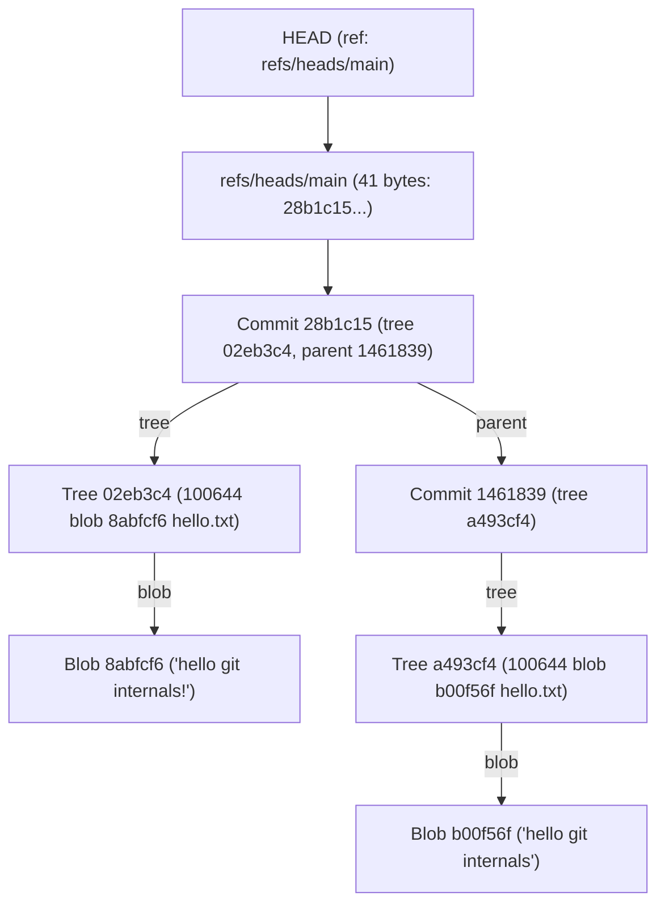

# GIT-01 · Git Internals: objects, refs, index

> **TL;DR** — Git về bản chất là một **content-addressable filesystem** (lưu dữ liệu theo hash SHA-1/SHA-256 của nội dung) kết hợp với **Merkle DAG**. Toàn bộ `.git/` xoay quanh 4 loại object (`blob`, `tree`, `commit`, `tag`), một file nhị phân staging gọi là **Index** (`.git/index`), và các con trỏ text **41 byte** gọi là **Refs** (`refs/heads/*`, `HEAD`). Hiểu tầng plumbing này giải thích tận gốc vì sao đổi 1 byte làm đổi toàn bộ chuỗi hash commit, branch thực chất chỉ là 1 file 41 byte, và tạo/xóa branch tốn gần như 0 ms.

## 🧭 Brief

| | |
| :--- | :--- |
| **Loại** | Bài học |
| **Giai đoạn** | Quý 0 · Bridge |
| **Chủ đề** | Git nâng cao |

**Phạm vi bắt buộc**
- blob/tree/commit/tag object
- SHA và content-addressable storage
- refs, HEAD, detached HEAD
- index (staging area)

**Câu hỏi sâu — nội dung phải giúp trả lời được**
- Tại sao đổi 1 byte trong file làm đổi hash của commit?
- Branch thực chất là gì trên đĩa?

**Ý tưởng lab / demo**
- Dùng git cat-file / git hash-object để dựng tay 1 commit không qua git commit

**Tài liệu gốc gợi ý**
- Pro Git (git-scm.com/book)
- Git internals docs

**Gói đầu ra**
- [x] `README.md` — lý thuyết theo [lesson-template](../../../docs/templates/lesson-template.md)
- [x] `exercises.md` — bài tập L1/L2/L3 theo [exercises-template](../../../docs/templates/exercises-template.md)
- [x] `solutions.md` — đáp án theo [solutions-template](../../../docs/templates/solutions-template.md)
- [x] `lab/` — code demo chạy được + `lab/README.md` theo [lab-template](../../../docs/templates/lab-template.md)
- [ ] _(người học)_ `my-notes.md` — **agent không tạo**

---

<!-- Nội dung bắt đầu từ đây -->

## 1. Vấn đề: tại sao phải biết cái này?

Trong công việc hàng ngày, nhiều dev dùng Git như một hộp đen gõ `add` / `commit` / `push`, đến khi gặp sự cố thật:
1. Nhảy sang `git checkout <commit-hash>` để xem bug cũ rồi sửa và commit → sau đó `git checkout main`, tưởng commit mới bị mất sạch (*"Git xóa mất code của em rồi!"* — thực chất chỉ là **detached HEAD**, commit vẫn nằm nguyên trong `.git/objects`).
2. Nhìn repo phình lên `1.2 GB` vì từng commit nhầm 1 file `.jar` / dump SQL `300 MB`, xóa file ở commit sau rồi push vẫn thấy repo nặng nguyên `1.2 GB` vì **blob cũ vẫn nằm bất biến trong history**.
3. Hoặc khi gặp conflict `CONFLICT (content)`, thấy `git ls-files --stage` có 3 bản `1 / 2 / 3` trong Index mà không hiểu tại sao.

Khi hiểu 4 object, Index và Refs trên đĩa, mọi lệnh porcelain (`checkout`, `reset`, `rebase`, `reflog`) đều trở nên trong suốt.

---

## 2. Mô hình tư duy (mental model)

Hãy hình dung **`.git/objects/` là một kho lưu trữ key-value bất biến**:
- Key = hàm băm của `"<type> <byte_size>\0<content>"` (SHA-1 40 hex chars, hoặc SHA-256 64 hex chars ở repo khởi tạo theo `--object-format=sha256`).
- Value = nội dung được nén **zlib** lưu ở `.git/objects/<2 ký tự đầu>/<38 ký tự sau>`.

Và **`branch` + `HEAD` chỉ là các thẻ ghi chú bằng giấy**:
- Mỗi **branch** chỉ là một mảnh giấy ghi 1 mã commit duy nhất. Tạo 100 branch không copy bất kỳ file source code nào — chỉ ghi 100 file text **41 byte**.
- **`HEAD`** là mũi tên chỉ bạn đang đứng ở branch nào (hoặc đang trỏ thẳng vào 1 commit khi detached).

**Chỗ ẩn dụ không còn đúng:**
Kho key-value của Git không chỉ chứa file rời rạc: Git đóng gói nhiều object cũ thành **packfile** (`.git/objects/pack/*.pack` + `.idx`) kèm delta compression khi chạy `git gc` hoặc `git push/fetch`, và các branch ref cũ cũng được gộp vào 1 file `.git/packed-refs` để đỡ tốn inode.



---

## 3. Cơ chế bên trong (trọng tâm của bài)

### 3.1 Bốn loại Git Object trong `.git/objects/`

1. **`blob` (Binary Large Object):** chỉ lưu **nội dung thô** của file (không lưu tên file, không lưu quyền truy cập, không lưu timestamp). Nếu 2 file khác tên ở 2 thư mục khác nhau có nội dung giống hệt nhau từng byte, Git chỉ lưu **đúng 1 `blob` object duy nhất** (deduplication tự động).
2. **`tree`:** đại diện cho một thư mục. Mỗi dòng trong `tree` lưu 4 thông tin: `<file mode> <object type> <hash> <filename>` (ví dụ `100644` file thường, `100755` executable, `040000` thư mục con `tree`, `120000` symlink).
3. **`commit`:** trỏ tới đúng **1 `tree` gốc** (snapshot toàn bộ project tại thời điểm đó — không phải diff!), 0 hoặc nhiều `parent` commit, `author` + timestamp, `committer` + timestamp, và commit message.
4. **`tag` (Annotated tag):** object độc lập lưu tên tag, người tạo, ngày, message và trỏ tới một object (thường là `commit`), khác với *lightweight tag* vốn chỉ là 1 file ref trỏ thẳng vào commit.

### 3.2 Trả lời câu hỏi sâu #1: "Tại sao đổi 1 byte trong file làm đổi hash của commit?"

Git tổ chức lịch sử dưới dạng **Merkle DAG (Directed Acyclic Graph)** — mỗi tầng tính hash dựa trên nội dung của chính nó **cộng với hash của các tầng con**:
1. Đổi 1 byte trong `hello.txt` (thêm dấu `!`) → header `"blob 21\0..."` thay đổi → hash `blob` đổi từ `b00f56f...` sang `8abfcf6...`.
2. Vì nội dung của `tree` chứa chuỗi `100644 blob <hash> hello.txt`, hash `blob` mới làm nội dung `tree` thay đổi → hash `tree` đổi từ `a493cf4...` sang `02eb3c4...`.
3. Vì nội dung của `commit` bắt đầu bằng dòng `tree <hash>` (và `parent <hash>`), hash `tree` mới làm hash `commit` đổi từ `1461839...` sang `28b1c15...`.
4. Và bất kỳ commit con nào trỏ `parent 28b1c15...` ở phía sau đều có hash thay đổi dây chuyền!

Nhờ tính chất này, một commit hash vừa là **ID định danh**, vừa là **chữ ký toàn vẹn dữ liệu**: không ai sửa lén được 1 byte trong quá khứ mà không làm lộ đổi toàn bộ các commit hash phía sau.

### 3.3 Trả lời câu hỏi sâu #2: "Branch thực chất là gì trên đĩa?" và `HEAD` vs `detached HEAD`

- **Branch (`refs/heads/<name>`):** Trên đĩa, khi bạn tạo branch `main` hoặc `feat/order`, Git chỉ tạo **1 file text thuần** tại `.git/refs/heads/main` (hoặc `.git/refs/heads/feat/order`) chứa đúng **41 byte**: 40 ký tự hex SHA-1 của commit đầu nhánh + 1 ký tự xuống dòng `\n`. *(Khi chạy `git gc`, các ref ít đổi có thể được gom vào file `.git/packed-refs` để đọc nhanh hơn, nhưng về mặt logic vẫn chỉ là cặp `tên-ref -> commit-hash`.)*
- **`HEAD` (`.git/HEAD`):**
  - Trạng thái bình thường (*attached*): chứa **symbolic reference** dạng `ref: refs/heads/main`. Khi bạn `git commit`, Git cập nhật hash mới vào file mà `HEAD` đang trỏ tới (`refs/heads/main`).
  - Trạng thái **`detached HEAD`**: khi chạy `git checkout <commit-hash>` (hoặc `git checkout v1.0.0`), `.git/HEAD` chứa trực tiếp 40 ký tự SHA-1 của commit đó thay vì `ref: ...`. Nếu bạn commit lúc này, commit mới vẫn được tạo bình thường trong `.git/objects`, `HEAD` nhích lên commit mới, nhưng **không có branch nào trỏ tới nó** — khi quay lại `main`, commit đó trở thành *unreachable* (chỉ còn tìm qua `git reflog` trước khi `git gc` dọn).

### 3.4 Index (Staging Area — `.git/index`)

Index là một **file nhị phân** đóng vai trò cầu nối giữa *Working Tree* (file bạn đang sửa trên đĩa) và *Next Tree* (cây thư mục của commit kế tiếp):
- Khi chạy `git add hello.txt`, Git nén nội dung hiện tại thành `blob`, ghi vào `.git/objects/`, và cập nhật đường dẫn + `blob hash` + `stat` (mtime, size) vào `.git/index` ở **stage 0**.
- Khi xảy ra **merge conflict**, cùng 1 đường dẫn file trong Index xuất hiện **3 stage cùng lúc**:
  - **Stage 1:** bản ở common ancestor (base)
  - **Stage 2:** bản của nhánh hiện tại (`ours`)
  - **Stage 3:** bản của nhánh đang merge vào (`theirs`)
  Bạn chỉ resolve xong khi chọn nội dung cuối và `git add` đưa về lại **stage 0**.

---

## 4. Code minh họa

### 4.1 Dựng tay 1 commit bằng plumbing commands (không dùng `git add` / `git commit`)

Trích đoạn từ [build-handcrafted-commit.ps1](./lab/scripts/build-handcrafted-commit.ps1) (có bản `.sh` tương đương):
```powershell
# 1. Tạo blob trực tiếp trong .git/objects/
$blobHash = (git hash-object -w hello.txt).Trim()

# 2. Đưa blob vào Index ở mode 100644 (stage 0)
git update-index --add --cacheinfo 100644 $blobHash hello.txt

# 3. Đóng gói Index thành tree object
$treeHash = (git write-tree).Trim()

# 4. Tạo commit object trỏ tới tree vừa tạo
$commitHash = ("initial handcrafted commit" | git commit-tree $treeHash).Trim()

# 5. Trỏ branch 'main' tới commit vừa tạo (tạo file .git/refs/heads/main 41 bytes)
git update-ref refs/heads/main $commitHash
```

### 4.2 Ví dụ SAI vs ĐÚNG khi làm việc với `HEAD` & Index

```bash
# ❌ SAI: Thấy đang ở detached HEAD (sau khi checkout tag/commit), commit tiếp rồi chuyển về main -> tưởng mất code!
git checkout 1461839
# ... sửa code, git commit -m "hotfix" -> tạo commit X không có branch nào giữ
git checkout main    # Git cảnh báo "leaving 1 commit behind"

# ✅ ĐÚNG: Nếu lỡ commit trong detached HEAD, tạo branch ngay tại chỗ (hoặc sau khi rời đi dùng commit hash từ cảnh báo/reflog)
git switch -c fix/recovered-from-detached
```

### 4.3 Legacy corner (Java 7 / JBoss AS 7.1.1 trên Windows)

Trên môi trường Windows công ty không có Python và dùng Git cho Windows (thường gắn CRLF):
1. Nếu hash `blob` của cùng 1 file giữa máy Windows dev và CI Linux khác nhau dù bạn chưa sửa nội dung: kiểm tra `core.autocrlf` (`CRLF` 2 byte `\r\n` vs `LF` 1 byte `\n` làm đổi byte nội dung → đổi SHA-1 của `blob`!). Dùng `.gitattributes` (`* text=auto eol=lf` hoặc quy định rõ cho `.bat`/`.sh`).
2. Vì repo legacy ở công ty hay có nhiều file config/XML hoặc build artifact lớn lỡ commit nhầm trong quá khứ: biết lệnh `git rev-list --objects --all` + `git cat-file --batch-check='%(objecttype) %(objectname) %(objectsize) %(rest)'` giúp bạn tìm chính xác `blob` nào đang phình dung lượng `.git/` mà không cần cài thêm tool ngoài.

---

## 5. Quan sát & đo đạc

Chạy script lab trên PowerShell:
```powershell
powershell -ExecutionPolicy Bypass -File 00-foundations/git-workflow/01-git-internals/lab/scripts/build-handcrafted-commit.ps1
```

**Output thật ghi nhận từ `git version 2.54.0.windows.1`:**
```text
=== [1] Create blob manually with git hash-object ===
Blob hash : b00f56f95b66e87d8d2f3baff7ee67f101c7bfc6
Blob type : blob
Object path: .git/objects/b0/0f56f95b66e87d8d2f3baff7ee67f101c7bfc6

=== [2] Stage blob directly into Index (no git add) ===
100644 b00f56f95b66e87d8d2f3baff7ee67f101c7bfc6 0	hello.txt

=== [3] Build tree object with git write-tree ===
Tree hash : a493cf4c4cb78eec0d8a307a7bbdd6196787e3d5
100644 blob b00f56f95b66e87d8d2f3baff7ee67f101c7bfc6	hello.txt

=== [5] Point branch ref 'main' to commit & check HEAD ===
HEAD content           : ref: refs/heads/main
refs/heads/main content: 1461839ca00a0092386b55d7f9cb405d2fc0b040
refs/heads/main bytes  : 41 bytes

=== [6] Modify 1 byte and compare new commit hash ===
New blob  : 8abfcf6b257b08b0ae5f7dfac5198818b0c390f3
New tree  : 02eb3c488c69c0977b5423b2ef235fd479726381
New commit: 28b1c15215c6335e32cc3b36371ec81f627ce5db
```

---

## 6. Trade-offs & khi nào KHÔNG dùng

| Lựa chọn | Được gì | Mất gì | Dùng khi |
| :--- | :--- | :--- | :--- |
| **Plumbing (`hash-object`, `update-index`, `commit-tree`)** | Kiểm soát tuyệt đối object/index; dùng trong script tự động hoặc cứu repo lỗi | Rườm rà, dễ sai ref nếu thao tác tay hằng ngày | Học cơ chế, viết hook/script CI, sửa repo hỏng |
| **Porcelain (`add`, `commit`, `switch`)** | An toàn, kiểm tra working tree sạch, cập nhật reflog tự động | Che giấu bước trung gian (Index/Tree) | Công việc phát triển phần mềm hàng ngày |
| **Lightweight tag** vs **Annotated tag** | Chỉ là 1 file ref 41 byte | Không có tagger, ngày tạo, message, chữ ký GPG | Đánh dấu tạm local vs release chính thức (dùng `git tag -a`) |

---

## 7. Cạm bẫy production (ít nhất 3)

1. **Commit trong `detached HEAD` rồi chuyển branch không tạo nhánh mới** — *Triệu chứng:* vừa `git switch main` thì không thấy commit vừa tạo trong `git log`. *Nguyên nhân:* `.git/HEAD` trỏ trực tiếp hash cũ, không có ref nào trong `refs/heads/` trỏ tới commit mới. *Cách tránh:* tạo branch ngay bằng `git switch -c <branch>` trước khi rời đi; nếu lỡ rời đi, dùng `git reflog` lấy lại hash ngay.
2. **Commit file nhầm (binary lớn / file `.env` chứa secret) rồi chỉ xóa bằng commit mới** — *Triệu chứng:* `HEAD` không còn file đó nhưng `git clone` vẫn tải hàng trăm MB và secret vẫn nằm nguyên trong lịch sử. *Nguyên nhân:* mỗi `commit` giữ toàn bộ `tree` lịch sử và mọi `blob` cũ vẫn nằm bất biến trong `.git/objects/`. *Cách tránh:* rotate secret ngay lập tức nếu đã push; lọc lịch sử bằng `git filter-repo` (trước khi share chung) và chặn bằng `.gitignore` + hook.
3. **Tin rằng `git add` chỉ đánh dấu tên file vào danh sách chờ commit** — *Triệu chứng:* sửa file lần 1 → `git add` → sửa thêm lần 2 → `git commit` → bản commit lên không có phần sửa lần 2! *Nguyên nhân:* `git add` đã tạo ngay một `blob` snapshot tại thời điểm add và lưu hash đó vào `.git/index`; phần sửa lần 2 chỉ nằm ở Working Tree. *Cách tránh:* chạy `git diff --staged` (so sánh `HEAD` vs `Index`) và `git diff` (so sánh `Index` vs Working Tree) trước khi commit.

---

## 8. Liên hệ thực tế công việc

Ngay hôm nay trên repo dự án công ty (chỉ đọc, không sửa đổi gì):
1. Mở `.git/HEAD` và thử `Get-Content .git/refs/heads/<tên-branch-hiện-tại>` (hoặc `cat` trên Git Bash) để nhìn tận mắt file 41 byte.
2. Chạy `git cat-file -p HEAD` và `git ls-tree HEAD` để xem `commit` và `tree` thật của dự án đang làm — nhận diện xem trong repo có file `.jar`/build artifact nặng nào từng bị commit nhầm vào history không.

---

## 9. Self-check — Explain-back

> Trả lời **không nhìn tài liệu**, nói to trong 5 phút. Không trả lời được = chưa xong. (Đáp án nằm trong [solutions.md](./solutions.md).)

1. Phân biệt 4 loại object trong `.git/objects/` (`blob`, `tree`, `commit`, `tag`). Tên file và timestamp của một file được lưu ở object nào?
2. Giải thích từng tầng tại sao đổi 1 byte trong một file ở thư mục sâu 3 cấp lại làm đổi hash của commit hiện tại và các commit con sau này.
3. Trên đĩa, một branch thực chất là gì? Phân biệt nội dung `.git/HEAD` khi đang ở branch `main` vs khi đang `detached HEAD`.
4. `git add` thực sự làm gì bên dưới đối với `.git/objects/` và `.git/index`? Điều gì xuất hiện trong `.git/index` khi gặp merge conflict?
5. Tại sao xóa một file secret ở commit tiếp theo vẫn không loại bỏ secret đó khỏi repository?

---

## 10. Cheatsheet 1 trang

| Thành phần | Vị trí trên đĩa / Lệnh soi | Chứa gì |
| :--- | :--- | :--- |
| **`blob`** | `.git/objects/xx/yyyy...` · `git cat-file -p <hash>` | Nội dung file thuần (không có tên file) |
| **`tree`** | `git ls-tree <tree-or-commit>` | Danh sách `mode + type + hash + tên` (thư mục) |
| **`commit`** | `git cat-file -p HEAD` | `tree`, `parent(s)`, `author`, `committer`, message |
| **Branch ref** | `.git/refs/heads/<name>` (41 bytes) / `.git/packed-refs` | 40 hex chars commit hash + `\n` |
| **`HEAD`** | `.git/HEAD` | `ref: refs/heads/main` (hoặc 40-char hash nếu detached) |
| **Index** | `.git/index` · `git ls-files --stage` | Snapshot staged cho commit tới (stage `0`, conflict `1/2/3`) |

---

## 11. Tài liệu tham khảo

- Scott Chacon & Ben Straub, *Pro Git* (2nd Ed.) — [Chapter 10: Git Internals](https://git-scm.com/book/en/v2/Git-Internals-Plumbing-and-Porcelain) (Plumbing & Porcelain, Git Objects, Git References).
- [Git Official Documentation — `git-cat-file`, `git-hash-object`, `git-update-index`, `git-write-tree`, `git-commit-tree`](https://git-scm.com/docs) — tài liệu lệnh plumbing chính thức.

---
➡️ Tiếp theo: [exercises.md](./exercises.md) · [lab/](./lab/README.md) · Bài kế: [GIT-02 · Rebase, Cherry-pick, Reflog](../02-rebase-cherry-pick-reflog/README.md)
