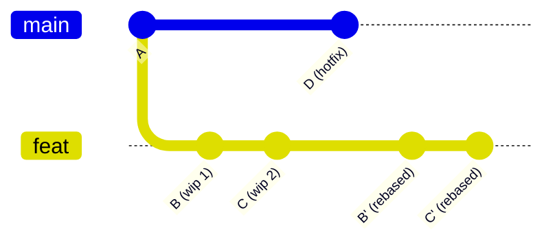

# GIT-02 · Rebase, Cherry-pick, Reflog

> **TL;DR** — `rebase` và `cherry-pick` không "di chuyển" commit cũ — chúng **tạo các commit object mới** có `parent` (và do đó có **hash**) hoàn toàn mới dựa trên diff của commit cũ. Vì thế Golden Rule là **không bao giờ rebase branch đã push và có người khác đang làm chung**. Ngược lại, trên local hoặc nhánh PR riêng, `rebase -i` giúp dọn 5–10 commit WIP thành lịch sử tuyến tính sạch sẽ, và `git reflog` (lưu lịch sử di chuyển `HEAD`/branch mặc định 90 ngày reachable / 30 ngày unreachable) là lưới an toàn cứu bạn khỏi hầu hết các pha `reset --hard` hoặc rebase hỏng.

## 🧭 Brief

| | |
| :--- | :--- |
| **Loại** | Bài học |
| **Giai đoạn** | Quý 0 · Bridge |
| **Chủ đề** | Git nâng cao |
| **Tiên quyết** | [GIT-01](../01-git-internals/README.md) |

**Phạm vi bắt buộc**
- merge vs rebase (linear history)
- interactive rebase: squash, fixup, reword
- cherry-pick và conflict
- reflog để cứu commit "đã mất"
- golden rule: không rebase branch đã push chung

**Câu hỏi sâu — nội dung phải giúp trả lời được**
- Khi nào rebase nguy hiểm?
- Làm sao khôi phục sau một git reset --hard nhầm?

**Ý tưởng lab / demo**
- Repo lab có kịch bản: lỡ reset --hard, cứu lại bằng reflog; squash 5 commit WIP

**Tài liệu gốc gợi ý**
- Pro Git (git-scm.com/book)
- Git internals docs

**Gói đầu ra**
- [x] `README.md` — lý thuyết theo [lesson-template](../../../docs/templates/lesson-template.md)
- [x] `exercises.md` — bài tập L1/L2/L3 theo [exercises-template](../../../docs/templates/exercises-template.md)
- [x] `solutions.md` — đáp án theo [solutions-template](../../../docs/templates/solutions-template.md)
- [x] `lab/` — code demo chạy được + `lab/README.md` theo [lab-template](../../../docs/templates/lab-template.md)
- [ ] _(người học)_ `my-notes.md` — **agent không tạo**

---

<!-- Nội dung bắt đầu từ đây -->

## 1. Vấn đề: tại sao phải biết cái này?

Ba tình huống lặp đi lặp lại trong team Java backend:
1. Sau 3 ngày code tính năng trên branch `feat/invoice`, bạn có 12 commit kiểu `"wip"`, `"fix typo"`, `"forgot null check"` trong khi `main` đã tiến thêm 8 commit. Nếu bấm `git merge main` liên tục rồi merge ngược lại, lịch sử biến thành mạng nhện rất khó `git bisect` ([GIT-03](../03-git-bisect/README.md)).
2. Cần đưa **đúng 1 bản vá** `fix: socket timeout` từ nhánh đang phát triển dở lên nhánh `release/1.2` mà không kéo theo 10 commit đang thử nghiệm khác.
3. Gõ nhầm `git reset --hard HEAD~2` (hoặc `rebase` nhầm nhánh) khiến 2 ngày commit biến mất khỏi `git log`.

Hiểu cơ chế **replay diff tạo commit mới** và **reflog cục bộ** biến các thao tác này từ rủi ro mất dữ liệu thành công cụ thường nhật an toàn.

---

## 2. Mô hình tư duy (mental model)

Từ [GIT-01](../01-git-internals/README.md), mỗi commit là bất biến (Merkle DAG). Do đó:
- **`merge`** tạo thêm **1 commit giao lộ** có 2 parent (`M` trỏ cả tip của `main` lẫn tip của `feature`), giữ nguyên toàn bộ hash cũ.
- **`rebase`** giống như **nhổ từng cây ở luống đất cũ, giữ lại phần cành lá (diff) rồi trồng lên ngọn luống mới (`main`)**: từng commit `C1, C2` được áp lại thành `C1', C2'` có hash mới; còn nhánh `feature` được dời con trỏ 41 byte sang `C2'`. Các commit `C1, C2` cũ **không bị xóa ngay** — chúng vẫn nằm trong `.git/objects/` và có dấu vết trong `git reflog`!


*(Khi rebase `feat` lên `main`: `B, C` cũ trở thành unreachable nhưng vẫn cứu được qua `reflog`; nhánh `feat` trỏ vào `B' -> C'` phía sau `D` tạo lịch sử thẳng hàng.)*

**Chỗ ẩn dụ không còn đúng:**
"Nhổ cây trồng lại" nghe như thao tác 1 lần là xong, nhưng nếu `feat` có 5 commit và cả 5 commit đều sửa cùng dòng với `D`, rebase sẽ **dừng ở từng commit để bạn giải conflict 5 lần** (trừ khi gộp/squash trước hoặc dùng `merge`), trong khi `merge` chỉ giải conflict đúng 1 lần ở điểm cuối.

---

## 3. Cơ chế bên trong (trọng tâm của bài)

### 3.1 `merge` vs `rebase` & Interactive Rebase (`squash`, `fixup`, `reword`)

| Lệnh / Chiến lược | Kết quả trên DAG | Ưu điểm | Nhược điểm |
| :--- | :--- | :--- | :--- |
| **`git merge --no-ff`** | Tạo merge commit 2 parent | Không sửa lịch sử cũ; giữ nguyên ngữ cảnh feature branch | Lịch sử rẽ nhánh nhiều; khó đọc nếu merge `main` vào feature liên tục |
| **`git rebase main`** | Replay từng commit feature lên tip của `main` (linear history) | Lịch sử thẳng hàng, `git log` / `git bisect` rất sạch | Viết lại hash commit; có thể giải conflict nhiều lần qua từng commit |
| **`git rebase -i <base>`** | Mở todo-list chỉnh sửa từng commit trước khi replay | Gộp commit rác trước khi tạo PR | **Tuyệt đối** không dùng cho commit đã push lên branch dùng chung |

**4 động từ hay dùng nhất trong `git rebase -i`:**
- **`pick` (`p`):** giữ nguyên commit và message.
- **`reword` (`r`):** giữ nội dung, sửa lại commit message.
- **`squash` (`s`):** gộp nội dung vào commit phía trên **và giữ lại để gộp/chỉnh commit message**.
- **`fixup` (`f`):** gộp nội dung vào commit phía trên và **vứt bỏ commit message của commit này** (lý tưởng cho commit `"fix typo"`).
*(Mẹo chuyên nghiệp: `git commit --fixup <hash>` + `git rebase -i --autosquash <base>` tự động xếp đúng vị trí và điền `fixup` giúp bạn!)*

### 3.2 `cherry-pick` và Conflict

`git cherry-pick <commit-hash>` tính **diff giữa `<commit-hash>` và parent của nó** (`git diff <hash>~1 <hash>`), rồi áp diff đó thành một **commit mới hoàn toàn** lên nhánh hiện tại (`HEAD`):
- Nếu commit nguồn là **merge commit** (có 2 parent), bạn phải chỉ rõ parent nào làm gốc bằng `-m 1` (thường là mainline branch).
- **Khi gặp conflict:** Git dừng lại giữa chừng, ghi trạng thái vào `.git/CHERRY_PICK_HEAD` và đưa 3 stage `1/2/3` vào Index. Sau khi sửa conflict và `git add <file>`, chạy `git cherry-pick --continue` (hoặc `git cherry-pick --abort` để hủy toàn bộ quay về trước lúc pick).
- **Khuyến nghị dùng `-x`:** khi cherry-pick hotfix lên nhánh release, chạy `git cherry-pick -x <hash>` để Git tự thêm dòng `(cherry picked from commit <hash>)` vào message — rất hữu ích khi kiểm tra xem hotfix đã được đưa lên `release` chưa.

### 3.3 Trả lời câu hỏi sâu #1: "Khi nào rebase nguy hiểm?" (Golden Rule)

**Golden Rule:** **Không bao giờ rebase (hoặc `commit --amend`) các commit đã push lên branch dùng chung có người khác đang kéo về.**

**Cơ chế khiến nó nguy hiểm:**
1. Bạn và đồng nghiệp cùng checkout nhánh `feat/shared` tại commit `B`.
2. Đồng nghiệp code tiếp commit `E` lên trên `B`.
3. Trong lúc đó, bạn chạy `git rebase main` biến `B` thành `B'` (hash mới!) rồi `git push --force-with-lease`.
4. Khi đồng nghiệp `git pull` (hoặc `git pull --rebase=false`), Git thấy `B` và `B'` là **hai nhánh lịch sử phân kỳ khác nhau dù cùng nội dung** → đồng nghiệp buộc phải merge lại `B` + `E` + `B'`, sinh ra **duplicate commits** và conflict giả trên toàn bộ file!
5. **Nguy hiểm thứ 2 trên local:** Rebase làm mất dấu thời gian thực lúc bạn code nhánh phụ nếu viết lại quá xa, hoặc làm hỏng bản build ở từng commit trung gian nếu bạn không test lại sau khi giải conflict (khiến `git bisect` sau này khó phân biệt lỗi gốc vs lỗi giải conflict).

*(Quy tắc an toàn khi phải push lại nhánh PR cá nhân sau khi rebase: **luôn dùng `git push --force-with-lease`**, không dùng `--force` mù quáng! `--force-with-lease` kiểm tra ref trên remote có còn khớp với `origin/feat` bạn đã fetch không — nếu có ai khác vừa push thêm commit lên nhánh đó, Git sẽ từ chối để tránh ghi đè mất code người khác.)*

### 3.4 Trả lời câu hỏi sâu #2: "Làm sao khôi phục sau một `git reset --hard` nhầm?" (`reflog`)

Mỗi lần `HEAD` hoặc một branch thay đổi vị trí (commit, checkout, reset, rebase, merge, cherry-pick), Git tự động ghi 1 dòng log cục bộ vào **`.git/logs/HEAD`** và **`.git/logs/refs/heads/<branch>`** (không bao giờ được push lên remote!).
- **Thời gian lưu:** mặc định Git giữ entry trỏ tới commit còn nối với ref trong **90 ngày** (`gc.reflogExpire`), và commit đã bị tách rời (*unreachable*) trong **30 ngày** (`gc.reflogExpireUnreachable`) trước khi `git gc` dọn.

**Quy trình 3 bước khôi phục sau `git reset --hard HEAD~2` nhầm:**
1. Chạy `git reflog` (hoặc `git reflog <tên-branch>`) để xem nhật ký dịch chuyển gần nhất:
   ```text
   34e5c20 HEAD@{0}: reset: moving to HEAD~2
   7a98e5e HEAD@{1}: commit: wip: partial step 5
   ```
2. Kiểm tra nội dung commit trước lúc reset: `git show 7a98e5e` (hoặc `git diff HEAD 7a98e5e`).
3. Phục hồi ngay bằng `git reset --hard 7a98e5e` (hoặc tạo nhánh an toàn `git switch -c rescue 7a98e5e` nếu không chắc chắn).

**Giới hạn bắt buộc phải biết:** `reflog` chỉ cứu được những gì **đã từng `git commit`**. Nếu bạn sửa code 2 tiếng **chưa `git commit`** mà chạy `git reset --hard`:
- Nếu đã chạy `git add` trước khi reset: `blob` đã vào `.git/objects/`, vẫn có cơ hội tìm lại qua `git fsck --lost-found` (trong `.git/lost-found/other/`).
- Nếu chưa cả `git add` lẫn `git commit`: Git chưa từng ghi dữ liệu vào `.git/objects/` → **không khôi phục được bằng Git** (chỉ còn trông vào Local History của IDE!).

---

## 4. Code minh họa

### 4.1 Sai vs Đúng khi xử lý rebase & force push

```bash
# ❌ SAI 1: Rebase nhánh `develop` hoặc `release` dùng chung rồi push --force
git switch release/2.0
git rebase main
git push --force origin release/2.0   # PHÁ HỎNG lịch sử của toàn bộ team!

# ✅ ĐÚNG 1: Chỉ rebase nhánh PR cá nhân của chính bạn, và đẩy bằng --force-with-lease
git switch feat/order-timeout
git fetch origin
git rebase origin/main
git push --force-with-lease origin feat/order-timeout
```

### 4.2 Legacy corner (Java 7 / JBoss AS 7.1.1 trên Windows)

Trên dự án legacy ở công ty (thường có nhiều bản release chạy song song cho từng khách hàng/chi nhánh):
1. Khi fix 1 bug khẩn cấp trên `main` và cần vá lên 2 nhánh khách hàng `release/v1.4` và `release/v1.5`, dùng **`git cherry-pick -x <commit-hash>`** thay vì sửa tay lại từng dòng rồi commit mới — vừa giữ được dấu vết commit gốc trong message, vừa giảm nguy cơ sót dòng khi port bugfix.
2. Trước khi thử bất kỳ lệnh rewrite lịch sử nào (`rebase -i`, `reset --hard`) trên repo legacy lớn, có thói quen đặt 1 nhánh đánh dấu tạm `git branch backup/before-rebase` (tốn đúng 41 byte theo `GIT-01`!). Nếu thấy rối, `git reset --hard backup/before-rebase` mất 1 giây và xóa nhánh tạm khi xong.

---

## 5. Quan sát & đo đạc

Chạy lab tạo kịch bản lỡ tay `git reset --hard HEAD~2`, cứu lại bằng `reflog`, squash 5 WIP commit và `cherry-pick` hotfix:
```powershell
powershell -ExecutionPolicy Bypass -File 00-foundations/git-workflow/02-rebase-cherry-pick-reflog/lab/scripts/setup-lab.ps1
powershell -ExecutionPolicy Bypass -File 00-foundations/git-workflow/02-rebase-cherry-pick-reflog/lab/solutions/verify-recovery-and-cherrypick.ps1
```

**Output thật ghi nhận từ `git version 2.54.0.windows.1`:**
```text
=== [1] Rescue feature-wip after accidental reset --hard via reflog ===
Before rescue (only 3 WIP commits):
34e5c20 wip: partial step 3
...
Rescued commit 7a98e5e! Now 5 WIP commits exist:
7a98e5e wip: partial step 5
...

=== [3] Cherry-pick isolated hotfix onto main ===
* 863b2a0 feat: complete wip feature in one clean commit
| * 3b08384 fix: set explicit socket timeout
|/
| * a563f1f fix: set explicit socket timeout   <-- hash gốc trên hotfix-source
| * b0f9748 feat: unfinished experiment
|/
* 547a3c5 chore: init app
```
*(Để ý: `a563f1f` trên `hotfix-source` sau khi `cherry-pick` sang `main` trở thành hash mới `3b08384` vì có `parent` mới là `547a3c5`.)*

---

## 6. Trade-offs & khi nào KHÔNG dùng

| Thao tác | Được gì | Mất gì | Dùng khi |
| :--- | :--- | :--- | :--- |
| **`rebase`** vs `merge` | Lịch sử thẳng hàng, dễ `git bisect` & `git log` | Đổi hash commit cũ; phải giải conflict từng commit | Cập nhật nhánh feature cá nhân trước khi tạo/merge PR |
| **`squash` / `fixup`** | Biến 10 commit WIP thành 1–2 commit có ý nghĩa | Mất lịch sử thử-sai chi tiết trong quá trình code | Dọn dẹp nhánh cá nhân trước review PR |
| **`cherry-pick -x`** | Lấy đúng 1 bản vá sang nhánh khác không kéo code thử nghiệm | Tạo commit trùng nội dung khác hash; nếu sau này merge 2 nhánh dễ conflict nhẹ | Backport hotfix sang nhánh release đang chạy production |
| **`--force-with-lease`** vs `--force` | An toàn: từ chối push nếu remote có commit mới chưa fetch | Vẫn viết lại lịch sử nhánh cá nhân | Luôn dùng thay `--force` khi push nhánh cá nhân sau rebase |

---

## 7. Cạm bẫy production (ít nhất 3)

1. **Chạy `git push --force` lên nhánh chung hoặc nhánh có người khác vừa push hotfix** — *Triệu chứng:* commit của đồng nghiệp trên remote biến mất lặng lẽ khỏi branch. *Nguyên nhân:* `--force` ghi đè mù quáng ref trên remote. *Cách tránh:* không rebase branch chung; nhánh cá nhân luôn dùng `--force-with-lease`.
2. **Sửa code cả buổi chiều chưa `git commit` rồi chạy `git reset --hard`** — *Triệu chứng:* `git reflog` chỉ thấy commit sáng nay, phần code buổi chiều biến mất hoàn toàn. *Nguyên nhân:* `reflog` chỉ theo dõi di chuyển của ref/commit; thay đổi chỉ nằm ở Working Tree chưa từng vào `.git/objects/`. *Cách tránh:* luôn `git commit -m "wip"` (hoặc `git stash push -m "..."`) trước khi reset/rebase.
3. **Nhầm lẫn `git reset --soft` vs `--mixed` vs `--hard`** — *Triệu chứng:* định giữ lại code đang làm để gom commit nhưng chạy nhầm `--hard` mất toàn bộ thay đổi Working Tree. *Nguyên nhân:* `--soft` chỉ dời branch ref (giữ nguyên Index & Working Tree); `--mixed` (mặc định) reset cả ref và Index (giữ Working Tree); `--hard` xóa sạch cả ref, Index lẫn Working Tree. *Cách tránh:* kiểm tra `git status` trước mọi lệnh `reset`; nếu muốn gom commit, dùng `--soft`.

---

## 8. Liên hệ thực tế công việc

Ngay tuần này trên repo công ty:
1. Trước khi mở PR hoặc merge một nhánh làm việc có 4–5 commit sửa vặt, hãy thực hành `git branch backup/wip` rồi dùng `git rebase -i` (hoặc `git reset --soft`) gộp gọn các commit `"fix typo"` thành commit có ý nghĩa rõ ràng.
2. Thử gõ `git reflog -n 10` trên repo đang làm để làm quen với định dạng `HEAD@{n}` — bạn sẽ tự tin hơn hẳn mỗi khi cần thử nghiệm với branch.

---

## 9. Self-check — Explain-back

> Trả lời **không nhìn tài liệu**, nói to trong 5 phút. Không trả lời được = chưa xong. (Đáp án nằm trong [solutions.md](./solutions.md).)

1. Về bản chất DAG, `rebase` và `cherry-pick` giống nhau ở điểm nào? Tại sao `cherry-pick` tạo ra một commit hash mới khác commit nguồn?
2. Giải thích **Golden Rule** của `rebase` và kịch bản cụ thể điều gì hỏng khi bạn rebase một branch đã push chung cho đồng nghiệp.
3. Trong `git rebase -i`, phân biệt `squash`, `fixup` và `reword`.
4. Trình bày từng bước cách khôi phục commit sau khi lỡ tay `git reset --hard HEAD~2`, và nêu rõ 2 trường hợp `reflog` **không** cứu trực tiếp được.
5. Phân biệt `--force` và `--force-with-lease`, và phân biệt 3 chế độ `--soft`, `--mixed`, `--hard` của `git reset`.

---

## 10. Cheatsheet 1 trang

```text
# Dọn 5 commit gần nhất trên nhánh cá nhân (chưa push chung)
git rebase -i HEAD~5                 # pick / reword / squash / fixup

# Đồng bộ nhánh cá nhân với main mới nhất + push an toàn
git fetch origin && git rebase origin/main
git push --force-with-lease

# Đưa đúng 1 hotfix sang nhánh release
git switch release/1.0 && git cherry-pick -x <hotfix-hash>

# Cứu commit sau khi lỡ git reset --hard nhầm
git reflog                           # tìm hash ngay trước dòng "reset: moving to..."
git reset --hard <old-hash>          # hoặc: git switch -c rescued <old-hash>
```

---

## 11. Tài liệu tham khảo

- Scott Chacon & Ben Straub, *Pro Git* (2nd Ed.) — [Chapter 3.6: Git Branching - Rebasing](https://git-scm.com/book/en/v2/Git-Branching-Rebasing) và [Chapter 10.7: Maintenance and Data Recovery](https://git-scm.com/book/en/v2/Git-Internals-Maintenance-and-Data-Recovery).
- [Git Official Documentation — `git-rebase`, `git-cherry-pick`, `git-reflog`, `git-reset`](https://git-scm.com/docs) — mô tả chi tiết `--force-with-lease`, `gc.reflogExpireUnreachable`, và `-m` trong cherry-pick merge commit.

---
➡️ Tiếp theo: [exercises.md](./exercises.md) · [lab/](./lab/README.md) · Bài kế: [GIT-03 · Tìm bug bằng git bisect](../03-git-bisect/README.md)
