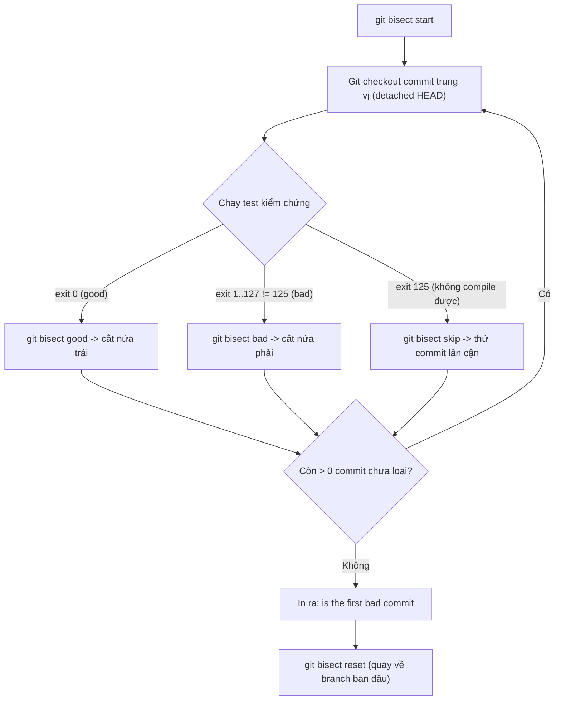

# GIT-03 · Tìm bug bằng git bisect

> **TL;DR** — Khi sản phẩm chạy ổn ở tag `v2.1` cách đây 1 tháng nhưng hôm nay bị regression sau 500–1.000 commit, việc đọc log bằng mắt tốn hàng giờ mà vẫn dễ bỏ sót. `git bisect` áp dụng **binary search trên DAG lịch sử** để khoanh đúng *first bad commit* chỉ trong $\lceil \log_2(N) \rceil$ bước (1.000 commit chỉ cần **tối đa 10 bước**). Kết hợp `git bisect run <script>`, toàn bộ quá trình chạy hoàn toàn tự động theo quy ước exit code (`0` = good, `1..127 trừ 125` = bad, `125` = skip khi commit không biên dịch được), và `--first-parent` giúp bỏ qua các commit nhánh phụ chưa xanh.

## 🧭 Brief

| | |
| :--- | :--- |
| **Loại** | Bài học |
| **Giai đoạn** | Quý 0 · Bridge |
| **Chủ đề** | Git nâng cao |
| **Tiên quyết** | [GIT-02](../02-rebase-cherry-pick-reflog/README.md) |

**Phạm vi bắt buộc**
- binary search trên lịch sử
- git bisect run với script test tự động
- bisect với merge commit

**Câu hỏi sâu — nội dung phải giúp trả lời được**
- Bisect trên 1000 commit cần tối đa bao nhiêu bước?
- Điều kiện để bisect run hoạt động đúng?

**Ý tưởng lab / demo**
- Script tạo repo 200 commit có 1 commit gây bug; dùng bisect run tìm ra

**Tài liệu gốc gợi ý**
- Pro Git (git-scm.com/book)
- Git internals docs

**Gói đầu ra**
- [x] `README.md` — lý thuyết theo [lesson-template](../../../docs/templates/lesson-template.md)
- [x] `exercises.md` — bài tập L1/L2/L3 theo [exercises-template](../../../docs/templates/exercises-template.md)
- [x] `solutions.md` — đáp án theo [solutions-template](../../../docs/templates/solutions-template.md)
- [x] `lab/` — code demo chạy được + `lab/README.md` theo [lab-template](../../../docs/templates/lab-template.md)
- [ ] _(người học)_ `my-notes.md` — **agent không tạo**

---

<!-- Nội dung bắt đầu từ đây -->

## 1. Vấn đề: tại sao phải biết cái này?

Tháng trước bản `release/2.4` chạy ổn định, nhưng sau 2 tuần với ~400 commit gộp từ 6 dev, QA báo: *"Tính chiết khấu khách hàng VIP đang sai từ 10% thành 5%."*
- Đọc 400 commit bằng mắt (`git log -p`) mất cả buổi chiều và dễ trượt qua một commit có message vô hại kiểu `"chore: clean up config"`.
- Kiểm tra thủ công từng ngày (`checkout` lùi 1 tuần, 3 ngày...) không có hệ thống thường mất 15–25 lần build lại WAR/JBoss.

`git bisect` biến việc tìm commit gây lỗi trên 400–1.000 commit thành **9–10 lần kiểm tra có hướng dẫn** (hoặc hoàn toàn tự động qua đêm bằng `git bisect run`).

---

## 2. Mô hình tư duy (mental model)

Hãy hình dung lịch sử commit từ `good` đến `bad` như một **dãy số đã sắp xếp**: mọi commit phía trước điểm gãy đều trả về `GOOD`, mọi commit từ điểm gãy trở đi đều trả về `BAD`. `git bisect` chỉ việc chọn **trung vị** (commit chia đôi số commit còn lại ở giữa), checkout sang commit đó (`detached HEAD`), hỏi bạn `good` hay `bad`, rồi vứt bỏ một nửa không gian tìm kiếm.

**Chỗ ẩn dụ không còn đúng:**
Lịch sử Git là một **DAG** (có nhánh rẽ và merge commit), không phải lúc nào cũng là đường thẳng:
1. Nếu có 2 nhánh song song nhập vào merge commit `M`, trung vị của DAG vẫn tính theo số commit tiếp cận được (reachable), nên đôi khi `bisect` nhảy vào giữa một feature branch dài chưa chắc tự compile độc lập được nếu tác giả nhánh đó không giữ từng commit xanh.
2. Nếu bạn truyền `--first-parent`, Git đi dọc theo đúng xương sống `main` (chỉ kiểm tra các điểm merge trên `main` rồi mới khoanh vào nhánh gây lỗi nếu cần).



---

## 3. Cơ chế bên trong (trọng tâm của bài)

### 3.1 Trả lời câu hỏi sâu #1: "Bisect trên 1000 commit cần tối đa bao nhiêu bước?"

Trong khoảng gồm $N$ commit từ `good` (độc quyền) đến `bad`, mỗi lần kiểm tra loại bỏ một nửa số ứng viên:
- Với $N = 1.000$ commit: $2^{9} = 512 < 1.000 \le 1.024 = 2^{10}$, do đó cần **tối đa $\lceil \log_2(1000) \rceil = 10$ bước** kiểm tra là tìm chính xác *first bad commit* (trong lab với 200 commit, `2^7 = 128 < 198 <= 256 = 2^8`, `git bisect` thực hiện đúng **8 bước**: `#100 → #150 → #125 → #137 → #131 → #134 → #136` rồi chốt `#137`).
- Ngay cả một repo có **1.000.000 commit** cũng chỉ mất tối đa $\lceil \log_2(1.000.000) \rceil = \mathbf{20}$ bước!

Bên dưới, Git lưu trạng thái phiên bisect vào thư mục `.git/BISECT_*` (`BISECT_START` lưu tên branch ban đầu để `git bisect reset` quay về, `BISECT_LOG` lưu lịch sử các đánh dấu good/bad, `refs/bisect/bad` và `refs/bisect/good-*` giữ các ref tạm).

### 3.2 `git bisect run` & Trả lời câu hỏi sâu #2: "Điều kiện để `bisect run` hoạt động đúng?"

Cú pháp:
```bash
git bisect start <bad-rev> <good-rev>
git bisect run <command> [args...]
```
`git bisect run` lặp tự động: checkout commit trung vị → chạy `<command>` → đọc exit code:
- **`0`**: coi commit là **`good`**.
- **`1..127` (ngoại trừ `125`)**: coi commit là **`bad`**.
- **`125`**: lệnh báo **"không kiểm tra được"** → Git tự đánh dấu `git bisect skip` và nhảy sang commit lân cận (ví dụ khi gặp commit bị gãy biên dịch không liên quan đến bug đang tìm!).
- **Exit code `> 127`** (thường gặp khi command bị kill bởi signal hoặc command không tồn tại — ví dụ gõ sai tên script trả về `127`/`128`!): trong đó `> 127` khiến `git bisect run` **dừng khẩn cấp** để tránh đánh dấu sai toàn bộ lịch sử.

**4 điều kiện bắt buộc để `git bisect run` cho kết quả chính xác:**
1. **Tính đơn điệu (Monotonicity) của bug trên khoảng `[good..bad]`:** Lỗi phải bắt đầu từ 1 commit và tiếp tục tái hiện cho tới `bad` (không chập chờn *flaky test*, không bị sửa nhầm rồi vỡ lại giữa chừng trừ khi bạn hiểu rõ phạm vi).
2. **Script hoàn toàn độc lập & clean build (Self-contained):**
   - Trước khi test, phải biên dịch lại từ mã nguồn tại commit đang checkout (ví dụ `mvn -q test-compile test -Dtest=MyReproTest` hoặc xóa `target/`). Nếu quên build lại và chạy nhầm `.jar`/`.class` cũ còn sót, mọi bước đều cho kết quả giống nhau!
   - Nếu chạy script kiểm tra nằm **trong chính git repo đang bisect**, khi `bisect` lùi về commit cũ chưa có file script đó thì script sẽ biến mất! **Luôn đặt script test ở ngoài repo** (hoặc trong `/tmp` / thư mục cha) hoặc dùng lệnh trực tiếp như `mvn test`.
3. **Trả về đúng exit code `125` cho lỗi không liên quan (compile error):** Ví dụ:
   ```bash
   mvn -q test-compile || exit 125
   mvn -q test -Dtest=DiscountRegressionTest
   ```
   Nếu `test-compile` lỗi mà không `exit 125`, `mvn` trả exit code `1` khiến `bisect` hiểu nhầm commit lỗi biên dịch đó là thủ phạm gây bug logic!
4. **Dọn dẹp file rác (clean working tree) trước/trong script:** Nếu test sinh file log/DB tạm làm `git checkout` bước kế bị từ chối, Git sẽ dừng bisect.

### 3.3 Bisect với Merge Commit (`--first-parent`)

Khi repo dùng chiến lược tạo merge commit (`git merge --no-ff feat/abc`), có 2 tình huống:
- **Mặc định (`git bisect start bad good`):** Git tìm kiếm cả các commit bên trong nhánh `feat/abc`. Rủi ro: nhánh `feat/abc` có thể chứa commit WIP chưa compile được, hoặc bạn chỉ muốn biết **PR/merge commit nào** đã đưa bug vào `main`.
- **Dùng `--first-parent` (`git bisect start --first-parent bad good`):** Git chỉ bước nhảy dọc theo `parent 1` của mỗi commit trên `main`. Khi phát hiện merge commit `M` là *first bad commit*, bạn đã khoanh gọn đúng **1 PR**; nếu muốn tìm tiếp commit con bên trong PR đó, chỉ cần mở phiên bisect thứ hai trên `M^1..M^2`!

*(Mẹo nếu bug không phải "good → bad" mà là "broken → fixed", tức bạn muốn tìm commit **đã sửa** một lỗi: dùng thuật ngữ đảo ngược `git bisect start --term-old=broken --term-new=fixed`!)*

---

## 4. Code minh họa

### 4.1 Mẫu script `bisect-run` an toàn cho project Java / Maven

```bash
#!/usr/bin/env bash
# Đặt file NÀY ở ngoài git repo (ví dụ /tmp/check-bug.sh)
set -u

# 1. Nếu commit này không compile được -> trả 125 để git bisect skip, KHÔNG đánh dấu bad!
mvn -q test-compile || exit 125

# 2. Chạy đúng 1 bài test tái hiện bug (ví dụ đặt test repro tạm ở /tmp hoặc truyền -Dtest=...)
mvn -q test -Dtest=VipDiscountRegressionTest
```

### 4.2 Legacy corner (Java 7 / JBoss AS 7.1.1 trên Windows)

Trên codebase công ty không có test tự động cho bug mới báo:
1. Viết nhanh 1 **unit test tái hiện bug ở ngoài commit tree** (hoặc viết 1 file `Repro.java` nhỏ để ở `$env:TEMP\Repro.java`, copy vào / biên dịch cùng class cần kiểm tra trong script PowerShell rồi xóa sau khi test) — tránh tình trạng `git bisect` checkout lùi lại 100 commit là mất file test của chính bạn.
2. Nhớ dùng **`powershell -NoProfile -ExecutionPolicy Bypass -File <đường-dẫn-tuyệt-đối>`** khi chạy `git bisect run` trên Windows, và luôn kết thúc bằng `git bisect reset` để trả repo về đúng branch trước khi làm tiếp.

---

## 5. Quan sát & đo đạc

Chạy lab tự động sinh 200 commit (bug ẩn ở commit `#137`) và để `git bisect run` tự săn thủ phạm:
```powershell
$check = (Resolve-Path 00-foundations/git-workflow/03-git-bisect/lab/scripts/bisect-check.ps1).Path
powershell -ExecutionPolicy Bypass -File 00-foundations/git-workflow/03-git-bisect/lab/scripts/create-200-commits-repo.ps1
cd $env:TEMP\git-03-bisect-lab
git bisect start HEAD $(git rev-list --max-parents=0 HEAD)
git bisect run powershell -NoProfile -ExecutionPolicy Bypass -File $check
git bisect reset
```

**Output thật ghi nhận từ `git version 2.54.0.windows.1`:**
```text
Bisecting: 99 revisions left to test after this (roughly 7 steps) -> iteration 100
Bisecting: 49 revisions left to test after this (roughly 6 steps) -> iteration 50
Bisecting: 24 revisions left to test after this (roughly 5 steps) -> iteration 25
Bisecting: 12 revisions left to test after this (roughly 4 steps) -> iteration 125
Bisecting: 5 revisions left to test after this (roughly 3 steps)  -> iteration 137
Bisecting: 2 revisions left to test after this (roughly 2 steps)  -> iteration 131
Bisecting: 0 revisions left to test after this (roughly 1 step)   -> iteration 134
Bisecting: 0 revisions left to test after this (roughly 1 step)   -> iteration 136
34db58801042dfe267161565f02d37325cf5f7b6 is the first bad commit
    chore: iteration 137
```
Chỉ mất đúng **8 lần chạy script** để bắt trúng `iteration 137` trong 200 commit!

---

## 6. Trade-offs & khi nào KHÔNG dùng

| Lựa chọn | Được gì | Mất gì | Dùng khi |
| :--- | :--- | :--- | :--- |
| **`git bisect run` tự động** | Không tốn công tay, chạy qua đêm được cho repo lớn | Tốn thời gian viết script repro ổn định và xử lý exit `125` | Khoảng tìm kiếm `> 15` commit và tái hiện được bằng test/CLI |
| **`git bisect` thủ công** | Linh hoạt khi bug phải kiểm tra bằng mắt/UI/Postman | Chậm nếu `> 20` commit | Bug UI hoặc môi trường khó tự động hóa |
| **`git bisect --first-parent`** | Tránh rơi vào commit WIP gãy build trong feature branch | Chỉ tìm ra merge commit (PR), chưa chỉ đích danh dòng trong PR | Repo merge theo PR (`--no-ff`) với nhánh con chưa sạch từng commit |
| **`git log -S <token>` (Pickaxe)** | Tìm ngay commit thêm/xóa 1 chuỗi/hàm cụ thể trong 1 giây | Vô dụng nếu bug đến từ thay đổi tương tác giữa nhiều file | Biết chắc tên hàm/biến/constant bị đổi |

---

## 7. Cạm bẫy production (ít nhất 3)

1. **Quên `exit 125` khi commit trung gian không compile được** — *Triệu chứng:* `git bisect run` kết luận thủ phạm là một commit `"wip: temp"` gãy compile hoàn toàn không liên quan gì đến bug. *Nguyên nhân:* lệnh build (`mvn compile`) trả exit code `1`, bị `bisect run` hiểu là `bad`. *Cách tránh:* luôn kiểm tra bước build trước và trả `125` (`build_cmd || exit 125`).
2. **Để file test tái hiện bug bên trong repo đang bisect** — *Triệu chứng:* đang bisect bình thường bỗng nhiên commit cũ báo `file not found` (exit `1` hoặc `127`), hoặc không checkout được vì file untracked đụng commit có cùng tên file. *Nguyên nhân:* `git bisect` di chuyển `HEAD` về quá khứ nơi file test chưa tồn tại. *Cách tránh:* đặt script kiểm tra (và file test tạm nếu cần) ở thư mục ngoài repo (`$env:TEMP` / `/tmp`), hoặc xóa file tạm sau mỗi bước test.
3. **Dùng `bisect run` với một flaky test (lúc pass lúc fail ngẫu nhiên)** — *Triệu chứng:* `bisect` nhảy sai nửa và chỉ vào một commit vô tội (`chore: update README`). *Nguyên nhân:* Binary search giả định tính đơn điệu tuyệt đối; chỉ cần 1 bước chạy sai dấu là toàn bộ các bước sau tìm nhầm nửa. *Cách tránh:* loại bỏ thời gian/mạng/random khỏi test repro, hoặc chạy lại 2–3 lần trong script trước khi kết luận `bad`.

---

## 8. Liên hệ thực tế công việc

Ngay tuần này trên repo công ty:
1. Thử `git log -S "<tên-hàm-hoặc-constant>" --oneline` kết hợp với `git bisect` tinh thần: nếu tuần tới gặp bất kỳ regression nào mà `v_old` hoạt động còn `HEAD` lỗi, đừng đọc từng commit — hãy tạo nhanh khoảng `git bisect start HEAD <good-tag>` và tự khoanh vùng trong 15 phút.

---

## 9. Self-check — Explain-back

> Trả lời **không nhìn tài liệu**, nói to trong 5 phút. Không trả lời được = chưa xong. (Đáp án nằm trong [solutions.md](./solutions.md).)

1. Bisect trên 1.000 commit và 1.000.000 commit mất tối đa bao nhiêu bước kiểm tra? Công thức tính là gì?
2. Liệt kê 3 nhóm exit code mà `git bisect run` nhận biết (`0`, `1..127` trừ `125`, `125`) và ý nghĩa của từng mã.
3. Nêu 4 điều kiện để `git bisect run` chạy ra kết quả đúng không bị lừa.
4. Khi lịch sử có nhiều merge commit từ các nhánh con chứa commit WIP gãy build, flag nào của `git bisect` giúp giải quyết và cơ chế nó đi trên DAG như thế nào?
5. Vì sao không nên để file script kiểm tra của `git bisect run` nằm ngay trong working tree (đã tracked) của repo đang bisect?

---

## 10. Cheatsheet 1 trang

```text
# Bisect thủ công
git bisect start <bad> <good>
git bisect good | bad | skip
git bisect log                       # xem lại lịch sử các bước đã chọn
git bisect reset                     # bắt buộc chạy khi xong để thoát detached HEAD

# Bisect tự động & merge-safe
git bisect start --first-parent HEAD v1.0.0
git bisect run /path/outside/repo/check.sh

# Quy ước exit code cho script
# 0 = good | 1..127 (trừ 125) = bad | 125 = skip (không compile/test được) | >127 = abort
```

---

## 11. Tài liệu tham khảo

- Scott Chacon & Ben Straub, *Pro Git* (2nd Ed.) — [Chapter 7.10: Debugging with Git (`git bisect`)](https://git-scm.com/book/en/v2/Git-Tools-Debugging-with-Git).
- [Git Official Documentation — `git-bisect`](https://git-scm.com/docs/git-bisect) — đặc tả exit codes (`0`, `125`, `>127`), `--first-parent`, `--term-old`/`--term-new`.

---
➡️ Tiếp theo: [exercises.md](./exercises.md) · [lab/](./lab/README.md) · Bài kế: [GIT-04 · Branching strategy & Conventional Commits](../04-branching-conventional-commits/README.md)
