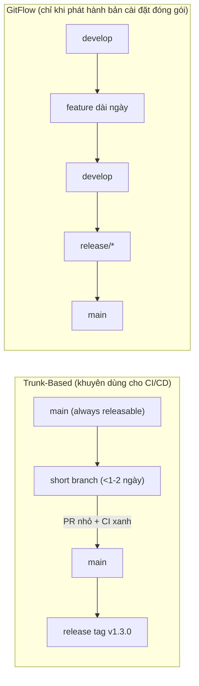

# GIT-04 · Branching strategy & Conventional Commits

> **TL;DR** — Branching strategy quyết định tốc độ tích hợp code: **GitFlow** tạo nhiều nhánh sống dài (`develop`, `release/*`, `hotfix/*`) dễ gây "merge hell", **GitHub Flow** phù hợp deploy web liên tục qua short-lived PR, còn **Trunk-Based Development (TBD)** giữ nhánh sống `< 1–2 ngày` hợp nhất liên tục vào `main` nên là nền tảng bắt buộc của CI/CD hiện đại (dùng Feature Flags thay cho nhánh sống dài). Đi kèm với đó, **Conventional Commits** (`feat:`, `fix:`, `!` / `BREAKING CHANGE:`) biến lịch sử commit thành dữ liệu máy đọc được để tự sinh **Semantic Versioning (`MAJOR.MINOR.PATCH`)** và giúp kỹ sư trực sự cố đọc hiểu nguyên nhân chỉ trong vài giây qua `git blame` / `git bisect`.

## 🧭 Brief

| | |
| :--- | :--- |
| **Loại** | Bài học |
| **Giai đoạn** | Quý 0 · Bridge |
| **Chủ đề** | Git nâng cao |
| **Tiên quyết** | [GIT-03](../03-git-bisect/README.md) |

**Phạm vi bắt buộc**
- trunk-based vs GitFlow vs GitHub flow
- conventional commits và semantic versioning
- commit message tốt
- PR nhỏ

**Câu hỏi sâu — nội dung phải giúp trả lời được**
- Vì sao trunk-based phù hợp với CI/CD?
- Commit message tốt giúp gì khi điều tra sự cố?

**Ý tưởng lab / demo**
- Viết commit-msg hook kiểm tra format conventional commits

**Tài liệu gốc gợi ý**
- Pro Git (git-scm.com/book)
- Git internals docs

**Gói đầu ra**
- [x] `README.md` — lý thuyết theo [lesson-template](../../../docs/templates/lesson-template.md)
- [x] `exercises.md` — bài tập L1/L2/L3 theo [exercises-template](../../../docs/templates/exercises-template.md)
- [x] `solutions.md` — đáp án theo [solutions-template](../../../docs/templates/solutions-template.md)
- [x] `lab/` — code demo chạy được + `lab/README.md` theo [lab-template](../../../docs/templates/lab-template.md)
- [ ] _(người học)_ `my-notes.md` — **agent không tạo**

---

<!-- Nội dung bắt đầu từ đây -->

## 1. Vấn đề: tại sao phải biết cái này?

Trong một team 8 backend dev:
1. Nhánh `feat/v2-billing` tách ra từ `develop` sống 4 tuần không merge về nhánh chính. Đến ngày tích hợp trước release, merge lại sinh **42 file conflict**, mất 2 ngày sửa conflict và sinh 6 regression bug mới.
2. Khi production sập lúc 23:00, bạn dùng `git bisect` chỉ ra commit nghi vấn, mở `git show` chỉ thấy tiêu đề: `"fix"` / `"update code"` / `"done task 12"` (không body, không ticket ID, không lý do) → không biết hàm bị sửa là sửa bug gì hay ràng buộc nghiệp vụ nào, không dám revert ngay.
3. PR gửi lên dài `1.400 dòng` chạm `28 file` → reviewer bấm "LGTM" lướt qua trong 3 phút vì quá tải nhận thức.

Chọn đúng branching strategy + PR nhỏ + Conventional Commits có kỷ luật giải quyết cả 3 vấn đề từ gốc quy trình.

---

## 2. Mô hình tư duy (mental model)

Hãy hình dung **integration branch (`main` / trunk)** như một **tuyến đường sắt chính**:
- **GitFlow:** mỗi đội tự xây hẳn một đường ray riêng dài hàng chục km (`feature/*` → `develop` → `release/*`), cuối tháng mới nối vào đường ray chính. Càng tách lâu, hai đường ray càng lệch nhau, lúc nối lại (*merge day*) dễ trật bánh.
- **Trunk-Based Development:** mọi toa tàu đều chạy trên cùng 1 trục chính, mỗi chuyến hàng chỉ rẽ nhánh tối đa vài giờ đến 1–2 ngày (`< 24–48h`) rồi nhập về `main` ngay. Toa tàu nào chưa mở bán cho khách thì **đóng khóa toa (Feature Flag)** ngay trên trục chính thay vì tách ray sống 1 tháng!



---

## 3. Cơ chế bên trong (trọng tâm của bài)

### 3.1 So sánh Trunk-Based vs GitHub Flow vs GitFlow

| Tiêu chí | Trunk-Based Development (TBD) | GitHub Flow | GitFlow |
| :--- | :--- | :--- | :--- |
| **Số nhánh sống lâu dài** | 1 (`main`), nhánh release ngắn chỉ cắt lúc sắp phát hành nếu cần | 1 (`main`) | 2 (`main` + `develop`) + `release/*`, `hotfix/*` |
| **Tuổi thọ feature branch** | Rất ngắn (**vài giờ – 1–2 ngày**) hoặc commit thẳng vào `main` (team nhỏ có CI nhanh) | Ngắn đến trung bình (vài ngày) | Dài (nhiều ngày – nhiều tuần) |
| **Xử lý tính năng lớn chưa xong** | **Branch by Abstraction + Feature Flag** (code đã merge vào `main` nhưng tắt flag) | Giữ trên PR cho tới khi xong tính năng rồi mới merge & deploy | Giữ trên `feature/*` / `develop` |
| **Phù hợp với** | Microservices / SaaS / team làm **CI/CD** liên tục | Web app / API deploy mỗi khi merge PR | Sản phẩm đóng gói phát hành theo chu kỳ dài (mobile app cần Apple review, phần mềm cài on-premise nhiều version song song) |

### 3.2 Trả lời câu hỏi sâu #1: "Vì sao Trunk-Based phù hợp với CI/CD?"

CI (*Continuous Integration*) không chỉ là "có Jenkins/GitHub Actions chạy test trên mỗi nhánh riêng lẻ" — theo định nghĩa gốc, CI là **mọi lập trình viên tích hợp code của mình vào nhánh chung ít nhất mỗi ngày một lần**:
1. **Phát hiện xung đột sớm khi còn nhỏ:** Merge 20 dòng mỗi ngày chỉ gây tối đa 1–2 conflict nhỏ dễ sửa; để 3 tuần thành 2.000 dòng thì công sức sửa conflict tăng theo cấp số nhân.
2. **Test thực sự phản ánh bản phát hành:** Một tính năng A chạy xanh trên nhánh riêng và tính năng B chạy xanh trên nhánh riêng **không đảm bảo A + B chạy cùng nhau sẽ xanh**. Trunk-based ép A và B chạm mặt nhau trên `main` ngay trong ngày → pipeline CD luôn có một artifact duy nhất sẵn sàng deploy bất kỳ lúc nào.
3. **Mở đường cho PR nhỏ (`< 200–400 LOC`):** PR nhỏ nhận review kỹ thật sự (tìm được lỗi logic và race condition), còn PR `1.500 dòng` gần như chắc chắn bị review qua loa.

### 3.3 Conventional Commits & Semantic Versioning (`SemVer`)

Đặc tả **Conventional Commits 1.0.0** chuẩn hóa cấu trúc commit message:
```text
<type>[optional (scope)][!]: <short summary>

[optional body: WHY this change was made]

[optional footer(s): BREAKING CHANGE: ... / Refs: JIRA-123]
```

**Ánh xạ trực tiếp sang Semantic Versioning (`MAJOR.MINOR.PATCH`):**
- **`fix:`** (sửa bug tương thích ngược) → tự động tăng **`PATCH`** (`1.2.3 → 1.2.4`).
- **`feat:`** (thêm tính năng tương thích ngược) → tự động tăng **`MINOR`** (`1.2.4 → 1.3.0`, reset `PATCH` về `0`).
- **`!` ngay trước dấu `:`** (vd `feat(api)!: ...`) **HOẶC** footer **`BREAKING CHANGE: ...`** → tự động tăng **`MAJOR`** (`1.3.0 → 2.0.0`).
- Các `type` khác (`docs`, `refactor`, `perf`, `test`, `build`, `ci`, `chore`, `style`, `revert`) không tự tăng version API (trừ khi có `!` / `BREAKING CHANGE`).

Nhờ format chuẩn này, các công cụ CI (như `semantic-release`, `release-please`) tự động sinh `CHANGELOG.md` và bump tag version không cần chỉnh tay.

### 3.4 Commit message tốt & Trả lời câu hỏi sâu #2: "Commit message tốt giúp gì khi điều tra sự cố?"

Quy tắc **50/72** + nguyên tắc **"Diff nói *Cái gì* (What), Commit message phải nói *Tại sao* (Why)"**:
- Dòng tiêu đề ≤ 50–72 ký tự, dùng động từ nguyên mẫu mệnh lệnh (*"add"*, *"reject"*, *"avoid"* — khớp cách viết của Git khi tự sinh `"Merge branch..."` hoặc `"Revert..."`).
- Phần **Body** (cách tiêu đề 1 dòng trống, ngắt dòng ~72 ký tự) ghi rõ:
  1. **Triệu chứng / Bối cảnh:** trước đó bị lỗi gì, số liệu nào, ticket nào?
  2. **Tại sao chọn giải pháp này:** vì sao không dùng cách khác? Có ràng buộc ẩn nào với DB/legacy app không?

**Khi điều tra sự cố production lúc nửa đêm**, `git blame` hoặc `git bisect` chỉ ra commit `a1b2c3d`:
- Nếu message là `"fix bug"`: bạn không biết xóa/revert dòng đó có làm sống lại một lỗi bảo mật hay một bug dữ liệu nghiêm trọng hơn không → **tê liệt, không dám hotfix nhanh**.
- Nếu message ghi rõ:
  ```text
  fix(pool): set socketTimeout=3000ms on legacy tax client

  Partner tax gateway stalled silently during 11/11 peak, holding
  JBoss worker threads indefinitely until pool exhaustion.
  3000ms leaves margin below the 5000ms upstream gateway timeout.
  Refs: INC-2026-041
  ```
  Kỹ sư trực sự cố chỉ cần 10 giây đọc `git show` là hiểu ngay **ngưỡng 3000ms liên kết với upstream 5000ms**, biết ngay nên điều chỉnh tham số nào hay revert có an toàn không!

### 3.5 Kỹ thuật giữ PR nhỏ (`< 300 LOC`)
1. **Tách Refactoring PR khỏi Feature PR:** đổi tên/tách class trước trong 1 PR thuần refactor (behavior unchanged) → review 5 phút; PR tính năng sau đó chỉ còn 80 dòng logic mới.
2. **Stack / Phased PR với Interface/Feature Flag:** tạo interface + DB migration trước (PR 1), implement + test phía sau (PR 2), bật flag (PR 3).

---

## 4. Code minh họa

### 4.1 Hook `commit-msg` kiểm tra Conventional Commits (không cần Python/Node)

Trích từ [lab/hooks/commit-msg](./lab/hooks/commit-msg) (chạy được trên Git for Windows `sh` lẫn Linux/macOS):
```sh
#!/bin/sh
MSG_FILE="$1"
FIRST_LINE=$(head -n 1 "$MSG_FILE" | tr -d '\r')

case "$FIRST_LINE" in
  Merge\ *|Revert\ \"*) exit 0 ;;
esac

PATTERN='^(feat|fix|docs|style|refactor|perf|test|build|ci|chore|revert)(\([a-z0-9._-]+\))?!?: .{1,72}$'
if ! printf '%s\n' "$FIRST_LINE" | grep -Eq "$PATTERN"; then
  echo "ERROR: Invalid Conventional Commit message: \"$FIRST_LINE\"" >&2
  exit 1
fi
```

### 4.2 Legacy corner (Java 7 / JBoss AS 7.1.1 trên Windows)

Trên hệ thống legacy Java 7 / JBoss ở công ty (thường phát hành theo lịch cố định cuối tuần hoặc giữ 2–3 phiên bản cho các đơn vị khác nhau):
1. Nếu chưa lên được Continuous Deployment mỗi ngày, bạn vẫn áp dụng được **Trunk-Based nội bộ cho phần phát triển** (PR nhỏ `< 300 dòng`, merge về nhánh chính mỗi 1–2 ngày, chỉ cắt `release/*` ngay sát ngày đóng gói WAR) để tránh các nhánh feature sống hàng tháng gây merge hell.
2. Dùng `git config --local core.hooksPath .githooks` (trên Git 2.9+) hoặc copy `commit-msg` vào `.git/hooks/` để cả team Windows dùng thống nhất format mà **không cần cài Node.js (`husky`) hay Python (`pre-commit`)**.

---

## 5. Quan sát & đo đạc

Chạy script test `commit-msg` hook trong `lab/`:
```powershell
powershell -ExecutionPolicy Bypass -File 00-foundations/git-workflow/04-branching-conventional-commits/lab/scripts/setup-hook-lab.ps1
```

**Output thật ghi nhận từ `git version 2.54.0.windows.1`:**
```text
=== [1] Testing invalid commit message ('update code') ===
ERROR: Invalid Conventional Commit message:
  "update code"

Expected: <type>[optional (scope)][!]: <short summary (<=72 chars)>
Allowed types: feat, fix, docs, style, refactor, perf, test, build, ci, chore, revert
Exit code for invalid commit: 1

=== [2] Testing valid Conventional Commit ('feat(order): add initial app') ===
Exit code for valid commit: 0
e02e18d feat(order): add initial app
```

---

## 6. Trade-offs & khi nào KHÔNG dùng

| Lựa chọn | Được gì | Mất gì | Dùng khi |
| :--- | :--- | :--- | :--- |
| **Trunk-Based Development** | Ít conflict, CI luôn kiểm tra code đã hợp nhất, deploy nhanh | Đòi hỏi test tự động tốt + Feature Flag cho việc lớn | Team làm web/backend/microservices CI/CD |
| **GitFlow** | Tách biệt rõ bản đang chạy prod và bản đang phát triển | Nhánh sống dài dễ merge hell, nhiều ceremony branch | Phần mềm đóng gói/on-premise hỗ trợ song song nhiều major version cũ |
| **Conventional Commits + Hook** | Tự động SemVer/Changelog, lịch sử sạch dễ tra cứu | Hơi khắt khe lúc mới làm quen (nhất là commit WIP local — nên chỉ chặn khi commit cuối hoặc dùng squash PR title) | Mọi repo team và dự án cá nhân có CI |

---

## 7. Cạm bẫy production (ít nhất 3)

1. **Tạo branch `feat/xyz` sống 3 tuần không đồng bộ `main` rồi gửi PR 2.000 dòng** — *Triệu chứng:* conflict hàng loạt, reviewer không đọc nổi chi tiết, lỗi ẩn lọt lên staging/prod. *Cách tránh:* áp dụng Branch by Abstraction / Feature Flag, chia thành các PR nhỏ `< 300 LOC` gộp mỗi 1–2 ngày.
2. **Đưa breaking change vào mà không đánh dấu `!` hoặc `BREAKING CHANGE:`** — *Triệu chứng:* SemVer chỉ tăng `MINOR` hoặc `PATCH` (vd `1.4.0 → 1.4.1`), consumer tưởng an toàn nâng cấp và vỡ API/schema ở production. *Cách tránh:* review checklist bắt buộc đánh dấu `!` / `BREAKING CHANGE:` khi đổi API contract, xóa field JSON hoặc đổi định dạng config.
3. **Commit message chỉ lặp lại tên file vừa sửa (`"update OrderService.java"`)** — *Triệu chứng:* 6 tháng sau khi điều tra sự cố qua `git blame`, không ai biết tại sao dòng `if` kỳ lạ đó được thêm vào. *Cách tránh:* tiêu đề nói mục đích nghiệp vụ, body ghi rõ *tại sao* và mã ticket sự cố.

---

## 8. Liên hệ thực tế công việc

Ngay hôm nay với repo dự án Java 7 tại công ty và chính repo học tập `daily-engineering-lab` này:
1. Thử cài đặt hook `commit-msg` từ [lab/](./lab/README.md) cho một repo cá nhân (hoặc kích hoạt `git config core.hooksPath` trong repo thử nghiệm) để rèn thói quen viết `<type>(<scope>): <why/summary>`.
2. Với PR/merge sắp tới ở công ty, thử chủ động tách phần refactor (đổi tên hàm, dọn import) thành 1 commit/PR riêng trước khi viết phần thay đổi nghiệp vụ.

---

## 9. Self-check — Explain-back

> Trả lời **không nhìn tài liệu**, nói to trong 5 phút. Không trả lời được = chưa xong. (Đáp án nằm trong [solutions.md](./solutions.md).)

1. So sánh GitFlow, GitHub Flow và Trunk-Based Development về số nhánh sống lâu dài và tuổi thọ feature branch.
2. Vì sao Trunk-Based Development lại phù hợp nhất với CI/CD, và làm sao xử lý một tính năng lớn mất 2 tuần mới xong mà không tạo nhánh dài ngày?
3. Trong Conventional Commits, `fix:`, `feat:` và `!` / `BREAKING CHANGE:` tác động thế nào tới Semantic Versioning (`MAJOR.MINOR.PATCH`)?
4. Vì sao nói *"Diff nói What, Commit message phải nói Why"* — điều này giúp gì trực tiếp khi bạn dùng `git blame` / `git bisect` lúc 23:00 xử lý sự cố production?
5. Kể 2 kỹ thuật cụ thể để tách một thay đổi lớn (~1.000 dòng) thành các PR nhỏ dễ review.

---

## 10. Cheatsheet 1 trang

```text
# Conventional Commits -> SemVer
fix(scope): ...                 -> PATCH (0.0.+1)
feat(scope): ...                -> MINOR (0.+1.0)
feat(scope)!: ... / BREAKING CHANGE: -> MAJOR (+1.0.0)
docs / refactor / test / chore / ci / perf / build -> không tăng version

# Cấu trúc commit message tốt
<type>(<scope>): <tóm tắt hành động ngắn gọn <= 50-72 ký tự>

<Body: Tại sao cần thay đổi? Bối cảnh/ticket? Tại sao không chọn cách khác?>

BREAKING CHANGE: <nếu có>
```

---

## 11. Tài liệu tham khảo

- [Conventional Commits 1.0.0 Specification](https://www.conventionalcommits.org/en/v1.0.0/) — đặc tả chính thức `<type>`, `<scope>`, `!`, `BREAKING CHANGE`.
- [Semantic Versioning 2.0.0](https://semver.org/) — quy tắc `MAJOR.MINOR.PATCH`.
- Paul Hammant, [Trunk Based Development](https://trunkbaseddevelopment.com/) — mô hình TBD, Branch by Abstraction, Short-lived feature branches.
- Chris Beams, [How to Write a Git Commit Message](https://cbea.ms/git-commit/) — 7 quy tắc kinh điển về tiêu đề & body.
- [Git Official Documentation — `githooks(5)`](https://git-scm.com/docs/githooks) — đặc tả `commit-msg` hook và `core.hooksPath`.

---
➡️ Tiếp theo: [exercises.md](./exercises.md) · [lab/](./lab/README.md) · Chặng tiếp (Năm 1 · Q1): [DSA-01 · Độ phức tạp & Big-O thực dụng](../../dsa/01-complexity-analysis/README.md)
