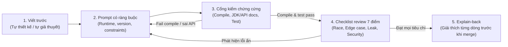

# AI-01 · AI-assisted development playbook

> **TL;DR** — AI coding assistant không "hiểu" hệ thống của bạn; nó dự đoán token có xác suất cao nhất dựa trên ngữ cảnh bạn đưa vào và dữ liệu huấn luyện. Vì vậy AI rất giỏi sinh boilerplate, gợi ý góc nhìn test và giải thích cấu trúc lạ, nhưng cực dễ **bịa API không tồn tại (hallucination)**, tạo **race condition tinh vi**, bỏ sót **edge case nghiệp vụ**, hoặc sinh code Java 17/21 không chạy được trên **Java 7 / JBoss AS 7.1.1**. Kỷ luật cốt lõi là **"Viết trước, hỏi sau"**, luôn ép code qua compiler/test thật, và duyệt mọi dòng qua **checklist 7 điểm** trước khi merge — không bao giờ merge đoạn code mà chính bạn không giải thích được từng dòng.

## 🧭 Brief

| | |
| :--- | :--- |
| **Loại** | Bài học |
| **Giai đoạn** | Năm 1 · Q1 |
| **Chủ đề** | AI Engineering |

**Phạm vi bắt buộc**
- prompt cho review, sinh test, giải thích code
- lỗi AI hay mắc (hallucinated API, race condition, thiếu edge case)
- quy trình viết trước - hỏi sau
- checklist review code AI viết

**Câu hỏi sâu — nội dung phải giúp trả lời được**
- Làm sao phát hiện API do AI bịa?
- Review code AI sinh ra theo checklist nào?

**Ý tưởng lab / demo**
- Cho AI sinh 3 đoạn code có lỗi tinh vi, luyện tìm lỗi

**Tài liệu gốc gợi ý**
- AI Engineering (Chip Huyen)
- Anthropic docs (docs.claude.com)
- pgvector README
- MTEB leaderboard
- Model Context Protocol spec

**Gói đầu ra**
- [x] `README.md` — lý thuyết theo [lesson-template](../../../docs/templates/lesson-template.md)
- [x] `exercises.md` — bài tập L1/L2/L3 theo [exercises-template](../../../docs/templates/exercises-template.md)
- [x] `solutions.md` — đáp án theo [solutions-template](../../../docs/templates/solutions-template.md)
- [x] `lab/` — code demo chạy được + `lab/README.md` theo [lab-template](../../../docs/templates/lab-template.md)
- [ ] _(người học)_ `my-notes.md` — **agent không tạo**

---

<!-- Nội dung bắt đầu từ đây -->

## 1. Vấn đề: tại sao phải biết cái này?

Trong đội ngũ backend dùng AI mỗi ngày, có hai kịch bản tốn giờ debug nhiều nhất:
1. **Merge nhanh, trả nợ chậm:** Một developer dùng AI sinh `OrderRateLimiter` (80 dòng) và `JdbcInvoiceRepository` (110 dòng) trong 3 phút, thấy code gọn, bấm merge. Hai tuần sau ở tải **1.500 req/s**, hệ thống xảy ra race condition làm vượt quota khuyến mãi, leak **400+ JDBC connections** trong 12 phút làm JBoss AS 7.1.1 treo cứng thread pool, và tốn **6 giờ** incident review mới nhận ra không ai trong team thực sự đọc kỹ đoạn code AI sinh.
2. **Mất năng lực đọc và thiết kế code:** Cứ gặp class legacy 1.500 dòng là dán toàn bộ sang AI hỏi *"sửa giùm bug này"*. Khi lên production không có quyền truy cập công cụ AI ngoài (môi trường nội bộ ngân hàng/doanh nghiệp), hoặc khi AI bịa một method `HttpClient.newBuilder().retryPolicy(...)` không hề tồn tại trong JDK, người dùng không biết tự kiểm chứng bằng source code và tài liệu gốc.

Hiểu bản chất failure modes của AI biến AI từ **"máy gõ code mù"** thành **reviewer & sparring partner** giúp tăng chất lượng mà không đánh mất quyền làm chủ hệ thống.

---

## 2. Mô hình tư duy (mental model)

Hãy xem trợ lý AI như một **kỹ sư thực tập siêu đọc nhiều nhưng làm việc theo trí nhớ ngắn hạn và cực kỳ tự tin**:
- Cậu ta đã đọc hàng tỷ dòng code công khai (GitHub, StackOverflow, docs nhiều phiên bản trộn lẫn nhau).
- Cậu ta không có "trình biên dịch trong đầu" và không thấy toàn bộ runtime/schema/dependencies trên máy bạn nếu bạn không đưa vào prompt.
- Khi không chắc một method thuộc JDK 7 hay JDK 21, hoặc thư viện `v2.1` hay `v3.4`, cậu ta **không dừng lại báo "tôi không biết"** — cậu ta ghép tên method nghe *có vẻ hợp lý nhất* theo xác suất thống kê và trình bày với giọng điệu chắc nịch như sự thật.

**Chỗ ẩn dụ không còn đúng:**
Người thực tập thật biết tự nghi ngờ khi không tìm thấy file và có thể chạy thử trong đầu xem kiểu trả về có khớp hay không; còn LLM sinh từng token tuần tự một chiều (autoregressive) dựa trên phân phối xác suất có điều kiện $P(t_i \mid t_{<i}, \text{context})$. Một khi token sai đầu tiên lọt vào (ví dụ tên class/method sai phiên bản), các token sau tiếp tục *hợp thức hóa* cái sai đó một cách trôi chảy.



---

## 3. Cơ chế bên trong (trọng tâm của bài)

### 3.1 Vì sao AI mắc 4 nhóm lỗi kinh điển?

Theo *AI Engineering* (Chip Huyen) và tài liệu hướng dẫn prompt của Anthropic (`docs.claude.com`), các lỗi khi dùng LLM sinh code bắt nguồn trực tiếp từ cơ chế hoạt động của mô hình ngôn ngữ:

1. **Hallucinated API / Version Drift (Bịa API hoặc trộn phiên bản):**
   - Trong dữ liệu huấn luyện, cùng một thư viện tồn tại nhiều version (`Spring Boot 2` dùng `javax.*`, `Spring Boot 3` dùng `jakarta.*`; `Apache HttpClient 4` vs `5`; `Java 7` vs `Java 21`). Khi prompt không khóa chặt phiên bản, LLM chọn mẫu xuất hiện nhiều nhất theo thống kê thay vì mẫu đúng với `pom.xml` của bạn.
   - Nguy hiểm hơn là **plausible-looking fabrication** (bịa tên method theo quy luật đặt tên của thư viện, ví dụ `JdbcTemplate.queryForOptional(...)` hoặc `Files.readString(path, Charset)` ở JDK 7 vốn mới có từ JDK 11) hoặc **slopsquatting** (bịa tên package/artifact chưa từng tồn tại trên Maven Central/npm — kẻ tấn công có thể đăng ký chính tên package bịa đó để phát tán mã độc).
2. **Race Condition & Concurrency Illusion:**
   - Code ví dụ trên blog/tutorial thường bỏ qua đồng bộ hóa để ngắn gọn. Do đó LLM có thiên hướng sinh mẫu **check-then-act** (`if (!map.containsKey(k)) map.put(k, ...)` hoặc `if (count < limit) { ... count++; }`) dù đã dùng `ConcurrentHashMap` hoặc `AtomicInteger`. Dùng class thread-safe *không* làm chuỗi 2 thao tác ghép lại trở nên atomic.
3. **Thiếu Edge Case & Resource Cleanup:**
   - LLM tối ưu cho "happy path" (đầu vào hợp lệ, không `null`, số dương, kết nối thành công). Các nhánh biên như `BigDecimal` chia không có `RoundingMode` (ném `ArithmeticException`), chuỗi rỗng/blank, số âm/tràn `int`, `null` ở cột DB nullable, hoặc quên đóng `Connection`/`PreparedStatement`/`ResultSet` khi có exception giữa chừng rất thường bị bỏ qua.
4. **Sycophancy & Silent Assumption (Chiều ý & tự giả định ngầm):**
   - Nếu bạn hỏi *"Đoạn code này đúng rồi chứ?"*, mô hình dễ đồng thuận và chỉ chỉnh sửa lặt vặt. Nếu đề bài thiếu chi tiết (múi giờ, isolation level, transaction boundary, encoding UTF-8), AI tự chọn ngầm một giả định mà không hỏi lại bạn.

### 3.2 Trả lời câu hỏi sâu #1: Làm sao phát hiện API do AI bịa?

Không dựa vào "cảm giác quen mắt" — phải xác minh qua **4 lớp kiểm tra cơ học**:

| Lớp kiểm tra | Cách thực hiện cụ thể | Phát hiện được gì |
| :--- | :--- | :--- |
| **1. Compiler & IDE / JDK target thật** | Chạy `javac --release 7` (hoặc `mvn -o compile` với đúng `<maven.compiler.release>`) và `javap` kiểm tra chữ ký class | Bắt ngay method không tồn tại, API chỉ có ở JDK mới (như `List.of`, `String.isBlank`, `Files.readString` trên Java 7), sai checked exception |
| **2. Kiểm tra Dependency & Coordinate** | Tra `pom.xml` hiện hữu của project hoặc kiểm tra trong `.m2/repository` / Maven Central | Bắt artifact/groupId bịa (*slopsquatting*), version drift (method có ở bản 3.x nhưng `pom.xml` đang khóa 2.x) |
| **3. Nhảy tới định nghĩa (Go to Declaration)** | Trong IDE (IntelliJ: `Ctrl+B`), mở thẳng file `.class` / source JAR xem Javadoc, tham số, giá trị trả về, behavior khi null | Bắt lỗi hiểu sai ngữ nghĩa (ví dụ `ConcurrentHashMap.computeIfAbsent` không cho phép modify map bên trong lambda — ném `IllegalStateException` trên JDK 9+/treo deadlock ở JDK 8) |
| **4. Ép AI trích dẫn nguồn xác thực** | Yêu cầu AI ghi rõ *"Chỉ dùng API có trong JDK 7 / `<thư viện X phiên bản Y>`, nếu không chắc hãy nói không chắc"* và đối chiếu tài liệu chính thức | Giảm hallucination do model tự lọc không gian phương án; nhưng **không bao giờ thay thế được bước 1–3** |

### 3.3 Quy trình "Viết trước, hỏi sau" (từ ROADMAP §2.3)

Quy trình này đảm bảo bạn **nâng trình tư duy** thay vì làm người bấm nút Tab:

1. **Bước 1 — Tự viết nháp trước (10–15 phút):** Trước khi mở AI, tự viết ra giấy hoặc file nháp: (a) bài toán nhận input gì, trả output gì, invariants là gì; (b) 3 edge case dễ chết nhất; (c) cấu trúc code/query dự kiến hoặc 3 giả thuyết nếu đang debug bug.
2. **Bước 2 — Prompt AI phản biện (không giao làm hộ từ đầu):** Đưa bản nháp + ràng buộc môi trường cho AI, nhờ chỉ ra lỗ hổng, race condition, hoặc trường hợp biên bạn sót.
3. **Bước 3 — Kiểm chứng bằng Compiler + Test thật:** Tự gõ hoặc chạy code, viết unit test cho mọi edge case vừa phát hiện (trước khi tin bất kỳ câu trả lời nào).
4. **Bước 4 — Explain-back:** Đóng màn hình AI, tự giải thích lại luồng dữ liệu, transaction, lock và failure mode của đoạn code vừa hoàn thành.

### 3.4 Bộ Prompt mẫu cho 3 tác vụ cốt lõi

Nguyên tắc chung (theo Anthropic Prompt Engineering docs): **khóa rõ Role + Runtime/Constraints + Input cụ thể + Output format + Tiêu chí từ chối bịa**.

#### A. Prompt Review Code (ép AI tìm lỗi thật, chống khen xã giao)
```text
Vai trò: Senior Java Backend Reviewer khó tính.
Môi trường bắt buộc: Java 7, JBoss AS 7.1.1, JDBC thuần (không Spring, không Lombok).
Hãy review đoạn code dưới đây CHỈ tập trung vào lỗi nghiêm trọng:
1. Lỗi concurrency / race condition / thread-safety.
2. Resource leak (Connection, Statement, ResultSet, Stream, File descriptor).
3. Edge case (null, chia 0, BigDecimal scale/rounding, off-by-one, tràn số).
4. Bảo mật (SQL injection, log nhạy cảm) và API không tồn tại trên Java 7.
Không viết lại toàn bộ code nếu chưa liệt kê từng bug theo format:
[Mức độ] Dòng/Method -> Kịch bản lỗi cụ thể -> Cách sửa ngắn gọn.
Nếu không tìm thấy lỗi ở hạng mục nào, ghi rõ "Không phát hiện".
```

#### B. Prompt Sinh Test (ép AI cover boundary & characterization test)
```text
Môi trường: JUnit 5 + AssertJ (hoặc JUnit 4 nếu module legacy Java 7).
Đọc method dưới đây và liệt kê danh sách test cases TRƯỚC khi viết code:
- Happy path (tối thiểu 2 case)
- Boundary values (0, âm, MAX_VALUE, chuỗi rỗng/blank, null, list rỗng)
- Failure / exception path (timeout, duplicate key, SQL error)
Quy tắc:
- KHÔNG dùng mock cho domain logic thuần (theo CQ-07).
- Mọi test phải assert giá trị/trạng thái cụ thể, CẤM viết test chỉ assertNotNull() hoặc nuốt exception.
```

#### C. Prompt Giải thích Code lạ (phối hợp với phương pháp đọc code READ-01)
```text
Tôi đã tự đọc class này và tóm tắt hiểu biết của tôi như sau:
<Dán 3-5 dòng tóm tắt của chính bạn ở đây>

Hãy:
1. Chỉ ra điểm nào trong tóm tắt của tôi bị sai hoặc hiểu thiếu so với code thực tế.
2. Vẽ luồng gọi chính (Entry point -> DB/External I/O -> Side effect) bằng danh sách đánh số.
3. Chỉ rõ những chỗ có implicit state (biến static, ThreadLocal, mutating parameter) hoặc subtle side-effect.
Không tóm tắt chung chung; mọi khẳng định phải chỉ đích xác tên method/biến có trong code tôi dán.
```

### 3.5 Trả lời câu hỏi sâu #2: Checklist review code AI sinh ra (7 điểm)

Dùng checklist này như **cổng kiểm soát bắt buộc** trước mọi `git commit`:

1. **[ ] API & Runtime Match:** Tất cả class, method, overload, annotation có thực sự tồn tại ở đúng phiên bản JDK / dependency trong `pom.xml` không? (Đã biên dịch sạch với `--release` mục tiêu chưa?)
2. **[ ] Edge Cases & Data Invariants:** Đã kiểm tra `null`, chuỗi rỗng, mảng rỗng, số `0`/âm, `BigDecimal` scale & `RoundingMode`, off-by-one (`<` vs `<=`), timezone (`UTC` vs local)?
3. **[ ] Concurrency & State:** Có shared mutable state (`static SimpleDateFormat`, `HashMap` dùng chung nhiều thread), hay mẫu check-then-act không atomic (`containsKey` + `put`, `get` + `set`) không?
4. **[ ] Resource & Transaction Lifecycle:** Mọi `Connection`, `PreparedStatement`, `ResultSet`, `InputStream`, socket đều nằm trong `try-with-resources` (hoặc `try/finally` ở Java < 7)? Lỗi có gây rollback đúng chỗ và không nuốt `InterruptedException`?
5. **[ ] Security & Input Validation:** Có nối chuỗi SQL (`"SELECT ... " + id`), path traversal, hardcoded secret/token, hoặc log PII/password ra file không?
6. **[ ] Test Integrity:** Test AI sinh ra có test đúng hành vi thất bại (khi cố tình làm hỏng logic, test có ĐỎ thật không?), hay chỉ mock hết mọi thứ và assert qua loa?
7. **[ ] Explain-back Gate:** Bạn có thể giải thích từng dòng code, từng điều kiện `if`, và độ phức tạp thời gian/bộ nhớ của đoạn code này cho đồng nghiệp trong 3 phút mà không nhìn lại prompt không?

---

## 4. Code minh họa

Ví dụ dưới đây trích từ lab thực tế của bài ([OrderRateLimiterBuggy.java](./lab/src/main/java/lab/ai/playbook/buggy/OrderRateLimiterBuggy.java) vs bản sửa trong `lab/solutions/`): nhìn bên ngoài code do AI sinh rất sạch sẽ và dùng `ConcurrentHashMap`, nhưng sập dưới concurrency thật!

```java
// ❌ SAI (code AI hay sinh): dùng ConcurrentHashMap nhưng vẫn dính race condition + memory leak!
public final class OrderRateLimiterBuggy {
    private final ConcurrentHashMap<String, Integer> counters = new ConcurrentHashMap<>();
    private final int maxRequests;

    public boolean allowRequest(String userId) {
        // BẪY 1: Check-then-act KHÔNG atomic! 2 thread cùng đọc count = 4 (< 5) -> cả 2 cùng ghi 5 -> lọt quota!
        Integer current = counters.getOrDefault(userId, 0);
        if (current >= maxRequests) {
            return false;
        }
        counters.put(userId, current + 1);
        // BẪY 2: Không kiểm tra null/blank userId; không bao giờ xóa entry cũ -> leak RAM theo userId!
        return true;
    }
}
```

```java
// ✅ ĐÚNG: cập nhật trạng thái atomic trong 1 bucket có kiểm soát vòng đời & validate input
public final class OrderRateLimiterFixed {
    private final ConcurrentHashMap<String, AtomicInteger> counters = new ConcurrentHashMap<>();
    private final int maxRequests;

    public boolean allowRequest(String userId) {
        if (userId == null || userId.isBlank()) {
            throw new IllegalArgumentException("userId must not be blank");
        }
        AtomicInteger counter = counters.computeIfAbsent(userId, k -> new AtomicInteger(0));
        // Atomic compare-and-set loop đảm bảo không vượt trần maxRequests dù 64 thread chạy song song
        while (true) {
            int current = counter.get();
            if (current >= maxRequests) {
                return false;
            }
            if (counter.compareAndSet(current, current + 1)) {
                return true;
            }
        }
    }
}
```

### 4.1 Legacy corner (Java 7 / JBoss AS 7.1.1)

Trên môi trường công ty dùng **Java 7 / JBoss AS 7.1.1 / JDBC thuần** không kết nối internet:
1. **Lệch phiên bản JDK:** AI mặc định sinh `LocalDate`, `Optional`, `Stream`, `List.of`, `String.isBlank`, `var`, hay `HttpClient` — tất cả đều **lỗi compile trên JDK 7**. Hãy luôn thêm dòng khóa đầu prompt: *"Target strictly Java 7 (no lambda, no Stream, no java.time, no Optional). Use java.sql.* JDBC and try-with-resources (available since Java 7)."*
2. **Thread-safety bẫy kinh điển ở Java 7:** AI rất hay dùng `private static final SimpleDateFormat SDF = new SimpleDateFormat("yyyy-MM-dd");` khi viết helper format ngày trên Java 7 — **`SimpleDateFormat` KHÔNG thread-safe**! Trên JBoss nhiều worker thread dùng chung, nó làm hỏng ngày âm thầm hoặc ném `NumberFormatException` ngẫu nhiên (phải dùng `ThreadLocal<SimpleDateFormat>` hoặc tạo mới theo scope).
3. **Bảo mật dữ liệu công ty:** Tuyệt đối **không** dán tên bảng thật nhạy cảm, chuỗi kết nối JDBC, IP nội bộ, secret hoặc dữ liệu khách hàng thật vào công cụ AI public. Hãy ẩn danh hóa tên class/bảng (`TableA`, `CustomerOrder`) trước khi hỏi.

---

## 5. Quan sát & đo đạc

Trong lab của bài này (`lab/`), ta chạy bộ test tái hiện **3 đoạn code "AI-generated" chứa lỗi tinh vi** và kiểm chứng bằng JUnit 5 + Java Compiler API (`--release`):

```powershell
# Từ thư mục lab/
mvn -o -B verify
mvn -o -B compile exec:java
```

**Output thực tế ghi nhận trên Windows 11 · OpenJDK 26.0.1 (`--release 21`):**
- `AiBugReproductionTest`: **4/4 tests pass** (trong đó 3 test chủ động tái hiện và chứng minh chính xác 3 lỗi tinh vi của AI: race condition vượt giới hạn quota `allowRequest` dưới 16 thread song song; SQL injection + rò rỉ resource / sai `BigDecimal` rounding trong `InvoiceJdbcHelperBuggy`; nuốt `InterruptedException` + retry nhầm lỗi 4xx + `SimpleDateFormat` race trong `PaymentClientBuggy`; và 1 test kiểm tra phát hiện hallucinated/version-incompatible API qua reflection/compile check!).
- `PlaybookLabRunner`: in đối chiếu trực tiếp tỷ lệ lọt quota khi chạy 16 thread với `maxRequests = 10` (`Buggy allowed = 13..16/16` vs `Fixed allowed = 10/16` chính xác tuyệt đối) và kết quả kiểm tra API `java.lang.String.isBlank` (có từ JDK 11 — không tồn tại trên Java 7) vs `java.net.http.HttpClient.newBuilder().retryPolicy(...)` (API bịa không tồn tại trên bất kỳ JDK nào!).

---

## 6. Trade-offs & khi nào KHÔNG dùng

| Kịch bản dùng AI | Được gì | Mất / Rủi ro gì | Dùng khi |
| :--- | :--- | :--- | :--- |
| **AI sinh code từ đầu (Vibe coding)** | Nhanh ở prototype / CRUD đơn giản | Tỷ lệ bug ẩn cao, mù kiến trúc, khó debug khi sự cố prod | Script dùng 1 lần, spike thử ý tưởng (nhưng không merge prod nguyên trạng) |
| **Viết trước → AI review & sinh test** | Phát hiện góc khuất, mở rộng boundary test nhanh, giữ nguyên hiểu biết sâu | Tốn thêm 10–15 phút tự phác thảo trước | **Mọi task code nghiệp vụ & refactoring hàng ngày** |
| **Không dùng AI** | Buộc đọc sâu spec/source gốc, rèn tư duy độc lập (giống `READ-01`) | Chậm hơn ở việc viết test boilerplate lặp lại | Khi đang học nền tảng cốt lõi, xử lý sự cố nhạy cảm bảo mật, hoặc code tối mật không được đưa ra ngoài |

---

## 7. Cạm bẫy production (ít nhất 3)

1. **Tin tưởng code AI chỉ vì "nhìn rất sạch và có comment đầy đủ"** — *Triệu chứng:* code có Javadoc đẹp, dùng `ConcurrentHashMap`, qua được unit test đơn luồng, nhưng lên production 500 concurrent users thì vượt quota/sai số liệu. *Nguyên nhân:* check-then-act không atomic, thiếu boundary test. *Cách tránh:* luôn viết stress test đa luồng ngắn cho mọi code có shared state (xem `lab/`).
2. **Merge test do AI viết mà không kiểm tra test có thể FAIL được không** — *Triệu chứng:* coverage đạt 90% nhưng bug vẫn lên production. *Nguyên nhân:* AI thường mock cả đối tượng đang test hoặc chỉ viết `assertDoesNotThrow` / `verify(repo).save(any())` mà không kiểm tra giá trị trả về hoặc invariant thật ([CQ-07](../../code-quality/07-test-pyramid-mocking/README.md)). *Cách tránh:* thử sửa sai 1 điều kiện trong production code (*mutation check thủ công*) — nếu test vẫn xanh, test đó vô dụng.
3. **Copy nguyên package/import hoặc method bịa (Hallucination & Slopsquatting)** — *Triệu chứng:* dự án mới thêm dependency từ gợi ý của AI mà không kiểm tra trên Maven Central, hoặc dùng method phiên bản cũ/mới lộn xộn dẫn đến lỗi runtime `NoSuchMethodError` trên JBoss. *Cách tránh:* chỉ thêm thư viện có lý do rõ, kiểm tra groupId/artifactId chính thức và luôn compile sạch bằng đúng JDK target của server.
4. **Rò rỉ secret / mã nguồn độc quyền qua prompt** — *Triệu chứng:* dev dán cả file config có mật khẩu DB hoặc logic tính giá độc quyền lên web chat AI công cộng. *Nguyên nhân:* không tách biệt dữ liệu nhạy cảm trước khi hỏi. *Cách tránh:* ẩn danh hóa tên domain, thay mọi credential bằng placeholder trước khi gửi prompt.

---

## 8. Liên hệ thực tế công việc

Ngay tuần này trên codebase **Java 7 / JBoss AS 7.1.1**:
1. Chọn 1 hàm nghiệp vụ cũ ~50–100 dòng bạn sắp sửa: tự đọc và viết 5 dòng tóm tắt flow ra giấy trước ([READ-01](../../../00-foundations/code-reading/01-code-reading-method/README.md)), rồi mới dùng Prompt C (Giải thích & đối chiếu) để kiểm tra xem bạn đọc sót nhánh nào.
2. Áp dụng **Checklist 7 điểm** ở §3.5 cho đúng 1 PR hoặc đoạn code tiếp theo bạn dùng AI hỗ trợ — đặc biệt soi kỹ 2 mục hay chết nhất trên legacy: **đóng JDBC resource trong `try/finally` (hoặc `try-with-resources`)** và **không chia sẻ `SimpleDateFormat` dạng `static`**.

---

## 9. Self-check — Explain-back

> Trả lời **không nhìn tài liệu**, nói to trong 5 phút. Không trả lời được = chưa xong. (Đáp án nằm trong [solutions.md](./solutions.md).)

1. Tại sao mô hình LLM lại có thể bịa ra tên một method Java hoặc tên dependency Maven trông "rất thật" dù nó không tồn tại?
2. Nêu 4 bước kiểm tra cơ học để phát hiện một API hoặc phiên bản thư viện do AI bịa.
3. Giải thích quy trình **"Viết trước, hỏi sau"** và lý do nó chống lại ảo giác hiểu biết (*illusion of competence*).
4. Kể tên 7 hạng mục trong checklist review code do AI sinh ra trước khi commit.
5. Khi dùng AI viết code cho hệ thống **Java 7 / JBoss AS 7.1.1 / JDBC thuần**, 3 lỗi đặc thù nào AI dễ mắc nhất?

---

## 10. Cheatsheet 1 trang

| Chủ đề | Quy tắc bỏ túi |
| :--- | :--- |
| **Bản chất LLM** | Dự đoán token theo xác suất từ ngữ cảnh + dữ liệu cũ → không tự biết runtime/pom.xml của bạn |
| **Phát hiện API bịa** | (1) Compile đúng `--release` target, (2) Kiểm tra `pom.xml`/Maven Central, (3) `Ctrl+B` đọc source/Javadoc, (4) Ép khóa version trong prompt |
| **4 lỗi kinh điển** | Hallucinated API/slopsquatting · Check-then-act race · Thiếu edge case (`null`, `BigDecimal`, `0`) · Quên đóng resource / nuốt interrupt |
| **Viết trước, hỏi sau** | Tự phác thảo + tự đoán edge case 10' → Hỏi AI phản biện → Compile + Test thật → Explain-back từng dòng |
| **Checklist 7 điểm** | API/Version · Edge cases · Concurrency · Resource/Tx · Security · Test có thể FAIL không? · Explain-back |

---

## 11. Tài liệu tham khảo

- Chip Huyen, *AI Engineering* (O'Reilly, 2025) — Chương về Foundation Models, Hallucination, Evaluation & Prompt Engineering.
- [Anthropic Documentation — Prompt Engineering Overview](https://docs.anthropic.com/en/docs/build-with-claude/prompt-engineering/overview) — hướng dẫn đưa ngữ cảnh rõ ràng, role prompting, và giảm hallucination ("allow model to say I don't know").
- [Java SE 21 & JDK 7 API Specs (`SimpleDateFormat`, `ConcurrentHashMap`)](https://docs.oracle.com/en/java/javase/21/docs/api/java.base/java/util/concurrent/ConcurrentHashMap.html) — đối chiếu các ràng buộc thread-safety và phiên bản `@since` của từng API.
- [ROADMAP.md §2.3 — Quy tắc dùng AI](../../../ROADMAP.md#23-quy-tắc-dùng-ai-ai-era-discipline) — nguyên tắc "Viết trước, hỏi sau" và Explain-back test của repo.

---
➡️ Tiếp theo: [exercises.md](./exercises.md) · [lab/](./lab/README.md) · Bài kế: [AI-02 · Embeddings cơ bản](../02-embeddings-fundamentals/README.md)
