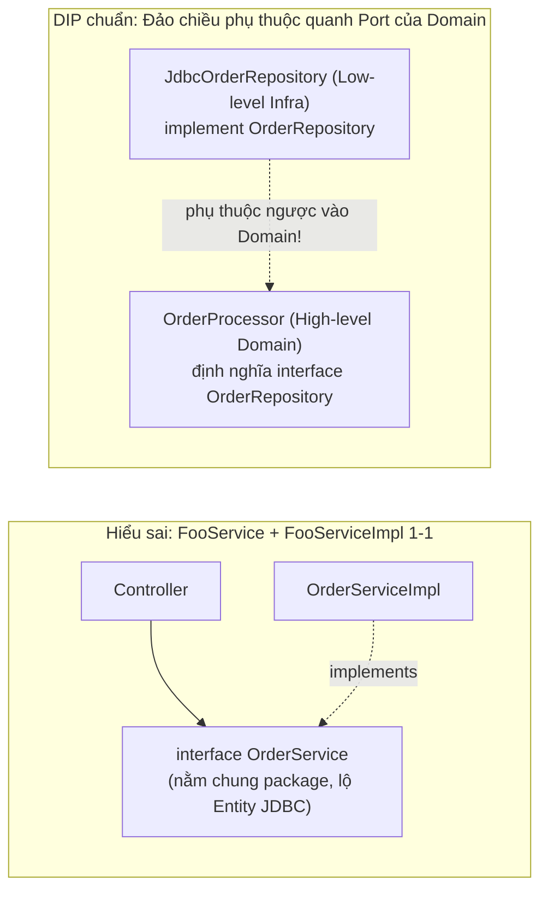

# CQ-01 · SOLID áp dụng thực tế

> **TL;DR**: **SOLID** không phải nghi thức tạo interface cho mọi class; đó là tập 5 quy tắc giảm chi phí thay đổi phần mềm khi nhiều bộ phận nghiệp vụ thay đổi ở tốc độ khác nhau. **SRP** không phải "hàm làm 1 việc" mà là **"một class/module chỉ phục vụ MỘT Actor (nhóm người dùng/stakeholder)"**. **DIP** không phải "mọi service có 1 `XxxService` + `XxxServiceImpl`", mà là **tách luồng nghiệp vụ cấp cao khỏi chi tiết hạ tầng (JDBC/SMTP/HTTP)** bằng abstraction do **domain sở hữu**. Lạm dụng SOLID tạo ra rừng class rỗng (*interface-itis*, *over-abstraction*) còn khó bảo trì hơn code thẳng.

## 🧭 Brief

| | |
| :--- | :--- |
| **Loại** | Bài học |
| **Giai đoạn** | Năm 1 · Q1 |
| **Chủ đề** | Code Quality, Refactoring & Testing |

**Phạm vi bắt buộc**
- từng nguyên tắc với ví dụ vi phạm từ code nghiệp vụ thật
- khi SOLID bị lạm dụng (over-abstraction)

**Câu hỏi sâu — nội dung phải giúp trả lời được**
- Interface cho mọi class có phải là DIP?
- SRP: "một lý do để thay đổi" nghĩa là gì cụ thể?

**Ý tưởng lab / demo**
- Refactor 1 service god-class vi phạm SRP/OCP

**Tài liệu gốc gợi ý**
- Working Effectively with Legacy Code
- Refactoring (Fowler)
- A Philosophy of Software Design
- JUnit 5 User Guide

**Gói đầu ra**
- [x] `README.md` — lý thuyết theo [lesson-template](../../../docs/templates/lesson-template.md)
- [x] `exercises.md` — bài tập L1/L2/L3 theo [exercises-template](../../../docs/templates/exercises-template.md)
- [x] `solutions.md` — đáp án theo [solutions-template](../../../docs/templates/solutions-template.md)
- [x] `lab/` — code demo chạy được + `lab/README.md` theo [lab-template](../../../docs/templates/lab-template.md)
- [ ] _(người học)_ `my-notes.md` — **agent không tạo**

---

## 1. Bài toán & Động lực

Trong nhiều hệ thống doanh nghiệp (nhất là codebase lâu năm), ta gặp hai thái cực đối nghịch đều đau khổ như nhau:
1. **God Class (`OrderManager` 2.500 dòng)**: Validate input, tính chiết khấu VIP/Partner, cộng VAT, format SQL/CSV, gửi mail SMTP nằm chung một hàm `processOrder()`. Kế toán đổi công thức chiết khấu có nguy cơ làm gãy câu format SQL; muốn viết unit test cho luật tính giá buộc phải khởi động cả database!
2. **Over-engineered SOLID**: Mọi class đều đi thành cặp `FooService` / `FooServiceImpl` 1-1 dù chỉ có 1 implementation duy nhất suốt 5 năm; đọc một flow phải bấm F12 nhảy qua 7 file interface không chứa logic gì.

Học SOLID đúng nghĩa là biết **chính xác chỗ nào cần tách/trừu tượng hoá** và **chỗ nào nên giữ đơn giản**.

## 2. Bối cảnh & Bản chất thực dụng của 5 chữ cái

Robert C. Martin tổng hợp 5 nguyên tắc từ kinh nghiệm bảo trì hệ thống lớn hướng đối tượng:
- **S**ingle Responsibility (SRP) · **O**pen/Closed (OCP) · **L**iskov Substitution (LSP) · **I**nterface Segregation (ISP) · **D**ependency Inversion (DIP).

Mục tiêu chung duy nhất của cả 5: **cô lập bán kính ảnh hưởng của mỗi lần thay đổi (blast radius)** và cho phép **test nghiệp vụ nhanh mà không cần dựng hạ tầng nặng**.

## 3. Cơ chế & Phân tích từng nguyên tắc (kèm ví dụ thật)

### 3.1 S — Single Responsibility Principle (SRP)

#### Câu hỏi sâu #1 — "Một lý do để thay đổi" nghĩa là gì cụ thể?

> Câu định nghĩa hay bị hiểu sai nhất là *"một class chỉ làm một việc"* (rồi dev cắt một hàm thành 10 class nhỏ xíu — thực ra đó là trích hàm trong [CQ-03](../03-refactoring-catalog/README.md)). Trong *Clean Architecture*, Robert Martin định nghĩa lại rất rõ: **"Lý do để thay đổi" chính là một Actor (nhóm người yêu cầu thay đổi nghiệp vụ khác nhau)**.

Lấy ví dụ từ [`LegacyOrderGodService`](lab/src/main/java/lab/cq/solid/before/LegacyOrderGodService.java) trong lab:
- **Bộ phận Kinh doanh / Marketing** yêu cầu thay đổi rule chiết khấu hạng `VIP` / `PARTNER` và mẫu email thông báo.
- **Bộ phận Kế toán / Tài chính** yêu cầu thay đổi thuế VAT `0.08` hay phí ship `express`.
- **Đội DBA / Hạ tầng dữ liệu** yêu cầu thay đổi cấu trúc lưu trữ CSV/SQL (`orderId,customerTier,total`).

Khi cả 3 nhóm actor cùng trỏ sửa vào **một file `LegacyOrderGodService`**:
- Hai lập trình viên sửa code cho Kế toán và Marketing đụng merge conflict hàng tuần.
- Sửa bug xuất CSV vô tình làm lệch công thức làm tròn thuế VAT (regression chéo giữa các actor).

**Cách áp dụng đúng**: Tách theo ranh giới **Actor** (`PricingPolicy` cho Kinh doanh, `OrderRepository` cho Persistence/DBA, `OrderNotifier` cho Marketing/Comms, `OrderProcessor` làm điều phối). Ngược lại, **không** cắt một hàm `parseDate()` nhỏ thuộc cùng một actor thành `DateSplitter` + `DateTrimmer` + `DateConverter`!

### 3.2 O — Open/Closed Principle (OCP)

> *Open for extension, closed for modification* — Mở để thêm biến thể hành vi mới, đóng với việc phải sửa lại code cốt lõi đã test kỹ.

Trong `LegacyOrderGodService`, mỗi lần thêm hạng khách hàng (`EMPLOYEE`, `ENTERPRISE`), dev phải mở file cốt lõi ra chèn thêm nhánh `else if (...)` — rủi ro gãy logic hạng `VIP` hoặc `STANDARD` đang chạy ổn trên production.

Trong bản refactor [`OrderProcessor`](lab/src/main/java/lab/cq/solid/after/OrderProcessor.java), chính sách giảm giá được trừu tượng hóa qua `@FunctionalInterface PricingPolicy` và nạp qua `Map<String, PricingPolicy>`. Khi muốn thêm hạng `"EMPLOYEE"` giảm `30%`, chỉ cần đăng ký policy mới (đã chứng minh trong `SolidRefactorTest.ocpExtensionAddsNewTierWithoutTouchingProcessorCode`) mà **không sửa một dòng nào** trong `OrderProcessor`.

> Cảnh báo: Áp dụng OCP **chỉ tại trục biến động đã thấy bằng chứng** (Rule of Three hoặc domain rõ ràng nhiều chiến lược như tier/thuế/cổng thanh toán). Không bọc `Strategy` cho logic mà cả đời chỉ có 1 trường hợp.

### 3.3 L — Liskov Substitution Principle (LSP)

> Bất kỳ implementation / subclass `B` nào của interface/base `A` đều phải thay thế được cho `A` mà **không phá vỡ kỳ vọng (precondition / postcondition / invariant)** của caller.

Ví dụ vi phạm LSP rất hay gặp ở code thật (mô phỏng trong `SolidRefactorTest.lspViolationThrowsWhenSubtypeBreaksDiscountPostcondition`):
- Interface `PricingPolicy.calculateDiscount(subtotal)` cam kết hậu điều kiện: `0 <= discount <= subtotal`.
- Một dev viết subclass/lambda lỗi hoặc voucher cộng thưởng sai logic trả về `subtotal + 50.0` (lớn hơn `subtotal`) hoặc ném `UnsupportedOperationException` cho đơn hàng nhỏ thay vì trả `0.0` → khiến tổng thanh toán bị âm hoặc crash giữa pipeline dù hợp đồng kiểu biên dịch vẫn pass!
- Một vi phạm LSP kinh điển khác trong Java: `ReadOnlyList` vẫn implement `java.util.List` nhưng hàm `add(...)` ném `UnsupportedOperationException`, khiến caller nhận `List` bị nổ runtime bất ngờ.

### 3.4 I — Interface Segregation Principle (ISP)

> Caller không nên bị ép phụ thuộc vào các method mà nó không dùng.

Sai lầm phổ biến: tạo `interface OrderGateway` 8 method (`save`, `findById`, `notifyEmail`, `notifySms`, `exportPdf`, `reconcileBank`, `cancel`, `refund`). Khi một service chỉ cần lưu DB vẫn phải mock/implement đủ 7 method kia khi viết unit test; khi `exportPdf` đổi tham số, service lưu DB cũng phải biên dịch lại!

Bản refactor tách nhỏ thành [`OrderRepository`](lab/src/main/java/lab/cq/solid/after/OrderModels.java) (chỉ có `save`) và [`OrderNotifier`](lab/src/main/java/lab/cq/solid/after/OrderModels.java) (chỉ có `notifyConfirmed`).

### 3.5 D — Dependency Inversion Principle (DIP)

#### Câu hỏi sâu #2 — Tạo interface cho MỌI class (`FooService` + `FooServiceImpl`) có phải là DIP?

**Câu trả lời dứt khoát là KHÔNG.** Tạo `OrderService` + `OrderServiceImpl` ở cặp 1-1:
1. Nếu `interface OrderService` nhận/trả về `JdbcRowSet` hoặc `HttpServletRequest` hoặc mang nguyên signature của implementation, đó **không phải đảo chiều phụ thuộc** — domain vẫn bị cột chặt vào hạ tầng, chỉ thêm 1 file boilerplate!
2. Với các thuật toán/value logic thuần nội tại không chạm I/O (như tính thuế VAT + ship bên trong `OrderProcessor`, hay `String` parser thuần), **không cần tạo interface**. Tạo interface cho mọi class là *over-abstraction* làm code mờ mịt, tốn chi phí điều hướng IDE và tốn effort giữ hai file đồng bộ.
3. **DIP đúng nghĩa** chỉ cần ở **ranh giới bất ổn / I/O / chính sách đa hình**: High-level module (`OrderProcessor`) định nghĩa port (`OrderRepository`, `OrderNotifier`) bằng **ngôn ngữ nghiệp vụ** (`OrderReceipt`); Low-level module (`JdbcOrderRepository`, `SmtpOrderNotifier`) là plugin cài ngược từ ngoài vào!

## 4. Khi nào SOLID bị lạm dụng (Over-abstraction Checklist)

| Dấu hiệu lạm dụng | Hệ quả thực tế | Cách sửa |
| :--- | :--- | :--- |
| Mọi class đều có cặp `Xxx` + `XxxImpl` | Gấp đôi file, không thay thế được impl nào | Xoá interface 1-1 nếu không phải I/O boundary / đa hình |
| Factory tạo Strategy cho 1 `enum` chỉ có 1 giá trị | Thêm tầng indirection khó đọc luồng chính | Dùng thẳng method/switch rõ ràng tới khi có biến thể thứ 2–3 |
| Inject 8 interface nhỏ vào constructor chỉ để pass-through | Rối DI container, constructor bloat | Xem [CQ-02](../02-cohesion-coupling-deep-modules/README.md) gộp thành Deep Module |

## 5. Minh hoạ & Lab

Lab [`01-solid-in-practice/lab`](lab/README.md) đối chiếu song song [`LegacyOrderGodService`](lab/src/main/java/lab/cq/solid/before/LegacyOrderGodService.java) với bản refactor [`OrderProcessor`](lab/src/main/java/lab/cq/solid/after/OrderProcessor.java).

Kết quả chạy `SolidRefactorTest` (`mvn -o test`):
- **3/3 test cases PASS**:
  1. `refactoredOrderProcessorMatchesLegacyBehaviorExactly`: xác minh đầu ra `231.0`, `188.6`, `209.4` khớp tuyệt đối 100% giữa legacy và bản refactor qua fake `OrderRepository` + `OrderNotifier` (không cần DB/SMTP).
  2. `ocpExtensionAddsNewTierWithoutTouchingProcessorCode`: thêm hạng `"EMPLOYEE"` (`30%`) vào map mà không chạm dòng nào trong `OrderProcessor`, ra `total = 80.6`.
  3. `lspViolationThrowsWhenSubtypeBreaksDiscountPostcondition`: phát hiện ngay subtype vi phạm hậu điều kiện giảm giá `> subtotal`.

## 6. Legacy corner (Java 7 / JBoss / JDBC)

Trong codebase **Java 7 + JDBC thuần / JBoss AS 7.1.1**:
- **Không dùng lambda hay `record`** như lab Java 21 được, nhưng nguyên tắc DIP/SRP hoàn toàn áp dụng bằng **anonymous class / class cụ thể** và **POJO immutable** (`final class` với `final` fields).
- Sai lầm kinh điển ở JBoss: Service nhận thẳng `javax.sql.DataSource` hoặc tự gọi `InitialContext.doLookup(...)` + `Connection / PreparedStatement / ResultSet` nằm lẫn lộn trong hàm tính tiền (`OrderServlet` hoặc `EJB` 1.500 dòng). Muốn áp dụng DIP ngay trên Java 7 mà *không* cần Spring: chỉ cần trích xuất phần JDBC thành `JdbcOrderRepository` implement một interface nhỏ `OrderRepository` do domain định nghĩa rồi truyền vào constructor của service — lập tức logic nghiệp vụ test được với JUnit trong 5 ms thay vì phải deploy lên JBoss! (Xem thêm kỹ thuật phá dependency ở [CQ-04](../04-legacy-characterization-tests/README.md)).

## 7. Lỗi hay gặp trong production

1. **Sinh hàng loạt `XxxService` / `XxxServiceImpl` 1-1 "cho đúng chuẩn Clean Architecture"**
   Thực tế chỉ làm tăng boilerplate khi chỉ có đúng 1 implementation và signature vẫn rò rỉ DTO/Entity của DB.
2. **Hiểu SRP = cắt hàm thành chục class 20 dòng**
   Dẫn tới *Classitis* (bài [CQ-02](../02-cohesion-coupling-deep-modules/README.md)): người đọc nhảy qua 6 class nhỏ chỉ để hiểu 1 bước validate đơn giản, dù tất cả đều thuộc về 1 actor duy nhất.
3. **Subclass ghi đè method làm gãy invariant hoặc ném `UnsupportedOperationException`**
   Vi phạm LSP khiến code dùng interface tổng quát bị crash runtime hoặc phải viết ngược lại `if (impl instanceof SpecialImpl)` — phá nát cả OCP.

## 8. Checklist thực hành

- [ ] Chạy xong [`SolidRefactorTest`](lab/src/test/java/lab/cq/solid/SolidRefactorTest.java) (`mvn -o test`) và giải thích được từng assertion tương ứng với chữ cái nào của SOLID.
- [ ] Review một service lớn trong dự án của bạn: đếm xem nó đang phục vụ bao nhiêu **Actor** khác nhau và các dependency I/O có bị `new` cứng bên trong không.
- [ ] Hoàn thành bài tập L1–L3 trong [exercises.md](exercises.md) trước khi mở [solutions.md](solutions.md).

## 9. Câu hỏi tự kiểm tra

1. Nếu một class có `printReport()` (xuất PDF cho Kế toán) và `saveReport()` (ghi bảng DB cho DBA), nó vi phạm nguyên tắc nào và tại sao dù chỉ phục vụ "báo cáo" vẫn nên tách?
2. Tại sao tạo `CustomerService` + `CustomerServiceImpl` (1-1, cả hai phụ thuộc thẳng `ResultSet` hoặc JPA `@Entity`) **không** đạt được DIP?
3. Khi viết một implementation mới cho interface `DiscountRule`, điều kiện gì giúp bạn chắc chắn mình không vi phạm LSP?
4. Trong bài lab `OrderProcessor`, tại sao phép tính `tax = afterDiscount * 0.08` được giữ làm logic trực tiếp bên trong class thay vì tách thêm `interface TaxCalculator`?
5. Với hệ thống Java 7 + JDBC thuần trên JBoss AS 7.1.1 (không có Spring), làm cách nào áp dụng DIP để unit test được logic tính đơn hàng trong < 10 ms?

## 10. Tài liệu tham khảo

- Robert C. Martin — *Clean Architecture* (Ch. 7–11: The Design Principles — SRP, OCP, LSP, ISP, DIP)
- Martin Fowler — *Refactoring: Improving the Design of Existing Code*
- John Ousterhout — *A Philosophy of Software Design* (góc nhìn phản biện tránh over-decomposition)
- Bài tiếp theo: [CQ-02 · Cohesion, Coupling, Deep modules](../02-cohesion-coupling-deep-modules/README.md)
