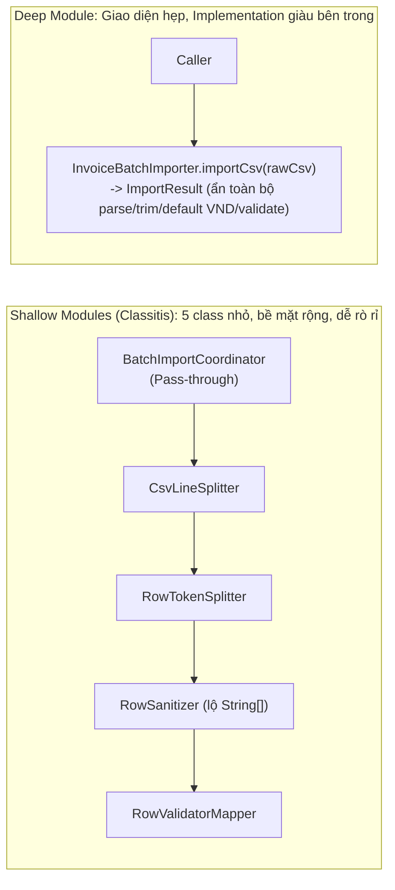

# CQ-02 · Cohesion, Coupling, Deep modules

> **TL;DR**: Độ phức tạp của hệ thống đến từ hai nguồn (Ousterhout): **`Complexity = Dependencies + Obscurity`**. Mục tiêu thiết kế tốt là **High Cohesion** (những thứ thay đổi cùng nhau nằm cạnh nhau) và **Loose Coupling** nhờ **Information Hiding**. Trái với ngộ nhận "class càng nhỏ càng sạch", việc chặt vụn một chức năng thành nhiều **Shallow Modules** (*Classitis*) chỉ tạo thêm giao diện trung gian, rò rỉ cấu trúc dữ liệu, sinh *Temporal Coupling* và làm tăng tổng độ phức tạp; thiết kế ưu việt là **Deep Module**: giao diện ngoài cực hẹp/đơn giản nhưng bên trong che giấu toàn bộ logic giàu nghiệp vụ.

## 🧭 Brief

| | |
| :--- | :--- |
| **Loại** | Bài học |
| **Giai đoạn** | Năm 1 · Q1 |
| **Chủ đề** | Code Quality, Refactoring & Testing |
| **Tiên quyết** | [CQ-01](../01-solid-in-practice/README.md) |

**Phạm vi bắt buộc**
- các loại coupling
- information hiding
- deep vs shallow module (Ousterhout)
- complexity = dependencies + obscurity

**Câu hỏi sâu — nội dung phải giúp trả lời được**
- Vì sao nhiều class nhỏ chưa chắc tốt?
- Đo coupling bằng cách nào?

**Ý tưởng lab / demo**
- Đánh giá 2 thiết kế cùng chức năng theo tiêu chí deep module

**Tài liệu gốc gợi ý**
- Working Effectively with Legacy Code
- Refactoring (Fowler)
- A Philosophy of Software Design
- JUnit 5 User Guide

**Gói đầu ra**
- [x] `README.md` — lý thuyết theo [lesson-template](../../../docs/templates/lesson-template.md)
- [x] `exercises.md` — bài tập L1/L2/L3 theo [exercises-template](../../../docs/templates/exercises-template.md)
- [x] `solutions.md` — đáp án theo [solutions-template](../../../docs/templates/solutions-template.md)
- [x] `lab/` — code demo chạy được + `lab/README.md` theo [lab-template](../../../docs/templates/lab-template.md)
- [ ] _(người học)_ `my-notes.md` — **agent không tạo**

---

## 1. Bài toán & Động lực

Sau khi học SOLID ở [CQ-01](../01-solid-in-practice/README.md), một lỗi phổ biến của nhiều kỹ sư mới là biến một hàm đọc/validate CSV dài 45 dòng thành 5–6 class khác nhau: `CsvLineSplitter`, `RowTokenSplitter`, `RowSanitizer`, `RowValidatorMapper`, `BatchImportCoordinator`. Kết quả sau 6 tháng:
- Đọc luồng xử lý phải nhảy qua 5 file khác nhau để ráp mảnh bức tranh trong đầu (**Change Amplification & Cognitive Load**).
- Mỗi class nhỏ lại định nghĩa `DTO`/mảng `String[]` trung gian riêng: sửa thêm 1 cột CSV buộc phải sửa xuyên qua cả 5 class!
- Nếu caller lỡ gọi `RowValidatorMapper` trước `RowSanitizer`, code chạy sai âm thầm (**Temporal Coupling**).

Đó là lúc triết lý **Deep Modules** của John Ousterhout (*A Philosophy of Software Design*) bổ khuyết hoàn hảo cho SOLID.

## 2. Công thức Độ phức tạp: `Complexity = Dependencies + Obscurity`

Ousterhout định nghĩa độ phức tạp bằng khả năng gây khó dễ khi bảo trì của hệ thống, đến từ **2 nguyên nhân gốc**:
1. **Dependencies (Sự phụ thuộc)**: Khi một đoạn code không thể hiểu hoặc sửa độc lập mà phải hiểu/sửa hàng loạt chỗ khác liên đới. Gây ra **Change Amplification** (sửa một yêu cầu nhỏ mà chạm hàng chục nơi).
2. **Obscurity (Sự mờ mịt)**: Khi thông tin quan trọng không rõ ràng từ chữ ký API — ví dụ caller phải nhớ ngầm quy ước index `cols[1]` là tiền, hoặc nhớ gọi `init()` trước `execute()`, hoặc tự đoán xem giá trị trả về có thể `null` không (**Unknown Unknowns**).

## 3. Cơ chế & Phân tích chuyên sâu

### 3.1 Deep Module vs Shallow Module (và vì sao nhiều class nhỏ chưa chắc tốt)

Hãy hình dung mỗi module (hàm, class, package, service) như một hình chữ nhật: **cạnh trên là Interface** (chi phí tinh thần người dùng phải bỏ ra để hiểu cách gọi) và **diện tích bên trong là Functionality / Implementation** (lợi ích module mang lại).

- **Deep Module** (ví dụ cổ điển: I/O `java.nio.file.Files.readString(Path)` hoặc [`InvoiceBatchImporter`](lab/src/main/java/lab/cq/modules/deep/InvoiceBatchImporter.java) trong lab): Giao diện cực nhỏ gọn (`importCsv(rawCsv)`), nhưng bên dưới nó tự tách dòng, bỏ dòng trống, cắt khoảng trắng, áp mặc định tiền tệ `"VND"`, validate số dương, gom danh sách lỗi từng dòng. Người dùng **chỉ cần biết 1 chữ ký method**.
- **Shallow Module**: Giao diện phức tạp không tương xứng với phần lợi ích bên trong. Khi cực đoan tách hàm ngắn dưới 5 dòng thành hàng loạt **Pass-Through Methods** (method A chẳng làm gì ngoài việc chuyển nguyên xi tham số sang B), ta mắc bệnh **Classitis**.

> **Trả lời câu hỏi sâu #1 — Vì sao nhiều class nhỏ chưa chắc tốt?**
> Cắt nhỏ mù quáng thành nhiều class nông gây 4 thiệt hại:
> 1. **Mỗi class mới sinh ra thêm một Interface** phải đọc, đặt tên, import, test giả lập → tăng tổng số *Dependencies* và diện tích bề mặt của hệ thống.
> 2. **Information Leakage giữa các mảnh nhỏ**: Dữ liệu trung gian (`String[]`, `Map<String, Object>`) đáng lẽ là chi tiết cài đặt riêng tư nay bị đẩy thành kiểu trả về/tham số công khai truyền qua lại giữa các class!
> 3. **Temporal Coupling**: Caller buộc phải tự nối bước 1 -> bước 2 -> bước 3 đúng thứ tự.
> 4. **Mất cục bộ (Locality)**: Logic thuộc cùng một nghiệp vụ bị xé lẻ sang nhiều file (*Unknown Unknowns*), vi phạm **High Cohesion** (*những gì hay thay đổi cùng nhau nên đứng cạnh nhau*).

### 3.2 Các loại Coupling (từ chặt/nguy hiểm tới lỏng/an toàn)

Thứ tự từ **tệ nhất → tốt nhất**:

| Loại Coupling | Mô tả & Ví dụ thực tế | Mức độ rủi ro |
| :--- | :--- | :--- |
| **1. Content Coupling** | Class A chọc sửa trực tiếp field private (qua reflection) hoặc dữ liệu nội tại / quy ước mảnh bộ nhớ của B | **Cực cao** — phá hoàn toàn encapsulation |
| **2. Common / Global Coupling** | Nhiều class cùng đọc/ghi một biến `public static` toàn cục (ví dụ `AppGlobals.currentUser` / singleton mutable cache) | **Rất cao** — side-effect khó đoán, race condition |
| **3. Control Coupling** | Caller truyền cờ boolean/int điều khiển luồng rẽ nhánh bên trong (`process(order, true, false, 2)`) | **Cao** — lộ cấu trúc rẽ nhánh nội bộ (`Obscurity`) |
| **4. Temporal Coupling** | Phải gọi `a.connect()` → `a.auth()` → `a.send()` đúng thứ tự nếu không sẽ nổ `NPE`/`IllegalState` | **Cao** — bug ẩn nếu gọi thiếu bước |
| **5. Stamp (Data-structure) Coupling** | Truyền nguyên cả mega object `HttpServletRequest` hay `OrderEntity` 40 field dù hàm chỉ đọc mỗi `orderId` | **Trung bình** — kéo cả package phụ thuộc không cần thiết |
| **6. Data Coupling** | Chỉ truyền đúng các tham số value/record tối thiểu mà module thật sự cần (`String orderId, long amount`) | **Tốt nhất** — chuẩn giao tiếp sạch |

> **Information Hiding (Che giấu thông tin)**: Đỉnh cao chống coupling là giấu mọi quyết định dễ thay đổi (định dạng CSV, thuật toán retry, cấu trúc map nội bộ, mã lỗi raw) **vào bên trong ranh giới module**, không làm rò rỉ ra kiểu trả về hay exception thô.

### 3.3 Cohesion (Độ gắn kết nội bộ)

**Cohesion** đo mức độ các thành phần bên trong một class/module phục vụ chung một mục đích nhất quán:
- **Low Cohesion (Trộn xà bần)**: `Utils` / `CommonHelper` (chứa đủ thứ từ `formatDate`, `md5Hash`, tới `sendSlackMessage`), hoặc chia class dựa theo thời điểm chạy ("tầng Init" gộp DB init + UI init).
- **High Cohesion (Functional Cohesion)**: Mọi field và private helper trong `InvoiceBatchImporter` đều tồn tại duy nhất để biến raw CSV thành `ImportResult`. Sửa luật parse dấu phẩy? Mọi chỗ cần chạm nằm gói gọn trong **1 file duy nhất**.

### 3.4 Câu hỏi sâu #2 — Đo coupling bằng cách nào (thay vì đoán cảm tính)?

Có **4 thước đo định lượng & thực nghiệm** có thể kiểm tra ngay trên repository Git / IDE:
1. **Afferent Coupling ($C_a$ — Fan-in) & Efferent Coupling ($C_e$ — Fan-out) + Instability ($I$)**:
   - $C_a$: số module bên ngoài phụ thuộc vào module X (*trách nhiệm cao nếu $C_a$ lớn* — sửa X ảnh hưởng nhiều nơi).
   - $C_e$: số module bên ngoài mà X phải gọi (*dễ vỡ theo biến động bên ngoài*).
   - **Instability Metric** (Robert Martin): $I = \frac{C_e}{C_a + C_e} \in [0, 1]$ ($I=0$: lõi cực ổn định như Domain/Value Object; $I=1$: lớp ngoài cùng như Controller/Adapter).
2. **Diện tích Public Surface vs Lines of Functionality (Deep vs Shallow ratio)**: Số class/method `public` phải khai báo để dùng một tính năng. Trong bài lab: `ShallowCsvPipeline` phơi ra **7 public types** và đòi **4 bước nối chuỗi**, trong khi `InvoiceBatchImporter` chỉ phơi **3 public types** (1 worker + 2 immutable DTOs) với **1 method `importCsv`**.
3. **Temporal / Logical Coupling qua Git History (Code As a Crime Scene — Adam Tornhill)**: Chạy `git log` xem các file nào luôn bị commit chung trong cùng 1 PR suốt 6 tháng dù không import trực tiếp nhau (co-change coupling — ví dụ `ShallowPipeline` và `OrderCsvDTO` cứ hễ thêm cột là sửa cả 5 file!).
4. **Test Friction & Connascence**: Muốn viết 1 unit test phải dựng bao nhiêu mock/constructor args? Hễ đổi thứ tự tham số `(String a, String b)` hoặc index `cols[1]` mà không có compiler bắt lỗi là **Connascence of Position** — dấu hiệu coupling ngầm nguy hiểm.

## 4. Nguyên tắc quyết định tách hay gộp

| Dấu hiệu nên **GỘP** thành Deep Module | Dấu hiệu nên **TÁCH** module |
| :--- | :--- |
| Hai mảnh chia sẻ chung một cấu trúc trung gian (`cols[]`, `ctx Map`) | Hai mảnh thuộc 2 Actor khác nhau hoặc có tốc độ thay đổi độc lập (bài [CQ-01](../01-solid-in-practice/README.md)) |
| Xuất hiện method trung gian chỉ gọi thẳng sang class khác (pass-through) | Ranh giới giao tiếp I/O ngoài hệ thống (DB, HTTP, Queue) |
| Người dùng phải gọi chuỗi `step1()` -> `step2()` -> `step3()` đúng thứ tự | Hàm nghiệp vụ lớn có cấu trúc con rõ rệt tách thành private method (hạn chế public bloat) |

## 5. Minh hoạ & Lab

Lab [`02-cohesion-coupling-deep-modules/lab`](lab/README.md) cài đặt cùng 1 nghiệp vụ import hóa đơn CSV theo 2 kiến trúc đối lập:
- **Shallow design** ([`ShallowCsvPipeline`](lab/src/main/java/lab/cq/modules/shallow/ShallowCsvPipeline.java)): 5 class tách lẻ + 2 DTO = **7 nested public types**, lộ mảng `String[]` với quy ước index `cols[0]/cols[1]/cols[2]` xuyên suốt `RowTokenSplitter -> RowSanitizer -> RowValidatorMapper`.
- **Deep design** ([`InvoiceBatchImporter`](lab/src/main/java/lab/cq/modules/deep/InvoiceBatchImporter.java)): 1 worker class + 2 immutable DTO records = **3 public types**, ẩn toàn bộ chi tiết splitting, default `"VND"`, parsing và error reporting sau đúng một lời gọi `importCsv(rawCsv)`.

Kết quả chạy `DeepVsShallowTest` (`mvn -o test`): **1/1 test PASS**, khẳng định hai bản cho ra `valid()` và `errors()` giống hệt nhau trên CSV hợp lệ, thiếu currency, dòng trống và dữ liệu lỗi, trong khi thiết kế Deep giảm > 50% số lượng public types phơi ra cho caller (`3` vs `7`).

## 6. Legacy corner (Java 7 / JBoss / JDBC)

Trong hệ thống Java 7 cũ, thiết kế *Shallow + Coupling cao* xuất hiện dưới dạng:
1. **`CommonUtil.java` 3.000 dòng (Coincidental/Low Cohesion)**: chứa lẫn `formatVnd`, `callSoap`, `parseDate` → sửa format tiền phải test lại cả luồng SOAP!
2. **Stamp & Common Coupling trên JBoss**: Truyền nguyên `HttpSession` / `HttpServletRequest` xuyên từ Servlet xuống tận tầng DAO Java 7 chỉ để lấy mỗi `userId` (`String`), hoặc lưu `static Map` chia sẻ toàn cục. **Cách xử lý**: Thu hẹp tham số xuống đúng `String userId` (**Data Coupling**), và gom nhóm hàm parse/validate cấu hình rời rạc lại thành một Deep Module đơn giản (tương tự [`DeepConfigLoader`](lab/solutions/DeepConfigLoader.java) — chạy được nguyên vẹn cả trên Java 7 nếu đổi `Map.copyOf` thành `Collections.unmodifiableMap`).

## 7. Lỗi hay gặp trong production

1. **Ám ảnh "hàm ≤ 5 dòng, class ≤ 50 dòng" tạo ra Classitis**
   Code trông rất "gọn" trong từng file 20 dòng nhưng tổng thể đọc như mê cung, toàn method pass-through không có độ sâu (*Shallow*).
2. **Dùng cờ boolean (`Control Coupling`) cho mọi nhu cầu mở rộng**
   Hàm `exportInvoice(Order o, boolean includeTax, boolean maskPhone, boolean pdfFormat)` ép người gọi đoán ý nghĩa từng cờ `true/false` khi nhìn tại call site.
3. **Rò rỉ cấu trúc lưu trữ nội bộ (`Information Leakage`)**
   Module đọc config trả nguyên `Properties` hoặc `Map<String, String>` thô cho caller tự `trim()` và `Integer.parseInt()`, khiến logic validate fallback bị nhân bản ở 20 chỗ khác nhau.

## 8. Checklist thực hành

- [ ] Chạy xong [`DeepVsShallowTest`](lab/src/test/java/lab/cq/modules/DeepVsShallowTest.java) (`mvn -o test`) và quan sát trực tiếp sự khác biệt giữa `ShallowCsvPipeline` và `InvoiceBatchImporter`.
- [ ] Thử tìm trong codebase thực tế 1 class *Pass-through* hoặc hàm nhận cờ `boolean` điều khiển luồng và thử thiết kế lại API sâu hơn.
- [ ] Giải hết các bài L1–L3 trong [exercises.md](exercises.md) trước khi mở [solutions.md](solutions.md).

## 9. Câu hỏi tự kiểm tra

1. Theo John Ousterhout, hai thành phần tạo nên Complexity của phần mềm là gì? Lấy ví dụ cho từng thành phần.
2. Tại sao tách một tác vụ tuần tự thành `Step1Class`, `Step2Class`, `Step3Class` truyền `String[]` qua lại thường **làm tăng** complexity thay vì giảm?
3. Xếp thứ tự nguy hiểm từ cao xuống thấp các loại coupling: *Data Coupling*, *Common/Global Coupling*, *Control Coupling*, *Stamp Coupling*.
4. Nếu bạn dùng `git log` để tìm coupling trong một legacy repo Java 7 mà không đọc hết hàng trăm nghìn dòng code, dấu hiệu nào cho thấy hai module đang bị dính chặt nhau (*Temporal/Co-change Coupling*)?
5. Tại sao hàm `positiveIntOrDefault(key, defaultValue)` trong `DeepConfigLoader` lại là ví dụ của *Deep Module* so với việc trả thẳng `String getRaw(key)`?

## 10. Tài liệu tham khảo

- John Ousterhout — *A Philosophy of Software Design* (Ch. 2–5: The Nature of Complexity, Working Code Isn't Enough, Modules Should Be Deep, Information Hiding)
- Robert C. Martin — *Clean Architecture* (Ch. 14: Component Coupling — $C_a, C_e, I$)
- Adam Tornhill — *Your Code as a Crime Scene* (Temporal / Change Coupling via Git history)
- Bài tiếp theo: [CQ-03 · Refactoring catalog & code smells](../03-refactoring-catalog/README.md)
