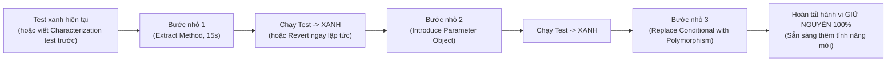

# CQ-03 · Refactoring catalog & code smells

> **TL;DR**: **Refactoring** (Martin Fowler) là cải tổ cấu trúc bên trong của code để dễ hiểu và rẻ sửa hơn **mà tuyệt đối không thay đổi hành vi quan sát được bên ngoài**, thông qua chuỗi bước nhỏ an toàn được test xanh bảo vệ sau mỗi bước. Khác hoàn toàn với **Rewrite** (đập đi viết lại từ đầu — rủi ro vỡ edge case âm thầm, đóng băng feature nhiều tháng). Nhận diện đúng **Code Smells** (*Long Method*, *Shotgun Surgery*, *Divergent Change*, *Feature Envy*, *Primitive Obsession*, *Data Clumps*) để tra đúng bài thuốc (*Extract Method/Class*, *Introduce Parameter Object*, *Replace Conditional with Polymorphism*). Nhưng đừng refactoring mù quáng: **không refactor** code sắp xóa bỏ, code quá đơn giản không còn thay đổi, hoặc khi chưa có test bảo vệ trước deadline gấp.

## 🧭 Brief

| | |
| :--- | :--- |
| **Loại** | Bài học |
| **Giai đoạn** | Năm 1 · Q1 |
| **Chủ đề** | Code Quality, Refactoring & Testing |
| **Tiên quyết** | [CQ-02](../02-cohesion-coupling-deep-modules/README.md) |

**Phạm vi bắt buộc**
- code smells phổ biến
- extract method/class, replace conditional with polymorphism, introduce parameter object
- refactor an toàn từng bước nhỏ

**Câu hỏi sâu — nội dung phải giúp trả lời được**
- Refactor khác rewrite ở điểm nào?
- Khi nào KHÔNG nên refactor?

**Ý tưởng lab / demo**
- Kata Gilded Rose: refactor có test bảo vệ

**Tài liệu gốc gợi ý**
- Working Effectively with Legacy Code
- Refactoring (Fowler)
- A Philosophy of Software Design
- JUnit 5 User Guide

**Gói đầu ra**
- [x] `README.md` — lý thuyết theo [lesson-template](../../../docs/templates/lesson-template.md)
- [x] `exercises.md` — bài tập L1/L2/L3 theo [exercises-template](../../../docs/templates/exercises-template.md)
- [x] `solutions.md` — đáp án theo [solutions-template](../../../docs/templates/solutions-template.md)
- [x] `lab/` — code demo chạy được + `lab/README.md` theo [lab-template](../../../docs/templates/lab-template.md)
- [ ] _(người học)_ `my-notes.md` — **agent không tạo**

---

## 1. Bài toán & Động lực

Hầu hết kỹ sư đều từng nghe câu nói đầy nguy hiểm trong buổi sprint planning: *"Module xử lý tồn kho này bẩn quá rồi, đừng đụng vào nó nữa — cho em 2 tuần đập đi viết lại từ đầu cho sạch!"*. Hai tháng sau, module mới viết lại vẫn chưa ra được production vì liên tục phát hiện hàng tá nghiệp vụ dị biệt nằm ẩn trong mớ `if/else` cũ không có tài liệu mô tả.

Thay vì đánh cược vào cú nhảy *Big Bang Rewrite*, nghề kỹ thuật phần mềm phát triển bộ công thức **Refactoring có hệ thống**: biết ngửi **Code Smells** nào ứng với kỹ thuật **Catalog Refactoring** nào, biến một mớ `if` lồng nhau như Kata **Gilded Rose** thành kiến trúc mở rộng được mà test vẫn **xanh 100% ở từng bước**.

## 2. Cơ chế: Chu kỳ Refactor an toàn & Bản chất khác với Rewrite

### 2.1 Câu hỏi sâu #1 — Refactor khác Rewrite ở điểm nào?



| Tiêu chí | Refactoring (Fowler) | Rewrite ("Đập đi viết lại") |
| :--- | :--- | :--- |
| **Định nghĩa** | Thay đổi cấu trúc nội bộ, **bảo toàn 100% hành vi** quan sát được | Xây mới từ đầu, tái cài đặt lại nghiệp vụ |
| **Kích thước bước** | Chuỗi micro-steps **1–5 phút/bước**, dừng bất kỳ lúc nào vẫn deploy được | Một quả bom lớn kéo dài **nhiều tuần – nhiều tháng** |
| **Điều kiện tiên quyết** | Có bộ test bảo vệ chạy nhanh (< vài giây) sau **mỗi bước nhỏ** | Thường đóng băng tính năng cũ, dễ rơi vào *Second-System Effect* |
| **Rủi ro mất edge case** | Cực thấp — mất hành vi là test đỏ ngay sau 30 giây | Rất cao — dễ bỏ sót rule lịch sử ẩn mà user đang phụ thuộc |

### 2.2 Quy tắc "Two Hats" (Hai chiếc mũ của Kent Beck)

Khi làm việc, bạn chỉ đội **đúng MỘT chiếc mũ** tại một thời điểm:
- **Mũ Refactoring**: Cải tạo cấu trúc (đổi tên, tách hàm, tách chiến lược), **không** thêm tính năng mới, không sửa bug nghiệp vụ — mọi test cũ phải giữ nguyên kết quả.
- **Mũ Adding Functionality**: Chỉ sau khi refactor sạch đường dẫn (Make the change easy, then make the easy change!), mới đội mũ viết test mới + tính năng mới (như thêm `"Conjured Mana Cake"` sau khi đã dọn sạch `GildedRoseRefactored`).

## 3. Code Smells phổ biến & Catalog Refactoring tương ứng

### 3.1 Nhóm mùi kinh điển và thuốc đặc trị

| Code Smell | Triệu chứng thực tế | Phép Refactor chuẩn (Fowler Catalog) |
| :--- | :--- | :--- |
| **Long Method** | Hàm > 50–100 dòng trộn nhiều mức trừu tượng, lồng nhiều `if`/`for`, cần comment phân khu (`// step 1: validate`) | **Extract Method** (tách theo cụm logic có nghĩa, không cắt vụn pass-through — nhớ bài [CQ-02](../02-cohesion-coupling-deep-modules/README.md)) |
| **Switch / Nested Conditionals** | Chuỗi `if/else` hoặc `switch` lặp lại theo `item.name`, `orderType`, `paymentMethod` ở nhiều nơi | **Replace Conditional with Polymorphism** (hoặc Strategy Map) |
| **Data Clumps & Long Parameter List** | 4–6 tham số luôn kè kè đi chung nhiều hàm (`LocalDate from, LocalDate to, String currency, boolean taxIncluded`) | **Introduce Parameter Object** (gom vào `record DateRange(...)` hoặc `InvoiceSpec` có validation chung) |
| **Primitive Obsession** | Dùng `String`, `long`, `int` trần cho mọi thứ (`moneyCents`, `currency`, `email`, `statusCode`), dễ truyền nhầm thứ tự | **Replace Primitive with Object** (`record Money(long amount, String currency)`) |
| **Feature Envy** | Hàm ở Class A chọc gọi 6–7 getter của Class B để tự tính toán cho B | **Move Method** về đúng nơi sở hữu dữ liệu (Class B) |
| **Divergent Change vs Shotgun Surgery** | *Divergent*: 1 class bị sửa vì 3 Actor khác nhau. *Shotgun Surgery*: thêm 1 trường mới phải sửa rải rác 8 class | *Divergent* → **Extract Class** theo Actor. *Shotgun* → **Move Method/Field** + gom thành Deep Module |

### 3.2 Minh hoạ 3 phép Catalog quan trọng trên code thật

#### 1. Introduce Parameter Object (Chống Long Parameter List & Data Clumps)
Thay vì `searchTransactions(String custId, LocalDate start, LocalDate end, long minAmount, long maxAmount)`:
```java
public record TransactionQuery(String customerId, LocalDate from, LocalDate to, long minAmount, long maxAmount) {
    public TransactionQuery {
        if (from.isAfter(to)) {
            throw new IllegalArgumentException("from must be <= to");
        }
    }
}
```
Lợi ích kép: gọi hàm ngắn gọn, không trượt thứ tự tham số cùng kiểu, và quy luật bất biến (`from <= to`) tự động đi theo object.

#### 2. Extract Method & Extract Class
Trong [`GildedRoseRefactored`](lab/src/main/java/lab/cq/refactor/after/GildedRoseRefactored.java), việc kiểm tra `item.quality < 50` và `item.quality > 0` nằm lặp đi lặp lại 6 lần trong bản legacy. Chỉ bằng việc trích 2 helper rõ nghĩa `incrementQuality(item, step)` và `decrementQuality(item, step)`, logic chính của `"Aged Brie"` hay `"Backstage passes"` lộ nguyên hình rành mạch không còn nhiễu biên `0..50`.

#### 3. Replace Conditional with Polymorphism
Trong [`GildedRoseLegacy`](lab/src/main/java/lab/cq/refactor/before/GildedRoseLegacy.java), luật của 4 loại hàng bị bện xoắn qua `if (!item.name.equals("Aged Brie") && ...)` lồng 4 tầng sâu. Sau khi trích `@FunctionalInterface ItemUpdater` (hoặc interface đa hình theo tên/loại item) và ánh xạ qua `Map<String, ItemUpdater>`, mỗi loại hàng nằm cô lập một cụm nhỏ: đọc `"Backstage passes"` không bao giờ sợ nhìn nhầm nhánh `"Sulfuras"`!

## 4. Câu hỏi sâu #2 — Khi nào KHÔNG nên refactor?

Kinh nghiệm senior thực dụng: **Refactor là công cụ kinh tế, không phải tôn giáo.** Tuyệt đối **KHÔNG refactor** trong 4 trường hợp sau:
1. **Đoạn code sắp bị xoá bỏ hoặc thay thế hoàn toàn** (legacy module sắp rút phích trong vài tuần tới). Sửa nó chỉ tốn thời gian không thu hồi được ROI.
2. **Code chạy ổn định hàng năm và hoàn toàn KHÔNG có nhu cầu mở rộng/thay đổi** (vi phạm không gây chi phí bảo trì vì không ai phải mở file đó ra đọc hay sửa). Nguyên tắc vàng: *Refactor phần code nóng hay chạm tới (hotspots), bỏ qua góc tối yên bình.*
3. **Code chưa có test bảo vệ trong lúc áp lực deadline khẩn cấp** (hotfix sự cố 2h sáng): Đừng vừa fix bug production vừa "tiện tay dọn đẹp" 300 dòng — rất dễ tạo incident thứ hai. Hãy fix tối thiểu + tạo ticket dọn sau khi viết Characterization Test ([CQ-04](../04-legacy-characterization-tests/README.md)).
4. **Hầu như toàn bộ thiết kế cốt lõi thực sự cần thay đổi hoàn toàn** và chi phí cải tạo từng bước cao vượt trội chi phí cô lập + viết lại module nhỏ sạch theo kiến trúc Strangler Fig ([CQ-05](../05-seams-strangler/README.md)).

## 5. Minh hoạ & Lab (Gilded Rose Kata)

Lab [`03-refactoring-catalog/lab`](lab/README.md) cài đặt trọn vẹn bài kinh điển **Gilded Rose Kata**:
- **Before ([`GildedRoseLegacy`](lab/src/main/java/lab/cq/refactor/before/GildedRoseLegacy.java))**: Hàm `updateQuality()` lồng 4 tầng `if` ngược phủ định (`!equals(...)`) cực kỳ khó hiểu và không thể thêm loại `"Conjured"` nếu không chèn thêm `&&` vào 4 chỗ.
- **After ([`GildedRoseRefactored`](lab/src/main/java/lab/cq/refactor/after/GildedRoseRefactored.java))**: Thay điều kiện lồng ghép bằng bảng đa hình `Map<String, ItemUpdater>` + helper `incrementQuality` / `decrementQuality`.

Kiểm chứng an toàn:
- [`GildedRoseCharacterizationTest`](lab/src/test/java/lab/cq/refactor/GildedRoseCharacterizationTest.java) tạo ma trận **122 tổ hợp Item × sellIn × quality** và cho chạy song song **15 ngày liên tiếp** (tổng **1.830 assertions** so khớp chuỗi `toString()` từng ngày một): **1/1 test PASS**, sai khác = `0`.
- Sau khi bộ test bảo vệ đã xanh, việc mở rộng tính năng mới [`ConjuredGildedRoseExtension`](lab/solutions/ConjuredGildedRoseExtension.java) mất chưa đầy 10 dòng và **không cần chạm một dòng nào vào `GildedRoseRefactored`** (`conjured` giảm chất lượng gấp đôi: `10 -> 8 -> 6 -> 2 -> 0` so với normal `10 -> 9 -> 8 -> 6 -> 4`).

## 6. Legacy corner (Java 7 / JBoss / JDBC)

Trên dự án **Java 7 + JBoss**, công cụ mạnh nhất để refactor an toàn từng bước nhỏ **không phải làm bằng tay**, mà là **Automated IDE Refactorings** của IntelliJ IDEA / Eclipse (từ Java 7 đã hỗ trợ chuẩn):
- **`Extract Method`** (`Ctrl+Alt+M`), **`Introduce Parameter Object`**, **`Rename`** (`Shift+F6`), **`Move Method`** (`F6`): IDE đảm bảo an toàn biên dịch 100%, giúp giảm thiểu sai sót gõ tay trong các file Servlet/DAO 1.500 dòng.
- Vì Java 7 chưa có `lambda` hay `record`, kỹ thuật *Replace Conditional with Polymorphism* trên Java 7 viết bằng **interface + concrete static/top-level classes** (ví dụ `class AgedBrieUpdater implements ItemUpdater`) và POJO immutable (`private final` fields). Tính an toàn và khả năng mở rộng hoàn toàn tương đương!

## 7. Lỗi hay gặp trong production

1. **Vừa đội mũ Refactoring vừa đội mũ Sửa bug / Thêm feature trong cùng 1 commit lớn**
   Khi diff lên 800 dòng vừa đổi cấu trúc vừa sửa luật tính thuế, reviewer không thể kiểm chứng đâu là giữ nguyên hành vi và đâu là thay đổi nghiệp vụ; nếu lỗi trên production sẽ rất khó `git bisect`.
2. **Refactor không có test chạy trước khi chạm code**
   "Tự tin mắt thường" sửa điều kiện phủ định kép `!a && !b` thành `a || b` rất dễ lật sai luật De Morgan hoặc trượt dấu biên `<` / `<=`.
3. **Mắc kẹt chủ nghĩa hoàn hảo tại các file chết (Code Smell Hunting)**
   Bới code cũ 6 năm chưa ai đụng để "cho sạch code" tốn nửa tuần trong khi nghiệp vụ mảng đó không bao giờ thêm tính năng mới.

## 8. Checklist thực hành

- [ ] Chạy xong [`GildedRoseCharacterizationTest`](lab/src/test/java/lab/cq/refactor/GildedRoseCharacterizationTest.java) (`mvn -o test`) kiểm chứng 122 tổ hợp x 15 ngày khớp tuyệt đối.
- [ ] Thực hành tự tay thêm `"Conjured Mana Cake"` vào bản refactor mà không phá 1830 assertion cũ (đối chiếu [`ConjuredGildedRoseExtension`](lab/solutions/ConjuredGildedRoseExtension.java)).
- [ ] Hoàn thành L1–L3 trong [exercises.md](exercises.md) trước khi mở [solutions.md](solutions.md).

## 9. Câu hỏi tự kiểm tra

1. Phân biệt rõ **Divergent Change** với **Shotgun Surgery** — cả hai có đều sửa cùng 1 nguyên nhân không, và kỹ thuật giải quyết từng cái khác nhau thế nào?
2. Tại sao Kent Beck khuyên chỉ đội đúng "một chiếc mũ" (*Refactor* hoặc *Add Feature*) tại một thời điểm?
3. Giải thích quy trình an toàn nhất nếu sếp bảo bạn refactor một hàm 400 dòng phức tạp để tuần sau thêm khuyến mãi mới, nhưng hàm đó hiện chưa có một dòng unit test nào?
4. Trong Gilded Rose Legacy (`sellIn < 0`, `"Backstage passes"`), vì sao viết tay phép biến đổi điều kiện từ chuỗi `if` lồng nhau rất dễ làm mất rule `quality = 0` khi `sellIn` về âm nếu thiếu matrix test?
5. Kể ra 3 tình huống thực tế mà câu trả lời chuyên nghiệp nhất là *"KHÔNG refactor đoạn code này"*.

## 10. Tài liệu tham khảo

- Martin Fowler — *Refactoring: Improving the Design of Existing Code* (2nd Edition, Ch. 2–3, Ch. 6–10)
- Emily Bache — *Gilded Rose Refactoring Kata*
- Robert C. Martin — *Clean Code* & Kent Beck — *Implementation Patterns*
- Bài tiếp theo: [CQ-04 · Legacy code & Characterization tests](../04-legacy-characterization-tests/README.md)
