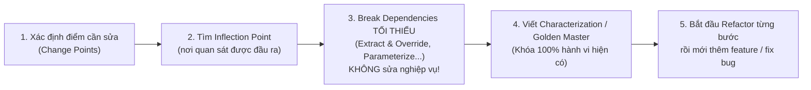

# CQ-04 · Legacy code & Characterization tests

> **TL;DR**: Michael Feathers định nghĩa cực chuẩn: **"Legacy code đơn giản là code không có test"** — dù mới viết hôm qua bằng Java 21. Trước khi dám động một dòng vào class 2.000 dòng chưa ai hiểu hết luật ngầm, bước đầu tiên không phải viết code sạch ngay mà là: **tìm điểm cắt tối thiểu (Break Dependency bảo toàn logic)** để gọi được class đó trong test harness, rồi viết **Characterization Test / Golden Master (Approval Test)** nhằm **khóa hành vi thực tế hiện tại** (kể cả bug/quirk đang chạy prod!). Chỉ khi bộ lưới an toàn xanh rì, ta mới được phép refactor ([CQ-03](../03-refactoring-catalog/README.md)).

## 🧭 Brief

| | |
| :--- | :--- |
| **Loại** | Bài học |
| **Giai đoạn** | Năm 1 · Q1 |
| **Chủ đề** | Code Quality, Refactoring & Testing |
| **Tiên quyết** | [CQ-03](../03-refactoring-catalog/README.md) |

**Phạm vi bắt buộc**
- định nghĩa legacy = code không có test
- characterization/golden master test
- approval testing
- phá dependency để đưa vào test

**Câu hỏi sâu — nội dung phải giúp trả lời được**
- Refactor class 2.000 dòng không test, bước đầu tiên?
- Golden master test có nhược điểm gì?

**Ý tưởng lab / demo**
- Viết characterization test cho 1 class legacy Java 7 kiểu JDBC thuần

**Tài liệu gốc gợi ý**
- Working Effectively with Legacy Code
- Refactoring (Fowler)
- A Philosophy of Software Design
- JUnit 5 User Guide

**Gói đầu ra**
- [x] `README.md` — lý thuyết theo [lesson-template](../../../docs/templates/lesson-template.md)
- [x] `exercises.md` — bài tập L1/L2/L3 theo [exercises-template](../../../docs/templates/exercises-template.md)
- [x] `solutions.md` — đáp án theo [solutions-template](../../../docs/templates/solutions-template.md)
- [x] `lab/` — code demo chạy được + `lab/README.md` theo [lab-template](../../../docs/templates/lab-template.md)
- [ ] _(người học)_ `my-notes.md` — **agent không tạo**

---

## 1. Bài toán & Động lực

Bạn nhận nhiệm vụ thêm tính năng mới vào một class Java 7 viết từ 2015: `LegacyMonthlyStatementDao.java`, trộn lẫn `DriverManager.getConnection(...)`, `PreparedStatement`, `ResultSet`, `System.currentTimeMillis()`, vòng lặp tính phí `floor`, cộng trừ thưởng VIP, không tài liệu đặc tả và **zero unit tests**.

Nỗi ám ảnh **The Legacy Code Dilemma** (Michael Feathers):
> *Khi muốn sửa code, ta phải có test bảo vệ trước. Nhưng để đưa được code vào test harness, ta lại thường phải sửa nhẹ code để tách DB/Network/Clock ra khỏi hàm!*

Làm sao bứt khỏi vòng luẩn quẩn này với rủi ro gần bằng 0? Câu trả lời nằm ở kỹ thuật **Dependency Breaking tối thiểu + Characterization Testing**.

## 2. Định nghĩa cốt lõi

### 2.1 "Legacy Code = Code không có Test"
Michael Feathers (*Working Effectively with Legacy Code*) không đo legacy theo tuổi đời ngôn ngữ hay framework:
- Code chạy bằng Spring Boot 3 / Java 21 mới viết tháng trước nhưng không có test tự động → sửa bất kỳ dòng nào cũng là trò chơi đoán mò, mất hàng giờ test tay → **đó là Legacy Code**.
- Code Java 7 / JDBC thuần có bộ Characterization Test chạy trong 100 ms → sửa tự tin, refactor an toàn → **đã thoát kiếp Legacy**.

### 2.2 Characterization Test vs Unit Test thông thường

| Tiêu chí | Traditional / Specification Unit Test | Characterization Test (Test đặc trưng hoá) |
| :--- | :--- | :--- |
| **Câu hỏi đặt ra** | "Hàm **nên** làm gì theo tài liệu/spec?" | "Hàm **thực sự đang** làm gì ngay lúc này trên prod?" |
| **Cách viết assertion** | Con người tính trước kết quả đúng (`expected = 105`) | Chạy hàm với 1 giá trị đại diện (hoặc bất kỳ) -> quan sát output thật JVM in ra -> **đóng băng output đó thành `expected`** |
| **Khi gặp bug/quirk lạ** | Sửa bug ngay | **Khoá nguyên cả quirk đó trước** và ghi chú lại (hỏi PO/Business xem khách hàng có đang dựa vào chính quirk đó hay không trước khi sửa!) |

### 2.3 Golden Master & Approval Testing

**Golden Master Testing** (còn gọi là **Approval Testing**, phổ biến qua thư viện *ApprovalTests* hoặc text-block snapshot tự quản) mở rộng ý tưởng Characterization cho những hàm trả về **chuỗi lớn, báo cáo HTML/PDF/CSV, JSON nhiều tầng hoặc ma trận hàng trăm tổ hợp** (tương tự bài Gilded Rose ở [CQ-03](../03-refactoring-catalog/README.md)):
1. Chọn một tập đầu vào đa dạng (ma trận kết hợp các biên bình thường, biên `=`, rỗng, âm, VIP).
2. Chạy phiên bản hiện tại một lần để thu output dạng text cố định (*Approved Snapshot* / Golden Master).
3. Từ đó về sau, mỗi thay đổi cấu trúc code đều phải sinh ra output **giống từng ký tự** với Golden Master!

## 3. Cơ chế & Quy trình từng bước (Deep Dive)

### 3.1 Câu hỏi sâu #1 — Refactor class 2.000 dòng không test, bước đầu tiên là gì?

**TUYỆT ĐỐI KHÔNG bắt đầu bằng việc sửa thuật toán bên trong hay "tách đẹp 20 class".** Hãy đi đúng 5 bước kỷ luật của **The Legacy Code Change Algorithm** (Michael Feathers):

Giải thích các kỹ thuật **Break Dependencies (Phá phụ thuộc an toàn không cần viết test trước khi dùng IDE)**:
1. **Extract and Override Factory Method** (áp dụng trong lab [`LegacyMonthlyStatementDao`](lab/src/main/java/lab/cq/legacy/LegacyMonthlyStatementDao.java)):
   Hàm cũ gọi trực tiếp `DriverManager.getConnection(...)` và `System.currentTimeMillis()`. Bạn **không** sửa thân hàm; chỉ trích đúng dòng khởi tạo đó ra thành `protected Connection openConnection()` và `protected long currentEpochMillis()`. Trong test, tạo anonymous subclass `@Override` hai method `protected` đó để trả in-memory JDBC stub và fixed timestamp! (Chi tiết mở rộng các loại Seam xem ở [CQ-05](../05-seams-strangler/README.md)).
2. **Parameterize Constructor / Method**: Giữ nguyên constructor cũ gọi `this(new RealGateway())` cho production không ai gãy, và thêm overload constructor nhận port giả lập cho test.
3. **Preserve Signatures (Bảo toàn chữ ký qua IDE)**: Dùng tính năng Extract tự động của IDE, không gõ tay copy-paste, rồi kiểm tra kỹ `git diff` đảm bảo **zero logic change** ở commit phá dependency đầu tiên.

### 3.2 Câu hỏi sâu #2 — Golden Master Test có nhược điểm gì?

Dù cực kỳ hiệu quả để dựng rào chắn nhanh cho legacy 2.000 dòng, **Golden Master / Approval Testing** có **4 nhược điểm lớn** bạn phải biết để dùng đúng chỗ:

1. **Dễ vỡ vì dữ liệu bất định (*Non-determinism & Brittleness*)**:
   Nếu đầu ra chứa `System.currentTimeMillis()`, `UUID.randomUUID()`, thứ tự duyệt của `HashMap`/`HashSet`, hoặc chuỗi stacktrace, Golden Master sẽ **fail ngẫu nhiên** ở mọi lần chạy nếu chưa cô lập Clock/PRNG hoặc chuẩn hoá thứ tự (`sort`) trước khi snapshot.
2. **Tín hiệu lỗi mờ (*Low Diagnostic Clarity / Opaque Failure*)**:
   Khi có 1 dòng lệch giữa snapshot 500 dòng, Golden Master chỉ báo `"Expected line 312 X but got Y"` mà không giải thích ý định nghiệp vụ đằng sau luật đó là gì (khác với unit test đặt tên rõ `vipReceivesBonusAbove100k()`).
3. **Hợp đồng quá nhạy với thay đổi format vô hại**:
   Chỉ thêm một khoảng trắng, đổi tiêu đề `"STATEMENT"` thành `"INVOICE"`, hay thêm 1 cột log đều làm hàng chục Golden Master tests đỏ, đòi hỏi cập nhật lại toàn bộ file snapshot (*approval churn*).
4. **Dễ tạo cảm giác an toàn giả (*Shallow Coverage Illusion*)**:
   Nếu tập đầu vào ma trận chưa đụng qua nhánh `else` ẩn sâu trong 2.000 dòng, Golden Master vẫn xanh trong khi nhánh ẩn đó chưa hề được khoá! Cần chạy **Code Coverage (JaCoCo)** trên Golden Master để biết nhánh nào vẫn còn tối trước khi đụng dao kéo vào nhánh đó.

> Kinh nghiệm chuẩn: Dùng Golden Master làm **giàn giáo tạm hoặc lưới bảo hiểm cấp thô**, sau khi hiểu và tách được module sạch bên trong rồi thì bổ sung các unit test tập trung quy tắc nghiệp vụ rõ ràng (CQ-06) để dần thay thế phần snapshot cồng kềnh.

## 4. Chiến lược chọn cách test cho Legacy Code

| Tình huống | Chiến lược đề xuất |
| :--- | :--- |
| Class 2.000 dòng chưa có test, output là String/Report/DTO phức tạp | Bẻ seam (`Extract & Override`) + **Golden Master + JaCoCo** đo nhánh phủ |
| Chỉ cần sửa 1 nhánh nhỏ giữa hàm quá dài mà chưa thể mock hết | Dùng **Sprout Method / Sprout Class** (học kỹ ở [CQ-05](../05-seams-strangler/README.md)) để code mới được unit test 100% độc lập |
| Hàm có nhiều bug ẩn người dùng đang sống chung | Viết **Characterization Test** khoá hành vi thật trước, **xác nhận với Product/BA** xem có được phép sửa quirk đó không |

## 5. Minh hoạ & Lab (Legacy Java 7 JDBC + Characterization)

Lab [`04-legacy-characterization-tests/lab`](lab/README.md) mô phỏng đúng một DAO viết kiểu Java 7 truyền thống ([`LegacyMonthlyStatementDao`](lab/src/main/java/lab/cq/legacy/LegacyMonthlyStatementDao.java)):
- Vẫn giữ nguyên `try / finally` đóng `ResultSet`, `PreparedStatement`, `Connection`, `DriverManager.getConnection(...)`, `System.currentTimeMillis()`, cùng 2 "quirk" thật ngoài đời:
  1. Tính phí `2%` bằng phép chia nguyên `(amount * 2) / 100` (cắt phần lẻ).
  2. Thưởng VIP `5.000` dùng điều kiện `grossCents > 100_000L` (**strict `>`**, tức đúng `100.000` **không** được thưởng!).
- Chỉ cắt đúng **2 seam tối giản** (`protected Connection openConnection()` và `protected long currentEpochMillis()`), không thay đổi bất kỳ dòng tính toán nào.

Trong [`StatementCharacterizationTest`](lab/src/test/java/lab/cq/legacy/StatementCharacterizationTest.java):
- Tạo stub in-memory cho `Connection`, `PreparedStatement`, `ResultSet` gọn bằng chuẩn `java.lang.reflect.Proxy` của JDK (không cần thư viện mock ngoài hay DB thật).
- Khoá **Golden Master** cho 3 kịch bản (`STD`, `VIP > 100k`, `Empty ResultSet`): **1/1 test PASS (`0.110 s`)**.
- Chạy [`BoundaryQuirkCheck`](lab/solutions/BoundaryQuirkCheck.java) phơi bày rõ hành vi biên thật trên production trước khi ai đó "vô tình sửa `>` thành `>=`":
  - `net=100000` → `bonus=0|final=100000`
  - `net=100001` → `bonus=5000|final=95001`

## 6. Legacy corner (Java 7 / JBoss / JDBC)

1. **`DriverManager`, `InitialContext` (JNDI lookup), và `DataSource` static helper**: Đây là 3 phụ thuộc phổ biến nhất khoá chết mọi bài test JBoss/Java 7. **Tuyệt chiêu nhanh nhất để viết được test ngay trong ngày trên Java 7**: trích hàm `protected Connection openConnection()` (hoặc `protected DataSource lookupDataSource()`) rồi `@Override` trong lớp test với JDBC Proxy hoặc H2 in-memory!
2. **File/Date/Time Java 7 cũ (`new Date()`, `Calendar.getInstance()`)**: Nếu code dùng trực tiếp `new Date()`, hãy bọc thành `protected Date now()` để khoá bất định cho Golden Master trước khi nâng cấp sang `java.time.Clock` ở Java 8+/21.
3. **Không cần Lombok hay Mockito mới test được**: Như bài lab chứng minh, ngay cả trên Java 7 không có Mockito hay internet tải jar mới, `java.lang.reflect.Proxy` tích hợp sẵn trong JDK chuẩn đã đủ stub trọn vẹn `ResultSet` trong 20 dòng code!

## 7. Lỗi hay gặp trong production

1. **Vừa bẻ Seam vừa tranh thủ "sửa code đẹp luôn"** trong lần chạm đầu tiên vào class 2.000 dòng → chưa có test giữ mà đã sửa logic dễ gây gãy ngay khâu nối chuỗi hoặc đóng `ResultSet`.
2. **Viết test dựa theo giả định ("chắc nó tính thế này") thay vì characterization từ code/prod thật** → vô tình sửa mất một quirk mà hệ thống kế toán đối tác đang phụ thuộc (*Hyrum's Law*).
3. **Lấy nguyên `LocalDateTime.now()` hoặc `UUID` in thẳng vào chuỗi Golden Master** → bài test lúc pass lúc fail (*flaky test*), sau 2 tuần cả team tắt luôn vì phiền!

## 8. Checklist thực hành

- [ ] Chạy xong [`StatementCharacterizationTest`](lab/src/test/java/lab/cq/legacy/StatementCharacterizationTest.java) (`mvn -o test`) và hiểu cách `Proxy` giả lập `ResultSet` không cần DB thật.
- [ ] Chạy [`BoundaryQuirkCheck`](lab/solutions/BoundaryQuirkCheck.java) để thấy sức mạnh của Characterization Test khi phát hiện bug biên `100_000` vs `100_001`.
- [ ] Hoàn thành bài tập L1–L3 trong [exercises.md](exercises.md) trước khi mở [solutions.md](solutions.md).

## 9. Câu hỏi tự kiểm tra

1. Theo Michael Feathers, một service mới viết bằng Java 21 Spring Boot nhưng có **0 dòng test** có phải là "Legacy Code" không? Vì sao?
2. Trước khi refactoring một class DAO Java 7 dài 2.000 dòng gọi trực tiếp `DriverManager.getConnection` và `Calendar.getInstance()`, thứ tự **3 hành động đầu tiên** an toàn nhất là gì?
3. Khác biệt về mục đích giữa **Unit Test viết theo spec** và **Characterization Test** là gì?
4. Tại sao nói Golden Master / Approval Test dễ bị **flaky** hoặc **mất rõ ràng khi fail**, và ta khắc phục mỗi nhược điểm đó bằng cách nào?
5. Khi chạy Characterization Test phát hiện hàm legacy chia nguyên mất số dư làm khách hàng bị thiệt 1 đồng mỗi tháng (nhưng đang chạy trên prod 5 năm), ta nên làm gì ngay trong test đó?

## 10. Tài liệu tham khảo

- Michael C. Feathers — *Working Effectively with Legacy Code* (Ch. 2, Ch. 9: I Can't Get This Class into a Test Harness, Ch. 13: I Need to Make a Change but I Don't Know What Tests to Write)
- Emily Bache — *Approval Testing & Golden Master Technique*
- Llewellyn Falco — *ApprovalTests* concepts & practices
- Bài tiếp theo: [CQ-05 · Seams & Strangler Fig](../05-seams-strangler/README.md)
