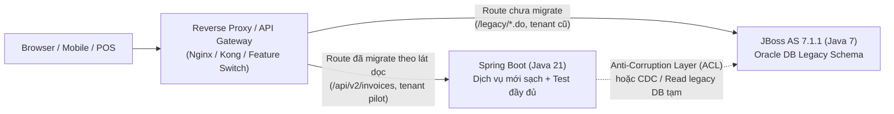

# CQ-05 · Seams & Strangler Fig

> **TL;DR**: Một **Seam (Đường nối)** theo Michael Feathers là điểm trong code mà bạn có thể **thay đổi hành vi (chuyển hướng sang fake/stub hoặc phiên bản mới) mà KHÔNG phải sửa đoạn code tại ngay vị trí đó**. Muốn thêm tính năng an toàn vào một hệ thống legacy khó viết test toàn bộ, hãy dùng **Sprout Method / Sprout Class** (viết logic mới sạch sẽ kèm unit test 100%, rồi chèn đúng 1 dòng gọi ra từ code cũ) hoặc **Wrap Method**. Ở quy mô ứng dụng (như chuyển **JBoss AS 7.1.1 → Spring Boot**), áp dụng **Strangler Fig Pattern**: đặt Proxy/Router phía trước cắt từng lát nghiệp vụ sang hệ thống mới theo cohort/endpoint cho đến khi monolith cũ rút sạch vai trò rồi nghỉ hưu.

## 🧭 Brief

| | |
| :--- | :--- |
| **Loại** | Bài học |
| **Giai đoạn** | Năm 1 · Q1 |
| **Chủ đề** | Code Quality, Refactoring & Testing |
| **Tiên quyết** | [CQ-04](../04-legacy-characterization-tests/README.md) |

**Phạm vi bắt buộc**
- seam (object seam, link seam)
- sprout method/class
- wrap method
- strangler fig ở mức module và hệ thống

**Câu hỏi sâu — nội dung phải giúp trả lời được**
- Thêm tính năng vào legacy khi không thể viết test cho code cũ?
- Strangler fig áp dụng cho migration JBoss → Spring Boot ra sao?

**Ý tưởng lab / demo**
- Dùng sprout class thêm logic mới có test vào code cũ

**Tài liệu gốc gợi ý**
- Working Effectively with Legacy Code
- Refactoring (Fowler)
- A Philosophy of Software Design
- JUnit 5 User Guide

**Gói đầu ra**
- [x] `README.md` — lý thuyết theo [lesson-template](../../../docs/templates/lesson-template.md)
- [x] `exercises.md` — bài tập L1/L2/L3 theo [exercises-template](../../../docs/templates/exercises-template.md)
- [x] `solutions.md` — đáp án theo [solutions-template](../../../docs/templates/solutions-template.md)
- [x] `lab/` — code demo chạy được + `lab/README.md` theo [lab-template](../../../docs/templates/lab-template.md)
- [ ] _(người học)_ `my-notes.md` — **agent không tạo**

---

## 1. Bài toán & Động lực

Trong thực tế ở doanh nghiệp, bạn không được phép mất 2 tuần "đứng hình" viết Characterization Test hết 4.000 dòng EJB/DAO trước khi giao một quy tắc miễn thuế mới cho thứ Sáu tuần này. Vậy khi sếp yêu cầu thêm quy tắc mới ngay vào một hàm legacy rối như mớ bòng bong mà chưa thể unit test nổi hàm cũ, ta đứng trước ngã ba đường:
- Nhét thêm `if/else` vào giữa hàm legacy không test → rủi ro gãy luồng cũ, và code mới sinh ra cũng lập tức bị "nhiễm bệnh không test được".
- Dùng **Seam + Sprout / Wrap + Strangler Fig** → **cô lập 100% logic mới** vào vùng đất sạch, viết test đầy đủ cho nó ngay hôm nay, và thay thế dần dần hệ thống cũ không cần *Big Bang Rewrite*.

## 2. Cơ chế bên trong (Deep Dive)

### 2.1 Seam & Enabling Point (Định nghĩa của Michael Feathers)

> **Seam** là nơi bạn có thể thay đổi hành vi của chương trình mà **không chỉnh sửa ngay tại file/vị trí đó**. Mọi Seam đều đi kèm một **Enabling Point** — chỗ bạn ra quyết định chọn hành vi nào sẽ chạy.

Ba loại Seam chính trong Java:
1. **Object Seam (Phổ biến nhất & sạch nhất trong Java)**:
   Thay đổi cộng tác viên qua Constructor Injection, Factory Method, hoặc Setter. Trong [`LegacyInvoiceProcessor`](lab/src/main/java/lab/cq/seams/LegacyInvoiceProcessor.java), `AuditSink` được truyền qua constructor (Enabling Point là lời gọi `new LegacyInvoiceProcessor(captured::add)` ở test vs `new LegacyInvoiceProcessor()` ở prod). Code bên trong `calculateAndAudit(...)` **không hề thay đổi một ký tự nào** giữa test và production!
2. **Link Seam (Đường nối cấp Classpath / Build / JNDI)**:
   Code Java giữ nguyên dòng gọi lớp/giao diện (hoặc JNDI name), nhưng ở môi trường test bạn tráo file `.jar` / thư mục test trên **Classpath** hoặc cấu hình JNDI trỏ tới fake DataSource/stub server. Lưu ý: tuy ít xâm lấn nhất nhưng khó thấy trực tiếp trong code (*Obscurity* cao), nên ưu tiên *Object Seam* cho unit test nhanh.
3. **Preprocessing Seam** (C/C++ `#define`, trong Java gần như không dùng trừ bytecode instrumentation / Java Agent / Mock static ByteBuddy như bài [CQ-06](../06-junit5-mockito/README.md)).

### 2.2 Câu hỏi sâu #1 — Thêm tính năng vào legacy khi không thể viết test cho code cũ?

Khi đụng phải một hàm legacy bất khả thi về test trong ngắn hạn (chẳng hạn servlet 800 dòng móc thẳng `HttpServletRequest` + `InitialContext`), áp dụng ngay 2 kỹ thuật phẫu thuật ít xâm lấn:

#### Kỹ thuật 1: Sprout Method / Sprout Class ("Đâm chồi")
Thay vì viết logic mới xen vào hàm cũ, bạn tạo hẳn một hàm mới (**Sprout Method**) hoặc tốt hơn là một class mới độc lập (**Sprout Class**, như [`TaxExemptionSproutPolicy`](lab/src/main/java/lab/cq/seams/TaxExemptionSproutPolicy.java)), không phụ thuộc vào hạ tầng legacy, và viết bộ JUnit 5 test phủ **100%** cho chồi non này! Rồi trong hàm legacy cũ, bạn **chỉ chèn duy nhất 1 dòng gọi sang Sprout Class**.

- **Ưu điểm**: Toàn bộ logic nghiệp vụ mới được bảo vệ tuyệt đối bằng unit test; ranh giới chạm vào code cũ chỉ là 1–2 dòng dễ review nhất.
- **Nhược điểm**: Thừa nhận tạm thời bỏ ngỏ phần thân hàm cũ chưa có test (sẽ quay lại bọc Characterization Test như [CQ-04](../04-legacy-characterization-tests/README.md) khi có thời gian).

#### Kỹ thuật 2: Wrap Method ("Bọc vỏ")
Khi cần thêm một hành vi *xuyên suốt trước/sau* hàm cũ (ví dụ ghi audit log, bắn event, check permission) mà không muốn nhồi vào ruột hàm cũ:
1. Đổi tên hàm cũ (hoặc giữ làm lõi `calculateNetPayable(...)`).
2. Tạo hàm wrapper bên ngoài (`calculateAndAudit(...)`) gọi vào hàm lõi rồi nối thêm bước mới qua Seam (`auditSink.record(...)`).
3. Code mới nằm hoàn toàn bên ngoài vòng rủi ro của hàm cũ và có thể test độc lập.

### 2.3 Strangler Fig Pattern — Cấp Module & Cấp Hệ thống

Lấy cảm hứng từ cây si bóp cổ (Strangler Fig) mọc bám quanh cây cổ thụ cho tới khi tự đứng vững và thay thế cây cũ chết mục đi.

#### Câu hỏi sâu #2 — Áp dụng Strangler Fig cho migration JBoss AS 7.1.1 → Spring Boot thế nào?



Lộ trình 5 bước chuẩn công nghiệp (tránh 100% rủi ro Big Bang Rewrite):
1. **Đặt Routing Edge (Nginx / API Gateway)** làm mặt tiền duy nhất trước JBoss (Enabling Point cấp hệ thống).
2. **Chọn lát cắt dọc có giá trị cao & ít phụ thuộc nhất trước** (ví dụ API tra cứu hóa đơn, hoặc tính phí mới cho 1 nhóm `pilot tenants` như `InvoiceStranglerRouter` trong lab).
3. **Dựng lớp chống tham nhũng (Anti-Corruption Layer — ACL)**: Spring Boot giao tiếp với DB/SOAP cũ của JBoss qua adapter dịch thuật rõ ràng, tuyệt đối *không* để schema xấu của legacy tràn vào model mới bên trong Spring Boot.
4. **Canary / Shadow Traffic & Fallback**: Đẩy 5–10% traffic thật hoặc đối chiếu kết quả song song (Shadow mode) trước khi cắt 100% traffic cho route đó, giữ sẵn công tắc quay xe tức thì nếu Spring Boot gặp lỗi (như [`StranglerFallbackSwitch`](lab/solutions/StranglerFallbackSwitch.java)).
5. **Tắt dần module cũ trên JBoss**: Khi cả route đã chuyển sang Spring Boot ổn định, xoá code/endpoint cũ trên JBoss để tránh bảo trì hai nơi. Lặp lại theo từng lát đến khi JBoss trống rỗng và nghỉ hưu hẳn!

## 3. So sánh chiến lược mở rộng Legacy

| Chiến lược | Khi nào dùng | Mức độ xâm lấn vào code cũ | Mức bảo vệ bằng test |
| :--- | :--- | :--- | :--- |
| **Sprout Method / Class** | Thêm rule tính toán mới vào giữa quy trình legacy dài | Rất thấp (1 dòng chèn thêm) | 100% cho phần code mới |
| **Wrap Method** | Thêm log/audit/validation/retry quanh lời gọi hàm cũ | Cực thấp (không đụng ruột cũ) | Cao cho hành vi bọc thêm |
| **Strangler Fig** | Thay thế dần một EJB module / JBoss app sang Spring Boot | Zero trên module đích cũ (đặt Router ngoài) | Toàn diện trên module/service mới |

## 4. Minh hoạ & Lab

Lab [`05-seams-strangler/lab`](lab/README.md) chứng minh cả 3 công cụ trên một bài toán tính hóa đơn VAT + miễn giảm:
- [`TaxExemptionSproutPolicy`](lab/src/main/java/lab/cq/seams/TaxExemptionSproutPolicy.java): **Sprout Class** chứa logic miễn thuế `NON_PROFIT_FULL_EXEMPTION` và trợ cấp vùng xa `REMOTE_ZONE_REBATE`, được test sạch không cần khởi động server.
- [`LegacyInvoiceProcessor`](lab/src/main/java/lab/cq/seams/LegacyInvoiceProcessor.java): hàm cũ `calculateNetPayable` gọi đúng 1 dòng tới `sproutPolicy`, hàm mới `calculateAndAudit` minh hoạ **Wrap Method + Object Seam (`AuditSink`)**, và `InvoiceStranglerRouter` định tuyến cohort `migratedToSpring` sang handler mới.
- [`StranglerFallbackSwitch`](lab/solutions/StranglerFallbackSwitch.java): minh hoạ công tắc Strangler tự fallback về legacy khi `TENANT-ERR` gặp timeout ở engine mới.

Kết quả chạy `SeamsStranglerTest` (`mvn -o test`): **3/3 test cases PASS** + output mẫu từ `StranglerFallbackSwitch.java`:
```text
TENANT-STD   -> 1100000
TENANT-PILOT -> 1075000
[FALLBACK] Reverting TENANT-ERR to legacy due to: New microservice timeout
TENANT-ERR   -> 1100000
```

## 5. Legacy corner (Java 7 / JBoss AS 7.1.1)

Trên môi trường **Java 7 + JBoss AS 7.1.1**:
- **Dùng Link Seam + JBoss Datasource cực khéo khi integration local**: file cấu hình `standalone.xml` giữ nguyên JNDI `java:jboss/datasources/CoreDS` trong code Java, nhưng khi chạy test ở local trỏ sang H2/schema test — đúng nghĩa *Link Seam*!
- **Di cư dần từ WAR/EAR sang Spring Boot bằng Nginx**: thay vì đợi 1 năm chuyển toàn bộ 80 trang JSP/Struts/Servlet trên JBoss sang React + Spring Boot, đặt Nginx phía trước ánh xạ `/api/v2/reports/* -> spring-boot:8081` trong khi `/*.do -> jboss:8080`, dùng **Shared Session/JWT Cookie** làm cầu nối xác thực để user không cảm nhận hệ thống đang tách đôi.

## 6. Lỗi hay gặp trong production

1. **Làm Strangler Fig nhưng để Spring Boot truy cập chọc sửa thẳng vào cùng bảng DB của JBoss mà thiếu ACL / Ownership**
   Khi hai hệ thống cùng update tự do lên 1 bảng mà không rõ chủ sở hữu dữ liệu (*Source of Truth*), sẽ nổ ra xung đột trạng thái, mất đồng bộ logic validation ngầm của JBoss.
2. **Cắt một Sprout Class nhưng lại copy-paste luôn cả kết nối JDBC/HttpSession vào trong Sprout**
   Biến chồi non thành một bản sao khó test y hệt cây cũ. Luôn đẩy giá trị thuần (`long grossVnd`, `String regionCode`) vào Sprout Class!
3. **Không dọn lớp định tuyến cũ sau khi Strangler xong**
   Giữ hai nhánh code (old & new) chạy song song nhiều năm biến *Feature Toggle / Strangler Router* thành nợ kỹ thuật kép vĩnh viễn.

## 7. Checklist thực hành

- [ ] Chạy [`SeamsStranglerTest`](lab/src/test/java/lab/cq/seams/SeamsStranglerTest.java) (`mvn -o test`) và giải thích đúng vai trò của từng test với *Sprout*, *Wrap*, *Object Seam*, và *Strangler*.
- [ ] Chạy [`StranglerFallbackSwitch`](lab/solutions/StranglerFallbackSwitch.java) để thấy cơ chế fallback an toàn khi canary lỗi.
- [ ] Hoàn thành bài tập L1–L3 trong [exercises.md](exercises.md) trước khi mở [solutions.md](solutions.md).

## 8. Câu hỏi tự kiểm tra

1. Theo Michael Feathers, một **Seam** luôn cần đi kèm **Enabling Point**. Chỉ ra Seam và Enabling Point trong `new LegacyInvoiceProcessor(captured::add)`.
2. Khi được yêu cầu thêm quy tắc khuyến mãi mới vào một hàm Java 7 dài 600 dòng chưa có test, tại sao **Sprout Class** tốt hơn sửa trực tiếp bên trong hàm đó?
3. Khác biệt chính về mục đích sử dụng giữa **Sprout Method** và **Wrap Method** là gì?
4. Trong lộ trình Strangler Fig từ JBoss AS 7.1.1 sang Spring Boot, **Anti-Corruption Layer (ACL)** giải quyết bài toán gì?
5. Tại sao chiến lược cắt traffic Strangler theo nhóm nhỏ (*canary/tenant*) kết hợp công tắc fallback an toàn hơn cắt 100% ngay lập tức?

## 9. Tài liệu tham khảo

- Michael C. Feathers — *Working Effectively with Legacy Code* (Ch. 4: The Seam Model, Ch. 6: I Don't Have Much Time and I Have to Change It — Sprout & Wrap)
- Martin Fowler — *Strangler Fig Application* (martinfowler.com/bliki/StranglerFigApplication.html)
- Sam Newman — *Monolith to Microservices* (Ch. 3–4: Strangler Fig & Data Decomposition)
- Bài tiếp theo: [CQ-06 · JUnit 5 & Mockito](../06-junit5-mockito/README.md)
