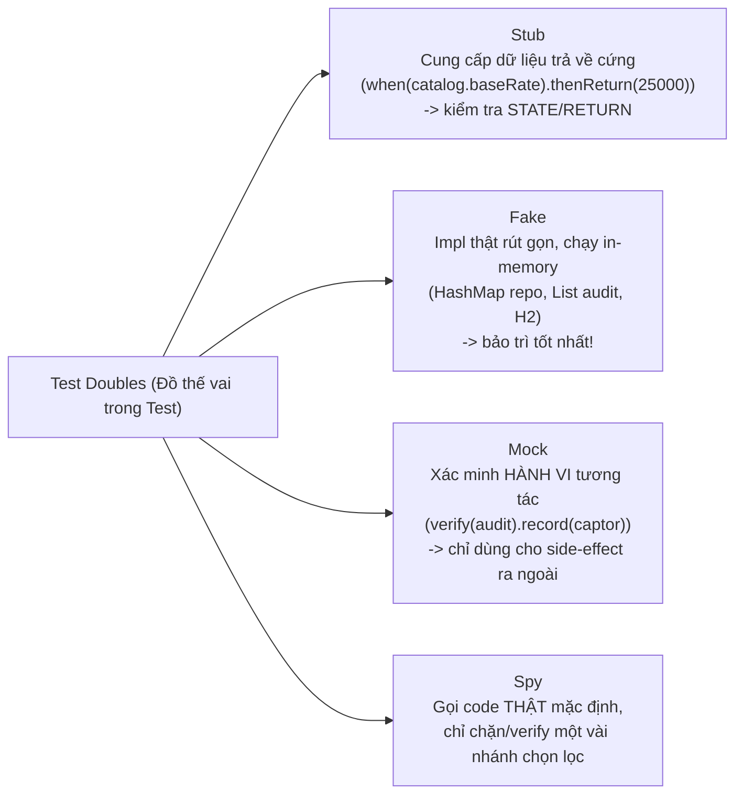

# CQ-06 · JUnit 5 & Mockito

> **TL;DR**: **JUnit 5 (Jupiter)** + **AssertJ** + **Mockito** là bộ ba chuẩn công nghiệp giúp test đọc mượt như tài liệu nghiệp vụ. Dùng đúng vũ khí: **`@Nested` + `@DisplayName`** nhóm test theo hành vi, **`@ParameterizedTest`** quét hàng loạt biên dữ liệu mà không lặp code, **Extension** gom logic kỹ thuật lặp đi lặp lại; chỉ dùng Mockito ở ranh giới tương tác thực sự. Phân biệt rạch ròi **Stub** (trả data mẫu) vs **Fake** (impl nhẹ in-memory) vs **Mock** (kiểm chứng cuộc gọi `verify()`). Lạm dụng `verify()` khiến test trói chặt vào chi tiết nội bộ (*Implementation Coupling*) và gãy vụn mỗi lần refactor ([CQ-07](../07-test-pyramid-mocking/README.md)).

## 🧭 Brief

| | |
| :--- | :--- |
| **Loại** | Bài học |
| **Giai đoạn** | Năm 1 · Q1 |
| **Chủ đề** | Code Quality, Refactoring & Testing |
| **Tiên quyết** | [CQ-05](../05-seams-strangler/README.md) |

**Phạm vi bắt buộc**
- lifecycle, parameterized test, nested, extension
- Mockito mock/spy/captor
- AssertJ
- test đặt tên rõ ý

**Câu hỏi sâu — nội dung phải giúp trả lời được**
- Mock vs stub vs fake?
- Vì sao test quá nhiều verify() trở nên giòn?

**Ý tưởng lab / demo**
- Bộ test cho 1 service tính phí với parameterized cases

**Tài liệu gốc gợi ý**
- Working Effectively with Legacy Code
- Refactoring (Fowler)
- A Philosophy of Software Design
- JUnit 5 User Guide

**Gói đầu ra**
- [x] `README.md` — lý thuyết theo [lesson-template](../../../docs/templates/lesson-template.md)
- [x] `exercises.md` — bài tập L1/L2/L3 theo [exercises-template](../../../docs/templates/exercises-template.md)
- [x] `solutions.md` — đáp án theo [solutions-template](../../../docs/templates/solutions-template.md)
- [x] `lab/` — code demo chạy được + `lab/README.md` theo [lab-template](../../../docs/templates/lab-template.md)
- [ ] _(người học)_ `my-notes.md` — **agent không tạo**

---

## 1. Bài toán & Động lực

Nhiều bộ unit test trong doanh nghiệp rơi vào 1 trong 2 thảm họa:
- **Copy-paste `test1`, `test2`, `test3`** dài hàng nghìn dòng với tên vô nghĩa (`testCase1_OK`), `assertEquals(expected, actual)` đảo ngược thứ tự khi đọc báo lỗi, setup nặng nề không cô lập.
- **Test tràn ngập Mockito `when(...).thenReturn(...)` + `verify(...)` mọi hàm con**, đến nỗi vừa tách một helper method là hàng loạt test báo đỏ dù kết quả đầu ra cho khách hàng hoàn toàn không đổi!

## 2. JUnit 5 Architecture & Tính năng cốt lõi

### 2.1 Kiến trúc JUnit 5 & Lifecycle

JUnit 5 chia thành **JUnit Platform** (cổng chạy cho IDE/Maven) + **JUnit Jupiter** (API hiện đại viết test) + **JUnit Vintage** (tương thích ngược JUnit 3/4 legacy!).

Vòng đời mặc định mỗi method test (`@TestInstance(Lifecycle.PER_METHOD)`):
1. `@BeforeAll` (`static`): chạy **1 lần** trước toàn bộ class (mở schema/fixture dùng chung nặng).
2. Trước **mỗi** `@Test` / `@ParameterizedTest`: JUnit tạo **1 instance test class mới** (tránh rò rỉ mutable state giữa các test!) → chạy `@BeforeEach` → `BeforeTestExecutionCallback` (Extension).
3. Chạy thân test → `AfterTestExecutionCallback` → `@AfterEach`.
4. `@AfterAll`: dọn dẹp tài nguyên cấp class.

### 2.2 `@Nested`, `@DisplayName` & Quy tắc đặt tên test rõ ý

Mỗi test method là một **tài liệu sống** trả lời 3 vế: **Condition (Hoàn cảnh) · Action (Hành động) · Expected Outcome (Kết quả)**. Ví dụ:
- Xấu: `testQuoteFee1()`
- Rõ ý: `@Nested class AuditAndValidationTests` + `vipFreeDomesticWaivesFeeAndRecordsWaivedEvent()` kèm `@DisplayName("VIP domestic >= 500k skips surcharge computation and emits waived audit event")`.

### 2.3 `@ParameterizedTest` (`@CsvSource` / `@MethodSource`) & JUnit 5 Extension

Thay vì viết 6 `@Test` lặp đi lặp lại, `@ParameterizedTest` gom trọn ma trận biên (`499999` vs `500000`, `1.5 kg` vs `4.0 kg`, `DOMESTIC`/`EXPRESS`/`INTERNATIONAL`) vào 1 bảng `@CsvSource` gọn gàng (xem [`ShippingFeeServiceTest`](lab/src/test/java/lab/cq/testing/ShippingFeeServiceTest.java)).

Và thay vì dùng kế thừa `AbstractBaseTest` cồng kềnh như thời JUnit 4 (`@Rule`), JUnit 5 dùng **Composition qua `@ExtendWith(...)`**: ví dụ `ExecutionTimerExtension implements BeforeTestExecutionCallback, AfterTestExecutionCallback` tự đo thời gian và cảnh báo test chạy chậm hơn 250 ms mà mọi class test đều gắn dùng chung được!

### 2.4 AssertJ — Assertions đọc như tiếng Anh tự nhiên

AssertJ giúp IDE autocomplete chính xác theo kiểu dữ liệu và xuất thông điệp lỗi cực kỳ rõ khi fail:
```java
assertThat(actualFee).isEqualTo(expectedFee);
assertThat(event.freeWaiverApplied()).isTrue();
assertThatThrownBy(() -> service.quoteFee(badRequest))
        .isInstanceOf(IllegalArgumentException.class)
        .hasMessageContaining("Invalid order total");
```

## 3. Mockito & Phản biện thiết kế Test Double

### 3.1 Câu hỏi sâu #1 — Mock vs Stub vs Fake khác nhau thế nào?

Theo chuẩn phân loại *xUnit Test Patterns* (Gerard Meszaros / Martin Fowler):



| Loại Test Double | Mục đích sử dụng | Ví dụ trong [`ShippingFeeServiceTest`](lab/src/test/java/lab/cq/testing/ShippingFeeServiceTest.java) & [`FakeVsMockRefactorDemo`](lab/solutions/FakeVsMockRefactorDemo.java) |
| :--- | :--- | :--- |
| **Stub** | Cung cấp input giả để đẩy luồng chạy qua nhánh cần test | `when(rateCatalog.baseRateFor(EXPRESS)).thenReturn(60_000L)` hoặc lambda `table::get` |
| **Fake** | Bản chạy nhẹ hoạt động thật (có state nhất quán in-memory) | `List<QuoteAuditEvent> recorded = new ArrayList<>();` truyền `recorded::add` (chứng minh trong `FakeVsMockRefactorDemo`) |
| **Mock** | Ghi chép và assert **hàm có được gọi hay không / đúng tham số nào** | `verify(auditTracker).record(eventCaptor.capture())` + assert payload `ArgumentCaptor` |
| **Spy** | Bọc một instance **thật** (`@Spy SurchargeCalculator`), chạy thật và cho phép verify hoặc stub ghi đè cục bộ | `verify(surchargeSpy).weightSurcharge(6.0)` hoặc `verify(surchargeSpy, never()).weightSurcharge(...)` |

> Nguyên tắc thực dụng (**Classical vs Mockist TDD**): Ưu tiên **Fake / Real object → Stub → Mock** (chỉ verify tương tác với external side-effect thực sự như gửi event audit, mail, thanh toán).

### 3.2 Câu hỏi sâu #2 — Vì sao test quá nhiều `verify()` trở nên giòn (brittle)?

Khi một test chứa đầy các dòng `verify(helperA).step1(...)`, `verify(helperB).step2(...)`, `verifyNoMoreInteractions(...)`:
1. **Khoá cứng cấu trúc nội bộ (*Testing Implementation, not Behavior*)**: Hàm đó vẫn tính ra `fee = 80_000L` đúng 100%, nhưng hễ bạn gộp 2 lần lookup thành 1 batch call, hoặc đổi thứ tự tính chiết khấu trước thuế, hoặc trích/inline helper class (như `SurchargeCalculator`) → **toàn bộ test dùng `verify()` nổ đỏ hàng loạt**, phá hủy lợi ích lớn nhất của bộ unit test là bảo vệ an toàn khi refactor!
2. **Dẫn tới sai lầm khi mock trả dữ liệu khớp giả định (`Pass even if prod is broken`)**: Stub + Verify quá nhiều biến test thành tấm gương soi chính kịch bản ta nghĩ trong đầu thay vì kiểm chứng công thức thật. (Sẽ phân tích sâu ở bài [CQ-07](../07-test-pyramid-mocking/README.md)).
3. **Chỉ nên dùng `verify()` + `ArgumentCaptor` tại CỔNG RA BÊN NGOÀI (External Side-effect)** — như kiểm tra rằng `auditTracker.record(...)` **không được gọi** khi input âm (`never()`), hoặc được gọi với `QuoteAuditEvent` mang đúng `freeWaiverApplied = true`.

## 4. Lưu ý Java 21+ & ByteBuddy Agent với Mockito 5

Từ Java 21 (JEP 451), JVM phát cảnh báo hoặc siết dần *Dynamic Self-Attachment* (khi Mockito tự cài `byte-buddy-agent` lúc runtime). Cách cấu hình chuẩn trong `pom.xml` (`maven-surefire-plugin`) là khai báo rõ `-javaagent`:
```xml
<argLine>-javaagent:${settings.localRepository}/net/bytebuddy/byte-buddy-agent/1.15.11/byte-buddy-agent-1.15.11.jar -Dnet.bytebuddy.experimental=true</argLine>
```
Cách này vừa chạy êm sạch trên Java 21–26, vừa tránh lỗi phân quyền agent trên CI/Windows sandbox.

## 5. Minh hoạ & Lab

Lab [`06-junit5-mockito/lab`](lab/README.md) kiểm thử [`ShippingFeeService`](lab/src/main/java/lab/cq/testing/ShippingFeeService.java) qua [`ShippingFeeServiceTest`](lab/src/test/java/lab/cq/testing/ShippingFeeServiceTest.java) với đầy đủ tính năng:
- `@ExtendWith({MockitoExtension.class, ExecutionTimerExtension.class})`
- `@Nested` (`PricingMatrixTests`, `AuditAndValidationTests`) + `@BeforeEach` + `@DisplayName`
- `@ParameterizedTest` với 6 ca `@CsvSource` phủ ranh giới `499999` vs `500000`, `2.0 kg` vs `> 2.0 kg`
- `@Mock`, `@Spy`, `@Captor` (`ArgumentCaptor<QuoteAuditEvent>`) + `never()`
- AssertJ `assertThat` + `assertThatThrownBy`

Kết quả chạy `mvn -o verify` thực tế: **9/9 tests PASS** (`6` parameterized + `3` contract tests), và [`FakeVsMockRefactorDemo`](lab/solutions/FakeVsMockRefactorDemo.java) cho kết quả:
```text
fee1=0 | fee2=65000 | recordedEvents=2
```

## 6. Legacy corner (Java 7 / JBoss / JUnit 4)

Nếu codebase công ty vẫn đang chạy **JUnit 4 (`4.12/4.13`) + Java 7**:
- Khi nâng dần hoặc song song hóa trên dự án Maven hiện đại, **JUnit Vintage Engine** cho phép chạy lẫn test `@org.junit.Test` (JUnit 4) và `@org.junit.jupiter.api.Test` (JUnit 5) trên cùng `mvn test`, giúp nhóm **di cư dần từng file** không cần sửa hàng trăm test JUnit 4 cũ!
- Nếu viết mới trên Java 7 chưa nâng JUnit 5: giữ nguyên kỷ luật **Fake > Mock**, dùng **Mockito 2.x/3.x** (bản cuối hỗ trợ Java 7/8) cho external interface (JDBC/JNDI/HTTP gateway), kết hợp **AssertJ 2.x/3.x** (không cần lambda cho Java 7 vẫn dùng `assertThatThrownBy` chưa có -> dùng `try { ... fail(); } catch (Expected e) { assertThat(e)... }`).

## 7. Lỗi hay gặp trong production (khi viết test)

1. **`lenient()` hay `UnnecessaryStubbingException` che dấu test bẩn**
   Đưa tất cả 10 `when(...)` vào `@BeforeEach` làm nhiều test chẳng dùng tới hết → Mockito strictness báo `UnnecessaryStubbingException`, rồi dev tiện tay gắn `@MockitoSettings(strictness = LENIENT)` hoặc `lenient()` bừa bãi thay vì setup cục bộ gọn trong từng test cần dùng!
2. **Dùng `doReturn` / `@Spy` bừa trên class thiết kế quá rối**
   Phải dùng `@Spy` stub chính một method private/public ngay bên trong class đang test (*Partial Mocking*) thường là dấu hiệu class đó đang gộp hai trách nhiệm — nên tách theo [CQ-01](../01-solid-in-practice/README.md) thay vì lạm dụng Spy.
3. **Assert chỉ kiểm tra `verify(repo).save(any())` mà không kiểm tra giá trị bên trong**
   `any()` nuốt sạch mọi sai số bên trong payload lưu xuống DB; luôn dùng `ArgumentCaptor` hoặc tốt hơn là Fake Repository lưu object vào List/Map để assert chính xác trạng thái kết quả!

## 8. Checklist thực hành

- [ ] Chạy [`ShippingFeeServiceTest`](lab/src/test/java/lab/cq/testing/ShippingFeeServiceTest.java) (`mvn -o test`) kiểm chứng **9/9** test cases chạy gọn.
- [ ] Thử cố tình làm gãy 1 assertion trong `@CsvSource` (rồi trả lại) để đọc định dạng thông báo lỗi của AssertJ và tên parameterized case trên console.
- [ ] Giải hết các bài L1–L3 trong [exercises.md](exercises.md) trước khi mở [solutions.md](solutions.md).

## 9. Câu hỏi tự kiểm tra

1. Tại sao JUnit 5 mặc định khởi tạo một **instance mới của test class** cho từng `@Test`?
2. Phân biệt rõ 4 khái niệm: **Stub**, **Fake**, **Mock**, và **Spy**. Cái nào dễ bảo trì nhất khi refactor?
3. Khi nào `verify(...)` kết hợp `ArgumentCaptor` mang lại giá trị thật, và khi nào dùng `verify(...)` lại phản tác dụng khiến bộ test giòn?
4. Trong JUnit 5, tại sao nên viết `ExecutionTimerExtension` (`@ExtendWith`) thay vì tạo `BaseTest` class cha bắt mọi class test `extends BaseTest`?
5. Với bài test kiểm tra 10 ngưỡng giá/chiết khấu khác nhau, cơ chế nào trong JUnit 5 giúp loại bỏ trùng lặp mà vẫn giữ từng dòng test case độc lập trên report?

## 10. Tài liệu tham khảo

- [JUnit 5 User Guide — Writing Tests, Lifecycle, Parameterized Tests & Extensions](https://junit.org/junit5/docs/current/user-guide/)
- [Mockito Documentation — Strict Stubbing, ArgumentCaptor & Java 21 Agent Configuration](https://javadoc.io/doc/org.mockito/mockito-core/latest/org/mockito/Mockito.html)
- [AssertJ Core Fluent Assertions Guide](https://assertj.github.io/doc/)
- Martin Fowler — *Mocks Aren't Stubs* (martinfowler.com/articles/mocksArentStubs.html)
- Bài tiếp theo: [CQ-07 · Test pyramid & khi nào KHÔNG mock](../07-test-pyramid-mocking/README.md)
