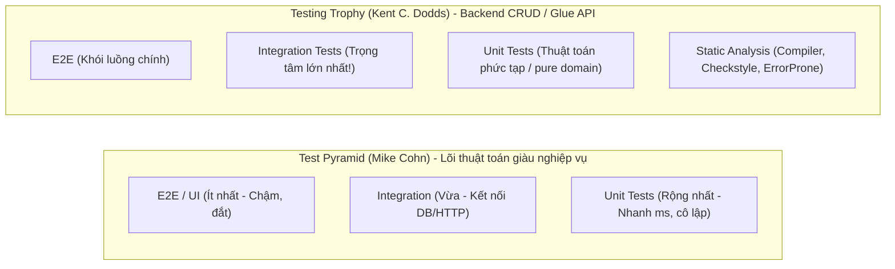

# CQ-07 · Test pyramid & khi nào KHÔNG mock

> **TL;DR**: Chọn đúng tầng test là bài toán ROI giữa **Tốc độ phản hồi**, **Độ tin cậy thật**, và **Chi phí bảo trì khi refactor**. Tháp **Test Pyramid** cổ điển đặt đáy rộng bằng Unit Test nhanh, còn mô hình **Testing Trophy** (cho backend/API hiện đại kết nối DB) nhấn mạnh giá trị cực cao của **Integration Test** tại ranh giới thật. Quy tắc vàng để không tự trói tay: **KHÔNG mock helper/domain logic nội bộ — chỉ stub/fake ở ranh giới I/O bên ngoài**, và **luôn test Behavior (đầu vào → đầu ra/side-effect), đừng test Implementation (cách các class nội bộ gọi nhau)**.

## 🧭 Brief

| | |
| :--- | :--- |
| **Loại** | Bài học |
| **Giai đoạn** | Năm 1 · Q1 |
| **Chủ đề** | Code Quality, Refactoring & Testing |
| **Tiên quyết** | [CQ-06](../06-junit5-mockito/README.md) |

**Phạm vi bắt buộc**
- unit/integration/e2e
- testing trophy
- mock biên (I/O) không mock nội bộ
- test behavior không test implementation

**Câu hỏi sâu — nội dung phải giúp trả lời được**
- Khi nào integration test có giá trị hơn unit test?
- Over-mocking gây hại gì khi refactor?

**Ý tưởng lab / demo**
- So sánh 2 bộ test (over-mocked vs boundary-mocked) khi refactor

**Tài liệu gốc gợi ý**
- Working Effectively with Legacy Code
- Refactoring (Fowler)
- A Philosophy of Software Design
- JUnit 5 User Guide

**Gói đầu ra**
- [x] `README.md` — lý thuyết theo [lesson-template](../../../docs/templates/lesson-template.md)
- [x] `exercises.md` — bài tập L1/L2/L3 theo [exercises-template](../../../docs/templates/exercises-template.md)
- [x] `solutions.md` — đáp án theo [solutions-template](../../../docs/templates/solutions-template.md)
- [x] `lab/` — code demo chạy được + `lab/README.md` theo [lab-template](../../../docs/templates/lab-template.md)
- [ ] _(người học)_ `my-notes.md` — **agent không tạo**

---

## 1. Bài toán & Động lực

Có những dự án đạt **"95% line coverage"** trên báo cáo SonarQube nhưng hễ đẩy lên staging là vẫn sập ngay ở câu SQL bị lệch kiểu cột, JSON parse sai field name, hoặc transaction không rollback! Trong khi đó, chỉ cần tách hoặc đổi cấu trúc một class domain, 80 unit test lại báo đỏ vì mock khắp nơi!

Vấn đề không phải "viết ít test hay nhiều test", mà là **viết test ở sai tầng** và **mock sai chỗ**.

## 2. Test Pyramid vs Testing Trophy



| Tầng test | Scope kiểm chứng | Tốc độ & Chi phí | Khi nào phát huy giá trị cao nhất |
| :--- | :--- | :--- | :--- |
| **Unit Test** | 1 hàm hoặc 1 cụm module domain thuần (chạy in-memory) | Cực nhanh (**vài ms/test**), không cần hạ tầng | Nhiều nhánh nghiệp vụ phức tạp (tính thuế, khuyến mãi, state machine, rule validation) |
| **Integration Test** | Service + Repository + **DB/Redis/Kafka thật** (Testcontainers) | Chậm hơn (**vài giây**), tốn RAM/Docker | Nối dây Spring DI, câu SQL / ORM mapping, Transaction rollback, Migration, JSON serialization |
| **E2E Test** | Toàn hệ thống từ UI/HTTP Edge tới DB thật & dịch vụ phụ | Rất chậm (**phút**), dễ *flaky* (mạng/timing) | Smoke test các đường dẫn sinh tử (*checkout, login, thanh toán*), giữ số lượng ít và tinh gọn |

### 2.1 Câu hỏi sâu #1 — Khi nào Integration Test có giá trị hơn Unit Test?

Trong rất nhiều service backend (như Spring Boot CRUD hay DAO JDBC của JBoss), **Integration Test đập chết Unit Test** về giá trị phát hiện bug ở 4 tình huống:
1. **Logic phần lớn là tương tác I/O / SQL / Migration**: Một DAO viết `SELECT ... ON CONFLICT ... WHERE ...` phức tạp nhưng trong unit test bạn lại mock `JdbcTemplate` / `PreparedStatement` → unit test chỉ khẳng định *"code gọi đúng tên hàm executeQuery"*, hoàn toàn **không biết SQL sai cú pháp, thiếu index, hay lệch kiểu dữ liệu cột**!
2. **Transaction, Lock & Concurrency DB**: Kiểm tra `@Transactional(rollbackFor = ...)` có thật sự rollback khi văng checked exception, hay hai thread `SELECT FOR UPDATE` có tránh được race condition hay không — *không thể* test bằng Mockito!
3. **Cấu hình DI, Serialization & HTTP Mapping**: Jackson deserialization (`@JsonProperty`, `LocalDate` format), Bean Validation (`@Valid`), Spring Security filter chain, Flyway SQL migration scripts.
4. **Hợp đồng với dịch vụ ngoài (WireMock / Contract Test)**: Đảm bảo client HTTP đọc đúng JSON trả về và xử lý timeout 504 chuẩn xác.

## 3. Cơ chế & Triết lý Mock đúng chỗ: Mock Biên (I/O), KHÔNG Mock Nội Bộ

### 3.1 Câu hỏi sâu #2 — Over-mocking gây hại gì khi Refactor?

Hãy nhìn trực tiếp cặp test đối lập trong [`BoundaryVsOverMockedTest`](lab/src/test/java/lab/cq/pyramid/BoundaryVsOverMockedTest.java) của bài lab:

1. **Test Over-Mocked (Antipattern — *Mockist cực đoan*)**:
   `CheckoutServiceV1` gọi 2 domain helper thuần là `DiscountRule` và `TaxRule`, rồi ghi kết quả ra cổng I/O `PaymentLedgerPort`. Người dev viết `@Mock DiscountRule`, `@Mock TaxRule`, rồi ghi:
   ```java
   when(mockedDiscount.discountFor(1_000_000L, true)).thenReturn(100_000L);
   when(mockedTax.vatFor(900_000L)).thenReturn(72_000L);
   verify(mockedDiscount).discountFor(...);
   ```
   **Hai tác hại chí mạng**:
   - **(a) Test cho cảm giác an toàn giả (*False Confidence*)**: Kể cả khi `DiscountRule` thật trên prod đang viết lỗi `* 0.90` thay vì `* 0.10`, test này **vẫn PASS xanh rì** vì nó không hề chạy code thật của `DiscountRule`!
   - **(b) Khoá chết quyền Refactor (*Test Fragility*)**: Khi sang `CheckoutServiceV2Refactored` ta gộp công thức tính toán cho gọn mà không thay đổi bất kỳ con số đầu ra nào (`972_000L`), bộ test over-mocked bị gãy nát ngay lập tức vì chữ ký và `verify(...)` bám chặt vào `DiscountRule` & `TaxRule`!

2. **Test Boundary-Mocked (Best Practice — *Test Behavior, not Implementation*)**:
   Dùng **đối tượng THẬT** cho toàn bộ logic nội bộ (`new DiscountRule()`, `new TaxRule()`), và **chỉ truyền Fake/Stub ở ranh giới I/O bên ngoài** (`v1Ledger::add` cho `PaymentLedgerPort`).
   - Kết quả chạy lab chứng minh: `boundaryMockedBehaviorTestSurvivesV1ToV2RefactoringIdentically` kiểm chứng được công thức tính toán thật **VÀ chạy xanh cả trên V1 lẫn V2** mà không phải sửa test khi đổi cấu trúc bên trong!

### 3.2 Quy tắc 3 bước "Mock hay Real?"

```text
Collaborator là gì?
  ├─► Thuộc logic nội bộ / Value object / Helper thuần (không chạm I/O, không chậm)?
  │     └──► DÙNG OBJECT THẬT! (Tuyệt đối không mock)
  ├─► Ranh giới hệ thống ngoài trong tầm kiểm soát (DB, Redis, Kafka) khi viết Integration Test?
  │     └──► DÙNG CONTAINER THẬT (Testcontainers - CQ-08)!
  └─► Ranh giới ngoài khó dựng / cần tốc độ ms trong Unit Test (SMTP, Payment Gateway, Clock, Ledger)?
        └──► DÙNG FAKE / STUB NHẸ (hoặc Mockito Mock chỉ tại Port interface này).
```

## 4. Minh hoạ & Lab

Lab [`07-test-pyramid-mocking/lab`](lab/README.md) đặt cạnh nhau hai phiên bản của `CheckoutService` (`V1` gọi tách `DiscountRule` + `TaxRule`, `V2Refactored` gộp logic nội bộ gọn lại) trong [`CheckoutDomain`](lab/src/main/java/lab/cq/pyramid/CheckoutDomain.java), và đối chiếu trong [`BoundaryVsOverMockedTest`](lab/src/test/java/lab/cq/pyramid/BoundaryVsOverMockedTest.java):
- `overMockedTestPassesEvenIfRealDiscountFormulaWereBroken`: chứng minh test mock nội bộ chỉ lặp lại giả định của người viết test và dính cứng `verify(...)` vào cấu trúc V1.
- `boundaryMockedBehaviorTestSurvivesV1ToV2RefactoringIdentically`: dùng real `DiscountRule` + `TaxRule` + Fake `List<LedgerEntry>`, pass trên cả `V1` và `V2` với `total = 972_000L` và `LedgerEntry` giống hệt nhau (`2/2` test PASS).
- [`BoundaryFakeSolution`](lab/solutions/BoundaryFakeSolution.java) (L3): chạy `CheckoutServiceV2Refactored` với fake ledger thuần in ra: `VIP=1944000 | STD=2160000 | recordedCharges=[LedgerEntry[orderId=B-1, netPayableVnd=1944000], LedgerEntry[orderId=B-2, netPayableVnd=2160000]]`.

## 5. Legacy corner (Java 7 / JBoss / JDBC)

Trong hệ thống **JBoss / Java 7 / JDBC thuần**:
- Rất nhiều team cố viết "Unit Test" bằng cách mock từng dòng `Connection`, `PreparedStatement`, `ResultSet` (`when(rs.next()).thenReturn(true, false); when(rs.getString(1))...`) chỉ để đẩy Coverage lên 80%. Thực chất đó là **Over-mocking vô nghĩa**: sửa câu SQL bị thiếu dấu phẩy test vẫn pass xanh 100%!
- **Cách phân tầng chuẩn cho legacy JBoss**:
  - **Logic nghiệp vụ thuần** (tính phí, validate, mapping trạng thái): tách ra POJO không I/O và viết **Unit Test thật không mock**.
  - **Tầng JDBC / SQL DAO**: đưa sang **Integration Test** chạy trên DB test thật (PostgreSQL Testcontainers ở bài [CQ-08](../08-testcontainers/README.md), hoặc Oracle/schema test cục bộ) thay vì mock từng method `ResultSet`! *(Lưu ý: `Proxy` JDBC trong `CQ-04` chỉ dùng làm giàn giáo tạm để khoá hành vi trước khi tách DAO và logic ra).*

## 6. Lỗi hay gặp trong production

1. **Mock cả `List`, `LocalDate`, `ObjectMapper`, hoặc `DiscountCalculator` nội bộ**
   Thay vì `new ObjectMapper()` hay `new DiscountCalculator()` mất `0.1 ms` chạy thật, dev lại đi `@Mock` nó làm test vừa dài vừa không test nổi bug serialization/toán học thực tế.
2. **Đảo ngược thành *Ice Cream Cone Antipattern* (đáy Unit mỏng dính, đỉnh E2E UI to đùng)**
   Mọi thứ đều test qua Selenium/E2E click trình duyệt 45 phút mỗi lần build → pipeline chậm chạp, hay flaky ngẫu nhiên, team ngừng chạy test trước khi merge!
3. **Bắt KPI `100% Coverage` bằng Mock**
   Kỹ sư sinh ra hàng trăm test mock trống rỗng chạy qua mọi dòng code nhưng `assertThat(result).isNotNull()` hời hợt — coverage xanh nhưng bug production vẫn lọt nguyên.

## 7. Checklist thực hành

- [ ] Chạy [`BoundaryVsOverMockedTest`](lab/src/test/java/lab/cq/pyramid/BoundaryVsOverMockedTest.java) (`mvn -o test`) kiểm chứng **2/2** pass và đọc so sánh V1 vs V2.
- [ ] Kiểm tra 3 test gần nhất bạn viết ở dự án: đếm xem trong đó có bao nhiêu mock trỏ vào **class nội bộ cùng domain** (thay vì ranh giới I/O bên ngoài).
- [ ] Giải hết bài tập L1–L3 trong [exercises.md](exercises.md) trước khi mở [solutions.md](solutions.md).

## 8. Câu hỏi tự kiểm tra

1. Điểm nhấn cốt lõi của **Testing Trophy** khác gì với **Test Pyramid** truyền thống, và phù hợp với loại ứng dụng backend nào?
2. Kể 3 trường hợp thực tế mà một **Integration Test** có giá trị vượt trội hoàn toàn so với Unit Test có mock.
3. Khi viết test cho `CheckoutServiceV1`, vì sao bạn *nên* mock `PaymentLedgerPort` (hoặc dùng Fake in-memory) nhưng *không nên* mock `DiscountRule` và `TaxRule`?
4. Định nghĩa ngắn gọn câu châm ngôn *"Test behavior, not implementation"* và nêu hậu quả nếu vi phạm.
5. Một class DAO chỉ chứa đúng 1 câu SQL `JOIN` 4 bảng không có `if/else` Java — nên viết Unit Test mock `ResultSet` hay Integration Test trên DB thật? Vì sao?

## 9. Tài liệu tham khảo

- Kent C. Dodds — *The Testing Trophy and Testing Classifications* (kentcdodds.com/blog/the-testing-trophy-and-testing-classifications)
- Vladimir Khorikov — *Unit Testing Principles, Practices, and Patterns* (Classical vs London school, Observable Behavior vs Implementation Details)
- Google Testing Blog — *Don't Overuse Mocks* & *Test Behavior, Not Implementation*
- Bài tiếp theo: [CQ-08 · Integration test với Testcontainers](../08-testcontainers/README.md)
