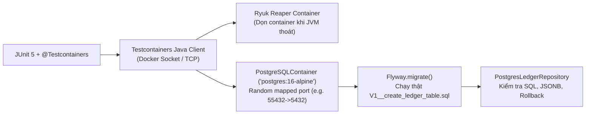

# CQ-08 · Integration test với Testcontainers

> **TL;DR**: **Testcontainers** dựng và xoá tự động container **PostgreSQL, Redis, Kafka thật** bằng Docker ngay trong vòng đời JUnit 5, xóa bỏ hoàn toàn ảo giác *"test pass trên H2 nhưng lên staging Postgres thì nổ"*. Đừng dùng H2 thay PostgreSQL vì **H2 lệch cú pháp SQL, JSONB, expression index, `ON CONFLICT ... RETURNING`, `LOCK`, và behavior Flyway migration**. Để chạy Testcontainers nhanh (vài giây thay vì vài phút): **chia sẻ một `@Container` singleton cho cả suite**, **tái sử dụng container khi dev local (`.withReuse(true)`)**, dọn dữ liệu bằng `TRUNCATE` thay vì tạo lại container, và tách phase chạy trên CI qua Docker socket / DinD.

## 🧭 Brief

| | |
| :--- | :--- |
| **Loại** | Bài học |
| **Giai đoạn** | Năm 1 · Q1 |
| **Chủ đề** | Code Quality, Refactoring & Testing |
| **Tiên quyết** | [CQ-07](../07-test-pyramid-mocking/README.md) |

**Phạm vi bắt buộc**
- Testcontainers PostgreSQL/Redis/Kafka
- reuse container
- test transaction, migration
- chạy trong CI

**Câu hỏi sâu — nội dung phải giúp trả lời được**
- Vì sao không dùng H2 thay PostgreSQL khi test?
- Tăng tốc test suite dùng Testcontainers thế nào?

**Ý tưởng lab / demo**
- Repository test với PostgreSQL thật + Flyway migration

**Tài liệu gốc gợi ý**
- Working Effectively with Legacy Code
- Refactoring (Fowler)
- A Philosophy of Software Design
- JUnit 5 User Guide

**Gói đầu ra**
- [x] `README.md` — lý thuyết theo [lesson-template](../../../docs/templates/lesson-template.md)
- [x] `exercises.md` — bài tập L1/L2/L3 theo [exercises-template](../../../docs/templates/exercises-template.md)
- [x] `solutions.md` — đáp án theo [solutions-template](../../../docs/templates/solutions-template.md)
- [x] `lab/` — code demo chạy được + `lab/README.md` theo [lab-template](../../../docs/templates/lab-template.md)
- [ ] _(người học)_ `my-notes.md` — **agent không tạo**

---

## 1. Bài toán & Động lực

Ở bài [CQ-07](../07-test-pyramid-mocking/README.md), ta xác định tầng **Integration Test** là lá chắn cực kỳ giá trị tại ranh giới Database / Broker. Ngày xưa đội Java hay giải quyết bằng cách cắm **H2 in-memory** chạy `MODE=PostgreSQL` (hoặc dùng chung một server DB dev chia sẻ cho cả 10 lập trình viên khiến người này ghi đè làm hỏng test của người kia). Hệ quả:
- Script **Flyway migration** xanh trên H2 nhưng lên staging/prod PostgreSQL 16 văng lỗi cú pháp ở chỉ mục expression `JSONB` hoặc `GENERATED ALWAYS`!
- Câu SQL `INSERT ... ON CONFLICT DO UPDATE ... RETURNING id` chạy thật trên Postgres thất bại ngay trên H2!

**Testcontainers** giải quyết tận gốc: mỗi máy dev và mỗi pipeline CI đều khởi chạy đúng engine **PostgreSQL 16 / Redis 7 / Kafka** trong container riêng sạch sẽ, cổng ngẫu nhiên không đụng port, và tự huỷ **Ryuk container** khi JVM test tắt.

## 2. Cơ chế hoạt động của Testcontainers & Hỗ trợ đa hạ tầng



Ngoài PostgreSQL, mô hình y hệt áp dụng cho:
- **Redis (`GenericContainer<>("redis:7-alpine").withExposedPorts(6379)`)**: kiểm tra TTL eviction, Lua script nguyên tử, distributed lock không thể giả lập chính xác bằng `HashMap`.
- **Kafka (`KafkaContainer` / Redpanda container)**: kiểm tra producer/consumer serialization, dead-letter topic, offset commit và idempotency thật.

## 3. Phân tích chuyên sâu (Deep Dive)

### 3.1 Câu hỏi sâu #1 — Vì sao KHÔNG dùng H2 thay PostgreSQL khi test?

Nhiều dev dùng `jdbc:h2:mem:db;MODE=PostgreSQL` vì nghĩ nó "giống PostgreSQL 95%". Thực tế **chính 5% khác biệt đó lại là nơi sinh bug nặng nhất trên production**:

1. **DDL & Expression Index không tương thích (đã chứng minh trong [`H2DialectPitfallTest`](lab/src/test/java/lab/cq/testcontainers/H2DialectPitfallTest.java))**:
   Script thật PostgreSQL trong [`V1__create_ledger_table.sql`](lab/src/main/resources/db/migration/V1__create_ledger_table.sql) tạo cột `JSONB` và chỉ mục expression:
   ```sql
   CREATE INDEX idx_ledger_channel ON ledger_entry ((metadata ->> 'channel'));
   ```
   Ngay cả khi bật `MODE=PostgreSQL;DATABASE_TO_LOWER=TRUE`, H2 **văng `SQLException` thất bại ngay lúc chạy migration**. Ngược lại, nếu bạn sửa migration để vừa lòng H2 (hoặc chạy 2 bộ migration riêng), thì bài test đã mất ý nghĩa kiểm chứng SQL thật!
2. **DML nâng cao & Dialect khác nhau**:
   - `INSERT ... ON CONFLICT (external_ref) DO UPDATE ... RETURNING id`, `DISTINCT ON (...)`, `ILIKE`, array types (`TEXT[]`), `TIMESTAMPTZ` behavior, và hàm cửa sổ/CTE đặc thù của PostgreSQL.
3. **Transaction Isolation & Locking (MVCC)**:
   H2 khóa bảng/dòng khác với MVCC của PostgreSQL (`SELECT ... FOR UPDATE SKIP LOCKED`, `SERIALIZABLE` serialization failure `40001`). Lỗi deadlock hoặc race condition của job scheduler sẽ không bao giờ lộ ra trên H2.
4. **Hành vi ép kiểu & Constraint ẩn**:
   Ví dụ so sánh phân biệt hoa-thường tên bảng/cột không ngoặc kép, giới hạn độ dài chuỗi, ép kiểu `CAST(? AS JSONB)` và kiểm chứng **Flyway Checksum + Version sequence** thật.

### 3.2 Test Transaction Rollback & Flyway Migration

Trong [`PostgresFlywayIntegrationIT`](lab/src/test/java/lab/cq/testcontainers/PostgresFlywayIntegrationIT.java), bài test kiểm chứng cả 3 thứ mà mock & H2 đều bất lực:
1. **Flyway thật**: chạy `V1__create_ledger_table.sql` áp schema, `CHECK (amount_cents > 0)`, `UNIQUE (external_ref)`, `JSONB`, và index expression trực tiếp lên PostgreSQL 16.
2. **Upsert & Returning**: gọi `upsertAndReturnId` hai lần cùng `external_ref` kiểm tra trả đúng 1 `id` không tạo dòng trùng và tìm lại được bằng `metadata ->> 'channel'`.
3. **Transaction Rollback thật**: `insertBatchAtomically` chèn 2 dòng (dòng 1 hợp lệ `20_000L`, dòng 2 vi phạm `CHECK` `-5L`) bên trong `setAutoCommit(false)` → khi dòng 2 nổ `SQLException`, `conn.rollback()` **phải huỷ sạch dòng 1 khỏi bảng**.

### 3.3 Câu hỏi sâu #2 — Tăng tốc Test Suite dùng Testcontainers thế nào?

Nếu mỗi class test dựng một `@Container` PostgreSQL mới tinh, 30 class test sẽ tốn `30 * 5s = 150s` chỉ để khởi động Docker! Có **4 kỹ thuật chuẩn tăng tốc 5–10x**:

1. **Singleton Container Pattern (Dùng chung 1 container cho cả Test Suite)**:
   Khai báo container `static final` trong một lớp nền (hoặc `AbstractPostgresIT` khởi động 1 lần trong `static { POSTGRES.start(); }` để Ryuk dọn cuối JVM), mọi class test dùng chung **1 PostgreSQL container duy nhất**.
2. **Container Reuse ở máy Dev Local (`.withReuse(true)`)**:
   - Đặt `.withReuse(true)` trên `PostgreSQLContainer` **và** thêm `testcontainers.reuse.enable=true` vào file cấu hình `~/.testcontainers.properties` trên máy cá nhân.
   - Từ lần chạy test thứ 2 trở đi ở local, Testcontainers giữ nguyên container đang sống (chỉ mất **< 0.3 giây** reconnect thay vì boot lại container!).
   - *Lưu ý*: Không bật `reuse` trên ephemeral CI runner dùng 1 lần rồi vứt.
3. **Làm sạch dữ liệu nhanh (`TRUNCATE` / Rollback) thay vì tạo lại container hoặc chạy lại Flyway**:
   Flyway chỉ chạy **1 lần** lúc boot singleton container; giữa các test chỉ chạy `TRUNCATE TABLE ledger_entry RESTART IDENTITY CASCADE;` (tốn `< 5 ms`).
4. **Dùng ảnh Alpine nhẹ & `@DynamicPropertySource` + Cache Docker Layer trên CI**:
   Ưu tiên `postgres:16-alpine` (~80–100 MB thay vì image full 400 MB); tách Unit Test (`*Test.java` qua Surefire) chạy trong vài trăm ms khi code, và Integration Test (`*IT.java` qua Failsafe `mvn verify`) chạy song song hoặc ở giai đoạn PR CI.

### 3.4 Chạy Testcontainers trong CI/CD (GitHub Actions / GitLab CI / Jenkins)

| Môi trường CI | Cấu hình chạy Testcontainers mượt mà |
| :--- | :--- |
| **GitHub Actions (`ubuntu-latest`)** | Có sẵn Docker daemon mặc định — chạy thẳng `mvn verify` không cần config thêm! |
| **GitLab CI / Jenkins Docker-in-Docker (DinD)** | Gắn service `docker:27-dind` + biến `DOCKER_HOST=tcp://docker:2375`, `DOCKER_TLS_CERTDIR=""`, `TESTCONTAINERS_RYUK_DISABLED=false` (hoặc mount socket `/var/run/docker.sock` kèm `TESTCONTAINERS_HOST_OVERRIDE` nếu chạy Sibling Containers). |
| **Môi trường nội bộ không có Internet (Air-gapped)** | Mirror image `postgres:16-alpine`, `testcontainers/ryuk` vào private registry (Harbor/Nexus) rồi đặt prefix mặc định qua `TESTCONTAINERS_HUB_IMAGE_NAME_PREFIX=registry.company.local/`! |

## 4. Minh hoạ & Lab (Thực tế kiểm chứng trên máy)

Lab [`08-testcontainers/lab`](lab/README.md) được thiết kế **hai tầng chạy được cả khi không có Docker và khi có Docker**:
1. [`H2DialectPitfallTest`](lab/src/test/java/lab/cq/testcontainers/H2DialectPitfallTest.java) (chạy không cần Docker): dùng chính driver H2 bật `jdbc:h2:mem:dialectcheck;MODE=PostgreSQL` chứng minh câu DDL `JSONB` + index expression và `ON CONFLICT ... RETURNING` trong repo đều thất bại ngay trên H2.
   - Đã chạy `mvn -o verify`: **`H2DialectPitfallTest` 1/1 PASS (`0.260 s`)**, cùng [`MigrationDryRunCheck`](lab/solutions/MigrationDryRunCheck.java) kiểm tra quy ước Flyway (`validName=true | primaryKey=true | usesJsonb=true`).
2. [`PostgresFlywayIntegrationIT`](lab/src/test/java/lab/cq/testcontainers/PostgresFlywayIntegrationIT.java) (chạy với PostgreSQL 16 Docker thật + Flyway 10.20.1): đã biên dịch sạch cùng project; sử dụng `@Testcontainers(disabledWithoutDocker = true)` + `@EnabledIf("isDockerAvailable")` để tự kích hoạt trên máy có Docker Desktop hoặc CI, và skip sạch sẽ trên máy chưa cài Docker (như môi trường Windows kiểm chứng hiện tại).

## 5. Legacy corner (Java 7 / JBoss / Oracle)

Trên dự án công ty đang dùng **JBoss AS 7.1.1 / Java 7 / Oracle DB**:
- Testcontainers 1.x chính thức hỗ trợ từ Java 8+, nên module test Java 7 **không** nhúng trực tiếp Testcontainers vào project Java 7 cũ.
- **Lộ trình thực tế hữu ích nhất cho team bạn**:
  1. Nếu chỉ nâng riêng một **Integration Test module dùng JDK 17/21** trỏ kết nối qua JDBC tới container **`gvenzl/oracle-free`** (ảnh Docker Oracle chính thức cực nhẹ cho Testcontainers) hoặc PostgreSQL tương lai: viết test migration/DAO sạch tách riêng chạy trong pipeline CI!
  2. Còn ở máy nội bộ công ty **không có Docker và không có Internet**: đừng cố thay Oracle bằng H2 để test các câu PL/SQL hoặc `MERGE INTO` phức tạp; hãy dựng 1 schema test riêng biệt cho từng developer trên DB nội bộ, bọc mỗi test trong transaction tự rollback cuối test (`conn.setAutoCommit(false)` → `finally { conn.rollback(); }`).

## 6. Lỗi hay gặp trong production (khi cấu hình Testcontainers)

1. **Dùng ảnh `latest` thay vì ghim version (`postgres:latest`)**
   Một ngày đẹp trời upstream lên bản PostgreSQL major mới làm test CI đột ngột gãy bất thường. Luôn ghim đúng version đang chạy trên production (ví dụ `postgres:16.4-alpine` hoặc `postgres:16-alpine`).
2. **Dùng `.withReuse(true)` nhưng quên tạo `~/.testcontainers.properties`**
   Code viết `.withReuse(true)` nhưng trên máy không có `testcontainers.reuse.enable=true` → Testcontainers lặng lẽ bỏ qua cờ reuse và vẫn tạo mới container tốn thời gian y như cũ!
3. **Hardcode port DB trong `application-test.properties` (`5432`) thay vì lấy `container.getMappedPort(5432)` / `getJdbcUrl()`**
   Gây lỗi xung đột `Port already in use` ngay khi máy đang cài sẵn Postgres local hoặc CI chạy 2 job song song.

## 7. Checklist thực hành

- [ ] Chạy `mvn -o verify` trong `08-testcontainers/lab/` để xác nhận `H2DialectPitfallTest` **1/1 PASS** và toàn bộ class `Testcontainers` + `Flyway` biên dịch sạch.
- [ ] Trên máy có **Docker Desktop** (hoặc CI runner có Docker), chạy `mvn verify -Dit.test=PostgresFlywayIntegrationIT` để quan sát `postgres:16-alpine` + Flyway migrate + transaction rollback chạy thật.
- [ ] Giải hết bài tập L1–L3 trong [exercises.md](exercises.md) trước khi mở [solutions.md](solutions.md).

## 8. Câu hỏi tự kiểm tra

1. Kể **3 điểm khác biệt kỹ thuật** khiến H2 (`MODE=PostgreSQL`) không thể thay thế PostgreSQL thật trong Integration Test.
2. Làm thế nào để giảm thời gian chạy bộ test Testcontainers có 25 file `*IT.java` từ ~2 phút xuống còn ~10–15 giây trên máy cá nhân và CI?
3. Khi viết test cho hàm `insertBatchAtomically` có transaction rollback trên PostgreSQL thật, bạn kiểm chứng điều gì để biết rollback thực sự đã diễn ra trên DB chứ không chỉ bắt được `SQLException` trong Java?
4. Ở môi trường CI nội bộ bị chặn Internet (không kéo được `postgres:16-alpine` và `testcontainers/ryuk` từ Docker Hub), cần cấu hình biến môi trường gì cho Testcontainers?
5. Tại sao Testcontainers không bao giờ được gọi `withExposedPorts(5432)` theo kiểu bind cứng port 5432 trên host, mà phải map sang random host port qua `getJdbcUrl()`?

## 9. Tài liệu tham khảo

- [Testcontainers Java Documentation — PostgreSQL, Singleton Containers & Reusable Containers](https://java.testcontainers.org/modules/databases/postgres/)
- [Testcontainers CI Setup & Custom Private Registry Configuration](https://java.testcontainers.org/features/configuration/)
- [Flyway Java API Documentation](https://documentation.red-gate.com/fd/api-java-184127629.html)
- Bài trước: [CQ-07 · Test pyramid & khi nào KHÔNG mock](../07-test-pyramid-mocking/README.md) · Tổng quan domain: [Code Quality & Testing](../README.md)
