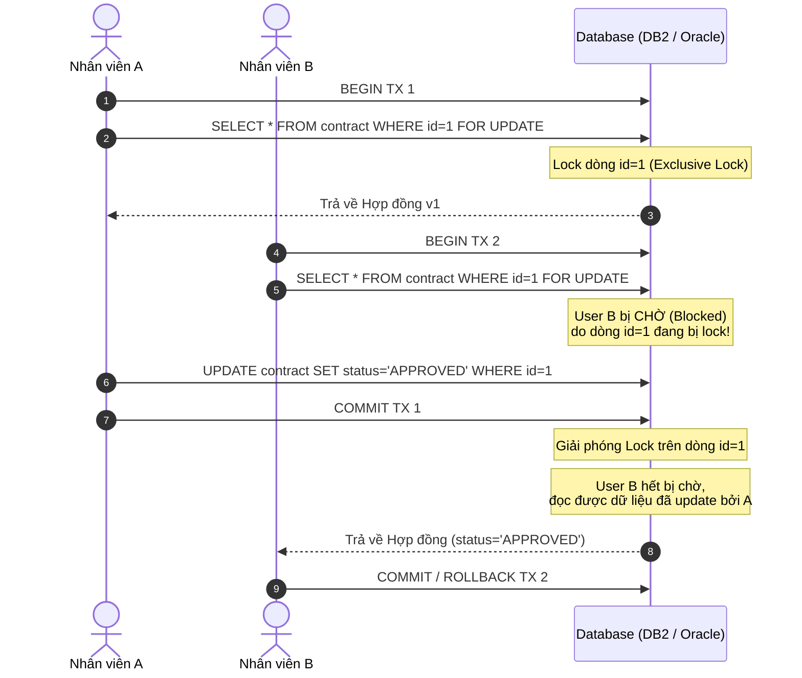
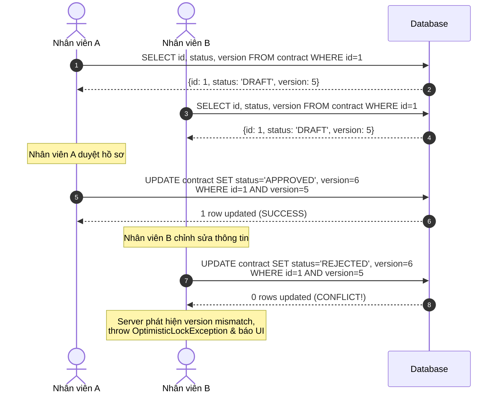

# Pessimistic Lock vs Optimistic Lock
**Loại**: #tradeoff  
**Ngày**: 2026-08-02  
**Bối cảnh**: Nghiệp vụ bảo hiểm & ngân hàng — nhiều nhân viên cùng thao tác trên 1 hợp đồng / hồ sơ chi trả / tài khoản.

---

## 1. Khái niệm & Vấn đề Cốt lõi (Lost Update Problem)

Khi ứng dụng web phục vụ nhiều người dùng đồng thời (concurrent users), hai hoặc nhiều giao dịch (transactions) có thể đọc cùng một bản ghi dữ liệu tại cùng một thời điểm và sau đó cố gắng cập nhật bản ghi đó. 

Nếu không có cơ chế kiểm soát tranh chấp (Concurrency Control), hiện tượng **Lost Update (Mất dữ liệu do ghi đè)** sẽ xảy ra:

```
[User A] Reads Contract (Version 1, Balance = $100)
[User B] Reads Contract (Version 1, Balance = $100)
[User A] Updates Balance = $100 + $50 = $150 -> Saves to DB
[User B] Updates Balance = $100 - $30 = $70  -> Saves to DB (OVERWRITES A's UPDATE!)
=> Result: Balance is $70 instead of $120. User A's update is LOST!
```

Để khắc phục vấn đề này, hai chiến lược khóa chính được sử dụng: **Pessimistic Locking (Khóa bi quan)** và **Optimistic Locking (Khóa lạc quan)**.

---

## 2. Bản chất Kỹ thuật & Cơ chế Hoạt động

### 2.1 Pessimistic Locking (Khóa Bi quan)
- **Triết lý**: Giả định rằng **xung đột luôn luôn xảy ra**. Do đó, phải bảo vệ tài nguyên ngay từ bước đọc dữ liệu.
- **Cơ chế**: Sử dụng cơ chế khóa ở tầng Database (Database Engine Lock). Khi Giao dịch A đọc một bản ghi với ý định cập nhật, DB sẽ đặt khóa ghi (Exclusive Lock / Write Lock) lên dòng đó. Giao dịch B khi muốn đọc để sửa hoặc muốn ghi vào dòng đó sẽ **bị chặn (block)** cho đến khi Giao dịch A hoàn tất (`COMMIT` hoặc `ROLLBACK`).

#### Cú pháp SQL Thực tế:
- **ANSI SQL / MySQL / PostgreSQL**:
  ```sql
  SELECT * FROM contracts WHERE id = 1001 FOR UPDATE;
  ```
- **IBM DB2 (bối cảnh eBAF)**:
  ```sql
  SELECT * FROM contracts WHERE id = 1001 WITH RS USE AND KEEP EXCLUSIVE LOCKS;
  ```
  *(Lưu ý: `WITH RS` = Read Stability isolation level, đảm bảo khóa chỉ giữ trên các bản ghi thỏa mãn điều kiện).*

---

### 2.2 Optimistic Locking (Khóa Lạc quan)
- **Triết lý**: Giả định rằng **xung đột hiếm khi xảy ra**. Do đó, không khóa bất kỳ thứ gì trong suốt quá trình đọc và chuẩn bị dữ liệu.
- **Cơ chế**: Không dùng DB Lock. Thay vào đó, thêm một cột quản lý phiên bản (thường là `version INT` hoặc `updated_at TIMESTAMP`) vào bảng. Khi cập nhật, ứng dụng sẽ kiểm tra xem cột phiên bản tại thời điểm ghi có còn giống như thời điểm đọc hay không.

#### Cú pháp SQL Thực tế:
1. **Đọc dữ liệu (Không khóa)**:
   ```sql
   SELECT id, customer_name, status, version FROM contracts WHERE id = 1001;
   -- Kết quả thu được: version = 5
   ```
2. **Cập nhật dữ liệu kèm kiểm tra version**:
   ```sql
   UPDATE contracts 
   SET status = 'APPROVED', version = version + 1 
   WHERE id = 1001 AND version = 5;
   ```
3. **Đánh giá kết quả**:
   - Nếu số dòng bị ảnh hưởng (`Affected Rows`) == `1`: Cập nhật thành công.
   - Nếu số dòng bị ảnh hưởng == `0`: ai đó đã cập nhật dòng này trước (version đã tăng lên 6). Quá trình ghi bị từ chối, ứng dụng báo lỗi `StaleObjectStateException` hoặc `OptimisticLockException`.

---

## 3. Sơ đồ Luồng Thực thi (Mermaid Diagram)

### Luồng 1: Pessimistic Locking (Block & Wait)



### Luồng 2: Optimistic Locking (Check Version & Conflict Detection)



---

## 4. Bảng So sánh Toàn diện

| Tiêu chí | Pessimistic Lock | Optimistic Lock |
|---|---|---|
| **Cơ chế bảo vệ** | Khóa cứng ở Database level (`FOR UPDATE`) | Kiểm tra logic ở Application/SQL level (`WHERE version = ?`) |
| **Thời gian giữ lock** | Giữ DB connection & Lock suốt từ lúc `SELECT` tới khi `COMMIT` | 0 giây trong lúc sửa form; chỉ mất vài milisecond ở câu `UPDATE` |
| **Xử lý xung đột** | Ngăn ngừa xung đột: Người sau phải đứng chờ | Phát hiện xung đột: Người sau được làm nhưng báo lỗi khi bấm Lưu |
| **Hiệu năng khi Low Concurrency** | Thấp hơn (do chi phí quản lý lock ở DB engine) | Rất cao (không tốn tài nguyên locking) |
| **Hiệu năng khi High Concurrency** | Ổn định, tránh tranh chấp tài nguyên quá mức | Kém nếu xung đột cao (nhiều giao dịch thất bại, tốn công retry) |
| **Trải nghiệm UX** | Người sau bấm mở form có thể bị treo/chờ lâu | Người sau thao tác mượt, nhưng rủi ro bị báo lỗi "Dữ liệu đã thay đổi" khi lưu |
| **Nguy cơ Deadlock** | **Cao** nếu khóa nhiều bản ghi không đúng thứ tự | **Bằng 0** (không giữ lock kéo dài) |
| **Phù hợp kiến trúc Microservices** | Rất khó (không thể truyền DB Lock qua HTTP API) | Rất dễ (chỉ cần truyền trường `version` trong JSON payload) |

---

## 5. Ví dụ Mã nguồn minh họa (Java / Spring / JDBC)

### 5.1 Triển khai Optimistic Locking trong Spring Data JPA

```java
@Entity
@Table(name = "contracts")
public class Contract {
    @Id
    private Long id;

    private String customerName;
    private String status;

    @Version // JPA tự động check và tăng version khi UPDATE
    private Integer version;

    // Getters and Setters
}

@Service
public class ContractService {
    @Autowired
    private ContractRepository contractRepository;

    @Transactional
    public void approveContract(Long id) {
        Contract contract = contractRepository.findById(id)
            .orElseThrow(() -> new RuntimeException("Contract not found"));
            
        contract.setStatus("APPROVED");
        
        // Khi commit, JPA tự sinh SQL: 
        // UPDATE contracts SET status = 'APPROVED', version = version + 1 WHERE id = ? AND version = ?
        // Nếu version đã đổi, ném ObjectOptimisticLockingFailureException
        contractRepository.save(contract);
    }
}
```

### 5.2 Triển khai Optimistic Locking thủ công với JDBC (Kiểu eBAF / SQL thuần)

```java
public boolean updateContractStatus(Connection conn, Long id, String newStatus, int oldVersion) throws SQLException {
    String sql = "UPDATE contracts SET status = ?, version = version + 1 WHERE id = ? AND version = ?";
    try (PreparedStatement pstmt = conn.prepareStatement(sql)) {
        pstmt.setString(1, newStatus);
        pstmt.setLong(2, id);
        pstmt.setInt(3, oldVersion);
        
        int rowsAffected = pstmt.executeUpdate();
        if (rowsAffected == 0) {
            // Không có dòng nào được cập nhật -> Concurrency Conflict!
            return false;
        }
        return true; // Cập nhật thành công
    }
}
```

---

## 6. Cạm bẫy Thực tế & Bài học từ Production

1. **Quên xử lý Exception ở UI trong Optimistic Lock**:
   - *Lỗi phổ biến*: Báo 500 Server Error chung chung khi bị `OptimisticLockException`.
   - *Giải pháp*: Catch exception này, trả về HTTP status `409 Conflict`, kèm message rõ ràng: `"Dữ liệu hợp đồng đã được cập nhật bởi người dùng khác. Vui lòng tải lại trang để xem thông tin mới nhất."`

2. **Pessimistic Lock gây cạn kiệt Connection Pool**:
   - *Lỗi*: Nếu nhân viên mở màn hình sửa hợp đồng và giữ transaction mở (hoặc mạng bị chập chờn), DB connection bị chiếm dụng kéo dài.
   - *Hậu quả*: Connection pool của ứng dụng bị hết (pool exhaustion), gây sập toàn bộ các module khác.
   - *Quy tắc*: **Không bao giờ** giữ Pessimistic Lock qua các thao tác chờ người dùng (User Think Time). Chỉ lock trong khoảng thời gian xử lý ngắn nhất ở backend.

3. **Deadlock với Pessimistic Lock**:
   - Nếu Thread A khóa Record 1 rồi cần khóa Record 2, đồng thời Thread B khóa Record 2 rồi cần khóa Record 1 -> **Deadlock**.
   - *Giải pháp*: Luôn sắp xếp thứ tự khóa các bản ghi theo một quy tắc cố định (ví dụ: sắp xếp tăng dần theo Primary Key `ORDER BY id`).

---

## 7. Cây Quyết định Chọn Giải pháp (Decision Tree)

```
Nghiệp vụ có nguy cơ xung đột cao không?
 ├── KHÔNG (Xác suất 2 người cùng sửa 1 dòng < 5%)
 │    └── CHỌN: Optimistic Lock (Version Column)
 └── CÓ (Xác suất trùng cao, ví dụ: Duyệt hồ sơ bồi thường hot, Đặt vé xem phim)
      ├── Hậu quả của Lost Update có cực kỳ nghiêm trọng? (Vd: Trừ tiền tài khoản, kho hàng còn 1 sản phẩm)
      │    ├── CÓ -> CHỌN: Pessimistic Lock (SELECT FOR UPDATE)
      │    └── KHÔNG -> CHỌN: Optimistic Lock + Cế chế Retry tự động ở backend
      └── Hệ thống có phải Microservices / Stateless REST API không?
           └── CÓ -> BẮT BUỘC CHỌN: Optimistic Lock (Truyền version trong DTO)
```

---

## 8. Tài liệu & Bài viết liên quan
- [[transaction-boundary]] — Quản lý ranh giới transaction khi thực hiện lock.
- [[idempotency]] — Tránh xử lý lặp khi người dùng retry lại sau khi bị Optimistic Lock Error.
- [[../bug-cases/]] — Các lỗi runtime thực tế liên quan tới DB Lock Timeout & Deadlock.