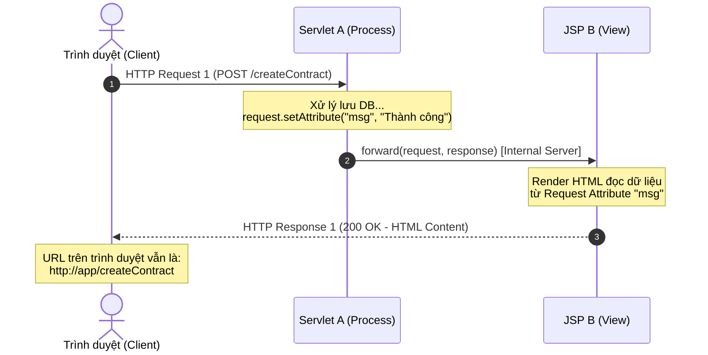
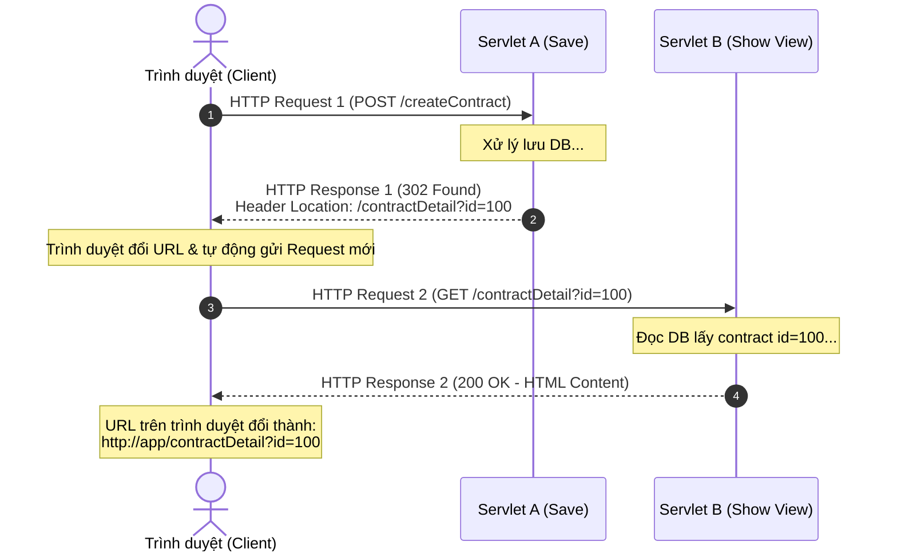

# Redirect vs Forward (Server-side)
**Loại**: #tradeoff  
**Ngày**: 2026-08-02  
**Bối cảnh**: Java Servlet/JSP (eBAF Framework), Spring MVC & Web Application Architecture.

---

## 1. Khái niệm & Vấn đề Cốt lõi

Trong ứng dụng Web dựa trên Java (Servlet/JSP hoặc Spring MVC), sau khi một Servlet tiếp nhận và xử lý xong yêu cầu từ người dùng (ví dụ: xác thực, lưu thông tin form), ứng dụng cần chuyển hướng người dùng tới một trang giao diện mới (JSP/HTML) hoặc một Action khác. 

Hai cơ chế chuyển hướng cơ bản nhất là:
1. **Forward (`request.getRequestDispatcher().forward()`)**: Chuyển giao việc xử lý request **nội bộ bên trong Server**.
2. **Redirect (`response.sendRedirect()`)**: Yêu cầu **Trình duyệt (Browser) tự tạo một HTTP Request mới** đến URL chỉ định.

Hiểu sai 2 cơ chế này dẫn đến các lỗi nghiêm trọng trong sản phẩm: **Double Submit** (gửi trùng dữ liệu khi F5), **mất dữ liệu form**, hoặc **lộ URL nội bộ**.

---

## 2. Bản chất Kỹ thuật & Cơ chế Hoạt động

### 2.1 Cơ chế Forward (Chuyển tiếp Nội bộ)
- **Tầng xử lý**: Hoàn toàn diễn ra ở Server-side (trong cùng Servlet Context / Web Container).
- **Quy trình**:
  1. Trình duyệt gửi `Request 1` đến `Servlet A`.
  2. `Servlet A` xử lý logic, sau đó gọi `forward()` sang `JSP B` hoặc `Servlet B`.
  3. `JSP B` render HTML và trả kết quả về cho Trình duyệt qua `Response 1`.
- **Đặc điểm**:
  - **Chỉ có 1 vòng lặp HTTP (1 Round-trip)**. Trình duyệt hoàn toàn không biết việc chuyển giao này diễn ra ở backend.
  - **URL trên thanh địa chỉ Trình duyệt KHÔNG ĐỔI** (vẫn hiển thị địa chỉ của `Servlet A`).
  - **Dữ liệu trong `HttpServletRequest` được giữ nguyên**: Có thể sử dụng `request.setAttribute("key", value)` từ `Servlet A` và đọc lại ở `JSP B`.
  - **Hạn chế**: Không thể forward sang một domain hoặc web context khác ngoài ứng dụng hiện tại.

### 2.2 Cơ chế Redirect (Chuyển hướng từ Trình duyệt)
- **Tầng xử lý**: Kết hợp Server-side và Client-side (vòng lặp HTTP thứ 2).
- **Quy trình**:
  1. Trình duyệt gửi `Request 1` (ví dụ: `POST /submit-form`) đến `Servlet A`.
  2. `Servlet A` xử lý xong, trả về `Response 1` với mã trạng thái HTTP **`302 Found`** (hoặc `303 See Other`) cùng với HTTP Header `Location: /success-page`.
  3. Trình duyệt nhận được mã `302`, tự động khởi tạo một **`Request 2` hoàn toàn mới (phương thức `GET`)** tới URL `/success-page`.
  4. Server xử lý `/success-page` và trả về giao diện qua `Response 2`.
- **Đặc điểm**:
  - **Có 2 vòng lặp HTTP riêng biệt (2 Round-trips)**.
  - **URL trên thanh địa chỉ Trình duyệt THAY ĐỔI** thành URL mới.
  - **Dữ liệu trong `HttpServletRequest` ban đầu BỊ HỦY**: `Request 2` là một request mới tinh. Muốn truyền dữ liệu qua Redirect phải dùng `HttpSession`, `Query Parameters` (`?id=123`), hoặc `Flash Attributes`.
  - **Linh hoạt**: Có thể redirect tới bất kỳ địa chỉ URL nào (kể cả domain ngoài như `https://google.com` hay cổng thanh toán VNPay).

---

## 3. Sơ đồ Luồng Thực thi (Mermaid Diagram)

### Sơ đồ 1: Luồng xử lý Forward (1 Request - URL không đổi)



### Sơ đồ 2: Luồng xử lý Redirect (2 Requests - URL đổi)



---

## 4. Mẫu Thiết kế Cốt lõi: Post/Redirect/Get (PRG Pattern)

Một trong những ứng dụng quan trọng nhất của `Redirect` là giải quyết bài toán **Double Submit Form**.

### Vấn đề nếu dùng Forward sau khi Submit Form:
Nếu dùng `forward()` sau khi người dùng bấm "Thanh toán" hoặc "Tạo hợp đồng":
1. Trình duyệt gửi `POST /pay`.
2. Server `forward()` sang `success.jsp` và trả về kết quả.
3. Thanh địa chỉ của Trình duyệt vẫn đang dừng ở `POST /pay`.
4. Người dùng bấm **F5 (Reload)** -> Trình duyệt hỏi "Do you want to resubmit form data?" -> Nếu chọn Yes, yêu cầu `POST /pay` bị gửi lại lần thứ 2 -> **Tài khoản bị trừ tiền 2 lần!**

### Giải pháp PRG Pattern (Post / Redirect / Get):
Luôn áp dụng quy tắc: **Sau một thao tác làm thay đổi trạng thái dữ liệu (POST / PUT / DELETE), BẮT BUỘC dùng REDIRECT về một trang hiển thị (GET)**.

```
[User Submit Form] 
    ↓
POST /saveContract (Server lưu DB)
    ↓
Redirect to GET /contractList (Server trả mã HTTP 302)
    ↓
GET /contractList (Browser tự gọi GET hiển thị danh sách)
```
*Kết quả*: Khi người dùng nhấn F5, Trình duyệt chỉ tải lại yêu cầu `GET /contractList` (an toàn, không thay đổi dữ liệu DB), triệt tiêu hoàn toàn rủi ro Double Submit!

---

## 5. Bảng So sánh Toàn diện

| Tiêu chí | `forward()` | `sendRedirect()` |
|---|---|---|
| **Số lượt HTTP Request** | **1 Request** (Server-side dispatch) | **2 Requests** (Client-side HTTP 302/303) |
| **URL trên Trình duyệt** | Giữ nguyên URL của request ban đầu | Thay đổi thành URL mới |
| **Request Attributes** | **Còn nguyên** (`request.getAttribute` đọc được) | **Mất hoàn toàn** (vì Request 2 là mới) |
| **Session Attributes** | Còn nguyên | Còn nguyên (Session đi theo Cookie `JSESSIONID`) |
| **Chuyển hướng Domain ngoài** | Không thể (chỉ trong cùng Context) | Được (chuyển sang bất kỳ URL/Domain nào) |
| **Tốc độ / Hiệu năng** | Nhanh hơn (không tốn round-trip mạng) | Chậm hơn một chút (thêm 1 round-trip HTTP) |
| **Nguy cơ F5 (Double Submit)** | **Rất cao** (gửi lại dữ liệu POST cũ) | **Bằng 0** (chuyển sang request GET mới) |
| **Truyền tham số** | Đặt trực tiếp object vào `request.setAttribute` | Phải nối tham số URL (`?id=1`) hoặc dùng Session/Flash |

---

## 6. Ví dụ Mã nguồn Minh họa (Java Servlet & Spring MVC)

### 6.1 Trong Java Servlet thuần (Mô hình eBAF / Classic Servlet)

```java
// --- CÁCH 1: Dùng FORWARD (Thích hợp cho render trang tìm kiếm/hiển thị) ---
protected void doGet(HttpServletRequest request, HttpServletResponse response) 
        throws ServletException, IOException {
    List<Contract> list = contractService.findAll();
    request.setAttribute("contracts", list); // Giữ được object phỏng vấn
    
    // Forward sang JSP để hiển thị UI
    RequestDispatcher dispatcher = request.getRequestDispatcher("/WEB-INF/views/contract-list.jsp");
    dispatcher.forward(request, response);
}

// --- CÁCH 2: Dùng REDIRECT (Bắt buộc cho submit form để chống F5) ---
protected void doPost(HttpServletRequest request, HttpServletResponse response) 
        throws ServletException, IOException {
    Contract contract = extractContractFromRequest(request);
    contractService.save(contract);
    
    // Redirect về trang danh sách (PRG Pattern)
    response.sendRedirect(request.getContextPath() + "/contract/list?status=created");
}
```

### 6.2 Trong Spring MVC Controller

```java
@Controller
@RequestMapping("/contracts")
public class ContractController {

    // Forward trong Spring MVC
    @GetMapping("/search")
    public String searchContracts(Model model) {
        model.addAttribute("results", contractService.search());
        return "contract/search-result"; // Mặc định là forward tới view engine
    }

    // Redirect trong Spring MVC với Flash Attributes
    @PostMapping("/create")
    public String createContract(@ModelAttribute Contract contract, RedirectAttributes redirectAttrs) {
        contractService.create(contract);
        
        // Thêm thông báo hiển thị 1 lần sau khi redirect (Flash Attribute lưu tạm trong Session)
        redirectAttrs.addFlashAttribute("message", "Tạo hợp đồng thành công!");
        
        return "redirect:/contracts/list"; // Trả về 302 redirect
    }
}
```

---

## 7. Cụ thể hóa Cụm từ: Scope Data Management

Khi thực hiện chuyển hướng, lập trình viên cần chọn đúng Phạm vi lưu trữ dữ liệu (Data Scope):

1. **Request Scope (`HttpServletRequest`)**:
   - Chỉ sống trong **1 Request**.
   - Dùng được với: `forward()`.
   - Bị xóa khi: `sendRedirect()`.

2. **Flash Scope (`RedirectAttributes` trong Spring MVC)**:
   - Sống qua đúng **1 lần Redirect** (Server tự lưu vào Session, sau khi Redirect xong và đọc dữ liệu ở Request 2 thì Server tự động xóa).
   - Dùng được với: `sendRedirect()`.

3. **Session Scope (`HttpSession`)**:
   - Sống trong suốt **phiên làm việc của User** (đến khi Timeout hoặc Logout).
   - Dùng được với: Cả `forward()` và `sendRedirect()`. Nhưng tránh lạm dụng gây tốn bộ nhớ RAM Server.

---

## 8. Cây Quyết định Chọn Giải pháp (Decision Tree)

```
Thao tác vừa thực hiện là gì?
 ├── Lấy dữ liệu hiển thị (READ - GET Request)
 │    └── CHỌN: Forward () 
 │         └── Mục đích: Giữ lại Request attributes, render nhanh JSP/View template.
 └── Thay đổi dữ liệu trong DB (CREATE / UPDATE / DELETE - POST Request)
      └── CHỌN: Redirect (PRG Pattern)
           ├── Cần chuyển hướng sang Website/Domain khác? (Cổng thanh toán, OAuth Login)
           │    └── Dùng: response.sendRedirect("https://external-domain.com")
           └── Chuyển hướng nội bộ ứng dụng?
                └── Dùng: response.sendRedirect("/app/success-page") 
                     └── Truyền thông báo qua Flash Attributes hoặc URL parameters (?msg=success)
```

---

## 9. Tài liệu & Bài viết liên quan
- [[validate-client-vs-server]] — Xử lý validate trước khi quyết định forward/redirect.
- [[session-vs-cookie-vs-token]] — Hiểu về cơ chế duy trì Session qua `JSESSIONID` khi Redirect.
- [[idempotency]] — Trọng tâm của PRG pattern nhằm đảm bảo tính idempotent cho UI submission.