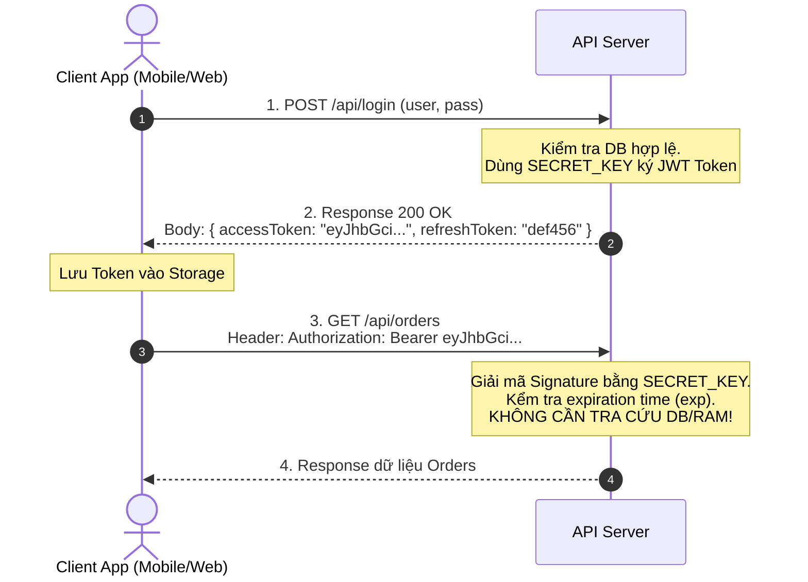

# Session vs Cookie vs Token (JWT) cho Authentication
**Loại**: #tradeoff  
**Ngày**: 2026-08-02  
**Bối cảnh**: Hệ thống eBAF (Monolith JSP/Servlet cũ dùng Session) nâng cấp mở rộng các dịch vụ API/Mobile App và Microservices.

---

## 1. Khái niệm & Vấn đề Cốt lõi

Vì HTTP là một giao thức không lưu trạng thái (**Stateless Protocol**), mỗi HTTP Request từ Trình duyệt đến Server đều hoàn toàn độc lập và Server không tự biết request đó đến từ ai. Để duy trì trạng thái đăng nhập của người dùng qua nhiều request, ứng dụng web cần một cơ chế Quản lý Xác thực (Authentication & Session Management).

Ba thành phần cốt lõi hay bị nhầm lẫn:
1. **Cookie**: Cơ chế lưu trữ phía Client (Trình duyệt), tự động gửi kèm theo mọi HTTP Request tới domain tương ứng. Cookie **không phải là phương pháp xác thực**, mà là **kênh vận chuyển (transport vehicle)** dữ liệu xác thực.
2. **Session (Server-side Session)**: Phương pháp xác thực **Có lưu trạng thái (Stateful)**. Server lưu toàn bộ thông tin đăng nhập trong bộ nhớ (RAM/Redis) và cấp cho Client một Mã định danh Session (`JSESSIONID`).
3. **Token (JSON Web Token - JWT)**: Phương pháp xác thực **Không lưu trạng thái (Stateless)**. Server mã hóa và ký số (Cryptographic Signature) toàn bộ thông tin người dùng vào một chuỗi Token và giao cho Client tự giữ.

---

## 2. Bản chất Kỹ thuật & Cơ chế Hoạt động

### 2.1 Cơ chế Stateful Session (Session + Cookie)
- **Luồng hoạt động**:
  1. User gửi `POST /login` với Username/Password.
  2. Server kiểm tra DB, nếu đúng sẽ tạo một `HttpSession` trong RAM server (chứa `userId`, `roles`...).
  3. Server sinh một mã ngẫu nhiên duy nhất (VD: `JSESSIONID = abc123xyz`).
  4. Server trả về Response kèm Header `Set-Cookie: JSESSIONID=abc123xyz; HttpOnly; Path=/`.
  5. Ở các request sau, Trình duyệt tự động đính kèm Cookie `JSESSIONID=abc123xyz`.
  6. Server lấy `JSESSIONID` tra cứu vào bộ nhớ RAM để tìm `HttpSession` tương ứng.

- **Ưu điểm**:
  - **Dễ dàng thu hồi (Revoke/Logout)**: Muốn hủy phiên làm việc của user chỉ cần `session.invalidate()` hoặc xóa Session Key trên Server ngay lập tức.
  - **Bảo mật dữ liệu**: Thông tin nhạy cảm của user nằm hoàn toàn trên Server, Client chỉ giữ một chuỗi ID ngẫu nhiên không có ý nghĩa.

- **Nhược điểm (Điểm yếu chí mạng)**:
  - **Khó mở rộng theo chiều ngang (Scale-out)**: Nếu có 3 Server (Server A, B, C) đứng sau Load Balancer, nếu User đăng nhập ở Server A (Session nằm ở RAM Server A), request tiếp theo nhảy sang Server B sẽ bị coi là chưa đăng nhập. 
  - *Giải pháp*: Phải dùng **Sticky Session** (buộc user cố định ở 1 server) hoặc dùng **Distributed Session Store** (Redis/Memcached) khiến kiến trúc phức tạp hơn.

---

### 2.2 Cơ chế Stateless Token (JWT)
- **Cấu trúc của JWT**: Chuỗi JWT gồm 3 phần phân tách bằng dấu chấm (`.`): `Header.Payload.Signature`
  - **Header**: Thuật toán ký (VD: `{"alg": "HS256", "typ": "JWT"}`).
  - **Payload**: Thông tin User (Claims) (VD: `{"sub": "user123", "role": "ADMIN", "exp": 1700000000}`).
  - **Signature**: Chữ ký điện tử sinh ra từ `HMACSHA256(base64(Header) + "." + base64(Payload), SECRET_KEY)`.

- **Luồng hoạt động**:
  1. User gửi `POST /login`.
  2. Server kiểm tra DB, nếu đúng sẽ dùng `SECRET_KEY` ở Server để ký ra một chuỗi `JWT Token`.
  3. Server trả Token về cho Client trong JSON body. **Server KHÔNG lưu lại Token này vào RAM hay DB**.
  4. Client (Web/Mobile) lưu Token vào `localStorage`, `sessionStorage` hoặc `Secure Cookie`.
  5. Các request tiếp theo, Client đính kèm Token vào HTTP Header: `Authorization: Bearer <JWT_TOKEN>`.
  6. Server nhận được request, chỉ cần dùng `SECRET_KEY` giải mã Chữ ký (Signature) để xác minh tính hợp lệ. Nếu chữ ký đúng và chưa hết hạn (`exp`), Server tin tưởng dữ liệu trong Payload.

- **Ưu điểm**:
  - **Stateless & Scalable**: Server không lưu state. Có thể bật 100 Server mới, Server nào cũng verify được Token chỉ bằng `SECRET_KEY`.
  - **Hỗ trợ Cross-Domain & Mobile Native App**: Mobile App không hỗ trợ Cookie jar mặc định của Browser nhưng dễ dàng đính kèm HTTP Header `Authorization`.

- **Nhược điểm**:
  - **KHÔNG THỂ THU HỒI TRƯỚC HẠN TRUYỀN THỐNG**: Token đã phát ra giống như vé máy bay đã in. Nếu Token có hạn 2 tiếng, dù Admin có khóa tài khoản User ở DB thì Token đó vẫn hợp lệ trên Server cho tới khi hết hạn `exp`!
  - *Giải pháp thu hồi*: Phải dùng **Blacklist Token trên Redis** hoặc mô hình **Access Token ngắn hạn (5-15 phút) + Refresh Token dài hạn**.

---

## 3. Sơ đồ Luồng Thực thi (Mermaid Diagram)

### Sơ đồ 1: Stateful Session Authentication

```mermaid
sequenceDiagram
    autonumber
    actor Client as Browser (Client)
    participant Server as Web Server (eBAF)
    participant RAM as Session Store (RAM/Redis)

    Client->>Server: 1. POST /login (user, pass)
    Note over Server: Kiểm tra DB hợp lệ
    Server->>RAM: 2. Tạo Session Object {userId: 101, role: 'ADMIN'}<br/>Sinh Key: JSESSIONID=XYZ888
    RAM-->>Server: Saved OK
    Server-->>Client: 3. Response 200 OK<br/>Header: Set-Cookie: JSESSIONID=XYZ888; HttpOnly

    Client->>Server: 4. GET /user/profile<br/>Header: Cookie: JSESSIONID=XYZ888
    Server->>RAM: 5. Tra cứu Key XYZ888
    RAM-->>Server: Trả về Session Object {userId: 101}
    Server-->>Client: 6. Response dữ liệu Profile
```

### Sơ đồ 2: Stateless JWT Authentication



---

## 4. Phân tích Bảo mật: XSS vs CSRF

| Nguy cơ Bảo mật | Session (Dùng Cookie mặc định) | Token (Lưu trong LocalStorage) | Token (Lưu trong HttpOnly Cookie) |
|---|---|---|---|
| **CSRF (Cross-Site Request Forgery)** | **RẤT NGUY HIỂM**: Browser tự động gửi Cookie sang domain khác nếu user dính link độc hại. *Cần dùng CSRF Token để chống.* | **AN TOÀN trước CSRF**: Browser không tự gửi Header `Authorization` khi click link lạ. | **NGUY HIỂM tương tự Session**: Vì vẫn dùng Cookie làm kênh vận chuyển. *Cần dùng SameSite=Strict.* |
| **XSS (Cross-Site Scripting)** | **AN TOÀN** nếu dùng cờ `HttpOnly` (JS độc hại không đọc được Cookie). | **RẤT NGUY HIỂM**: Mã JS độc hại injected có thể đọc `localStorage.getItem('token')` và đánh cắp Token. | **AN TOÀN**: Mã JS không thể đọc `HttpOnly` Cookie. |

---

## 5. Bảng So sánh Toàn diện

| Tiêu chí | Stateful Session | Stateless JWT Token |
|---|---|---|
| **Nơi lưu trạng thái** | **Server** (Memory / Redis) | **Client** (Browser / Mobile Memory) |
| **Dữ liệu đính kèm request** | Chỉ 1 ID ngắn (`JSESSIONID` ~ 32 bytes) | Cả Token chứa Payload + Signature (~ 500 - 2000 bytes) |
| **Khả năng Scale-out Server** | Phức tạp (Cần Sticky Session hoặc Redis Cluster) | Cực kỳ dễ dàng (Stateless) |
| **Thu hồi quyền (Revoke/Logout)** | Tức thì (Xóa session trên Server là xong) | Khó (Cần chờ hết hạn hoặc triển khai Blacklist Redis) |
| **Hỗ trợ Cross-Domain / CORS** | Khó khăn (Cookie bị giới hạn bởi chính sách Same-Origin) | Rất tốt (Gửi qua Authorization Header) |
| **Khả năng Offline / Decoupled** | Phải liên tục giao tiếp với Server chứa Session | Các Service nội bộ có thể tự verify chữ ký mà không gọi Auth DB |
| **Phù hợp với** | Web App Monolith truyền thống, Server-side rendering (JSP, Thymeleaf) | Mobile App, Microservices API, SPA (React, Angular, Vue) |

---

## 6. Ví dụ Mã nguồn Minh họa

### 6.1 Tạo và Verify JWT trong Java (Sử dụng thư viện `jjwt`)

```java
public class JwtProvider {
    private static final String SECRET_KEY = "ebaf_secret_key_must_be_at_least_256_bits_long!";
    private static final long EXPIRATION_TIME = 900000; // 15 phút

    // 1. Sinh Token
    public String generateToken(String username, String role) {
        return Jwts.builder()
                .setSubject(username)
                .claim("role", role)
                .setIssuedAt(new Date())
                .setExpiration(new Date(System.currentTimeMillis() + EXPIRATION_TIME))
                .signWith(SignatureAlgorithm.HS256, SECRET_KEY.getBytes(StandardCharsets.UTF_8))
                .compact();
    }

    // 2. Verify Token
    public Claims parseToken(String token) {
        try {
            return Jwts.parser()
                    .setSigningKey(SECRET_KEY.getBytes(StandardCharsets.UTF_8))
                    .parseClaimsJws(token)
                    .getBody();
        } catch (ExpiredJwtException e) {
            throw new RuntimeException("Token đã hết hạn!");
        } catch (SignatureException e) {
            throw new RuntimeException("Chữ ký Token không hợp lệ!");
        }
    }
}
```

---

## 7. Kiến trúc Hybrid cho Hệ thống Chuyển đổi (Migration Strategy)

Đối với các hệ thống lớn như **eBAF**, việc chuyển đổi toàn bộ từ Session sang JWT ngay lập tức là rủi ro. Mô hình **Hybrid Architecture** được áp dụng:

```
                  ┌────────────────────────┐
                  │   Client Layer (Users) │
                  └───────────┬────────────┘
                              │
             ┌────────────────┴────────────────┐
             ▼                                 ▼
   [Web Browser (JSP UI)]           [Mobile App / Partner API]
             │                                 │
     Cookie: JSESSIONID               Authorization: Bearer <JWT>
             │                                 │
             ▼                                 ▼
┌──────────────────────────┐     ┌──────────────────────────┐
│ eBAF Legacy Web Engine   │     │ eBAF API Gateway         │
│ (Stateful Session RAM)   │     │ (Stateless JWT Verifier) │
└──────────────────────────┘     └──────────────────────────┘
```
- **Web UI truyền thống**: Giữ nguyên `JSESSIONID` + `Session` để tránh phải sửa toàn bộ màn hình JSP.
- **Tầng API mới (Mobile / Tích hợp đối tác)**: Bổ sung `JwtAuthenticationFilter` để xác thực bằng Token.

---

## 8. Cây Quyết định Chọn Giải pháp (Decision Tree)

```
Ứng dụng đang xây dựng là gì?
 ├── 1. Monolith Web App truyền thống (Server-rendered JSP / HTML form)
 │    └── CHỌN: Session + HttpOnly Cookie
 │         └── Lợi ích: Đơn giản, thu hồi phiên làm việc tức thì, chống XSS tốt.
 ├── 2. Single Page Application (React/Vue/Angular) hoặc Mobile App thuần
 │    └── CHỌN: JWT Token (Access Token ngắn hạn + Refresh Token)
 │         ├── Lưu Access Token ở đâu?
 │         │    ├── Web SPA -> Dùng HttpOnly, SameSite=Strict Cookie (Chống XSS & CSRF)
 │         │    └── Mobile App -> Dùng Encrypted Secure Storage (Keychain / Keystore)
 └── 3. Hệ thống Microservices với hàng chục Service độc lập
      └── CHỌN: Stateless JWT Token
           └── Lợi ích: API Gateway sinh Token, các Microservices tự verify offline bằng Public Key (RSA).
```

---

## 9. Tài liệu & Bài viết liên quan
- [[validate-client-vs-server]] — Validate Token tại Server API Filter.
- [[../bug-cases/]] — Xử lý lỗi CORS & Unauthenticated khi gọi API từ domain khác.