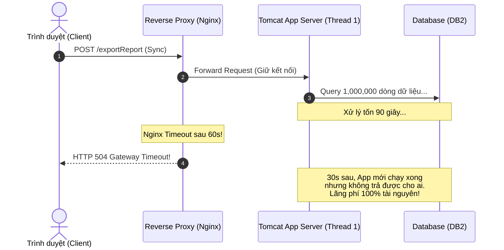
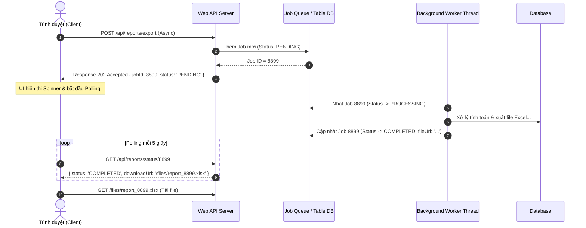

# Đồng bộ (Sync) vs Bất đồng bộ (Async) trong xử lý Batch/Report
**Loại**: #tradeoff  
**Ngày**: 2026-08-02  
**Bối cảnh**: Hệ thống eBAF, Module `AMA0_B066` (Batch Report xuất báo cáo hợp đồng hàng loạt).

---

## 1. Khái niệm & Vấn đề Cốt lõi

Trong các ứng dụng doanh nghiệp (Enterprise Systems), xử lý báo cáo (Report) và xử lý lô (Batch Processing) là các tác vụ đòi hỏi truy vấn và tính toán trên khối lượng dữ liệu lớn. 

Khi thiết kế chức năng này, bài toán kiến trúc quan trọng nhất là chọn phương thức xử lý:
1. **Xử lý Đồng bộ (Synchronous Processing)**: Trình duyệt gửi Request -> Web Server nhận và giữ kết nối HTTP, chạy toàn bộ tác vụ -> Trả kết quả về cho Trình duyệt trong cùng Request đó.
2. **Xử lý Bất đồng bộ (Asynchronous Processing)**: Trình duyệt gửi Request -> Web Server tạo một **Job ID**, đẩy tác vụ vào hàng đợi (Queue/Background Thread) và **trả về Job ID ngay lập tức** -> Trình duyệt đóng HTTP Request -> Worker chạy ngầm -> Trình duyệt kiểm tra tiến trình (Polling) hoặc nhận thông báo khi xong.

Lựa chọn sai lầm ở đây là nguyên nhân số 1 gây ra lỗi **HTTP 504 Gateway Timeout**, **treo Web Server (Tomcat Thread Exhaustion)** và **cạn kiệt DB Connection Pool**.

---

## 2. Bản chất Kỹ thuật & Lý do Bị Timeout ở Sync

### 2.1 Chuỗi Timeout trong Hệ thống Web Enterprise
Khi người dùng bấm "Xuất Báo Cáo", HTTP Request phải đi qua nhiều tầng mạng:
```
[Browser] ──(Timeout 60s)──> [Load Balancer / F5] ──(Timeout 30s)──> [Apache / Nginx] ──(Timeout 60s)──> [Tomcat App Server]
```
Nếu tác vụ tổng hợp dữ liệu chạy mất **3 phút**:
- Đến giây thứ 30 hoặc 60, Nginx / Load Balancer sẽ chủ động ngắt kết nối và trả về cho Client lỗi **`504 Gateway Timeout`**.
- Tuy nhiên, ở backend, Tomcat thread và DB Connection vẫn tiếp tục chạy ngầm trong vô vọng (vì Tomcat chưa biết kết nối HTTP client đã đứt).

### 2.2 Tác hại đến Tài nguyên Hệ thống (Resource Exhaustion)
- **Tomcat Worker Thread Pool**: Mặc định Tomcat có khoảng 200 threads (`maxThreads=200`). Nếu 50 nhân viên cùng bấm "Xuất Báo Cáo" đồng bộ và mỗi report mất 2 phút, 50/200 threads sẽ bị giữ cứng. Chỉ cần thêm vài thao tác nữa, toàn bộ thread pool bị chiếm sạch -> **Hệ thống không thể phục vụ bất kỳ ai khác!**
- **Database Connection Pool**: Thread chạy Sync sẽ giữ 1 DB Connection trong suốt 2 phút đó. HikariCP / DB2 Connection Pool bị cạn kiệt, gây sập dây chuyền các module giao dịch online khác.

---

## 3. Sơ đồ Luồng Thực thi (Mermaid Diagram)

### Sơ đồ 1: Luồng Sync (Rủi ro Timeout & Treo Thread)



### Sơ đồ 2: Luồng Async (Job Queue + Polling Architecture)



---

## 4. Phân tích Case Study Thực tế: Module `AMA0_B066`

### Bối cảnh `AMA0_B066` (Batch Report Hợp đồng Bảo hiểm eBAF)
- **Thiết kế ban đầu (Sync)**: Khi bấm xuất báo cáo AMA0_B066, hệ thống chạy trực tiếp một câu query phức tạp liên kết hơn 10 bảng trong DB2 để tính doanh thu, hoa hồng và xuất file Excel.
- **Vấn đề phát sinh**: Khi số lượng hợp đồng đạt 500,000 bản ghi:
  - Thời gian xử lý tăng từ 5 giây lên 120 giây.
  - Người dùng bấm nút nhiều lần do tưởng ứng dụng bị đơ (Double click/Retry).
  - Tỷ lệ lỗi 504 Gateway Timeout tăng vọt lên 40% vào cuối tháng (thời điểm chốt số liệu).

### Giải pháp Cải tiến (Chuyển sang Async Job Pattern):
1. **API Submit**: Trả về `jobId` trong **50ms**.
2. **Job Store**: Lưu thông tin công việc vào bảng `BATCH_JOB_TRACKING (JOB_ID, STATUS, CREATED_BY, FILE_PATH, PERCENT)`.
3. **Worker Thread Pool**: Sử dụng Spring `@Async` hoặc Scheduled Task để nhặt từng job ra xử lý theo thứ tự ưu tiên (FIFO).
4. **UX**: Màn hình danh sách báo cáo hỗ trợ nút "Tải lại tiến trình" hoặc tự động Polling hiển thị thanh tiến độ `%`.

---

## 5. Bảng So sánh Toàn diện

| Tiêu chí | Synchronous (Đồng bộ) | Asynchronous (Bất đồng bộ) |
|---|---|---|
| **Thời gian phản hồi HTTP** | Chậm (Bằng thời gian xử lý thực tế: 10s - 10 phút) | Cực nhanh (Vài milisecond để tạo Job ID) |
| **Rủi ro Timeout (504/502)** | **Rất cao** khi dữ liệu tăng trưởng theo thời gian | **Bằng 0** (HTTP Request đóng ngay lập tức) |
| **Chiếm dụng Thread Server** | Giữ Web Thread suốt quá trình chạy tác vụ | Giải phóng Web Thread ngay lập tức |
| **Tác động DB Connection** | Giữ DB Connection liên tục thời gian dài | Worker chủ động mở/đóng Connection theo từng Chunk |
| **Trải nghiệm UX** | Người dùng bị "khóa" màn hình, phải chờ đợi | Người dùng có thể đi làm việc khác, quay lại tải sau |
| **Khả năng hiển thị tiến độ** | Không có (chỉ biết xoay spinner chờ đợi) | Rất tốt (Hiển thị % xong: 20%, 50%, 100%) |
| **Độ phức tạp lập trình** | Rất đơn giản (Viết code chạy nối tiếp từ A -> Z) | Phức tạp hơn (Cần Job Table, Worker, Polling UI) |
| **Khả năng Retry khi lỗi** | Thất bại là phải bấm chạy lại từ đầu | Dễ dàng Retry tự động ở Background khi bị ngắt kết nối DB |

---

## 6. Ví dụ Mã nguồn Minh họa (Spring Boot / Java)

### 6.1 Cấu hình Async Worker & Job Tracking (Backend)

```java
// 1. DTO Trả về cho Client
public class JobResponseDto {
    private String jobId;
    private String status; // PENDING, PROCESSING, COMPLETED, FAILED
    private String message;
}

// 2. Service quản lý Async Job
@Service
public class AsyncReportService {

    @Autowired
    private JobRepository jobRepository;

    @Autowired
    private ReportExporter reportExporter;

    // API Controller gọi hàm này: Trả kết quả NGAY LẬP TỨC
    public JobResponseDto createExportJob(ReportRequest params, String userId) {
        String jobId = UUID.randomUUID().toString();
        
        JobEntity job = new JobEntity(jobId, userId, "PENDING", 0);
        jobRepository.save(job);

        // Đẩy tác vụ chạy ngầm vào Thread Pool riêng (Async)
        executeReportInBackground(jobId, params);

        return new JobResponseDto(jobId, "PENDING", "Tác vụ đang được khởi tạo ngầm.");
    }

    @Async("reportThreadPoolTaskExecutor") // Chạy ở Thread Pool tách biệt với Web Thread Pool!
    public void executeReportInBackground(String jobId, ReportRequest params) {
        try {
            updateJobStatus(jobId, "PROCESSING", 10);
            
            // Xử lý dữ liệu lớn & xuất file
            String fileUrl = reportExporter.generateExcel(params, (percent) -> {
                updateJobProgress(jobId, percent); // Callback cập nhật % tiến độ
            });

            updateJobCompleted(jobId, fileUrl);
        } catch (Exception e) {
            updateJobFailed(jobId, e.getMessage());
        }
    }
}
```

---

## 7. Các Mẫu UX Xử lý Async Phía Frontend (Client Polling)

Có 3 cơ chế phổ biến để Client cập nhật trạng thái tác vụ Async:

1. **Short Polling (Khuyến nghị cho eBAF)**:
   - Client dùng `setInterval()` gửi request `GET /api/jobs/{id}/status` mỗi 3 - 5 giây một lần cho đến khi `status == COMPLETED`.
   - *Ưu điểm*: Đơn giản, dễ triển khai, chạy tốt trên mọi hạ tầng mạng.

2. **Long Polling**:
   - Client gửi Request, Server giữ kết nối cho tới khi có thay đổi trạng thái mới trả về.

3. **WebSocket / Server-Sent Events (SSE)**:
   - Server chủ động push notification về Client ngay khi Job hoàn thành.
   - *Ưu điểm*: UX tuyệt vời nhất, nhưng đòi hỏi hạ tầng hỗ trợ WebSocket.

---

## 8. Cây Quyết định Chọn Giải pháp (Decision Tree)

```
Thời gian ước tính xử lý tác vụ là bao nhiêu?
 ├── Dưới 3 - 5 giây (Báo cáo nhỏ, Tìm kiếm đơn giản)
 │    └── CHỌN: Synchronous (Đồng bộ)
 │         └── Giữ nguyên code đơn giản, trả về HTML/File trực tiếp.
 └── Trên 5 giây HOẶC Khối lượng dữ liệu tăng dần theo thời gian (VD: AMA0_B066)
      └── CHỌN: Asynchronous (Bất đồng bộ)
           ├── Kiến trúc hệ thống là gì?
           │    ├── Web Monolith (eBAF) -> Dùng Async Job Table DB + Spring @Async + Polling UI
           │    └── Microservices -> Dùng Message Queue (RabbitMQ / Kafka) + Dedicated Worker Service
           └── Đảm bảo quy tắc:
                ├── Thread Pool của Async phải tách biệt hoàn toàn với Web Thread Pool của Tomcat.
                └── Luôn cấu hình Cleanup Job để xóa các file xuất báo cáo cũ sau 7 ngày.
```

---

## 9. Tài liệu & Bài viết liên quan
- [[transaction-boundary]] — **Cực kỳ quan trọng**: Không được mở 1 Transaction DB duy nhất suốt cả quá trình Async Job kéo dài (phải chia Chunk Transaction).
- [[n-plus-1-query-problem]] — Tối ưu các câu query tính toán báo cáo trong Async Worker để tránh N+1.
- [[../bug-cases/]] — Xử lý sự cố OutOfMemoryError (OOM) khi xuất file Excel dung lượng lớn trong Async Job.