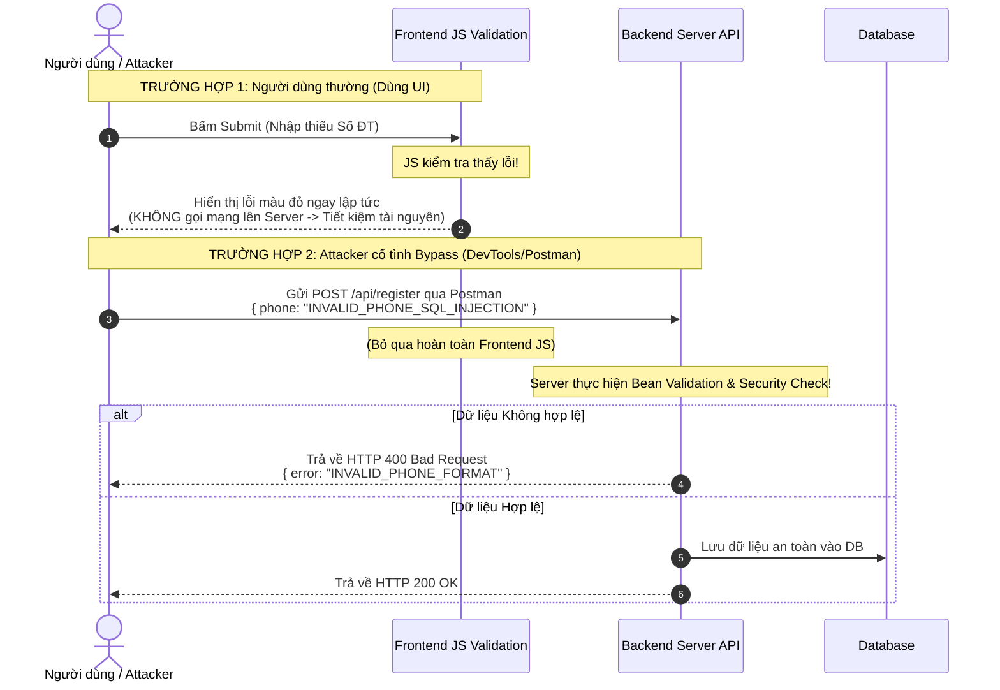

# Validate ở Client vs Server
**Loại**: #tradeoff  
**Ngày**: 2026-08-02  
**Bối cảnh**: Tất cả các ứng dụng Web / API trong hệ thống eBAF và hệ thống phát triển mới.

---

## 1. Khái niệm & Vấn đề Cốt lõi

Trong quá trình phát triển ứng dụng Web, lập trình viên thường đối mặt với câu hỏi: *"Nếu giao diện Frontend đã viết mã JavaScript kiểm tra kỹ lưỡng (bắt buộc nhập, đúng định dạng số điện thoại, ngày tháng...), tại sao Server Backend vẫn bắt buộc phải viết lại toàn bộ mã validation đó lần thứ hai?"*

Câu trả lời nằm ở nguyên lý cốt lõi của bảo mật phần mềm: **Mô hình Phòng thủ Nhiều lớp (Defense-in-Depth)** và tư duy **"Never Trust the Client" (Không bao giờ tin tưởng dữ liệu gửi từ phía Client)**.

- **Validate ở Client (Frontend Validation)**: Là lớp kiểm tra phục vụ mục đích **Trải nghiệm người dùng (UX)**.
- **Validate ở Server (Backend Validation)**: Là lớp kiểm tra phục vụ mục đích **Bảo mật (Security)** và **Toàn vẹn dữ liệu (Data Integrity)**.

---

## 2. Bản chất Kỹ thuật & Ranh giới Tin cậy (Trust Boundary)

```
┌─────────────────────────────────────────────────────────┐
│              UNTRUSTED ZONE (Client Side)               │
│  [Browser] ──> [HTML5 / JS Validation] ──> [DevTools]  │
└────────────────────────────┬────────────────────────────┘
                             │  HTTP Request (Easy to Bypass!)
============== Ranh giới Tin cậy (TRUST BOUNDARY) =============
                             │
┌────────────────────────────▼────────────────────────────┐
│               TRUSTED ZONE (Server Side)                │
│  [API Gateway Filter] ──> [Server Bean Validation]     │
│  ──> [Business Logic Rules] ──> [Database System]       │
└─────────────────────────────────────────────────────────┘
```

### 2.1 Tại sao Client-Side Validation KHÔNG THỂ coi là Bảo mật?
Client-side validation chạy hoàn toàn trên trình duyệt của người dùng. Người dùng có toàn quyền kiểm soát môi trường này. Một attacker hoặc một user tò mò có thể bỏ qua lớp Client Validation một cách cực kỳ dễ dàng qua các cách sau:

1. **Tắt JavaScript trên Trình duyệt**: Toàn bộ script validate JS bị vô hiệu hóa.
2. **Sửa DOM / HTML Attributes qua DevTools (F12)**: Xóa thuộc tính `required`, `maxlength="10"`, hoặc sửa hàm `onsubmit="return validateForm()"`.
3. **Gửi Request Trực tiếp bằng Tool (Postman / cURL / Script)**: Gọi thẳng tới URL Endpoint `POST /api/payment` mà không hề đi qua giao diện HTML/JS.
4. **Giả mạo & Can thiệp HTTP Request (Dùng Burp Suite / OWASP ZAP)**: Chặn request HTTP sau khi JS đã validate thành công, sửa dữ liệu (VD: đổi số tiền từ `1,000,000` thành `100`) rồi mới gửi tới Server.

=> **Kết luận**: Client Validation chỉ có tác dụng hỗ trợ người dùng nhập đúng dữ liệu nhanh hơn. **Server Validation mới là tuyến phòng thủ thực sự**.

---

## 3. Sơ đồ Luồng Thực thi (Mermaid Diagram)



---

## 4. Phân loại Các Cấp độ Validation (Validation Levels)

Không phải mọi việc validate đều giống nhau. Validation được chia thành 3 tầng:

1. **Tầng 1: Validate Định dạng (Format & Schema Validation)**
   - Kiểm tra: Bắt buộc (Required), Độ dài (Length), Định dạng Email, Regex Số điện thoại, Số nguyên dương...
   - *Thực hiện*: Cả **Client** (UX) và **Server** (JSR-380 Annotations như `@NotNull`, `@Size`, `@Pattern`).

2. **Tầng 2: Validate Nghiệp vụ phụ thuộc Dữ liệu (Business Logic Validation)**
   - Kiểm tra: Mã số thuế này đã tồn tại trong DB chưa? Số dư tài khoản có đủ để thực hiện giao dịch không? Hợp đồng này có đang ở trạng thái cho phép chỉnh sửa không?
   - *Thực hiện*: **BẮT BUỘC chỉ làm ở Server** (vì Client không có đủ dữ liệu DB và thông tin DB tại Client sẽ bị lộ bí mật).

3. **Tầng 3: Làm sạch Dữ liệu & Bảo mật (Sanitization & Security)**
   - Kiểm tra: Chống SQL Injection (Parameterized Query), chống Cross-Site Scripting (HTML Entity Encoding cho các thẻ `<script>`).
   - *Thực hiện*: **BẮT BUỘC ở Server**.

---

## 5. Bảng So sánh Toàn diện

| Tiêu chí | Validate ở Client (JS / HTML5) | Validate ở Server (Java / Spring) |
|---|---|---|
| **Mục đích chính** | Tối ưu trải nghiệm người dùng (UX) | Bảo mật hệ thống & Toàn vẹn dữ liệu |
| **Tốc độ Phản hồi** | Tức thì (0 milisecond, không chờ mạng) | Tốn thời gian Round-trip HTTP (vài chục ms) |
| **Độ tin cậy (Security)** | **Bằng 0** (Có thể bị bypass 100%) | **Tuyệt đối** (Do lập trình viên kiểm soát) |
| **Tải trên Server** | Giúp giảm tải Server (Chặn request rác từ UI) | Xử lý kiểm tra tốn CPU/Memory của Server |
| **Khả năng kiểm tra DB** | Không thể (Không truy cập trực tiếp DB) | Hoàn toàn làm được (Query tra cứu DB) |
| **Mức độ Bắt buộc** | Không bắt buộc (Optional, khuyến khích có) | **BẮT BUỘC 100%** cho mọi Endpoint API |
| **Công nghệ phổ biến** | HTML5 attributes (`required`), React Hook Form, Yup, Vuelidate | Hibernate Validator (JSR-380), Spring `@Valid`, Custom Validator |

---

## 6. Ví dụ Mã nguồn Minh họa

### 6.1 Lớp Frontend (Client Validation - JavaScript)

```html
<!-- Client-side HTML5 & JS -->
<form id="contractForm" onsubmit="return validateClientForm()">
    <input type="text" id="taxCode" required pattern="^[0-9]{10}$" placeholder="Nhập 10 số MST">
    <span id="taxCodeError" style="color:red"></span>
    <button type="submit">Lưu</button>
</form>

<script>
function validateClientForm() {
    const taxCode = document.getElementById('taxCode').value;
    const errorSpan = document.getElementById('taxCodeError');
    
    // Kiểm tra nhanh ở Client để cho UX tốt
    if (!/^[0-9]{10}$/.test(taxCode)) {
        errorSpan.innerText = "Mã số thuế phải đúng 10 chữ số!";
        return false; // Ngăn gửi form
    }
    return true;
}
</script>
```

### 6.2 Lớp Backend (Server Validation - Java Bean Validation JSR-380)

```java
// 1. DTO hứng dữ liệu với Annotation Validation
public class ContractDto {

    @NotBlank(message = "Mã hợp đồng không được để trống")
    @Size(min = 5, max = 20, message = "Mã hợp đồng phải từ 5-20 ký tự")
    private String contractNo;

    @NotBlank(message = "Mã số thuế không được để trống")
    @Pattern(regexp = "^[0-9]{10}$", message = "Mã số thuế phải đúng 10 chữ số")
    private String taxCode;

    @NotNull(message = "Số tiền không được null")
    @Min(value = 1000, message = "Số tiền tối thiểu là 1,000 VNĐ")
    private BigDecimal amount;

    // Getters and Setters
}

// 2. REST Controller xử lý Validation
@RestController
@RequestMapping("/api/contracts")
public class ContractController {

    @Autowired
    private ContractService contractService;

    @PostMapping
    public ResponseEntity<?> createContract(@Valid @RequestBody ContractDto dto) {
        // Nếu DTO vi phạm bất kỳ annotation nào, Spring sẽ tự động ném MethodArgumentNotValidException
        // và trả về lỗi HTTP 400 Bad Request kèm chi tiết trường bị lỗi.
        
        // Validate bổ sung ở tầng Business (Tra cứu DB)
        if (contractService.isTaxCodeBlacklisted(dto.getTaxCode())) {
            return ResponseEntity.badRequest().body(new ErrorDto("TAX_CODE_BLACKLISTED", "Mã số thuế thuộc danh sách đen!"));
        }

        contractService.save(dto);
        return ResponseEntity.ok("Tạo hợp đồng thành công");
    }
}
```

---

## 7. Cụm từ Nguyên tắc Cốt lõi trong Bảo mật Web

1. **"Never Trust Client Input"**: Bất kỳ dữ liệu nào vượt qua ranh giới mạng (từ HTTP Request Body, Header, Cookie, URL Parameter) đều phải được coi là **độc hại** cho đến khi Server kiểm tra hợp lệ.
2. **"Validate on Standardized DTOs"**: Tất cả dữ liệu đầu vào nên được bind vào DTO có định dạng rõ ràng và validate bằng framework chuẩn (Hibernate Validator) thay vì dùng hàng chục câu lệnh `if (param == null)` thủ công rải rác.
3. **"Fail-Fast Principal"**: Kiểm tra định dạng dữ liệu (Format Validation) ngay tại cửa ngõ API (Controller / Filter) trước khi thực hiện các câu query DB đắt đỏ.

---

## 8. Cây Quyết định & Quy trình Thiết kế (Decision Tree)

```
Khi phát triển một Chức năng / API mới:
 ├── BƯỚC 1: Xây dựng Server Validation (BẮT BUỘC TRƯỚC)
 │    ├── Đã thêm JSR-380 Annotations (@NotNull, @Pattern...) vào DTO chưa? -> CÓ
 │    ├── Đã validate Business Logic tra cứu DB ở Service chưa? -> CÓ
 │    └── Đã viết Global Exception Handler trả về lỗi HTTP 400 chuẩn chưa? -> CÓ
 └── BƯỚC 2: Thêm Client Validation (BỔ SUNG ĐỂ TỐI ƯU UX)
      ├── Thêm HTML5 attributes (required, pattern) trên form HTML.
      ├── Viết JS check tức thì khi user gõ (onBlur / onChange).
      └── Đảm bảo UI hiển thị thông báo lỗi thân thiện, trùng khớp với message của Server.
```

---

## 9. Tài liệu & Bài viết liên quan
- [[idempotency]] — Tránh người dùng gửi dữ liệu lỗi nhiều lần.
- [[redirect-vs-forward]] — Xử lý trả lại View kèm thông báo lỗi khi Validate thất bại.
- [[../bug-cases/]] — Các lỗi liên quan đến vi phạm ràng buộc dữ liệu DB2 khi bỏ sót Server Validate.