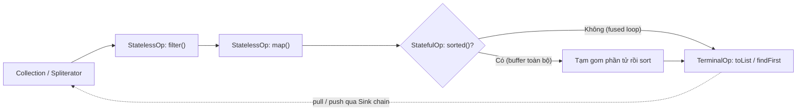

# JVM-01 · Java 7 → 21: Bridge Cheatsheet

> **TL;DR** — Bước nhảy từ Java 7 lên Java 21 không chỉ là cú pháp ngắn hơn mà thay đổi cả mô hình thực thi: lambda chạy qua `invokedynamic` (không sinh class ẩn như anonymous class), `Stream` là pipeline lười (lazy pull/push) dùng tốt cho biểu đạt logic nhưng không tự động nhanh hơn `for-loop`, `Optional` là kiểu trả về để ép xử lý thiếu dữ liệu (không dùng cho field hay parameter), `java.time` bất biến để xóa sổ lỗi race condition của `SimpleDateFormat`, và `HttpClient` hỗ trợ HTTP/2 + async kèm timeout rõ ràng. Khi đưa code Java 21 lên production, cái bẫy lớn nhất là dùng `parallelStream()` cho I/O làm nghẽn `ForkJoinPool.commonPool()` dùng chung toàn JVM.

## 🧭 Brief

| | |
| :--- | :--- |
| **Loại** | Bài học |
| **Giai đoạn** | Quý 0 · Bridge |
| **Chủ đề** | Java hiện đại & JVM Internals |

**Phạm vi bắt buộc**
- lambda, functional interface, Stream, Optional
- java.time
- var
- text blocks
- switch expression
- HTTP client
- so sánh cùng 1 bài toán viết bằng Java 7 và Java 21

**Câu hỏi sâu — nội dung phải giúp trả lời được**
- Stream có luôn nhanh hơn for-loop không?
- Optional nên và không nên dùng ở đâu?

**Ý tưởng lab / demo**
- Viết lại 1 module xử lý danh sách kiểu Java 7 sang Java 21, đặt 2 bản cạnh nhau

**Tài liệu gốc gợi ý**
- JVM Specification
- Effective Java 3rd
- Oracle GC Tuning Guide
- JEP index (openjdk.org/jeps)

**Gói đầu ra**
- [x] `README.md` — lý thuyết theo [lesson-template](../../../docs/templates/lesson-template.md)
- [x] `exercises.md` — bài tập L1/L2/L3 theo [exercises-template](../../../docs/templates/exercises-template.md)
- [x] `solutions.md` — đáp án theo [solutions-template](../../../docs/templates/solutions-template.md)
- [x] `lab/` — code demo chạy được + `lab/README.md` theo [lab-template](../../../docs/templates/lab-template.md)
- [ ] _(người học)_ `my-notes.md` — **agent không tạo**

---

<!-- Nội dung bắt đầu từ đây -->

## 1. Vấn đề: tại sao phải biết cái này?

Trong một hệ thống Java 7 / JBoss AS 7.1.1 chạy 300–500 req/s giờ cao điểm, ba lỗi sau lặp đi lặp lại ở production:
1. Đặt `private static final SimpleDateFormat SDF = new SimpleDateFormat("yyyy-MM-dd")` để tiết kiệm memory → dưới tải 8 thread đồng thời, `SimpleDateFormat` làm hỏng biến `Calendar` nội bộ, gây `NumberFormatException` hoặc tệ hơn: **parse nhầm ngày giao dịch mà không ném exception** (trong lab của bài này, 54/200 lần gọi song song bị sai hoặc lỗi).
2. Gọi API đối tác bằng `HttpURLConnection` quên `setReadTimeout` → khi đối tác treo 30s, 200 worker thread của app server bị giữ cứng, toàn hệ thống timeout dây chuyền.
3. Chuỗi `if (x != null && x.getPromo() != null ...)` dài hàng trăm dòng nhưng chỉ sót 1 nhánh là `NullPointerException` 500 ở production.

Nếu nhảy thẳng từ Java 7 lên Java 21 mà **chỉ học cú pháp bề mặt** (hoặc copy code từ AI) mà không hiểu cơ chế bên dưới, bạn sẽ gặp đúng ba cái bẫy mới: dùng `parallelStream()` cho I/O làm treo `ForkJoinPool.commonPool()`, dùng `Optional.orElse(callDb())` khiến DB vẫn bị query dù cache đã hit, và dùng `LocalDateTime` thay vì `Instant` làm lệch 7 tiếng khi deploy container UTC.

---

## 2. Mô hình tư duy (mental model)

Hãy hình dung **vòng lặp `for` kiểu Java 7** giống như **công nhân tự tay bốc từng món hàng**: mỗi vòng lặp tự lấy phần tử, tự kiểm tra `if`, tự cộng dồn vào biến ngoài. Còn **`Stream` của Java 8+** giống như **bản thiết kế dây chuyền (pipeline blueprint)**:
- Các bước `filter`, `map`, `sorted` chỉ *đăng ký công đoạn* vào bản thiết kế — chưa có phần tử nào chạy qua.
- Chỉ khi gặp terminal operation (`toList()`, `sum()`, `findFirst()`), JVM mới kéo/đẩy từng phần tử đi dọc dây chuyền và dừng ngay khi đủ kết quả (short-circuit).

**Chỗ ẩn dụ không còn đúng:**
1. Dây chuyền thật có thể chạy lại nhiều lần, còn **`Stream` chỉ tiêu thụ đúng 1 lần** — dùng lại sẽ ném `IllegalStateException`.
2. Bản thiết kế trông gọn hơn không đồng nghĩa chạy nhanh hơn công nhân bốc tay: với list nhỏ (`n = 100`), chi phí dựng các object `Pipeline`/`Sink` lớn hơn hẳn một vòng `for` đơn giản.
3. Bật `.parallelStream()` không tạo dây chuyền riêng cho bạn — nó đẩy việc vào **`ForkJoinPool.commonPool()` dùng chung toàn JVM**.



---

## 3. Cơ chế bên trong (trọng tâm của bài)

### 3.1 Lambda & Functional Interface: `invokedynamic` vs Anonymous Inner Class

Một `@FunctionalInterface` là interface có **đúng 1 abstract method** (như `Predicate<T>`, `Function<T, R>`, `Supplier<T>`, `Consumer<T>`, `Comparator<T>`). Annotation `@FunctionalInterface` giúp compiler báo lỗi ngay nếu ai đó thêm abstract method thứ hai.

Điều quan trọng: **Lambda KHÔNG phải syntactic sugar cho Anonymous Inner Class.**
- **Anonymous Inner Class (Java 7):** trình biên dịch tạo thêm 1 file `.class` riêng trên đĩa (ví dụ `OrderService$1.class`), JVM phải load, verify, giữ metadata trong PermGen/Metaspace, và mỗi lần chạy `new Comparator<>()` là cấp phát một object mới trên heap. Bên trong class ẩn, `this` trỏ vào chính instance ẩn đó.
- **Lambda (Java 8+, JSR-335 / JEP 126):** trình biên dịch biến thân lambda thành một hàm `private static` (hoặc instance) ngay trong class chứa nó, còn tại call site chỉ phát ra 1 lệnh bytecode `invokedynamic` trỏ tới `LambdaMetafactory.metafactory(...)` (theo JVMS §4.7.23 BootstrapMethods).
  - Lần đầu tiên call site chạy, `LambdaMetafactory` mới liên kết động và trả về `CallSite` (thường tạo class/instance tối ưu trong runtime bằng `Lookup.defineHiddenClass` trên JDK hiện đại).
  - **Non-capturing lambda** (không dùng biến ngoài, như `(a, b) -> Integer.compare(a.length(), b.length())`): JVM thường dùng lại **1 singleton instance duy nhất**, không cấp phát mỗi lần gọi.
  - **Capturing lambda** (bắt biến cục bộ `prefix`, bắt buộc `final` hoặc *effectively final*): chỉ cấp phát wrapper giữ giá trị `prefix` đó. Lý do biến cục bộ phải *effectively final*: biến cục bộ nằm trên stack frame của thread gọi, có thể biến mất sau khi hàm return, nên lambda thực chất **copy giá trị** chứ không giữ tham chiếu tới stack slot (tránh data race và dangling stack).
  - Trong lambda, `this` trỏ tới **enclosing instance** (class bên ngoài), không phải bản thân lambda.

*(Bạn có thể tự kiểm chứng bằng `javap -c -p` trên class `BytecodeInspectTarget` trong `lab/` — kết quả chạy thực tế nằm ở mục 5.)*

### 3.2 Stream API internals & Trả lời câu hỏi sâu: "Stream có luôn nhanh hơn for-loop không?"

Bên trong JDK (`java.util.stream.AbstractPipeline`), một `Stream` là một **doubly-linked list các stage**:
- `Head` bọc nguồn dữ liệu (`Spliterator`)
- `StatelessOp` (`filter`, `map`, `flatMap`) xử lý từng phần tử độc lập
- `StatefulOp` (`sorted`, `distinct`, `limit` trong parallel) cần giữ trạng thái hoặc buffer

Khi terminal operation chạy, pipeline dựng một chuỗi `Sink` từ cuối ngược lên đầu (`wrapAndCopyInto`), nhờ đó **loop fusion** xảy ra: `filter` → `map` → `sum` chạy qua **1 vòng lặp duy nhất**, không tạo `List` trung gian giữa mỗi bước như cách viết Java 7 naive (`list1` lọc xong → `list2` map xong → `sum`). Ngoài ra, các phép như `findFirst()` / `anyMatch()` kích hoạt cơ chế hủy sớm (`cancellationRequested()`), dừng ngay khi thỏa điều kiện.

**Vậy Stream có luôn nhanh hơn for-loop không? KHÔNG.**
1. **Collection nhỏ hoặc vòng lặp rất khít (tight loop):** `for (int i = 0; i < list.size(); i++)` trên `ArrayList` chỉ tăng index trên thanh ghi CPU. Ngược lại, `Stream` phải tạo `Head` + các stage + chuỗi `Sink` + gọi qua `Spliterator` (vài chục đến trăm byte allocation trên heap và virtual dispatch trước khi JIT C2 kịp inline/escape-analyze, xem thêm [JVM-05](../05-jit-compilation/README.md)).
2. **Boxing overhead:** `Stream<Integer>` ép boxing/unboxing nếu không chuyển sang primitive stream (`IntStream`, `LongStream`, `DoubleStream` qua `.mapToInt()` / `.mapToLong()`).
3. **`parallelStream()` phản tác dụng khi lạm dụng:** `parallelStream()` chia dữ liệu bằng `Spliterator.trySplit()` và đẩy task vào **`ForkJoinPool.commonPool()`**, mặc định có số thread bằng `Runtime.getRuntime().availableProcessors() - 1` (ví dụ máy 16 vCPU → 15 worker thread). Chi phí chia task, đồng bộ fork/join và context switch chỉ có lãi khi:
   - N lớn (thường hàng chục nghìn đến triệu phần tử) **HOẶC** chi phí CPU mỗi phần tử đủ nặng,
   - Cấu trúc dữ liệu tách đều tốt (`ArrayList`, array, `IntStream.range` tốt; `LinkedList` hoặc `Stream.iterate` tách rất tệ vì phải duyệt tuần tự $O(n)$ mới chia được!),
   - Công việc **thuần CPU**, không chứa blocking I/O.

**Số đo thực tế từ `lab/` (JDK 26 `--release 21`, Windows 11, 16 CPUs):**
- List nhỏ `n = 100` (100.000 lần sau warmup): `for-loop` **6 ms** · `stream()` **10 ms** · `parallelStream()` **1.026 ms** (**chậm hơn ~171×** vì overhead điều phối `ForkJoinPool`).
- List lớn thuần CPU `n = 1.000.000` (20 vòng hash/phần tử): `for-loop` **8 ms** · `stream()` **10 ms** · `parallelStream()` **2 ms** (tận dụng 15 worker threads).

### 3.3 `Optional<T>` & Trả lời câu hỏi sâu: "Optional nên và không nên dùng ở đâu?"

`Optional<T>` (JSR-335, `java.util.Optional`) là một container bất biến chứa 0 hoặc 1 tham chiếu non-null:
- `Optional.empty()` trả về **1 singleton tĩnh duy nhất** (`EMPTY`), không tốn cấp phát mới.
- `Optional.of(value)` ném `NullPointerException` ngay lập tức nếu `value == null` (fail-fast).
- `Optional.ofNullable(value)` trả `EMPTY` nếu `null`, ngược lại bọc trong 1 object `Optional` mới (~16–24 byte header + reference trên heap 64-bit với Compressed Oops).
- `Optional` cố ý **không implement `Serializable`** (theo thiết kế của JSR-335 và *Effective Java* 3rd Edition, Item 55) để không bị dùng làm DTO/field.

**Quy tắc sử dụng chuẩn (*Effective Java*, Item 55):**

| Ngữ cảnh | Nên dùng `Optional`? | Lý do |
| :--- | :---: | :--- |
| **Return type** của method có thể không có kết quả (tìm theo ID, lookup config) | **NÊN** | Ép caller xử lý nhánh vắng mặt ở compile time qua `orElse`, `orElseThrow`, `map`, `ifPresent`. |
| **Field của entity / DTO / class** | **KHÔNG** | Tốn thêm object wrapper + pointer indirection; phá serialization (Jackson/JPA/RMI). |
| **Method parameter / Constructor parameter** | **KHÔNG** | Caller phải gói `Optional.of(...)` mỗi lần gọi, lại có nguy cơ caller truyền `null` cho chính biến `Optional`! Dùng method overloading hoặc builder/default. |
| **Bên trong Collection / Map** (`List<Optional<T>>`, `Map<K, Optional<V>>`) | **KHÔNG** | Dùng list rỗng `List.of()` hoặc không chèn key vào map. |
| **Thay thế `if (x != null)` đơn giản bằng `.isPresent()` + `.get()`** | **KHÔNG** | Vừa tốn cấp phát `Optional` vừa vẫn có thể nổ `NoSuchElementException` — còn dài hơn `if (x != null)`. |

**Bẫy hiệu năng `orElse` vs `orElseGet`:**
- `opt.orElse(fetchDefaultFromDb())`: Java luôn **evaluate tham số trước khi gọi hàm `orElse`** → `fetchDefaultFromDb()` **luôn chạy** kể cả khi `opt` đang có giá trị!
- `opt.orElseGet(() -> fetchDefaultFromDb())`: truyền `Supplier`, chỉ chạy khi `opt` rỗng. Dùng `orElse(...)` cho hằng số rẻ (`"DEFAULT"`, `List.of()`), dùng `orElseGet(...)` cho mọi lời gọi hàm/tạo object mới.

### 3.4 `java.time` (JSR-310) vs `java.util.Date` & `SimpleDateFormat`

`java.util.Date` và `Calendar` mắc 3 lỗi thiết kế kinh điển:
1. **Mutable:** hàm setter sửa trực tiếp object → bất kỳ code nào giữ reference đều bị thay đổi âm thầm.
2. **Thread-unsafe ở `SimpleDateFormat`:** lớp cha `DateFormat` giữ một trường `protected Calendar calendar;` dùng chung. Khi 2 thread cùng gọi `sdf.parse(...)` hay `sdf.format(...)`, chúng ghi đè `calendar` của nhau → sai ngày hoặc ném exception.
3. **API dễ nhầm:** năm trong `Date` tính từ `1900`, tháng đánh số từ `0` (`0 = tháng 1`).

`java.time` (JSR-310, thiết kế bởi Stephen Colebourne) giải quyết bằng **immutable value objects** (`@ValueBased` / `final` class):
- `Instant`: mốc thời gian tuyệt đối trên trục UTC (epoch seconds + nanos) → dùng để lưu DB (`TIMESTAMPTZ`), log, giao tiếp API.
- `LocalDate` / `LocalTime` / `LocalDateTime`: ngày/giờ **không gắn timezone** → dùng cho ngày sinh, ngày hợp đồng theo lịch địa phương; **không** đại diện cho một thời điểm toàn cầu duy nhất.
- `ZonedDateTime` / `OffsetDateTime`: thời điểm gắn vùng (`ZoneId.of("Asia/Ho_Chi_Minh")`) hoặc độ lệch (`+07:00`).
- `DateTimeFormatter`: **bất biến và thread-safe hoàn toàn**, khai báo `static final` dùng chung mọi thread mà không cần `ThreadLocal`.

### 3.5 `var` (JEP 286), Text Blocks (JEP 378), Switch Expressions (JEP 361)

- **`var` (Java 10, JEP 286):** là **Local Variable Type Inference tại compile time**, **không phải dynamic typing** như JavaScript. Trình biên dịch suy ra kiểu tĩnh từ biểu thức vế phải và phát ra bytecode **giống hệt** khi viết tường minh kiểu.
  - Chỉ dùng được cho **biến cục bộ có giá trị khởi tạo** (hoặc biến trong `for` / `try-with-resources`), không dùng cho field, parameter, return type, hay `var x = null;`.
  - Bẫy: `var list = new ArrayList<>();` (không có type witness) sẽ suy ra `ArrayList<Object>`!
- **Text Blocks (Java 15, JEP 378):** mở bằng `"""` + xuống dòng. Compiler tự động tính lề chung nhỏ nhất (incidental whitespace) để căn lề trái tại **compile time**, nên tại runtime trong Constant Pool chỉ là một `String` hằng bình thường (0 chi phí phụ). Hỗ trợ `\s` (giữ space cuối dòng) và `\` ở cuối dòng (nối dòng không xuống dòng).
- **Switch Expressions (Java 14, JEP 361):** dùng cú pháp mũi tên `case A, B -> ...` nên **không có fall-through** (không còn bug quên `break;`). Khi gán kết quả `var x = switch (status) { ... }`, compiler bắt buộc **exhaustive** (đủ mọi nhánh enum hoặc có `default`). Nếu 1 nhánh cần nhiều dòng code, dùng block `{ ... yield value; }`. (Kết hợp với `sealed` interface và pattern matching ở bài [JVM-02](../02-records-sealed-pattern-matching/README.md).)

### 3.6 `java.net.http.HttpClient` (JEP 321) vs `HttpURLConnection`

`HttpURLConnection` (từ JDK 1.1) chỉ hỗ trợ HTTP/1.1, cấu hình proxy/redirect rải rác qua `System.setProperty`, không có API async chuẩn, và đọc lỗi 4xx/5xx phải tự rẽ nhánh `getErrorStream()` thay vì `getInputStream()`.

`java.net.http.HttpClient` (chuẩn hóa ở Java 11, JEP 321):
- Thiết kế **immutable builder**: `HttpClient` quản lý connection pool nội bộ + selector thread + TLS/ALPN (tự đàm phán **HTTP/2** multiplexing và fallback HTTP/1.1).
- Hỗ trợ đồng bộ `client.send(...)` và bất đồng bộ `client.sendAsync(...)` trả về `CompletableFuture<HttpResponse<T>>` (liên quan [CONC-05](../../concurrency/05-completablefuture/README.md)).
- Timeout tách bạch rõ 2 lớp: `HttpClient.Builder.connectTimeout(...)` (thời gian bắt tay TCP/TLS) và `HttpRequest.Builder.timeout(...)` (thời gian chờ toàn request + response).
- **Cập nhật quan trọng Java 21:** `HttpClient` đã implement **`AutoCloseable`** (`close()`, `shutdown()`, `awaitTermination()`). Tuy nhiên trong service chạy dài hạn, **tạo 1 `HttpClient` singleton tái sử dụng** để giữ connection pool (HTTP keep-alive / HTTP/2 multiplexing), tránh tạo mới mỗi request gây tốn socket và selector thread.

---

## 4. Code minh họa

### 4.1 Cùng 1 bài toán: Java 7 vs Java 21

Bài toán: lọc đơn hàng hợp lệ trong `lookbackDays` ngày gần nhất, tính tổng theo từng `customerTier`, lấy top 3 ID giá trị cao nhất, lấy `promoNote` của đơn đầu tiên, ánh xạ `OrderStatus` sang SLA, gọi endpoint lấy thuế suất, và xuất JSON. (Code đầy đủ chạy được nằm ở [OrderReportServiceJava7.java](./lab/src/main/java/lab/jvm/bridge/OrderReportServiceJava7.java) và [OrderReportServiceJava21.java](./lab/src/main/java/lab/jvm/bridge/OrderReportServiceJava21.java).)

**Java 7 (dài ~155 dòng, trích đoạn chính):**
```java
// SimpleDateFormat không thread-safe -> buộc bọc ThreadLocal
private static final ThreadLocal<SimpleDateFormat> ISO_DATE_FORMAT =
    new ThreadLocal<SimpleDateFormat>() {
        @Override
        protected SimpleDateFormat initialValue() {
            SimpleDateFormat sdf = new SimpleDateFormat("yyyy-MM-dd");
            sdf.setLenient(false);
            return sdf;
        }
    };

// Lọc, gom nhóm và sort bằng Anonymous Comparator
List<Order> sorted = new ArrayList<Order>(eligible);
Collections.sort(sorted, new Comparator<Order>() {
    @Override
    public int compare(Order a, Order b) {
        int byAmount = b.getAmount().compareTo(a.getAmount());
        return byAmount != 0 ? byAmount : a.getId().compareTo(b.getId());
    }
});

// Nullable lookup phải tự nhớ check null
String firstPromo = "NO_PROMO";
if (!sorted.isEmpty()) {
    String note = findPromoNote(sorted.get(0));
    if (note != null) {
        firstPromo = note.trim().toUpperCase();
    }
}
```

**Java 21 (gọn ~95 dòng, rõ ý định nghiệp vụ):**
```java
private static final DateTimeFormatter ISO_DATE = DateTimeFormatter.ISO_LOCAL_DATE;

var refDate = LocalDate.parse(referenceDateIso, ISO_DATE);
var cutoffDate = refDate.minusDays(lookbackDays);

var eligible = Optional.ofNullable(orders).orElseGet(List::of).stream()
        .filter(Objects::nonNull)
        .filter(o -> o.getStatus() != OrderStatus.CANCELLED && o.getStatus() != OrderStatus.REJECTED)
        .filter(o -> {
            var created = LocalDate.parse(o.getCreatedDateIso(), ISO_DATE);
            return !created.isBefore(cutoffDate) && !created.isAfter(refDate);
        })
        .toList();

Map<String, BigDecimal> grossByTier = eligible.stream()
        .collect(Collectors.groupingBy(
                Order::getCustomerTier,
                TreeMap::new,
                Collectors.reducing(BigDecimal.ZERO, Order::getAmount, BigDecimal::add)));

var firstPromo = eligible.stream()
        .sorted(Comparator.comparing(Order::getAmount).reversed().thenComparing(Order::getId))
        .findFirst()
        .flatMap(this::findPromoNote)
        .map(note -> note.trim().toUpperCase())
        .orElse("NO_PROMO");

var slaPriority = switch (leadStatus) {
    case PENDING -> "P1_URGENT";
    case APPROVED -> "P2_NORMAL";
    case PAID -> "P3_ARCHIVE";
    case REJECTED, CANCELLED -> "P4_CLOSED";
};
```

### 4.2 Ví dụ SAI vs ĐÚNG

```java
// ❌ SAI 1: SimpleDateFormat static -> race condition dưới đa luồng
private static final SimpleDateFormat SDF = new SimpleDateFormat("yyyy-MM-dd");

// ✅ ĐÚNG 1: DateTimeFormatter immutable, thread-safe (Java 8+)
private static final DateTimeFormatter DTF = DateTimeFormatter.ISO_LOCAL_DATE;

// ❌ SAI 2: orElse luôn gọi queryDb() dù user đã có trong cache!
User user = cachedUser.orElse(queryDb(userId));

// ✅ ĐÚNG 2: orElseGet chỉ gọi queryDb() khi cachedUser rỗng
User user = cachedUser.orElseGet(() -> queryDb(userId));

// ❌ SAI 3: var + diamond operator suy ra ArrayList<Object>
var ids = new ArrayList<>();
ids.add(123);      // compile OK dù bạn tưởng đây là List<String>!

// ✅ ĐÚNG 3: Ghi rõ kiểu phần tử ở vế phải hoặc dùng List.of / new ArrayList<String>()
var ids = new ArrayList<String>();
```

### 4.3 Legacy corner (Java 7 / JBoss AS 7.1.1)

Trên môi trường công ty dùng **Java 7 + JBoss AS 7.1.1 + JDBC thuần**, bạn **chưa dùng được** lambda, `Stream`, `Optional`, `java.time`, `var`, text block, switch expression hay `java.net.http.HttpClient`. Tuy nhiên, 4 thói quen tư duy của Java 21 **áp dụng được ngay từ Java 7**:
1. **Dùng `try-with-resources` (đã có từ Java 7!)** cho mọi `Connection`, `PreparedStatement`, `ResultSet`, `InputStream` thay cho `finally { close(); }` dễ rò rỉ connection.
2. **Thay `SimpleDateFormat` static bằng `ThreadLocal<SimpleDateFormat>`** (có `setLenient(false)`) hoặc `FastDateFormat` (Apache Commons Lang, thường đã có sẵn trong WAR/JBoss) — đừng quên gọi `.remove()` nếu tạo `ThreadLocal` theo request trên thread pool JBoss để tránh ClassLoader leak khi redeploy (xem [JVM-10](../10-metaspace-classloader-leak/README.md)).
3. **Luôn đặt `setConnectTimeout` + `setReadTimeout` trên `HttpURLConnection`** và luôn đọc `getErrorStream()` khi `status >= 400` để đóng socket sạch (tránh tích tụ `CLOSE_WAIT`).
4. **Dùng `Objects.requireNonNull(...)` (đã có từ Java 7)** ở đầu hàm thay cho để `null` trôi sâu vào business logic rồi mới nổ NPE khó truy vết.

---

## 5. Quan sát & đo đạc

Để *nhìn thấy tận mắt* sự khác biệt ở mức bytecode và runtime, chạy lab rồi dùng `javap`:

```powershell
# Biên dịch & chạy thí nghiệm trong lab/
mvn -q verify
mvn -q compile exec:java
# Soi bytecode lambda vs anonymous class
javap -c -p target/classes/lab/jvm/bridge/BytecodeInspectTarget.class
```

**Output thật ghi nhận từ `BytecodeInspectTarget.class` (JDK 26 `--release 21`):**
```text
public void sortWithAnonymousClass(java.util.List<java.lang.String>);
     1: new           #7  // class lab/jvm/bridge/BytecodeInspectTarget$1
     6: invokespecial #9  // Method lab/jvm/bridge/BytecodeInspectTarget$1."<init>"
     9: invokeinterface #12, 2 // InterfaceMethod java/util/List.sort:(Ljava/util/Comparator;)V

public void sortWithNonCapturingLambda(java.util.List<java.lang.String>);
     1: invokedynamic #18, 0 // InvokeDynamic #0:compare:()Ljava/util/Comparator;
     6: invokeinterface #12, 2 // InterfaceMethod java/util/List.sort:(Ljava/util/Comparator;)V

public java.lang.String varAndTextBlockDemo(lab.jvm.bridge.OrderStatus);
    44: new           #38 // class java/lang/MatchException  (compiler tự sinh cho switch exhaustive)
    ...
    66: astore_2          // var label -> biến cục bộ bình thường, 0 overhead runtime
    67: ldc           #49 // String status=%s\n (text block đã strip indent từ compile time)
```

Nhìn dòng `1: invokedynamic`: trình biên dịch không sinh class `BytecodeInspectTarget$1` cho lambda, và chữ ký `compare:()Ljava/util/Comparator;` không nhận tham số ngoài nào (non-capturing) — đối lập với `capturingLambda(String prefix)` phát ra `InvokeDynamic #1:apply:(Ljava/lang/String;)Ljava/util/function/Function;`.

---

## 6. Trade-offs & khi nào KHÔNG dùng

| Lựa chọn | Được gì | Mất gì | Dùng khi |
| :--- | :--- | :--- | :--- |
| **`Stream` tuần tự** vs `for-loop` | Rõ ý đồ transform (`filter/map/collect`), tránh biến tạm mutable | Tốn nhẹ cấp phát stage/Sink (~4–10 ms chênh trên 100k lần list nhỏ), khó debug step-by-step | Xử lý collection nghiệp vụ bình thường, pipeline ≥ 2 bước; tránh trong hot-loop millisecond nhạy boxing |
| **`parallelStream()`** vs `stream()` | Tận dụng đa nhân cho tác vụ thuần CPU trên tập lớn | Dùng chung `ForkJoinPool.commonPool()`, dễ gây thread starvation; rất chậm với tập nhỏ hoặc `LinkedList` | Tập dữ liệu lớn (`ArrayList`/array/range) + CPU nặng + đã đo benchmark; **KHÔNG** dùng cho I/O |
| **`Optional<T>`** vs trả `null` | Buộc caller xử lý trường hợp vắng mặt ở compile time | Tốn 1 wrapper object; dài dòng nếu lạm dụng ở field/param | Kiểu trả về của method tìm kiếm/lookup có thể rỗng |
| **`var`** vs khai báo kiểu tường minh | Giảm lặp tên class dài (`Map<String, List<Order>>`) | Có thể che mất kiểu trả về nếu RHS là tên hàm mơ hồ | RHS đã lộ rõ kiểu (`new ...`, `Order.create()`, literal) |
| **`java.net.http.HttpClient`** vs `HttpURLConnection` | HTTP/2, async `CompletableFuture`, timeout 2 lớp rõ ràng | Cần Java 11+; vẫn là low-level client (chưa có retry/circuit breaker sẵn như Spring `RestClient` + Resilience4j) | Service Java 11–21 cần HTTP client chuẩn JDK không kéo thư viện ngoài |

---

## 7. Cạm bẫy production (ít nhất 3)

1. **`parallelStream()` gọi blocking I/O làm sập gián tiếp cả các tác vụ async khác** — *Triệu chứng:* endpoint không liên quan dùng `CompletableFuture.supplyAsync()` đột ngột treo p99 từ 30ms lên > 5s khi một batch report chạy. *Nguyên nhân:* cả hai mặc định dùng chung `ForkJoinPool.commonPool()` (chỉ có `CPU - 1` thread). Khi `parallelStream()` block chờ HTTP/DB, toàn bộ worker pool bị chiếm cứng. *Cách tránh:* tuyệt đối không chạy blocking I/O trong `parallelStream()`; dùng `ExecutorService` tách riêng hoặc Virtual Threads ([CONC-08](../../concurrency/08-virtual-threads/README.md)).
2. **`Optional.orElse(expensiveCall())` âm thầm nhân đôi tải DB** — *Triệu chứng:* dù cache hit rate báo 95%, lượng query fallback xuống DB vẫn bằng 100% số request. *Nguyên nhân:* đối số truyền vào `orElse(...)` luôn được evaluate trước khi gọi hàm. *Cách tránh:* luôn dùng `orElseGet(() -> expensiveCall())` cho bất kỳ biểu thức nào không phải hằng số.
3. **Tạo mới `HttpClient.newHttpClient()` mỗi request + quên timeout** — *Triệu chứng:* số file descriptor / socket `ESTABLISHED`/`CLOSE_WAIT` tăng vọt hoặc pod treo thread vô thời hạn khi downstream đơ. *Nguyên nhân:* `HttpClient` mới tạo selector thread & pool riêng (trước JDK 21 không có `close()`, thậm chí có `close()` rồi thì tạo liên tục vẫn mất TCP/TLS handshake mỗi lần), và mặc định `HttpRequest` không có request timeout. *Cách tránh:* tái sử dụng 1 `HttpClient` singleton, luôn set cả `connectTimeout(...)` lẫn `request.timeout(...)`.
4. **Dùng `LocalDateTime` cho mốc thời gian giao dịch** — *Triệu chứng:* dữ liệu lưu DB đúng khi chạy local (`+07:00`) nhưng lệch 7 tiếng khi chạy Docker container (`UTC`). *Nguyên nhân:* `LocalDateTime` không chứa timezone/offset. *Cách tránh:* lưu và truyền `Instant` (UTC) hoặc `OffsetDateTime`; chỉ chuyển sang `LocalDate`/`ZonedDateTime` ở tầng hiển thị hoặc cắt ngày nghiệp vụ theo `ZoneId` tường minh.
5. **Bắt biến trong lambda rồi sửa biến hoặc quên `var` + `<>`** — *Triệu chứng:* biến dùng `AtomicInteger` bị lạm dụng để mutate trong `forEach` (vi phạm stateless stream, dễ lỗi khi parallel), hoặc `var x = new ArrayList<>()` mất kiểm tra kiểu generic tại compile time. *Cách tránh:* dùng `collect`/`reduce` thay vì mutate biến ngoài trong `forEach`; luôn ghi type parameter khi khởi tạo bằng `var`.

---

## 8. Liên hệ thực tế công việc

Ngay tuần này trên codebase **Java 7 / JBoss AS 7.1.1 / JDBC thuần**, bạn có thể làm 3 việc kiểm tra an toàn mà không cần nâng JDK:
1. Grep toàn bộ `new SimpleDateFormat` trong project — bất kỳ field nào là `static` (hoặc nằm trên Singleton EJB/Servlet) đều là bug tiềm ẩn đa luồng; đổi sang `ThreadLocal<SimpleDateFormat>` (kèm `try/finally` hoặc `FastDateFormat`) và gọi `setLenient(false)`.
2. Grep `openConnection()` / `HttpURLConnection` — kiểm tra xem mọi chỗ gọi HTTP ra ngoài đã có cả `setConnectTimeout` và `setReadTimeout` chưa, và có đóng `getErrorStream()` khi status ≥ 400 không.
3. Chọn 1 method xử lý `List` dài 50–100 dòng trong service hiện tại, mở [lab/](./lab/README.md) và tập viết lại phiên bản Java 21 đặt cạnh để cảm nhận ranh giới giữa chỗ Java 21 làm code sạch hơn thật sự và chỗ cần cẩn thận (`Optional`, `LocalDate`, `HttpClient`).

---

## 9. Self-check — Explain-back

> Trả lời **không nhìn tài liệu**, nói to trong 5 phút. Không trả lời được = chưa xong. (Đáp án nằm trong [solutions.md](./solutions.md).)

1. Tại sao nói lambda không phải là syntactic sugar của anonymous inner class? JVM liên kết và cấp phát lambda tại runtime như thế nào?
2. Giải thích kiến trúc `Pipeline` + `Sink` của `Stream` và trả lời: khi nào `for-loop` nhanh hơn `Stream`, khi nào `parallelStream()` gây hại nặng hơn chạy tuần tự?
3. Liệt kê 4 chỗ **không** nên dùng `Optional<T>` và giải thích khác biệt giữa `orElse()` với `orElseGet()`.
4. Vì sao `SimpleDateFormat` bị hỏng dữ liệu khi dùng chung giữa các thread, còn `DateTimeFormatter` thì an toàn? Khác biệt cốt lõi giữa `Instant` và `LocalDateTime` là gì?
5. Khi dùng `java.net.http.HttpClient` trong production Java 21, cần cấu hình những gì để tránh rò rỉ tài nguyên và treo thread?

---

## 10. Cheatsheet 1 trang

| Mục tiêu | Java 7 Legacy | Java 21 Bridge | Lưu ý cốt lõi |
| :--- | :--- | :--- | :--- |
| **Callback / Sort** | `new Comparator<T>() { ... }` | `(a, b) -> ...` / `Comparator.comparing(...)` | `invokedynamic` + `LambdaMetafactory`, biến cục bộ phải effectively final |
| **Lọc / Gom nhóm** | `for` + `List` tạm + `Map.containsKey` | `.stream().filter(...).collect(groupingBy(...))` | Pipeline lazy, 1 lần dùng; không mặc định nhanh hơn `for-loop` |
| **Giá trị có thể vắng** | Trả `null` + `if (x != null)` | `Optional<T>` trả về + `.map().orElseGet(...)` | Chỉ dùng làm return type; tránh `orElse(call())` |
| **Ngày / Giờ** | `Date`, `Calendar`, `SimpleDateFormat` | `Instant`, `LocalDate`, `ZonedDateTime`, `DateTimeFormatter` | Immutable & thread-safe; phân biệt `Instant` (mốc UTC) vs `LocalDateTime` |
| **Khai báo biến** | `Map<String, List<Order>> m = new ...` | `var m = new HashMap<String, List<Order>>();` | Compile-time inference; tránh `var x = new ArrayList<>();` |
| **Chuỗi nhiều dòng** | `"{\n" + "  \"a\": 1\n" + "}"` | `""" ... """.formatted(...)` | Bỏ lề tại compile time, 0 overhead runtime |
| **Rẽ nhánh enum** | `switch (s) { case A: x=1; break; ... }` | `var x = switch (s) { case A -> 1; ... };` | Không fall-through; compiler kiểm tra đủ nhánh |
| **Gọi HTTP** | `HttpURLConnection` | `HttpClient` + `HttpRequest` + `HttpResponse` | Re-use singleton client, set đủ `connectTimeout` & `timeout` |

---

## 11. Tài liệu tham khảo

- [JEP 126: Lambda Expressions & Virtual Extension Methods](https://openjdk.org/jeps/126) — cơ chế lambda và `invokedynamic`.
- [JEP 286: Local-Variable Type Inference (`var`)](https://openjdk.org/jeps/286) — quy tắc và giới hạn suy luận kiểu cục bộ.
- [JEP 321: HTTP Client (Standard)](https://openjdk.org/jeps/321) — kiến trúc `HttpClient`, HTTP/2, async `CompletableFuture`.
- [JEP 361: Switch Expressions](https://openjdk.org/jeps/361) — cú pháp mũi tên, `yield`, exhaustiveness.
- [JEP 378: Text Blocks](https://openjdk.org/jeps/378) — quy tắc strip incidental whitespace.
- [Java 21 API Specification: `java.util.stream`, `java.util.Optional`, `java.time`](https://docs.oracle.com/en/java/javase/21/docs/api/java.base/module-summary.html) — spec chính thức của các lớp core.
- Joshua Bloch, *Effective Java* (3rd Edition) — Item 42–48 (Lambdas & Streams) và Item 55 (Return optionals judiciously).
- [Java Language Specification (JLS SE 21) §15.27 Lambda Expressions & §14.11 Switch](https://docs.oracle.com/javase/specs/jls/se21/html/index.html) — đặc tả ngữ nghĩa biến effectively final và `this`.

---
➡️ Tiếp theo: [exercises.md](./exercises.md) · [lab/](./lab/README.md) · Bài kế: [JVM-02 · Records, Sealed classes, Pattern matching](../02-records-sealed-pattern-matching/README.md)
