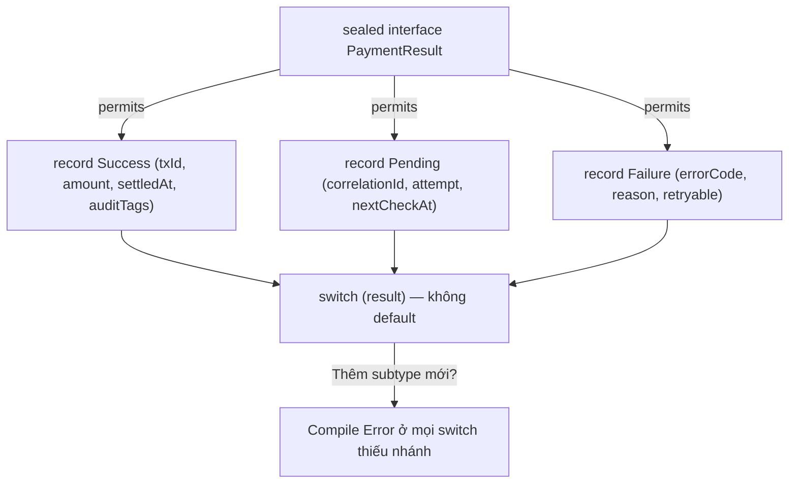

# JVM-02 · Records, Sealed classes, Pattern matching

> **TL;DR** — Java 21 kết hợp `record` (dữ liệu bất biến nông với canonical constructor), `sealed interface` (tập con đóng được JVM kiểm tra qua attribute `PermittedSubclasses`), và Pattern Matching cho `switch` (JEP 440/441) tạo nên phong cách **Data-Oriented Programming (DOP)**. Điểm ăn tiền nhất không phải viết ít dòng hơn, mà là biến các lỗi logic từng chỉ nổ ở runtime (quên nhánh khi thêm trạng thái mới, DTO chứa trạng thái mâu thuẫn, deserialization bỏ qua validate) thành **lỗi biên dịch ngay lúc build**. Khác với Lombok `@Value`, `record` là cấu trúc cấp ngôn ngữ/JVM gọi `ObjectMethods.bootstrap` qua `invokedynamic` và bắt buộc chạy canonical constructor khi deserialize.

## 🧭 Brief

| | |
| :--- | :--- |
| **Loại** | Bài học |
| **Giai đoạn** | Quý 0 · Bridge |
| **Chủ đề** | Java hiện đại & JVM Internals |
| **Tiên quyết** | [JVM-01](../01-java-8-to-21-bridge/README.md) |

**Phạm vi bắt buộc**
- record và immutability
- sealed interface
- pattern matching instanceof/switch
- data-oriented programming

**Câu hỏi sâu — nội dung phải giúp trả lời được**
- Record khác Lombok @Value thế nào?
- Sealed + switch giúp compiler bắt lỗi gì?

**Ý tưởng lab / demo**
- Mô hình hóa kết quả xử lý (Success/Failure/Pending) bằng sealed + switch

**Tài liệu gốc gợi ý**
- JVM Specification
- Effective Java 3rd
- Oracle GC Tuning Guide
- JEP index (openjdk.org/jeps)

**Gói đầu ra**
- [x] `README.md` — lý thuyết theo [lesson-template](../../../docs/templates/lesson-template.md)
- [x] `exercises.md` — bài tập L1/L2/L3 theo [exercises-template](../../../docs/templates/exercises-template.md)
- [x] `solutions.md` — đáp án theo [solutions-template](../../../docs/templates/solutions-template.md)
- [x] `lab/` — code demo chạy được + `lab/README.md` theo [lab-template](../../../docs/templates/lab-template.md)
- [ ] _(người học)_ `my-notes.md` — **agent không tạo**

---

<!-- Nội dung bắt đầu từ đây -->

## 1. Vấn đề: tại sao phải biết cái này?

Trong hệ thống thanh toán hoặc xử lý đơn hàng kiểu cũ, người ta thường gom mọi kết quả vào một class "mega-DTO" chứa hàng chục field nullable:
```java
// status = "SUCCESS" | "PENDING" | "FAILED"
// Nếu status == "FAILED", txId là null còn errorCode != null... nhưng compiler không hề biết!
```
Khi nghiệp vụ thêm trạng thái thứ tư (`EXPIRED` hoặc `DISPUTED`), hai sự cố thực tế hay xảy ra ở production:
1. Một đoạn `switch (resp.getStatus())` hoặc chuỗi `if/else` ở module đối soát cuối ngày có nhánh `default: return "DONE";` → **4% giao dịch hết hạn bị xử lý nhầm thành thành công** mà build vẫn xanh hoàn toàn.
2. Class DTO chỉ validate trong constructor, nhưng khi đọc qua Java serialization hoặc reflection/deserializer không qua constructor, object có `amount = -500` vẫn lọt vào hệ thống.

`record` + `sealed` + `switch` pattern matching giải quyết triệt để hai vấn đề này ở **compile time** và **JVM verification time**.

---

## 2. Mô hình tư duy (mental model)

Hãy hình dung:
- **Mega-DTO truyền thống** giống một **tờ khai giấy có 15 ô trống**: người điền muốn bỏ trống ô bắt buộc hay điền chéo hai ô loại trừ nhau đều nộp được, đến khi kế toán đọc mới phát hiện sai.
- **`sealed interface` + `record` (Sum type + Product type)** giống **3 mẫu phiếu khác màu đóng sẵn khuôn**: phiếu Xanh (`Success`) *chỉ* có `txId + amount + settledAt`, phiếu Vàng (`Pending`) *chỉ* có `correlationId + attempt`, phiếu Đỏ (`Failure`) *chỉ* có `errorCode + retryable`. Không thể tạo ra phiếu "vừa thành công vừa có mã lỗi".
- **`switch` không `default`** giống **máy phân loại phiếu**: nếu bạn thêm mẫu phiếu Tím (`Expired`), máy báo lỗi ngay tại xưởng biên dịch ở mọi điểm chưa biết xử lý phiếu Tím.

**Chỗ ẩn dụ không còn đúng:**
1. Phiếu giấy đóng khuôn là bất biến hoàn toàn, còn **`record` chỉ bất biến nông (shallow immutability)** — nếu một component của `record` là `ArrayList` hoặc `Date`, người giữ reference ngoài vẫn sửa được nội dung bên trong trừ khi bạn copy phòng thủ trong compact constructor.
2. `sealed` khóa danh sách class con trực tiếp, nhưng nếu một class con tự khai báo **`non-sealed`**, nhánh đó lại mở ra cho kế thừa tự do.



---

## 3. Cơ chế bên trong (trọng tâm của bài)

### 3.1 `record` (JEP 395) và Trả lời câu hỏi sâu: "Record khác Lombok `@Value` thế nào?"

Khi viết `public record Point(int x, int y) {}`, trình biên dịch và JVM thực hiện (theo JLS §8.10 và JVMS §4.7.30):
1. Tạo class `public final` tự động kế thừa `java.lang.Record` (nên **không thể `extends` class khác**, nhưng vẫn `implements` interface được).
2. Khai báo các field `private final` tương ứng từng component, accessor cùng tên (`x()`, `y()`, **không** có tiền tố `get`), và **cấm khai báo thêm non-static instance field** (tránh trạng thái ngầm làm gãy định nghĩa *"the state, the whole state, and nothing but the state"*).
3. Ghi metadata **`Record` attribute** vào file `.class`, nhờ đó `Class.isRecord()` và `Class.getRecordComponents()` hoạt động chuẩn ở runtime mà không cần annotation retention.
4. Sinh `equals`, `hashCode`, `toString` không bằng hàng chục dòng bytecode lặp lại như POJO thường, mà bằng lệnh `invokedynamic` gọi `java.lang.runtime.ObjectMethods.bootstrap(...)` — giúp file `.class` nhỏ gọn hơn và JVM tối ưu linh hoạt.
5. **Khác biệt quyết định với Lombok `@Value`:**

| Tiêu chí | Java `record` (JEP 395) | Lombok `@Value` |
| :--- | :--- | :--- |
| **Bản chất** | Tính năng chính thức của ngôn ngữ & JVM (`extends java.lang.Record`) | Annotation processor sinh code POJO lúc compile, phụ thuộc API nội bộ của `javac` |
| **Deserialization (`ObjectInputStream`)** | **Bắt buộc gọi canonical constructor** theo Java Serialization Spec → invariant trong compact constructor luôn được kiểm tra | Dùng cơ chế deserialization thông thường (cấp phát trực tiếp, **bỏ qua constructor** → object sai invariant vẫn lọt qua!) |
| **Bytecode `equals/hashCode/toString`** | `invokedynamic` → `ObjectMethods.bootstrap` | Sinh đầy đủ bytecode so sánh từng field trong mọi class |
| **Bảo toàn bất biến cấu trúc** | Ngôn ngữ **cấm** thêm instance field ngoài component | Dev vẫn có thể vô tình thêm field hoặc gắn `@NonFinal` làm gãy bất biến |
| **Tên getter & hệ sinh thái** | `user.name()` (không `get`); Jackson 2.12+, JUnit, Spring hỗ trợ gốc | `user.getName()` (chuẩn JavaBean cũ cho framework legacy) |
| **Độ bền khi nâng JDK** | Chuẩn JLS, nâng Java 21 → 25 không gãy build | Dễ gãy biên dịch khi nâng JDK mới nếu bản Lombok cũ chưa hỗ trợ AST `javac` mới |

**Cảnh báo immutability nông (shallow immutability):** `record` chỉ giữ reference `final`. Nếu truyền `List<String>` vào `record Success(..., List<String> auditTags)`, caller giữ reference `mutableList.add(...)` vẫn làm thay đổi nội dung bên trong `Success`. Cách chuẩn là dùng **compact constructor**:
```java
public Success {
    auditTags = auditTags == null ? List.of() : List.copyOf(auditTags);
}
```
`List.copyOf` tạo snapshot bất biến (và ném NPE nếu có phần tử `null`).

**Khi nào KHÔNG dùng `record`:** không dùng làm **JPA `@Entity`**. Hibernate/JPA cần class không `final`, có no-arg constructor cho lazy proxy và cần mutable fields cho dirty checking. Hãy dùng `record` cho DTO, API request/response, event payload, config value object, và JPA projection.

### 3.2 `sealed interface` / `sealed class` (JEP 409)

Khai báo `public sealed interface PaymentResult permits Success, Pending, Failure` thiết lập một **hệ phân cấp đóng (closed hierarchy)**:
- Mọi class/interface con trực tiếp phải được liệt kê sau `permits` (nếu viết lồng cùng file như trong `lab/` thì có thể lược bỏ `permits`, compiler tự suy ra các nested subtype).
- Mọi subtype trực tiếp **bắt buộc** chọn đúng 1 trong 3 modifier:
  - `final` (mọi `record` mặc định là `final`),
  - `sealed` (tiếp tục giới hạn đời cháu bằng `permits` riêng),
  - `non-sealed` (mở lại cho bất kỳ class nào kế thừa).
- Ở tầng bytecode, compiler ghi **`PermittedSubclasses` attribute** vào file `.class` (JVMS §4.7.31). JVM kiểm tra attribute này ngay lúc load class con: kể cả có ai viết bytecode lậu để `implements PaymentResult`, JVM cũng từ chối bằng `IncompatibleClassChangeError` nếu không cùng module/package và nằm trong danh sách `permits`.

### 3.3 Pattern Matching (`instanceof` JEP 394, Record Patterns JEP 440, `switch` JEP 441) & Trả lời câu hỏi sâu: "Sealed + switch giúp compiler bắt lỗi gì?"

Trong Java 21, `switch` hỗ trợ kiểm tra kiểu, giải cấu trúc record (record deconstruction), điều kiện `when` (guarded pattern), và `case null`:
```java
return switch (result) {
    case null -> "INVALID_NULL_RESULT";
    case PaymentResult.Success(var txId, var amt, var ignored, var tags)
            when amt.compareTo(HIGH_VALUE) >= 0 -> "HIGH:" + txId;
    case PaymentResult.Success(var txId, var amt, var ignored, var tags) ->
            "NORMAL:" + txId;
    case PaymentResult.Pending(var corrId, var attempt, var next) when attempt >= 3 ->
            "ESCALATE:" + corrId;
    case PaymentResult.Pending(var corrId, var attempt, var next) ->
            "WAIT:" + corrId;
    case PaymentResult.Failure(var code, var reason, var retryable) when retryable ->
            "RETRY:" + code;
    case PaymentResult.Failure(var code, var reason, var ignored) ->
            "FAIL:" + code;
};
```
*(Lưu ý cú pháp Java 21: trong record pattern JEP 440 **không** viết hằng số trực tiếp như `Failure(var code, var reason, true)` — trình biên dịch sẽ báo lỗi `illegal start of type`; phải bind biến `var retryable` rồi lọc bằng `when retryable`.)*

**4 loại lỗi compiler bắt được nhờ `sealed` + `switch`:**
1. **Thiếu nhánh (Exhaustiveness error):** Nếu bỏ `default` và thiếu dù chỉ 1 permitted subtype (hoặc có `when` guard mà thiếu nhánh không guard dự phòng cho subtype đó), compiler chặn ngay: `'switch' expression does not cover all possible input values`. Khi thêm `Timeout` vào `PaymentResult`, mọi `switch` trong toàn codebase tự động báo lỗi biên dịch để bạn không bỏ sót!
2. **Nhánh bị che khuất (Pattern Dominance error):** Nếu đặt `case PaymentResult.Success s -> ...` (unconditional) **trước** `case PaymentResult.Success(...) when ... -> ...`, compiler chặn ngay: `this case label is dominated by a preceding case label`.
3. **Ép kiểm tra `null` / bảo vệ `MatchException`:** Nếu switch qua reference có thể `null` mà không viết `case null -> ...`, JVM ném `NullPointerException` rõ ràng tại cổng `switch`. Với `switch` đã exhaustive trên `sealed`, compiler tự chèn fallback sinh `MatchException` nếu tại runtime gặp mismatch (ví dụ biên dịch rời các jar không đồng bộ phiên bản).
4. **Kiểu giải cấu trúc không khớp (Type mismatch trong Record Pattern):** Nếu sửa kiểu component `attempt` từ `int` sang `long`, compiler bắt mọi chỗ pattern đang ép `int attempt` không tương thích.

### 3.4 Data-Oriented Programming (DOP)

Thay vì nhét hành vi vào từng subclass theo OOP cổ điển (khi thêm 1 thao tác mới phải sửa mọi subclass), DOP áp dụng 4 nguyên tắc (theo Brian Goetz):
1. Mô hình hóa dữ liệu bất biến thuần túy bằng `record` + `sealed`.
2. Đưa mọi trạng thái hợp lệ vào hệ thống kiểu (**make illegal states unrepresentable**).
3. Tách riêng dữ liệu và logic xử lý (stateless functions dùng `switch` pattern matching).
4. Dữ liệu bên ngoài (JSON/DB) phải được validate ngay tại biên bằng compact constructor.

---

## 4. Code minh họa

### 4.1 Mô hình hóa `Success / Pending / Failure` bằng `sealed` + `record` + `switch`

Code đầy đủ nằm ở [PaymentResult.java](./lab/src/main/java/lab/jvm/dop/PaymentResult.java) và [PaymentResultHandler.java](./lab/src/main/java/lab/jvm/dop/PaymentResultHandler.java).

```java
// ❌ SAI (Mega-DTO kiểu cũ): cho phép trạng thái vô nghĩa tồn tại lúc compile
public class LegacyPaymentDto {
    private String status;      // "SUCCESS", "PENDING", "FAILED"
    private String txId;        // null khi FAILED? hay quên gán khi SUCCESS?
    private String errorCode;   // có thể khác null ngay cả khi status == "SUCCESS"!
    private boolean retryable;
}

// ✅ ĐÚNG (DOP với sealed + record): chỉ biểu diễn được trạng thái hợp lệ
public sealed interface PaymentResult permits PaymentResult.Success, PaymentResult.Pending, PaymentResult.Failure {
    record Success(String txId, BigDecimal amount, Instant settledAt, List<String> auditTags) implements PaymentResult {
        public Success {
            if (amount == null || amount.signum() <= 0) throw new IllegalArgumentException("amount must be positive");
            auditTags = auditTags == null ? List.of() : List.copyOf(auditTags);
        }
    }
    record Pending(String correlationId, int attempt, Instant nextCheckAt) implements PaymentResult {}
    record Failure(String errorCode, String reason, boolean retryable) implements PaymentResult {}
}
```

### 4.2 Ví dụ SAI vs ĐÚNG khi viết `switch` trên `sealed`

```java
// ❌ SAI 1: Thêm `default` vào switch trên sealed interface -> triệt tiêu kiểm tra exhaustiveness khi thêm subtype mới!
String msg = switch (result) {
    case PaymentResult.Success s -> "OK";
    default -> "OTHER"; // Thêm Timeout sau này -> compiler im lặng, rơi vào "OTHER"!
};

// ❌ SAI 2: Đặt pattern tổng quát trước pattern có `when` -> lỗi biên dịch "dominated"
String tier = switch (result) {
    case PaymentResult.Success s -> "NORMAL";
    case PaymentResult.Success(var id, var amt, var t, var tags) when amt.signum() > 100 -> "HIGH"; // COMPILE ERROR!
    ...
};

// ❌ SAI 3: Viết constant literal trong record pattern (chưa hỗ trợ ở Java 21)
// case PaymentResult.Failure(var code, var msg, true) -> ...  // COMPILE ERROR: illegal start of type

// ✅ ĐÚNG: Không dùng default, pattern hẹp (có `when`) đặt TRƯỚC pattern rộng
case PaymentResult.Failure(var code, var msg, var retryable) when retryable -> ...
case PaymentResult.Failure(var code, var msg, var ignored) -> ...
```

### 4.3 Legacy corner (Java 7 / JBoss AS 7.1.1)

Trên Java 7 / JBoss AS 7.1.1 chưa có `record` hay `sealed`, nhưng bạn có thể áp dụng tinh thần của bài ngay hôm nay:
1. Viết `public final class` với mọi field `private final`, copy phòng thủ `Collections.unmodifiableList(new ArrayList<String>(tags))` trong constructor, và validate invariant ngay đầu constructor.
2. Nếu class `implements Serializable`, tự viết `private void readObject(ObjectInputStream in)` để gọi lại logic validate (bù cho điểm yếu của POJO Java 7 khi deserialize!).
3. Tránh dùng `default:` nuốt lỗi trong `switch (enum)` — đặt `throw new AssertionError("Unhandled state: " + state)` ở `default` để nếu thiếu nhánh khi thêm giá trị enum mới, test/runtime nổ ngay lập tức thay vì trả kết quả sai âm thầm.

---

## 5. Quan sát & đo đạc

Chạy lab và kiểm tra thuộc tính JVM bằng `javap`:
```powershell
mvn -q verify
mvn -q compile exec:java
javap -v -p target/classes/lab/jvm/dop/PaymentResult.class
javap -c -p target/classes/lab/jvm/dop/PaymentResult`$Success.class
```

**Output thật ghi nhận từ bytecode (`JDK 26.0.1 --release 21`):**
```text
PermittedSubclasses:
  lab/jvm/dop/PaymentResult$Success
  lab/jvm/dop/PaymentResult$Pending
  lab/jvm/dop/PaymentResult$Failure

Compiled from "PaymentResult.java"
public final class lab.jvm.dop.PaymentResult$Success extends java.lang.Record implements lab.jvm.dop.PaymentResult {
  private final java.lang.String txId;
  private final java.math.BigDecimal amount;
  ...
  public lab.jvm.dop.PaymentResult$Success(java.lang.String, java.math.BigDecimal, java.time.Instant, java.util.List<java.lang.String>);
    Code:
         0: aload_0
         1: invokespecial #1  // Method java/lang/Record."<init>":()V
         ...
        66: invokestatic  #42 // InterfaceMethod java/util/List.copyOf:(Ljava/util/Collection;)Ljava/util/List;
```

Và trong test deserialization (`DopComparisonTest`), khi sửa 1 số `int` trong byte stream từ `10` thành `-5`:
- `PositiveRecord`: `ObjectInputStream` gọi canonical constructor và ném `InvalidObjectException: value must be > 0`.
- `PositivePojo`: `ObjectInputStream` **bỏ qua constructor**, trả về object có `value == -5` dù constructor đã chặn `value <= 0`.

---

## 6. Trade-offs & khi nào KHÔNG dùng

| Lựa chọn | Được gì | Mất gì | Dùng khi |
| :--- | :--- | :--- | :--- |
| **`record`** vs POJO / Lombok `@Value` | Chuẩn ngôn ngữ, deserialization an toàn qua constructor, bytecode gọn | Không kế thừa class khác, không có setter/mutable state | DTO, Value Object, Event, Projection, Config |
| **DOP (`sealed` + `switch`)** vs OOP đa hình (abstract method trên interface) | Dễ thêm **operation mới** mà không sửa các class dữ liệu; compiler kiểm tra đủ nhánh | Khi thêm **subtype mới**, phải cập nhật mọi `switch` (nhưng chính đó là bảo vệ compile-time!) | Tập subtype cố định/ít đổi (kết quả API, AST, state event), nhiều hàm xử lý bên ngoài |
| **`sealed`** vs `non-sealed` / `interface` mở | Khóa tập con, hỗ trợ exhaustive `switch` | Module/package ngoài không thể tự thêm implementation (trừ khi đánh dấu `non-sealed`) | Domain model nội bộ cần kiểm soát chặt các biến thể |

---

## 7. Cạm bẫy production (ít nhất 3)

1. **Nhét `record` làm JPA `@Entity`** — *Triệu chứng:* Hibernate ném `InstantiationException` / không tạo được lazy proxy hoặc mất dirty-tracking. *Nguyên nhân:* `record` là `final`, mọi field `private final`, không có no-arg constructor. *Cách tránh:* giữ `@Entity` là class thường (hoặc package-private no-arg constructor), chỉ map kết quả query sang `record` bằng constructor expression (`SELECT new pkg.SummaryDto(...)`).
2. **Tin rằng `record` bất biến tuyệt đối khi chứa `List` / `Map` / `Date`** — *Triệu chứng:* dữ liệu bên trong record bị đổi sau khi đã qua validate hoặc ném `ConcurrentModificationException`. *Nguyên nhân:* `record` chỉ giữ reference `final` (shallow immutability). *Cách tránh:* luôn dùng `List.copyOf(...)` / `Map.copyOf(...)` trong compact constructor và tránh đặt kiểu mutable như `Date`, `byte[]` làm component.
3. **Viết `default ->` trong `switch` trên `sealed` interface** — *Triệu chứng:* thêm biến thể mới vào `sealed interface` nhưng build vẫn xanh và runtime rơi nhầm vào nhánh `default`. *Nguyên nhân:* `default` làm compiler coi mọi nhánh đã được phủ. *Cách tránh:* liệt kê tường minh toàn bộ subtype của `sealed` interface, không dùng `default`.
4. **Dùng `switch (result)` quên `case null ->` khi nguồn dữ liệu có thể trả `null`** — *Triệu chứng:* nổ `NullPointerException` ngay đầu `switch`. *Nguyên nhân:* Java `switch` trên reference type giữ nguyên quy ước ném NPE nếu selector là `null` và không có `case null`. *Cách tránh:* luôn thêm `case null -> ...` hoặc đảm bảo đầu vào non-null (trả `Optional<PaymentResult>` trước khi `switch`).

---

## 8. Liên hệ thực tế công việc

Ngay trên hệ thống legacy **Java 7 / JBoss AS 7.1.1**, mỗi lần đọc hoặc review một DTO trả về từ service/JDBC có hơn 5 trường nullable đi kèm một cờ `status` hoặc `type`:
1. Hãy liệt kê trên giấy (hoặc trong ADR/PR comment) các trường hợp kết hợp vô nghĩa đang được phép tồn tại (ví dụ `status=FAILED` nhưng `txId != null`).
2. Áp dụng thói quen "tách nhánh `switch` rõ ràng không dùng `default` nuốt lỗi" cho các `enum` hiện tại trong project để bất kỳ enum value mới nào cũng lộ ra ngay trong test.

---

## 9. Self-check — Explain-back

> Trả lời **không nhìn tài liệu**, nói to trong 5 phút. Không trả lời được = chưa xong. (Đáp án nằm trong [solutions.md](./solutions.md).)

1. Nêu 3 điểm khác biệt kỹ thuật giữa Java `record` và Lombok `@Value` (về deserialization, bytecode và giới hạn kế thừa/field).
2. "Shallow immutability" trong `record` nghĩa là gì và compact constructor xử lý nó như thế nào?
3. Vì sao không nên dùng `record` làm JPA `@Entity`? Khi nào nên dùng `record` với JPA?
4. Ba modifier hợp lệ cho subtype trực tiếp của `sealed` là gì, và JVM lưu danh sách `permits` ở đâu trong file `.class`?
5. Khi kết hợp `sealed interface` + `switch` expression (không `default`), compiler bắt được những loại lỗi nào ngay lúc build?

---

## 10. Cheatsheet 1 trang

| Khái niệm | Cú pháp Java 21 | Điểm nhớ nhanh |
| :--- | :--- | :--- |
| **`record`** | `record Money(BigDecimal amt, String ccy) { public Money { ... } }` | Implicitly `final`, extends `Record`; dùng compact constructor để validate & `List.copyOf` |
| **`sealed`** | `sealed interface Res permits A, B {}` | Subtype phải là `final`, `sealed`, hoặc `non-sealed` (cùng module/package); JVM check `PermittedSubclasses` |
| **Pattern `instanceof`** | `if (o instanceof String s && !s.isBlank())` | Biến `s` chỉ sống trong scope chắc chắn khớp |
| **Record pattern + `when`** | `case Failure(var c, var m, var retry) when retry -> ...` | Pattern hẹp (có `when`) phải đứng **trước** pattern rộng; Java 21 không viết literal trong record pattern |
| **Null trong `switch`** | `case null -> ...` | Mặc định ném NPE nếu không có `case null` |
| **Exhaustive `switch`** | Không viết `default` trên `sealed` | Thêm subtype mới → compiler báo mọi chỗ cần cập nhật |

---

## 11. Tài liệu tham khảo

- [JEP 395: Records](https://openjdk.org/jeps/395) — đặc tả `record`, compact constructor và quy tắc deserialization.
- [JEP 409: Sealed Classes](https://openjdk.org/jeps/409) — `sealed`, `permits`, `non-sealed` và `PermittedSubclasses`.
- [JEP 394: Pattern Matching for `instanceof`](https://openjdk.org/jeps/394) — flow scoping của pattern variable.
- [JEP 440: Record Patterns](https://openjdk.org/jeps/440) — giải cấu trúc `record` trong Java 21.
- [JEP 441: Pattern Matching for `switch`](https://openjdk.org/jeps/441) — guarded pattern (`when`), dominance, exhaustiveness và `case null` trong Java 21.
- [Java Language Specification SE 21 (§8.10, §14.11.1, §14.30)](https://docs.oracle.com/javase/specs/jls/se21/html/index.html) — đặc tả ngôn ngữ chính thức.
- Brian Goetz, [Data-Oriented Programming in Java](https://www.infoq.com/articles/data-oriented-programming-java/) — tư duy thiết kế DOP với `record` + `sealed` + `switch`.

---
➡️ Tiếp theo: [exercises.md](./exercises.md) · [lab/](./lab/README.md) · Bài kế: [JVM-03 · Class loading & ClassLoader hierarchy](../03-class-loading/README.md)
