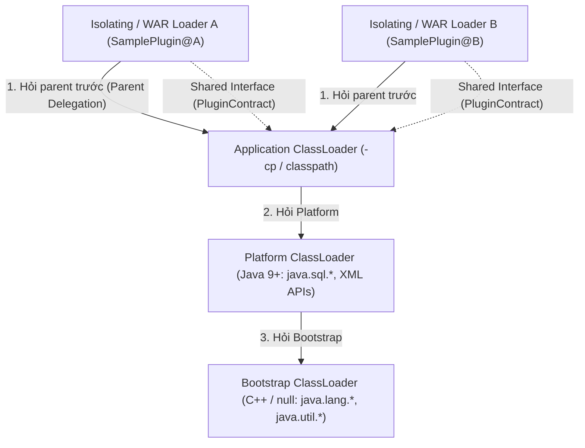

# JVM-03 · Class loading & ClassLoader hierarchy

> **TL;DR** — Một class trong JVM không chỉ được định danh bằng tên đầy đủ (`com.app.Order`), mà bằng cặp **`(ClassLoader, BinaryName)`** (JVMS §5.3). Nạp một file `.class` qua 2 `ClassLoader` khác nhau tạo ra 2 `Class<?>` hoàn toàn tách biệt trong Metaspace — không cast được cho nhau và mỗi bản có bộ biến `static` riêng. Trong khi JDK dùng mô hình phân cấp **Parent Delegation** (`Bootstrap → Platform → Application`), **JBoss Modules** trên JBoss AS 7.1.1 dùng đồ thị module tách biệt (`module.xml`) để cô lập dependency giữa server và các WAR/EAR. Hiểu vòng đời *Loading → Linking → Initialization* cũng giải thích rõ sự khác nhau giữa `ClassNotFoundException` và `NoClassDefFoundError`.

## 🧭 Brief

| | |
| :--- | :--- |
| **Loại** | Bài học |
| **Giai đoạn** | Năm 1 · Q1 |
| **Chủ đề** | Java hiện đại & JVM Internals |
| **Tiên quyết** | [JVM-02](../02-records-sealed-pattern-matching/README.md) |

**Phạm vi bắt buộc**
- loading/linking/initialization
- parent delegation
- context classloader
- app server (JBoss modules) classloading
- ClassNotFoundException vs NoClassDefFoundError

**Câu hỏi sâu — nội dung phải giúp trả lời được**
- Vì sao 2 class cùng tên ở 2 classloader không cast được cho nhau?
- JBoss modules khác classpath phẳng thế nào?

**Ý tưởng lab / demo**
- Custom ClassLoader load cùng 1 class 2 lần, chứng minh 2 Class object khác nhau

**Tài liệu gốc gợi ý**
- JVM Specification
- Effective Java 3rd
- Oracle GC Tuning Guide
- JEP index (openjdk.org/jeps)

**Gói đầu ra**
- [x] `README.md` — lý thuyết theo [lesson-template](../../../docs/templates/lesson-template.md)
- [x] `exercises.md` — bài tập L1/L2/L3 theo [exercises-template](../../../docs/templates/exercises-template.md)
- [x] `solutions.md` — đáp án theo [solutions-template](../../../docs/templates/solutions-template.md)
- [x] `lab/` — code demo chạy được + `lab/README.md` theo [lab-template](../../../docs/templates/lab-template.md)
- [ ] _(người học)_ `my-notes.md` — **agent không tạo**

---

<!-- Nội dung bắt đầu từ đây -->

## 1. Vấn đề: tại sao phải biết cái này?

Trong môi trường production chạy app server (như **JBoss AS 7.1.1** hoặc Tomcat) hoặc hệ thống plugin/hot-reload, hai sự cố kinh điển liên tục xuất hiện:
1. Deploy file WAR lên JBoss AS 7.1.1 bỗng nổ `ClassCastException: com.company.Dto cannot be cast to com.company.Dto` — hai bên rõ ràng **cùng một tên class**! Hoặc đụng `NoSuchMethodError` vì JBoss nạp bản `jackson` / `guava` cũ trong server thay vì bản bạn đóng trong `WEB-INF/lib`.
2. Lúc khởi động app thấy 1 dòng `ExceptionInInitializerError` bị nuốt trong log đầu tiên, nhưng sau đó hàng nghìn request tiếp theo đồng loạt báo `NoClassDefFoundError: Could not initialize class com.company.ConfigHolder` dù file `.class` vẫn nằm nguyên trong JAR!

Nếu không hiểu vòng đời Class Loading, Parent Delegation, TCCL và JBoss Modules, bạn chỉ có thể đoán mò bằng cách xóa thư viện ngẫu nhiên.

---

## 2. Mô hình tư duy (mental model)

Hãy xem **`ClassLoader` như một "quốc gia" cấp hộ chiếu cho từng class**:
- File `.class` chỉ là bản photo hồ sơ.
- Khi "quốc gia A" (`loaderA`) và "quốc gia B" (`loaderB`) cùng đọc một bản photo `SamplePlugin.class` và gọi `defineClass`, hai thực thể sinh ra trong JVM là **2 công dân thuộc 2 không gian định danh khác nhau** `(loaderA, SamplePlugin)` vs `(loaderB, SamplePlugin)`.
- Trong mô hình **Parent Delegation**, công dân luôn hỏi "cấp trên" (Bootstrap → Platform → Application) trước xem cấp trên đã có sẵn hộ chiếu chưa — chỉ khi cấp trên lắc đầu thì cấp dưới mới tự cấp. Điều này bảo vệ để không ai tự viết giả `java.lang.String` lọt vào JVM.

**Chỗ ẩn dụ không còn đúng:**
Trong ứng dụng web/JBoss Modules hoặc OSGi, cây phân cấp cha-con cứng nhắc không đủ: `DriverManager` (nằm ở `Platform`/`Bootstrap`) cần nạp driver PostgreSQL/Oracle nằm ở `Application`/`WAR` (tầng dưới) → buộc phải vòng ngược xuống qua **Thread Context ClassLoader (TCCL)**. Và JBoss Modules phá bỏ cây cha-con đơn tuyến để chuyển sang **đồ thị module có hướng**.



---

## 3. Cơ chế bên trong (trọng tâm của bài)

### 3.1 Vòng đời 3 pha: Loading → Linking → Initialization (JVMS §5)

1. **Loading:** Tìm mảng byte nhị phân (`.class` từ JAR/file/network) theo binary name và gọi `ClassLoader.defineClass(...)` tạo cấu trúc đại diện class trong **Metaspace** cùng một object `java.lang.Class<?>` trên Heap. *(Lưu ý: `Class.forName(name, false, loader)` chỉ chạy tới pha này, chưa chạy khối `static {}`!)*
2. **Linking** (gồm 3 bước nhỏ):
   - **Verification:** kiểm tra file `.class` hợp lệ chuẩn bytecode (magic number `0xCAFEBABE`, stack map frames, không tràn operand stack, tuân thủ `PermittedSubclasses` của `sealed` class).
   - **Preparation:** cấp phát bộ nhớ cho các biến **`static` của class và gán giá trị mặc định 0/null/false** (chưa gán giá trị khởi tạo thật! Ví dụ `static int x = 42;` ở pha Preparation `x` bằng `0`, trừ `static final` hằng số compile-time được điền ngay từ `ConstantValue`).
   - **Resolution:** biến các symbolic reference trong Constant Pool (tên class/method dạng chuỗi) thành tham chiếu trực tiếp tới bộ nhớ runtime (có thể làm eager hoặc lazy lúc thực thi lệnh gọi đầu tiên).
3. **Initialization (`<clinit>`):** Chạy duy nhất 1 lần (được JVM đồng bộ thread-safe) khi có **active use** đầu tiên (`new`, gọi `static` method, đọc/ghi non-constant `static` field, `Class.forName(name, true, ...)`). JVM chạy các gán biến `static` và khối `static { ... }` theo đúng thứ tự từ trên xuống dưới.

### 3.2 Parent Delegation & Trả lời câu hỏi sâu #1: "Vì sao 2 class cùng tên ở 2 classloader không cast được cho nhau?"

Theo **JVMS §5.3 (Creation and Loading)**, mỗi class tại runtime được xác định duy nhất bởi bộ đôi:
$$\text{Runtime Identity} = (\text{Defining ClassLoader}, \text{Binary Name})$$

Khi `loaderA` và `loaderB` đều tự gọi `defineClass("lab.jvm.classloading.SamplePlugin", bytes, ...)`:
- JVM tạo ra **2 bảng method & dữ liệu class riêng biệt trong Metaspace** và 2 thực thể `Class<?>` khác nhau (`classA != classB`).
- Mỗi bản sở hữu **bộ biến `static` độc lập hoàn toàn** (trong lab: `STATIC_INIT_COUNTER` của cả `instanceA` và `instanceB` đều in `initCount=1` riêng biệt!).
- Khi bạn ép `(SamplePlugin) instanceA` trong code chạy bởi `AppClassLoader`, lệnh bytecode `checkcast` kiểm tra thực thể runtime của `instanceA` (`(loaderA, SamplePlugin)`) với kiểu đích (`(AppClassLoader, SamplePlugin)`). Hai cặp này khác `Defining ClassLoader` → JVM ném **`ClassCastException`** kèm thông báo rõ ràng tên 2 loader khác nhau!
- **Cách giao tiếp hợp lệ giữa 2 loader:** Đưa một interface chung (`PluginContract`) lên **parent ClassLoader chung** (`AppClassLoader`) và ép kiểu về `PluginContract` thay vì class implementation `SamplePlugin`.

### 3.3 Thread Context ClassLoader (TCCL)

Parent Delegation chỉ cho phép con nhìn thấy cha, **không cho phép cha nhìn thấy con**. Thế nhưng `java.sql.DriverManager` (nằm ở **Platform ClassLoader**) lại cần nạp `com.mysql.cj.jdbc.Driver` hoặc `org.postgresql.Driver` (nằm ở **Application ClassLoader** hoặc bên trong **WAR ClassLoader**!).
Giải pháp của Java từ JDBC/JNDI là **Thread Context ClassLoader**:
- Mỗi thread mang một tham chiếu `Thread.currentThread().getContextClassLoader()` (mặc định kế thừa từ thread cha, thường là `AppClassLoader` hoặc được JBoss/Tomcat tạm đổi thành `WebAppClassLoader` khi xử lý request vào WAR).
- Code trong thư viện cha gọi `ServiceLoader.load(..., Thread.currentThread().getContextClassLoader())` để "lách" xuống nạp class ở tầng ứng dụng.
- **Cảnh báo rò rỉ:** Nếu code của bạn tự tạo thread mới hoặc đổi TCCL mà quên trả lại trong `finally`, hoặc thread pool giữ tham chiếu TCCL của WAR cũ, đó chính là nguyên nhân gốc gây **Metaspace ClassLoader Leak** khi redeploy (xem `JVM-10` và `INC-08`)!

### 3.4 Trả lời câu hỏi sâu #2: "JBoss Modules khác classpath phẳng thế nào?"

| Tiêu chí | Classpath phẳng (`java -cp a.jar:b.jar`) | JBoss Modules (`JBoss AS 7.1.1+` / WildFly) |
| :--- | :--- | :--- |
| **Cách tìm class** | Quét tuyến tính từ trái sang phải theo danh sách JAR | Mỗi module có `module.xml` và **`ModuleClassLoader` riêng**, tạo **đồ thị phụ thuộc (DAG)** |
| **Cô lập thư viện** | **Không cô lập:** mọi class thấy hết mọi JAR trên `-cp`; 2 bản `guava-18` & `guava-32` đụng nhau âm thầm | **Cô lập chặt:** Module A không thấy class của Module B trừ khi khai báo `<module name="..." slot="..."/>` |
| **Xung đột version** | Bản đứng trước thắng ngầm → nổ `NoSuchMethodError` ở runtime | Hai WAR khác nhau có thể dùng 2 phiên bản thư viện khác nhau (hoặc tắt module server bằng `jboss-deployment-structure.xml`) |
| **Tốc độ tìm class** | Chậm khi hàng trăm JAR ($O(n)$ scan nếu thiếu index) | Nhanh ($O(1)$ tra bảng các dependency trực tiếp được import) |

Trên **JBoss AS 7.1.1**, thứ tự ưu tiên nạp class mặc định cho mỗi WAR deployment là:
1. Các module hệ thống bắt buộc & API Java EE (`javax.*`, `java.*`)
2. Các dependency khai báo trong `META-INF/MANIFEST.MF` (`Dependencies: ...`) hoặc `WEB-INF/jboss-deployment-structure.xml`
3. Class nội bộ của WAR (`WEB-INF/classes` và `WEB-INF/lib/*.jar`) — khác với Tomcat mặc định ưu tiên `WEB-INF` trước cho non-JDK classes.

### 3.5 `ClassNotFoundException` vs `NoClassDefFoundError`

| Tiêu chí | `ClassNotFoundException` (Checked Exception) | `NoClassDefFoundError` (Error) |
| :--- | :--- | :--- |
| **Xảy ra khi nào** | Pha **Loading** khi nạp **động** bằng tên chuỗi (`Class.forName(...)`, `ClassLoader.loadClass(...)`) mà không tìm thấy file `.class` | Có 2 nguyên nhân ở runtime: (1) Lúc compile có class đó, nhưng lúc chạy file `.class`/JAR bị thiếu ở pha Linking/Resolution; **(2) Rất hay gặp:** Khối `static {}` (`<clinit>`) từng nổ **`ExceptionInInitializerError`** ở lần dùng đầu → JVM đánh dấu class là *erroneous*, mọi lần chạm tiếp theo đều ném **`NoClassDefFoundError: Could not initialize class ...`**! |
| **Mức độ** | `Exception` (caller có thể bắt & xử lý plugin tùy chọn) | `Error` (hỏng cấu trúc runtime hoặc hỏng static init, app không tiếp tục dùng class đó được) |

---

## 4. Code minh họa

### 4.1 Nạp cùng 1 class bằng 2 `ClassLoader` & chia sẻ qua `PluginContract`

Trích đoạn từ [ClassLoadingLabRunner.java](./lab/src/main/java/lab/jvm/classloading/ClassLoadingLabRunner.java):
```java
byte[] pluginBytes = IsolatingClassLoader.readClassBytes(SamplePlugin.class);
var loaderA = new IsolatingClassLoader("plugin-loader-A", SamplePlugin.class.getName(), pluginBytes, appLoader);
var loaderB = new IsolatingClassLoader("plugin-loader-B", SamplePlugin.class.getName(), pluginBytes, appLoader);

Class<?> classA = loaderA.loadClass(SamplePlugin.class.getName());
Class<?> classB = loaderB.loadClass(SamplePlugin.class.getName());
Object instanceA = classA.getDeclaredConstructor().newInstance();

// ❌ SAI: Cast trực tiếp sang SamplePlugin (nạp bởi AppClassLoader) -> ClassCastException!
// SamplePlugin p = (SamplePlugin) instanceA;

// ✅ ĐÚNG: Giao tiếp qua Interface chung nằm ở Parent ClassLoader
PluginContract p = (PluginContract) instanceA;
```

### 4.2 Legacy corner (Java 7 / JBoss AS 7.1.1)

Trên **JBoss AS 7.1.1** (vốn đã chạy JBoss Modules 1.1.x!):
1. Khi WAR của bạn đóng sẵn một phiên bản thư viện trong `WEB-INF/lib/` (như Log4j/SLF4J/Jackson/Apache HttpClient) bị xung đột với module tích hợp sẵn của JBoss AS 7, tạo file `WEB-INF/jboss-deployment-structure.xml` với `<exclusions><module name="..."/></exclusions>` để chặn JBoss nạp bản cũ của server vào WAR.
2. Khi gọi `Class.forName("oracle.jdbc.OracleDriver")` hay tạo `InitialContext` trong code cũ: đừng giữ `Thread.currentThread().setContextClassLoader(...)` mà quên `try { ... } finally { currentThread.setContextClassLoader(old); }` — nếu quên, sau khi redeploy WAR trên JBoss, thread pool vẫn bám giữ `ModuleClassLoader` cũ làm rò rỉ PermGen/Metaspace!

---

## 5. Quan sát & đo đạc

Chạy lab kiểm chứng toàn bộ các pha class loading và lỗi casting chéo loader:
```powershell
mvn -q verify
mvn -q compile exec:java
```

**Output thật ghi nhận từ `ClassLoadingLabRunner` (JDK 26.0.1 `--release 21`):**
```text
[2] Same binary name, two isolated ClassLoaders:
  classA == classB ? false
  classA.isInstance(instanceB) ? false
  instanceA -> SamplePlugin@1686767850[loader=plugin-loader-A, initCount=1]: hello
  instanceB -> SamplePlugin@1392649607[loader=plugin-loader-B, initCount=1]: hello
  Cross-loader cast failed as expected: class lab.jvm.classloading.SamplePlugin cannot be cast to class lab.jvm.classloading.SamplePlugin (lab.jvm.classloading.SamplePlugin is in unnamed module of loader 'plugin-loader-A' @574c1e72; lab.jvm.classloading.SamplePlugin is in unnamed module of loader org.codehaus.mojo.exec.URLClassLoaderBuilder$ExecJavaClassLoader @524f5ea5)

[4] ClassNotFoundException vs NoClassDefFoundError:
  ClassNotFoundException -> lab.jvm.classloading.DoesNotExist
  1st reference to BrokenStaticInit -> ExceptionInInitializerError: Simulated missing config during <clinit>
  2nd reference to BrokenStaticInit -> NoClassDefFoundError: Could not initialize class lab.jvm.classloading.BrokenStaticInit
```
*(Chú ý thêm: bạn có thể thêm JVM flag `-Xlog:class+load=info` khi chạy `java` để xem từng class được nạp từ module/JAR nào theo thứ tự thời gian.)*

---

## 6. Trade-offs & khi nào KHÔNG dùng

| Cơ chế | Được gì | Mất gì | Dùng khi |
| :--- | :--- | :--- | :--- |
| **Parent Delegation (mặc định JDK)** | Bảo vệ core JDK, tránh nạp trùng class nền tảng | Khó cô lập 2 phiên bản thư viện khác nhau trong cùng JVM | Ứng dụng Java độc lập thông thường |
| **Child-first / Modular ClassLoader (JBoss Modules / WAR)** | Cô lập dependency, cho phép plugin/WAR dùng version riêng | Dễ đụng `ClassCastException` nếu chia sẻ DTO qua ranh giới loader mà không đặt interface ở parent | App server, hệ thống plugin, multi-tenant container |
| **Custom `ClassLoader` tự viết** | Hot-reload hoặc sandbox plugin | Dễ gây ClassLoader leak (giữ reference không GC được khỏi Metaspace) nếu quên đóng/giải phóng | Chỉ khi thực sự cần plugin động; ưu tiên dùng module system chuẩn |

---

## 7. Cạm bẫy production (ít nhất 3)

1. **Bỏ qua lỗi `ExceptionInInitializerError` đầu tiên trong log rồi chỉ đọc `NoClassDefFoundError` phía sau** — *Triệu chứng:* hàng nghìn log báo `NoClassDefFoundError: Could not initialize class X` khiến dev tưởng thiếu file JAR. *Nguyên nhân:* `static {}` của class `X` bị lỗi (thiếu biến môi trường, sai cấu hình) ở lần gọi đầu, đánh dấu `X` hỏng vĩnh viễn cho tới khi restart JVM. *Cách tránh:* luôn grep ngược lên log đầu tiên lúc mới khởi động app để tìm `ExceptionInInitializerError` và `Caused by:`.
2. **Đặt nhầm cùng 1 thư viện ở cả Server/Parent Loader lẫn `WEB-INF/lib` của WAR** — *Triệu chứng:* `ClassCastException: A cannot be cast to A` hoặc `LinkageError: loader constraint violation`. *Nguyên nhân:* một class truyền qua ranh giới giữa module server và WAR bị nạp bởi 2 `ClassLoader` khác nhau. *Cách tránh:* đánh dấu `<scope>provided</scope>` trong Maven đối với các API server cung cấp (Servlet API, JPA API, JDBC driver JNDI) hoặc cấu hình exclusion trong `jboss-deployment-structure.xml`.
3. **Tin rằng `Class.forName("...")` hoặc `getstatic` trên hằng số `static final` hoạt động giống nhau** — *Triệu chứng:* đọc `Config.VERSION` (`static final String`) không kích hoạt khối `static {}` của `Config`. *Nguyên nhân:* hằng số compile-time (`ConstantValue`) được compiler inline trực tiếp vào class gọi ở pha compile/Preparation, **không** phải active use kích hoạt `<clinit>`. *Cách tránh:* không đặt side-effect khởi tạo quan trọng trong `static {}` nếu người dùng có thể chỉ đọc hằng số.

---

## 8. Liên hệ thực tế công việc

Ngay tuần này trên hệ thống **JBoss AS 7.1.1**:
1. Kiểm tra `pom.xml` của WAR xem có thư viện nào trùng với JBoss (ví dụ `servlet-api`, `jta`, `hibernate-jpa`, `slf4j-api`, `log4j`) nhưng đang để mặc định `compile` thay vì `<scope>provided</scope>` không.
2. Mở xem file `WEB-INF/jboss-deployment-structure.xml` (nếu có) hoặc `standalone.xml` phần `<global-modules>` để hiểu rõ WAR hiện tại đang dùng module nào của JBoss.

---

## 9. Self-check — Explain-back

> Trả lời **không nhìn tài liệu**, nói to trong 5 phút. Không trả lời được = chưa xong. (Đáp án nằm trong [solutions.md](./solutions.md).)

1. Nêu 3 pha chính của vòng đời class trong JVM (*Loading → Linking → Initialization*) và biến `static int count = 5;` có giá trị là bao nhiêu ở bước Preparation vs Initialization?
2. Giải thích vì sao 2 class có cùng binary name được nạp bởi 2 `ClassLoader` khác nhau lại không cast được cho nhau và có biến `static` độc lập.
3. Parent Delegation hoạt động theo thứ tự nào, và tại sao `java.sql.DriverManager` cần tới **Thread Context ClassLoader (TCCL)**?
4. JBoss Modules khác classpath phẳng của `java -cp` ở những điểm cốt lõi nào?
5. Phân biệt `ClassNotFoundException` và `NoClassDefFoundError` (nhấn mạnh nguyên nhân thứ hai từ `<clinit>`).

---

## 10. Cheatsheet 1 trang

| Khái niệm | Điểm cốt lõi cần nhớ |
| :--- | :--- |
| **Runtime Class Identity** | `(Defining ClassLoader, Binary Name)` — khác loader = khác `Class<?>` & khác `static` state |
| **Loading → Linking → Init** | Loading (`defineClass`) → Linking (`Verify` → `Prepare` gán default 0/null → `Resolve`) → Init (`<clinit>`) |
| **Parent Delegation** | Child hỏi Parent (`App → Platform → Bootstrap`) trước khi tự nạp; bảo vệ core `java.*` |
| **TCCL** | `Thread.currentThread().getContextClassLoader()` giúp SPI tầng cha (`DriverManager`) nạp driver tầng dưới |
| **JBoss Modules** | Đồ thị phụ thuộc có hướng qua `module.xml` + `ModuleClassLoader` cô lập từng module (khác `-cp` phẳng) |
| **`ClassNotFound` vs `NoClassDef`** | `ClassNotFoundException` = nạp động theo tên không thấy file; `NoClassDefFoundError` = thiếu lúc chạy hoặc do `<clinit>` từng nổ `ExceptionInInitializerError` |

---

## 11. Tài liệu tham khảo

- [Java Virtual Machine Specification SE 21 — Chapter 5: Loading, Linking, and Initializing](https://docs.oracle.com/javase/specs/jvms/se21/html/jvms-5.html) — đặc tả chuẩn định danh classloader, verification, preparation, initialization.
- [Java SE 21 API — `java.lang.ClassLoader`](https://docs.oracle.com/en/java/javase/21/docs/api/java.base/java/lang/ClassLoader.html) — quy trình `loadClass` và parallel-capable class loaders.
- [JBoss AS 7.1 Class Loading Documentation](https://docs.jboss.org/author/display/AS71/Class%20Loading%20in%20AS7.html) — kiến trúc JBoss Modules, thứ tự ưu tiên nạp class và `jboss-deployment-structure.xml`.

---
➡️ Tiếp theo: [exercises.md](./exercises.md) · [lab/](./lab/README.md) · Bài kế: [JVM-04 · JVM Memory: Heap, Stack, Metaspace, Direct memory](../04-jvm-memory-areas/README.md)
