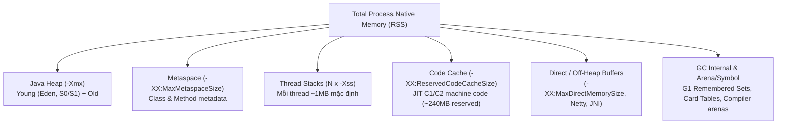

# JVM-04 · JVM Memory: Heap, Stack, Metaspace, Direct memory

> **TL;DR** — `-Xmx2g` chỉ giới hạn **Heap**, không giới hạn toàn bộ bộ nhớ process Java (RSS). Phần bộ nhớ ngoài Heap (*off-heap / native memory*) gồm **Thread Stacks** (`N × -Xss`), **Metaspace**, **Code Cache** (JIT), **GC metadata** (G1 Remembered Sets/Card Tables), và **Direct Buffers** (`ByteBuffer.allocateDirect` / Netty), có thể đẩy RSS lên `4 GB` và làm container bị OOMKilled dù Heap mới dùng 60%. Ở mức từng đối tượng, một `Integer` trên HotSpot 64-bit (Compressed Oops) tốn **16 bytes** (`12B` header + `4B` int) — gấp 4× kiểu nguyên thủy `int` (`4B`), và một mảng `Integer[1000]` tốn **20.016 bytes** (**5,0×** so với `4.016 bytes` của `int[1000]`).

## 🧭 Brief

| | |
| :--- | :--- |
| **Loại** | Bài học |
| **Giai đoạn** | Năm 1 · Q1 |
| **Chủ đề** | Java hiện đại & JVM Internals |
| **Tiên quyết** | [JVM-03](../03-class-loading/README.md) |

**Phạm vi bắt buộc**
- heap (young/old), stack frame, metaspace, code cache, direct buffer
- object header, compressed oops
- escape analysis

**Câu hỏi sâu — nội dung phải giúp trả lời được**
- Process Java dùng 4GB RSS dù -Xmx2g, phần còn lại ở đâu?
- Object Integer tốn bao nhiêu byte?

**Ý tưởng lab / demo**
- Dùng NMT (Native Memory Tracking) và JOL đo các vùng nhớ

**Tài liệu gốc gợi ý**
- JVM Specification
- Effective Java 3rd
- Oracle GC Tuning Guide
- JEP index (openjdk.org/jeps)

**Gói đầu ra**
- [x] `README.md` — lý thuyết theo [lesson-template](../../../docs/templates/lesson-template.md)
- [x] `exercises.md` — bài tập L1/L2/L3 theo [exercises-template](../../../docs/templates/exercises-template.md)
- [x] `solutions.md` — đáp án theo [solutions-template](../../../docs/templates/solutions-template.md)
- [x] `lab/` — code demo chạy được + `lab/README.md` theo [lab-template](../../../docs/templates/lab-template.md)
- [ ] _(người học)_ `my-notes.md` — **agent không tạo**

---

<!-- Nội dung bắt đầu từ đây -->

## 1. Vấn đề: tại sao phải biết cái này?

Khi đưa một service Spring Boot cấu hình `-Xmx2g` vào container có memory limit `2.5 GB` (chi tiết thêm ở `CTR-04` và `INC-13`):
1. Grafana báo JVM Heap mới dùng `1.2 GB / 2.0 GB` (60%), nhưng Linux OOM Killer vẫn bắn chết pod với mã `Exit Code 137 (OOMKilled)` vì tổng RSS của process vượt quá `2.5 GB` (thậm chí trên máy lớn lên tới `4 GB` RSS).
2. Hoặc một service cache in-memory 50 triệu bản ghi `Map<Long, Integer>` bỗng ngốn gần `4 GB` Heap dù phép tính tay ban đầu tưởng `50M × (8 + 4) ≈ 600 MB`.

Biết chính xác bản đồ vùng nhớ native của JVM và layout từng byte của object (qua **NMT** và **JOL**) giúp bạn ước lượng RAM chính xác thay vì đoán mò.

---

## 2. Mô hình tư duy (mental model)

Hãy hình dung **JVM Process RSS** là **tổng diện tích thuê của một xưởng sản xuất**, trong đó:
- **Heap (`-Xmx`)** chỉ là **sàn kho chứa hàng** (Young Gen cho hàng luân chuyển nhanh, Old Gen cho hàng tồn lâu).
- Ngoài sàn kho, xưởng còn tốn mặt bằng cho:
  - **Bàn làm việc riêng của từng công nhân (`Thread Stack`)**: mỗi thread có 1 stack riêng chứa local variables và call frames.
  - **Phòng lưu bản thiết kế (`Metaspace`)**: nằm ở native memory (từ Java 8, thay cho PermGen cũ), lưu metadata của class, method, constant pool.
  - **Kho máy tự động (`Code Cache`)**: lưu native machine code mà JIT compiler (C1/C2) đã biên dịch.
  - **Khu bốc xếp ngoài trời (`Direct Memory`)**: `ByteBuffer.allocateDirect`, mmap file, thư viện JNI/C (GZip `Deflater`, Netty off-heap) — không nằm trong `-Xmx` nhưng vẫn tính vào **RSS** của OS!



---

## 3. Cơ chế bên trong (trọng tâm của bài)

### 3.1 Trả lời câu hỏi sâu #1: "Process Java dùng 4GB RSS dù `-Xmx2g`, phần còn lại ở đâu?"

Công thức tính **Tổng bộ nhớ của process JVM** (không bao giờ chỉ là `-Xmx`):
$$\text{Total RSS} \approx \text{Heap} + \text{Metaspace} + (\text{Threads} \times \text{Xss}) + \text{Code Cache} + \text{GC Overhead} + \text{Direct/Native Memory}$$

Khi `-Xmx2g` nhưng RSS thực tế chạm `~4 GB`, phần `~2 GB` ngoài Heap thường phân bổ vào 5 nguồn sau (mọi vùng này đều quan sát trực tiếp được bằng `jcmd <pid> VM.native_memory summary`):
1. **Thread Stacks (`Threads × -Xss`):** Mặc định `-Xss` là `1 MB` trên 64-bit Linux/Windows. Một server Tomcat/JBoss cấu hình pool 400 thread + Kafka/Hikari/GC threads = ~500 threads → tốn tối đa tới **~500 MB** stack committed khi các thread hoạt động sâu. *(Lưu ý: Virtual Threads ở `CONC-08` khắc phục phần này bằng stack thu phóng trên Heap.)*
2. **GC Internal Overhead (~5%–15% Heap, đặc biệt với G1):** G1 phải duy trì **Remembered Sets (RSet)** và **Card Tables** ngoài Heap để biết vùng nào tham chiếu chéo sang vùng nào — với Heap 2 GB có nhiều tham chiếu chéo, phần này dễ tốn **150–300 MB**.
3. **Metaspace (`-XX:MaxMetaspaceSize` không giới hạn mặc định!):** Spring Boot + Hibernate + Jackson + hàng chục nghìn proxy classes (CGLIB/JDK Proxy) nạp vào Metaspace thường chiếm **150–400 MB** (hoặc phình vô hạn nếu bị ClassLoader leak khi redeploy!).
4. **Code Cache (`-XX:ReservedCodeCacheSize` ~240 MB mặc định với Tiered Compilation):** Khi app chạy lâu với hàng nghìn method được JIT C2 compile, Code Cache commit **100–240 MB**.
5. **Direct Memory & Native Allocations (`-XX:MaxDirectMemorySize` mặc định xấp xỉ `-Xmx`!):** NIO `DirectByteBuffer`, Netty off-heap pool, file mmap, hoặc zlib `Inflater`/`Deflater` trong JNI/libc có thể chiếm **500 MB – 1+ GB** hoàn toàn ngoài Heap!

*(Kiểm chứng thực tế từ `lab/` khi chạy với `-Xmx256m` + cấp phát `64 MB DirectByteBuffer`: `Java Heap committed` mới là **10 MB**, nhưng tổng `committed` NMT đã là **168 MB** và `reserved` là **1.803 MB**!)*

### 3.2 Object Header, Compressed Oops & Trả lời câu hỏi sâu #2: "Object `Integer` tốn bao nhiêu byte?"

Mọi object trên Heap của HotSpot 64-bit đều bắt đầu bằng **Object Header** và luôn được căn lề (padding) theo **bội số 8 bytes** (`Object alignment: 8 bytes`):
1. **Mark Word (8 bytes):** Lưu identity hashCode (sau khi gọi), trạng thái khóa (`synchronized` lock bits), tuổi GC (age bits để promote từ Survivor lên Old), và các cờ đánh dấu GC.
2. **Klass Word / Class Pointer:** Con trỏ trỏ tới cấu trúc class tương ứng trong Metaspace:
   - Khi bật **`-XX:+UseCompressedOops` & `-XX:+UseCompressedClassPointers`** (mặc định khi `-Xmx < 32 GB`): Klass Word được nén từ 8 bytes xuống **4 bytes** (và mỗi reference trỏ tới object khác cũng chỉ tốn **4 bytes** thay vì 8 bytes!).
   - Khi Heap **`>= 32 GB`** (vượt ngưỡng 32-bit scaled addressing `2^32 × 8 bytes = 32 GB`) hoặc tắt thủ công `-XX:-UseCompressedOops`: Klass Word tốn **8 bytes**, mỗi reference tốn **8 bytes**.

**Tính chính xác kích thước một đối tượng `java.lang.Integer`:**

| Cấu hình JVM (64-bit HotSpot) | Mark Word | Klass Pointer | Field `int value` | Alignment Padding | **Tổng kích thước 1 `Integer`** | Cộng thêm 1 reference trỏ tới nó |
| :--- | :---: | :---: | :---: | :---: | :---: | :---: |
| **Mặc định (`-Xmx < 32 GB`, Compressed Oops ON)** | 8 B | 4 B | 4 B | 0 B | **16 bytes** | **+4 bytes** (trong mảng `Integer[]` hoặc field) |
| **Heap ≥ 32 GB (Compressed Oops OFF)** | 8 B | 8 B | 4 B | 4 B | **24 bytes** | **+8 bytes** |

→ So với kiểu nguyên thủy `int` (**4 bytes**), một `Integer` trên Heap tốn **16 bytes** (gấp **4×** bản thân giá trị; nếu nằm trong `Integer[]` còn thêm 4 bytes pointer = **20 bytes/phần tử** — đo thật bằng JOL trong lab: `int[1000] = 4.016 B` vs `Integer[1000] = 20.016 B`, đúng **5,0×**!).

*(Lưu ý thêm về Field Reordering của HotSpot: như JOL cho thấy ở class `CompactSample`, JVM tự động sắp xếp lại thứ tự các field trong bộ nhớ — đẩy `int` 4B lên sau header 12B trước `long` 8B — để giảm tối đa các khe padding trống giữa các field!)*

### 3.3 Escape Analysis & Scalar Replacement (JIT tối ưu Heap → Stack/Register)

Không phải mọi `new Foo()` trong code Java đều buộc phải cấp phát lên Heap:
- **Escape Analysis (mặc định bật `-XX:+DoEscapeAnalysis`):** JIT C2 phân tích xem một object vừa `new` có bị "thoát" (*escape*) khỏi phạm vi method (như `return` ra ngoài, gán vào `static` field, hoặc nhét vào `List` ngoài) hay thoát sang thread khác không.
- Nếu **NoEscape**, JIT C2 thường thực hiện **Scalar Replacement (`-XX:+EliminateAllocations`)**: **không cấp phát object `Foo` trên Heap nữa**, mà tách thẳng các field của `Foo` thành các biến cục bộ nằm trên **thanh ghi CPU / Stack frame**, đồng thời xóa luôn cả khóa đồng bộ (`-XX:+EliminateLocks`) nếu chỉ khóa trên object cục bộ đó!
- Điều kiện để hưởng lợi: method phải được JIT C2 biên dịch (nóng) và object không được quá lớn hoặc thoát ra nhánh hiếm gặp/cấu trúc quá phức tạp.

---

## 4. Code minh họa

### 4.1 Sai vs Đúng về Memory Footprint & Direct Buffer

```java
// ❌ SAI: Dùng Map<Long, Integer> hoặc Integer[] cho mảng 10 triệu phần tử số nguyên
// Với Compressed Oops: 10M x 20B (chưa kể HashMap Node 32B/entry) -> tốn hàng trăm MB Heap & áp lực GC!
Integer[] ids = new Integer[1_000_000];

// ✅ ĐÚNG: Dùng primitive array (int[] / long[]) hoặc thư viện primitive collection (Eclipse Collections / Agrona)
int[] primitiveIds = new int[1_000_000]; // đúng ~4 MB, 0 pointer indirection, thân thiện CPU cache!
```

### 4.2 Legacy corner (Java 7 / JBoss AS 7.1.1)

Trên **Java 7 / JBoss AS 7.1.1** (cũng như khi chuẩn bị nâng cấp lên Java 21):
1. **PermGen vs Metaspace:** Java 7 dùng **PermGen** (`-XX:PermSize`, `-XX:MaxPermSize=256m`) nằm liền kề vùng nhớ cố định của JVM — hết sẽ nổ `OutOfMemoryError: PermGen space`. Từ Java 8 trở đi (Java 21), PermGen được thay bằng **Metaspace** nằm ở native memory (`-XX:MaxMetaspaceSize` mặc định *không giới hạn*!). Khi chuyển app lên Java 21 chạy trong container có memory limit, **bắt buộc** set `-XX:MaxMetaspaceSize` nếu không muốn Metaspace leak ăn sạch RAM container.
2. **Kiểm tra `-Xss` trên JBoss:** JBoss AS 7 hay mở 100–300 HTTP/EJB threads; trên Windows/Linux 64-bit mặc định `-Xss1m`, giảm xuống `-Xss512k` (nếu call stack ứng dụng không đệ quy sâu quá mức) có thể tiết kiệm hàng trăm MB native memory.

---

## 5. Quan sát & đo đạc

Chạy lab để đo kích thước thật của object bằng **JOL (`0.17`)** và đo từng vùng bộ nhớ bằng **Native Memory Tracking (`NMT`)**:
```powershell
mvn -q verify
mvn -q compile
# Chạy kèm NMT summary (thay <jol-jar> bằng đường dẫn jol-core-0.17.jar trong ~/.m2)
java "-XX:NativeMemoryTracking=summary" "-Xmx256m" "-Djdk.attach.allowAttachSelf=true" -cp "target\classes;$env:USERPROFILE\.m2\repository\org\openjdk\jol\jol-core\0.17\jol-core-0.17.jar" lab.jvm.memory.MemoryLayoutRunner
```

**Output thật ghi nhận (Windows 11, JDK 26.0.1 `--release 21`, JOL 0.17):**
```text
java.lang.Integer object internals:
OFF  SZ   TYPE DESCRIPTION               VALUE
  0   8        (object header: mark)     N/A
  8   4        (object header: class)    N/A
 12   4    int Integer.value             N/A
Instance size: 16 bytes
Space losses: 0 bytes internal + 0 bytes external = 0 bytes total

  int[1000] shallow size     = 4016 bytes
  Integer[1000] total size   = 20016 bytes (5.0x larger!)

[3] jcmd 31884 VM.native_memory summary:
  Total: reserved=1803218KB, committed=168222KB
  - Java Heap (reserved=262144KB, committed=10240KB)
  - Class / Metaspace (reserved=1048742KB, Metadata committed=3584KB)
  - Thread (threads #25, stack reserved=25600KB, committed=308KB)
  - Code (reserved=248441KB, committed=8245KB)
```

*(Trên máy production thật, dùng `jcmd <pid> VM.native_memory summary` hoặc `summary.diff` so sánh sau khi chạy 1 tiếng để tìm chính xác vùng nhớ native nào đang tăng dần!)*

---

## 6. Trade-offs & khi nào KHÔNG dùng

| Lựa chọn | Được gì | Mất gì | Dùng khi |
| :--- | :--- | :--- | :--- |
| **`-Xmx < 32 GB` (giữ Compressed Oops ON)** | Tiết kiệm ~30–40% Heap & tăng CPU L1/L2 cache hit rate | Giới hạn Heap `< 32 GB` (thường ngưỡng tối ưu quanh `30–31g` tùy alignment) | Hầu hết microservices Java (luôn giữ `< 32g` trừ khi thật sự cần heap lớn hơn) |
| **Direct ByteBuffer / Off-heap** | Giảm áp lực lên GC pause khi giữ buffer I/O lớn hoặc cache hàng GB | Không tự thu hồi ngay theo Young GC; dễ gây OS OOMKilled nếu quên giới hạn `-XX:MaxDirectMemorySize` | Netty network buffer, I/O hiệu năng cao, mmap file lớn |
| **`-XX:NativeMemoryTracking=summary`** | Nhìn rõ từng vùng RAM native qua `jcmd` | Tốn ~5–10% overhead nhỏ ở cấp phát native (chỉ ở chế độ `detail` tốn nhiều hơn `summary`) | Bật sẵn `summary` ở staging và các service từng nghi ngờ leak native memory |

---

## 7. Cạm bẫy production (ít nhất 3)

1. **Đặt `-Xmx` bằng đúng memory limit container (ví dụ container `2 GB` mà set `-Xmx2g`)** — *Triệu chứng:* Pod bị Kubernetes/Docker `OOMKilled` (`Exit Code 137`) dù Heap mới dùng 50–70%. *Nguyên nhân:* Metaspace + Threads + Code Cache + Direct Memory + GC metadata cần thêm `400 MB – 1 GB+` ngoài Heap. *Cách tránh:* Để dư tối thiểu 25–35% RAM container cho vùng off-heap (dùng `-XX:MaxRAMPercentage=70.0` và giới hạn `-XX:MaxMetaspaceSize` + `-XX:MaxDirectMemorySize`).
2. **Đẩy `-Xmx` từ `28g` lên `32g` (hoặc `36g`) khiến Compressed Oops tự động tắt** — *Triệu chứng:* nâng `-Xmx` thêm 4 GB nhưng bộ nhớ khả dụng cho số lượng object lại **giảm đi** và throughput giảm vì cache miss tăng! *Nguyên nhân:* Vượt ngưỡng ~32 GB, mỗi pointer nhảy từ 4 bytes lên 8 bytes và header nhảy từ 12B lên 16B. *Cách tránh:* Hoặc dừng ở `-Xmx30g` (giữ Compressed Oops), hoặc nhảy hẳn lên `>= 48g` nếu thật sự cần thêm capacity.
3. **Cấp phát `ByteBuffer.allocateDirect` lặp lại trong vòng lặp mà không tái sử dụng (pooling)** — *Triệu chứng:* Heap trống trơn, Young GC không chạy, nhưng RSS tăng liên tục cho đến khi `OutOfMemoryError: Direct buffer memory` hoặc OS OOMKilled. *Nguyên nhân:* Direct buffer chỉ được giải phóng bởi `Cleaner`/`PhantomReference` khi GC quét tới wrapper object nhỏ xíu trên Heap — nếu Heap còn rất rảnh, GC lười chạy nên vùng off-heap bị giữ mãi! *Cách tránh:* Dùng pool buffer tái sử dụng (như Netty `ByteBuf` pool), cấu hình `-XX:MaxDirectMemorySize` rõ ràng.

---

## 8. Liên hệ thực tế công việc

Ngay tuần này trên server chạy **Java 7 / JBoss AS 7.1.1**:
1. Kiểm tra script khởi động (`standalone.conf` / `standalone.conf.bat`): ghi lại giá trị hiện tại của `-Xms`, `-Xmx`, `-XX:MaxPermSize`, `-Xss` và đối chiếu với tổng RAM thực tế của máy chủ JBoss (còn dư bao nhiêu cho OS page cache và native regions?).
2. Rà các đoạn code đọc/ghi file lớn hoặc xuất báo cáo Excel/PDF: xem có đang nhét `Integer[]`/`Long[]` hoặc `List<Map<String, Object>>` khổng lồ vào Heap thay vì stream/primitive không.

---

## 9. Self-check — Explain-back

> Trả lời **không nhìn tài liệu**, nói to trong 5 phút. Không trả lời được = chưa xong. (Đáp án nằm trong [solutions.md](./solutions.md).)

1. Kể ít nhất 5 vùng nhớ cấu thành nên tổng RSS của một process Java ngoài `-Xmx` (Heap).
2. Một object `Integer` trên HotSpot 64-bit tốn chính xác bao nhiêu byte khi bật vs tắt Compressed Oops? Giải thích từng phần (Mark Word, Klass Word, Value, Padding).
3. Vì sao nâng `-Xmx` từ `30 GB` lên `32 GB` đôi khi làm JVM **chứa được ít object hơn**?
4. Escape Analysis và Scalar Replacement của JIT C2 tối ưu bộ nhớ như thế nào?
5. Tại sao lạm dụng `ByteBuffer.allocateDirect` có thể gây cạn RAM off-heap trong khi Heap vẫn còn trống rất nhiều?

---

## 10. Cheatsheet 1 trang

```text
Total RSS = Heap (-Xmx) + Metaspace + (Threads * -Xss) + CodeCache + GC metadata + DirectMemory

Object Layout (HotSpot 64-bit, alignment 8B):
- Compressed Oops ON (<32GB): Header = 12B (8B Mark + 4B Klass), Ref = 4B -> Integer = 16B
- Compressed Oops OFF (>=32GB): Header = 16B (8B Mark + 8B Klass), Ref = 8B -> Integer = 24B

Lệnh chẩn đoán nhanh:
java -XX:NativeMemoryTracking=summary -Xmx256m ...
jcmd <pid> VM.native_memory summary
jcmd <pid> VM.native_memory baseline / summary.diff
```

---

## 11. Tài liệu tham khảo

- [Java Virtual Machine Specification SE 21 — §2.5 Run-Time Data Areas](https://docs.oracle.com/javase/specs/jvms/se21/html/jvms-2.html#jvms-2.5) — đặc tả Heap, Stack, Method Area (Metaspace).
- [Oracle HotSpot Native Memory Tracking (NMT) Guide](https://docs.oracle.com/en/java/javase/21/troubleshoot/diagnostic-tools.html) — hướng dẫn bật NMT và đọc `jcmd VM.native_memory`.
- [OpenJDK JOL (Java Object Layout)](https://github.com/openjdk/jol) — công cụ chuẩn đo chính xác layout object, header và alignment.
- Aleksey Shipilëv, *JVM Anatomy Quarks* — Compressed Oops, Object Layout và Escape Analysis.

---
➡️ Tiếp theo: [exercises.md](./exercises.md) · [lab/](./lab/README.md) · Bài kế: [JVM-05 · JIT: Interpreter, C1, C2, tiered compilation](../05-jit-compilation/README.md)
