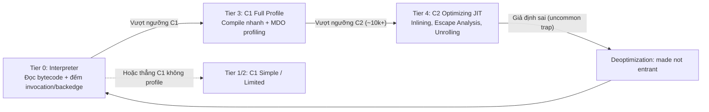

# JVM-05 · JIT: Interpreter, C1, C2, tiered compilation

> **TL;DR** — Java không "chạy chậm vì là ngôn ngữ thông dịch", mà khởi đầu bằng **Interpreter (Tier 0)** để startup nhanh và thu thập số liệu thực thi, rồi **Tiered Compilation** nâng dần các hàm nóng lên **C1 (Tier 1–3, compile nhanh + gắn profiling)** và **C2 (Tier 4, tối ưu sâu: inlining, escape analysis, loop unrolling)**. Đó là lý do service Java mới deploy luôn chậm trong vài phút đầu (*cold warmup*) và các microbenchmark thiếu warmup hoặc không tiêu thụ kết quả (*Dead Code Elimination*) cho số đo sai lệch hoàn toàn. Khi giả định tối ưu của C2 bị phá vỡ lúc runtime (nhánh lạ hoặc implementation thứ 2 xuất hiện), JVM thực hiện **Deoptimization** (`made not entrant: uncommon trap`) quay lại Interpreter rồi compile lại.

## 🧭 Brief

| | |
| :--- | :--- |
| **Loại** | Bài học |
| **Giai đoạn** | Năm 1 · Q1 |
| **Chủ đề** | Java hiện đại & JVM Internals |
| **Tiên quyết** | [JVM-04](../04-jvm-memory-areas/README.md) |

**Phạm vi bắt buộc**
- tiered compilation
- inlining
- deoptimization
- warmup
- JIT và benchmark sai

**Câu hỏi sâu — nội dung phải giúp trả lời được**
- Vì sao service Java chậm ở vài phút đầu sau deploy?
- Deoptimization xảy ra khi nào?

**Ý tưởng lab / demo**
- -XX:+PrintCompilation quan sát method được compile; benchmark có/không warmup

**Tài liệu gốc gợi ý**
- JVM Specification
- Effective Java 3rd
- Oracle GC Tuning Guide
- JEP index (openjdk.org/jeps)

**Gói đầu ra**
- [x] `README.md` — lý thuyết theo [lesson-template](../../../docs/templates/lesson-template.md)
- [x] `exercises.md` — bài tập L1/L2/L3 theo [exercises-template](../../../docs/templates/exercises-template.md)
- [x] `solutions.md` — đáp án theo [solutions-template](../../../docs/templates/solutions-template.md)
- [x] `lab/` — code demo chạy được + `lab/README.md` theo [lab-template](../../../docs/templates/lab-template.md)
- [ ] _(người học)_ `my-notes.md` — **agent không tạo**

---

<!-- Nội dung bắt đầu từ đây -->

## 1. Vấn đề: tại sao phải biết cái này?

Hai tình huống thực tế ở hệ thống backend Java:
1. Vừa deploy phiên bản mới lên Kubernetes/JBoss rồi chuyển 100% traffic vào ngay → **2–3 phút đầu tiên, p99 latency vọt từ `25 ms` lên `450 ms`, CPU chạm 95% rồi tự hạ xuống bình thường**. Nếu liveness/readiness probe hoặc HPA cấu hình quá nhạy, pod vừa lên đã bị restart liên tục hoặc scale thừa 5 pod!
2. Một dev viết benchmark `for (int i=0; i<1_000_000; i++) calc(i);` bằng `System.nanoTime()` rồi kết luận *"hàm X chạy chỉ mất 1 ms cho 10 triệu lần"* — trong khi lên production thật nó chậm gấp 5 lần vì ở benchmark hàm đó bị **Dead Code Elimination** xóa sạch thân vòng lặp!

Hiểu cách HotSpot Tiered Compilation, Inlining, OSR và Deoptimization vận hành giải quyết tận gốc cả bài toán warmup production lẫn bẫy viết benchmark sai.

---

## 2. Mô hình tư duy (mental model)

Hãy xem HotSpot JVM như một **đầu bếp thông minh kết hợp dây chuyền công nghiệp**:
- Khi khách đầu tiên gọi món (**Interpreter — Tier 0**): đầu bếp tự làm từng bước theo công thức bytecode — mất ít công chuẩn bị (startup nhanh), vừa làm vừa ghi chép xem bước nào lặp đi lặp lại.
- Khi thấy một món được gọi vài trăm lần (**C1 — Client Compiler, Tier 1–3**): dựng nhanh dây chuyền bán tự động để phục vụ kịp tốc độ, đồng thời vẫn đặt cảm biến đếm nhánh `if/else` nào hay đi qua và kiểu object nào hay xuất hiện.
- Khi món vượt ngưỡng vài nghìn/chục nghìn lần (**C2 — Server Compiler, Tier 4**): đầu tư thiết kế dây chuyền tối ưu tối đa — **nhét thẳng công thức con vào công thức mẹ (Inlining)**, loại bỏ vỏ hộp thừa (Escape Analysis), duỗi vòng lặp (Loop Unrolling).
- Nếu bỗng có 1 vị khách gọi biến thể mới chưa từng thấy (ví dụ xuất hiện `VipTax` phá vỡ giả định chỉ có `StandardTax`), dây chuyền C2 dừng khẩn (**Deoptimization / uncommon trap**), trả về cho đầu bếp **Interpreter** xử lý lại rồi ghi nhận thêm biến thể mới trước khi dựng dây chuyền mới!



---

## 3. Cơ chế bên trong (trọng tâm của bài)

### 3.1 Tiered Compilation (Tier 0 → 1..3 → 4) & OSR (`%`)

Từ Java 8 trở đi (và Java 21), `-XX:+TieredCompilation` được bật mặc định với **5 cấp thực thi**:
- **Tier 0 — Interpreter:** thông dịch bytecode trực tiếp, thu thập invocation counter (số lần gọi method) và back-edge counter (số lần lặp của vòng `for`/`while`).
- **Tier 1 — C1 Simple:** compile bằng C1 *không* chèn profiling (dùng cho các getter/setter quá đơn giản không cần C2 tối ưu thêm).
- **Tier 2 — C1 Limited Profile:** compile nhanh có đếm invocation/backedge tối thiểu (dùng khi hàng đợi C2 đang quá tải).
- **Tier 3 — C1 Full Profile:** compile nhanh bằng C1 **kèm ghi Method Data Object (MDO)**: ghi xác suất rẽ nhánh `if/else`, các kiểu runtime thực tế truyền vào interface/virtual call, và phát hiện null.
- **Tier 4 — C2 (Server/Optimizing Compiler):** dựa trên dữ liệu MDO từ Tier 3 để tối ưu quyết liệt nhất rồi phát ra native machine code tối ưu vào **Code Cache** (sau đó bản Tier 3 cũ được đánh dấu `made not entrant`).

**On-Stack Replacement (OSR — ký hiệu `%` trong `-XX:+PrintCompilation`):**
Nếu một hàm `main()` hoặc batch job chỉ được gọi **đúng 1 lần**, nhưng bên trong có vòng lặp chạy 1.000.000 lần: bình thường phải chờ lần gọi hàm tiếp theo mới nhảy vào code JIT. Nhờ **OSR**, khi back-edge counter vượt ngưỡng, JVM compile riêng phần vòng lặp và chuyển khung thực thi *ngay giữa lúc vòng lặp đang chạy* (`lab.jvm.jit.JitWarmupRunner::main @ 109`).

### 3.2 Trả lời câu hỏi sâu #1: "Vì sao service Java chậm ở vài phút đầu sau deploy?"

Có **4 nguyên nhân cộng hưởng** trong vài phút đầu sau khi bật pod/JBoss:
1. **Chạy ở Tier 0 Interpreter & C1:** Toàn bộ request đầu tiên thực thi qua Interpreter (chậm hơn native C2 thường từ **5× đến 50×** tùy độ phức tạp CPU/vòng lặp).
2. **Tranh chấp CPU cho các JIT compiler threads:** C1 và C2 chạy trên các background compiler threads riêng (`-XX:CICompilerCount`). Trong vài chục giây đến vài phút đầu khi hàng nghìn method cùng nóng lên, compiler threads dùng đáng kể CPU cùng lúc với worker threads xử lý HTTP.
3. **Class Loading + Lazy Initialization + Connection Pool Warmup:** Nạp hàng nghìn class Spring/Hibernate, khởi tạo reflection/proxy và mở kết nối DB/Redis/HTTP TLS đầu tiên.
4. **Profile stabilization & Deoptimization:** Lúc đầu chỉ thấy một vài loại request (nên C2 tối ưu theo kịch bản đó); khi loại request khác xuất hiện, vài method phải deoptimize rồi compile lại.

*(Cách xử lý production: chạy **readiness probe** kèm vài request **warmup** nội bộ trước khi đưa pod vào Load Balancer, hoặc cấu hình CPU request đủ rộng cho giai đoạn startup; trong hệ sinh thái mới có **AppCDS / CRaC / AOT Cache** ở JDK 24+.)*

### 3.3 Inlining — "Mẹ của mọi tối ưu hóa"

Inlining là việc C2 **chép thẳng thân hàm được gọi vào bên trong hàm gọi**, loại bỏ chi phí tạo stack frame/call instruction và quan trọng hơn là **mở khóa** cho Escape Analysis, Constant Folding và Dead Code Elimination nhìn xuyên qua ranh giới hàm:
- **Ngưỡng kích thước bytecode HotSpot mặc định:**
  - `MaxInlineSize` = **35 bytes** bytecode (hàm bình thường).
  - `FreqInlineSize` = **325 bytes** bytecode (hàm nóng được gọi thường xuyên).
  - `MaxInlineLevel` = **15** tầng lồng nhau (trên Java 11+; Java 7/8 là 9).
- **Devirtualization (Monomorphic vs Bimorphic vs Megamorphic):**
  - **Monomorphic (1 class implement interface):** C2 dùng Class Hierarchy Analysis (CHA) hoặc profile để devirtualize & inline thẳng (chi phí call = 0).
  - **Bimorphic (2 implementation):** C2 chèn 1 lệnh kiểm tra nhánh `if (obj.klass == StandardTax) ... else ...` vẫn inline được cả 2.
  - **Megamorphic (≥ 3 implementation tại cùng 1 call site):** C2 không inline được nữa, quay về tra **vtable/itable dispatch** tốn thêm chi phí nhảy gián tiếp và chặn Escape Analysis xuyên hàm.

### 3.4 Trả lời câu hỏi sâu #2: "Deoptimization xảy ra khi nào?"

Vì C2 thực hiện **Speculative Optimization** (tối ưu dựa trên giả định thống kê từ Tier 3 rằng quá khứ sẽ lặp lại trong tương lai), **Deoptimization** xảy ra ngay khi giả định đó bị phá vỡ tại runtime:
1. **Class loading mới phá vỡ CHA / Monomorphic assumption:** Như thấy trực tiếp trong log `PrintCompilation` của `lab/`: hàm `applyTax(TaxRule, long)` ban đầu chỉ gặp `StandardTax` nên C2 compile Tier 4 (`id 119`) giả định monomorphic; ngay khi `VipTax` xuất hiện, C2 bắn **`made not entrant: uncommon trap`**, trả thực thi về Interpreter, thu profile bimorphic rồi compile lại bản Tier 4 mới (`id 123`)!
2. **Uncommon branch được kích hoạt lần đầu:** Ví dụ một nhánh `if (rareError)` chưa từng chạy trong lúc profiling → C2 không sinh machine code cho nhánh đó mà đặt bẫy `uncommon_trap`. Khi nhánh lỗi chạy lần đầu, JVM thoát khỏi native code về Interpreter.
3. **Null check / ArrayBounds giả định bị sai:** C2 tối ưu bỏ check `null` vì MDO ghi biến chưa từng `null`; khi gặp `null` thật, JVM deoptimize để ném `NullPointerException` đúng ngữ nghĩa.

Khi deoptimize, code cũ bị gắn **`made not entrant`** (không nhận lời gọi mới nào nữa, các thread đang kẹt bên trong chạy nốt rồi thoát) và sau khi không còn ai dùng sẽ thành **`made zombie`** để giải phóng Code Cache.

### 3.5 JIT và những lỗi viết Benchmark sai kinh điển

Nếu tự đo hiệu năng bằng vòng `for` + `System.nanoTime()` như dev hay làm:
1. **Không có warmup:** Đo ngay từ vòng lặp 1 thực chất là đo Interpreter + thời gian compiler chạy nền.
2. **Dead Code Elimination (DCE):** Gọi `pureWork(i)` mà **không dùng giá trị trả về** → C2 phát hiện hàm không có side-effect nên xóa sạch cả vòng lặp (`2 ms` cho 10 triệu lần trong lab vs `9 ms` khi cộng dồn!).
3. **Constant Folding:** Truyền hằng số cố định (như `compute(1000)`) → JIT tính trước kết quả ngay lúc compile.
4. **OSR bias:** Chạy hết benchmark trong 1 vòng lặp duy nhất bên trong `main` tạo ra code OSR khác với code hàm được gọi lặp từ ngoài.
→ **Quy tắc chuẩn:** Dùng **JMH** (`PERF-04`) với `@BenchmarkMode`, `@Warmup`, `@Measurement` và `Blackhole`!

---

## 4. Code minh họa

### 4.1 Bẫy benchmark sai (DCE) vs tiêu thụ qua `volatile`

```java
// ❌ SAI: Bị Dead Code Elimination xóa toàn bộ thân vòng lặp khi C2 tối ưu!
long t0 = System.nanoTime();
for (int i = 0; i < 10_000_000; i++) {
    pureWork(i); // kết quả bị bỏ -> C2 thấy không có side-effect, bỏ luôn vòng lặp!
}

// ✅ TẠM ĐÚNG (chỉ cho demo học, production benchmark phải dùng JMH - PERF-04):
long acc = 0;
for (int i = 0; i < 10_000_000; i++) {
    acc += pureWork(i);
}
blackhole = acc; // ghi vào static volatile field để ngăn DCE
```

### 4.2 Legacy corner (Java 7 / JBoss AS 7.1.1)

Trên **Java 7 / JBoss AS 7.1.1**:
1. **Tiered Compilation chưa bật mặc định ở Java 7** (chỉ bật mặc định từ Java 8)! Trên Java 7 `-server`, JVM chỉ dùng **Interpreter → C2** (ngưỡng `CompileThreshold = 10.000`) — nghĩa là thời gian làm nóng còn lâu hơn nhưng một số ứng dụng bật `-XX:+TieredCompilation` trên Java 7u40+ cũng có thể gặp **Code Cache đầy** (`ReservedCodeCacheSize` mặc định thời Java 7 chỉ `48 MB` so với `240 MB` của Java 8–21!). Khi Code Cache đầy, JVM in `CodeCache is full. Compiler has been disabled` → toàn bộ class nạp sau đó mãi mãi chạy ở **Interpreter**, làm app chậm đi đột ngột sau vài ngày chạy!
2. Trên JBoss AS 7.1.1 (Java 7), kiểm tra `-XX:ReservedCodeCacheSize=128m` (hoặc `240m`) nếu bật `-XX:+TieredCompilation`, và luôn giữ các method nghiệp vụ nóng gọn dưới 325 bytes bytecode để C2 inline tốt (không nhồi 500 dòng vào một method khổng lồ!).

---

## 5. Quan sát & đo đạc

Chạy lab và quan sát trực tiếp Tier `3`, `4`, OSR `%` và `made not entrant: uncommon trap`:
```powershell
mvn -q verify
mvn -q compile
java -XX:+PrintCompilation -cp target/classes lab.jvm.jit.JitWarmupRunner
```

**Đọc nhanh một dòng output `-XX:+PrintCompilation` thật ghi nhận từ `JitWarmupRunner`:**
```text
58   14       3       lab.jvm.jit.JitWarmupRunner::pureWork (22 bytes)
58   15       4       lab.jvm.jit.JitWarmupRunner::pureWork (22 bytes)
58   14       3       lab.jvm.jit.JitWarmupRunner::pureWork (22 bytes)   made not entrant: not used
58   16 %     3       lab.jvm.jit.JitWarmupRunner::hotSum @ 4 (24 bytes)
...
98  119       4       lab.jvm.jit.JitWarmupRunner::applyTax (8 bytes)
103 119       4       lab.jvm.jit.JitWarmupRunner::applyTax (8 bytes)   made not entrant: uncommon trap
105 123       4       lab.jvm.jit.JitWarmupRunner::applyTax (8 bytes)
```
Ý nghĩa các cột từ trái qua phải:
- Cột 1 (`58`, `103`): thời gian từ lúc khởi động JVM (**ms**).
- Cột 2 (`14`, `15`, `119`): ID biên dịch tăng dần.
- Cột 3 (`%`): OSR compile (kèm `@ <bytecode index>` nơi nhảy vào vòng lặp); `s` = synchronized; `!` = có exception handler; `n` = native wrapper.
- Cột 4 (`3`, `4`): **Compilation Tier** (`3` = C1 full profile, `4` = C2).
- Cột 5 (`22 bytes`): kích thước bytecode của method (`< 35 bytes` → inline cực dễ).
- Cột 6 (`made not entrant: uncommon trap`): method `119` bị deoptimize đúng lúc `VipTax` lần đầu chạy qua `applyTax`, sau đó compile lại bản `123` ở Tier 4!

*(Và số đo trong lab: `[2] Dead Code Elimination trap (10M calls): discarded=2 ms | consumed=9 ms`.)*

---

## 6. Trade-offs & khi nào KHÔNG dùng

| Lựa chọn | Được gì | Mất gì | Dùng khi |
| :--- | :--- | :--- | :--- |
| **Tiered Compilation (mặc định Java 8–21)** | Startup nhanh nhờ C1, đạt peak performance nhờ C2 | Tốn ~240 MB Code Cache reserved + CPU compile lúc đầu | Mọi service backend dài hạn (Spring Boot, JBoss) |
| **Chia nhỏ method (`< 35` / `< 325` bytes)** | Dễ đọc + C2 inline trọn vẹn + kích hoạt Escape Analysis | Quá nhiều tầng trừu tượng hóa megamorphic (≥ 3 impl) lại cản inline | Code nóng trên critical path |
| **JMH vs `System.nanoTime()` tự viết** | Tránh được DCE, constant folding, sai số warmup/OSR | Mất vài phút chạy nhiều fork/iteration | Mọi benchmark micro muốn kết luận chính xác (`PERF-04`) |

---

## 7. Cạm bẫy production (ít nhất 3)

1. **Chuyển 100% traffic production vào pod vừa khởi động không có warmup** — *Triệu chứng:* 1–3 phút đầu p99 latency tăng 5–10×, readiness/liveness probe timeout, HPA tự scale thừa pod. *Nguyên nhân:* JVM chạy Interpreter + C1/C2 threads tranh CPU để compile hàng nghìn method nóng. *Cách tránh:* chạy kịch bản warmup nhẹ (gọi vài chục request đại diện vào endpoint chính trước khi mở readiness `UP`) và cấp CPU limit đủ thoáng.
2. **Code Cache bị đầy (`CodeCache is full. Compiler has been disabled`)** — *Triệu chứng:* sau vài ngày/tuần chạy, app bỗng chậm đi 10× vĩnh viễn dù GC và DB bình thường. *Nguyên nhân:* Code Cache chạm trần (`-XX:ReservedCodeCacheSize` quá nhỏ, hoặc sinh quá nhiều class động/regex/lambda). *Cách tránh:* theo dõi metric Code Cache (hoặc `jcmd <pid> Compiler.codecache`), giữ `ReservedCodeCacheSize >= 240m` (nhất là trên Java 7/8 cũ).
3. **Tin vào microbenchmark tự viết không `Blackhole` và không warmup** — *Triệu chứng:* tối ưu một hàm tốn hàng triệu phép tính dựa trên benchmark `2 ms`, lên prod hoàn toàn không cải thiện (hoặc chậm hơn). *Nguyên nhân:* C2 dùng Dead Code Elimination hoặc Constant Folding xóa sạch tính toán khi không dùng output, hoặc do chạy monomorphic trên benchmark nhưng lên prod là megamorphic (≥ 3 implementation). *Cách tránh:* dùng JMH (`PERF-04`) và test với đủ số lượng implementation giống production.

---

## 8. Liên hệ thực tế công việc

Trên hệ thống **Java 7 / JBoss AS 7.1.1**:
1. Kiểm tra script khởi động JBoss xem `-XX:ReservedCodeCacheSize` có đang để mặc định nhỏ (`48m` thời Java 7!) hay chưa — nếu ứng dụng lớn có hàng trăm JSP/proxy/class động, tăng lên `128m–256m` tránh tắt JIT đột ngột.
2. Quan sát các method xử lý hot-path (ví dụ loop tính cước, parse batch) — tránh viết một method dài 800 dòng làm vượt quá ngưỡng tối ưu/inline của C2; tách logic rõ ràng theo các hàm nhỏ dễ inline.

---

## 9. Self-check — Explain-back

> Trả lời **không nhìn tài liệu**, nói to trong 5 phút. Không trả lời được = chưa xong. (Đáp án nằm trong [solutions.md](./solutions.md).)

1. Tiered Compilation trong HotSpot gồm những cấp nào (Tier 0 → Tier 4), và vai trò của Tier 3 (C1 Full Profile) là gì?
2. Kể 4 nguyên nhân khiến một service Java mới khởi động chạy chậm trong vài phút đầu.
3. Inlining là gì, ngưỡng `35` bytes / `325` bytes của HotSpot có ý nghĩa gì, và khác nhau giữa Monomorphic, Bimorphic, Megamorphic call site là gì?
4. Deoptimization (`made not entrant`) xảy ra khi nào? Cho 2 ví dụ cụ thể.
5. Kể 3 lỗi kinh điển làm một microbenchmark bằng `System.nanoTime()` cho kết quả sai hoàn toàn.

---

## 10. Cheatsheet 1 trang

```text
Tier 0: Interpreter  ->  Tier 3: C1 (+ MDO profile)  ->  Tier 4: C2 (Inlining, EA, Unrolling)
% trong PrintCompilation = OSR (compile ngay giữa vòng lặp đang chạy)

Ngưỡng Inlining mặc định HotSpot:
- MaxInlineSize  = 35 bytes bytecode
- FreqInlineSize = 325 bytes bytecode
- Call site: Monomorphic (1 impl) / Bimorphic (2 impl) -> inline được; Megamorphic (3+) -> vtable

Deoptimization:
- Uncommon trap / class mới phá CHA -> "made not entrant" -> quay về Interpreter -> compile lại
```

---

## 11. Tài liệu tham khảo

- [OpenJDK HotSpot Compiler Overview & Tiered Compilation](https://openjdk.org/groups/hotspot/docs/HotSpotGlossary.html) — giải thích thuật ngữ `nmethod`, `not entrant`, `zombie`, OSR, uncommon trap.
- [JEP 197: Segmented Code Cache](https://openjdk.org/jeps/197) — cấu trúc phân tách Code Cache cho Tier 1–3, Tier 4 và non-method code.
- Aleksey Shipilëv, [The Black Magic of (Java) Method Dispatch](https://shipilev.net/blog/2015/black-magic-method-dispatch/) — chi tiết monomorphic, bimorphic, megamorphic và CHA.
- [OpenJDK JMH (Java Microbenchmark Harness)](https://github.com/openjdk/jmh) — công cụ chuẩn tránh lỗi DCE, warmup và OSR khi benchmark.

---
➡️ Tiếp theo: [exercises.md](./exercises.md) · [lab/](./lab/README.md) · Bài kế: [JVM-06 · GC cơ bản & G1](../06-gc-fundamentals-g1/README.md)
