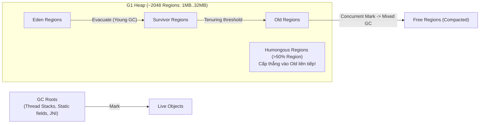

# JVM-06 · GC cơ bản & G1

> **TL;DR** — Garbage Collector (GC) hoạt động dựa trên **Reachability** (truy từ GC Roots thay vì đếm tham chiếu) và **Weak Generational Hypothesis** (hầu hết object chết rất sớm ngay sau khi tạo). Từ Java 9 đến Java 21, collector mặc định là **G1 (Garbage-First)** — chia Heap thành ~2.048 **Region** đồng đều và ưu tiên thu gom các Region nhiều rác nhất nhằm giữ STW pause quanh `-XX:MaxGCPauseMillis` (mặc định `200 ms`). Hai hiểu lầm đắt giá nhất ở production là cấp phát **Humongous Objects** (`> 50%` kích thước 1 Region — trong lab làm số lần GC tăng vọt **24×**, từ 4 lên 96 sự kiện cho cùng 128 MB) và tin rằng **"cứ tăng `-Xmx` là giảm GC pause"**.

## 🧭 Brief

| | |
| :--- | :--- |
| **Loại** | Bài học |
| **Giai đoạn** | Năm 1 · Q1 |
| **Chủ đề** | Java hiện đại & JVM Internals |
| **Tiên quyết** | [JVM-05](../05-jit-compilation/README.md) |

**Phạm vi bắt buộc**
- reachability, generational hypothesis
- mark/sweep/compact
- G1 regions, mixed GC, humongous objects
- pause target

**Câu hỏi sâu — nội dung phải giúp trả lời được**
- Vì sao object lớn gây vấn đề với G1?
- Tăng heap luôn giảm GC pause không?

**Ý tưởng lab / demo**
- Ứng dụng tạo rác với tốc độ điều chỉnh được, quan sát G1 qua GC log

**Tài liệu gốc gợi ý**
- JVM Specification
- Effective Java 3rd
- Oracle GC Tuning Guide
- JEP index (openjdk.org/jeps)

**Gói đầu ra**
- [x] `README.md` — lý thuyết theo [lesson-template](../../../docs/templates/lesson-template.md)
- [x] `exercises.md` — bài tập L1/L2/L3 theo [exercises-template](../../../docs/templates/exercises-template.md)
- [x] `solutions.md` — đáp án theo [solutions-template](../../../docs/templates/solutions-template.md)
- [x] `lab/` — code demo chạy được + `lab/README.md` theo [lab-template](../../../docs/templates/lab-template.md)
- [ ] _(người học)_ `my-notes.md` — **agent không tạo**

---

<!-- Nội dung bắt đầu từ đây -->

## 1. Vấn đề: tại sao phải biết cái này?

Trong một API xuất báo cáo / đọc JSON payload lớn chạy G1GC mặc định:
1. Mỗi request tạo mảng `byte[]` hoặc `StringBuilder` kích thước `1.2 MB` (hoặc `3 MB`) → GC log đột ngột bắn hàng loạt `Pause Young (Concurrent Start) (G1 Humongous Allocation)`, CPU GC tăng vọt và thỉnh thoảng nổ **Full GC dừng cả app 3–6 giây** dù tổng Heap sử dụng mới có 55%!
2. Đội vận hành thấy hay bị GC pause dài bèn tăng `-Xmx4g` lên `-Xmx16g` — kết quả p99 pause bình thường vẫn thế, nhưng mỗi lần dính Mixed/Full GC thời gian treo lại **dài hơn gấp 3 lần**!

Nắm chắc Reachability, Mark-Sweep-Compact, kiến trúc Region của G1 và Humongous allocation giúp bạn sửa đúng nguyên nhân thay vì "vẩy RAM cầu may".

---

## 2. Mô hình tư duy (mental model)

Hãy hình dung **Heap G1** như một **bãi đỗ xe chia thành ~2.048 ô vuông bằng nhau (Regions)**:
- Xe con mới vào (**Eden**), nếu chưa rời bãi sau 1 lượt kiểm tra được dồn sang ô tạm (**Survivor**), ở lâu hơn nữa chuyển vào khu dài hạn (**Old**).
- Xe dọn rác G1 hoạt động theo chiến lược **"nhiều rác nhất làm trước" (Garbage-First)**: thay vì dọn sạch toàn bãi cùng lúc (STW hàng giây), nó chọn vừa đủ số ô có nhiều chỗ trống nhất sao cho thời gian dọn kịp chỉ tiêu **`MaxGCPauseMillis` (200 ms)**.
- **Humongous object** giống như **chiếc xe đầu kéo dài hơn nửa ô vuông**: không đỗ vừa ô thường, nên bị đẩy thẳng vào **chuỗi ô liên tiếp ở khu dài hạn (Old)**, chiếm chỗ và bẻ gãy sự linh hoạt của bãi!



---

## 3. Cơ chế bên trong (trọng tâm của bài)

### 3.1 Reachability, Weak Generational Hypothesis & 3 thuật toán nền

1. **Reachability (Tracing từ GC Roots):** JVM không dùng Reference Counting (vì không tự phá được vòng tham chiếu `A ↔ B`). Thay vào đó, GC xuất phát từ **GC Roots** (biến cục bộ/tham số đang nằm trên Thread Stacks, `static` fields của class đang được nạp, JNI global references, lock monitors) và duyệt đồ thị đối tượng: bất kỳ object nào đi tới được là *live*, phần còn lại là *rác* (kể cả 1.000 object trỏ vòng tròn lẫn nhau nhưng không nối với Root nào!).
2. **Weak Generational Hypothesis:** Quan sát thực nghiệm cho thấy 80–98% object trong ứng dụng Java chết rất nhanh (object tạo trong 1 HTTP request như DTO, Iterator, StringBuilder). Do đó tách **Young Gen** (chết nhiều, dọn nhanh bằng Copy) khỏi **Old Gen** (sống dai, ít quét).
3. **3 bước cơ bản: Mark – Sweep – Compact:**
   - **Mark:** đánh dấu object sống từ GC Roots (tốn thời gian tỷ lệ với **số lượng object sống**, KHÔNG phải dung lượng rác!).
   - **Sweep:** thu hồi vùng nhớ chết — nhanh nhưng để lại **phân mảnh (fragmentation)**.
   - **Compact / Evacuate (Copy):** chép các object sống dồn sát về một vùng nhớ mới liên tục rồi xóa sạch vùng cũ — triệt tiêu phân mảnh và cho phép cấp phát mới siêu nhanh bằng **TLAB (Thread-Local Allocation Buffer)** *bump-the-pointer*.

### 3.2 Kiến trúc G1: Regions, Young GC, Concurrent Mark & Mixed GC

Khác với các collector cổ điển (Parallel/CMS) chia cứng 3 dải liên tục cho Eden / Survivor / Old, **G1 (JEP 248, mặc định từ Java 9)** chia Heap thành khoảng **2.048 Region** kích thước bằng nhau (lũy thừa của 2 từ `1 MB` đến `32 MB`, chỉnh qua `-XX:G1HeapRegionSize`). Mỗi Region mang vai trò động (`Eden`, `Survivor`, `Old`, `Humongous`, `Free`):
- **Young GC (Stop-The-World):** Khi các Eden Region đầy, G1 tạm dừng app thread, copy các object sống từ Eden/Survivor sang Survivor mới hoặc promote sang Old. Để không phải quét toàn bộ Old Gen tìm con trỏ trỏ ngược về Young, G1 dùng **Remembered Sets (RSet)** và **Card Table** (cập nhật qua write barrier).
- **Concurrent Marking Cycle (đánh dấu nền):** Khi Old Gen vượt ngưỡng **`-XX:InitiatingHeapOccupancyPercent` (IHOP, mặc định `45%`**, và G1 hiện đại tự điều chỉnh *Adaptive IHOP*), G1 kích hoạt đánh dấu đồng thời song song với app thread (chỉ dừng STW ngắn ở Initial Mark piggyback vào Young GC, và Remark).
- **Mixed GC (Garbage-First):** Sau khi Concurrent Mark biết chính xác Region Old nào chứa nhiều rác nhất (ít object sống nhất), G1 thực hiện một chuỗi **Mixed GC** — vừa dọn toàn bộ Young Regions, vừa chọn các **Old Regions nhiều rác nhất** (trong giới hạn `MaxGCPauseMillis`) để copy/compact, tránh rơi vào Full GC.

### 3.3 Trả lời câu hỏi sâu #1: "Vì sao object lớn (`Humongous`) gây vấn đề với G1?"

Trong G1, bất kỳ đối tượng (hoặc mảng) nào có kích thước **lớn hơn 50% kích thước 1 Region** (`G1HeapRegionSize / 2`) được phân loại là **Humongous Object** (ví dụ `-XX:G1HeapRegionSize=1m` → object `> 512 KB` là Humongous; region mặc định với Heap 4 GB là `2 MB` → object `> 1 MB` là Humongous!).

**4 hậu quả trực tiếp trên G1:**
1. **Cấp phát thẳng vào các Region liên tiếp thuộc Old Gen:** Bỏ qua hoàn toàn Eden và cơ chế Young GC thông thường.
2. **Lãng phí không gian (Internal Fragmentation):** Nếu một mảng `byte[]` nặng `520 KB` rơi vào Region `1 MB`, gần `480 KB` cuối Region đó **bị bỏ trống hoàn toàn**, không object khác nào dùng chung được.
3. **Kích hoạt Concurrent Mark liên tục (`G1 Humongous Allocation`):** Mỗi lần cấp phát Humongous làm tăng tỷ lệ chiếm dụng Old, đẩy G1 vào trạng thái `Pause Young (Concurrent Start) (G1 Humongous Allocation)` liên miên (trong lab: **96 lần GC** chỉ để cấp phát 128 MB mảng `600 KB`, gấp **24×** so với **4 lần GC** của mảng `4 KB`!). *(Từ JDK 8u40+, G1 có thêm tối ưu Eager Reclaim ở Young GC cho các mảng primitive/object không có tham chiếu ngoài như `byte[]`, nhưng vẫn tốn STW khởi phát Concurrent Undo Cycle.)*
4. **Nguy cơ Full GC do thiếu Region liên tiếp:** Vì G1 không move/compact các Humongous object trong Mixed GC thông thường, nếu cấp phát một object cần 4 Region liên tiếp khi Heap bị phân mảnh, G1 có thể dính **Evacuation Failure (`To-space exhausted`)** hoặc **Full GC** kéo dài hàng giây!

### 3.4 Pause Target (`-XX:MaxGCPauseMillis`) & Trả lời câu hỏi sâu #2: "Tăng heap luôn giảm GC pause không?"

`-XX:MaxGCPauseMillis` (mặc định **`200 ms`**) là **mục tiêu mềm (soft goal)**, không phải cam kết cứng (hard guarantee). G1 tự động co giãn tỷ lệ Young Gen (`G1NewSizePercent` 5% → `G1MaxNewSizePercent` 60%) và số Old Regions thu gom trong mỗi Mixed GC để cố giữ pause dưới `200 ms`.

**Tăng Heap có luôn giảm GC pause không? KHÔNG.**
1. **Heap lớn làm Young/Mixed/Full GC có thể LÂU hơn:**
   - Khi bạn tăng `-Xmx` mà vẫn giữ `G1MaxNewSizePercent=60%`, G1 có thể mở rộng Young Gen lớn hơn, tích tụ nhiều object sống sót cần copy trong 1 lần Young GC → pause tăng (đến khi G1 tự co lại theo `MaxGCPauseMillis`, còn nếu bạn tự set cứng `-Xmn` thì pause tăng vĩnh viễn).
   - Nếu xảy ra **Full GC** (do allocation rate vượt tốc độ Concurrent Mark hoặc Humongous fragmentation), thời gian Full GC tỷ lệ thuận với **tổng live set + kích thước Heap** — Heap `32 GB` có thể dừng **10–20 giây** thay vì `2 giây` trên Heap `4 GB`!
2. **Ngưỡng `32 GB` tắt Compressed Oops:** Như bài [JVM-04](../04-jvm-memory-areas/README.md), tăng Heap chạm `32 GB` làm mọi pointer to gấp đôi (4B → 8B), tăng áp lực bộ nhớ và lượng dữ liệu GC phải quét.
3. **Tốn thêm bộ nhớ G1 Remembered Sets (RSet):** Heap càng lớn và càng nhiều Region/tham chiếu chéo, lượng RAM native ngoài Heap cho RSet càng lớn.

→ Nếu yêu cầu độ trễ cực thấp ổn định bất kể kích thước Heap (`< 1–10 ms` p99), cần chuyển sang **ZGC / Shenandoah** (xem bài kế [JVM-07](../07-zgc-low-latency/README.md)).

---

## 4. Code minh họa

### 4.1 Tránh tạo Humongous object lặp lại trong vòng lặp xử lý request

```java
// ❌ SAI: Đọc toàn bộ file upload / response lớn vào 1 mảng byte[] > 1MB mỗi request
// -> Cấp phát Humongous liên tiếp vào Old Gen, kích hoạt Concurrent Start / Full GC!
byte[] fullPayload = Files.readAllBytes(largeReportPath); // vd 3 MB -> 2-4 Humongous Regions!

// ✅ ĐÚNG: Đọc/xử lý theo luồng (streaming) với buffer nhỏ tái sử dụng (8 KB - 64 KB)
byte[] buffer = new byte[16 * 1024]; // 16 KB -> nằm gọn trong Eden TLAB, chết nhanh ở Young GC
try (InputStream in = Files.newInputStream(largeReportPath)) {
    int read;
    while ((read = in.read(buffer)) != -1) {
        digest.update(buffer, 0, read);
    }
}
```

### 4.2 Legacy corner (Java 7 / JBoss AS 7.1.1)

Trên **Java 7 / JBoss AS 7.1.1**:
1. Collector mặc định trên Java 7 `-server` là **Parallel GC** (`-XX:+UseParallelGC`), **KHÔNG phải G1**! Parallel GC tối ưu throughput nhưng **Full GC là đơn luồng (trước 7u4) / STW dài hàng giây** trên Heap lớn; nhiều đội từng bật **CMS (`-XX:+UseConcMarkSweepGC`)** trên Java 7 nhưng CMS không compact Old Gen khi chạy nền → dễ dính **`Concurrent Mode Failure`** gây Full GC đóng băng app hàng chục giây!
2. Khi nâng cấp từ Java 7 lên Java 21 dùng **G1GC mặc định**: **xóa hết các flag tuning CMS cũ** (`-XX:+UseConcMarkSweepGC`, `-XX:CMSInitiatingOccupancyFraction`, `-Xmn` cứng) — giữ `-Xmn` cứng sẽ vô hiệu hóa khả năng G1 tự co giãn Young Gen để giữ `-XX:MaxGCPauseMillis`!

---

## 5. Quan sát & đo đạc

Chạy lab so sánh chế độ `normal` (`4 KB`) vs `humongous` (`600 KB`) trên cùng một Heap `64 MB` với `-XX:G1HeapRegionSize=1m`:
```powershell
mvn -q verify
mvn -q compile
java -Xms64m -Xmx64m -XX:+UseG1GC -XX:G1HeapRegionSize=1m -Xlog:gc -cp target\classes lab.jvm.gc.GcAllocationRunner normal
java -Xms64m -Xmx64m -XX:+UseG1GC -XX:G1HeapRegionSize=1m -Xlog:gc -cp target\classes lab.jvm.gc.GcAllocationRunner humongous
```

**Output thật ghi nhận (Windows 11, JDK 26.0.1 `--release 21`, G1GC, Region = 1 MB):**
```text
=== G1 NORMAL (cấp phát tổng 128 MB qua 32.768 mảng 4 KB) ===
[0.084s][info][gc] GC(0) Pause Young (Normal) (G1 Evacuation Pause) 35M->3M(64M) 1.202ms
[0.087s][info][gc] GC(1) Pause Young (Normal) (G1 Evacuation Pause) 30M->3M(64M) 0.681ms
[0.090s][info][gc] GC(2) Pause Young (Normal) (G1 Evacuation Pause) 36M->3M(64M) 0.541ms
[0.096s][info][gc] GC(3) Pause Young (Normal) (G1 Evacuation Pause) 38M->3M(64M) 0.529ms
  [NORMAL (4 KB buffers, 128 MB total)] elapsed=21 ms | GC events=4 | total STW GC time=2 ms | retained=512 chunks

=== G1 HUMONGOUS (cấp phát tổng 128 MB qua 218 mảng 600 KB) ===
[0.072s][info][gc] GC(0) Pause Young (Concurrent Start) (G1 Humongous Allocation) 28M->25M(64M) 1.127ms
[0.072s][info][gc] GC(1) Concurrent Undo Cycle 0.078ms
... (lặp lại liên tục tới GC(191)!)
  [HUMONGOUS (600 KB buffers, 128 MB total)] elapsed=36 ms | GC events=96 | total STW GC time=20 ms | retained=24 chunks
```
Cùng một tổng lượng RAM cấp phát (`128 MB`), chỉ vì kích thước từng mảng vượt quá `512 KB` (`50%` của Region `1 MB`), số lần GC bùng nổ từ **4 lên 96 lần (24×)** và thời gian STW tăng **10×**!

---

## 6. Trade-offs & khi nào KHÔNG dùng

| Collector / Tuning | Được gì | Mất gì | Dùng khi |
| :--- | :--- | :--- | :--- |
| **G1GC (mặc định Java 9–21)** | Cân bằng tốt throughput + pause quanh `50–200 ms`, tự compact giảm phân mảnh | Pause vẫn tỷ lệ với live set di chuyển; nhạy với Humongous object; tốn ~5–15% native RSet | Hầu hết microservice & web app Spring Boot |
| **Parallel GC (`-XX:+UseParallelGC`)** | Throughput CPU cao nhất (không có write barrier nặng như G1) | STW pause dài hơn nhiều | Batch job offline không quan tâm p99 latency |
| **Tăng `G1HeapRegionSize`** (vd lên `8m` / `16m`) | Nâng ngưỡng Humongous (`> 4 MB` / `> 8 MB`) | Ít Region hơn (nên tránh ít hơn vài trăm Region làm G1 kém linh hoạt) | App bắt buộc giữ các mảng `1–3 MB` và bị Humongous bão GC |
| **ZGC (`-XX:+UseZGC -XX:+ZGenerational`)** | Pause sub-millisecond (`< 1 ms`) kể cả Heap hàng chục/trăm GB | Tốn thêm CPU nền & memory barrier overhead nhẹ | Service cực nhạy p99.9 latency (chi tiết ở [JVM-07](../07-zgc-low-latency/README.md)) |

---

## 7. Cạm bẫy production (ít nhất 3)

1. **Cấp phát mảng `byte[]` / `char[]` / `String` lớn hơn 50% Region Size** — *Triệu chứng:* log tràn ngập `G1 Humongous Allocation`, Old Gen tăng nhanh và thỉnh thoảng dính `To-space exhausted` / Full GC. *Cách tránh:* stream dữ liệu theo chunk nhỏ (`8–64 KB`), tái sử dụng buffer, hoặc nâng `-XX:G1HeapRegionSize` hợp lý nếu không sửa được kích thước buffer.
2. **Đặt cứng `-Xmn` (kích thước Young Gen cố định) trên G1GC** — *Triệu chứng:* G1 mất khả năng tự co giãn Young Gen để đạt `MaxGCPauseMillis`, gây pause vọt lên quá 200ms khi tải tăng. *Cách tránh:* bỏ `-Xmn` / `-XX:NewSize` trên G1; chỉ điều chỉnh `-XX:MaxGCPauseMillis` và `-Xmx` (hướng dẫn đọc chi tiết GC log ở [JVM-08](../08-gc-log-analysis/README.md)).
3. **Copy nguyên bộ flag CMS thời Java 7/8 sang Java 17/21** — *Triệu chứng:* JVM từ chối khởi động (`Unrecognized VM option 'UseConcMarkSweepGC'` từ Java 14+) hoặc G1 chạy kém tối ưu. *Cách tránh:* khởi đầu sạch chỉ với `-XX:+UseG1GC -XX:MaxGCPauseMillis=...` và `-Xlog:gc*`, đo đạc trước khi chỉnh cờ chuyên sâu.

---

## 8. Liên hệ thực tế công việc

Ngay tuần này trên hệ thống **Java 7 / JBoss AS 7.1.1**:
1. Xem lại các flag GC đang chạy trong `standalone.conf` / `standalone.conf.bat` (xác định đang dùng Parallel GC hay CMS).
2. Kiểm tra trong code xuất báo cáo Excel/PDF hoặc đọc file SOAP/XML xem có chỗ nào đang load nguyên file `> 500 KB` vào một `byte[]` hoặc `String` duy nhất hay không — chuyển sang `BufferedInputStream` / streaming để sẵn sàng sạch sẽ khi chuyển sang G1 ở Java 21.

---

## 9. Self-check — Explain-back

> Trả lời **không nhìn tài liệu**, nói to trong 5 phút. Không trả lời được = chưa xong. (Đáp án nằm trong [solutions.md](./solutions.md).)

1. Phân biệt **Reachability** (GC Roots) và Reference Counting; nêu nội dung của **Weak Generational Hypothesis**.
2. So sánh Mark-Sweep vs Mark-Compact (Evacuate) về vấn đề phân mảnh bộ nhớ và tốc độ cấp phát TLAB.
3. Mô tả chu trình hoạt động của G1: Region, Young GC, Concurrent Marking (IHOP), và Mixed GC.
4. **Humongous object** trong G1 được định nghĩa như thế nào, được cấp phát vào đâu, và gây ra những vấn đề gì?
5. Trả lời và giải thích 3 lý do vì sao **tăng Heap (`-Xmx`) không phải lúc nào cũng giảm GC pause**.

---

## 10. Cheatsheet 1 trang

```text
G1 Heap (~2048 Regions, mỗi Region 1MB..32MB):
- Young GC: Copy live objects từ Eden/Survivor -> Survivor/Old (dùng RSet để không quét cả Old)
- IHOP (45%): Kích hoạt Concurrent Mark -> tìm Old Region nhiều rác nhất -> Mixed GC
- Humongous Object: size > G1HeapRegionSize / 2 -> cấp thẳng vào Old Regions liên tiếp!

Flags cơ bản Java 21 (G1GC):
-XX:+UseG1GC -XX:MaxGCPauseMillis=200 -Xlog:gc*:file=gc.log:time,uptime,level,tags
(Tránh set cứng -Xmn trên G1; tăng -XX:G1HeapRegionSize chỉ khi thật sự cần cho mảng > 512KB..2MB)
```

---

## 11. Tài liệu tham khảo

- [Oracle HotSpot Virtual Machine Garbage Collection Tuning Guide (JDK 21) — Garbage-First (G1)](https://docs.oracle.com/en/java/javase/21/gctuning/garbage-first-g1-garbage-collector1.html) — đặc tả chi tiết Region, Humongous, Adaptive IHOP, Mixed GC.
- [JEP 248: Make G1 the Default Garbage Collector](https://openjdk.org/jeps/248) — lý do chuyển mặc định từ Parallel GC sang G1GC.
- [JEP 158: Unified JVM Logging (`-Xlog:gc*`)](https://openjdk.org/jeps/158) — chuẩn cấu hình log GC từ Java 9 trở lên.

---
➡️ Tiếp theo: [exercises.md](./exercises.md) · [lab/](./lab/README.md) · Bài kế: [JVM-07 · ZGC / Shenandoah & low-latency GC](../07-zgc-low-latency/README.md)
