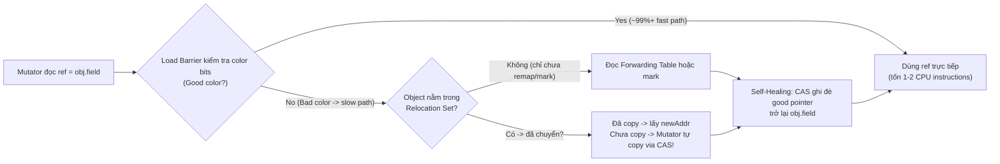

# JVM-07 · ZGC / Shenandoah & low-latency GC

> **TL;DR**: **ZGC** và **Shenandoah** triệt tiêu phần lớn STW pause khi compact heap bằng cách dọn và di dời object **concurrently** trong lúc thread ứng dụng vẫn chạy. Trên 64-bit, ZGC gài metadata vào **colored pointers** (pointer bits) kết hợp **load barrier** tự sửa tham chiếu (*self-healing*), giúp STW pause chỉ còn vài chục micro giây để quét root — độc lập với kích thước heap hay live set. Từ Java 21 (**Generational ZGC**, JEP 439), tách Young/Old giảm mạnh CPU overhead và nguy cơ *Allocation Stall*; nhưng ZGC đánh đổi peak throughput lấy tail latency nên **không hợp** cho batch job hoặc container thiếu CPU/RAM headroom.

## 🧭 Brief

| | |
| :--- | :--- |
| **Loại** | Bài học |
| **Giai đoạn** | Năm 1 · Q1 |
| **Chủ đề** | Java hiện đại & JVM Internals |
| **Tiên quyết** | [JVM-06](../06-gc-fundamentals-g1/README.md) |

**Phạm vi bắt buộc**
- concurrent compaction
- colored pointers, load barriers
- generational ZGC (Java 21)
- trade-off throughput vs latency

**Câu hỏi sâu — nội dung phải giúp trả lời được**
- ZGC đạt pause < 1ms bằng cơ chế gì?
- Khi nào không nên chọn ZGC?

**Ý tưởng lab / demo**
- So sánh p99 latency của cùng 1 app với G1 vs ZGC

**Tài liệu gốc gợi ý**
- JVM Specification
- Effective Java 3rd
- Oracle GC Tuning Guide
- JEP index (openjdk.org/jeps)

**Gói đầu ra**
- [x] `README.md` — lý thuyết theo [lesson-template](../../../docs/templates/lesson-template.md)
- [x] `exercises.md` — bài tập L1/L2/L3 theo [exercises-template](../../../docs/templates/exercises-template.md)
- [x] `solutions.md` — đáp án theo [solutions-template](../../../docs/templates/solutions-template.md)
- [x] `lab/` — code demo chạy được + `lab/README.md` theo [lab-template](../../../docs/templates/lab-template.md)
- [ ] _(người học)_ `my-notes.md` — **agent không tạo**

---

## 1. Bài toán & Động lực

Ở [JVM-06](../06-gc-fundamentals-g1/README.md), ta thấy G1 đã tiến một bước dài: chia heap thành region và đánh dấu Old gen concurrently. Nhưng bước **Evacuation / Compaction** (copy object sống từ region nguồn sang region đích để gom mảnh trống và cập nhật lại toàn bộ pointer trỏ tới nó) của G1 vẫn chạy trong **Stop-The-World (STW)**.

Hệ quả là khi live set phình lớn, có nhiều cross-region reference hoặc allocation rate tăng vọt làm G1 không kịp chuẩn bị region trống (*Evacuation Failure*), app bị dính pause hàng chục đến hàng trăm ms:

```text
=== G1GC (-Xmx1g) === (kết quả đo thực tế trong lab JVM-07)
[6.760s][info][gc] GC(381) Pause Young (Normal) (G1 Evacuation Pause) (Evacuation Failure: Allocation) 1016M->1017M(1024M) 1.430ms
[6.790s][info][gc] GC(383) Pause Full (G1 Compaction Pause) 1023M->354M(1024M) 28.486ms
  Live set=2000000 objects | Probe jitter -> p50=986 us | p99=27668 us | max=41848 us (41.85 ms)
```

Với các dịch vụ trading, payment gateway, API SLA `p99 < 10 ms`, hay cache node heap 32–128 GB, chỉ một pha Full Compaction vài trăm ms đã đủ làm timeout dây chuyền. Câu hỏi đặt ra: **làm sao di chuyển object sang địa chỉ mới ngay cả khi mutator thread đang đọc và ghi object đó mà không bị đọc nhầm dữ liệu cũ hoặc pointer gãy?**

## 2. Bối cảnh & Đường tiến hoá

```
CMS (Java 5..14): Concurrent Mark + Sweep không compact
  └─▶ Phân mảnh heap -> tụt về Serial Full GC STW dài
       │
       ▼
G1GC (Java 9+ default): Concurrent Mark + Incremental STW Evacuation
  └─▶ Giữ pause đều ~10-200 ms, nhưng compaction vẫn STW -> tail latency tăng theo live set/heap
       │
       ▼
ZGC & Shenandoah (Java 11..17..21+): Concurrent Mark + Concurrent Compaction
  ├─▶ ZGC (JEP 333 -> JEP 377 -> Generational ZGC JEP 439 Java 21 -> Default JEP 474/490)
  └─▶ Shenandoah (JEP 189 -> JEP 379 -> Generational Shenandoah JEP 404/521)
```

Điểm đột phá của cả **ZGC** (Oracle) và **Shenandoah** (Red Hat) là **Concurrent Compaction**: quá trình copy object và cập nhật reference đều diễn ra song song với thread ứng dụng (*mutators*). STW pause chỉ còn dùng cho việc cực ngắn là quét root và đồng bộ pha.

## 3. Cơ chế bên trong (Deep Dive)

### 3.1 Concurrent Compaction & Forwarding Table

Khi muốn giải phóng một vùng nhớ (*ZPage* trong ZGC, tương tự region trong G1) có ít object sống rải rác:
1. GC chọn tập các page cần dọn (**Relocation Set**).
2. Với mỗi object sống trong page đó, GC thread cấp phát chỗ ở trên một page đích và copy byte sang địa chỉ mới `newAddr`.
3. GC ghi ánh xạ `oldAddr -> newAddr` vào một **Forwarding Table** nằm **off-heap** (ngoài heap vùng ZPage).
4. Ngay khi mọi object sống trong ZPage cũ đã được copy sang nơi mới, ZGC có thể **tái sử dụng hoặc uncommit ZPage cũ ngay lập tức**, không phải chờ quét sửa toàn bộ mọi reference trên heap trước!

Tại sao ZGC dám giải phóng ZPage cũ sớm như vậy khi hàng triệu field khác trên heap vẫn đang chứa `oldAddr`? Nhờ **Colored Pointers** và **Load Barriers**.

### 3.2 Colored Pointers & Load Barriers (cơ chế cốt lõi của ZGC)

Trên kiến trúc 64-bit, một địa chỉ ảo thực tế chỉ cần ~42–48 bit để đánh địa chỉ vật lý (ZGC hỗ trợ heap tới 16 TB với 44 bit offset trong mô hình classic, 46 bit trong Generational ZGC). ZGC tận dụng các bit cao không dùng đến trong chính **con trỏ 64-bit (object reference)** để nhúng metadata trạng thái của tham chiếu — gọi là **Colored Pointers**.

Thay vì chặn ở mọi lệnh đọc/ghi primitive, ZGC chỉ chèn **Load Barrier** (vài lệnh máy cực nhẹ) vào đúng thời điểm **thread ứng dụng đọc một tham chiếu object từ heap** (`Object x = obj.field;`), *không* chèn khi đọc biến local trên stack hay field primitive (`int`, `long`).



Hai cơ chế đi kèm biến slow path thành cực hiếm:
1. **Self-Healing (Tự chữa lành)**: ngay lần đầu một thread đụng phải bad pointer (`oldAddr`), slow path tra (hoặc tự copy nếu GC thread chưa làm tới) ra `newAddr`, rồi thực hiện **CAS** ghi đè `newAddr` mang màu *good* trở lại ngay vào `obj.field`. Mọi lần đọc `obj.field` tiếp theo đi thẳng qua fast path!
2. **Colored Pointers trên x64/ARM64**: Ở ZGC non-generational, một địa chỉ heap có các bit màu `Marked0`, `Marked1`, `Remapped` (kỹ thuật *multi-mapping* ánh xạ 3 view địa chỉ ảo vào cùng bộ nhớ vật lý, nên CPU/OS vẫn dereference thẳng mà không cần shift bit ở fast path). Ở Generational ZGC, color bits còn mã hóa thêm bit thế hệ (**Young/Old** và remember-set state) và dùng mask/unmask pointer.

> **Trả lời câu hỏi sâu #1 — ZGC đạt pause < 1ms bằng cơ chế gì?**
> ZGC đạt STW pause < 1ms (thực tế thường **0.005 – 0.05 ms**, tức vài chục micro giây) vì độ dài STW **O(số lượng thread roots)**, hoàn toàn **không tỷ lệ theo kích thước heap hay số lượng object sống**:
> - **Pause Mark Start**: chỉ quét roots trên thread stack/register để lấy điểm xuất phát, không đi theo đồ thị heap.
> - **Concurrent Mark**: duyệt đồ thị heap song song với app; Load Barrier đảm bảo mọi reference mới đọc đều được mark.
> - **Pause Mark End**: điểm đồng bộ handshake rất ngắn (để xử lý một số edge case final mark).
> - **Concurrent Select Relocation Set**: chọn ZPage ít live object nhất.
> - **Pause Relocate Start**: chỉ relocate các object trỏ trực tiếp từ **thread roots**.
> - **Concurrent Relocate**: copy phần còn lại của heap song song; bất kỳ thread nào đọc phải reference chưa cập nhật sẽ được **Load Barrier + Forwarding Table** tự định tuyến sang địa chỉ mới và *self-heal* ngay tại chỗ.

Minh hoạ log thật từ OpenJDK trên bài lab (`-Xlog:gc,gc+phases=info`):
```text
[0.515s][info][gc,phases] GC(1) Y: Pause Mark Start (Major) 0.011ms
[0.534s][info][gc,phases] GC(1) Y: Concurrent Mark 19.058ms
[0.534s][info][gc,phases] GC(1) Y: Pause Mark End 0.010ms
[0.534s][info][gc,phases] GC(1) Y: Pause Relocate Start 0.007ms
[0.536s][info][gc,phases] GC(1) Y: Concurrent Relocate 1.279ms
```
Ba lần STW cộng lại chỉ **0.028 ms**, trong khi toàn bộ việc mark (`19.058ms`) và relocate (`1.279ms`) chạy nền!

### 3.3 Generational ZGC (Java 21 — JEP 439)

ZGC thế hệ đầu (Java 11–17) là **Single-Generation** (không chia Young/Old). Nhược điểm chí mạng là **Weak Generational Hypothesis** bị bỏ qua: phần lớn object chết ngay sau vài ms, nhưng ZGC single-gen phải mark toàn bộ heap mỗi chu kỳ, dẫn đến tốn nhiều CPU và dễ bị **Allocation Stall** nếu app tạo rác nhanh hơn tốc độ quét toàn heap.

**Generational ZGC** (ra mắt production trong Java 21 qua **JEP 439**) tách ZPage thành **Young Generation** và **Old Generation**:
- **Minor Collection** chỉ gom Young ZPage — chu kỳ rất nhanh (~1–5 ms chạy nền) nên giải phóng bộ nhớ kịp ngay cả dưới allocation rate cực cao.
- **Store / Write Barrier** (bên cạnh Load Barrier) được bổ sung để theo dõi tham chiếu từ Old trỏ sang Young (**Remembered Set** dùng bitmap cho mỗi ZPage). Nhờ không phải quét cả Old gen mỗi lần gom Young, throughput cải thiện rõ và heap headroom cần thiết giảm mạnh so với ZGC single-gen.
- **Flags theo phiên bản JDK**:
  - **Java 21**: `-XX:+UseZGC -XX:+ZGenerational` (bắt buộc thêm `-XX:+ZGenerational`, nếu không vẫn chạy single-gen).
  - **Java 23 (JEP 474) / Java 24+ (JEP 490)**: Generational ZGC trở thành chế độ mặc định và duy nhất; chỉ cần `-XX:+UseZGC` (flag `-XX:+ZGenerational` bị deprecate rồi bỏ).

### 3.4 Shenandoah — người anh em đồng hành

**Shenandoah GC** (thêm vào OpenJDK từ JDK 12/15 qua JEP 189/379, phổ biến trên Red Hat / Eclipse Temurin / Amazon Corretto) cũng thực hiện Concurrent Compaction để giữ pause ở mức sub-ms hoặc vài ms, nhưng dùng **Load Reference Barrier** (từ JDK 13 thay cho Brooks forwarding pointer đầy đủ trước đây) kết hợp forwarding pointer ngay trong **object header** (thay vì color bit trên 64-bit pointer). Nhờ vậy Shenandoah từng chạy được cả trên 32-bit và Compressed Oops trước ZGC; từ các bản mới có thêm chế độ thử nghiệm/sản phẩm **Generational Shenandoah** (JEP 404/521, `-XX:+UseShenandoahGC -XX:ShenandoahGCMode=generational`).

### 3.5 Trade-off Throughput vs Latency & Khi nào không nên chọn ZGC

> **Trả lời câu hỏi sâu #2 — Khi nào không nên chọn ZGC?**
> Không có collector nào miễn phí: mọi barrier chạy ở mutator và GC thread chạy nền đều tiêu tốn CPU và cần RAM dư. **Không nên chọn ZGC** trong 4 tình huống sau:
> 1. **Workload ưu tiên Throughput (Batch / ETL / Data pipeline / CI build)**: Load barrier và write barrier (trong Generational ZGC) cộng thêm chi phí CPU (~2–10% tuỳ workload mật độ truy cập pointer). Nếu service không quan tâm tail pause 50 ms mà cần xử lý tổng lượng bản ghi/giây tối đa, **Parallel GC** hoặc **G1GC** cho throughput cao hơn.
> 2. **Container bị bóp CPU (`< 2–4 vCPU`) hoặc CPU luôn > 80%**: ZGC cần đủ core trống cho concurrent marking/relocation threads chạy đua với app. Thiếu CPU, GC không kịp dọn trước khi heap đầy → xảy ra **Allocation Stall** (thread app bị chặn cứng vài chục ms đến hàng giây chờ GC giải phóng ZPage).
> 3. **Heap quá chật so với live set (thiếu RAM headroom)**: ZGC luôn cần khoảng trống (~15–30% tuỳ allocation rate) để chứa *floating garbage* sinh ra trong lúc đang mark/relocate. Trong lab `AllocationStallDemo`, khi ép `-Xmx360m` cho ~220 MB live set, log lập tức nổ `[gc] Allocation Stall (tight-allocator) 27.961ms`.
> 4. **Heap rất nhỏ (`< 512 MB`) hoặc môi trường legacy**: Với heap 128–256 MB, G1/Serial/Parallel đã cho pause rất ngắn với footprint nhỏ hơn. Và dĩ nhiên trên Java 7/8 ZGC hoàn toàn không tồn tại.

## 4. So sánh lựa chọn GC

| Tiêu chí | Parallel GC | G1GC (Default JDK 9–25+) | ZGC (Generational JDK 21+) | Shenandoah |
| :--- | :--- | :--- | :--- | :--- |
| **Mục tiêu chính** | Max Throughput | Cân bằng Throughput & Pause (~10–200ms) | Ultra-low Latency (< 1ms STW) | Low Latency (~sub-ms đến vài ms) |
| **Compaction** | Full STW | Incremental STW (Young + Mixed) | Concurrent (Load Barrier + Forwarding Table) | Concurrent (LRB + Forwarding Pointer) |
| **Tail Pause (`p99.9`)** | Cao (vài trăm ms – nhiều giây) | Trung bình (10 – 100+ ms khi Evac Failure) | **< 1 ms** (độc lập heap size) | **< 1–5 ms** |
| **Overhead CPU / RAM** | Thấp nhất | Thấp – Trung bình | Trung bình – Cao hơn chút (barrier + headroom) | Trung bình – Cao hơn chút |
| **Flag (Java 21)** | `-XX:+UseParallelGC` | `-XX:+UseG1GC` | `-XX:+UseZGC -XX:+ZGenerational` | `-XX:+UseShenandoahGC` |

## 5. Minh hoạ & Lab

Lab [`LatencyComparisonRunner`](lab/src/main/java/lab/jvm/zgc/LatencyComparisonRunner.java) giữ **2.000.000 live `byte[96]` objects (~250+ MB)** trên heap `-Xmx1g`, chạy 1 thread nền liên tục cấp phát `byte[32KB]` vào ring buffer, và đo jitter của 2.000 probe `Thread.sleep(1)` (mỗi probe đo phần trễ vượt quá 1.000 µs mục tiêu).

Kết quả chạy trực tiếp trên OpenJDK 26.0.1 (`-Xmx1g`, Windows 11):

| Chỉ số | G1GC (`-XX:+UseG1GC`) | ZGC (`-XX:+UseZGC`) |
| :--- | :--- | :--- |
| `p50` jitter | `986 us` | `988 us` |
| **`p99` jitter** | **`27.668 us` (~27.7 ms)** | **`2.474 us` (~2.5 ms — nhiễu OS timer)** |
| **`max` jitter** | **`41.848 us` (`41.85 ms`)** | **`2.653 us` (`2.65 ms`)** |
| Tổng thời gian GC MXBean báo cáo | `3.082 ms` / `389` events | `800 ms` / `417` cycles (chạy nền) |
| Hiện tượng trong `-Xlog:gc` | Bị `Evacuation Failure` và `Pause Full (G1 Compaction Pause) 28.486ms` | `Minor Collection` hoàn thành nền `0.004s–0.005s`, không dính Full GC |

> Lưu ý: Jitter ~`1.000–2.500 us` của ZGC trên Windows đến từ độ phân giải timer mặc định của OS cho `Thread.sleep(1)`, **không phải** STW pause của GC (pause thực tế trong `-Xlog:gc,gc+phases=info` chỉ `0.005–0.015 ms`).

## 6. Legacy corner (Java 7 / JBoss AS 7.1.1)

Trên **Java 7 + JBoss AS 7.1.1**, ZGC và Shenandoah hoàn toàn **không có mặt**. Hai collector khả dụng cho app nhạy latency thời Java 7 là:
- **ParallelGC** (`-XX:+UseParallelGC -XX:+UseParallelOldGC`): mặc định trên server Java 7, ưu tiên throughput, nhưng Full GC STW có thể kéo dài vài giây trên heap 4–8 GB.
- **CMS** (`-XX:+UseConcMarkSweepGC`): tổ tiên về mặt tư tưởng của G1/ZGC trong việc mark concurrently, nhưng **không có concurrent compaction** (Young dùng ParNew STW, Old dùng mark-sweep concurrent không gom mảnh). Trên JBoss AS 7.1.1 cấu hình trong `standalone.conf.bat`:
  - Đặt `-XX:CMSInitiatingOccupancyFraction=70 -XX:+UseCMSInitiatingOccupancyOnly` để CMS bắt đầu quét trước khi Old gen đầy.
  - Bài học tương đồng với **Allocation Stall** của ZGC: nếu không bắt đầu concurrent mark đủ sớm (khi occupancy ~70%), CMS sẽ bị **Concurrent Mode Failure** và rơi thẳng về Serial Full GC STW hàng chục giây!
  - Ngoài ra trên Java 7 vẫn còn **PermGen** (`-XX:MaxPermSize=256m`), vấn đề classloader leak của JBoss sẽ được mổ xẻ ở [JVM-10](../10-metaspace-classloader-leak/README.md).

## 7. Lỗi hay gặp trong production

1. **Hiểu nhầm dòng `Minor Collection ... 0.004s` trong `-Xlog:gc` là STW pause**
   Log rút gọn `-Xlog:gc` in tổng thời gian cả **cycle chạy nền** (ví dụ `0.004s` = 4 ms cho concurrent mark + relocate). Muốn thấy STW pause thật (`0.007ms`–`0.015ms`), phải bật `-Xlog:gc,gc+phases=info` (hoặc `-Xlog:gc*`) và đọc các dòng `Pause Mark Start`, `Pause Mark End`, `Pause Relocate Start`. Chi tiết đọc log sẽ học ở [JVM-08](../08-gc-log-analysis/README.md).
2. **Đặt `-Xmx` sát nút live set gây `Allocation Stall`**
   Thói quen từ Parallel/G1 hay căn `-Xmx = 1.2x live set` để tiết kiệm RAM. Với ZGC, headroom quá mỏng khiến mutator phải phanh gấp chờ GC cycle dọn xong → spike latency 20–500 ms. Giải pháp: giữ headroom tối thiểu 20–30%, có thể kết hợp `-XX:SoftMaxHeapSize` (ZGC sẽ cố giữ heap quanh mức mềm này trong lúc bình thường và bung lên `-Xmx` khi có burst).
3. **Bật ZGC cho batch job / container 1 vCPU**
   Dẫn đến CPU tăng cao hơn hoặc `Allocation Stall` liên miên vì không đủ CPU core cho concurrent GC thread cạnh tranh với mutator.

## 8. Checklist thực hành

- [ ] Chạy xong [lab](lab/README.md) so sánh `G1GC` và `ZGC` ở cùng `-Xmx1g` và đối chiếu `p99` / `max`.
- [ ] Kiểm tra log `-Xlog:gc,gc+phases=info` để phân biệt được dòng `Pause ...` (STW) và `Concurrent ...` (chạy nền).
- [ ] Giải được tối thiểu các bài L1 và L2 trong [exercises.md](exercises.md) trước khi mở [solutions.md](solutions.md).

## 9. Câu hỏi tự kiểm tra

1. Tại sao ZGC có thể giải phóng ZPage nguồn ngay sau khi copy object sống xong, trong khi còn hàng nghìn reference trên heap vẫn trỏ về địa chỉ cũ?
2. Trong cơ chế **Self-Healing** của ZGC Load Barrier, thao tác nào đảm bảo các lần đọc sau không phải đi vào slow path nữa?
3. Vì sao từ Java 21 cần ưu tiên **Generational ZGC** (`-XX:+UseZGC -XX:+ZGenerational`) thay cho ZGC single-generation?
4. Trong GC log của ZGC xuất hiện dòng `[gc] Allocation Stall (worker-1) 42.150ms`. Đây là lỗi gì và có 2 hướng xử lý chính nào?
5. Với một hệ thống Java 7 chạy JBoss AS 7.1.1 gặp spike Full GC 8 giây nhưng chưa thể nâng cấp JDK ngay, nên kiểm tra và dùng chiến lược GC nào thay thế?

## 10. Tài liệu tham khảo

- [JEP 333: ZGC: A Scalable Low-Latency Garbage Collector](https://openjdk.org/jeps/333)
- [JEP 377: ZGC: A Scalable Low-Latency Garbage Collector (Production)](https://openjdk.org/jeps/377)
- [JEP 439: Generational ZGC (Java 21)](https://openjdk.org/jeps/439)
- [JEP 474: ZGC: Generational Mode by Default (Java 23)](https://openjdk.org/jeps/474)
- [Oracle Java Garbage Collection Tuning Guide — ZGC](https://docs.oracle.com/en/java/javase/21/gctuning/z-garbage-collector.html)
- Bài tiếp theo: [JVM-08 · Đọc GC log](../08-gc-log-analysis/README.md)
