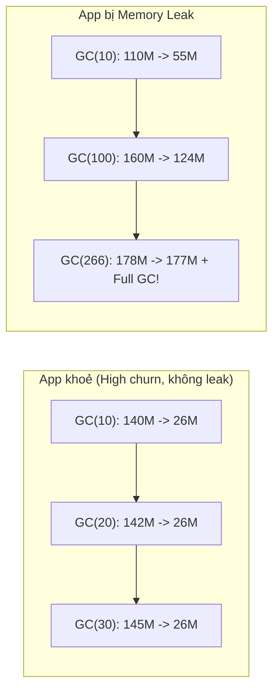

# JVM-08 · Đọc GC log

> **TL;DR**: GC log là nhật ký y tế rẻ nhất để chẩn đoán sức khoẻ JVM trên production (< 1% overhead) vì bạn không thể tối ưu thứ mình không đo. Từ Java 9+, JVM dùng **Unified Logging (`-Xlog:gc*`)** thay cho các cờ `-XX:+PrintGCDetails` cũ. 4 chỉ số sống còn cần đọc là: **GC Pause (`p95`/`max`)**, **GC Throughput %**, **Allocation Rate (MB/s)**, và **Live-Set Floor Trend** (đường đáy hình răng cưa sau mỗi lần GC). Đáy răng cưa đi ngang dù allocation rate cao là **app khoẻ**; đáy leo dốc không hồi về mức nền sau Full/Mixed GC là **dấu hiệu memory leak**.

## 🧭 Brief

| | |
| :--- | :--- |
| **Loại** | Bài học |
| **Giai đoạn** | Năm 1 · Q1 |
| **Chủ đề** | Java hiện đại & JVM Internals |
| **Tiên quyết** | [JVM-07](../07-zgc-low-latency/README.md) |

**Phạm vi bắt buộc**
- unified logging -Xlog:gc*
- đọc pause, allocation rate, promotion rate
- GCeasy/GCViewer
- dấu hiệu memory leak trong GC log

**Câu hỏi sâu — nội dung phải giúp trả lời được**
- Từ GC log làm sao biết đang leak?
- Allocation rate cao gây ra gì?

**Ý tưởng lab / demo**
- Phân tích GC log của app leak vs app bình thường

**Tài liệu gốc gợi ý**
- JVM Specification
- Effective Java 3rd
- Oracle GC Tuning Guide
- JEP index (openjdk.org/jeps)

**Gói đầu ra**
- [x] `README.md` — lý thuyết theo [lesson-template](../../../docs/templates/lesson-template.md)
- [x] `exercises.md` — bài tập L1/L2/L3 theo [exercises-template](../../../docs/templates/exercises-template.md)
- [x] `solutions.md` — đáp án theo [solutions-template](../../../docs/templates/solutions-template.md)
- [x] `lab/` — code demo chạy được + `lab/README.md` theo [lab-template](../../../docs/templates/lab-template.md)
- [ ] _(người học)_ `my-notes.md` — **agent không tạo**

---

## 1. Bài toán & Động lực

Khi một node JBoss hoặc microservice Java bỗng dưng phản hồi chậm hoặc chết vì `OutOfMemoryError: Java heap space`, kỹ sư mới vào nghề thường chỉ chụp heap dump hoặc đoán mò tăng `-Xmx`. Tăng `-Xmx` khi đang leak chỉ làm dịch vụ **chết muộn hơn và STW lâu hơn**. Còn mở profiler trực tiếp lên production khi đang nghẽn thì lại rủi ro treo hẳn app.

Ngược lại, **GC log** luôn nên bật sẵn 24/7 trên mọi môi trường production: overhead gần như bằng 0, file có thể xoay vòng (*log rotation*), và chỉ nhìn vào vài chục KB text ta biết ngay app đang bị **thiếu RAM thật**, **allocation spike**, hay **đang memory leak từng phút**.

## 2. Bối cảnh & Đường tiến hoá: Từ Legacy flags sang Unified Logging

Trước Java 9 (JDK 7/8), mỗi subsystem có cờ log riêng rời rạc: `-XX:+PrintGCDetails -XX:+PrintGCDateStamps -XX:+PrintGCTimeStamps -Xloggc:gc.log`. Các công cụ như **GCViewer** (mở offline trên máy nội bộ không cần internet) và **GCeasy** (web parser) phải đoán định dạng theo từng phiên bản collector.

Từ **Java 9 (JEP 158 — Unified JVM Logging)** đến **Java 21+**, toàn bộ hệ thống log hợp nhất vào một cú pháp duy nhất `-Xlog`:

```text
-Xlog:gc*:file=gc-%t-%p.log:time,uptime,level,tags:filecount=10,filesize=20M
```

Giải phẫu nhanh từng phần:
- `gc*`: tag `gc` và mọi sub-tag (`gc+heap`, `gc+phases`, `gc+age`, `gc+promotion`, `gc+ergo`...). Nếu chỉ viết `-Xlog:gc`, bạn **thiếu** chi tiết Eden/Survivor/Old và `Pause ...` con.
- `file=gc-%t-%p.log`: ghi ra file thay vì `stdout`, `%t` là startup timestamp, `%p` là PID.
- `time,uptime,level,tags`: decorator đầu mỗi dòng (`[0.058s][info][gc,heap]`), trong đó `time` giúp đối chiếu đúng giờ bị timeout trên APM/LB!
- `filecount=10,filesize=20M`: log rotation tích hợp sẵn trong JVM, giới hạn tối đa ~200 MB ổ đĩa.

> Lưu ý thực tế trên công ty không có internet (không upload log lên GCeasy public được vì bảo mật và không có mạng): bạn dùng **GCViewer** offline, **Java Mission Control / JFR**, hoặc các parser nội bộ gọn nhẹ tương tự [`GcLogAnalyzer`](lab/src/main/java/lab/jvm/gclog/GcLogAnalyzer.java) trong lab.

## 3. Cơ chế bên trong: Giải phẫu các chỉ số từ GC log

### 3.1 Giải phẫu một cụm dòng `-Xlog:gc*` (G1GC)

Dưới đây là log thật thu được từ [`GcWorkloadRunner`](lab/src/main/java/lab/jvm/gclog/GcWorkloadRunner.java):

```text
[0.057s][info][gc,start    ] GC(0) Pause Young (Normal) (G1 Evacuation Pause)
[0.058s][info][gc,heap     ] GC(0) Eden regions: 1->0(1)
[0.058s][info][gc,heap     ] GC(0) Survivor regions: 0->1(1)
[0.058s][info][gc,heap     ] GC(0) Old regions: 0->0
[0.058s][info][gc          ] GC(0) Pause Young (Normal) (G1 Evacuation Pause) 2M->2M(10M) 0.845ms
```

Mỗi `GC(id)` nhóm các dòng cùng ID:
- **Loại & lý do**: `Pause Young (Normal) (G1 Evacuation Pause)` — Eden đầy kích hoạt Young GC; nếu thấy `(Concurrent Start)` nghĩa là Old/IHOP đạt ngưỡng khởi động Concurrent Marking; nếu thấy **`(Evacuation Failure: Allocation)`** hoặc **`Pause Full (G1 Compaction Pause)`** là còi báo động heap kiệt vùng trống.
- **Chi tiết vùng (`[gc,heap]`)**: `Eden regions: 1->0(1)` cho biết Eden từ 1 region dọn sạch về 0; `Survivor` và `Old regions` tăng bao nhiêu giúp tính trực tiếp **Promotion**.
- **Tổng hợp cuối chu kỳ (`[gc]`)**: `beforeM->afterM(capacityM) durationMs`, ví dụ `178M->177M(192M) 0.382ms`.
  - Con số **`before` (178M)** là heap ngay trước lúc GC chạy.
  - Con số **`after` (177M)** là lượng object sống còn lại **sau** GC (**live-set floor**).

### 3.2 Bốn công thức tính chỉ số từ GC log

1. **GC Pause (`p50` / `p95` / `max`)**: lấy trực tiếp từ trường `...ms` của mọi dòng `Pause ...` (không nhầm với concurrent cycle time của ZGC!).
2. **GC Throughput (%)**: tỷ lệ thời gian app thực sự chạy business code:
   $$\text{Throughput} = 100\% \times \left(1 - \frac{\sum \text{STW Pause}}{\text{Tổng thời gian quan sát}}\right)$$
   Dịch vụ khoẻ thường > **98–99%**. Trong bài lab khi bị leak, throughput rớt từ **90.32%** xuống còn **62.25%** (gần 38% thời gian JVM đứng hình dọn rác!).
3. **Allocation Rate (MB/s)**: tốc độ app cấp phát object mới giữa 2 lần GC liên tiếp:
   $$\text{Allocated}_{\text{between } i-1, i} \approx \text{Before}_i - \text{After}_{i-1}$$
   Cộng dồn qua cửa sổ thời gian $\Delta t$ ta có `MB/s` (nhớ cộng/trừ cẩn thận nếu xảy ra Concurrent Mark/Full GC hoặc Humongous).
4. **Promotion Rate (MB/s)**: tốc độ object sống sót qua Eden/Survivor bị đẩy vào **Old Gen**:
   $$\text{Promoted}_i \approx \text{OldAfter}_i - \text{OldBefore}_i$$
   (Hoặc ước lượng qua delta `Old regions * HeapRegionSize` trên `[gc,heap]`).

### 3.3 Trả lời câu hỏi sâu #1 — Từ GC log làm sao biết đang memory leak?

Hãy vẽ đồ thị *heap after GC* (đường đáy của biểu đồ răng cưa — **Sawtooth Pattern**):



Bốn dấu hiệu đặc trưng của **Memory Leak** trên GC log (khác hẳn với *cấp phát nhiều* hay *thiếu RAM tĩnh*):
1. **Đáy răng cưa (`afterMb`) tăng tịnh tiến đơn điệu**: Sau mỗi Young GC và ngay cả sau **Mixed GC / Full GC**, lượng bộ nhớ giữ lại không quay về nền cũ (`26 MB`) mà leo đều (`55 MB -> 124 MB -> 169 MB -> 177 MB`).
2. **Full GC liên tiếp nhưng không thu hồi được RAM**: Ví dụ thấy chuỗi `Pause Full (G1 Compaction Pause) 190M->189M(192M)` lặp lại dày đặc (GC thrashing — trong lab là **9 lần Full GC** chỉ trong `0.396s`).
3. **Throughput tụt dốc theo thời gian**: Giai đoạn đầu throughput > 95%, càng về sau GC chạy liên tục làm throughput rớt < 70% trước khi văng `OutOfMemoryError: GC overhead limit exceeded` (hoặc `Java heap space`).
4. **`(Evacuation Failure: Allocation)` / `(To-space exhausted)`**: Old Gen đã kín chỗ khiến Survivor không có chỗ promote object sống sang.

> Phân biệt nhanh: nếu `afterMb` nhảy thẳng lên mức cao nhưng **nằm ngang** (ví dụ cache nạp cố định 1.5 GB trên heap 1.6 GB) → app **thiếu headroom `-Xmx`**, *không* phải leak. Chỉ khi đường đáy **cứ tăng mãi theo thời gian/request** mới là leak.

### 3.4 Trả lời câu hỏi sâu #2 — Allocation rate cao gây ra gì?

Nhiều dev chủ quan: *"Object tạo ra chết ngay trong Young Gen thì miễn phí, không ảnh hưởng Old Gen!"*. Sai. **Allocation rate cao** (ví dụ `> 1–3 GB/s` từ parse JSON, stream DTO, `String.format`, boxing `Integer`/`Long` trong vòng lặp) gây ra 4 hệ luỵ dây chuyền:

1. **Young GC chạy dày đặc hơn**: Chu kỳ giữa 2 lần Young GC co lại (ví dụ từ 5 giây xuống còn 150 ms). Dù mỗi pause chỉ `3 ms`, tổng CPU dành cho GC và safepoint overhead tăng vọt, kéo giảm throughput của thread nghiệp vụ.
2. **Premature Promotion (Thăng hạng sớm)**: Khi allocation rate quá lớn trong lúc request A đang xử lý ~100 ms, Young GC xảy ra liên tục đẩy `age` của object tạm thuộc request A tăng vọt hoặc làm tràn **Survivor** (`Survivor` nhỏ hơn tốc độ sống tạm), ép chúng bị đẩy thẳng vào **Old Gen**. Kết quả là Old Gen bị "rác trung hạn" làm đầy, kích hoạt Mixed/Full GC tốn kém.
3. **CPU Cache & Memory Bandwidth Thrashing**: TLAB bị tiêu thụ liên tục buộc cấp phát vùng nhớ mới liên tục, làm nguội CPU L1/L2 cache và tốn CPU zeroing memory.
4. **Risk Evacuation Failure / Allocation Stall**: Với G1 dễ dính *To-space exhausted* khi burst đột biến; với ZGC (như đã thấy ở [JVM-07](../07-zgc-low-latency/README.md)), nếu `allocation rate > reclamation rate` thì mutator bị dính **Allocation Stall**.

## 4. Quy trình đọc GC log trong 5 phút (Runbook Triage)

| Bước | Kiểm tra gì | Dấu hiệu bình thường | Dấu hiệu bất thường & bước tiếp theo |
| :--- | :--- | :--- | :--- |
| **1** | Có `Full GC` / `Allocation Stall` / `Evac Failure`? | `0` lần | Đếm tần suất, xem heap trước/sau khi Full GC |
| **2** | Đường đáy `afterMb` theo thời gian | Đi ngang quanh baseline | Tăng dần không giảm sau Full/Mixed GC → **Leak** → qua [JVM-09](../09-heap-dump-mat-jfr/README.md) chụp heap dump |
| **3** | GC Throughput & `max`/`p95` pause | Throughput ≥ 98%, pause đạt SLA | Throughput < 95% hoặc pause > SLA → kiểm tra Allocation Rate & `-Xmx` |
| **4** | Allocation Rate (`MB/s`) & Promotion Rate | Ổn định theo QPS | Tăng đột biến → profile allocation hotspot bằng JFR ([JVM-09](../09-heap-dump-mat-jfr/README.md)) |

## 5. Minh hoạ & Lab

Lab [`08-gc-log-analysis/lab`](lab/README.md) gồm:
- [`GcWorkloadRunner`](lab/src/main/java/lab/jvm/gclog/GcWorkloadRunner.java): sinh tải `normal` (churn thuần `byte[64KB]` trên nền 24 MB) và `leak` (rò rỉ 1/8 số allocation vào `static List`).
- [`GcLogAnalyzer`](lab/src/main/java/lab/jvm/gclog/GcLogAnalyzer.java): parser Java thuần đọc file `-Xlog:gc*` và tính `p95`, `max`, `throughput%`, `allocationRate (MB/s)`, đáy đầu-cuối (`floor`) và cờ `leakSuspected`.

Kết quả chạy thật với `-Xmx192m -XX:+UseG1GC "-Xlog:gc*:file=..."` (`24.000` iterations):

| Chế độ | Số lần GC (`Full`) | Throughput % | Allocation Rate | Max Pause | Live-set Floor (sau warmup → cuối) | Kết luận |
| :--- | :--- | :--- | :--- | :--- | :--- | :--- |
| **`normal`** | `32` (`0 Full`) | `90.32%` | **`6.952,6 MB/s`** | `2.72 ms` | **`26 MB -> 26 MB`** (`+0 MB`) | **Không leak** (chỉ allocation rate cao) |
| **`leak`** | `266` (**`9 Full`**) | **`62.25%`** | `4.103,5 MB/s` | `8.95 ms` | **`169 MB -> 177 MB`** + 9 Full GC | **Leak rõ rệt** (`Evacuation Failure`) |

Chú ý chi tiết cực đắt giá từ số đo: `normal` có **Allocation Rate cao hơn cả `leak`** (`6.952 MB/s` vs `4.103 MB/s`, vì `leak` mất thời gian cho Full GC nên chạy chậm lại), nhưng `normal` có đáy `floor` phẳng lì `26 MB -> 26 MB`, `0` Full GC! Còn `leak` bị kẹt sát trần `192 MB`, dính `9 Full GC` và throughput sụt xuống `62.25%`.

## 6. Legacy corner (Java 7 / JBoss AS 7.1.1)

Trên **Java 7 + JBoss AS 7.1.1**, flag `-Xlog:gc*` **không tồn tại** (chỉ có từ JDK 9). Nếu truyền `-Xlog:gc*` vào Java 7, JVM sẽ báo `Unrecognized option` và từ chối khởi động!

Bộ flag tương đương cho JBoss AS 7.1.1 (`standalone.conf` / `standalone.conf.bat` trên Java 7) để có đủ log mở bằng **GCViewer**:

```text
-XX:+PrintGCDetails
-XX:+PrintGCDateStamps
-XX:+PrintGCTimeStamps
-XX:+PrintTenuringDistribution
-XX:+UseGCLogFileRotation
-XX:NumberOfGCLogFiles=10
-XX:GCLogFileSize=20M
-Xloggc:${jboss.server.log.dir}/gc.log
```

Đọc nhanh một dòng log Java 7 ParallelGC / CMS:
```text
2026-11-27T10:15:02.120+0700: 42.105: [GC [PSYoungGen: 131072K->18432K(153600K)] 412000K->305000K(1048576K), 0.0412000 secs]
[Times: user=0.15 sys=0.01, real=0.04 secs]
```
- `412000K->305000K(1048576K)` là tổng heap trước/sau/dung lượng (đơn vị `K` chứ không phải `M` như `-Xlog:gc*`).
- `[Times: user=0.15 sys=0.01, real=0.04 secs]`: Nếu `sys` cao bất thường (ví dụ `sys > real` hoặc `real` cao dù `user` nhỏ), hãy nghi ngờ **OS paging/swapping**, disk I/O block khi ghi GC log, hoặc VM bị steal CPU!
- Khi thấy `[Full GC [PSYoungGen: ...] [ParOldGen: 699000K->698500K(699392K)] ... [PSPermGen: ...]]` mà `ParOldGen` không giảm → dấu hiệu chắc chắn heap leak (hoặc `PSPermGen` chạm trần trên Java 7).

## 7. Lỗi hay gặp trong production

1. **Tắt GC log ở production vì sợ "chậm app / đầy ổ cứng"**
   Bỏ quên `filecount` + `filesize` mới gây đầy ổ cứng; còn khi bật rotation (`filecount=10,filesize=20M`), chi phí gần như zero, nhưng thiếu nó khi nổ OOM lúc 2h sáng là mất hoàn toàn bằng chứng lịch sử trước crash.
2. **Đọc mỗi tổng dung lượng `-Xlog:gc` mà bỏ qua `[gc,heap]` và `cause`**
   Không biết có `To-space exhausted` hay `Promotion` tăng, dễ chẩn đoán nhầm giữa allocation rate cao với leak.
3. **Nhầm lẫn "GCEasy báo Allocation Rate 2 GB/s = Memory Leak"**
   Allocation rate cao phản ánh **tốc độ tạo rác** (thường chỉ cần tối ưu object allocation hoặc nới Young/Eden), **không** đồng nghĩa với leak. Phải kiểm tra `afterMb` floor và Old Gen trend sau Mixed/Full GC.
4. **Dùng flag Java 9+ (`-Xlog:gc*`) trên server Java 7/8 (hoặc ngược lại)**
   Làm JBoss/service fail startup ngay lập tức khi migrate JDK.

## 8. Checklist thực hành

- [ ] Chạy được [`GcLogAnalyzerTest`](lab/src/test/java/lab/jvm/gclog/GcLogAnalyzerTest.java) (`mvn -o test`).
- [ ] Sinh đủ 2 file GC log thật (`normal` và `leak`) từ `GcWorkloadRunner` với `-Xmx192m` và phân tích bằng `GcLogAnalyzer`.
- [ ] Giải được L1–L3 trong [exercises.md](exercises.md) trước khi xem [solutions.md](solutions.md).

## 9. Câu hỏi tự kiểm tra

1. Khác biệt cốt lõi giữa `-Xlog:gc` và `-Xlog:gc*` là gì? Thêm `:time,uptime:filecount=10,filesize=20M` có tác dụng gì?
2. Trên biểu đồ từ GC log, làm sao phân biệt được **Memory Leak** với **Heap thiếu headroom (live set lớn nhưng ổn định)**?
3. Giả sử một service tạo toàn object sống < 2 ms với Allocation Rate 4 GB/s. Tại sao Old Gen vẫn có thể bị đầy và Mixed/Full GC vẫn xuất hiện?
4. Trong dòng log Java 7 `[Times: user=0.05 sys=0.40, real=0.45 secs]`, thông số nào đáng báo động nhất và nguyên nhân thường gặp trên Linux/Windows VM là gì?
5. Sau khi xác nhận GC log có dấu hiệu sawtooth leo dốc (memory leak), bước tiếp theo cần dùng công cụ gì để chỉ mặt đặt tên đúng class/Map đang giữ object?

## 10. Tài liệu tham khảo

- [JEP 158: Unified JVM Logging](https://openjdk.org/jeps/158)
- [Oracle Java Platform, Standard Edition Tools Reference — `-Xlog`](https://docs.oracle.com/en/java/javase/21/docs/specs/man/java.html#enable-logging-with-the-jvm-unified-logging-framework)
- [Oracle GC Tuning Guide — Garbage Collection Logging](https://docs.oracle.com/en/java/javase/21/gctuning/introduction-garbage-collection-tuning.html)
- [GCViewer (Offline GC log viewer)](https://github.com/chewiebug/GCViewer)
- Bài tiếp theo: [JVM-09 · Heap dump, Eclipse MAT, JFR](../09-heap-dump-mat-jfr/README.md)
