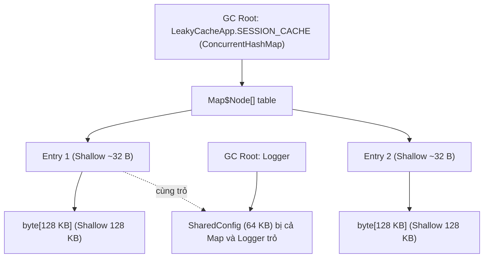

# JVM-09 · Heap dump, Eclipse MAT, JFR

> **TL;DR**: GC log ([JVM-08](../08-gc-log-analysis/README.md)) cho biết *có* leak hay không, còn **Heap Dump (`.hprof`) + Eclipse MAT** và **Java Flight Recorder (JFR)** trả lời *cái gì* đang chiếm RAM hoặc ngốn CPU/Lock. Trong **Eclipse MAT**, đừng nhìn mỗi **Shallow Size** (kích thước bản thân một object rỗng ruột), hãy đọc **Retained Size** và **Dominator Tree** để thấy ngay "ông trùm" giữ cả đồ thị bộ nhớ đằng sau (như `ConcurrentHashMap`). Trên production đang chạy, lấy heap dump cần quy trình an toàn (cách ly khỏi load balancer vì gây STW pause), còn bình thường hãy ưu tiên **JFR** (< 1–2% overhead) để soi **Allocation Profiling** và **Lock Contention**.

## 🧭 Brief

| | |
| :--- | :--- |
| **Loại** | Bài học |
| **Giai đoạn** | Năm 1 · Q1 |
| **Chủ đề** | Java hiện đại & JVM Internals |
| **Tiên quyết** | [JVM-08](../08-gc-log-analysis/README.md) |

**Phạm vi bắt buộc**
- jcmd/jmap tạo heap dump
- dominator tree, retained size
- leak suspects
- JFR + JMC: allocation profiling, lock profiling

**Câu hỏi sâu — nội dung phải giúp trả lời được**
- Shallow size vs retained size?
- Lấy heap dump trên prod an toàn thế nào?

**Ý tưởng lab / demo**
- App leak qua static Map, tìm ra bằng MAT; ghi JFR và đọc hot method

**Tài liệu gốc gợi ý**
- JVM Specification
- Effective Java 3rd
- Oracle GC Tuning Guide
- JEP index (openjdk.org/jeps)

**Gói đầu ra**
- [x] `README.md` — lý thuyết theo [lesson-template](../../../docs/templates/lesson-template.md)
- [x] `exercises.md` — bài tập L1/L2/L3 theo [exercises-template](../../../docs/templates/exercises-template.md)
- [x] `solutions.md` — đáp án theo [solutions-template](../../../docs/templates/solutions-template.md)
- [x] `lab/` — code demo chạy được + `lab/README.md` theo [lab-template](../../../docs/templates/lab-template.md)
- [ ] _(người học)_ `my-notes.md` — **agent không tạo**

---

## 1. Bài toán & Động lực

GC log đã báo đáy heap leo dốc và Full GC lặp lại liên tục. Nhưng một ứng dụng Spring hay JBoss có hàng nghìn class: thứ đang phình trong Old Gen là **session cache**, **JDBC ResultSet chưa đóng**, **Hibernate first-level cache**, hay một **`static Map`** quên eviction?

Nếu đọc code bằng mắt thường để đoán chỗ leak, tỷ lệ đoán sai rất cao. Ngược lại, kết hợp **Heap Dump + Eclipse MAT** (ảnh X-quang không gian bộ nhớ tĩnh tại 1 thời điểm) và **JFR + JMC / CLI** (hộp đen ghi lại diễn biến cấp phát & tranh chấp lock theo thời gian), bạn sẽ khoanh vùng đúng tới tên biến static và đúng dòng code chỉ trong vài phút.

## 2. Bộ đôi công cụ: Heap Dump (Static Snapshot) vs JFR (Continuous Flight Recorder)

| Tiêu chí | Heap Dump (`.hprof` · Eclipse MAT) | JFR (`.jfr` · JDK Mission Control / `RecordingFile`) |
| :--- | :--- | :--- |
| **Bản chất** | Ảnh chụp toàn bộ object sống trên heap tại 1 thời điểm | Luồng event liên tục bên trong JVM (allocation, lock, CPU, GC, Thread) |
| **Tác động lên app** | **Gây STW dài** (vài giây – chục giây tuỳ live set & disk I/O) | Rất nhẹ (**~1–2% overhead** với `settings=profile`), an toàn chạy trực tiếp trên prod |
| **Kích thước file** | Lớn bằng lượng live objects (có thể **4 GB – 32 GB**) | Nhỏ (vài trăm KB – vài chục MB dạng binary ring buffer) |
| **Trả lời câu hỏi gì** | "Ai đang giữ 2 GB RAM không chịu nhả?" | "Hàm nào tạo nhiều rác nhất? Thread kẹt ở `synchronized` nào?" |

## 3. Cơ chế bên trong (Deep Dive)

### 3.1 `jcmd` vs `jmap`: Lấy Heap Dump từ CLI hiện đại

Từ JDK 9+, Oracle khuyến nghị dùng **`jcmd`** thay cho `jmap` (tránh các rủi ro freeze/hang với `-F` force mode của `jmap`):

```powershell
# Tìm PID của Java process
jcmd

# Tạo live heap dump (chỉ giữ object sống sau khi quét, giảm kích thước file)
jcmd <pid> GC.heap_dump C:\dumps\app-live.hprof

# Bắt buộc có sẵn trong cờ khởi động để tự dump đúng khoảnh khắc sập:
-XX:+HeapDumpOnOutOfMemoryError -XX:HeapDumpPath=/var/dumps/
```

Lưu ý:
- `GC.heap_dump` mặc định chỉ dump **live objects** (tương đương `-dump:live` của `jmap`). Nếu muốn dump *cả rác chết chưa kịp dọn* (đôi khi hữu ích để xem app mới cấp phát gì trước khi GC chạy), truyền thêm cờ `-all`: `jcmd <pid> GC.heap_dump -all app.hprof`.
- Khi `jcmd` chạy trên local cùng user hệ điều hành, nó giao tiếp với target JVM qua **Dynamic Attach mechanism** (Unix domain socket trên Linux `/tmp/.java_pid<pid>` hoặc Windows `hsperfdata` + named pipe).

### 3.2 Eclipse MAT: Shallow Size, Retained Size, Dominator Tree & Leak Suspects

#### Câu hỏi sâu #1 — Shallow size vs Retained size?



- **Shallow Size**: lượng bộ nhớ do **chính bản thân một object** chiếm trực tiếp (object header + primitive fields + references — chưa tính các object mà nó trỏ tới). Ví dụ bản thân object `ConcurrentHashMap` rỗng ruột chỉ tốn khoảng **64 bytes Shallow Size**, một `Node` chỉ ~**32 bytes**! Nếu xếp hạng Histogram theo Shallow Size, thứ đứng top thường là `byte[]`, `char[]`, `String`, khiến bạn *không biết ai giữ chúng*.
- **Retained Size** của object `X`: tổng Shallow Size của `X` **cộng thêm toàn bộ các object chỉ có thể đi tới từ GC Root xuyên qua `X`** (nói cách khác: *lượng RAM sẽ được GC giải phóng ngay lập tức nếu `X` bị mất tham chiếu*).
  - Trong sơ đồ trên: `SESSION_CACHE` có **Shallow Size = ~64 B**, nhưng **Retained Size = > 256 KB** (chứa `Node[]`, các `Entry`, và các `byte[128KB]`), *không* bao gồm `SharedConfig` vì `SharedConfig` còn được `Logger` giữ từ một nhánh GC Root khác!
- **Dominator Tree**: cây phân cấp các nút *dominate* (chi phối quyền sống chết) dựa trên đồ thị heap. Node đứng đầu Dominator Tree theo **Retained Heap** chính là nút cổ chai nắm giữ phần lớn RAM (thường là 1 `ConcurrentHashMap`, 1 `Thread`, hoặc 1 `ClassLoader`).
- **Leak Suspects Report**: báo cáo tự động của MAT quét tìm các "accumulation point" chiếm > 10% heap và gợi ý thẳng đường **Shortest Path to GC Roots** (loại bỏ Weak/Soft/Phantom reference — *Merge Shortest Paths to GC Roots -> exclude weak references*).

### 3.3 Câu hỏi sâu #2 — Lấy heap dump trên production an toàn thế nào?

> Lệnh `jcmd <pid> GC.heap_dump` bắt buộc **Stop-The-World** trong toàn bộ thời gian đọc và ghi đồ thị object xuống đĩa. Nếu heap đang sống 16 GB, node có thể **đứng hình 15–60 giây** và làm đầy 16 GB ổ đĩa!

Quy trình 6 bước lấy heap dump an toàn trên production:
1. **Rút node ra khỏi Load Balancer / Service Discovery (Drain traffic)** trước khi dump (nếu cụm có ≥ 2 node). Nếu không rút, LB/K8s liveness probe thấy node không phản hồi 30 giây sẽ **kill pod/restart**, chặt đứt file `.hprof` đang ghi dở!
2. **Kiểm tra dung lượng đĩa trống** tại đích dump phải lớn hơn tối thiểu `1.5x` heap đang sử dụng (`-Xmx`). Tránh dump vào `/tmp` nếu `/tmp` là RAMFS (`tmpfs`) — vì dump 10 GB vào `tmpfs` sẽ ngốn sạch RAM OS và kích hoạt **Linux OOM Killer**!
3. **Nén hoặc copy ra khỏi node ngay sau khi xong** (`gzip` / chuyển sang máy phân tích có nhiều RAM hơn). Lưu ý MAT cần RAM để mở `.hprof` bằng khoảng **1x–1.5x** kích thước file `.hprof` (cấu hình trong `MemoryAnalyzer.ini`: `-Xmx8g`).
4. **Dùng `-XX:+HeapDumpOnOutOfMemoryError -XX:HeapDumpPath=...`** (kết hợp `-XX:+ExitOnOutOfMemoryError` hoặc `-XX:+CrashOnOutOfMemoryError` trên Kubernetes/orchestrator để node tự chết sạch và lên node mới sau khi dump xong thay vì sống lay lắt dạng zombie).
5. **Nếu không thể chịu STW hay hết đĩa**: dùng **JFR** trước (hoặc `jcmd <pid> GC.class_histogram` — nhẹ hơn heap dump nhiều lần, chỉ in bảng thống kê class & bytes ra text trong < 1–2 giây mà không xuất hàng GB file!).

### 3.4 JFR + JMC: Allocation Profiling & Lock Profiling

**Java Flight Recorder (JFR)** tích hợp sẵn trong OpenJDK (miễn phí trên mọi bản OpenJDK 11+, backport xuống 8u262+). Bạn có thể thu dữ liệu ngay trên production mà không cần khởi động lại JVM:

```powershell
# Bắt đầu ghi profile 60 giây trên JVM đang chạy rồi tự xuất file
jcmd <pid> JFR.start name=prod-check settings=profile duration=60s filename=prod.jfr

# Hoặc mở thủ công rồi dump tức thì:
jcmd <pid> JFR.start name=lab settings=profile
jcmd <pid> JFR.dump name=lab filename=live.jfr
jcmd <pid> JFR.stop name=lab
```

Hai view đáng giá nhất trong **JMC (JDK Mission Control)** hoặc đọc bằng API `jdk.jfr.consumer.RecordingFile` ([`JfrInspector`](lab/src/main/java/lab/jvm/matjfr/JfrInspector.java)):
1. **Memory -> TLAB Allocations (`jdk.ObjectAllocationSample` / `jdk.ObjectAllocationInNewTLAB`)**: chỉ rõ chính xác **method nào** và **call stack nào** tạo rác nhiều nhất (trả lời thẳng vấn đề allocation rate cao ở JVM-08!).
2. **Lock Instances (`jdk.JavaMonitorEnter`)**: ghi lại mọi lần thread phải chờ khi vào `synchronized`, tổng thời gian block (`ms`) và **Monitor Class / Contended Method** — rất hiệu quả khi tìm nguyên nhân throughput giảm dù CPU chỉ đạt 20%!

## 4. Quy trình kết hợp trong thực tế

```text
1. GC log thấy Full GC / leak  ──▶ jcmd <pid> GC.class_histogram (nhanh, nhẹ)
                                     │
                                     ▼
2. Cần xem ai giữ GC Root     ──▶ Drain traffic -> jcmd <pid> GC.heap_dump -> Eclipse MAT (Dominator Tree)
                                     │
                                     ▼
3. CPU / Alloc / Lock cao     ──▶ jcmd <pid> JFR.start settings=profile -> JMC / JfrInspector
```

## 5. Minh hoạ & Lab

Lab [`09-heap-dump-mat-jfr/lab`](lab/README.md) mô phỏng [`LeakyCacheApp`](lab/src/main/java/lab/jvm/matjfr/LeakyCacheApp.java) với đúng 3 lỗi kinh điển:
1. `SESSION_CACHE` (`static ConcurrentHashMap<String, byte[]>`) giữ 200–300 entry `byte[128KB]`.
2. `allocateTempAuditPayload()` bơm rác `byte[16KB]` liên tục trong vòng lặp.
3. `contendedAuditLock()` gọi `Thread.sleep(2)` bên trong `synchronized (AUDIT_LOCK)` giữa 4 worker threads.

Kết quả chạy thật với `jcmd` trên OpenJDK 26.0.1:
- **Heap Dump live (`jcmd <pid> GC.heap_dump`)**: xuất thành công file **43.916.429 bytes (~41.9 MB)** trong **0.045s** với 300 entry rò rỉ (~37.5 MB nằm gọn dưới dominator `LeakyCacheApp.SESSION_CACHE`).
- **JFR Recording (`jcmd <pid> JFR.start/dump` + [`JfrInspector`](lab/src/main/java/lab/jvm/matjfr/JfrInspector.java))**: file `258.656 bytes` chứa `3.847` events (`262` allocation samples, `125` monitor enter events), bóc tách chính xác hai thủ phạm:
  - **Top Allocation Hot Method**: `lab.jvm.matjfr.LeakyCacheApp#allocateTempAuditPayload` (`59.860.272` bytes sampled)
  - **Top Contended Lock Method**: `lab.jvm.matjfr.LeakyCacheApp#contendedAuditLock` (`2.332,25 ms` tổng thời gian 4 thread đứng chờ nhau)

## 6. Legacy corner (Java 7 / JBoss AS 7.1.1)

Trên **Java 7**, `jcmd` đã có từ JDK 7u4 (`jcmd <pid> GC.heap_dump`), nhưng phổ biến nhất thời đó vẫn là **`jmap`**:

```text
jmap -dump:live,format=b,file=jboss-heap.hprof <pid>
jmap -histo:live <pid> | head -n 30
```

Hai cảnh báo sống còn trên JBoss / Java 7:
1. **Tuyệt đối cẩn thận với `jmap -F`**: flag `-F` (Force) tạm dừng tiến trình ở tầng debugger OS rất chậm (có thể treo node JBoss hàng chục phút) và thỉnh thoảng làm crash VM; chỉ dùng khi JVM đã treo cứng không attach được bình thường.
2. **Không dùng JFR miễn phí trên Oracle JDK 7/8 commercial**: trước Java 11, Flight Recorder trên Oracle JDK 7/8 là tính năng thương mại (`-XX:+UnlockCommercialFeatures -XX:+FlightRecorder`), không bật sẵn nếu không có license; trên production Java 7 không có JFR thì dùng `jstack` (lấy 3–5 thread dump cách nhau 5 giây để tìm lock contention) thay thế.

## 7. Lỗi hay gặp trong production

1. **Dump `.hprof` vào `/tmp` (RAMFS) làm sập luôn toàn bộ container/VM**
   Trên nhiều bản Linux/container, `/tmp` mount trên RAM (`tmpfs`), không phải ổ đĩa thật. Ghi 8 GB `.hprof` vào `/tmp` sẽ ăn hết RAM vật lý và khiến kernel bắn `SIGKILL` (OOM Killer).
2. **Đọc Histogram trên MAT rồi kết luận `byte[]` hoặc `String` là "thủ phạm leak"**
   `byte[]` và `char[]` gần như lúc nào cũng đứng #1 về Shallow Size! Bạn *bắt buộc* phải mở **Dominator Tree** (sắp theo **Retained Heap**) hoặc click chuột phải vào `byte[]` → **Merge Shortest Paths to GC Roots (exclude weak references)** để truy ra object cha giữ nó.
3. **Cố mở file `.hprof` 16 GB bằng Eclipse MAT chạy trên laptop RAM 8 GB**
   MAT sẽ treo hoặc văng OOM. Hoặc mở từ đầu trên server/VM có đủ RAM (`-Xmx24g` trong `MemoryAnalyzer.ini`), hoặc bật chế độ CLI parse tạo report HTML (`ParseHeapDump.bat app.hprof org.eclipse.mat.api:suspects`).

## 8. Checklist thực hành

- [ ] Chạy xong [`HeapMatJfrTest`](lab/src/test/java/lab/jvm/matjfr/HeapMatJfrTest.java) (`mvn -o test`) kiểm chứng sinh file `.hprof` header `JAVA PROFILE` và `.jfr` events.
- [ ] Thực hành gắn `jcmd <pid> GC.heap_dump` và `jcmd <pid> JFR.start/dump` vào `LeakyCacheApp` đang chạy thật, đọc kết quả qua `JfrInspector` (hoặc mở trong JMC/Eclipse MAT).
- [ ] Giải hết các bài L1–L3 trong [exercises.md](exercises.md) trước khi đối chiếu [solutions.md](solutions.md).

## 9. Câu hỏi tự kiểm tra

1. Một `ConcurrentHashMap` rỗng chứa 1 triệu `byte[1KB]` đang có Shallow Size ~64 bytes. Retained Size của nó khoảng bao nhiêu, và ngoại lệ nào làm một vài `byte[1KB]` *không* cộng vào Retained Size của Map?
2. Tại sao trên Kubernetes/LB production không nên chạy thẳng `jcmd <pid> GC.heap_dump` vào giữa giờ cao điểm khi chưa rút node?
3. Nếu chưa có Eclipse MAT hay file `.hprof` quá lớn (32 GB), lệnh `jcmd` nào cho thông tin sơ bộ tức thì chỉ tốn < 1–2 giây?
4. Khi phân tích file `.jfr` bằng JMC hoặc `JfrInspector`, tên 2 event chuẩn giúp tìm **nơi cấp phát rác nhiều** và **nơi tranh chấp lock** là gì?
5. Trên JBoss chạy Java 7 không có JFR miễn phí, làm sao tìm được lock contention giống như `jdk.JavaMonitorEnter`?

## 10. Tài liệu tham khảo

- [JEP 328: Flight Recorder (Open-sourced in Java 11)](https://openjdk.org/jeps/328)
- [Eclipse Memory Analyzer (MAT) Documentation — Shallow vs Retained Heap](https://help.eclipse.org/latest/topic/org.eclipse.mat.ui.help/concepts/shallowretainedheap.html)
- [Oracle Java Troubleshooting Guide — The `jcmd` Utility](https://docs.oracle.com/en/java/javase/21/troubleshoot/diagnostic-tools.html)
- Bài tiếp theo: [JVM-10 · Metaspace & ClassLoader leak](../10-metaspace-classloader-leak/README.md)
