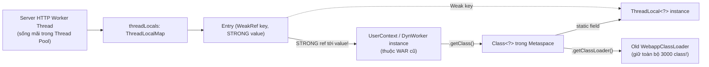

# JVM-10 · Metaspace & ClassLoader leak

> **TL;DR**: Một class trong JVM chỉ được **unload** khỏi **Metaspace** (native memory, hoặc **PermGen** trên Java 7) khi **3 điều kiện xảy ra đồng thời**: không còn instance nào của class đó sống, không còn tham chiếu tới object `Class<?>` của nó, và **chính `ClassLoader` nạp ra nó phải unreachable**. Trên JBoss / Tomcat khi redeploy WAR không restart server, chỉ cần **một** `ThreadLocal` trên thread pool, một JDBC `DriverManager` chưa deregister, hoặc một timer thread cũ còn giữ reference tới một object thuộc `ClassLoader` cũ, toàn bộ hàng nghìn class của bản WAR cũ sẽ mắc kẹt mãi mãi cho đến khi nổ **`java.lang.OutOfMemoryError: Metaspace`**.

## 🧭 Brief

| | |
| :--- | :--- |
| **Loại** | Bài học |
| **Giai đoạn** | Năm 1 · Q1 |
| **Chủ đề** | Java hiện đại & JVM Internals |
| **Tiên quyết** | [JVM-09](../09-heap-dump-mat-jfr/README.md) |

**Phạm vi bắt buộc**
- metaspace growth
- redeploy leak trong app server
- ThreadLocal leak
- OOM: Metaspace

**Câu hỏi sâu — nội dung phải giúp trả lời được**
- Vì sao redeploy nhiều lần trên JBoss dẫn đến OOM Metaspace?
- ThreadLocal gây leak như thế nào trong thread pool?

**Ý tưởng lab / demo**
- Tái hiện classloader leak bằng thread giữ reference sau redeploy giả lập

**Tài liệu gốc gợi ý**
- JVM Specification
- Effective Java 3rd
- Oracle GC Tuning Guide
- JEP index (openjdk.org/jeps)

**Gói đầu ra**
- [x] `README.md` — lý thuyết theo [lesson-template](../../../docs/templates/lesson-template.md)
- [x] `exercises.md` — bài tập L1/L2/L3 theo [exercises-template](../../../docs/templates/exercises-template.md)
- [x] `solutions.md` — đáp án theo [solutions-template](../../../docs/templates/solutions-template.md)
- [x] `lab/` — code demo chạy được + `lab/README.md` theo [lab-template](../../../docs/templates/lab-template.md)
- [ ] _(người học)_ `my-notes.md` — **agent không tạo**

---

## 1. Bài toán & Động lực

Bạn deploy lại file `.war` 5–10 lần trong ngày lên cùng một JBoss / WildFly / Tomcat đang chạy để test hoặc hotfix, không hề báo lỗi heap. Đến lần redeploy thứ 12, toàn bộ server treo cứng với dòng log:

```text
java.lang.OutOfMemoryError: Metaspace
```

Hoặc trên Java 7 là `java.lang.OutOfMemoryError: PermGen space`. Bạn kiểm tra `-Xmx` thấy Java Heap vẫn còn trống một nửa! Lý do là **Class Metadata** không nằm trên Java Heap (nơi GC quét mỗi giây), mà nằm ở vùng bộ nhớ riêng của **Metaspace** gắn chặt với vòng đời của từng **`ClassLoader`** (kiến thức nền ở [JVM-03](../03-class-loading/README.md) và [JVM-04](../04-jvm-memory-areas/README.md)).

## 2. PermGen (Java 7) → Metaspace (Java 8–21+)

| Tiêu chí | PermGen (Java ≤ 7) | Metaspace (Java 8–21+) |
| :--- | :--- | :--- |
| **Vị trí lưu** | Một vùng cố định nối liền **Java Heap** | **Native Memory** (ngoài Java Heap, cấp phát bởi OS qua chunk) |
| **Giới hạn mặc định** | Rất nhỏ (~64–82 MB), đặt qua `-XX:MaxPermSize` | **Không giới hạn trên mặc định (`unlimited`)**, có thể chặn qua `-XX:MaxMetaspaceSize` |
| **Hậu quả khi leak** | Nhanh chóng văng `OOM: PermGen space` | Phình RAM native âm thầm cho tới khi chạm `MaxMetaspaceSize` hoặc bị Linux **OOM Killer** bắn sập pod! |
| **Điều kiện Class Unloading** | Phải giải phóng **toàn bộ `ClassLoader`** + cả `String` intern/meta cũ | Phải giải phóng **chính `ClassLoader` instance** + bật `-XX:+ClassUnloading` (mặc định ON) |

> Chết người trên container: Nếu không đặt `-XX:MaxMetaspaceSize` trên Kubernetes/Docker, một app bị ClassLoader leak có thể ăn sạch RAM ngoài heap mà JMX Heap metrics không hề cảnh báo, dẫn tới container bị `OOMKilled` (`Exit Code 137`) không có `.hprof`! Ngược lại, đặt `-XX:MaxMetaspaceSize` là **cầu chì bảo vệ** giúp JVM báo lỗi `OutOfMemoryError: Metaspace` rõ ràng thay vì kéo chết cả OS node.

## 3. Cơ chế bên trong (Deep Dive)

### 3.1 Liên kết 2 chiều khiến ClassLoader "không thể chết"

Theo JVM Specification, mối liên hệ giữa một instance, class của nó và ClassLoader là liên kết sống còn chặt chẽ:
1. Mỗi **Object** trên heap giữ con trỏ **Klass Pointer** trỏ tới cấu trúc class metadata (`java.lang.Class<?>`) tương ứng (đã học ở [JVM-04](../04-jvm-memory-areas/README.md)).
2. Mỗi **`Class<?>`** giữ tham chiếu mạnh tới **defining `ClassLoader`** (`clazz.getClassLoader()`).
3. Mỗi **`ClassLoader`** lại giữ danh sách **toàn bộ mọi `Class<?>`** (`Vector<Class<?>> classes`) mà nó từng nạp!

Hệ quả tất yếu: **Chỉ cần MỘT object duy nhất thuộc một class bất kỳ do `WebappClassLoader` nạp vẫn còn đường dẫn tới GC Root, toàn bộ `WebappClassLoader` và TẤT CẢ 3.000 class trong file `.war` cũ sẽ không bao giờ bị unload!**

### 3.2 Câu hỏi sâu #1 — Vì sao redeploy nhiều lần trên JBoss dẫn đến OOM Metaspace?

Trên JBoss AS 7.1.1 / WildFly / Tomcat, **Server Core Thread** (HTTP worker thread pool, JDBC pool, JBoss Remoting, timer thread) được nạp bởi **Module/Bootstrap ClassLoader cấp server** (sống từ lúc start đến lúc stop JVM). Mỗi lần bạn bấm *Redeploy `app.war`*:
- JBoss tạo **một `ModuleClassLoader` / `WebappClassLoader` mới** cho `app.war` phiên bản mới để nạp lại class.
- Phiên bản `app.war` cũ được kỳ vọng trở thành rác để Full GC dọn sạch Metaspace.
- Nhưng thực tế có 4 "cái neo" thường giữ chặt `ClassLoader` cũ từ bên ngoài:
  1. **`ThreadLocal` không `.remove()`** trên HTTP worker thread của JBoss (chi tiết ở mục 3.3).
  2. **JDBC Driver (`DriverManager`)**: `app.war` tự nạp `ojdbc.jar` / `mysql-connector.jar`; `java.sql.DriverManager` (nạp bởi Bootstrap ClassLoader!) đăng ký driver instance vào danh sách `registeredDrivers` toàn cục → giữ `ClassLoader` của WAR dù WAR đã undeploy!
  3. **Background thread / `Timer` / `ExecutorService` không `shutdown()`** trong `ServletContextListener.contextDestroyed()`: bản thân thread đang chạy giữ contextClassLoader (`Thread.currentThread().getContextClassLoader()`) trỏ vào `WebappClassLoader` cũ.
  4. **Logging / Reflection / ShutdownHook leak**: Apache Commons Logging `LogFactory` cache, `Introspector.flushCaches()`, `Runtime.addShutdownHook()` chưa gỡ, hoặc thư viện đăng ký JMX MBean quên unregister.

Sau $N$ lần redeploy, trong Metaspace tồn tại song song $N$ bản sao của toàn bộ metadata ứng dụng → **`OutOfMemoryError: Metaspace`**.

### 3.3 Câu hỏi sâu #2 — `ThreadLocal` gây leak như thế nào trong thread pool?



Hãy nhìn kỹ vào cấu trúc nội tại của `java.lang.ThreadLocal.ThreadLocalMap.Entry` (JDK source):
- `Entry` kế thừa **`WeakReference<ThreadLocal<?>>`**: tức là chỉ **KEY** (biến `ThreadLocal`) là *Weak Reference*!
- Còn **VALUE** (dữ liệu bạn đặt bằng `.set(value)`) lại là **STRONG Reference**!

Khi ứng dụng chạy trong một **Thread Pool tái sử dụng thread** (như `http-executor` của JBoss AS 7.1.1 hoặc `Executors.newFixedThreadPool`):
1. Request kết thúc, thread *không chết* mà quay lại pool chờ request sau → `Thread.threadLocals` (`ThreadLocalMap`) tồn tại suốt đời server!
2. Nếu quên gọi `threadLocal.remove()` trong `finally`, `Entry.value` giữ Strong Reference tới object thuộc **WAR ClassLoader cũ**.
3. Độc hại hơn: nếu `ThreadLocal` là `static final` của một class trong WAR cũ, ta có **vòng tròn giữ mạnh**: `Entry.value -> getClass() -> static ThreadLocal key`! Khi đó ngay cả `WeakReference` ở key cũng **không thể** tự động thành `null` khi GC chạy — cả key, value, `ClassLoader`, và toàn bộ Metaspace của bản WAR cũ bị khóa cứng vĩnh viễn!
4. Ngay cả khi *không* redeploy (microservice Spring Boot chạy 1 WAR duy nhất), quên `.remove()` trên thread pool còn gây 2 lỗi chết người khác: **(a) Data corruption chéo user** (request sau đọc nhầm `TenantContext` / `UserPrincipal` của request trước) và **(b) Heap memory leak** nếu `value` nặng mà key là dynamic `ThreadLocal` không bao giờ chạm tới slot đó nữa.

## 4. Cách phòng ngừa & Gỡ rối Metaspace Leak

| Tình huống | Giải pháp triệt để |
| :--- | :--- |
| **`ThreadLocal` trong Servlet / Async pool** | Luôn bọc `try { ctx.set(val); ... } finally { ctx.remove(); }`; tránh truyền `ThreadLocal` tự động qua async nếu không có filter dọn sạch. |
| **Redeploy WAR trên JBoss / Tomcat** | Đặt JDBC driver thành **server-level module / datasource** (không nhúng trong `WEB-INF/lib`); đóng hết `ExecutorService` / unregister MBean trong `ServletContextListener.contextDestroyed()`. |
| **Container / Kubernetes Java 21** | Đặt `-XX:MaxMetaspaceSize=256m` (tuỳ app đo thực tế) + `-Xlog:gc+metaspace*,class+unload=info` để nhận cảnh báo sớm trước khi `OOM: Metaspace`. |
| **Truy tìm từ Heap Dump khi leak** | Trong Eclipse MAT (bài [JVM-09](../09-heap-dump-mat-jfr/README.md)), mở **Duplicate Classes** hoặc lọc `ClassLoader` → xem **Path to GC Roots (exclude weak/soft)** sẽ thấy ngay sợi dây trỏ từ `Thread -> threadLocals -> Entry -> value`! |

## 5. Minh hoạ & Lab

Lab [`10-metaspace-classloader-leak/lab`](lab/README.md) mô phỏng kiến trúc JBoss với `ExecutorService` 4 worker threads sống dai dẳng (`jboss-http-worker`) và mỗi vòng "redeploy" nạp [`DynWorkerTemplate`](lab/src/main/java/lab/jvm/metaspace/DynWorkerTemplate.java) qua một `IsolatedWarClassLoader` hoàn toàn mới trong [`RedeployLeakSimulator`](lab/src/main/java/lab/jvm/metaspace/RedeployLeakSimulator.java):

- **`clean` mode** (gọi `hostSlot.remove()` trong `finally`): cho phép GC thu hồi `IsolatedWarClassLoader` ngay sau undeploy.
- **`leak` mode** (bỏ quên `.remove()`): worker thread giữ `Entry.value -> DynWorkerTemplate -> Class -> IsolatedWarClassLoader` mãi mãi.

Kết quả đo trực tiếp trên OpenJDK 26.0.1:

| Chế độ & Flag | Redeploys | `loadedClasses` | `unloadedClasses` | Metaspace Used | `OOM: Metaspace`? |
| :--- | :--- | :--- | :--- | :--- | :--- |
| **`clean`** (`-XX:MaxMetaspaceSize=20m`, `3000` deploys) | `3000` | `1041` | **`3000` (unload sạch)** | **`1.45 MB`** | Không (`hitOOM=false`) |
| **`leak`** (`-XX:MaxMetaspaceSize=32m`, `2000` deploys) | `2000` | **`3044`** | **`0` (không unload nổi 1 class)** | **`15.89 MB`** | Tăng tuyến tính |
| **`leak`** (`-XX:MaxMetaspaceSize=20m`, ép `3000` deploys) | Crash giữa chừng | — | `0` trong lúc sống | Chạm trần `20 MB` | **Có — văng `java.lang.OutOfMemoryError: Metaspace`** |

## 6. Legacy corner (Java 7 / JBoss AS 7.1.1)

Với đội ngũ vận hành **JBoss AS 7.1.1 trên Java 7**, Metaspace leak thực ra chính là căn bệnh kinh điển **PermGen Exhaustion** mỗi lần hot-redeploy ứng dụng qua Management Console hoặc thư mục `standalone/deployments/`:

1. **Triệu chứng JBoss AS 7.1.1**:
   - Lần deploy #1 mượt; lần hot-redeploy #4–#6 chậm dần rồi văng `java.lang.OutOfMemoryError: PermGen space` ở `jboss-msc` hoặc `org.jboss.as.server.deployment`.
   - Flag bắt buộc trong `standalone.conf.bat` (Java 7): `-XX:PermSize=128m -XX:MaxPermSize=256m` (và trên HotSpot Java 7 kết hợp CMS cần thêm **`-XX:+CMSClassUnloadingEnabled`** thì CMS mới chịu unload class chết; Java 8+ trở lên không còn PermGen và bật class unloading mặc định).
2. **Thủ phạm phổ biến nhất ở codebase Java 7 / JDBC / JBoss**:
   - Đóng gói driver `ojdbc6.jar` hoặc `sqljdbc4.jar` ngay trong `WAR/WEB-INF/lib` thay vì dùng JBoss **Module + `<datasource>` JNDI**.
   - Servlet filter lưu `UserSession` / `SimpleDateFormat` vào `static ThreadLocal` mà không có `finally { tl.remove(); }`.
   - Spring 3/4 hoặc Hibernate 4 tạo proxy CGLIB/Javassist động (mỗi lần tạo class động lại tốn thêm PermGen!).
3. **Khuyến nghị vận hành thực tế**: Trên production Java 7 / JBoss AS 7.1.1, **không** hot-redeploy trực tiếp lên node đang sống quá 1–2 lần; luôn restart sạch JVM JBoss theo cụm rolling restart khi release bản mới, và kiểm tra rò rỉ bằng quy trình MAT (`duplicate classes` / `ClassLoader` path to GC root).

## 7. Lỗi hay gặp trong production

1. **Nghĩ rằng `WeakReference` trong `ThreadLocalMap` sẽ tự dọn leak giúp mình**
   Sai hoàn toàn: chỉ **key** là weak, còn **value** là **strong reference**. Hơn nữa nếu value có đường tham chiếu ngược về key (như object của class giữ `static final ThreadLocal`), cả key cũng không bị thu hồi!
2. **Bỏ trống `-XX:MaxMetaspaceSize` trên Docker/K8s rồi ngạc nhiên khi pod bị `OOMKilled` (Exit 137)**
   Không giới hạn Metaspace khiến JVM mở rộng native memory vô hạn đến mức Linux OOM Killer giết cả tiến trình mà không kịp chạy `-XX:+HeapDumpOnOutOfMemoryError`.
3. **Dùng `-XX:MaxMetaspaceSize=64m` quá nhỏ trên Spring Boot microservices hiện đại**
   Ứng dụng Spring + Hibernate + Jackson + gRPC thực tế thường nạp 15.000–25.000 classes lúc khởi động, cần sẵn **150–250 MB** Metaspace hợp pháp. Đặt quá thấp sẽ OOM ngay lúc startup. Luôn đo mức ổn định khi khởi động (`jcmd <pid> VM.metaspace`) rồi nhân `1.5x–2x` làm ngưỡng giới hạn.

## 8. Checklist thực hành

- [ ] Chạy được [`MetaspaceLeakTest`](lab/src/test/java/lab/jvm/metaspace/MetaspaceLeakTest.java) (`mvn -o test`) kiểm chứng sự khác biệt `unloadedClasses` giữa `clean` và `leak`.
- [ ] Chạy `RedeployLeakSimulator` với `-XX:MaxMetaspaceSize=20m` cho cả hai mode `clean` và `leak` để chứng kiến tận mắt `OutOfMemoryError: Metaspace`.
- [ ] Tự kiểm tra toàn bộ dự án đang làm xem mọi `ThreadLocal.set(...)` đều có cặp `try { ... } finally { ...remove(); }` (đối chiếu [`CleanThreadLocalFilter`](lab/solutions/CleanThreadLocalFilter.java)).

## 9. Câu hỏi tự kiểm tra

1. Liệt kê đúng 3 điều kiện để JVM được phép unload một `Class<?>` và thu hồi Metaspace của nó.
2. Tại sao nói `ThreadLocalMap` dùng `WeakReference` nhưng vẫn gây memory leak cực nặng trong thread pool?
3. Trên JBoss AS 7.1.1 (Java 7), ngoài `ThreadLocal`, hãy nêu 2 nguyên nhân hay gặp khiến hot-redeploy WAR dẫn tới `OOM: PermGen space`.
4. Khác biệt về rủi ro giữa việc **bỏ trống** `-XX:MaxMetaspaceSize` và đặt `-XX:MaxMetaspaceSize` **vừa đủ** là gì?
5. Làm sao xác định chính xác xem một server đang leak **Java Heap** hay leak **Metaspace** chỉ bằng `jcmd` trước khi quyết định mở MAT?

## 10. Tài liệu tham khảo

- [JVM Specification §5.3 Creation and Loading / §5.7 Unloading of Classes and Interfaces](https://docs.oracle.com/javase/specs/jvms/se21/html/jvms-5.html)
- [JEP 122: Remove the Permanent Generation (PermGen -> Metaspace)](https://openjdk.org/jeps/122)
- [JEP 387: Elastic Metaspace](https://openjdk.org/jeps/387)
- [JDK `ThreadLocal` Javadoc & `ThreadLocalMap.Entry`](https://docs.oracle.com/en/java/javase/21/docs/api/java.base/java/lang/ThreadLocal.html)
- Bài trước trong domain: [JVM-09 · Heap dump, Eclipse MAT, JFR](../09-heap-dump-mat-jfr/README.md) · Tổng quan domain: [Java & JVM](../README.md)
