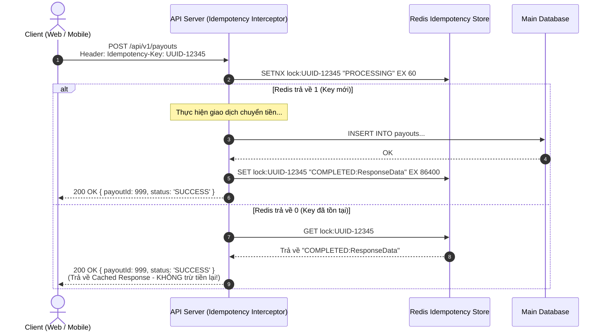

# Idempotency trong API & Hệ thống Giao dịch
**Loại**: #concept  
**Ngày**: 2026-08-02  
**Bối cảnh**: Nghiệp vụ duyệt hồ sơ bảo hiểm, thanh toán ngân hàng, và xử lý API trùng lặp.

---

## 1. Khái niệm Cốt lõi (Idempotency là gì?)

Trong khoa học máy tính và kiến trúc phần mềm, một thao tác được gọi là **Idempotent (Tính đáp ứng lặp lại / Tính định đẳng)** nếu:  
> **Việc thực thi thao tác đó 1 lần hay NHIỀU LẦN liên tiếp với cùng một tập dữ liệu đầu vào đều cho ra CÙNG MỘT KẾT QUẢ CUỐI CÙNG trên hệ thống, và KHÔNG gây ra tác dụng phụ (side-effects) ngoài ý muốn.**

### Công thức Toán học:
$$f(f(x)) = f(x)$$

---

## 2. Tính Idempotent của các Phương thức HTTP (RFC 7231)

| HTTP Method | Có Idempotent Không? | Giải thích chi tiết |
|---|---|---|
| **`GET`** | **CÓ** | Chỉ đọc dữ liệu, gọi 100 lần vẫn trả về danh sách đó, không làm đổi DB. |
| **`PUT`** | **CÓ** | Cập nhật toàn bộ bản ghi (`UPDATE users SET name='A' WHERE id=1`). Gọi 1 lần hay 10 lần thì `name` vẫn là `'A'`. |
| **`DELETE`** | **CÓ** | Xóa bản ghi (`DELETE FROM users WHERE id=1`). Gọi lần 1 xóa thành công, lần 2 trả về 404/204 nhưng trạng thái DB vẫn là "bản ghi id=1 không tồn tại". |
| **`POST`** | **KHÔNG** | Tạo mới tài nguyên (`INSERT INTO orders...`). Gọi 2 lần tạo ra 2 đơn hàng khác nhau với 2 ID khác nhau. |
| **`PATCH`** | **KHÔNG** (Mặc định) | Cập nhật một phần (Có thể idempotent hoặc không, ví dụ: `PATCH /users/1 { "age": "increment" }` làm tăng tuổi mỗi lần gọi). |

---

## 3. Tại sao Vấn đề "Bấm 2 Lần" Lại Rất Phổ biến?

Trong thực tế ứng dụng Web/Mobile, có 3 lý do làm request bị gửi trùng lặp (Duplicate Requests):
1. **Thao tác người dùng (User Action)**: Người dùng sốt ruột bấm nút "Thanh toán" hoặc "Duyệt hồ sơ" 2 lần liên tiếp (Double Click).
2. **Sự cố Mạng (Network Timeout & Retry)**: Trình duyệt gửi request thành công, Server xử lý xong DB, nhưng đường truyền về bị rớt. Trình duyệt / Mobile App tưởng lỗi nên tự động **Retry gửi lại Request lần 2**.
3. **Message Queue Redelivery**: Trong kiến trúc Microservices, Kafka/RabbitMQ cam kết giao tin nhắn "At-Least-Once", nghĩa là 1 tin nhắn duyệt hồ sơ có thể bị gửi 2 lần tới Worker.

Nếu API `POST /api/approval` không Idempotent -> **Hồ sơ bị duyệt 2 lần, tiền bị chi trả 2 lần!**

---

## 4. Các Giải pháp Triển khai Idempotency Chuẩn chuẩn Enterprise

### Giải pháp 1: Idempotency Key Pattern (Chuẩn Stripe / Payment Gateways)
- Client tự sinh một chuỗi UUID duy nhất đại diện cho **ý định thao tác** (ví dụ: `Idempotency-Key: 9b1deb4d-3b7d-4bad-9bdd-2b0d7b3dcb6d`) và gửi kèm trong HTTP Header.
- Server dùng một **Idempotency Store** (Redis hoặc DB Table) để theo dõi vòng đời của Key này.

#### Quy trình xử lý ở Server:
1. Nhận Request với `Idempotency-Key`.
2. Tra cứu Key trong Redis:
   - **Nếu Key chưa tồn tại**: Lưu Key vào Redis với trạng thái `PROCESSING` -> Tiếp tục xử lý nghiệp vụ -> Lưu kết quả Response vào Redis -> Trả về Client.
   - **Nếu Key đang ở trạng thái `PROCESSING`**: Trả về lỗi `409 Conflict` (Yêu cầu trùng lặp đang được xử lý).
   - **Nếu Key đã `COMPLETED`**: Lấy trực tiếp Cached Response trong Redis trả về ngay cho Client mà **KHÔNG CHẠY LẠI LOGIC NGHIỆP VỤ / DB**.

---

### Giải pháp 2: Điều kiện Cập nhật Trạng thái DB (State Machine Check)
Sử dụng câu lệnh SQL có điều kiện trạng thái để đảm bảo 1 dòng chỉ chuyển trạng thái đúng 1 lần:

```sql
-- Chỉ duyệt nếu trạng thái hiện tại đang là 'PENDING'
UPDATE contracts 
SET status = 'APPROVED', approved_at = NOW() 
WHERE id = 1001 AND status = 'PENDING';
```
- Lần 1 gọi: `Affected Rows = 1` -> Duyệt thành công.
- Lần 2 gọi (gửi trùng): `Affected Rows = 0` (vì status đã là `'APPROVED'`) -> Server nhận biết và báo "Hồ sơ này đã được duyệt trước đó", không sinh ra tác dụng phụ.

---

### Giải pháp 3: Ràng buộc Duy nhất ở Database (Unique Constraints)
Tạo `UNIQUE INDEX` trên tổ hợp trường mang tính duy nhất của nghiệp vụ:

```sql
CREATE UNIQUE INDEX idx_unique_approval ON contract_approvals(contract_id, step_code);
```
Dù code ứng dụng có lỡ bị gọi 2 lần song song, DB Engine sẽ chặn câu `INSERT` thứ 2 bằng lỗi vi phạm Unique Key (`SQLCODE -803` trên DB2 hoặc `Error 1062` trên MySQL).

---

## 5. Sơ đồ Luồng Thực thi (Mermaid Diagram)

### Sơ đồ: Idempotency Key Pattern với Redis



---

## 6. Ví dụ Mã nguồn Minh họa (Java Spring Boot Interceptor)

```java
// 1. Annotation để đánh dấu API cần kiểm tra Idempotent
@Target(ElementType.METHOD)
@Retention(RetentionPolicy.RUNTIME)
public @interface Idempotent {
    long expireTimeSeconds() default 86400; // Mặc định lưu 24h
}

// 2. Aspect / AspectJ AOP Xử lý Idempotency
@Aspect
@Component
public class IdempotencyAspect {

    @Autowired
    private StringRedisTemplate redisTemplate;

    @Around("@annotation(idempotent)")
    public Object handleIdempotency(ProceedingJoinPoint joinPoint, Idempotent idempotent) throws Throwable {
        HttpServletRequest request = ((ServletRequestAttributes) RequestContextHolder.currentRequestAttributes()).getRequest();
        String idempotencyKey = request.getHeader("Idempotency-Key");

        if (StringUtils.isEmpty(idempotencyKey)) {
            // Nếu không truyền key, cho qua hoặc ném lỗi tùy chính sách API
            return joinPoint.proceed();
        }

        String redisKey = "idempotency:" + idempotencyKey;
        
        // Thử acquire lock bằng SETNX
        Boolean success = redisTemplate.opsForValue().setIfAbsent(redisKey, "PROCESSING", Duration.ofSeconds(idempotent.expireTimeSeconds()));

        if (Boolean.FALSE.equals(success)) {
            // Key đã tồn tại -> Kiểm tra giá trị
            String cachedValue = redisTemplate.opsForValue().get(redisKey);
            if ("PROCESSING".equals(cachedValue)) {
                throw new ResponseStatusException(HttpStatus.CONFLICT, "Yêu cầu trùng lặp đang được xử lý. Vui lòng chờ.");
            }
            // Trả về kết quả cached trước đó (giả định dùng JSON mapper)
            return deserializeResponse(cachedValue);
        }

        try {
            // Thực thi logic chính của Controller
            Object result = joinPoint.proceed();
            
            // Lưu kết quả vào Redis
            redisTemplate.opsForValue().set(redisKey, serializeResponse(result), Duration.ofSeconds(idempotent.expireTimeSeconds()));
            return result;
        } catch (Throwable ex) {
            // Nếu xử lý thất bại, xóa Key để Client có thể retry lại
            redisTemplate.delete(redisKey);
            throw ex;
        }
    }
}
```

---

## 7. Cạm bẫy Thực tế & Bài học Kinh nghiệm (Production Pitfalls)

1. **Chỉ Disable Nút ở Frontend là CHƯA ĐỦ**:
   - *Sai lầm*: Nghĩ rằng vô hiệu hóa nút `Submit` sau khi click là đã giải quyết xong bài toán Idempotency.
   - *Thực tế*: Hacker có thể dùng Postman gọi thẳng API, hoặc đường truyền chập chờn khiến kết nối đứt ở chiều Response văng về, trình duyệt tự retry gửi lại.

2. **Đặt TTL (Time-To-Live) của Idempotency Key quá ngắn**:
   - Nếu để TTL của Key trong Redis là 5 giây, nhưng tác vụ DB chạy mất 6 giây, request retry thứ 2 nhảy vào sẽ thấy Key đã hết hạn và lại chạy lặp lần nữa.

3. **Cần Xóa Key khi Giao dịch Thất bại (Rollback)**:
   - Nếu lần gọi 1 bị lỗi validation hoặc lỗi DB, phải **xóa Idempotency Key** khỏi Redis để cho phép người dùng sửa dữ liệu và bấm gửi lại thành công.

---

## 8. Cây Quyết định Chọn Giải pháp (Decision Tree)

```
API bạn đang thiết kế thuộc loại nào?
 ├── API đọc dữ liệu (GET) -> Đã Idempotent sẵn, không cần làm gì.
 ├── API cập nhật theo trạng thái (PUT / POST Update)
 │    └── CHỌN: State Machine Check ở câu SQL (WHERE status = 'PENDING')
 └── API giao dịch quan trọng (POST Payment, Duyệt chi trả bảo hiểm, Tạo đơn hàng)
      └── CHỌN: Kết hợp 3 lớp phòng thủ:
           ├── Lớp 1: Client gửi Header `Idempotency-Key` (UUID) -> Server check Redis (Idempotency Key Pattern)
           ├── Lớp 2: DB dùng Unique Index cho các trường trùng lặp (contract_id, step)
           └── Lớp 3: UI disable nút bấm sau khi click (Tối ưu UX)
```

---

## 9. Tài liệu & Bài viết liên quan
- [[transaction-boundary]] — Đảm bảo Idempotency Key Store và Transaction DB hoạt động nhất quán.
- [[pessimistic-vs-optimistic-lock]] — Kết hợp Optimistic Locking với Idempotency.
- [[validate-client-vs-server]] — Validate dữ liệu trước khi kiểm tra Idempotency Key.