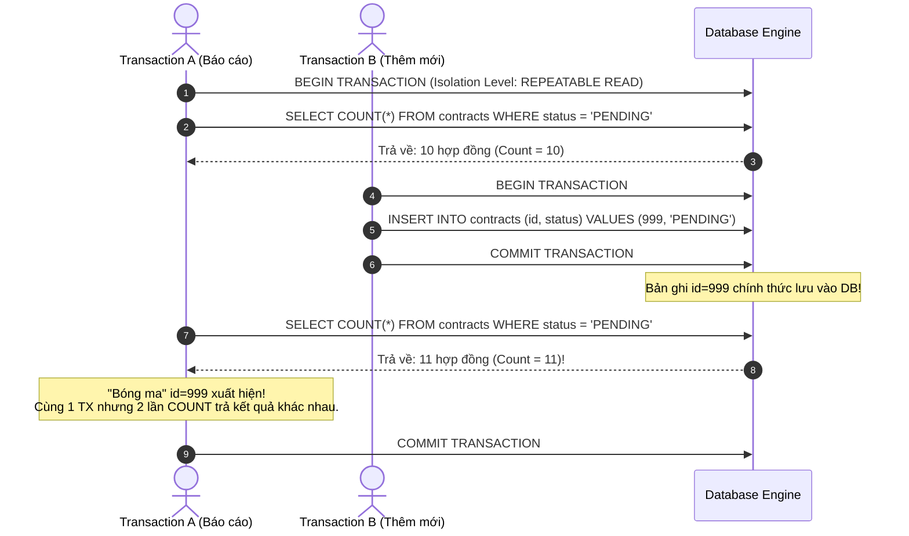

# Phantom Read (Hiện tượng Đọc Bóng Ma) trong Database Transaction
**Loại**: #concept  
**Ngày**: 2026-08-02  
**Bối cảnh**: Quản lý Mức độ Cách ly Giao dịch (Transaction Isolation Levels), tính nhất quán dữ liệu tài chính & báo cáo trong DB2 / MySQL / PostgreSQL.

---

## 1. Khái niệm Cốt lõi (Phantom Read là gì?)

**Phantom Read (Hiện tượng Đọc Bóng Ma)** xảy ra trong hệ thống Cơ sở dữ liệu đa người dùng (Concurrent DB Transactions) khi:

> **Một Giao dịch (Transaction A) thực hiện một câu truy vấn theo phạm vi (Range Query, ví dụ: `WHERE status = 'PENDING'`) hai lần trong cùng một ranh giới Transaction. Giữa hai lần đọc đó, một Giao dịch khác (Transaction B) chèn mới (`INSERT`) hoặc xóa (`DELETE`) bản ghi thỏa mãn điều kiện phạm vi đó và `COMMIT`. Kết quả là ở lần đọc thứ hai, Transaction A thấy xuất hiện thêm các bản ghi "bóng ma" (phantom rows) mà ở lần đọc thứ nhất KHÔNG hề có.**

---

## 2. Phân biệt 3 Hiện tượng Đọc Sai Dữ liệu (Read Phenomena)

Để tránh nhầm lẫn, chuẩn SQL-92 định nghĩa 3 hiện tượng xung đột đọc dữ liệu:

| Hiện tượng | Bản chất Sự cố | Thao tác gây ra ở TX 2 | Cần Isolation Level nào để chặn? |
|---|---|---|---|
| **Dirty Read** (Đọc rác) | TX 1 đọc dữ liệu chưa được commit của TX 2. Sau đó TX 2 bị rollback -> Dữ liệu TX 1 vừa đọc là giả! | `UPDATE` / `INSERT` (Chưa commit) | **Read Committed** |
| **Non-Repeatable Read** (Đọc không lặp lại) | TX 1 đọc dòng X (VD: balance = 100). TX 2 sửa dòng X (balance = 200) và `COMMIT`. TX 1 đọc lại dòng X thấy **giá trị dòng đó bị đổi**. | `UPDATE` trên dòng đã có | **Repeatable Read** |
| **Phantom Read** (Đọc bóng ma) | TX 1 query tập hợp dòng (VD: `WHERE age > 18` trả về 5 dòng). TX 2 chèn thêm dòng mới (age = 20) và `COMMIT`. TX 1 query lại thấy **số lượng dòng tăng từ 5 lên 6**. | **`INSERT`** hoặc **`DELETE`** bản ghi mới thỏa mãn phạm vi | **Serializable** (Hoặc Next-Key Lock trong InnoDB) |

---

## 3. Sơ đồ Luồng Thực thi (Mermaid Diagram)

### Sơ đồ: Diễn biến Hiện tượng Phantom Read



---

## 4. Bảng Mức độ Cách ly Giao dịch (ANSI SQL Isolation Levels)

Hiện tượng Phantom Read liên quan chặt chẽ tới 4 mức độ cách ly của chuẩn SQL:

| Isolation Level | Dirty Read | Non-Repeatable Read | Phantom Read |
|---|---|---|---|
| **Read Uncommitted** | ❌ Có thể bị | ❌ Có thể bị | ❌ Có thể bị |
| **Read Committed** *(Default ở DB2, Oracle, PostgreSQL)* | ✅ Đã chặn | ❌ Có thể bị | ❌ Có thể bị |
| **Repeatable Read** *(Default ở MySQL InnoDB)* | ✅ Đã chặn | ✅ Đã chặn | ❌ Có thể bị *(Theo chuẩn ANSI SQL)* |
| **Serializable** | ✅ Đã chặn | ✅ Đã chặn | ✅ **Đã chặn triệt để** |

> [!NOTE]
> **Đặc trưng của MySQL InnoDB**: InnoDB triển khai cơ chế **Next-Key Locking** (kết hợp Record Lock + Gap Lock) ở mức `REPEATABLE READ`, giúp chặn luôn Phantom Read ngay cả khi chưa lên mức `SERIALIZABLE`! Trong khi đó, **DB2** và **Oracle** cần mức `SERIALIZABLE` (hoặc `RR` - Repeatable Read trong thuật ngữ DB2) để triệt tiêu Phantom Read.

---

## 5. Cơ chế Kỹ thuật Chống Phantom Read

### 5.1 Predicate Locking & Gap Locking (Khóa Khoảng Khoảng Cách)
Khi chạy câu lệnh `SELECT ... WHERE age BETWEEN 20 AND 30 FOR UPDATE`:
- **Record Lock**: Khóa tất cả các dòng hiện có có `age` từ 20 đến 30.
- **Gap Lock (Khóa khoảng trống)**: Khóa các khoảng không gian chỉ mục (index gaps) giữa các bản ghi và khoảng trống sau bản ghi cuối cùng trong dải 20-30.
- **Next-Key Lock**: Sự kết hợp giữa Record Lock và Gap Lock. Chặn bất kỳ Transaction B nào cố gắng `INSERT` một bản ghi mới có `age = 25` vào khoảng không gian này cho tới khi Transaction A hoàn tất.

### 5.2 MVCC (Multi-Version Concurrency Control) & Snapshot Isolation
Trong các DB hiện đại (PostgreSQL, Oracle, MySQL), MVCC tạo ra một **Read View (Ảnh chụp nhanh Snapshot)** tại thời điểm Transaction A bắt đầu. Tất cả các câu query `SELECT` thuần túy (Consistent Read) trong Transaction A sẽ chỉ nhìn thấy bản chụp dữ liệu tại thời điểm đó, hoàn toàn phớt lờ các bản ghi `INSERT` mới của Transaction B.

---

## 6. Ví dụ Mã nguồn Minh họa (Java / Spring / DB2)

### 6.1 Cấu hình Isolation Level trong Spring Transaction

```java
@Service
public class FinancialReportService {

    @Autowired
    private ContractRepository contractRepository;

    // Cấu hình Isolation Level = SERIALIZABLE để triệt tiêu hoàn toàn Phantom Read
    @Transactional(isolation = Isolation.SERIALIZABLE, readOnly = true)
    public FinancialReportDto generateAuditReport() {
        // Lần query 1: Tổng tiền các hợp đồng đang chờ duyệt
        BigDecimal firstTotal = contractRepository.sumAmountByStatus("PENDING");

        // Thực hiện một số tính toán trung gian...
        doComplexCalculation();

        // Lần query 2: Kiểm tra lại tổng tiền để đảm bảo tính nhất quán tuyệt đối
        BigDecimal secondTotal = contractRepository.sumAmountByStatus("PENDING");

        if (!firstTotal.equals(secondTotal)) {
            // Nếu dùng SERIALIZABLE, hiện tượng này KHÔNG BAO GIỜ xảy ra!
            throw new IllegalStateException("Phát hiện Phantom Read làm sai lệch báo cáo tài chính!");
        }

        return new FinancialReportDto(firstTotal);
    }
}
```

### 6.2 Cú pháp SQL Khóa Khoảng cách trong IBM DB2 (bối cảnh eBAF)

```sql
-- Dùng Isolation Level RR (Repeatable Read trong DB2 tương đương Serializable trong ANSI SQL)
-- Giữ Exclusive Lock trên toàn bộ Range kết quả
SELECT SUM(amount) 
FROM contracts 
WHERE status = 'PENDING' 
WITH RR USE AND KEEP EXCLUSIVE LOCKS;
```

---

## 7. Cạm bẫy Thực tế & Bài học từ Production (Production Pitfalls)

1. **Sai lệch Báo cáo Tài chính & Kiểm toán (Audit Inconsistency)**:
   - *Kịch bản*: Batch chạy tính tổng tiền chi trả trong đêm. Bước 1 query `COUNT` được 1000 hồ sơ. Bước 2 loop qua từng hồ sơ để cộng tiền. Trong lúc đó có 5 hồ sơ mới được insert vào. Kết quả tổng tiền tính ra bị chênh lệch so với số lượng đếm ban đầu -> **Báo cáo tài chính không khớp balance**.

2. **Lỗi Deadlock gia tăng khi nâng cấp lên `SERIALIZABLE`**:
   - *Thực tế*: Để chống Phantom Read, việc bật `SERIALIZABLE` sẽ khiến DB cài đặt Gap Lock / Table Lock rất nhiều.
   - *Hậu quả*: Tỷ lệ bị **Deadlock** giữa các transaction song song tăng vọt, làm giảm throughput của toàn hệ thống.
   - *Bài học*: **Không lạm dụng `SERIALIZABLE` cho toàn hệ thống**. Chỉ áp dụng cho các hàm tính toán tài chính / chốt sổ kế toán thực sự nhạy cảm.

---

## 8. Cây Quyết định Chọn Isolation Level (Decision Tree)

```
Nghiệp vụ DB đang xử lý thuộc loại nào?
 ├── 1. Truy vấn đọc dữ liệu thông thường trên Web (Xem danh sách sản phẩm, profile)
 │    └── CHỌN: Read Committed (Mặc định của hầu hết DB Enterprise)
 │         └── Chấp nhận Phantom Read vì xác suất ảnh hưởng UX gần như bằng 0.
 ├── 2. Cập nhật dữ liệu 1 bản ghi có version (Sửa thông tin hợp đồng)
 │    └── CHỌN: Read Committed + Optimistic Locking (@Version column)
 │         └── Chi tiết xem tại: [[pessimistic-vs-optimistic-lock]]
 └── 3. Báo cáo Chốt sổ Tài chính / Tổng hợp Doanh thu / Kiểm toán Số lượng
      └── CHỌN: Repeatable Read / Serializable HOẶC Pessimistic Range Lock
           ├── Cách 1 (Application level): Chạy Async Job ngầm vào thời điểm Off-peak (đêm).
           ├── Cách 2 (DB level): Bật @Transactional(isolation = Isolation.SERIALIZABLE).
           └── Cách 3 (Locking): SELECT ... FOR UPDATE / WITH RR để khóa khoảng giá trị.
```

---

## 9. Tài liệu & Bài viết liên quan
- [[pessimistic-vs-optimistic-lock]] — So sánh cơ chế khóa DB Lock vs Version column.
- [[transaction-boundary]] — Quản lý ranh giới Transaction và cách Exception lan truyền.
- [[sync-vs-async-batch-processing]] — Đưa các báo cáo nhạy cảm với Phantom Read sang Async Processing.
