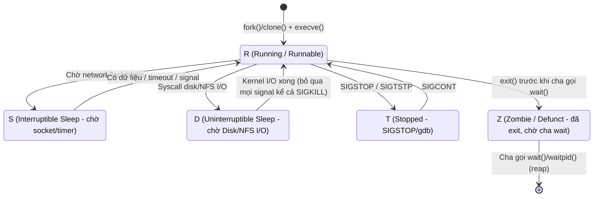

# LNX-01 · Process, thread & signal

> **TL;DR** — Trên Linux, mọi chương trình chạy từ cặp syscall **`fork()` / `clone()` + `execve()`** và tồn tại dưới dạng task trong kernel: một thread Java thực chất là một **Light-Weight Process (LWP)** được kernel lập lịch giống hệt process nhưng dùng chung không gian bộ nhớ và bảng File Descriptor. Khi process con kết thúc trước mà cha không gọi `wait()`/`waitpid()`, nó biến thành **zombie (`Z`)** để giữ exit code. Trên production Java / JBoss, hiểu signal giúp bạn lấy thread dump sống bằng **`kill -3` (`SIGQUIT`)**, dừng app an toàn bằng **`kill -15` (`SIGTERM`)** thay vì cắt ngang giao dịch bằng **`kill -9` (`SIGKILL`)**, và tránh lỗi container treo 10 giây khi `docker stop` do chạy wrapper shell làm **PID 1**.

## 🧭 Brief

| | |
| :--- | :--- |
| **Loại** | Bài học |
| **Giai đoạn** | Năm 1 · Q1 |
| **Chủ đề** | Linux & Networking |

**Phạm vi bắt buộc**
- fork/exec
- process states
- zombie/orphan
- signals (SIGTERM, SIGKILL, SIGHUP)
- PID 1 trong container
- graceful shutdown của JVM

**Câu hỏi sâu — nội dung phải giúp trả lời được**
- Vì sao container không dừng gọn khi docker stop?
- Zombie process sinh ra thế nào?

**Ý tưởng lab / demo**
- App Java xử lý SIGTERM graceful shutdown; quan sát khi chạy làm PID 1

**Tài liệu gốc gợi ý**
- The Linux Command Line
- Operating Systems: Three Easy Pieces
- Systems Performance (Gregg)
- High Performance Browser Networking (hpbn.co)
- TCP/IP Illustrated

**Gói đầu ra**
- [x] `README.md` — lý thuyết theo [lesson-template](../../../docs/templates/lesson-template.md)
- [x] `exercises.md` — bài tập L1/L2/L3 theo [exercises-template](../../../docs/templates/exercises-template.md)
- [x] `solutions.md` — đáp án theo [solutions-template](../../../docs/templates/solutions-template.md)
- [x] `lab/` — code demo chạy được + `lab/README.md` theo [lab-template](../../../docs/templates/lab-template.md)
- [ ] _(người học)_ `my-notes.md` — **agent không tạo**

---

<!-- Nội dung bắt đầu từ đây -->

## 1. Vấn đề: tại sao phải biết cái này?

Ba tình huống lặp đi lặp lại khi vận hành Java / JBoss trên Linux:
1. **Restart JBoss mất dữ liệu thanh toán:** Khi deploy bản mới, người vận hành gõ quen tay `kill -9 <pid>` cho nhanh. Process chết sau 1 ms, JVM **không chạy shutdown hook**, bỏ dở **40+ request đang ghi DB/Kafka**, để lại file lock `.pid` khiến lần khởi động sau lỗi hoặc mất tính nhất quán giao dịch.
2. **Docker / Kubernetes mất đúng 10–30 giây mới tắt được pod:** Mỗi lần rolling deploy **50 pod**, tổng thời gian chờ shutdown thừa ra vài phút, kèm hàng loạt lỗi `502 Bad Gateway` vì `docker stop` hết hạn 10s rồi bắn `SIGKILL` thẳng tay.
3. **JBoss treo CPU thấp nhưng hàng loạt thread không chết, hoặc `ps` báo hàng trăm `<defunct>`:** Khi gọi lệnh shell phụ (`Runtime.exec` / `ProcessBuilder`) mà quên thu hoạch exit code (`waitFor()`), hoặc tiến trình kẹt ở trạng thái `D` (disk/NFS treo), `kill -9` cũng bó tay!

---

## 2. Mô hình tư duy (mental model)

Hãy xem **Process trên Linux như một "công ty độc lập"**, còn **Thread như các "nhân viên trong cùng văn phòng"**:
- Mỗi công ty (`process`) có tòa nhà riêng (Virtual Address Space), tủ hồ sơ riêng (File Descriptor table), và một PID duy nhất.
- Khi cần đẻ công ty mới, Linux không xây từ số 0: nó nhân bản nguyên văn phòng cũ bằng `fork()` (dùng Copy-on-Write — chỉ copy trang nhớ khi có bên ghi), rồi thay ruột chương trình bằng `execve()`.
- Các nhân viên (`thread`, ví dụ thread `http-executor-1` của JBoss) được kernel cấp mã `TID`/`LWP` riêng để lập lịch lên CPU, nhưng dùng chung toàn bộ tủ hồ sơ và vùng nhớ Heap của công ty.

**Chỗ ẩn dụ không còn đúng:**
Trong đời thực, khi nhân viên nghỉ việc thì tự đi về; nhưng trong Linux, khi một process con kết thúc trước cha, **xác (entry trong kernel process table) vẫn nằm lại dưới dạng Zombie (`Z`)** cho đến khi process cha đến "ký giấy khai tử" (`wait()`/`waitpid()`). Ngoài ra, **PID 1** trên Linux có quyền miễn tử đặc biệt với các tín hiệu có hành động mặc định là tự sát!



---

## 3. Cơ chế bên trong (trọng tâm của bài)

### 3.1 `fork()` + `execve()` và Thread (`clone`) trên Linux

Theo *Operating Systems: Three Easy Pieces* (OSTEP) và Linux kernel `man 2 fork` / `man 2 clone`:
1. **`fork()`:** Tạo process con gần như giống hệt cha. Kernel **không** sao chép toàn bộ 4 GB RAM của JVM ngay lúc `fork()` — nó dùng **Copy-on-Write (CoW)**: chỉ sao chép *page table* và đánh dấu các trang RAM là Read-Only; chỉ khi cha hoặc con ghi vào trang nào thì mới nhân bản đúng trang 4 KB đó. *(Lưu ý bẫy Java 7/legacy: gọi `Runtime.exec()` từ một JVM đang dùng 8 GB RAM đôi khi fail `Cannot allocate memory` nếu `vm.overcommit_memory=2` vì kernel kiểm tra dự phòng page table; Java mới dùng `posix_spawn` để tránh bẫy này!)*
2. **`execve()`:** Thay thế toàn bộ memory image (text, data, stack, heap) của process hiện tại bằng chương trình mới (ví dụ `/usr/bin/java`), giữ nguyên PID và các FD không bật cờ `FD_CLOEXEC`.
3. **Thread (`pthread_create` → `clone()`):** Trên Linux (NPTL), kernel không có khái niệm "thread tách rời hoàn toàn" trong scheduler — mỗi Java platform thread gọi syscall `clone(CLONE_VM | CLONE_FS | CLONE_FILES | CLONE_SIGHAND | CLONE_THREAD, ...)` tạo một `task_struct` (`LWP` / `TID` riêng) dùng chung `TGID` (chính là `PID` của JVM).

### 3.2 Các trạng thái Process (`R`, `S`, `D`, `Z`, `T`)

| Trạng thái (`ps`/`top`) | Tên đầy đủ | Ý nghĩa bên dưới | Ảnh hưởng production Java/JBoss |
| :--- | :--- | :--- | :--- |
| **`R`** | Running / Runnable | Đang chạy trên CPU core hoặc nằm trong *run queue* chờ CPU | Nhiều task `R` hơn số CPU core = CPU bão hòa (GC storm / vòng lặp vô hạn) |
| **`S`** | Interruptible Sleep | Đang ngủ chờ sự kiện (nhận socket HTTP, DB trả kết quả, `Thread.sleep`, `futex`) — thức dậy ngay khi có signal | Trạng thái bình thường của phần lớn thread JBoss rỗi |
| **`D`** | Uninterruptible Sleep | Đang chờ phần cứng/kernel I/O tầng sâu (disk block I/O, NFS mount chết) — **không nhận bất kỳ signal nào, kể cả `SIGKILL` (`kill -9`)** | Làm Load Average vọt cao dù CPU idle; chỉ hết khi I/O xong/timeout hoặc reboot |
| **`T`** | Stopped / Traced | Bị tạm dừng bởi `SIGSTOP` (`Ctrl+Z`) hoặc đang bị `gdb`/`strace` bám vào | Toàn bộ JVM đóng băng nếu gõ nhầm `Ctrl+Z` trên terminal chạy foreground |
| **`Z`** | Zombie (`<defunct>`) | Process đã kết thúc (`exit`), RAM và FD đã trả hết cho kernel, chỉ giữ **1 slot PID + exit status** chờ cha đọc | Không tốn RAM nhưng nếu tích tụ hàng chục nghìn sẽ **cạn giới hạn PID hệ thống** (`/proc/sys/kernel/pid_max`) |

### 3.3 Trả lời câu hỏi sâu #1: Zombie process sinh ra thế nào? & Orphan process

1. **Zombie (`Z`):** Khi process con gọi `exit(code)`, nó không thể tự xóa hoàn toàn khỏi bảng tiến trình vì cha có thể cần đọc exit code qua `wait()`/`waitpid()`. Nếu cha **không gọi `wait()`** (ví dụ cha bận vòng lặp khác hoặc lập trình quên `process.waitFor()` trong Java `ProcessBuilder`), con biến thành **Zombie**. Lúc này `kill -9 <zombie_pid>` **vô tác dụng** vì zombie đã chết rồi! Cách duy nhất dọn zombie là sửa/giết **process cha (`PPID`)** để con thành orphan và được **PID 1** thu hoạch (*reap*).
2. **Orphan:** Khi process cha chết trước con khi con vẫn đang chạy (`R`/`S`), Linux kernel đổi `PPID` của con sang **PID 1** (hoặc subreaper gần nhất như `systemd --user`). PID 1 có trách nhiệm gọi `wait()` khi orphan kết thúc.

### 3.4 Tín hiệu (Signals) & Liên hệ vận hành Java / JBoss

Signal là thông báo bất đồng bộ cấp OS gửi tới process/thread (`man 7 signal`):

| Signal | Số | Catch / Ignore được? | Hành vi mặc định & Ý nghĩa thực tế trên Java / JBoss |
| :--- | :-: | :---: | :--- |
| **`SIGHUP`** | `1` | Có | Ban đầu báo mất terminal ("hang up"). Các daemon như Nginx dùng làm tín hiệu **reload config không downtime**. **Cảnh báo:** Nếu chạy `java -jar ... &` trực tiếp trong SSH mà không có `nohup` / `systemd` / `setsid`, tắt SSH sẽ gửi `SIGHUP` **giết chết JBoss**! |
| **`SIGINT`** | `2` | Có | Nhấn `Ctrl+C` trên terminal. JVM chạy shutdown hooks rồi thoát (exit code `130 = 128 + 2`). |
| **`SIGQUIT`** | `3` | Có | **`kill -3 <pid>` — vũ khí số 1 trên Linux production!** JVM **không thoát**; signal handler của HotSpot dừng ngắn và in **Full Thread Dump** (kèm trạng thái lock, deadlock, thread nid hex) thẳng ra `stdout` (`nohup.out` hoặc `journalctl`). |
| **`SIGKILL`** | `9` | **KHÔNG** | Kernel thu hồi process ngay lập tức, **bỏ qua toàn bộ Java `ShutdownHook`**, `finally`, flush log, hay đóng connection DB gọn gàng. Chỉ dùng khi `SIGTERM` thất bại (exit code `137 = 128 + 9`). |
| **`SIGTERM`** | `15` | Có | Tín hiệu tắt chuẩn của `kill <pid>`, `systemd stop`, `docker stop`, Kubernetes `pod termination`. JVM chạy toàn bộ `Runtime.getRuntime().addShutdownHook(...)`, sau đó thoát với code **`143` (`128 + 15`)**. |

### 3.5 Trả lời câu hỏi sâu #2: Vì sao container không dừng gọn khi `docker stop`?

Khi chạy `docker stop <container>` (hoặc Kubernetes xóa Pod), engine gửi **`SIGTERM` cho duy nhất PID 1 trong container**, chờ `10s` (mặc định Docker, hoặc `30s` `terminationGracePeriodSeconds` trên K8s), rồi bắn **`SIGKILL`** nếu PID 1 chưa thoát. Có **2 nguyên nhân kinh điển** khiến container Java không dừng gọn:

1. **Shell-form Dockerfile (`CMD java -jar app.jar` hoặc `ENTRYPOINT /app/start.sh` thiếu `exec`):**
   - Docker tự bọc thành `/bin/sh -c "java -jar app.jar"`. Lúc này **`/bin/sh` là PID 1**, còn **`java` là PID 7 (process con)**!
   - `sh` nhận `SIGTERM` nhưng theo chuẩn POSIX shell đang chờ foreground child, `sh` **KHÔNG tự động chuyển tiếp (forward) `SIGTERM` xuống `java`** → `java` không bao giờ biết để chạy Shutdown Hook, đứng im đủ 10 giây rồi ăn `SIGKILL` (`137`).
   - **Cách sửa:** Dùng **exec-form** `CMD ["java", "-jar", "app.jar"]`, hoặc trong `start.sh` đặt `exec java -jar app.jar` (lệnh `exec` dùng `execve` thay thế chính shell, đưa `java` lên làm PID 1).
2. **Cơ chế bảo vệ đặc biệt của Linux PID 1 + thiếu `init` reaper (`tini`):**
   - Trong Linux kernel (`kernel/signal.c`), **PID 1 miễn nhiễm với mọi signal không có custom handler** (trừ `SIGKILL`/`SIGSTOP` cũng bị chặn đặc biệt với PID 1 thực trên host; trong PID namespace container, PID 1 không có handler cho `SIGTERM` sẽ **bỏ qua `SIGTERM`**, khác hẳn PID khác có hành động mặc định là Terminate!). JVM có cài handler cho `SIGTERM`, nhưng nếu PID 1 là một binary/script tự viết không cài trap `SIGTERM`, container sẽ lờ đi hoàn toàn; đồng thời nếu JVM spawn script phụ làm PID 1 không reap zombie, zombie sẽ chất đống trong container → giải pháp chuẩn là dùng `--init` (`tini`) hoặc `exec java`.

### 3.6 Graceful Shutdown của JVM

Để ứng dụng Java / JBoss tắt không rớt request:
1. Nhận `SIGTERM` → dừng nhận request mới (health/readiness probe báo `DOWN`, đóng listen socket).
2. Chờ các request đang dở (*in-flight*) hoàn tất trong giới hạn timeout (ví dụ `20s`, nhỏ hơn `terminationGracePeriodSeconds=30s`).
3. Đóng HikariCP / DataSource pool, Kafka producer (`flush()` + `close()`), ExecutorService (`shutdown()` + `awaitTermination(...)`).
4. Thoát gọn trước khi hết grace period bị ép `SIGKILL`.

---

## 4. Code minh họa

Xem mã nguồn đầy đủ tại [GracefulShutdownApp.java](./lab/src/main/java/lab/linux/processes/GracefulShutdownApp.java) và [ProcessLifecycleLabRunner.java](./lab/src/main/java/lab/linux/processes/ProcessLifecycleLabRunner.java):

```java
// ❌ SAI: Thoát ngay hoặc hủy ngang ExecutorService (shutdownNow) khi nhận tín hiệu dừng
Runtime.getRuntime().addShutdownHook(new Thread(() -> {
    executor.shutdownNow(); // Ngắt ngang mọi transaction DB/HTTP đang chạy dở!
}));
```

```java
// ✅ ĐÚNG: Dừng nhận việc mới -> chờ drain in-flight trong timeout -> mới ép đóng
Runtime.getRuntime().addShutdownHook(new Thread(() -> {
    accepting.set(false);             // 1. Từ chối request mới ngay lập tức
    executor.shutdown();              // 2. Cho phép request đang chạy hoàn tất
    try {
        if (!executor.awaitTermination(15, TimeUnit.SECONDS)) {
            executor.shutdownNow();   // 3. Quá hạn mới ép dừng để không ăn SIGKILL ngoài ý muốn
        }
    } catch (InterruptedException e) {
        executor.shutdownNow();
        Thread.currentThread().interrupt();
    }
}, "jvm-graceful-shutdown"));
```

Và trong `Dockerfile` / startup script của Java / JBoss:
```dockerfile
# ❌ SAI: /bin/sh làm PID 1, nuốt mất SIGTERM khi docker stop
CMD java -Xms1g -Xmx1g -jar app.jar

# ✅ ĐÚNG: exec-form giúp tiến trình java nhận thẳng SIGTERM từ container runtime
ENTRYPOINT ["java", "-Xms1g", "-Xmx1g", "-jar", "app.jar"]
```

### 4.1 Legacy corner (Java 7 / JBoss AS 7.1.1)

Trên **JBoss AS 7.1.1** chạy trên RHEL/CentOS:
1. Script mặc định `$JBOSS_HOME/bin/standalone.sh` dùng vòng lặp shell chờ process `java`. Nếu bạn viết script systemd/init gọi `standalone.sh` mà không dùng `jboss-cli.sh --connect command=:shutdown` hoặc không truyền `SIGTERM` thẳng tới PID Java, JBoss có thể dừng đột ngột hoặc để lại child zombie.
2. Khi JBoss treo thread hoặc chậm đột biến trên production: **TUYỆT ĐỐI không `kill -9` ngay lập tức!** Hãy chạy `kill -3 <jboss_pid>` 3 lần, mỗi lần cách nhau 5 giây (lưu `standalone/log/server.log` hoặc `nohup.out`), rồi dùng [CONC-10](../../../01-software-engineering/concurrency/10-thread-dump-analysis/README.md) để bắt thủ phạm deadlock/DB block trước khi restart!

---

## 5. Quan sát & đo đạc

### Phần A — Đã chạy kiểm chứng trên Windows 11 (Java 21 ProcessBuilder simulator)
Từ thư mục `lab/`:
```powershell
mvn -o -B verify
mvn -o -B compile exec:java
```
**Output thực tế ghi nhận trên Windows 11 amd64 · OpenJDK 26.0.1 (`--release 21`):**
- `ProcessLifecycleTest`: **3/3 tests pass**, chứng minh:
  1. Khi child `GracefulShutdownApp` nhận lệnh graceful stop trong lúc `3` in-flight tasks đang chạy (`250ms` mỗi task), shutdown hook chờ đủ `3/3` tasks hoàn thành (`completedInFlight=3`, `abortedInFlight=0`) rồi mới thoát cleanly với `exitCode = 0`.
  2. Khi ép dừng ngang (`destroyForcibly()` — mô phỏng `SIGKILL` / shell PID 1 chặn `SIGTERM`), process bị giết tức thì trước khi hoàn thành (`completedInFlight=0`, `exitCode != 0`).
  3. `ProcessLifecycleSimulator` xác nhận child kết thúc khi cha chưa `wait()` bị giữ trạng thái `ZOMBIE`, và chỉ biến mất sau khi cha gọi `reap()`.

### Phần B — Cần kiểm chứng trên Linux / WSL / Docker (chưa chạy được trên máy Windows soạn bài)
> ⚠️ **Cần kiểm chứng trên Linux:** Các lệnh Linux dưới đây chưa chạy trực tiếp trong phiên soạn bài vì máy Windows hiện tại chưa cài WSL/Docker. Cần chạy kiểm chứng trên Ubuntu/RHEL VM hoặc container Linux:
- `ps -eo pid,ppid,stat,comm` (quan sát trạng thái `R`, `S`, `Z <defunct>`, `D`)
- `kill -3 <java_pid>` (gửi `SIGQUIT` kiểm tra HotSpot xuất `Full thread dump` ra stdout mà process vẫn sống)
- `kill -15 <java_pid>` vs `kill -9 <java_pid>` (`echo $?` nhận `143` vs `137`)
- `docker stop -t 10 <container>` với shell-form `CMD` vs exec-form `ENTRYPOINT ["java", ...]` (xem `lab/scripts/pid1-shell-vs-exec.sh` và `lab/scripts/observe-zombie-and-signals.sh`).

---

## 6. Trade-offs & khi nào KHÔNG dùng

| Lựa chọn | Được gì | Mất gì | Dùng khi |
| :--- | :--- | :--- | :--- |
| **`SIGTERM` + Graceful shutdown hook** | Không rớt giao dịch đang chạy, đóng DB pool sạch sẽ | Mất thêm vài giây để drain (nếu config sai timeout vẫn ăn `SIGKILL`) | **Mọi lần deploy, restart, scale-down bình thường** |
| **`SIGKILL` (`kill -9`)** | Dừng tức thì (< 1ms), giải phóng RAM/FD ngay | Mất transaction dở dang, để lại lock/temp file, không có cleanup | Chỉ khi app treo cứng không đáp ứng `SIGTERM` sau khi đã lấy `kill -3` thread dump |
| **`tini` / `--init` làm PID 1 bọc ngoài Java** | Tự động forward `SIGTERM` và **reap mọi zombie** sinh ra bởi child process | Thêm 1 process rất nhẹ (~vài trăm KB RAM) | Khi app Java có spawn sub-process ngoài (wkhtmltopdf, ffmpeg, shell script) |

---

## 7. Cạm bẫy production (ít nhất 3)

1. **Dùng `CMD java ...` (shell-form) trong Dockerfile** — *Triệu chứng:* mỗi lần `docker stop` hoặc K8s rolling update đều mất đúng 10s/30s rồi exit code `137`. *Nguyên nhân:* `/bin/sh -c` giữ PID 1 và không forward `SIGTERM` xuống JVM. *Cách tránh:* luôn dùng JSON exec-form `ENTRYPOINT ["java", ...]` hoặc `exec java ...` ở dòng cuối script entrypoint.
2. **Shutdown hook chạy lâu hơn `TimeoutStopSec` / `terminationGracePeriodSeconds`** — *Triệu chứng:* Shutdown hook bắt đầu drain nhưng giữa chừng bị `SIGKILL` (`137`). *Nguyên nhân:* đặt timeout drain 60s trong khi K8s chỉ chờ 30s (hoặc `ExecutorService` có task kẹt DB query không có query timeout). *Cách tránh:* cấu hình timeout drain nội bộ luôn **nhỏ hơn** grace period của systemd/K8s ít nhất 5–10 giây và luôn có `statementTimeout` cho DB.
3. **Chạy app background bằng `java ... &` rồi thoát SSH** — *Triệu chứng:* Vừa đóng PuTTY/SSH vài giây thì JBoss/Java tự tắt sạch. *Nguyên nhân:* Terminal đóng gửi `SIGHUP` cho toàn bộ process group thuộc session đó. *Cách tránh:* luôn quản lý service qua `systemd` ([LNX-04](../04-systemd-services/README.md)), không chạy `&` trần trên production.
4. **Cố dùng `kill -9` để giết Zombie (`Z`) hoặc I/O bị treo (`D`)** — *Triệu chứng:* gõ `kill -9` chục lần mà `ps aux` vẫn hiện nguyên dòng tiến trình. *Nguyên nhân:* Zombie đã chết sẵn (chờ cha `wait()`), còn `D`-state đang kẹt trong kernel driver/NFS không kiểm tra signal. *Cách tránh:* với `Z` thì kiểm tra/restart `PPID`; với `D` thì kiểm tra ổ đĩa/NFS (`dmesg`, `iostat`) chứ không gõ `kill -9` vô ích.

---

## 8. Liên hệ thực tế công việc

Ngay tuần này trên server Linux chạy **JBoss AS 7.1.1**:
1. Chạy `ps -ef | grep jboss` hoặc `ps -eLo pid,tid,ppid,stat,comm | grep java` trên môi trường staging để quan sát rõ mỗi thread JBoss là một `TID`/`LWP` riêng nhưng cùng `PID`.
2. Tập thói quen **trước khi restart một JBoss đang treo**, chạy `kill -3 <pid>` để lấy ít nhất 2–3 thread dump ra file log giúp team có bằng chứng phân tích nguyên nhân gốc thay vì "restart cho hết".

---

## 9. Self-check — Explain-back

> Trả lời **không nhìn tài liệu**, nói to trong 5 phút. Không trả lời được = chưa xong. (Đáp án nằm trong [solutions.md](./solutions.md).)

1. `fork()` + `execve()` tạo process mới như thế nào, và Copy-on-Write giúp gì cho hiệu năng khi JVM lớn gọi lệnh ngoài?
2. Phân biệt 5 trạng thái `R`, `S`, `D`, `T`, `Z` trên Linux; tại sao `kill -9` không giết được process đang ở trạng thái `Z` hoặc `D`?
3. Zombie process sinh ra như thế nào, và Orphan process được xử lý khác gì so với Zombie?
4. Vì sao container dùng `CMD java -jar app.jar` không dừng gọn khi chạy `docker stop`? Nêu 2 cách sửa triệt để.
5. Phân biệt `SIGHUP`, `SIGQUIT` (`kill -3`), `SIGTERM` (`kill -15`), và `SIGKILL` (`kill -9`) trong vận hành JVM / JBoss.

---

## 10. Cheatsheet 1 trang

| Chủ đề | Ghi nhớ nhanh |
| :--- | :--- |
| **Process vs Thread** | Process = không gian nhớ + FD table riêng (`fork`+`exec`); Thread = `LWP`/`TID` chung nhớ & FD (`clone`) |
| **States** | `R` (chạy) · `S` (ngủ chờ) · `D` (disk/NFS I/O, miễn `kill -9`) · `T` (stopped) · `Z` (chết, chờ cha `wait()`) |
| **Zombie vs Orphan** | Zombie = con chết, cha sống nhưng quên `wait()`; Orphan = cha chết, PID 1 nhận nuôi & reap |
| **Signals JVM** | `kill -3` (`SIGQUIT`) = Thread Dump không tắt app · `kill -15` (`SIGTERM`) = ShutdownHook (143) · `kill -9` (`SIGKILL`) = tắt cưỡng bức (137) |
| **PID 1 Container** | Tránh shell-form `CMD java ...`; dùng `ENTRYPOINT ["java", ...]` hoặc `exec java ...` (+ `tini` nếu có sub-process) |

---

## 11. Tài liệu tham khảo

- Remzi & Andrea Arpaci-Dusseau, [*Operating Systems: Three Easy Pieces* — Process API (`fork`, `exec`, `wait`)](https://pages.cs.wisc.edu/~remzi/OSTEP/cpu-api.pdf) — cơ chế process creation và zombie state.
- Linux man-pages: [`signal(7)`](https://man7.org/linux/man-pages/man7/signal.7.html) & [`pid_namespaces(7)`](https://man7.org/linux/man-pages/man7/pid_namespaces.7.html) — hành vi signal đặc biệt với PID 1.
- Brendan Gregg, *Systems Performance* (2nd ed.) — Linux process scheduling, `LWP`, và states (`R`/`S`/`D`/`Z`).
- [Docker Docs — Best practices for writing Dockerfiles (`ENTRYPOINT`/`CMD` exec form)](https://docs.docker.com/develop/develop-images/dockerfile_best-practices/#entrypoint) — lý do `SIGTERM` không tới app khi dùng shell form.

---
➡️ Tiếp theo: [exercises.md](./exercises.md) · [lab/](./lab/README.md) · Bài kế: [LNX-02 · File descriptor & I/O](../02-file-descriptors-io/README.md)
