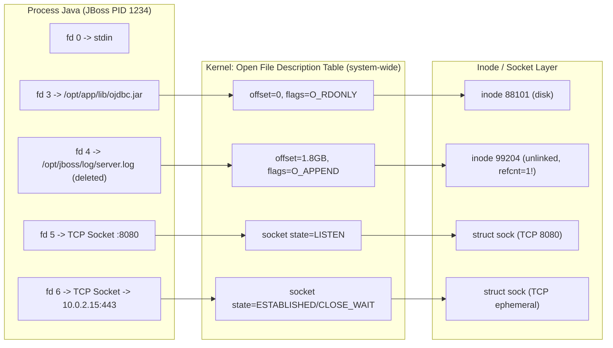

# LNX-02 · File descriptor & I/O

> **TL;DR** — Trong Linux, **"everything is a file"**: file thường, thư mục, pipe, terminal và cả **TCP socket** đều được truy cập qua một số nguyên không âm gọi là **File Descriptor (FD)** (`0=stdin`, `1=stdout`, `2=stderr`, tiếp theo `3, 4, ...`). Mỗi process có bảng FD riêng bị chặn trần bởi **`RLIMIT_NOFILE`** (`ulimit -n`), mà mặc định lịch sử trên nhiều distro chỉ là **`1024`**. Trên server Java / JBoss, quên đóng `HttpURLConnection` / `CloseableHttpResponse` / `InputStream` khiến TCP socket giữ FD không nhả — cho đến khi cạn trần `1024`, toàn bộ server nổ hàng loạt **`java.net.SocketException: Too many open files`** (`EMFILE`), thậm chí không mở nổi file log hay load thêm class từ `.jar` mới!

## 🧭 Brief

| | |
| :--- | :--- |
| **Loại** | Bài học |
| **Giai đoạn** | Năm 1 · Q1 |
| **Chủ đề** | Linux & Networking |
| **Tiên quyết** | [LNX-01](../01-processes-signals/README.md) |

**Phạm vi bắt buộc**
- fd table
- ulimit
- "Too many open files"
- socket cũng là fd
- lsof
- blocking vs non-blocking I/O

**Câu hỏi sâu — nội dung phải giúp trả lời được**
- "Too many open files" trên server Java điều tra ra sao?
- Connection HTTP không đóng ảnh hưởng fd thế nào?

**Ý tưởng lab / demo**
- Tái hiện fd leak và chẩn đoán bằng lsof

**Tài liệu gốc gợi ý**
- The Linux Command Line
- Operating Systems: Three Easy Pieces
- Systems Performance (Gregg)
- High Performance Browser Networking (hpbn.co)
- TCP/IP Illustrated

**Gói đầu ra**
- [x] `README.md` — lý thuyết theo [lesson-template](../../../docs/templates/lesson-template.md)
- [x] `exercises.md` — bài tập L1/L2/L3 theo [exercises-template](../../../docs/templates/exercises-template.md)
- [x] `solutions.md` — đáp án theo [solutions-template](../../../docs/templates/solutions-template.md)
- [x] `lab/` — code demo chạy được + `lab/README.md` theo [lab-template](../../../docs/templates/lab-template.md)
- [ ] _(người học)_ `my-notes.md` — **agent không tạo**

---

<!-- Nội dung bắt đầu từ đây -->

## 1. Vấn đề: tại sao phải biết cái này?

Một buổi sáng lưu lượng tăng gấp 3 lần trên hệ thống **JBoss AS 7.1.1**, ứng dụng bắt đầu trả lỗi `500` hàng loạt với stack trace kỳ lạ dù CPU chỉ 20% và RAM còn dư:
- `java.net.SocketException: Too many open files` khi gọi API thanh toán hoặc nhận request mới vào JBoss HTTP connector.
- `java.io.FileNotFoundException: /opt/jboss/standalone/log/server.log (Too many open files)` — thậm chí không ghi nổi log lỗi!
- Ngoài ra, một sự cố khác cực phổ biến: bộ phận Ops chạy `rm /opt/jboss/standalone/log/server.log` để giải phóng ổ đĩa đang đầy 100%, nhưng `df -h` vẫn báo **đầy 100%** cho đến khi restart JBoss!

Cả hai sự cố đều nằm ở cùng một cơ chế: **bảng File Descriptor (FD) 3 tầng của Linux kernel**.

---

## 2. Mô hình tư duy (mental model)

Hãy hình dung **File Descriptor (FD) như số thứ tự trên chiếc thẻ giữ đồ (claim check ticket) ở quầy gửi đồ**:
- Process Java không bao giờ cầm trực tiếp object `inode` hay `struct socket` trong kernel. Mỗi lần mở file hoặc `socket()`/`accept()`, kernel cấp cho process một số nguyên nhỏ (`fd = 3`, `fd = 4`, ... — luôn chọn số nhỏ nhất còn trống).
- Tủ phát thẻ của mỗi process có sức chứa hữu hạn (`RLIMIT_NOFILE`, ví dụ `1024` hoặc `65536`).
- Khi bạn mở 1 HTTP client connection hay `FileInputStream` mà quên `.close()`, tấm thẻ đó không được trả lại quầy → đến lượt khách thứ `1025`, nhân viên từ chối cấp thẻ (`EMFILE`) bất kể đĩa cứng còn trống hàng terabyte!

**Chỗ ẩn dụ không còn đúng:**
Ở ngoài đời, nếu bạn ném tờ giấy biên nhận đi (`rm file.log`) thì đồ mất theo; nhưng trong Linux, đường dẫn tên file chỉ là một *hard link* trỏ tới `inode`. Chừng nào vẫn còn ít nhất 1 FD đang mở trỏ tới `inode` đó (ví dụ JBoss đang giữ FD `4` mở `server.log`), kernel **chưa thu hồi data blocks trên đĩa** dù `ls` không còn thấy file!



---

## 3. Cơ chế bên trong (trọng tâm của bài)

### 3.1 Cấu trúc 3 tầng của File Descriptor trong Linux

Theo *Operating Systems: Three Easy Pieces* (OSTEP — Files and Directories) và `man 2 open`:
1. **Per-Process File Descriptor Table (`files_struct` trong `task_struct`):** Một mảng các con trỏ nằm riêng trong mỗi process (chia sẻ giữa các thread của cùng JVM nhờ `CLONE_FILES`). Chỉ số mảng chính là số `fd` (`0`, `1`, `2`, `3`, ...), kèm cờ như `FD_CLOEXEC`.
2. **System-wide Open File Table (`struct file`):** Lưu trạng thái phiên mở hiện tại: vị trí con trỏ đọc/ghi (*file offset*), access mode (`O_RDONLY`, `O_WRONLY`, `O_APPEND`), flags (`O_NONBLOCK`), và bộ đếm tham chiếu. *(Khi `fork()` hoặc `dup2()`, 2 FD khác nhau có thể trỏ cùng 1 `struct file` nên chia sẻ chung file offset!)*
3. **Inode / Socket Table:** Đại diện cho thực thể thật: file trên filesystem (`ext4`/`xfs`), pipe (`FIFO`), epoll instance (`anon_inode:[eventpoll]`), hoặc network socket (`struct socket`).

### 3.2 Trả lời câu hỏi sâu #1: Connection HTTP không đóng ảnh hưởng FD thế nào?

Trên Linux, **một socket mạng cũng chính là một File Descriptor**:
- Khi ứng dụng Java gọi một REST API ra ngoài (bằng `HttpURLConnection`, Apache `HttpClient`, hoặc tạo mới `new Socket(...)`), kernel thực hiện syscall `socket(AF_INET, SOCK_STREAM, 0)` → **cấp phát 1 FD mới** từ bảng FD của tiến trình Java.
- Khi JBoss nhận 1 request từ client qua `accept()`, kernel cũng **cấp phát 1 FD mới** cho client socket đó.
- Nếu code Java mở HTTP request mà **quên gọi `.close()`** (hoặc đọc `InputStream` chưa hết / quên `EntityUtils.consume()` trên Apache HttpClient 4 của hệ thống legacy, hoặc không đóng `CloseableHttpClient`), socket FD đó **không bị đóng ngay**:
  1. Ở phía OS, kết nối TCP kẹt ở trạng thái `ESTABLISHED` hoặc `CLOSE_WAIT` ([LNX-09](../09-time-wait-close-wait/README.md) & [INC-12](../../../03-production-troubleshooting/incident-labs/12-close-wait-leak/)).
  2. Trên JVM, đối tượng `Socket`/`FileInputStream` chỉ đóng FD khi GC chạy đến pha thu gom (hoặc `Cleaner`/`finalize()` — không hề có bảo đảm thời gian!). Với heap lớn `-Xmx8g`, Young/Old GC có thể lâu không chạm tới các object đang bị giữ tham chiếu trong cache/thread → **FD cạn sạch trước khi Heap đầy**.
  3. Khi chạm giới hạn `RLIMIT_NOFILE` của process Java, **mọi** thao tác cần FD mới đều đồng loạt chết (`EMFILE`): mở socket mới, nhận connection từ Nginx/ALB, mở file log xoay vòng (`logrotate`), hay nạp class từ file `.jar` mới.

### 3.3 `ulimit -n` (`EMFILE` vs `ENFILE`) & Giới hạn Soft/Hard

- **`EMFILE` (`Too many open files`):** Process hiện tại đã chạm giới hạn `RLIMIT_NOFILE` của riêng nó (xem qua `cat /proc/<pid>/limits`).
- **`ENFILE` (`Too many open files in system`):** Toàn bộ hệ điều hành đã chạm trần `fs.file-max` (`/proc/sys/fs/file-max`), hiếm gặp hơn nhiều so với `EMFILE` trên máy modern (thường hàng trăm nghìn đến hàng triệu).
- **Soft limit vs Hard limit:**
  - `ulimit -Sn` (soft): trần thực tế kernel áp dụng cho process; user thường có thể tự nâng soft limit lên tối đa bằng hard limit (`ulimit -Hn`).
  - **Cạm bẫy kinh điển:** Chạy `ulimit -n` trong SSH shell **KHÔNG phản ánh giới hạn của JBoss/systemd service**! Process `systemd` bỏ qua `/etc/security/limits.conf` — bạn phải kiểm tra trực tiếp **`cat /proc/<pid>/limits`** và đặt **`LimitNOFILE=65536`** trong file `.service` ([LNX-04](../04-systemd-services/README.md)).

### 3.4 Trả lời câu hỏi sâu #2: Điều tra `"Too many open files"` trên server Java như thế nào?

Quy trình 4 bước chuẩn SRE trên Linux:
1. **Kiểm tra trần thật của đúng tiến trình Java (không dùng `ulimit -n` trên shell hiện tại):**
   ```bash
   PID=$(pgrep -f 'jboss|java')
   cat /proc/$PID/limits | grep "Max open files"
   ```
2. **Đếm số FD đang mở thực tế của PID đó:**
   ```bash
   ls -1 /proc/$PID/fd | wc -l
   ```
3. **Phân loại nhanh FD đang bị leak là loại gì bằng `lsof` (hoặc `/proc/$PID/fd`):**
   ```bash
   # Gom nhóm theo cột TYPE (REG = file thường, IPv4/IPv6 = socket, FIFO = pipe, anon_inode = epoll)
   lsof -nP -p $PID | awk 'NR>1 {print $5}' | sort | uniq -c | sort -rn
   ```
   *(Lưu ý: dùng `-nP` để tắt reverse DNS lookup và dịch tên port, giúp `lsof` chạy nhanh gấp 10× trên server nhiều socket!)*
4. **Truy tìm thủ phạm cụ thể:**
   - Nếu `IPv4` / `sock` chiếm 90% → xem remote IP/port nào nhiều nhất (`lsof -nP -i -a -p $PID` hoặc `ss -tanp | grep $PID`). Nếu thấy hàng loạt `CLOSE_WAIT` về cùng 1 host downstream → **code Java quên đóng HTTP/JDBC connection**!
   - Nếu `REG` chiếm 90% → xem file nào mở lặp lại hàng trăm lần (`lsof -nP -p $PID | grep REG | awk '{print $9}' | sort | uniq -c | sort -rn | head -20`) → quên đóng `FileInputStream`/`ZipFile`/`JarFile`.
   - Nếu thấy `(deleted)` lớn bất thường → process vẫn giữ FD trỏ tới file đã bị `rm`!

### 3.5 Blocking I/O vs Non-blocking I/O ở mức FD

Mỗi FD mặc định khi mở là **Blocking**: gọi `read(fd, buf, len)` khi kernel receive buffer trống sẽ đưa thread gọi vào trạng thái ngủ **`S` (Interruptible Sleep)** — tức là **1 thread Java nằm chết chờ 1 socket**! Nếu có 5.000 kết nối chậm, bạn tốn 5.000 thread (`5.000 × 1 MB` stack = `5 GB` chỉ riêng Thread Stack!).
Ngược lại, nếu đặt cờ **`O_NONBLOCK`** trên FD (`fcntl(fd, F_SETFL, O_NONBLOCK)` — trong Java NIO là `channel.configureBlocking(false)`), gọi `read()` khi chưa có dữ liệu **trả về ngay lập tức `-1` với `errno = EAGAIN` / `EWOULDBLOCK`** (`0` bytes đọc được trong Java NIO) để 1 thread có thể quay sang phục vụ FD khác qua `epoll` ([LNX-07](../07-epoll-io-multiplexing/README.md)).

---

## 4. Code minh họa

Xem mã nguồn chạy thật tại [FdLeakLabRunner.java](./lab/src/main/java/lab/linux/fd/FdLeakLabRunner.java) và [BoundedFdTable.java](./lab/src/main/java/lab/linux/fd/BoundedFdTable.java):

```java
// ❌ SAI: Mở HttpURLConnection / Socket / InputStream không đóng khi xử lý hoặc khi có lỗi
public byte[] readBroken(Path path) throws IOException {
    InputStream in = Files.newInputStream(path); // Cấp 1 FD mới từ OS
    if (Files.size(path) == 0) {
        return new byte[0]; // Return sớm -> LEAK FD mãi cho tới khi GC (hoặc cạn ulimit -n)!
    }
    return in.readAllBytes(); // Nếu ném IOException cũng leak FD!
}
```

```java
// ✅ ĐÚNG: Luôn bọc trong try-with-resources (hỗ trợ từ Java 7!) để close() giải phóng FD ngay lập tức
public byte[] readSafe(Path path) throws IOException {
    try (InputStream in = Files.newInputStream(path)) {
        if (Files.size(path) == 0) {
            return new byte[0]; // JVM tự gọi in.close() -> syscall close(fd) ngay khi rời block!
        }
        return in.readAllBytes();
    }
}
```

### 4.1 Legacy corner (Java 7 / JBoss AS 7.1.1)

Trên hệ thống **Java 7 / JBoss AS 7.1.1** dùng Apache `HttpClient 4.x` hoặc `HttpURLConnection`:
1. **`try-with-resources` đã có sẵn từ Java 7** — đừng viết `try { ... } finally { is.close(); }` thủ công dài dòng dễ sót khi `close()` ném exception che mất lỗi chính (`try-with-resources` giữ lại exception chính và gắn lỗi `close()` vào `Suppressed`).
2. **Bẫy riêng của Apache `HttpClient 4`:** Chỉ đọc `response.getEntity().getContent()` một nửa hoặc chỉ check `getStatusLine().getStatusCode()` mà **không** gọi `EntityUtils.consumeQuietly(entity)` / `response.close()` sẽ giữ nguyên kết nối trong `PoolingClientConnectionManager` và FD ở mức kernel!
3. **Kiểm tra `ulimit -n` của user chạy JBoss (`jboss`):** Nhiều server RHEL 6/7 cài JBoss bằng script `init.d` hoặc chạy qua `su - jboss` quên thêm dòng `* soft nofile 65536` và `* hard nofile 65536` trong `/etc/security/limits.d/99-jboss.conf` nên JBoss chạy thực tế với trần **`1024`** hoặc **`4096`**!

---

## 5. Quan sát & đo đạc

### Phần A — Đã chạy kiểm chứng trên Windows 11 (Java 21 Socket/File FD + Non-blocking NIO lab)
Từ thư mục `lab/`:
```powershell
mvn -o -B verify
mvn -o -B compile exec:java
```
**Output thực tế ghi nhận trên Windows 11 amd64 · OpenJDK 26.0.1 (`--release 21`):**
- `FdLeakTest`: **4/4 tests pass**, chứng minh:
  1. `BoundedFdTable` với `softLimit = 16` (`0,1,2` giữ cho `stdin/stdout/stderr`) cấp phát `fd` tăng dần từ `3..15`; đến slot thứ `16` thì ném `TooManyOpenFilesException` (`EMFILE`) chặn cả `Socket` lẫn `openLogFile`! Khi đóng bằng `try-with-resources`, FD được tái sử dụng chính số nhỏ nhất vừa trả.
  2. Loopback `ServerSocketChannel` + `SocketChannel` thật: giữ danh sách `leakedSockets` không đóng làm số kết nối sống giữ nguyên `40/40`, trong khi `try-with-resources` trả về `0` socket mở sau vòng lặp.
  3. So sánh Blocking vs Non-blocking `SocketChannel`: kênh non-blocking (`configureBlocking(false)`) gọi `read(buf)` khi server chưa gửi byte trả về **`0` trong `< 1ms`**, không block thread.

### Phần B — Cần kiểm chứng trên Linux / WSL / Docker (chưa chạy được trên máy Windows soạn bài)
> ⚠️ **Cần kiểm chứng trên Linux:** Máy soạn là Windows 11 không có WSL/Docker; các lệnh Linux đếm FD thật trong `/proc` và `ulimit -n` dưới đây **chưa chạy trực tiếp**:
- `bash scripts/reproduce-emfile.sh` (đặt `ulimit -n 64` trong subshell để ép JVM ném `java.io.FileNotFoundException: ... (Too many open files)` thật ở Linux kernel).
- `bash scripts/inspect-java-fds.sh` (chạy `cat /proc/<pid>/limits`, `ls -1 /proc/<pid>/fd | wc -l`, `lsof -nP -p <pid>` để soi `REG`, `IPv4`, `(deleted)`).

---

## 6. Trade-offs & khi nào KHÔNG dùng

| Cấu hình / Cách xử lý | Được gì | Mất / Rủi ro gì | Dùng khi |
| :--- | :--- | :--- | :--- |
| **Tăng `ulimit -n` lên `65536` / `1048576`** | Server chịu được hàng chục nghìn kết nối đồng thời + nhiều JAR/file | Chỉ *trì hoãn* ngày sập nếu app thực sự bị leak FD! | Bắt buộc cho server production/JBoss sau khi đã kiểm tra không có leak |
| **Blocking I/O (`InputStream`/`Socket`)** | Code tuần tự dễ đọc, dễ debug stack trace | 1 socket chờ = 1 thread kẹt trạng thái `S` (~1 MB stack) | Số kết nối đồng thời nhỏ (`< 500`), hoặc chạy trên Java 21 **Virtual Threads** |
| **Non-blocking I/O (`O_NONBLOCK` + `Selector`/`epoll`)** | 1–4 thread phục vụ hàng chục nghìn kết nối | Code callback/event loop phức tạp hơn, không được block event loop | Proxy, gateway, high-concurrency server (Netty/Undertow) |

---

## 7. Cạm bẫy production (ít nhất 3)

1. **Tin kết quả `ulimit -n` chạy bằng user cá nhân thay vì kiểm tra `/proc/<pid>/limits` của JBoss** — *Triệu chứng:* `ulimit -n` trên terminal báo `65536`, nhưng JBoss vẫn sập `Too many open files` ở đúng ~`1024` FD! *Nguyên nhân:* `systemd` không đọc `/etc/security/limits.conf`, hoặc file script khởi động JBoss chạy trước khi limits có hiệu lực. *Cách tránh:* luôn kiểm chứng bằng `cat /proc/$(pgrep -f jboss)/limits`.
2. **Chạy `rm server.log` để cứu đĩa 100% mà không biết FD vẫn đang mở** — *Triệu chứng:* Đĩa cứng vẫn báo `100%` trên `df -h`, `du -sh /*` cộng lại không thấy file to đâu. *Nguyên nhân:* JBoss vẫn giữ FD trỏ vào inode đã xóa (`lsof +L1` sẽ thấy `(deleted)`). *Cách tránh:* dùng `truncate -s 0 /opt/jboss/standalone/log/server.log` (hoặc cấu hình `logrotate` với `copytruncate`) thay vì `rm` file đang ghi.
3. **Chạy `lsof -p <pid>` quên cờ `-nP` trên server production nhiều kết nối** — *Triệu chứng:* Lệnh `lsof` treo mất 2–5 phút mới in ra kết quả và gây tải DNS. *Nguyên nhân:* mặc định `lsof` thực hiện reverse DNS lookup cho từng IP và dịch port sang tên service. *Cách tránh:* luôn gõ **`lsof -nP -p <pid>`**.
4. **Dùng Apache `HttpClient` / `HttpURLConnection` tạo mới trong mỗi request mà không `close()`** — *Triệu chứng:* FD tăng tuyến tính theo traffic rồi sập toàn server vào giờ cao điểm. *Nguyên nhân:* mỗi instance giữ socket pool riêng hoặc mở socket mới không đóng, chờ GC thì quá muộn. *Cách tránh:* dùng singleton HTTP connection pool + `try-with-resources` đóng mọi response/stream.

---

## 8. Liên hệ thực tế công việc

Ngay tuần này trên server **JBoss AS 7.1.1 / Linux**:
1. Kiểm tra file `/etc/security/limits.conf` (hoặc unit systemd nếu dùng systemd) và chạy `cat /proc/<pid>/limits | grep "Max open files"` xem JBoss hiện được cấp `1024`, `4096` hay `65536`.
2. Grep trong codebase Java 7 các chỗ dùng `new FileInputStream`, `new FileOutputStream`, `HttpURLConnection`, `HttpClient` xem có chỗ nào chưa nằm trong `try-with-resources` hoặc `finally { closeQuietly(...); }` không.

---

## 9. Self-check — Explain-back

> Trả lời **không nhìn tài liệu**, nói to trong 5 phút. Không trả lời được = chưa xong. (Đáp án nằm trong [solutions.md](./solutions.md).)

1. Mô tả 3 tầng ánh xạ File Descriptor trong Linux kernel (`FD table` → `Open File Description` → `Inode/Socket`). Tại sao xóa một file log đang được JBoss mở bằng `rm` vẫn không giải phóng dung lượng đĩa?
2. Khi server Java báo `java.net.SocketException: Too many open files`, trình bày quy trình 4 lệnh Linux để xác định chính xác giới hạn hiện tại của tiến trình và tìm xem FD đang rò rỉ là file, socket, hay pipe.
3. Một connection HTTP (hoặc JDBC) không đóng trong Java ảnh hưởng thế nào tới bảng FD và các thao tác hoàn toàn khác như ghi log hay load class?
4. Phân biệt `EMFILE` vs `ENFILE`, và tại sao gõ `ulimit -n` trên terminal SSH không đáng tin để kết luận giới hạn FD của service `systemd`?
5. Khác biệt cốt lõi ở tầng syscall `read(fd)` giữa Blocking FD và Non-blocking FD (`O_NONBLOCK`) là gì?

---

## 10. Cheatsheet 1 trang

| Khái niệm / Lệnh | Tác dụng cốt lõi |
| :--- | :--- |
| **3 tầng FD** | Per-process FD table (`0,1,2,3...`) → System Open File table (offset, flags) → Inode / Socket |
| **Kiểm tra giới hạn thật** | `cat /proc/<pid>/limits \| grep "Max open files"` (không tin `ulimit -n` của shell!) |
| **Đếm & phân loại FD** | `ls -1 /proc/<pid>/fd \| wc -l` · `lsof -nP -p <pid>` (`-nP` tránh treo reverse DNS) |
| **File bị xóa vẫn ăn đĩa** | `lsof +L1` tìm dòng `(deleted)` · giải phóng an toàn: `truncate -s 0 <file>` |
| **Blocking vs `O_NONBLOCK`** | Blocking ngủ ở `S` chờ data; `O_NONBLOCK` trả ngay `EAGAIN`/`0` byte để ghép vào `epoll` |

---

## 11. Tài liệu tham khảo

- Remzi & Andrea Arpaci-Dusseau, [*Operating Systems: Three Easy Pieces* — Files and Directories](https://pages.cs.wisc.edu/~remzi/OSTEP/file-implementation.pdf) — cấu trúc File Descriptor table, open file table và inode reference count.
- Linux man-pages: [`open(2)`](https://man7.org/linux/man-pages/man2/open.2.html), [`getrlimit(2)`](https://man7.org/linux/man-pages/man2/getrlimit.2.html), [`lsof(8)`](https://man7.org/linux/man-pages/man8/lsof.8.html) — chi tiết `EMFILE`, `ENFILE`, `O_NONBLOCK`, `FD_CLOEXEC`.
- Brendan Gregg, *Systems Performance* (2nd ed.) — Linux File System & VFS, FD monitoring.
- [Java SE 21 Tutorial — The try-with-resources Statement](https://docs.oracle.com/javase/tutorial/essential/exceptions/tryResourceClose.html) — cơ chế giải phóng `AutoCloseable` từ Java 7.

---
➡️ Tiếp theo: [exercises.md](./exercises.md) · [lab/](./lab/README.md) · Bài kế: [LNX-03 · Virtual memory, page cache, swap & OOM killer](../03-memory-pagecache-oom/README.md)
