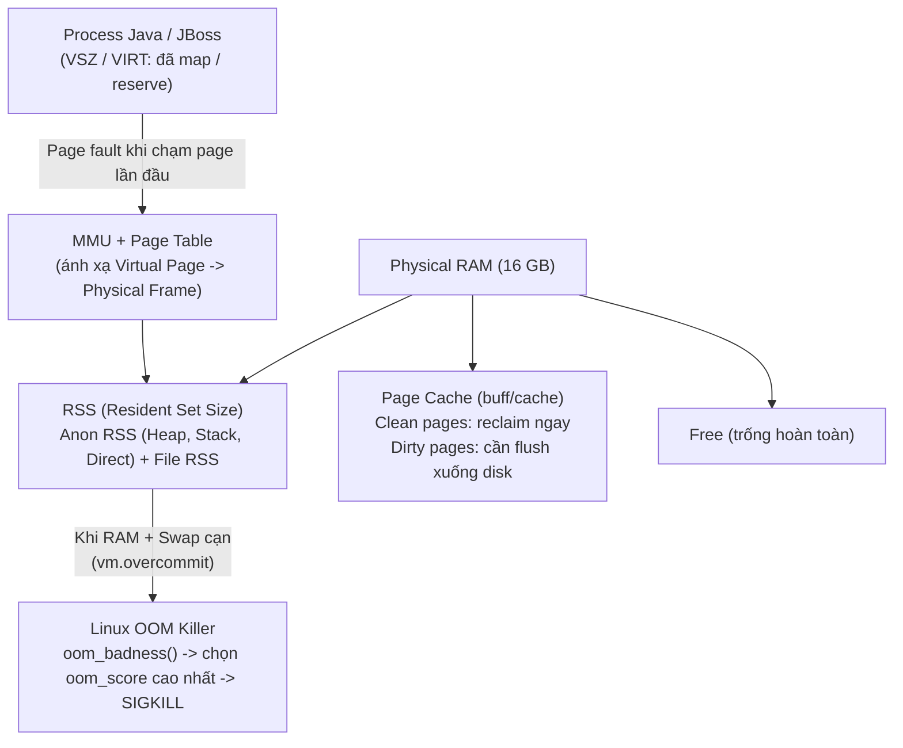

# LNX-03 · Virtual memory, page cache, swap & OOM killer

> **TL;DR** — Khi `free -m` báo cột `free` chỉ còn `120 MB` trên máy `16 GB` RAM, đừng hoảng — Linux đang mượn phần RAM rảnh làm **Page Cache** (`buff/cache`) để tăng tốc đọc ghi đĩa và sẵn sàng trả lại ngay tức thì, nên con số thật phải đọc là **`available`**. Ngược lại, một JVM đặt `-Xmx4g` luôn tiêu tốn tổng **RSS** lớn hơn `4 GB` (thêm Thread Stacks, Metaspace, Code Cache, GC metadata, Direct Buffers — [JVM-04](../../../01-software-engineering/java-jvm/04-jvm-memory-areas/README.md)). Khi RAM vật lý + swap (hoặc cgroup limit) cạn thật, **Linux OOM Killer** kích hoạt hàm `oom_badness()` chấm **`oom_score`** và bắn **`SIGKILL`** giết process ăn nhiều RSS nhất (thường chính là **JBoss / Java**) ngay lập tức mà **không kịp sinh `OutOfMemoryError` hay heap dump**.

## 🧭 Brief

| | |
| :--- | :--- |
| **Loại** | Bài học |
| **Giai đoạn** | Năm 1 · Q1 |
| **Chủ đề** | Linux & Networking |
| **Tiên quyết** | [LNX-02](../02-file-descriptors-io/README.md) |

**Phạm vi bắt buộc**
- virtual vs resident memory
- page cache
- swap
- overcommit
- OOM killer và oom_score
- free/vmstat đọc đúng

**Câu hỏi sâu — nội dung phải giúp trả lời được**
- "free" báo còn ít RAM có đáng lo không?
- OOM killer chọn process nào để giết?

**Ý tưởng lab / demo**
- Tạo áp lực bộ nhớ, quan sát page cache và OOM killer trong VM/container

**Tài liệu gốc gợi ý**
- The Linux Command Line
- Operating Systems: Three Easy Pieces
- Systems Performance (Gregg)
- High Performance Browser Networking (hpbn.co)
- TCP/IP Illustrated

**Gói đầu ra**
- [x] `README.md` — lý thuyết theo [lesson-template](../../../docs/templates/lesson-template.md)
- [x] `exercises.md` — bài tập L1/L2/L3 theo [exercises-template](../../../docs/templates/exercises-template.md)
- [x] `solutions.md` — đáp án theo [solutions-template](../../../docs/templates/solutions-template.md)
- [x] `lab/` — code demo chạy được + `lab/README.md` theo [lab-template](../../../docs/templates/lab-template.md)
- [ ] _(người học)_ `my-notes.md` — **agent không tạo**

---

<!-- Nội dung bắt đầu từ đây -->

## 1. Vấn đề: tại sao phải biết cái này?

Ba tình huống thực tế khiến kỹ sư Java / JBoss mất cả ngày điều tra nhầm hướng:
1. **Báo động giả vì `free` còn 2%:** Ops thấy `free -m` trên server JBoss `32 GB` báo cột `free = 400 MB`, vội mở ticket *"Java leak RAM, sắp sập server!"* dù `available = 18 GB` và `buff/cache = 17.6 GB`.
2. **JBoss biến mất không để lại bất kỳ `OutOfMemoryError` hay `hs_err_pid` nào:** Lúc `14:05`, service Java đột ngột tắt phụt giữa tải cao. Kiểm tra `server.log` hoàn toàn sạch sẽ, `gc.log` báo Heap mới dùng `62%`. Mở `dmesg -T` mới thấy dòng chí mạng: `Out of memory: Killed process 4812 (java) total-vm:9421800kB, anon-rss:7812040kB` — thủ phạm là **Linux OOM Killer** (xem thêm [INC-13](../../../03-production-troubleshooting/incident-labs/13-container-oomkilled/))!
3. **GC pause nhảy từ `30ms` lên `12 giây`:** Không có memory leak, nhưng OS đẩy một phần Heap của JVM ra đĩa (**swap**) vì áp lực page cache hoặc `vm.swappiness` cao. Khi G1/CMS chạy pha mark quét qua vùng Heap nằm trên swap disk, toàn bộ thread ứng dụng bị đóng băng hàng chục giây (*Stop-the-World + disk seek*).

---

## 2. Mô hình tư duy (mental model)

Hãy hình dung **bộ nhớ máy tính như một bàn làm việc (RAM) và tủ hồ sơ dưới kho (Disk/Swap)**:
- **Virtual Memory (`VSZ`/`VIRT`)** là **số trang sách trong danh mục bạn đã xin đặt chỗ** (ví dụ JVM đặt trước toàn bộ khung địa chỉ `-Xmx4g` + mmap file JAR), nhưng chưa chắc đã đặt lên bàn thật.
- **Resident Set Size (`RSS`/`RES`)** là **số trang thực sự đang nằm trên mặt bàn RAM vật lý** của riêng process đó.
- **Page Cache** là **phần bàn trống còn lại được thủ thư Linux tự động xếp sẵn các tài liệu vừa đọc từ đĩa** để lần sau mở không phải xuống kho. Nếu có người cần chỗ làm việc thật, thủ thư thu dọn ngay các trang sạch (*clean pages*) trên bàn chỉ trong micro giây!

**Chỗ ẩn dụ không còn đúng:**
Người bình thường nhìn thấy bàn đầy giấy (Page Cache) liền dọn đi trước; còn trên Linux, **RAM không dùng là RAM lãng phí**, nên cột `free` nhỏ gần 0 là trạng thái *khỏe mạnh tối ưu* của server chạy lâu ngày. Ngoài ra, bàn của **JBoss** dùng chung với hệ điều hành (trừ khi nhốt trong container cgroup), nên khi cả phòng hết bàn và hết cả tủ swap, **bảo vệ tòa nhà (OOM Killer)** sẽ chọn đúng người đang chiếm bàn lớn nhất để đuổi cổ ra ngoài bằng `SIGKILL`!



---

## 3. Cơ chế bên trong (trọng tâm của bài)

### 3.1 Virtual Memory (`VSZ`) vs Resident (`RSS`) vs `PSS` / `USS`

Theo *Operating Systems: Three Easy Pieces* (OSTEP — Address Spaces & Paging) và *Systems Performance* (Brendan Gregg):
- **`VSZ` (`VIRT` trong `top`):** Tổng không gian địa chỉ ảo mà process đã `mmap` hoặc `brk`/reserve. Khi chạy `java -Xms512m -Xmx8g`, `VSZ` nhảy lên hơn `8–12 GB` ngay khi mới khởi động dù RSS mới chỉ ~`300 MB`, vì JVM dùng **lazy allocation** (demand paging: chỉ cấp trang vật lý 4 KB khi có thao tác ghi/đọc chạm vào trang đó lần đầu gây *minor page fault*).
- **`RSS` (`RES` trong `top`):** Tổng lượng RAM vật lý đang nằm trong RAM của process, gồm **Anonymous memory** (Heap, Thread Stacks, Metaspace, Direct ByteBuffer, malloc C heap) và **Shared/File-backed memory** (thư viện `.so`, file `.jar` map vào nhớ).
- **Bẫy cộng dồn RSS:** Vì nhiều process cùng map chung `libc.so` hoặc JAR đọc chung, cộng `RSS` của mọi process lại có thể lớn hơn tổng RAM thật. Để đo công bằng hơn, Linux cung cấp **`PSS` (Proportional Set Size)** (chia đều trang dùng chung theo số process) và **`USS` (Unique Set Size)** (lượng RAM thực sự sẽ được giải phóng ngay nếu kill process này) trong `/proc/<pid>/smaps_rollup`.

### 3.2 Trả lời câu hỏi sâu #1: `"free"` báo còn ít RAM có đáng lo không?

Câu trả lời ngắn: **KHÔNG — nếu cột `available` còn cao và máy không swap liên tục.**

Ví dụ mẫu đầu ra chuẩn của `free -m` (`procps-ng >= 3.3.10`):
```text
               total        used        free      shared  buff/cache   available
Mem:           16000        6200         350         180        9450        9200
Swap:           4096          50        4046
```
- **`free` (`350 MB`):** RAM hoàn toàn bỏ không, không làm việc gì. Linux chủ động dùng RAM nhàn rỗi làm **`buff/cache` (`9.450 MB`)** — chủ yếu là **Page Cache** (dữ liệu đọc/ghi file trên đĩa, file log, DB data files, JAR).
- **`available` (`9.200 MB`):** Ước lượng từ `/proc/meminfo` (`MemAvailable`, có từ Linux kernel 3.14) cho biết **bao nhiêu RAM có thể cấp ngay cho app mới mà không cần đẩy ra Swap** (`free` + phần lớn clean Page Cache + reclaimable slab).
- **Khi nào mới thực sự đáng lo?**
  1. `available` tụt xuống dưới **10–15% tổng RAM** (ví dụ `< 1.5 GB` trên máy `16 GB`).
  2. `vmstat 1` cho thấy cột **`si` (swap in)** và **`so` (swap out)** khác `0` liên tục (swap thrashing!).
  3. Lượng **`Dirty`** pages trong `/proc/meminfo` quá lớn khi đĩa chậm (chỉ `Clean` page cache mới thu hồi tức thì; `Dirty` page phải `writeback` ra đĩa trước).

### 3.3 Page Cache, Swap & Overcommit

1. **Page Cache & `writeback`:** Khi ứng dụng ghi log JBoss (`write()`), dữ liệu đi vào **Page Cache** (đánh dấu *dirty*) và syscall trả về ngay lập tức; kernel flush bất đồng bộ xuống đĩa sau (trừ khi app gọi `fsync()` như WAL của PostgreSQL/Kafka).
2. **Swap & `vm.swappiness`:** Swap là không gian trên đĩa làm phần mở rộng cho anonymous memory khi RAM căng. `vm.swappiness` (0–200, mặc định `60`) điều chỉnh mức độ ưu tiên đổi anonymous page ra swap so với thu hồi page cache. Với server chạy **JVM / PostgreSQL / Kafka**, nên giảm **`vm.swappiness=1`** (trên kernel cũ `0` tắt hẳn swap cho reclaim bình thường) hoặc tắt swap trên node Kubernetes để tránh STW GC kéo dài nhiều giây do đọc trang Heap từ swap disk!
3. **Memory Overcommit (`vm.overcommit_memory`):**
   - `0` *(heuristic — mặc định)*: Cho phép `malloc`/reserve nhiều hơn RAM trống miễn thấy hợp lý (giúp `java -Xmx` hoặc `fork()` chạy trơn tru).
   - `1` *(always)*: Luôn cho cấp phát không kiểm tra (dùng cho Redis `BGSAVE`).
   - `2` *(never)*: Cấm tổng *committed address space* (`Committed_AS`) vượt quá `Swap + RAM * overcommit_ratio/100`. Nếu bật `2`, JVM dùng `-Xmx` lớn gọi `fork()` rất dễ nổ `ENOMEM` ([LNX-01](../01-processes-signals/README.md)).

### 3.4 Trả lời câu hỏi sâu #2: OOM Killer chọn process nào để giết?

Khi hệ thống (hoặc cgroup của container) hết sạch bộ nhớ không thể thu hồi được nữa, kernel gọi **OOM Killer** (`mm/oom_kill.c`). Thuật toán chấm điểm (`oom_badness`) hoạt động như sau:
1. Mỗi process nhận điểm gốc **`oom_score`** (thang **`0` đến `1000`**, xem tại `/proc/<pid>/oom_score`) tỷ lệ thuận với phần trăm **RAM (`RSS`) + Swap + Page Table** mà process đó đang chiếm trên tổng bộ nhớ khả dụng (của host hoặc cgroup limit). Ví dụ process chiếm `60%` RAM sẽ có `oom_score` gốc khoảng **`600`**.
2. Cộng thêm giá trị điều chỉnh của người quản trị **`oom_score_adj`** (từ **`-1000` đến `+1000`**, xem/sửa tại `/proc/<pid>/oom_score_adj`):
   - Đặt **`-1000`**: Bất tử trước OOM Killer (`sshd`, `systemd-journald` thường giữ giá trị âm để không mất khả năng SSH cứu máy!).
   - Đặt dương lớn (ví dụ `+500` đến `+999` như Kubernetes đặt cho Pod `BestEffort`): **Ưu tiên bị giết đầu tiên**.
3. Kernel chọn process có **điểm cuối cùng cao nhất** và gửi thẳng **`SIGKILL` (`kill -9`)**!
   - Vì JBoss/Java thường là process chiếm nhiều RSS nhất trên server (50–80% RAM máy), **JBoss gần như luôn là nạn nhân số 1** nếu có process khác leak RAM hoặc nếu cấu hình `-Xmx` + off-heap + Page Cache vượt ngưỡng giới hạn!

---

## 4. Code minh họa

Trên server Java thật, tổng bộ nhớ process (RSS) không chỉ là `-Xmx`! Xem [MemoryFootprintAnalyzer.java](./lab/src/main/java/lab/linux/oom/MemoryFootprintAnalyzer.java) và [OomScoreCalculator.java](./lab/src/main/java/lab/linux/oom/OomScoreCalculator.java):

```java
// ❌ SAI (tính nhầm dung lượng RAM khi cấp cho container/VM):
// "Container có 4 GB RAM, vậy đặt -Xmx4g cho tận dụng tối đa!"
// -> JVM Heap 4 GB + Metaspace 300 MB + 200 Thread * 1 MB + CodeCache 240 MB + DirectBuffer
//    = ~5.0 GB RSS -> Vượt 4 GB -> Linux OOM Killer bắn SIGKILL (Exit 137)!
```

```java
// ✅ ĐÚNG: Dành ~25-30% RAM cho off-heap JVM + OS Page Cache + headroom,
// hoặc trong container dùng -XX:MaxRAMPercentage=70.0 (và -XX:+ExitOnOutOfMemoryError)
long heapUsedMb = ManagementFactory.getMemoryMXBean().getHeapMemoryUsage().getUsed() / (1024 * 1024);
long directUsedMb = ManagementFactory.getPlatformMXBeans(BufferPoolMXBean.class).stream()
        .filter(p -> "direct".equals(p.getName()))
        .mapToLong(BufferPoolMXBean::getMemoryUsed)
        .sum() / (1024 * 1024);
// Ngoài Heap còn có Direct Buffer + Metaspace + Thread Stacks!
```

### 4.1 Legacy corner (Java 7 / JBoss AS 7.1.1)

Trên **Java 7 / JBoss AS 7.1.1** chạy trên VM Linux `8 GB` hoặc `16 GB` RAM:
1. Java 7 chưa có `-XX:MaxRAMPercentage` (mới có từ JDK 8u191/10+) và không có `NativeMemoryTracking` tốt như JDK 8+/21, cộng thêm **PermGen (`-XX:MaxPermSize=512m`)** nằm tách ngoài `-Xmx`. Nếu bạn gán `-Xmx6g` trên máy `8 GB` có cài chung agent log, DB client, JBoss native libs, tổng RSS rất dễ chạm `8 GB` và ăn **OOM Killer**. Quy tắc an toàn trên VM chạy JBoss: `-Xmx` tối đa **`60–70%` tổng RAM máy** nếu cùng chạy thêm agent/service khác.
2. Khi JBoss đột nhiên biến mất không có `hs_err_pid*.log` và không có `OutOfMemoryError` trong `server.log`, lệnh đầu tiên phải chạy là **`dmesg -T | grep -i -E "oom|killed process"`** (hoặc `/var/log/messages` trên RHEL/CentOS)!

---

## 5. Quan sát & đo đạc

### Phần A — Đã chạy kiểm chứng trên Windows 11 (Java 21 MemoryMXBean + Free/OOM Analyzer)
Từ thư mục `lab/`:
```powershell
mvn -o -B verify
mvn -o -B compile exec:java
```
**Output thực tế ghi nhận trên Windows 11 amd64 · OpenJDK 26.0.1 (`--release 21`):**
- `MemoryOomTest`: **4/4 tests pass**, kiểm chứng:
  1. `MemoryFootprintAnalyzer` cấp phát thật `64 MB` Direct Off-Heap `ByteBuffer` (`ByteBuffer.allocateDirect`) + đo qua `MemoryMXBean` và `BufferPoolMXBean`: Heap used chỉ tăng nhẹ (~vài MB), trong khi **`direct` buffer pool tăng chính xác `64 MB`** — chứng minh rõ phần RAM thực của JVM nằm ngoài `-Xmx`!
  2. `FreeOutputParser` phân tích đúng 2 mẫu `free -m`: mẫu `free=220 MB, buff/cache=10500 MB, available=10100 MB` (trên 16 GB) được kết luận **HEALTHY** (nhờ Page Cache reclaimable), còn mẫu `available=700 MB, swapUsed=2800 MB` báo **CRITICAL_MEMORY_PRESSURE**.
  3. `OomScoreCalculator` mô phỏng công thức `oom_badness`: một process `java` chiếm `65%` RSS (`score=650`) với `oom_score_adj=0` sẽ bị OOM Killer chọn giết trước `sshd` (`score=10, adj=-1000 -> effective=0`) và trước `postgres` nếu được bảo vệ bằng `oom_score_adj=-500`.

### Phần B — Cần kiểm chứng trên Linux / WSL / Docker (chưa chạy được trên máy Windows soạn bài)
> ⚠️ **Cần kiểm chứng trên Linux:** Các lệnh quan sát Linux kernel virtual memory, `buff/cache`, `si/so`, `oom_score`, `dmesg` sau đây **chưa chạy trực tiếp** vì máy soạn dùng Windows 11 không có WSL/Docker:
- `free -m` và `vmstat 1 5` (đọc cột `available`, `buff/cache`, `si`, `so`).
- `cat /proc/<pid>/oom_score` & `cat /proc/<pid>/oom_score_adj` & `cat /proc/<pid>/smaps_rollup` (`RSS`, `PSS`, `Swap`).
- `bash scripts/oom-pressure-demo.sh` và `dmesg -T | grep -i -E "oom|killed process"` (tạo áp lực memory trong cgroup/VM để thấy kernel bắn `SIGKILL`).

---

## 6. Trade-offs & khi nào KHÔNG dùng

| Cấu hình | Được gì | Mất gì | Dùng khi |
| :--- | :--- | :--- | :--- |
| **`vm.swappiness=1` (swap nhỏ)** | Có đệm cứu nguy nhẹ cho các trang ngủ hiếm dùng trước khi nổ OOM | Nếu JVM Heap bị đẩy ra swap sẽ gây GC pause hàng chục giây | VM Linux chạy app server có RAM hạn chế, ưu tiên tránh OOM đột ngột cho process nền |
| **Tắt swap hoàn toàn (`swapoff -a`)** | Latency dự đoán được, **không bao giờ bị GC pause do swap disk**, hành vi khớp Kubernetes | Hết RAM là **OOM Killer nổ ngay lập tức**, không có vùng đệm | **Node Kubernetes**, Kafka broker, server latency-sensitive |
| **Đặt `oom_score_adj=-1000` cho app** | App không bao giờ bị OOM Killer giết | Kernel có thể giết nhầm `sshd`/system daemon → **treo cứng cả máy không SSH vào được!** | **KHÔNG bao giờ** đặt `-1000` cho JBoss/Java! Chỉ dành cho `sshd`/`systemd` |

---

## 7. Cạm bẫy production (ít nhất 3)

1. **Nhầm `free` nhỏ là hết RAM và mở alert sai hoặc viết cron `echo 3 > /proc/sys/vm/drop_caches`** — *Triệu chứng:* có người cấu hình cron chạy `drop_caches` mỗi giờ để làm cột `free` đẹp lên. *Nguyên nhân:* không hiểu Page Cache; xóa sạch Page Cache ép DB và app đọc lại mọi file từ đĩa gây **spike disk I/O và tăng vọt p99 latency**. *Cách tránh:* alert theo **`MemAvailable`** (`available / total < 15%`), tuyệt đối không chạy `drop_caches` trên prod.
2. **Đặt `-Xmx` gần bằng 100% RAM container hoặc VM** — *Triệu chứng:* `OutOfMemoryError` không xuất hiện trong log Java, nhưng container chết với `Exit Code 137 (OOMKilled)` khi Heap mới 60–70%. *Nguyên nhân:* bỏ quên Direct Buffer (`ByteBuffer`/Netty), Thread Stack (`N × 1 MB`), Metaspace, Code Cache và Page Cache tính vào cgroup memory limit ([CTR-04](../../containers-k8s/04-jvm-in-containers/README.md), [INC-13](../../../03-production-troubleshooting/incident-labs/13-container-oomkilled/)). *Cách tránh:* giữ `-Xmx` (hoặc `-XX:MaxRAMPercentage`) ở mức `65–75%` RAM container/VM.
3. **Tin `top` cột `VIRT` (`VSZ`) lớn hơn RAM máy là lỗi leak** — *Triệu chứng:* `top` báo `java` chiếm `VIRT = 18g` trên máy `16 GB` RAM. *Nguyên nhân:* `VSZ` chỉ là vùng địa chỉ ảo đã `mmap`/reserve, không phải RAM thật đang tiêu thụ. *Cách tránh:* luôn theo dõi **`RES` (`RSS`)** và **`PSS`**, không dùng `VIRT` để đánh giá ngốn RAM.
4. **Bật Swap trên server JVM nhưng không theo dõi `si/so` trong `vmstat`** — *Triệu chứng:* hệ thống chạy chậm dần đều, GC log báo pha `Remark`/`Pause` mất `8.000ms` dù chỉ gom `200 MB` rác. *Nguyên nhân:* vùng Heap/Direct bị OS đẩy ra swap disk. *Cách tránh:* kiểm tra `vmstat 1` cột `si`/`so` và hạ `vm.swappiness=1` (hoặc tắt swap nếu có K8s).

---

## 8. Liên hệ thực tế công việc

Ngay tuần này trên server Linux chạy **JBoss AS 7.1.1**:
1. Chạy `free -m`, `vmstat 1 3`, và `ps -o pid,rss,vsz,comm -p <jboss_pid>` để đo chính xác tỷ lệ `RSS` thực tế của JBoss so với `-Xmx` bạn đang cấu hình trong `standalone.conf`.
2. Kiểm tra `/proc/sys/vm/swappiness` và `dmesg -T | grep -i oom` để biết máy hiện tại có từng bị OOM Killer âm thầm giết tiến trình nào trong quá khứ không.

---

## 9. Self-check — Explain-back

> Trả lời **không nhìn tài liệu**, nói to trong 5 phút. Không trả lời được = chưa xong. (Đáp án nằm trong [solutions.md](./solutions.md).)

1. Phân biệt `VSZ` (`VIRT`), `RSS` (`RES`), `PSS` và `USS`. Tại sao `java -Xmx4g` vừa bật có thể hiện `VIRT` > 6 GB nhưng `RES` chỉ vài trăm MB?
2. Khi `free -m` trên server `16 GB` báo `free = 250 MB` nhưng `available = 9.500 MB`, hệ thống có đang thiếu RAM không? Cơ chế Page Cache hoạt động thế nào?
3. Kể tên 4 vùng nhớ khiến **RSS** của một server Java/JBoss luôn cao hơn con số `-Xmx` bạn cấu hình.
4. Tại sao Swap lại đặc biệt nguy hiểm với GC của JVM (ví dụ G1GC / CMS)? `vm.swappiness` điều chỉnh cái gì?
5. Trình bày cách Linux **OOM Killer** tính điểm (`oom_score` + `oom_score_adj`) để chọn nạn nhân khi hết RAM, và tại sao JBoss thường bị giết đầu tiên?

---

## 10. Cheatsheet 1 trang

| Khái niệm / Lệnh | Ý nghĩa & quy tắc chuẩn |
| :--- | :--- |
| **`VSZ` vs `RSS`** | `VSZ` = bộ nhớ ảo đã xin địa chỉ (lazy); `RSS` = RAM vật lý đang chiếm (`Anon` + `File`) |
| **Đọc `free -m` đúng** | Bỏ qua cột `free` nhỏ; nhìn **`available`** (`MemAvailable`) và `buff/cache` (Page Cache) |
| **Lệnh kiểm tra Swap** | `vmstat 1` nhìn cột **`si`/`so`** (phải ≈ `0`); `sysctl vm.swappiness` (nên `1` cho server app) |
| **JVM RSS Budget** | `RSS ≈ Heap (-Xmx) + Metaspace + Thread*Xss + CodeCache + DirectBuffers + GC` (giữ `-Xmx` ≤ 70% RAM) |
| **OOM Killer** | Điểm = `oom_score` (0..1000 theo % RSS+Swap) + `oom_score_adj` (-1000..+1000) → cao nhất ăn `SIGKILL` (`dmesg -T \| grep -i oom`) |

---

## 11. Tài liệu tham khảo

- Remzi & Andrea Arpaci-Dusseau, [*Operating Systems: Three Easy Pieces* — Paging & Virtual Memory](https://pages.cs.wisc.edu/~remzi/OSTEP/vm-paging.pdf) — cơ chế page table, demand paging và swap.
- Brendan Gregg, *Systems Performance* (2nd ed.) — Chapter 7: Memory (Page Cache, `vmstat`, `free`, OOM Killer).
- Linux Kernel Documentation: [`/proc` filesystem & `oom_score_adj`](https://docs.kernel.org/filesystems/proc.html) và [`sysctl/vm.rst` (`overcommit_memory`, `swappiness`)](https://docs.kernel.org/admin-guide/sysctl/vm.html).
- Linux man-pages: [`free(1)`](https://man7.org/linux/man-pages/man1/free.1.html) — định nghĩa chính thức `buff/cache` và `available`.

---
➡️ Tiếp theo: [exercises.md](./exercises.md) · [lab/](./lab/README.md) · Bài kế: [LNX-04 · systemd & quản lý service](../04-systemd-services/README.md)
