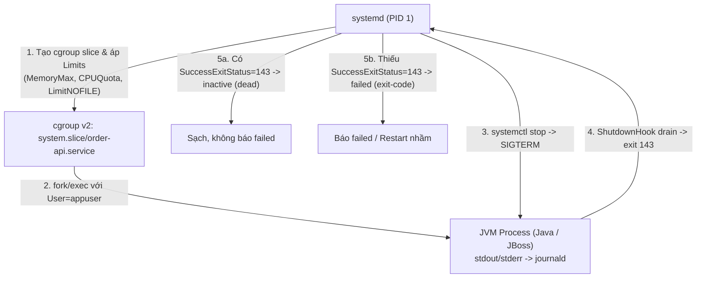

# LNX-04 · systemd & quản lý service

> **TL;DR** — Trên hầu hết bản phân phối Linux server hiện đại (RHEL 7+/Ubuntu/Debian), **systemd** chạy ở **PID 1**, trực tiếp khởi chạy, giám sát, áp giới hạn tài nguyên cgroup (`MemoryMax`, `CPUQuota`, `LimitNOFILE`), và thu log qua **`journald`** cho các dịch vụ như Java / **JBoss AS 7.1.1**. Hai cạm bẫy production lớn nhất với app Java: (1) systemd **không đọc `/etc/security/limits.conf`** — phải cấu hình **`LimitNOFILE=`** trực tiếp trong unit file; và (2) JVM khi nhận `SIGTERM` thoát với mã **`143` (`128 + 15`)**, nên nếu thiếu **`SuccessExitStatus=143`**, mỗi lần `systemctl stop` hoặc restart, systemd sẽ đánh dấu service **`failed`**! Ngoài ra, dùng mù quáng `Restart=always` không giới hạn burst dễ che giấu lỗi crash-loop làm cạn CPU và xoay vòng log mất dấu root cause.

## 🧭 Brief

| | |
| :--- | :--- |
| **Loại** | Bài học |
| **Giai đoạn** | Năm 1 · Q1 |
| **Chủ đề** | Linux & Networking |
| **Tiên quyết** | [LNX-03](../03-memory-pagecache-oom/README.md) |

**Phạm vi bắt buộc**
- unit file
- restart policy
- journalctl
- resource limits (cgroup qua systemd)
- timer thay cron

**Câu hỏi sâu — nội dung phải giúp trả lời được**
- Viết unit file cho app Java chạy ổn định?
- Restart=always có thể che giấu lỗi gì?

**Ý tưởng lab / demo**
- Chạy app Java như systemd service với giới hạn memory

**Tài liệu gốc gợi ý**
- The Linux Command Line
- Operating Systems: Three Easy Pieces
- Systems Performance (Gregg)
- High Performance Browser Networking (hpbn.co)
- TCP/IP Illustrated

**Gói đầu ra**
- [x] `README.md` — lý thuyết theo [lesson-template](../../../docs/templates/lesson-template.md)
- [x] `exercises.md` — bài tập L1/L2/L3 theo [exercises-template](../../../docs/templates/exercises-template.md)
- [x] `solutions.md` — đáp án theo [solutions-template](../../../docs/templates/solutions-template.md)
- [x] `lab/` — code demo chạy được + `lab/README.md` theo [lab-template](../../../docs/templates/lab-template.md)
- [ ] _(người học)_ `my-notes.md` — **agent không tạo**

---

<!-- Nội dung bắt đầu từ đây -->

## 1. Vấn đề: tại sao phải biết cái này?

Trong môi trường doanh nghiệp chạy Java / JBoss trên Linux VM, cách triển khai thủ công cũ (`nohup ./standalone.sh &` hoặc `rc.local`) gây ra hàng loạt sự cố vận hành:
1. **Reboot máy hay OOM Killer xong không tự bật lại:** Máy chủ bảo trì reboot ban đêm, sáng hôm sau toàn bộ JBoss tắt ngóm vì không có service manager giám sát.
2. **Dừng service báo `Active: failed (Result: exit-code)`:** `systemctl stop order-api` gửi `SIGTERM`, JVM chạy shutdown hook xong thoát với mã **`143`**, systemd tưởng ứng dụng vừa crash nên gắn cờ `failed` (và nếu đặt `Restart=on-failure` hay không kiểm soát có thể gây nhầm lẫn alert!).
3. **JBoss vẫn dính `ulimit -n 1024` dù Ops đã sửa `/etc/security/limits.conf`:** Vì tiến trình sinh bởi `systemd` (PID 1) **không đi qua PAM session login** nên bỏ qua hoàn toàn `limits.conf`.

---

## 2. Mô hình tư duy (mental model)

Hãy xem **systemd như "người quản lý tòa nhà" (PID 1)**:
- Mọi service (`order-api.service`, `jboss.service`) đều có một **hồ sơ quy chuẩn (Unit File)** khai báo: ai chạy (`User=`), chạy bằng lệnh gì (`ExecStart=`), được cấp bao nhiêu điện nước (`MemoryMax=`, `CPUQuota=`, `LimitNOFILE=`), khi nào khởi động (`After=network-online.target`), và xử lý ra sao nếu đột tử (`Restart=`).
- Thay vì mỗi người tự ghi nhật ký ra file lộn xộn và quên xoay vòng, mọi `stdout`/`stderr` của service chảy thẳng vào **hệ thống sổ nhật ký trung tâm (`journald`)** — xem, lọc theo thời gian, lọc theo mức ưu tiên chỉ bằng một lệnh `journalctl`.

**Chỗ ẩn dụ không còn đúng:**
Người quản lý bình thường nhìn thấy nhân viên tự đi về (`exit 143` sau khi nhận `SIGTERM`) là bình thường; nhưng systemd mặc định chỉ coi **`exit 0`** (hoặc `SIGHUP`/`SIGINT`/`SIGTERM`/`SIGPIPE` trong một số điều kiện nếu tiến trình không tự bắt signal để thoát qua `exit()`) là thành công! Riêng **JVM tự bắt `SIGTERM` để chạy Shutdown Hook rồi gọi `exit(143)`**, nên systemd thấy một exit code khác `0` là `143` và báo lỗi nếu không khai báo `SuccessExitStatus=143`!



---

## 3. Cơ chế bên trong (trọng tâm của bài)

### 3.1 Cấu trúc 3 phần của một Unit File (`.service`)

File cấu hình nằm ở `/etc/systemd/system/<ten-service>.service` (ưu tiên cao hơn `/usr/lib/systemd/system/`):
1. **`[Unit]`:** Metadata và thứ tự phụ thuộc (`Description=`, `After=network-online.target postgresql.service`, `Wants=network-online.target`, và giới hạn khởi động lại `StartLimitIntervalSec=300`, `StartLimitBurst=5` — chú ý trong systemd bản mới đặt ở `[Unit]`).
2. **`[Service]`:** Cách chạy tiến trình, tài khoản, biến môi trường, restart policy, cgroup limits và shutdown timeout.
   - `Type=simple` (mặc định: process `ExecStart` chạy foreground, không fork nền — phù hợp nhất cho `java -jar ...`), hoặc `Type=exec` (chờ `execve` thành công mới báo `active`), hoặc `Type=notify` (app báo sẵn sàng qua `sd_notify`). Tránh `Type=forking` trừ daemon cổ điển tự tách nền viết PIDFile.
3. **`[Install]`:** Khi nào được bật tự khởi động lúc boot (`WantedBy=multi-user.target` khi chạy `systemctl enable`).

### 3.2 Trả lời câu hỏi sâu #1: Viết Unit File cho app Java / JBoss chạy ổn định như thế nào?

Một unit file chuẩn production cho ứng dụng Java (`/etc/systemd/system/order-api.service`) phải hội đủ **8 quy tắc vàng** (xem mẫu đầy đủ tại [java-app.service](./lab/systemd/java-app.service)):

1. **Chạy bằng user thường không phải `root`:** `User=appuser`, `Group=appuser`.
2. **Đặt `SuccessExitStatus=143`:** Bắt buộc cho JVM! Khi systemd gửi `SIGTERM`, HotSpot JVM chạy Shutdown Hooks và kết thúc với exit code `143` (`128 + 15`). Có dòng này systemd mới coi `systemctl stop` là tắt sạch.
3. **Đặt `LimitNOFILE=65536` trực tiếp trong `[Service]`:** Vì systemd bỏ qua `/etc/security/limits.conf` ([LNX-02](../02-file-descriptors-io/README.md)).
4. **Giới hạn tài nguyên cgroup rõ ràng:** `MemoryMax=2G`, `MemoryHigh=1600M` (ép kernel reclaim sớm trước khi OOM), `CPUQuota=200%` (tối đa 2 CPU cores). Kết hợp `-XX:MaxRAMPercentage=70.0` (trên Java 11+/21) để JVM nhận diện đúng cgroup limit!
5. **Graceful shutdown timeout khớp với app:** `TimeoutStopSec=30`, `KillSignal=SIGTERM`, `KillMode=mixed` (gửi `SIGTERM` cho main process, hết hạn mới `SIGKILL` toàn cgroup).
6. **Biến môi trường tách riêng:** `EnvironmentFile=-/etc/order-api/env` (dấu `-` để không lỗi nếu file chưa tạo, quyền file `0600` chỉ `appuser`/`root` đọc).
7. **Không dùng shell wrapper thừa trong `ExecStart=`:** Gọi đường dẫn tuyệt đối `/opt/jdk21/bin/java -jar /opt/order-api/app.jar` (nếu buộc qua script shell `.sh`, dòng cuối phải là `exec java ...` — [LNX-01](../01-processes-signals/README.md)).
8. **Chống crash loop mất kiểm soát:** `Restart=on-failure`, `RestartSec=5s`, kết hợp `StartLimitIntervalSec=120` và `StartLimitBurst=5` trong `[Unit]`.

### 3.3 Trả lời câu hỏi sâu #2: `Restart=always` có thể che giấu lỗi gì?

`Restart=always` ra lệnh cho systemd khởi động lại service **bất kể nguyên nhân thoát là gì** (kể cả thoát sạch `exit 0`, lỗi cấu hình `exit 1`, `SIGTERM` từ người ngoài không qua `systemctl`, hoặc OOM):

| Lỗi bị che giấu bởi `Restart=always` | Cơ chế hậu quả thực tế |
| :--- | :--- |
| **1. Crash loop do cấu hình sai / OOM / port trùng** | App bật lên → crash sau 2 giây (thiếu DB password, sai migration, port 8080 bận) → systemd lại bật lên ngay → lặp vô tận, đốt CPU 100%, **đẩy trôi log lỗi đầu tiên khỏi `journald` / log file**, và làm dashboard tưởng service "vẫn đang chạy" nếu chỉ kiểm tra có PID! |
| **2. Che giấu lần thoát chủ động (`exit 0`) hoặc debug thủ công** | Khi bạn chạy `jboss-cli.sh :shutdown` hoặc app tự dừng có chủ đích (`exit 0`) để bảo trì, `Restart=always` lại **bật ngược service lên ngay lập tức**, gây ghi đè dữ liệu hoặc lỗi deploy ngoài ý muốn! |
| **3. Chạy vô tận khi thiếu tài nguyên (No burst limit)** | Nếu kết hợp `Restart=always` + `RestartSec=1` mà thiếu `StartLimitBurst`, mỗi phút app restart ~30–60 lần âm thầm hàng tuần liền cho tới khi người dùng phát hiện lỗi chập chờn. |

**Quy tắc đúng:** Dùng **`Restart=on-failure`** + **`RestartSec=5s`** + **`StartLimitIntervalSec=120`** + **`StartLimitBurst=5`**, đồng thời giám sát chỉ số `NRestarts` (`systemctl show -p NRestarts order-api`).

### 3.4 `journalctl` — Xem & lọc log chuẩn SRE

Mặc định `StandardOutput=journal` và `StandardError=journal` gửi toàn bộ log stdout/stderr của Java vào `systemd-journald` (lưu nhị phân có index thời gian & metadata `_PID`, `_SYSTEMD_UNIT`):
```bash
journalctl -u order-api.service -f                      # Tail live giống tail -f
journalctl -u order-api.service -S "2026-11-27 14:00" -U "14:15"   # Lọc theo khung giờ
journalctl -u order-api.service -n 200 --no-pager       # 200 dòng cuối, không phân trang
journalctl -u order-api.service -p err                  # Chỉ xem mức err trở lên
journalctl -u order-api.service --disk-usage            # Kiểm tra dung lượng journal chiếm
```
*(Mẹo: nếu Java xuất `kill -3` thread dump ra stdout khi chạy dưới systemd, bạn tìm lại toàn bộ thread dump đó trực tiếp trong `journalctl -u jboss-as -S "5 min ago"`!)*

### 3.5 `systemd timer` thay thế `cron`

Một `.timer` unit kích hoạt một `.service` cùng tên (ví dụ `heap-check.timer` → `heap-check.service`):
- **Lợi thế vượt trội so với `crontab`:**
  1. Log tự động vào `journalctl -u heap-check.service` (không còn cảnh cron fail âm thầm gửi mail cục bộ không ai đọc).
  2. Giới hạn CPU/RAM riêng cho job batch (`MemoryMax=512M`, `Nice=10`) để không đánh sập JBoss ([LNX-03](../03-memory-pagecache-oom/README.md)).
  3. **`RandomizedDelaySec=60s`** tránh hiện tượng "thundering herd" khi 50 server cùng chạy job đúng `00:00:00`.
  4. **`Persistent=true`** tự động chạy bù ngay nếu máy từng tắt đúng giờ hẹn.
  5. Dùng **`OnCalendar=*-*-* 02:00:00`** hoặc **`OnUnitActiveSec=15m`** (rõ ràng, có kiểm tra syntax bằng `systemd-analyze calendar`).

---

## 4. Code minh họa

Xem trọn bộ unit files chuẩn tại [java-app.service](./lab/systemd/java-app.service), [jboss-legacy.service](./lab/systemd/jboss-legacy.service), [heap-check.timer](./lab/systemd/heap-check.timer) và trình kiểm tra tự động [SystemdUnitLinter.java](./lab/src/main/java/lab/linux/systemd/SystemdUnitLinter.java):

```ini
# ❌ SAI: 5 lỗi kinh điển trong unit file Java
[Service]
User=root
ExecStart=/bin/sh -c "java -jar /opt/app/app.jar"
Restart=always
# Thiếu SuccessExitStatus=143 -> systemctl stop báo failed!
# Thiếu LimitNOFILE -> dính trần 1024!
# Thiếu MemoryMax -> ăn OOM toàn host!
```

```ini
# ✅ ĐÚNG: An toàn, giới hạn tài nguyên, graceful shutdown sạch
[Unit]
Description=Order API Java 21 Service
After=network-online.target
Wants=network-online.target
StartLimitIntervalSec=120
StartLimitBurst=5

[Service]
Type=simple
User=appuser
Group=appuser
WorkingDirectory=/opt/order-api
EnvironmentFile=-/etc/order-api/env
ExecStart=/opt/jdk21/bin/java -XX:MaxRAMPercentage=70.0 -XX:+ExitOnOutOfMemoryError -jar /opt/order-api/app.jar
SuccessExitStatus=143
Restart=on-failure
RestartSec=5s
TimeoutStopSec=30
LimitNOFILE=65536
MemoryHigh=1600M
MemoryMax=2G
CPUQuota=200%

[Install]
WantedBy=multi-user.target
```

### 4.1 Legacy corner (Java 7 / JBoss AS 7.1.1)

Khi đưa **JBoss AS 7.1.1** lên quản lý bằng `systemd` trên RHEL 7/8/9:
1. **Dừng bằng `ExecStop=` qua `jboss-cli.sh`:** Với JBoss AS 7, ngoài `SuccessExitStatus=143` bạn có thể cấu hình thêm `ExecStop=/opt/jboss/bin/jboss-cli.sh --connect command=:shutdown` và `TimeoutStopSec=45` để JBoss tắt EJB timer & datasource pool theo đúng thứ tự trước khi gửi `SIGTERM`.
2. **File wrapper `standalone.sh`:** Mặc định `standalone.sh` có vòng lặp check exit code `10` (restart) và tự chạy `java` làm child process! Nếu chạy `ExecStart=/opt/jboss/bin/standalone.sh` trực tiếp, nhớ đặt `LAUNCH_JBOSS_IN_BACKGROUND=false` hoặc tốt hơn hết dùng `KillMode=control-group` cẩn thận và kiểm tra `systemd` có đang gửi signal tới đúng JVM PID qua `systemctl status jboss-as` (Main PID) hay không!
3. **Đặt `LimitNOFILE=65536` trực tiếp trong `jboss-as.service`:** Nhiều team tốn cả ngày sửa `/etc/security/limits.conf` rồi restart `systemctl restart jboss-as` mà JBoss vẫn chỉ có `1024` FD vì systemd không đọc `limits.conf`.

---

## 5. Quan sát & đo đạc

### Phần A — Đã chạy kiểm chứng trên Windows 11 (Java 21 SystemdUnitLinter & Exit 143 Simulator)
Từ thư mục `lab/`:
```powershell
mvn -o -B verify
mvn -o -B compile exec:java
```
**Output thực tế ghi nhận trên Windows 11 amd64 · OpenJDK 26.0.1 (`--release 21`):**
- `SystemdUnitTest`: **3/3 tests pass**, chứng minh:
  1. `SystemdUnitLinter` quét `jboss-legacy-broken.service` phát hiện đủ **6 lỗi** (`User=root`, `ExecStart` dùng `/bin/sh -c` bọc Java, `Restart=always` thiếu burst limit, thiếu `SuccessExitStatus=143`, thiếu `LimitNOFILE`, thiếu `MemoryMax`).
  2. Quét `java-app.service` và `jboss-legacy.service` chuẩn mẫu đạt **0 findings**.
  3. `SystemdStateSimulator` chứng minh khi app thoát với mã `143`: nếu thiếu `SuccessExitStatus=143` → unit rơi vào `FAILED`; nếu có `SuccessExitStatus=143` → unit dừng sạch ở `INACTIVE_DEAD`. Với `Restart=always` khi crash liên tục không burst limit, `NRestarts` tăng không dừng mà không chuyển `FAILED`.

### Phần B — Cần kiểm chứng trên Linux / WSL / Docker (chưa chạy được trên máy Windows soạn bài)
> ⚠️ **Cần kiểm chứng trên Linux:** Máy soạn là Windows 11 không có WSL/Docker nên không có `systemd` daemon chạy PID 1; các lệnh Linux thực tế dưới đây **chưa được chạy kiểm chứng**:
- `systemd-analyze verify lab/systemd/java-app.service`
- `systemctl daemon-reload && systemctl enable --now java-app.service`
- `systemctl status java-app.service` (kiểm tra `Memory:`, `Tasks:`, `Main PID`, và thử `systemctl stop` khi có/thiếu `SuccessExitStatus=143`)
- `journalctl -u java-app.service -n 50 --no-pager` và `systemctl list-timers --all` (xem `heap-check.timer`).

---

## 6. Trade-offs & khi nào KHÔNG dùng

| Lựa chọn | Được gì | Mất gì | Dùng khi |
| :--- | :--- | :--- | :--- |
| **`systemd` quản lý trực tiếp Java/JBoss trên VM** | Quản lý thống nhất cgroup (`MemoryMax`, `LimitNOFILE`), auto-restart có kiểm soát, log tập trung `journalctl` | Gắn chặt vào Linux host (không portable như container OCI) | **Mọi app Java/JBoss chạy trực tiếp trên Linux VM** |
| **`systemd timer` thay `cron`** | Log vào `journalctl`, giới hạn RAM/CPU cgroup, `RandomizedDelaySec`, `Persistent=true` | Cấu hình 2 file (`.service` + `.timer`) dài hơn 1 dòng `crontab` | Mọi batch job/healthcheck chạy định kỳ trên server Linux |
| **Container (Docker / K8s) thay vì viết unit từng app** | Đóng gói immutable cả runtime/JDK, scale nhiều replica dễ | Thêm tầng container runtime & orchestrator | Môi trường microservices / cloud-native ([CTR-01](../../containers-k8s/01-namespaces-cgroups/README.md)) |

---

## 7. Cạm bẫy production (ít nhất 3)

1. **Quên `SuccessExitStatus=143` trong unit file Java** — *Triệu chứng:* mỗi lần chạy `systemctl stop jboss` hoặc deploy bản mới, `systemctl status` hiện màu đỏ **`failed (Result: exit-code)`** dù log app tắt hoàn toàn sạch sẽ. *Nguyên nhân:* JVM bắt `SIGTERM` chạy shutdown hook rồi thoát với code `143` (`128 + 15`), systemd thấy `!= 0` liền đánh dấu lỗi. *Cách tránh:* luôn thêm `SuccessExitStatus=143` trong `[Service]`.
2. **Sửa `/etc/security/limits.conf` mà không đặt `LimitNOFILE=` trong unit file** — *Triệu chứng:* `ulimit -n` qua SSH báo `65536`, nhưng JBoss chạy dưới systemd vẫn nổ `Too many open files` ở `1024`/`4096`. *Nguyên nhân:* `systemd` sinh process con trực tiếp không qua PAM session. *Cách tránh:* luôn khai báo `LimitNOFILE=65536` trong `[Service]` và kiểm chứng bằng `cat /proc/<MainPID>/limits`.
3. **Đặt `Restart=always` + `RestartSec=1` mà thiếu alert `NRestarts`** — *Triệu chứng:* ứng dụng thiếu biến môi trường hoặc port bận nên crash mỗi giây rồi tự bật lại suốt 2 ngày cuối tuần, ổ đĩa đầy log, CPU tăng cao. *Nguyên nhân:* `Restart=always` liên tục cứu lại tiến trình lỗi mà không dừng sau số lần thử giới hạn. *Cách tránh:* dùng `Restart=on-failure`, `RestartSec=5s`, `StartLimitIntervalSec=120`, `StartLimitBurst=5`.
4. **Sửa file `.service` xong chỉ gõ `systemctl restart` mà quên `systemctl daemon-reload`** — *Triệu chứng:* chỉnh `MemoryMax` hay `LimitNOFILE` rồi restart nhưng cấu hình cũ vẫn chạy. *Nguyên nhân:* systemd cache cấu hình unit trong RAM cho tới khi gọi `daemon-reload`. *Cách tránh:* luôn chạy `sudo systemctl daemon-reload && sudo systemctl restart <service>`.

---

## 8. Liên hệ thực tế công việc

Ngay tuần này trên server Linux chạy **JBoss AS 7.1.1**:
1. Kiểm tra xem JBoss đang được quản lý bằng `systemd` (`systemctl status jboss*`) hay script `init.d` / `nohup` thủ công; kiểm tra xem đã có `LimitNOFILE`, `MemoryMax`, và `SuccessExitStatus=143` chưa.
2. Nếu server đang có các `crontab` chạy script dọn log hoặc kiểm tra disk/heap, thử viết lại 1 tác vụ mẫu sang cặp `.service` + `.timer` trên môi trường test để tận dụng `journalctl` và giới hạn cgroup.

---

## 9. Self-check — Explain-back

> Trả lời **không nhìn tài liệu**, nói to trong 5 phút. Không trả lời được = chưa xong. (Đáp án nằm trong [solutions.md](./solutions.md).)

1. Nêu 3 phần chính của một `systemd` unit file (`[Unit]`, `[Service]`, `[Install]`) và 8 thiết lập quan trọng để một service Java chạy ổn định trên production.
2. Tại sao ứng dụng Java rất hay bị `systemd` đánh dấu `failed` khi chạy `systemctl stop`, và dòng cấu hình nào giải quyết triệt để vấn đề này?
3. Vì sao đặt `Restart=always` có thể nguy hiểm và che giấu lỗi hệ thống? Thay thế bằng tổ hợp thiết lập nào?
4. `systemd` áp giới hạn RAM/CPU/FD (`MemoryMax`, `CPUQuota`, `LimitNOFILE`) dựa vào cơ chế nào của kernel, và vì sao `/etc/security/limits.conf` không áp dụng cho systemd service?
5. Kể 4 ưu điểm khi thay thế `cron` truyền thống bằng `systemd timer` cho các batch job định kỳ trên server.

---

## 10. Cheatsheet 1 trang

| Mục | Lệnh / Giá trị chuẩn |
| :--- | :--- |
| **Áp unit mới / sửa unit** | `sudo systemctl daemon-reload && sudo systemctl enable --now app.service` |
| **Kiểm tra unit file** | `systemd-analyze verify /etc/systemd/system/app.service` |
| **Xem log nhanh** | `journalctl -u app.service -S "1 hour ago" -p err --no-pager` |
| **Xem giới hạn & số lần restart** | `systemctl show app.service -p NRestarts,MemoryCurrent,LimitNOFILE` |
| **Bắt buộc cho Java unit** | `SuccessExitStatus=143` · `LimitNOFILE=65536` · `Restart=on-failure` · `User=appuser` |
| **Timer thay Cron** | `systemctl list-timers --all` · `systemd-analyze calendar "*-*-* 02:00:00"` |

---

## 11. Tài liệu tham khảo

- systemd Documentation: [`systemd.service(5)`](https://www.freedesktop.org/software/systemd/man/latest/systemd.service.html), [`systemd.exec(5)`](https://www.freedesktop.org/software/systemd/man/latest/systemd.exec.html), [`systemd.resource-control(5)`](https://www.freedesktop.org/software/systemd/man/latest/systemd.resource-control.html) — chi tiết `SuccessExitStatus`, `LimitNOFILE`, `MemoryMax`, `Restart=`.
- systemd Documentation: [`systemd.timer(5)`](https://www.freedesktop.org/software/systemd/man/latest/systemd.timer.html) & [`journalctl(1)`](https://www.freedesktop.org/software/systemd/man/latest/journalctl.html).
- [Red Hat Enterprise Linux Docs — Managing Services with systemd & cgroups](https://docs.redhat.com/) — cách áp dụng resource limits và troubleshoot service Java trên RHEL.

---
➡️ Tiếp theo: [exercises.md](./exercises.md) · [lab/](./lab/README.md) · Bài kế: [LNX-05 · Công cụ hiệu năng Linux](../05-linux-perf-tools/README.md)
