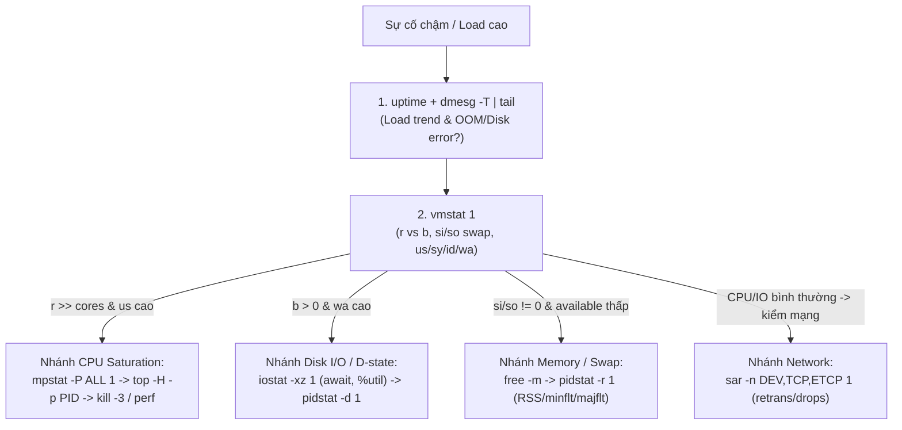

# LNX-05 · Công cụ hiệu năng Linux

> **TL;DR** — Khi server Java / JBoss chậm đột ngột, đừng đoán mò hay restart ngay — hãy chạy **checklist 60 giây của Brendan Gregg** (10 lệnh từ tổng quan đến chi tiết: `uptime`, `dmesg -T`, `vmstat 1`, `mpstat -P ALL 1`, `pidstat 1`, `iostat -xz 1`, `free -m`, `sar -n DEV 1`, `sar -n TCP,ETCP 1`, `top`). Trên Linux, **Load Average `20` trên máy `8` core** có thể là CPU bão hòa (`r ≈ 20`), **nhưng cũng có thể là CPU rảnh mà `20` thread đang kẹt `D`-state chờ disk/NFS I/O**. Với JVM/JBoss, cặp bài trùng nhanh nhất để bắt thread đốt CPU là **`top -H -p <pid>`** + đổi **`TID` sang hex (`nid=0x...`)** rồi đối chiếu với **`kill -3 <pid>`** thread dump — và tuyệt đối cẩn trọng với **`strace`** trên production vì overhead ptrace có thể làm chậm JVM 10×–100×.

## 🧭 Brief

| | |
| :--- | :--- |
| **Loại** | Bài học |
| **Giai đoạn** | Năm 1 · Q1 |
| **Chủ đề** | Linux & Networking |
| **Tiên quyết** | [LNX-04](../04-systemd-services/README.md) |

**Phạm vi bắt buộc**
- top/htop, vmstat, iostat, mpstat, pidstat, sar
- strace, perf
- Linux performance checklist 60 giây

**Câu hỏi sâu — nội dung phải giúp trả lời được**
- Load average 20 trên máy 8 core nghĩa là gì?
- CPU iowait cao điều tra thế nào?

**Ý tưởng lab / demo**
- Checklist 60 giây áp dụng trên máy bị tạo tải CPU/IO/memory

**Tài liệu gốc gợi ý**
- The Linux Command Line
- Operating Systems: Three Easy Pieces
- Systems Performance (Gregg)
- High Performance Browser Networking (hpbn.co)
- TCP/IP Illustrated

**Gói đầu ra**
- [x] `README.md` — lý thuyết theo [lesson-template](../../../docs/templates/lesson-template.md)
- [x] `exercises.md` — bài tập L1/L2/L3 theo [exercises-template](../../../docs/templates/exercises-template.md)
- [x] `solutions.md` — đáp án theo [solutions-template](../../../docs/templates/solutions-template.md)
- [x] `lab/` — code demo chạy được + `lab/README.md` theo [lab-template](../../../docs/templates/lab-template.md)
- [ ] _(người học)_ `my-notes.md` — **agent không tạo**

---

<!-- Nội dung bắt đầu từ đây -->

## 1. Vấn đề: tại sao phải biết cái này?

Trong ca trực production lúc 10:00 sáng, người dùng báo website quay vòng tròn 15 giây mới tải xong:
1. Mở dashboard chỉ thấy cảnh báo chung chung: `"High Load Average: 20.4 trên server 8 vCPU"`. Một người tưởng CPU quá tải nên xin nâng cấp gấp từ 8 lên 32 vCPU — nhưng hóa ra CPU chỉ dùng `12%`, còn **18 thread JBoss đang kẹt ghi log sync / đọc NFS** (`iowait = 68%`), nâng CPU hoàn toàn vô ích!
2. Trường hợp ngược lại: `top` báo CPU tổng cả máy chỉ `13%` (trên máy 8 core → tức là **1 core đang chạy `100%`**, 7 core kia ngồi chơi!), nhưng JBoss vẫn treo! Hóa ra **1 thread Java duy nhất bị vòng lặp vô hạn** hoặc `HashMap` Java 7 bị hỏng vòng lặp bucket (cần `mpstat -P ALL 1` + `top -H -p <pid>` + `kill -3` mới lòi ra ngay trong 30 giây).

---

## 2. Mô hình tư duy (mental model)

Áp dụng **USE Method (Utilization · Saturation · Errors)** của Brendan Gregg lên 3 tài nguyên cốt lõi: **CPU · Memory · Disk/Network I/O**:
- Đừng nhìn mỗi % sử dụng (*Utilization*), hãy luôn kiểm tra **độ dài hàng đợi (*Saturation*)** và **lỗi (*Errors*)**.
- Bắt đầu từ **góc nhìn toàn hệ thống (`vmstat`, `iostat`, `mpstat`) trong 60 giây đầu**, rồi mới khoan xuống **từng tiến trình (`pidstat`, `top -H`)**, và cuối cùng mới dùng kính hiển vi **`perf`** / **`strace`** / **`kill -3`** khi đã khoanh vùng đúng thủ phạm!



---

## 3. Cơ chế bên trong (trọng tâm của bài)

### 3.1 Linux Performance Checklist 60 Giây (10 bước tuần tự)

Theo phương pháp của Brendan Gregg (Netflix SRE), khi vừa SSH vào server có sự cố, chạy tuần tự 10 lệnh sau trong chưa tới 1 phút:

| # | Lệnh | Nhìn cột nào | Phát hiện nhanh điều gì |
| :-: | :--- | :--- | :--- |
| 1 | `uptime` | 3 số load average (`1m`, `5m`, `15m`) | Tải đang tăng vọt (`1m > 5m > 15m`) hay đang hạ dần |
| 2 | `dmesg -T \| tail -n 20` | `Out of memory`, `I/O error`, `TCP: drop` | Lỗi kernel cấp độ phần cứng, OOM Killer, cạn conntrack |
| 3 | `vmstat 1` | `r`, `b`, `si`, `so`, `us`, `sy`, `id`, `wa`, `st` | Bức tranh tổng thể CPU vs Blocked I/O vs Swap vs Steal CPU |
| 4 | `mpstat -P ALL 1` | `%usr`, `%sys`, `%iowait`, `%idle` từng core | Bắt lỗi **single-thread bottleneck** (1 core `100%`, các core khác `0%`) |
| 5 | `pidstat 1` (và `-d`, `-r`) | `%CPU`, `kB_rd/s`, `kB_wr/s`, `RSS` theo PID | Biết ngay PID nào ăn CPU, PID nào xả đĩa, PID nào ăn RAM |
| 6 | `iostat -xz 1` | `r/s`, `w/s`, `await`, `aqu-sz`, `%util` | Đĩa có quá tải hàng đợi (`aqu-sz > 1`) hay latency chậm (`await > 20ms`) |
| 7 | `free -m` | `available`, `buff/cache`, `Swap used` | Còn bộ nhớ khả dụng thật hay không ([LNX-03](../03-memory-pagecache-oom/README.md)) |
| 8 | `sar -n DEV 1` | `rxkB/s`, `txkB/s`, `rxdrop/s` | Băng thông card mạng chạm trần hay rớt gói ở NIC |
| 9 | `sar -n TCP,ETCP 1` | `active/s`, `passive/s`, `retrans/s` | Bão kết nối mới hay nghẽn mạng / mất gói TCP (`retrans/s` cao) |
| 10 | `top` (hoặc `top -H -p <pid>`) | `%CPU`, `RES`, `TIME+`, `S` | Xác nhận tổng hợp và chuyển `TID` sang hex tra `kill -3` |

### 3.2 Trả lời câu hỏi sâu #1: Load average `20` trên máy `8` core nghĩa là gì?

Khác với BSD/macOS chỉ đếm các task cần CPU, **trên Linux, Load Average đếm tổng số thread/process ở 2 trạng thái**:
$$\text{Linux Load} = \text{Số task ở trạng thái } \mathbf{R\text{ (Runnable/Running)}} + \text{Số task ở trạng thái } \mathbf{D\text{ (Uninterruptible Sleep)}}$$
được lấy trung bình trượt hàm mũ (exponential moving average) qua cửa sổ **1 phút, 5 phút, 15 phút**.

Do đó, **Load Average = `20` trên máy `8` core** (`2.5×` số core) có thể mang **2 ý nghĩa trái ngược nhau hoàn toàn**:
1. **Kịch bản A — CPU Saturation:** Có ~20 thread ở trạng thái `R` tranh nhau 8 core (8 thread chạy, 12 thread xếp hàng chờ CPU). Khi đó `vmstat 1` sẽ thấy **`r ≈ 20`**, `b = 0`, và `%us + %sy ≈ 100%`. (Ví dụ: GC storm, hoặc 20 thread JBoss tính toán/parse XML nặng cùng lúc.)
2. **Kịch bản B — Disk / NFS I/O Bottleneck:** CPU hầu như nhàn rỗi (`%idle = 75%`), nhưng có ~20 worker thread JBoss đang kẹt ở trạng thái `D` chờ ổ đĩa hoặc NFS trả lời! Khi đó `vmstat 1` sẽ thấy **`r ≈ 1–2`**, **`b ≈ 18–20`**, và **`%wa` (iowait) rất cao**.

*(Còn một trường hợp phụ trong VM/Cloud: cột **`st` (`steal time`)** trong `vmstat`/`mpstat` cao > 5–10% nghĩa là hypervisor vật lý bị quá tải, VM của bạn không được cấp đủ CPU thật dù trong VM báo `us` thấp!)*

### 3.3 Trả lời câu hỏi sâu #2: CPU `iowait` cao điều tra thế nào?

- **Bản chất của `%iowait` (`wa`):** `%iowait` **vẫn là thời gian CPU đang ngồi RẢNH (`idle`)** — điểm khác duy nhất so với `%idle` thuần túy là tại thời điểm đó có ít nhất 1 task gắn với CPU này đang chờ I/O đĩa chưa xong. *(Nếu một CPU core đang vừa chạy tính toán 100% vừa có disk I/O ngầm, `%iowait` vẫn bằng 0!)*
- **Quy trình 4 bước điều tra khi `%wa > 20%`:**
  1. **`vmstat 1`:** Nhìn cột `b` (số thread đang bị block chờ I/O), `bi/bo` (blocks đọc/ghi vào ra), và **`si/so`** — kiểm tra ngay xem `iowait` có phải do **Swap Thrashing** gây ra không!
  2. **`iostat -xz 1`:** Tìm thiết bị đĩa (`nvme0n1`, `sda`, `dm-0`) có **`await`** (thời gian phục vụ trung bình mỗi I/O request, gồm cả chờ hàng đợi lẫn đọc đĩa) tăng vọt bất thường (SSD bình thường `< 1–5 ms`; HDD `< 10–15 ms`; nếu nhảy lên `50–500 ms` là nghẽn đĩa!), hoặc **`aqu-sz`** (độ dài hàng đợi I/O) cao và `%util` gần `100%`. *(Lưu ý: trên ổ NVMe đa hàng đợi, `%util = 100%` chưa chắc bão hòa nếu `await` vẫn rất thấp `< 1ms`!)*
  3. **`pidstat -d 1`:** Liệt kê chính xác PID nào đang tạo lượng `kB_rd/s`, `kB_wr/s` lớn nhất (ví dụ JBoss đang bật `DEBUG` log ghi hàng chục MB/s, hoặc Postgres checkpoint, hoặc tiến trình backup nén file).
  4. **Kiểm tra trạng thái `D` & `lsof`:** Chạy `ps -eo pid,tid,stat,wchan:24,comm | awk '$3 ~ /D/'` để xem thread đang kẹt ở hàm kernel nào (`wchan`, ví dụ `rpc_wait_bit` → NFS treo, `blk_mq_get_tag` → nghẽn block queue).

### 3.4 `strace` vs `perf` — Cạm bẫy overhead trên Production

| Công cụ | Cơ chế bên dưới | Overhead trên Production | Khi nào dùng |
| :--- | :--- | :--- | :--- |
| **`strace`** | Dùng **`ptrace`**: bắt và dừng tiến trình mục tiêu **2 lần cho mỗi một syscall** (vào syscall + ra syscall) | **CỰC NẶNG** (có thể làm chậm ứng dụng nhiều syscall **10×–100×**!) | Chỉ dùng ngắn (`timeout 3s strace ...`) khi app đã treo/cực chậm để xem nó đang kẹt syscall nào (`connect`, `futex`, `read`), **không** gắn dài vào JBoss đang chạy high-throughput! |
| **`perf`** | Dùng **hardware PMU counters** + sampling theo tần số (ví dụ 99 Hz) và kernel **tracepoints / eBPF** | **Rất nhẹ** (~1–3% CPU ở 99 Hz sampling) | Dùng `perf top -p <pid>` hoặc `perf record -F 99 -p <pid> -g -- sleep 15` để vẽ CPU Flame Graph (cùng `-XX:+PreserveFramePointer` hoặc `async-profiler` cho Java — [PERF-06](../../../01-software-engineering/performance/06-profiling-flame-graph/README.md)) |

---

## 4. Code minh họa

Quy trình thực chiến kinh điển cho Java / JBoss — nối từ **Linux `top -H`** sang **JVM Thread Dump (`kill -3`)** (xem thêm bộ phân tích tại [PerfTriageAnalyzer.java](./lab/src/main/java/lab/linux/perf/PerfTriageAnalyzer.java)):

```bash
# Bước 1: Tìm PID của JBoss/Java
JBOSS_PID=$(pgrep -f 'jboss|standalone|java' | head -n 1)

# Bước 2: Xem từng thread (LWP/TID) bên trong JVM nào đang ăn CPU cao nhất
top -H -b -n 1 -p "$JBOSS_PID" | head -n 20
# Giả sử thấy TID = 4839 đang ngốn 99.2% CPU

# Bước 3: Đổi TID decimal -> hex (khớp với nid=0x... trong thread dump)
printf "nid=0x%x\n" 4839
# Output: nid=0x12e7

# Bước 4: Gửi SIGQUIT lấy thread dump sống (KHÔNG giết JBoss) rồi grep nid=0x12e7
kill -3 "$JBOSS_PID"
grep -A 25 "nid=0x12e7" /opt/jboss/standalone/log/server.log
```

### 4.1 Legacy corner (Java 7 / JBoss AS 7.1.1)

Trên **Java 7 / JBoss AS 7.1.1** (vốn chưa có JFR miễn phí không license thương mại và chưa có `async-profiler` cài sẵn trên máy công ty bảo mật chặt):
1. Bộ công cụ mặc định luôn có sẵn trên mọi RHEL/CentOS là **`top -H` + `kill -3` (hoặc `jstack -l <pid>`) + `vmstat 1` + `iostat -xz 1`**. Đổi `TID` sang hex `nid=0x...` là kỹ năng chẩn đoán nhanh nhất không cần cài thêm tool!
2. Với **Java 7**, `JIT` không bật `-XX:+PreserveFramePointer` (chỉ có từ JDK 8u60+), nên nếu chạy `perf` thô trên JDK 7 có thể thấy stack bị cắt đứt (*broken stack*); trong trường hợp đó, kết hợp `top -H` + 3 lần `kill -3` cách nhau 5 giây đáng tin cậy hơn nhiều.

---

## 5. Quan sát & đo đạc

### Phần A — Đã chạy kiểm chứng trên Windows 11 (Java 21 Workload + 60s Triage Analyzer)
Từ thư mục `lab/`:
```powershell
mvn -o -B verify
mvn -o -B compile exec:java
```
**Output thực tế ghi nhận trên Windows 11 amd64 · OpenJDK 26.0.1 (`--release 21`):**
- `PerfToolsTest`: **3/3 tests pass**, chứng minh:
  1. `CpuBurnWorkload` tạo tải CPU đa luồng thực tế trong `300ms`, đo qua `ThreadMXBean.getThreadCpuTime(...)` ghi nhận chính xác `cpu-burner-worker` đốt **`296 ms` CPU** trong khi `idle-io-waiter` giữ **`0 ms` CPU**.
  2. `PerfTriageAnalyzer` phân tích chính xác **3 mẫu output Linux production**:
     - Mẫu 1 (`vmstat`: `r=21, b=0, us=88, wa=1` trên 8 core) → chuẩn đoán **`CPU_SATURATION`** (Load ~20 do run queue CPU đầy).
     - Mẫu 2 (`vmstat`: `r=1, b=19, wa=66` trên 8 core + `iostat`: `await=84.5ms, aqu-sz=18.2, %util=99.4`) → chuẩn đoán **`DISK_IO_BOTTLENECK`** (Load ~20 do thread kẹt D-state chờ đĩa chứ KHÔNG thiếu CPU!).
     - Mẫu 3 (`mpstat -P ALL`: core 3 `99.5%`, các core khác `< 2%` + `top -H` TID `4839`) → tự động tính `nid=0x12e7` khớp đúng thread `"http-executor-17"` trong thread dump!

### Phần B — Cần kiểm chứng trên Linux / WSL / Docker (chưa chạy được trên máy Windows soạn bài)
> ⚠️ **Cần kiểm chứng trên Linux:** Máy soạn là Windows 11 không có WSL/Docker; toàn bộ công cụ Linux `sysstat`/`procps` dưới đây **chưa được chạy kiểm chứng trực tiếp**:
- `bash scripts/perf-60s-checklist.sh` (`uptime`, `dmesg -T`, `vmstat 1`, `mpstat -P ALL 1`, `pidstat 1`, `iostat -xz 1`, `free -m`, `sar -n DEV,TCP,ETCP 1`, `top -H -b -n 1`).
- `perf top -p <pid>` và `timeout 2s strace -c -p <pid>` (để kiểm chứng `strace` overhead vs `perf` sampling).

---

## 6. Trade-offs & khi nào KHÔNG dùng

| Công cụ | Được gì | Mất / Rủi ro gì | Dùng khi |
| :--- | :--- | :--- | :--- |
| **`vmstat` / `mpstat` / `iostat` (`1s` interval)** | Gần như **0% overhead**, nhìn toàn cảnh bottleneck trong 60s | Không thấy tên hàm Java cụ thể bên trong JVM | **Luôn chạy đầu tiên** khi điều tra bất kỳ server chậm nào |
| **`top -H` + `kill -3`** | Bắt đúng thread Java đang ngốn CPU/lock mà không cần cài tool ngoài | `kill -3` gây micro-pause rất ngắn; không bắt được allocation rate | Khoanh vùng CPU loop / deadlock trên Java 7 / JBoss AS 7.1.1 |
| **`perf` / `async-profiler`** | Sampling stack cả Java + C/Kernel ở overhead `~1–3%` | Cần quyền `perf_event_paranoid` hoặc cài `async-profiler` | Tìm điểm nóng CPU/allocation trên Java 8+/21 |
| **`strace -f -p <pid>`** | Thấy từng syscall + đối số (`open`, `connect`, `futex`) | **Overhead 10×–100×** có thể treo production | **KHÔNG dùng dài trên prod**; chỉ dùng 1–2s ở staging hoặc process đã kẹt hẳn |

---

## 7. Cạm bẫy production (ít nhất 3)

1. **Thấy Load Average cao hơn số CPU core liền vội tăng CPU cho VM** — *Triệu chứng:* nâng từ 8 core lên 16 core tốn gấp đôi tiền nhưng web vẫn chậm nguyên. *Nguyên nhân:* `vmstat` cột `b` cao và `%wa` cao — thread đang kẹt disk I/O / NFS (`D`-state) chứ không thiếu CPU! *Cách tránh:* luôn đối chiếu `uptime` với `vmstat 1` (`r` vs `b`) và `iostat -xz 1` trước khi scale phần cứng.
2. **Thấy `top` báo CPU tổng = 12.5% trên máy 8 core rồi kết luận "không phải lỗi CPU"** — *Triệu chứng:* 1 chức năng quay mãi không ra, 7 core kia rảnh. *Nguyên nhân:* `top` mặc định hiển thị trung bình toàn máy (`100% / 8 cores = 12.5%`) theo chế độ Irix/Solaris; 1 thread đơn lẻ bị infinite loop đang khóa chết 1 core ở `100%`. *Cách tránh:* chạy **`mpstat -P ALL 1`** và **`top -H -p <pid>`**.
3. **Chạy `strace -ff -p <jboss_pid>` trực tiếp trên server prod đang nhận 2.000 req/s** — *Triệu chứng:* ngay khi bấm Enter, latency vọt từ `30 ms` lên `5.000 ms`, ALB đánh rớt toàn bộ node. *Nguyên nhân:* `ptrace` ép kernel dừng tiến trình JVM ở mọi lần gọi syscall (hàng trăm nghìn lần/giây). *Cách tránh:* dùng `top -H` + `kill -3` hoặc `perf` / `jcmd JFR.start` trên production.
4. **Đọc `vmstat 1` ở đúng dòng đầu tiên rồi kết luận** — *Triệu chứng:* thấy `wa=40%` ở dòng 1 rồi tưởng đang nghẽn đĩa, dù các dòng sau `wa=0%`. *Nguyên nhân:* dòng đầu tiên của `vmstat`, `iostat`, `mpstat` luôn là **trung bình cộng dồn kể từ lúc boot máy**, không phải giá trị 1 giây hiện tại! *Cách tránh:* **luôn bỏ qua dòng số 1** và chỉ đọc từ dòng thứ 2 trở đi.

---

## 8. Liên hệ thực tế công việc

Ngay tuần này trên server staging / production **JBoss AS 7.1.1**:
1. Lưu sẵn script `perf-60s-checklist.sh` (chỉ đọc, 0 xâm lấn) vào thư mục runbook cá nhân để khi có incident chỉ cần chạy 1 lần là thu đủ bằng chứng `vmstat`, `iostat`, `mpstat`, `free`, `sar`.
2. Tập quy trình **3 lệnh vàng**: `top -H -p <jboss_pid>` → `printf "0x%x\n" <TID>` → `kill -3 <jboss_pid>` + `grep` `nid=0x...` trong log để tìm đúng dòng code Java đốt CPU.

---

## 9. Self-check — Explain-back

> Trả lời **không nhìn tài liệu**, nói to trong 5 phút. Không trả lời được = chưa xong. (Đáp án nằm trong [solutions.md](./solutions.md).)

1. Kể đúng thứ tự và ý nghĩa của 10 lệnh trong **Linux Performance Checklist 60 giây** (ít nhất nêu được 7–8 lệnh và cột cần soi của từng lệnh).
2. Load Average `20` trên máy `8` core có thể tương ứng với 2 kịch bản hoàn toàn khác nhau nào? Dùng lệnh nào và cột nào để phân biệt 2 kịch bản đó trong 5 giây?
3. `%iowait` thực chất đo thời gian CPU đang bận hay đang rảnh? Trình bày 4 bước điều tra khi `%wa` vọt lên `50%`.
4. Làm thế nào lần ngược từ một thread Java ăn 100% CPU trong `top -H` về đúng stack trace dòng code Java trong Thread Dump (`kill -3`)?
5. Tại sao dùng `strace` trực tiếp trên JBoss production lại cực kỳ nguy hiểm, và thay thế bằng công cụ nào ít overhead hơn?

---

## 10. Cheatsheet 1 trang

| Lệnh | Cột trọng yếu | Câu hỏi trả lời được |
| :--- | :--- | :--- |
| **`vmstat 1`** *(bỏ dòng 1!)* | `r`, `b`, `si/so`, `us`, `sy`, `wa`, `st` | Run queue (`r`) hay Disk block (`b`) hay Swap (`si/so`)? |
| **`mpstat -P ALL 1`** | `%usr`, `%iowait`, `%idle` mỗi core | Có core đơn lẻ nào bị 1 thread kéo lên `100%` không? |
| **`iostat -xz 1`** | `await`, `aqu-sz`, `%util`, `r/s`, `w/s` | Đĩa có đang chậm (`await` cao) hay nghẽn hàng đợi? |
| **`pidstat -u -d -r 1`** | `%CPU`, `kB_rd/s`, `kB_wr/s`, `RSS` | Tiến trình PID nào là thủ phạm CPU / Disk / RAM? |
| **`top -H -p <pid>` + `kill -3`** | `PID (TID)` → `printf "0x%x\n"` → `nid=0x...` | Đúng thread Java nào đang đốt CPU trong JBoss? |
| **`perf` vs `strace`** | Sampling (`~1-3%`) vs `ptrace` (`10x-100x`) | Prod dùng `perf` / `JFR` / `kill -3`; tránh `strace` trên prod |

---

## 11. Tài liệu tham khảo

- Brendan Gregg, [*Linux Performance Analysis in 60,000 Milliseconds*](https://netflixtechblog.com/linux-performance-analysis-in-60-000-milliseconds-accc10403c55) & *Systems Performance* (2nd ed.) — phương pháp USE và 60-second checklist.
- Linux man-pages: [`vmstat(8)`](https://man7.org/linux/man-pages/man8/vmstat.8.html), [`iostat(1)`](https://man7.org/linux/man-pages/man1/iostat.1.html), [`mpstat(1)`](https://man7.org/linux/man-pages/man1/mpstat.1.html), [`pidstat(1)`](https://man7.org/linux/man-pages/man1/pidstat.1.html), [`strace(1)`](https://man7.org/linux/man-pages/man1/strace.1.html), [`perf(1)`](https://man7.org/linux/man-pages/man1/perf.1.html).

---
➡️ Tiếp theo: [exercises.md](./exercises.md) · [lab/](./lab/README.md) · Bài kế: [LNX-06 · Shell scripting tự động hóa](../06-shell-scripting/README.md)
