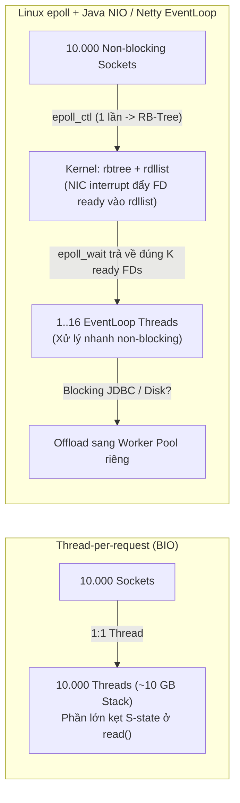

# LNX-07 · select, poll, epoll & event loop

> **TL;DR** — Mô hình **Thread-per-request (BIO)** gặp bài toán **C10K** (10.000 kết nối đồng thời) sẽ ngốn `~10 GB` chỉ cho thread stack và chết vì context-switch. Linux giải quyết bằng cơ chế **I/O Multiplexing `epoll`**: thay vì quét $O(N)$ toàn bộ mảng FD như `select`/`poll`, `epoll_ctl` đăng ký FD một lần vào **Red-Black Tree** trong kernel và `epoll_wait` chỉ trả về danh sách `rdllist` chứa đúng $K$ socket thực sự có dữ liệu ($O(1)$ / $O(K)$). Đó là cách **Java NIO `Selector` (`EPollSelectorImpl`)** và **Netty / Undertow** phục vụ **100.000 kết nối** chỉ bằng `2 × cores` EventLoop threads — với quy tắc sống còn: **tuyệt đối không block EventLoop thread** bằng JDBC, `Thread.sleep`, hay HTTP call đồng bộ!

## 🧭 Brief

| | |
| :--- | :--- |
| **Loại** | Bài học |
| **Giai đoạn** | Năm 1 · Q1 |
| **Chủ đề** | Linux & Networking |
| **Tiên quyết** | [LNX-06](../06-shell-scripting/README.md) |

**Phạm vi bắt buộc**
- C10K problem
- epoll edge vs level triggered
- Java NIO Selector
- Netty event loop
- so với thread-per-request

**Câu hỏi sâu — nội dung phải giúp trả lời được**
- Netty phục vụ 100k connection với vài thread thế nào?
- Block event loop gây ra gì?

**Ý tưởng lab / demo**
- Echo server NIO vs blocking, đo số connection tối đa

**Tài liệu gốc gợi ý**
- The Linux Command Line
- Operating Systems: Three Easy Pieces
- Systems Performance (Gregg)
- High Performance Browser Networking (hpbn.co)
- TCP/IP Illustrated

**Gói đầu ra**
- [x] `README.md` — lý thuyết theo [lesson-template](../../../docs/templates/lesson-template.md)
- [x] `exercises.md` — bài tập L1/L2/L3 theo [exercises-template](../../../docs/templates/exercises-template.md)
- [x] `solutions.md` — đáp án theo [solutions-template](../../../docs/templates/solutions-template.md)
- [x] `lab/` — code demo chạy được + `lab/README.md` theo [lab-template](../../../docs/templates/lab-template.md)
- [ ] _(người học)_ `my-notes.md` — **agent không tạo**

---

<!-- Nội dung bắt đầu từ đây -->

## 1. Vấn đề: tại sao phải biết cái này?

Hai tình huống khiến ứng dụng Java / Gateway sụp đổ dù CPU mới dùng 15%:
1. **Slowloris / Client mạng di động 3G chậm trên server BIO (Thread-per-request):** Server JBoss/Tomcat cấu hình `maxThreads=200`. Có 200 user mạng chậm mở kết nối TCP rồi gửi dữ liệu nhỏ giọt mỗi 5 giây. Toàn bộ 200 worker thread kẹt cứng trong `InputStream.read()` (`S`-state). Người dùng thứ 201 gửi request nhanh đến mấy cũng bị treo ngoài Accept Queue rồi timeout!
2. **Dùng Netty / Spring WebFlux nhưng vô tình gọi JDBC đồng bộ trên EventLoop:** Team chuyển sang kiến trúc reactive/Netty với `8` EventLoop threads để phục vụ `20.000` kết nối SSE/WebSocket. Một lập trình viên thêm lệnh gọi `restTemplate.getForObject(...)` hoặc `jdbcConnection.executeQuery(...)` mất `400 ms` ngay trong `channelRead()` → tất cả **2.500 kết nối** gắn vào EventLoop thread đó bị đóng băng theo suốt `400 ms`!

---

## 2. Mô hình tư duy (mental model)

Hãy so sánh **Nhà hàng truyền thống (Thread-per-request)** với **Bếp trưởng nhận chuông bàn (Event Loop + `epoll`)**:
- **Thread-per-request (BIO):** Mỗi khách bước vào (`accept()`), nhà hàng thuê riêng **1 phục vụ (`1 thread` ≈ `1 MB` stack)** đứng cạnh bàn đó suốt bữa, kể cả khi khách ngồi bấm điện thoại 30 phút không gọi món! Khi 10.000 khách vào (**bài toán C10K**), bạn cần 10.000 phục vụ → phá sản vì tiền lương (RAM & CPU context switch).
- **`select` / `poll`:** Chỉ có 1 phục vụ, nhưng cứ mỗi giây anh ta phải đi gõ cửa hỏi từng bàn từ bàn 1 đến bàn 10.000: *"Bàn này có gọi món chưa?"* ($O(N)$ scan).
- **`epoll` + Event Loop:** Mỗi bàn có một nút chuông điện. Phục vụ đứng tại quầy nhìn bảng đèn (`epoll_wait`). Chỉ khi khách ở bàn #412 và #8990 bấm chuông, tên 2 bàn đó mới nhảy lên bảng `rdllist` → phục vụ chạy thẳng ra đúng 2 bàn đó ($O(K)$ theo số bàn sẵn sàng!).

**Chỗ ẩn dụ không còn đúng:**
Nếu khách bàn #412 nhờ anh phục vụ *"đứng nấu hộ tôi nồi phở 15 phút ngay tại bàn"* (**blocking event loop**), bảng đèn `rdllist` có nhấp nháy đỏ rực cả nghìn bàn khác thì anh phục vụ duy nhất này vẫn đang kẹt nấu phở không quay lại quầy được!



---

## 3. Cơ chế bên trong (trọng tâm của bài)

### 3.1 Tiến hóa từ `select` → `poll` → `epoll` (Bài toán C10K)

Theo *Linux man-pages* (`select(2)`, `poll(2)`, `epoll(7)`) và *High Performance Browser Networking* (hpbn.co):

| Tiêu chí | `select(2)` | `poll(2)` | `epoll(7)` (`epoll_create1` / `epoll_ctl` / `epoll_wait`) |
| :--- | :--- | :--- | :--- |
| **Giới hạn số FD** | Cứng **`FD_SETSIZE = 1024`** trên Linux | Không giới hạn cứng | Không giới hạn cứng (chỉ theo `RLIMIT_NOFILE`) |
| **Copy mảng FD user ↔ kernel** | Copy lại toàn bộ `fd_set` mỗi lần gọi | Copy lại toàn bộ mảng `struct pollfd` mỗi lần gọi | **Đăng ký 1 lần** bằng `epoll_ctl`, lưu trong **Red-Black Tree** ở kernel |
| **Độ phức tạp kiểm tra sẵn sàng** | **$O(N)$** — kernel và user phải duyệt toàn bộ tập FD | **$O(N)$** — phải quét hết mảng tìm `revents != 0` | **$O(1)$ / $O(K)$** — NIC callback đẩy FD có sự kiện vào **`rdllist`**, `epoll_wait` chỉ trả về $K$ FD ready! |
| **Khả năng chịu C10K / C100K** | Kém (chết ở >1024 & $O(N)$) | Chậm khi $N$ lớn & ít kết nối active | **Rất cao** (chuẩn của Nginx, Redis, Netty, Java NIO Linux) |

### 3.2 `epoll`: Level-Triggered (LT) vs Edge-Triggered (ET)

1. **Level-Triggered (LT — mặc định của `epoll` và Java NIO `Selector`):**
   - Miễn là receive buffer của socket vẫn còn dữ liệu chưa đọc (`> 0` bytes), lần gọi `epoll_wait()` tiếp theo **vẫn tiếp tục báo FD đó `EPOLLIN`**.
   - *Ưu:* An toàn, dễ lập trình (nếu vòng này mới đọc 1 KB trong 4 KB, vòng sau vẫn được nhắc đọc tiếp 3 KB còn lại).
2. **Edge-Triggered (ET — cờ `EPOLLET`, dùng bởi Nginx và Netty `EpollEventLoopGroup` native transport):**
   - Kernel **chỉ báo sự kiện ĐÚNG 1 LẦN khi trạng thái chuyển từ rỗng → có dữ liệu mới**!
   - *Bắt buộc:* Phải dùng với FD `O_NONBLOCK` và **đọc cạn kiệt trong vòng lặp `while (read() > 0)` cho tới khi nhận `EAGAIN`**, nếu đọc dở 1 nửa rồi thôi mà không có gói tin mới đến nữa → **treo mất kết nối mãi mãi**! *Lợi:* Giảm số lần đánh thức `epoll_wait` lặp lại.

### 3.3 Trả lời câu hỏi sâu #1: Netty / Java NIO phục vụ 100.000 connection với vài thread thế nào?

1. **Multiplexing qua `epoll` (trên Linux, Java `Selector.open()` khởi tạo `EPollSelectorImpl`):** Một `EventLoop` thread duy nhất giữ 1 `Selector` (tương ứng 1 `epoll` instance `anon_inode:[eventpoll]`). Với `8` core CPU, Netty thường chỉ mở `8–16` EventLoop threads — phục vụ 100k connection nghĩa là mỗi thread gánh ~6.000–12.000 `SocketChannel` non-blocking.
2. **Phân vai Boss vs Worker (Reactor pattern):**
   - `bossGroup` (1 thread): chỉ làm mỗi việc nhận kết nối TCP mới (`OP_ACCEPT`) rồi giao sang `workerGroup` theo round-robin.
   - `workerGroup` (vài threads): mỗi `Channel` gắn chết với **đúng 1 `EventLoop` thread** suốt vòng đời → xử lý I/O tuần tự cho channel đó không cần `synchronized` hay lock!
3. **Chi phí RAM trên mỗi idle connection rất nhỏ:** Không tốn `1 MB` native thread stack cho mỗi kết nối như BIO; 100.000 kết nối idle chỉ tốn vài trăm MB cho kernel socket structs + channel metadata thay vì `100 GB` thread stack! *(Lưu ý cần nâng `ulimit -n` trên Linux lên > 100.000 vì mỗi socket vẫn là 1 FD — [LNX-02](../02-file-descriptors-io/README.md)!)*

### 3.4 Trả lời câu hỏi sâu #2: Block Event Loop gây ra gì?

Vì **một EventLoop thread phục vụ chung hàng nghìn kết nối**, mọi thao tác trên EventLoop bắt buộc phải hoàn thành trong micro giây đến vài mili giây:
- Nếu handler trên EventLoop thực hiện thao tác blocking (như JDBC query `150ms`, gọi `HttpURLConnection`, ghi file đồng bộ nặng, `Thread.sleep`, hay vòng lặp CPU nặng `500ms`):
  1. EventLoop thread bị mắc kẹt không quay lại được vòng lặp `epoll_wait()`/`selector.select()`.
  2. **Toàn bộ hàng nghìn socket khác** đang gắn vào EventLoop đó (kể cả request chỉ cần 1ms ping/health-check!) không được `read()`, không được `write()`, không nhận được `OP_ACCEPT` mới → **p99 latency toàn hệ thống tăng vọt**, health probe timeout kéo load balancer đánh chết cả node!
- **Giải pháp bắt buộc:** Mọi lệnh blocking phải đẩy sang một `ExecutorService` / Worker Pool tách biệt (hoặc dùng non-blocking async driver như R2DBC / Async HTTP client). *(Netty còn có cơ chế `BlockedThreadChecker` cảnh báo ngay nếu EventLoop bị giữ quá `2s`.)*

---

## 4. Code minh họa

Xem mã nguồn đầy đủ chạy trên loopback TCP tại [NioSelectorEchoServer.java](./lab/src/main/java/lab/linux/epoll/NioSelectorEchoServer.java) và [BlockingBioEchoServer.java](./lab/src/main/java/lab/linux/epoll/BlockingBioEchoServer.java):

```java
// ❌ SAI: Chạy tác vụ blocking trực tiếp bên trong EventLoop loop -> đóng băng toàn bộ client khác!
while (running) {
    selector.select();
    for (SelectionKey key : selector.selectedKeys()) {
        if (key.isReadable()) {
            // Đọc DB đồng bộ 300ms ngay trên EventLoop thread -> 2.000 client khác đứng chờ!
            orderJdbcDao.saveSync(readPayload(key));
        }
    }
}
```

```java
// ✅ ĐÚNG: EventLoop chỉ làm I/O non-blocking nhanh (<1ms), đẩy blocking work sang Worker Pool
while (running) {
    selector.select(50);
    Iterator<SelectionKey> it = selector.selectedKeys().iterator();
    while (it.hasNext()) {
        SelectionKey key = it.next();
        it.remove(); // BẮT BUỘC remove, nếu không vòng lặp sau select() lại dính key cũ!
        if (key.isReadable()) {
            ByteBuffer data = readNonBlocking((SocketChannel) key.channel());
            blockingWorkers.submit(() -> processAndScheduleWrite(key, data));
        }
    }
}
```

### 4.1 Legacy corner (Java 7 / JBoss AS 7.1.1)

1. **Connector BIO vs NIO/APR trên JBoss AS 7.1.1:** JBoss Web (dựa trên Apache Tomcat) trên JBoss AS 7.1.1 mặc định dùng **HTTP BIO connector** (1 thread = 1 connection, mặc định `maxThreads` giới hạn theo `512` hoặc ít hơn tùy config). Nếu có nhiều client giữ HTTP Keep-Alive mở idle hoặc client 3G chậm, BIO rất dễ cạn sạch worker thread! Khi nâng cấp lên **WildFly / Undertow** hoặc **Spring Boot WebFlux / Netty**, tầng network chuyển hẳn sang **XNIO / Netty + `epoll`**.
2. **Đừng hoảng khi đọc Thread Dump (`kill -3`) thấy `EPoll.wait` ở trạng thái `RUNNABLE`:**
   Trong thread dump của Java NIO / Netty / Undertow trên Linux, thread EventLoop đang rỗi chờ kết nối luôn đứng ở:
   `sun.nio.ch.EPoll.wait(Native Method)` với trạng thái Java là `RUNNABLE`. Đây là **trạng thái rảnh bình thường**, không phải thread đang đốt 100% CPU (hãy kiểm chứng thêm bằng `top -H -p <pid>` như [LNX-05](../05-linux-perf-tools/README.md))!

---

## 5. Quan sát & đo đạc

### Phần A — Đã chạy kiểm chứng trên Windows 11 (Java 21 NIO Selector vs Blocking BIO Server)
Từ thư mục `lab/`:
```powershell
mvn -o -B verify
mvn -o -B compile exec:java
```
**Output thực tế ghi nhận trên Windows 11 amd64 · OpenJDK 26.0.1 (`--release 21`):**
- `EpollEventLoopTest`: **3/3 tests pass**, chứng minh:
  1. **NioSelectorEchoServer (1 EventLoop thread duy nhất)** giữ mở và echo thành công **200 kết nối TCP đồng thời** trên `127.0.0.1` với chỉ **`1` server thread** (`serverThreadCount = 1`, hoàn thành trong `344 ms` ở runner).
  2. **BlockingBioEchoServer (pool `4` threads)** khi `4` client giữ kết nối mở idle không đóng: client thứ `5` bị treo hoàn toàn quá timeout `200 ms` (`SocketTimeoutException` — *thread-per-connection starvation*).
  3. **Event Loop Blocking simulation:** Khi bật cờ tiêm `250 ms` blocking work vào EventLoop cho 1 client, client `'FAST'` vô tội kết nối sau bị trì hoãn **`231 ms`** trong runner (và pass ngưỡng assertion `>= 180 ms` trong JUnit) do EventLoop thread bị kẹt không quay về `selector.select()`.

### Phần B — Cần kiểm chứng trên Linux / WSL / Docker (chưa chạy được trên máy Windows soạn bài)
> ⚠️ **Cần kiểm chứng trên Linux:** Trên Windows, `Selector.open()` dùng `WEPollSelectorImpl` / `WindowsSelectorImpl` nội bộ của JDK thay vì Linux `EPollSelectorImpl`; các lệnh kiểm tra `epoll` kernel FD trên Linux dưới đây **chưa chạy trực tiếp**:
- `bash scripts/inspect-epoll-fd.sh <JAVA_PID>` (`lsof -nP -p <pid> | grep eventpoll`, đọc `/proc/<pid>/fdinfo/<epfd>` để thấy danh sách `tfd:` các socket được gắn vào `epoll` RB-tree).
- Kiểm chứng tải C10K (`ulimit -n 20000`) trên Linux VM để xác nhận `EPollSelectorImpl` hoạt động với `10.000+` sockets.

---

## 6. Trade-offs & khi nào KHÔNG dùng

| Mô hình | Được gì | Mất gì | Dùng khi |
| :--- | :--- | :--- | :--- |
| **Thread-per-request (BIO / Servlet truyền thống)** | Stack trace đơn giản dễ debug, compatible mọi JDBC/thư viện blocking cũ | Tốn RAM thread stack & context switch ở > 1.000–2.000 kết nối giữ mở | Backend enterprise CRUD thông thường có connection pool ngắn, ít long-lived socket |
| **`epoll` + EventLoop (Netty / WebFlux)** | Chịu 10k–100k+ kết nối idle/streaming chỉ với vài thread, tốn rất ít RAM | **Bất kỳ lệnh blocking nào (JDBC truyền thống!) đều làm sập cả EventLoop**, debug stack trace bất đồng bộ khó hơn | API Gateway, Proxy (Nginx), WebSocket/SSE, Chat server, high-fanout I/O |
| **Java 21 Virtual Threads (`Executors.newVirtualThreadPerTaskExecutor`)** | Viết code blocking dễ đọc như BIO nhưng runtime tự unmount trên carrier thread dùng `epoll` bên dưới! | Cẩn thận `synchronized` pinning (JDK 21–23, đã cải thiện ở JDK 24 JEP 491) | Ứng dụng Java 21+ I/O-bound muốn throughput cao mà giữ nguyên mô hình code đồng bộ ([CONC-08](../../../01-software-engineering/concurrency/08-virtual-threads/README.md)) |

---

## 7. Cạm bẫy production (ít nhất 3)

1. **Gọi JDBC / `RestTemplate` / `Thread.sleep` trên Netty/WebFlux EventLoop thread** — *Triệu chứng:* throughput sụt thê thảm dù CPU `5%`, hàng nghìn request vô tội chậm đúng bằng thời gian DB query của 1 user. *Nguyên nhân:* EventLoop thread bị block không quay lại gọi `epoll_wait`. *Cách tránh:* luôn chuyển tác vụ blocking sang `Schedulers.boundedElastic()` / Worker pool riêng hoặc dùng driver non-blocking.
2. **Quên `it.remove()` khi duyệt `selector.selectedKeys()` bằng Java NIO** — *Triệu chứng:* vòng lặp CPU 100% dù không có dữ liệu mới! *Nguyên nhân:* `Selector` thêm key vào tập `selectedKeys` chứ không tự xóa; lần `select()` kế tiếp bạn duyệt lại chính `SelectionKey` cũ dù nó chưa có event mới (hoặc với LT nếu chưa đọc hết/chưa tắt `OP_WRITE`). *Cách tránh:* luôn gọi `it.remove()` ngay sau khi lấy key, và chỉ bật `OP_WRITE` khi buffer thực sự còn byte cần ghi.
3. **Thấy thread `EPoll.wait` ở trạng thái `RUNNABLE` trong thread dump rồi tưởng CPU loop** — *Triệu chứng:* đọc `kill -3` thấy 16 thread Netty đều ghi `RUNNABLE` tại `EPoll.wait`, vội kết luận bị loop. *Nguyên nhân:* JVM ánh xạ native blocking syscall `epoll_wait` sang trạng thái `RUNNABLE` trên Java Thread. *Cách tránh:* luôn đối chiếu với `top -H -p <pid>` — nếu `%CPU` của thread đó bằng `0.0%` thì nó đang ngủ chờ mạng bình thường.
4. **Dùng Edge-Triggered (`EPOLLET`) nhưng không đọc cạn kiệt đến `EAGAIN`** — *Triệu chứng:* request thỉnh thoảng bị treo nửa chừng chờ timeout dù dữ liệu đã nằm trong kernel buffer. *Nguyên nhân:* ET chỉ báo 1 lần lúc buffer chuyển từ rỗng sang có dữ liệu; đọc không hết sẽ không nhận thêm thông báo nào nữa. *Cách tránh:* đọc vòng lặp cho tới khi `EAGAIN`, hoặc dùng Level-Triggered mặc định nếu tự viết bằng Java NIO.

---

## 8. Liên hệ thực tế công việc

Ngay tuần này trên hệ thống **JBoss AS 7.1.1 / Java**:
1. Kiểm tra `standalone.xml` phần `<subsystem xmlns="urn:jboss:domain:web:1.1">` xem JBoss Web đang chạy connector `HTTP/1.1` BIO hay `native` (APR) và giá trị `max-connections` là bao nhiêu — để biết giới hạn chịu đựng khi bị slow-client attack hoặc nghẽn downstream.
2. Khi đọc thread dump ở công ty có thư viện dùng Netty (như Lettuce Redis client, Elasticsearch/Kafka/gRPC client), phân biệt rạch ròi `epollWait` (`RUNNABLE` nhưng `0% CPU`) với thread thực sự đang kẹt lock hoặc đốt CPU.

---

## 9. Self-check — Explain-back

> Trả lời **không nhìn tài liệu**, nói to trong 5 phút. Không trả lời được = chưa xong. (Đáp án nằm trong [solutions.md](./solutions.md).)

1. Bài toán **C10K** là gì, và tại sao mô hình Thread-per-request (BIO) thất bại trước C10K?
2. Giải thích vì sao **`epoll`** nhanh hơn **`select` / `poll`** ở quy mô 50.000 kết nối (nhắc đến `FD_SETSIZE`, copy mảng user↔kernel, Red-Black Tree và `rdllist`).
3. Phân biệt **Level-Triggered (LT)** và **Edge-Triggered (ET)** trong `epoll`; lỗi chết người nào xảy ra nếu dùng ET mà không đọc vòng lặp đến `EAGAIN`?
4. Netty phục vụ 100.000 kết nối chỉ với 8–16 threads bằng cách nào?
5. Điều gì xảy ra nếu lập trình viên gọi `jdbcTemplate.queryForObject(...)` (mất 200ms) ngay bên trong một Netty EventLoop thread?

---

## 10. Cheatsheet 1 trang

| Khái niệm | Điểm cốt lõi |
| :--- | :--- |
| **`select` / `poll` vs `epoll`** | `select` (max 1024 FD, $O(N)$), `poll` ($O(N)$ copy mảng) vs **`epoll`** (`epoll_ctl` vào RB-Tree 1 lần, `epoll_wait` lấy `rdllist` $O(K)$ ready FDs) |
| **LT vs ET** | **Level-Triggered** (Java NIO mặc định): nhắc lại nếu buffer còn data · **Edge-Triggered** (`EPOLLET`): chỉ nhắc 1 lần, buộc đọc tới `EAGAIN` |
| **Netty Reactor** | `BossGroup` (`OP_ACCEPT`) → `WorkerGroup` (`2×cores` EventLoop threads, 1 channel gắn cố định 1 EventLoop) |
| **Quy tắc EventLoop** | **NEVER block EventLoop!** (Không JDBC sync, `sleep`, HTTP sync — offload sang Worker Executor) |
| **Thread Dump `EPoll.wait`** | Hiện `RUNNABLE` nhưng `%CPU = 0%` → thread rảnh chờ mạng, hoàn toàn bình thường |

---

## 11. Tài liệu tham khảo

- Linux man-pages: [`epoll(7)`](https://man7.org/linux/man-pages/man7/epoll.7.html), [`select(2)`](https://man7.org/linux/man-pages/man2/select.2.html), [`poll(2)`](https://man7.org/linux/man-pages/man2/poll.2.html) — giải thích chi tiết cấu trúc `rbtree`, `rdllist`, LT vs ET.
- Dan Kegel, [*The C10K Problem*](http://www.kegel.com/c10k.html) — bài viết kinh điển đặt nền móng cho I/O multiplexing hiện đại.
- Norman Maurer & Marvin Allen Wolfthal, *Netty in Action* — kiến trúc `EventLoop`, `Channel`, và Threading Model.
- [Java SE 21 API — `java.nio.channels.Selector`](https://docs.oracle.com/en/java/javase/21/docs/api/java.base/java/nio/channels/Selector.html) — đặc tả `selectedKeys()` và quy trình non-blocking multiplexing.

---
➡️ Tiếp theo: [exercises.md](./exercises.md) · [lab/](./lab/README.md) · Bài kế: [LNX-08 · TCP: handshake, state machine, backlog](../08-tcp-handshake-states/README.md)
