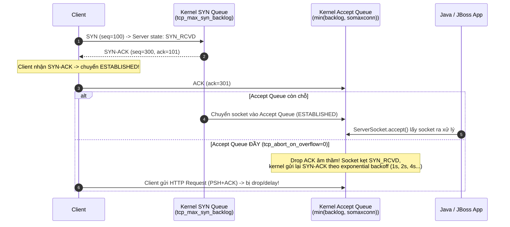

# LNX-08 · TCP: handshake, state machine, backlog

> **TL;DR** — Mọi kết nối HTTP/JDBC/Redis trên TCP đều bắt đầu bằng **3-way handshake** (`SYN → SYN-ACK → ACK`, tốn 1 RTT) và đóng bằng **4-way teardown** (`FIN ↔ ACK`). Ở phía server lắng nghe (`LISTEN`), Linux kernel duy trì **2 hàng đợi tách biệt**: **SYN Queue** (`SYN_RCVD`) và **Accept Queue** (bị chặn trần bởi **`min(backlog, net.core.somaxconn)`** — mặc định trong Java `new ServerSocket(port)` chỉ là **`50`**!). Khi Accept Queue đầy do JBoss/Java `accept()` không kịp, mặc định Linux (`tcp_abort_on_overflow=0`) **âm thầm vứt bỏ `ACK` cuối** khiến client tưởng kết nối đã `ESTABLISHED` rồi treo chờ timeout! Dùng **Keep-Alive / Connection Pool** giúp triệt tiêu RTT handshake lặp lại, còn bật **`TCP_NODELAY`** tắt Nagle tránh cộng hưởng trễ **40 ms** với Delayed ACK.

## 🧭 Brief

| | |
| :--- | :--- |
| **Loại** | Bài học |
| **Giai đoạn** | Năm 1 · Q1 |
| **Chủ đề** | Linux & Networking |
| **Tiên quyết** | [LNX-07](../07-epoll-io-multiplexing/README.md) |

**Phạm vi bắt buộc**
- 3-way/4-way handshake
- trạng thái TCP
- SYN backlog & accept queue
- keep-alive
- Nagle
- retransmission

**Câu hỏi sâu — nội dung phải giúp trả lời được**
- Accept queue đầy thì client thấy gì?
- Keep-alive giảm latency thế nào?

**Ý tưởng lab / demo**
- Quan sát handshake bằng tcpdump; làm đầy accept queue

**Tài liệu gốc gợi ý**
- The Linux Command Line
- Operating Systems: Three Easy Pieces
- Systems Performance (Gregg)
- High Performance Browser Networking (hpbn.co)
- TCP/IP Illustrated

**Gói đầu ra**
- [x] `README.md` — lý thuyết theo [lesson-template](../../../docs/templates/lesson-template.md)
- [x] `exercises.md` — bài tập L1/L2/L3 theo [exercises-template](../../../docs/templates/exercises-template.md)
- [x] `solutions.md` — đáp án theo [solutions-template](../../../docs/templates/solutions-template.md)
- [x] `lab/` — code demo chạy được + `lab/README.md` theo [lab-template](../../../docs/templates/lab-template.md)
- [ ] _(người học)_ `my-notes.md` — **agent không tạo**

---

<!-- Nội dung bắt đầu từ đây -->

## 1. Vấn đề: tại sao phải biết cái này?

Ba sự cố mạng kinh điển khiến ứng dụng Java / JBoss timeout dù cả server app lẫn database đều báo CPU < 30%:
1. **Bùng nổ kết nối mới buổi sáng (`accept queue` tràn):** 3.000 người dùng cùng đăng nhập lúc 08:30. Load balancer gửi 500 kết nối/giây vào JBoss đang cấu hình `acceptCount=100` (hoặc `somaxconn=128` trên kernel cũ). Nhiều client báo lỗi **`Read timed out`** hoặc chậm đúng `1s` / `3s` / `7s` (bội số RTO retransmit!), dù log JBoss không hề ghi nhận request nào lọt vào được servlet!
2. **Độ trễ cố định 40 ms bí ẩn trên mỗi lệnh RPC / JDBC nhỏ:** Một microservice gọi sang server khác viết 2 khung dữ liệu nhỏ liên tiếp (header + body) rồi đọc response, thấy mỗi lần lặp mất đúng **`40 ms`** trên mạng LAN nội bộ vốn RTT chỉ `0.2 ms` — thủ phạm là sự kết hợp giữa **thuật toán Nagle** và **TCP Delayed ACK**!
3. **Không dùng HTTP Keep-Alive / Connection Pool:** Mở TCP socket mới cho từng request sang service cách 20 ms RTT (+ TLS) đẩy latency tối thiểu từ `25 ms` lên `85–120 ms` và làm bùng phát `TIME_WAIT` ([LNX-09](../09-time-wait-close-wait/README.md)).

---

## 2. Mô hình tư duy (mental model)

Hãy hình dung **TCP trên Linux server như quy trình nhận khách ở quầy lễ tân có 2 phòng chờ**:
- **3-way Handshake (`SYN → SYN-ACK → ACK`):** Khách gõ cửa (`SYN`, đưa số thứ tự gói `seq=x`), lễ tân xác nhận và đưa số của mình (`SYN-ACK`, `ack=x+1, seq=y`), khách gật đầu xác nhận lại (`ACK`, `ack=y+1`). Hai bên đồng bộ được số thứ tự ban đầu (`ISN`) để chống gói tin cũ lạc đường và mất gói.
- **2 phòng chờ trước khi vào gặp nhân viên (`accept()`):**
  1. **SYN Queue (phòng nửa mở `SYN_RCVD`):** Khách đã gõ cửa, lễ tân đã gửi `SYN-ACK`, đang chờ khách xác nhận `ACK`.
  2. **Accept Queue (phòng đã hoàn tất `ESTABLISHED`):** Khách đã xong 3 bước, ngồi chờ nhân viên Java (`ServerSocket.accept()`) gọi tên vào làm việc.

**Chỗ ẩn dụ không còn đúng:**
Ở đời thực, nếu phòng chờ #2 (Accept Queue) đầy, bảo vệ sẽ hét ngay *"Hết chỗ rồi, về đi!"*. Nhưng trên Linux mặc định (`tcp_abort_on_overflow=0`), khi phòng #2 đầy, **lễ tân giả vờ không nghe thấy câu `ACK` cuối cùng của khách** — khiến vị khách nghĩ mình đã xong thủ tục check-in (`ESTABLISHED`) và bắt đầu nói yêu cầu, trong khi lễ tân vẫn tưởng khách chưa xác nhận!



---

## 3. Cơ chế bên trong (trọng tâm của bài)

### 3.1 3-way Handshake, 4-way Teardown & TCP State Machine

Theo *TCP/IP Illustrated* (Stevens) và RFC 9293:
1. **Mở kết nối (3-way handshake):** `CLOSED → SYN_SENT` (client gửi `SYN`) · `LISTEN → SYN_RCVD` (server nhận `SYN`, gửi `SYN-ACK`) → cả hai đạt `ESTABLISHED` khi server nhận `ACK` cuối. Đồng thời 2 bên thương lượng MSS, Window Scale (`WS`), SACK, Timestamps.
2. **Đóng kết nối (4-way teardown — song công độc lập hai chiều):**
   - Bên chủ động đóng (Active Close) gọi `close()` → gửi `FIN`, vào `FIN_WAIT_1` → nhận `ACK` vào `FIN_WAIT_2` → nhận `FIN` của bên kia → gửi `ACK` cuối và chờ **`TIME_WAIT`** (`2 × MSL`, mặc định **60 giây** trên Linux) để hứng các gói trễ và bảo đảm `ACK` cuối tới đích trước khi tái sử dụng tuple 4 thành phần.
   - Bên bị động đóng (Passive Close) nhận `FIN` → gửi `ACK`, vào **`CLOSE_WAIT`** chờ code ứng dụng của chính nó gọi `close()` → gọi `close()` gửi `FIN`, vào `LAST_ACK` → nhận `ACK` rồi về `CLOSED`. *(Tích tụ `CLOSE_WAIT` = bug app quên đóng socket — xem chi tiết ở [LNX-09](../09-time-wait-close-wait/README.md)!)*

### 3.2 SYN Backlog & Accept Queue — Trả lời câu hỏi sâu #1: Accept queue đầy thì client thấy gì?

1. **Kích thước 2 hàng đợi trong Linux:**
   - **SYN Queue (incomplete connections):** Giới hạn bởi `net.ipv4.tcp_max_syn_backlog` (và được bảo vệ trước SYN Flood bởi `net.ipv4.tcp_syncookies=1` — không cấp phát state `request_sock` khi đầy mà mã hóa cookie vào ISN của `SYN-ACK`).
   - **Accept Queue (complete connections chờ `accept()`):** Độ dài tối đa là:
     $$\text{Accept Queue Max} = \min(\text{app } \texttt{backlog},\; \texttt{net.core.somaxconn})$$
     - Lưu ý quan trọng: `new ServerSocket(8080)` trong JDK truyền mặc định **`backlog = 50`**! Còn Linux kernel `< 5.4` mặc định `somaxconn = 128` (từ Linux 5.4 nâng lên **`4096`**).
2. **Điều gì xảy ra với Client khi Accept Queue đầy?**
   - **Trường hợp mặc định (`net.ipv4.tcp_abort_on_overflow = 0`):** Kernel âm thầm bỏ qua gói `ACK` cuối của 3-way handshake. Phía **client** đã nhận `SYN-ACK` và gửi `ACK` nên phía client chuyển sang `ESTABLISHED` và **bắt đầu gửi payload HTTP/SQL**. Nhưng phía **server** vẫn để socket ở `SYN_RCVD`, giữ timer gửi lại `SYN-ACK` (theo backoff ~1s, 2s, 4s...), bỏ qua hoặc gửi lại `SYN-ACK` cho gói dữ liệu client (hoặc chuyển sang `ESTABLISHED` chỉ khi một slot trống vừa kịp mở trước khi hết retry `tcp_synack_retries`). Client thấy **treo đứng, latency nhảy bậc 1s / 3s / 7s, hoặc `SocketTimeoutException`**!
   - **Trường hợp `tcp_abort_on_overflow = 1`:** Server chủ động gửi gói **`RST`** ngay khi Accept Queue tràn → client nhận lỗi tức thì **`Connection reset by peer`** (fail fast, tốt cho hệ thống có retry phía trước, nhưng làm đứt hẳn request đang kết nối).
3. **Cách quan sát trên Linux:** Chạy `ss -lnt` xem cổng đang `LISTEN`:
   - Cột **`Send-Q`**: chính là kích thước tối đa Accept Queue thực tế (`min(backlog, somaxconn)`).
   - Cột **`Recv-Q`**: số kết nối đã xong handshake đang nằm chờ `accept()`. Nếu **`Recv-Q >= Send-Q`**, Accept Queue đang tràn — kiểm tra thêm `nstat -az TcpExtListenOverflows TcpExtListenDrops`!

### 3.3 Trả lời câu hỏi sâu #2: Keep-alive giảm latency thế nào? & HTTP vs TCP Keep-Alive

Phải phân biệt rạch ròi **2 khái niệm hoàn toàn khác tên giống nhau**:
- **HTTP Keep-Alive (`Connection: keep-alive` / Connection Pool như HikariCP, HttpClient pool):** Giữ nguyên một kết nối TCP `ESTABLISHED` mở sẵn giữa hai request liên tiếp.
  - **Giảm latency thế nào?**
    1. Tiết kiệm trọn **1 RTT** cho TCP 3-way handshake mỗi request (và thêm **1–2 RTT** cho TLS handshake nếu chạy HTTPS). Trên mạng WAN/cross-AZ có RTT `30ms`, riêng handshake đã tốn `60–90 ms` trước khi gửi 1 byte dữ liệu!
    2. Tránh bị **TCP Slow Start** reset `cwnd` (congestion window) về `10 MSS` (~14 KB) trên mỗi kết nối mới: kết nối đang dùng lại đã mở rộng `cwnd` nên truyền response lớn ngay trong ít RTT hơn.
    3. Giảm mạnh số socket tạo mới/đóng, tránh cạn ephemeral port (`TIME_WAIT`).
- **TCP Keep-Alive (`SO_KEEPALIVE`, `tcp_keepalive_time=7200s` mặc định Linux):** Gói probe rỗng ở tầng TCP để phát hiện peer đã chết đột ngột (mất điện/rớt mạng không gửi `FIN`) khi kết nối nằm im quá lâu. Mặc định **7200 giây (2 giờ)** quá chậm cho app server — thường cần chỉnh xuống `60s`–`300s` nếu đi qua NAT/firewall hay cắt kết nối idle.

### 3.4 Thuật toán Nagle (`TCP_NODELAY`) & Delayed ACK

- **Nagle's Algorithm (bật mặc định ở TCP):** Nếu còn gói dữ liệu nhỏ đã gửi chưa nhận `ACK`, gom các lần `write()` nhỏ kế tiếp lại thay vì bắn ra nhiều gói 10–20 byte gây lãng phí header `40 byte` (IP+TCP).
- **Delayed ACK (bật mặc định ở phía nhận):** Bên nhận chờ tối đa **`40 ms`** (Linux `TCP_DELACK_MIN`) xem ứng dụng có gửi response kèm luôn `ACK` piggyback không.
- **Cạm bẫy chết người (`Write → Write → Read`):** App gọi `write(header)`, rồi `write(body)`, rồi `read(response)`:
  1. Gói `header` bay đi; bên nhận đợi thêm dữ liệu hoặc response nên **Delayed ACK giữ lại `40 ms`**.
  2. App gọi `write(body)` nhưng **Nagle chặn không cho gửi** vì gói `header` chưa được `ACK`!
  3. Cả hai bên đứng nhìn nhau đúng **`40 ms`** (tối đa `25 req/s` cho 1 connection tuần tự!) chỉ vì một lệnh write chia làm 2 lần!
- **Giải pháp:** Bật **`socket.setTcpNoDelay(true)`** (tắt Nagle) cho các giao thức request-response nhạy latency như HTTP, JDBC, Redis, Kafka!

### 3.5 TCP Retransmission (RTO vs Fast Retransmit)

Khi một segment bị mất trên mạng, TCP phục hồi bằng 2 cơ chế:
1. **Fast Retransmit:** Bên nhận nhận được các gói sau bị nhảy số thứ tự liền gửi lặp lại **3 Duplicate ACKs** (`3 DupACK`) báo đúng `seq` đang thiếu → bên gửi bắn lại ngay không cần chờ timeout.
2. **RTO (Retransmission Timeout):** Nếu mất luôn cả gói cuối hoặc mất `SYN`/`SYN-ACK` (không có gói sau tạo DupACK), bên gửi đợi hết timer RTO (Linux RTO tối thiểu `200 ms`, initial `SYN` RTO **`1 second`** rồi nhân đôi `1s, 2s, 4s, 8s...` — exponential backoff).

---

## 4. Code minh họa

Xem mã nguồn chạy thật trên Java 21 loopback tại [TcpLabRunner.java](./lab/src/main/java/lab/linux/tcp/TcpLabRunner.java) và [TcpStateMachine.java](./lab/src/main/java/lab/linux/tcp/TcpStateMachine.java):

```java
// ❌ SAI: Mở ServerSocket backlog mặc định (50) & không bật TCP_NODELAY trên protocol nhỏ liên tiếp
ServerSocket server = new ServerSocket(8080); // backlog mặc định = 50 -> tràn ngay khi burst!
Socket client = new Socket(host, 8080);       // Nagle bật mặc định -> dính trễ 40ms với Delayed ACK!
```

```java
// ✅ ĐÚNG: Chỉ định backlog đủ lớn (khớp net.core.somaxconn) và bật TCP_NODELAY
ServerSocket server = new ServerSocket(8080, 1024); // min(1024, somaxconn)
Socket client = new Socket();
client.setTcpNoDelay(true);                         // Tắt Nagle -> không kẹt Delayed ACK 40ms
client.setKeepAlive(true);                          // Bật TCP KeepAlive phát hiện dead peer
client.connect(new InetSocketAddress(host, 8080), 2000);
```

### 4.1 Legacy corner (Java 7 / JBoss AS 7.1.1)

Trên **JBoss AS 7.1.1** chạy trên Linux production:
1. Trong `standalone.xml`, tham số **`backlog`** (trên `<connector name="http" ...>` hoặc `<socket-binding>`) hay bị bỏ mặc định ở `100` hoặc `50` — khi lượng kết nối từ Nginx/F5 đổ vào đột biến hoặc khi JBoss đang bị Full GC Pause 3 giây (`Accept` thread đứng hình không gọi `accept()` được!), Accept Queue `100` sẽ tràn trong chưa đầy 1 giây! Hãy nâng `net.core.somaxconn = 4096` ở Linux và cấu hình backlog connector tương xứng (`512`–`1024`).
2. Với **Oracle/PostgreSQL JDBC driver** trên Java 7: kiểm tra property `oracle.net.keepAlive` / `tcpKeepAlive=true` nếu giữa JBoss và DB có firewall hay ngắt kết nối idle sau 15–30 phút (tránh lỗi `IO Error: Connection reset` vào đầu giờ sáng!).
3. Để bắt chứng cứ TCP handshake / RST / retransmission trên Linux production, dùng **`tcpdump`** (`tcpdump -i any -nn -s 0 -w capture.pcap 'host 10.20.1.5 and port 8080'`, đọc thêm ở [LNX-14](../14-tcpdump-wireshark/README.md)).

---

## 5. Quan sát & đo đạc

### Phần A — Đã chạy kiểm chứng trên Windows 11 (Java 21 TCP Keep-Alive vs New-Conn & Backlog/State Machine)
Từ thư mục `lab/`:
```powershell
mvn -o -B verify
mvn -o -B compile exec:java
```
**Output thực tế ghi nhận trên Windows 11 amd64 · OpenJDK 26.0.1 (`--release 21`):**
- `TcpHandshakeLabTest`: **3/3 tests pass**, chứng minh:
  1. Benchmark `200` requests liên tiếp trên loopback `127.0.0.1`: mở kết nối TCP mới mỗi request mất **`363 ms`** so với tái sử dụng **1 kết nối Keep-Alive chỉ mất `29 ms`** (**nhanh hơn ~`12.2×`**) ngay cả trên localhost không có latency mạng WAN (`0 ms` địa lý)!
  2. `TcpStateMachine` mô hình hóa đầy đủ 3-way handshake, 4-way teardown (`TIME_WAIT` khi active close vs `CLOSE_WAIT` khi passive quên đóng), và chứng minh khi Accept Queue (`cap = 2`) đầy: `tcp_abort_on_overflow=false` giữ socket ở `SYN_RCVD` (drop `ACK`, `listenOverflows=1`), còn `tcp_abort_on_overflow=true` gửi `RST` (`TcpDropAndRetransmitTest` trong `solutions/`).

### Phần B — Cần kiểm chứng trên Linux / WSL / Docker (chưa chạy được trên máy Windows soạn bài)
> ⚠️ **Cần kiểm chứng trên Linux:** Máy soạn là Windows 11 không có WSL/Docker nên các thông số kernel Linux (`somaxconn`, `tcp_abort_on_overflow`, `tcp_delack_min = 40ms`) và công cụ bắt gói tin Linux **chưa được chạy kiểm chứng trực tiếp**:
- `bash scripts/observe-tcp-backlog.sh` (`ss -lnt` đọc `Recv-Q`/`Send-Q`, `nstat -az TcpExtListenOverflows TcpExtListenDrops`, `sysctl net.core.somaxconn net.ipv4.tcp_abort_on_overflow`).
- `sudo tcpdump -i lo -nn -S port <PORT>` (quan sát tận mắt `[S]`, `[S.]`, `[.]`, `[P.]`, `[F.]`, `[R.]` trong 3-way/4-way handshake).
- Đo thực tế hiệu ứng Nagle + Linux `40 ms` Delayed ACK trên Linux loopback (`setTcpNoDelay(false)` vs `true`).

---

## 6. Trade-offs & khi nào KHÔNG dùng

| Cấu hình TCP | Được gì | Mất / Đánh đổi gì | Dùng khi |
| :--- | :--- | :--- | :--- |
| **`TCP_NODELAY = true` (tắt Nagle)** | Loại bỏ hoàn toàn nguy cơ trễ **40 ms** khi `write-write-read` | Gửi nhiều gói nhỏ hơn nếu app gọi `write()` lắt nhắt từng byte không có `BufferedOutputStream` | **Mọi kết nối RPC, HTTP, JDBC, Redis, Kafka** (gom ở application buffer thay vì Nagle!) |
| **HTTP Keep-Alive / Connection Pool** | Giảm 1–3 RTT handshake, tận dụng TCP Slow Start đã mở `cwnd` | Chiếm FD và socket memory nếu client mở giữ quá lâu mà không set idle timeout | Giao tiếp giữa Backend ↔ DB / Redis / Microservices / ALB ↔ JBoss |
| **`tcp_abort_on_overflow = 1`** | Client nhận `RST` lỗi ngay lập tức (fail fast) khi server quá tải Accept Queue | Gãy kết nối ngay cả trong spike ngắn ngủi 100ms lẽ ra kịp thoát nếu chờ retry `SYN-ACK` | Khi có client/proxy retry nhanh và ưu tiên fail-fast hơn là treo timeout |

---

## 7. Cạm bẫy production (ít nhất 3)

1. **Quên tăng `net.core.somaxconn` hoặc truyền `ServerSocket(port)` dùng backlog mặc định `50`** — *Triệu chứng:* vào giờ cao điểm hoặc khi JVM GC pause ngắn, `nstat` báo `TcpExtListenOverflows` tăng vọt, client gặp latency nhảy bậc `1s / 3s` dù CPU app server bình thường. *Nguyên nhân:* kernel cắt trần Accept Queue theo `min(app_backlog, somaxconn)`. *Cách tránh:* đặt `net.core.somaxconn = 4096` (hoặc kiểm tra kernel `>= 5.4`) và cấu hình backlog app server `>= 512`–`1024`.
2. **Bật Nagle (`TCP_NODELAY=false`) trong code socket tự viết với chuỗi `write(len) + write(body) + read()`** — *Triệu chứng:* throughput tối đa bị kẹt cứng ở **`25 req/s`** (`1000ms / 40ms`) trên mỗi connection dù CPU 1%! *Nguyên nhân:* Delayed ACK `40 ms` của Linux chờ gói kế tiếp trong khi Nagle giữ gói thứ 2 chờ ACK của gói thứ 1. *Cách tránh:* luôn gọi `socket.setTcpNoDelay(true)` và gom dữ liệu vào 1 `BufferedOutputStream`/`ByteBuffer` trước khi `flush()`.
3. **Nhầm lẫn TCP Keep-Alive (mặc định 7200 giây) với HTTP Keep-Alive** — *Triệu chứng:* bật `socket.setKeepAlive(true)` nhưng firewall/NAT vẫn âm thầm cắt kết nối JDBC/HTTP sau 15 phút im lặng, gây treo `read()` cho đến khi nổ timeout! *Nguyên nhân:* `SO_KEEPALIVE` mặc định của Linux chỉ gửi gói thăm dò sau **2 giờ** (`7200s`), quá muộn so với timeout `900s` của NAT/Firewall. *Cách tránh:* cấu hình connection pool `maxLifetime` / `idleTimeout` ngắn hơn firewall timeout (vd 10 phút) hoặc giảm `tcp_keepalive_time` trên OS.
4. **Dùng `tcpdump` trên production mà không lọc host/port và không giới hạn dung lượng** — *Triệu chứng:* chạy `tcpdump -i eth0 -w dump.pcap` quên filter làm đầy ổ đĩa trong vài phút và tăng tải CPU copy packet. *Nguyên nhân:* bắt toàn bộ lưu lượng server. *Cách tránh:* luôn gắn BPF filter (`port 8080 and host ...`), giới hạn `-c 1000` hoặc xoay vòng `-C 100 -W 5` ([LNX-14](../14-tcpdump-wireshark/README.md)).

---

## 8. Liên hệ thực tế công việc

Ngay tuần này trên server Linux chạy **JBoss AS 7.1.1**:
1. Chạy `ss -lnt` và `cat /proc/sys/net/core/somaxconn` để kiểm tra xem JBoss HTTP port (`8080`/`8443`) đang được cấp Accept Queue `Send-Q` bằng bao nhiêu (`50`, `100`, `128`, hay `512+`), và chạy `nstat -az TcpExtListenOverflows TcpExtListenDrops` xem từ trước tới nay server có từng bị tràn Accept Queue âm thầm không!
2. Kiểm tra cấu hình JDBC / HTTP client pool trong codebase Java 7 xem đã bật reuse connection (Keep-Alive / pooling) và thiết lập cả `connectTimeout` lẫn `socketTimeout` chưa.

---

## 9. Self-check — Explain-back

> Trả lời **không nhìn tài liệu**, nói to trong 5 phút. Không trả lời được = chưa xong. (Đáp án nằm trong [solutions.md](./solutions.md).)

1. Mô tả chi tiết gói tin và trạng thái TCP ở 2 đầu trong **3-way handshake** và **4-way teardown** (`TIME_WAIT` nằm ở bên nào và kéo dài bao lâu?).
2. Phân biệt **SYN Queue** và **Accept Queue** trong Linux kernel; kích thước Accept Queue tính theo công thức nào?
3. Khi **Accept Queue đầy**, client nhìn thấy hiện tượng gì trong 2 trường hợp `tcp_abort_on_overflow = 0` (mặc định) và `= 1`? Dùng 2 lệnh Linux nào để khẳng định Accept Queue đã tràn?
4. **Keep-Alive** giảm latency như thế nào (nêu đủ cả yếu tố RTT handshake và TCP Slow Start `cwnd`)? Phân biệt TCP Keep-Alive vs HTTP Keep-Alive.
5. Giải thích hiện tượng kẹt **40 ms** khi thuật toán **Nagle** gặp **TCP Delayed ACK**, và cách khắc phục trong code Java.

---

## 10. Cheatsheet 1 trang

| Khái niệm | Ghi nhớ nhanh |
| :--- | :--- |
| **3-way / 4-way** | `SYN` → `SYN-ACK` → `ACK` (1 RTT) · Đóng: `FIN` ↔ `ACK` (`TIME_WAIT = 60s` ở bên đóng trước; `CLOSE_WAIT` ở bên quên `close()`) |
| **2 Queue tại `LISTEN`** | SYN Queue (`tcp_max_syn_backlog` / `syncookies`) · Accept Queue = `min(backlog, net.core.somaxconn)` (Java default `backlog=50`!) |
| **Accept Queue Overflow** | `tcp_abort_on_overflow=0`: drop `ACK` âm thầm, client tưởng đã `ESTABLISHED` rồi kẹt/retransmit · `=1`: trả `RST` |
| **Kiểm tra Overflow** | `ss -lnt` (`Recv-Q >= Send-Q`) · `nstat -az TcpExtListenOverflows TcpExtListenDrops` |
| **Nagle + Delayed ACK** | `write-write-read` kẹt **40 ms** (max `25 req/s`) → Bật **`socket.setTcpNoDelay(true)`** |
| **Keep-Alive** | HTTP Keep-Alive bỏ qua 1–3 RTT handshake + giữ `cwnd` ấm; TCP Keep-Alive mặc định `7200s` thăm dò dead peer |

---

## 11. Tài liệu tham khảo

- W. Richard Stevens & Kevin Fall, *TCP/IP Illustrated, Vol. 1* (2nd ed.) — TCP state machine, 3-way/4-way handshake, Nagle, Delayed ACK, Retransmission.
- Ilya Grigorik, [*High Performance Browser Networking (hpbn.co)* — Building Blocks of TCP](https://hpbn.co/building-blocks-of-tcp/) — 3-way handshake latency, Slow Start, Keep-Alive.
- Linux man-pages & Kernel Docs: [`tcp(7)`](https://man7.org/linux/man-pages/man7/tcp.7.html), [`listen(2)`](https://man7.org/linux/man-pages/man2/listen.2.html), [`ss(8)`](https://man7.org/linux/man-pages/man8/ss.8.html) (`somaxconn`, `tcp_abort_on_overflow`, `TCP_NODELAY`).
- [Java SE 21 API — `ServerSocket(int port, int backlog)` & `Socket.setTcpNoDelay(boolean)`](https://docs.oracle.com/en/java/javase/21/docs/api/java.base/java/net/ServerSocket.html).

---
➡️ Tiếp theo: [exercises.md](./exercises.md) · [lab/](./lab/README.md) · Bài kế: [LNX-09 · TIME_WAIT, CLOSE_WAIT & socket exhaustion](../09-time-wait-close-wait/README.md)
