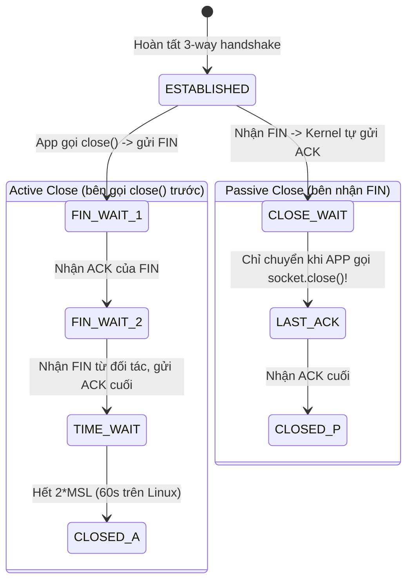

# LNX-09 · TIME_WAIT, CLOSE_WAIT & socket exhaustion

> **TL;DR** — **`TIME_WAIT`** và **`CLOSE_WAIT`** không phải "cùng một bệnh": `TIME_WAIT` nằm ở **bên chủ động đóng kết nối trước** (active close) và tồn tại trong **`2 × MSL` = 60 giây** trên Linux để bảo vệ gói `ACK` cuối cùng và lọc packet trễ của kết nối cũ; còn **`CLOSE_WAIT`** nằm ở **bên bị động đóng** (passive close) khi đối tác đã gửi `FIN` nhưng **ứng dụng của chính bạn quên gọi `socket.close()`** — nó không tự hết và sẽ ăn cạn `ulimit -n`! Khi một service gọi HTTP/API tới cùng 1 `(dst_ip, dst_port)` mà không dùng **Connection Pool / Keep-Alive** ở tốc độ > `~470 req/s`, dải ephemeral port mặc định (`32768–60999` = `28.232` ports) sẽ cạn kiệt vì kẹt trong `TIME_WAIT`, gây lỗi `EADDRNOTAVAIL: Cannot assign requested address`.

## 🧭 Brief

| | |
| :--- | :--- |
| **Loại** | Bài học |
| **Giai đoạn** | Năm 1 · Q1 |
| **Chủ đề** | Linux & Networking |
| **Tiên quyết** | [LNX-08](../08-tcp-handshake-states/README.md) |

**Phạm vi bắt buộc**
- vì sao cần TIME_WAIT
- ephemeral port exhaustion
- CLOSE_WAIT = app quên đóng
- connection pooling HTTP

**Câu hỏi sâu — nội dung phải giúp trả lời được**
- Hàng nghìn CLOSE_WAIT là lỗi của ai?
- Hết ephemeral port khi gọi API bên ngoài?

**Ý tưởng lab / demo**
- Tái hiện CLOSE_WAIT do không đóng HttpURLConnection/response

**Tài liệu gốc gợi ý**
- The Linux Command Line
- Operating Systems: Three Easy Pieces
- Systems Performance (Gregg)
- High Performance Browser Networking (hpbn.co)
- TCP/IP Illustrated

**Gói đầu ra**
- [x] `README.md` — lý thuyết theo [lesson-template](../../../docs/templates/lesson-template.md)
- [x] `exercises.md` — bài tập L1/L2/L3 theo [exercises-template](../../../docs/templates/exercises-template.md)
- [x] `solutions.md` — đáp án theo [solutions-template](../../../docs/templates/solutions-template.md)
- [x] `lab/` — code demo chạy được + `lab/README.md` theo [lab-template](../../../docs/templates/lab-template.md)
- [ ] _(người học)_ `my-notes.md` — **agent không tạo**

---

<!-- Nội dung bắt đầu từ đây -->

## 1. Vấn đề: tại sao phải biết cái này?

Hai sự cố production kinh điển liên quan tới vòng đời đóng TCP socket làm sập hệ thống dù CPU và RAM heap vẫn bình thường:

1. **Hết Ephemeral Port khi gọi API đối tác (`TIME_WAIT` exhaustion):** Service thanh toán trên JBoss gọi cổng webhook/payment gateway bên ngoài (1 IP + 1 port `443`) ở mức **`600 req/s`**. Vì mỗi request mở một `HttpURLConnection` kèm header `Connection: close` (hoặc không tái sử dụng connection pool), sau đúng ~47 giây, app bắt đầu ném hàng loạt `java.net.BindException: Cannot assign requested address` / `NoRouteToHostException`. Chạy `ss -s` thấy **`~28.000` socket nằm ở `TIME-WAIT`**!
2. **Rò rỉ `CLOSE_WAIT` làm sập JBoss sau 6 giờ chạy (`Too many open files`):** Sau một đợt deploy tích hợp mới, service chạy ổn định buổi sáng nhưng tới 14:00 bỗng dừng nhận mọi request HTTP và JDBC đều lỗi `EMFILE: Too many open files` ([LNX-02](../02-file-descriptors-io/README.md)). Kiểm tra `ss -tan state close-wait | wc -l` thấy **`1.018` socket `CLOSE_WAIT`** — gần chạm trần `ulimit -n = 1024`!

---

## 2. Mô hình tư duy (mental model)

Hãy hình dung một kết nối TCP như **cuộc gọi điện thoại hai chiều**, khi cúp máy mỗi bên phải nói lời tạm biệt riêng:

- **`TIME_WAIT` (Bên cúp máy trước đứng chờ thêm 60s ở bàn điện thoại):** Bạn là người chủ động nói *"Xong rồi, cúp máy nhé"* (`FIN`), đầu dây bên kia xác nhận rồi cũng nói *"Tạm biệt"* (`FIN`), bạn trả lời *"OK, tạm biệt"* (`ACK`). Bạn **không được gác máy ngay lập tức** để bấm số mới từ cùng đầu số nội bộ đó, vì nhỡ câu *"OK"* của bạn bị rớt dọc đường hoặc còn một câu nói trễ nào từ cuộc gọi trước đang bay tới!
- **`CLOSE_WAIT` (Đầu dây bên kia đã gác máy, bạn đã nghe tiếng `tút...` nhưng tay vẫn cầm ống nghe không chịu đặt xuống!):** Hệ điều hành đã báo cho ứng dụng biết đối tác đã gửi `FIN` xong (`read() == -1`), nhưng **code ứng dụng vẫn cầm chặt cái ống nghe (File Descriptor)** mà không chịu gọi `close()`.

**Chỗ ẩn dụ không còn đúng:**
Trong cuộc gọi điện thoại thật, giữ một ống nghe chỉ tốn một cái máy điện thoại; nhưng trên TCP, một socket `TIME_WAIT` vẫn cho phép cùng `ephemeral port` đó gọi sang **đích khác** `(dst_ip_2, dst_port_2)` miễn là **4-tuple** `(src_ip, src_port, dst_ip, dst_port)` là duy nhất! Ngược lại, `CLOSE_WAIT` chiếm giữ **1 File Descriptor thật** trong process — vượt quá `ulimit -n` là process không thể mở nổi thêm bất kỳ file, socket, hay log nào nữa.



---

## 3. Cơ chế bên trong (trọng tâm của bài)

### 3.1 Vì sao TCP bắt buộc phải có `TIME_WAIT` (`2 × MSL`)?

Theo **RFC 9293** (mục 3.6) và *TCP/IP Illustrated* (Stevens), trạng thái **`TIME_WAIT`** chỉ xuất hiện ở **bên thực hiện Active Close** (gửi gói `FIN` đầu tiên), kéo dài **`2 × MSL`** (*Maximum Segment Lifetime* — thời gian sống tối đa một gói tin được phép trôi nổi trên mạng). Trên Linux kernel, hằng số `TCP_TIMEWAIT_LEN` được cố định trong source kernel là **`60 giây`** (tương ứng `MSL = 30s`).

Hai lý do kỹ thuật không thể bỏ `TIME_WAIT`:
1. **Đảm bảo bên Passive Close nhận được gói `ACK` cuối cùng:**
   Khi Active Close gửi gói `ACK` đáp lại `FIN` của đối tác, gói `ACK` đó **không được ACK lại** (TCP không ACK cho một ACK đơn thuần). Nếu gói `ACK` cuối bị mất trên đường truyền, bên Passive Close ở trạng thái `LAST_ACK` sẽ hết timer và **gửi lại `FIN`**. Nếu bên Active Close đã xóa sạch state về `CLOSED` ngay lập tức, kernel sẽ coi gói `FIN` gửi lại là bất hợp lệ và bắn gói **`RST`** làm đối tác ghi nhận lỗi kết thúc bất thường! Nhờ còn nằm ở `TIME_WAIT`, kernel nhận ra gói `FIN` retransmit và gửi lại `ACK` tử tế.
2. **Ngăn "gói tin ma" (*wandering duplicates*) của kết nối cũ làm hỏng kết nối mới:**
   Giả sử 4-tuple `(10.0.1.5:52000 → 10.0.2.10:8080)` đóng xong và bạn mở lại **đúng 4-tuple đó** ngay 1 giây sau. Một gói TCP bị kẹt route vòng trên mạng từ kết nối cũ bất ngờ bay tới — nếu sequence number khớp cửa sổ nhận của kết nối mới, TCP sẽ tưởng đó là dữ liệu hợp lệ và **làm sai lệch dữ liệu (data corruption)**! Chờ đủ `2 × MSL` bảo đảm mọi gói tin cũ trên cả 2 chiều đã bị router loại bỏ (hết TTL IP) trước khi 4-tuple được tái sử dụng.

> **Lưu ý:** Một socket trong `TIME_WAIT` trên Linux chỉ tốn khoảng **~184–248 bytes** cấu trúc `inet_timewait_sock` trong kernel memory (không còn giữ send/receive buffer lớn của socket `ESTABLISHED`, không giữ File Descriptor của process đã `close()`). Nên **vài nghìn `TIME_WAIT` ở server bận không phải bug bộ nhớ** — vấn đề thực sự chỉ là **chiếm slot 4-tuple** hoặc **tốn CPU port allocation**.

### 3.2 Trả lời câu hỏi sâu #2: Hết ephemeral port khi gọi API bên ngoài?

Mỗi kết nối TCP được định danh duy nhất trong kernel bởi **4-tuple**:
$$(\text{src\_ip},\; \text{src\_port},\; \text{dst\_ip},\; \text{dst\_port})$$

Khi app Java gọi một API bên ngoài tại `(203.0.113.10, 443)` từ IP máy chủ cố định `10.0.1.5`:
- `src_ip`, `dst_ip`, `dst_port` đều **cố định**.
- Biến duy nhất còn lại để phân biệt các kết nối đồng thời (và các kết nối đang chờ trong `TIME_WAIT`) là **`src_port`** — gọi là **ephemeral port** (cổng tạm phía client).
- Trên Linux hiện đại, dải ephemeral port mặc định trong `/proc/sys/net/ipv4/ip_local_port_range` là **`32768 60999`**, tức có đúng:
  $$60999 - 32768 + 1 = \mathbf{28.232\text{ ports}}$$

**Toán học của sự cố cạn ephemeral port:**
Nếu service của bạn đóng kết nối trước (active close — ví dụ không dùng Keep-Alive hoặc dùng `Connection: close`), mỗi kết nối đóng xong sẽ giữ chặt `src_port` đó trong **`TIME_WAIT` = 60 giây** đối với đích `(203.0.113.10, 443)`. Suy ra thông lượng mở mới tối đa tới cùng 1 đích là:
$$\text{Max New Conn/s} = \frac{28.232}{60\text{ s}} \approx \mathbf{470.5\text{ connections/s}}$$

Chỉ cần traffic vượt **`~470 req/s`** trong hơn 1 phút mà không tái sử dụng kết nối, toàn bộ `28.232` cổng tạm đều bị khóa trong `TIME_WAIT`! Khi app gọi `connect()`, kernel không tìm được port trống để tạo 4-tuple mới và trả ngay lỗi **`EADDRNOTAVAIL` (`Cannot assign requested address`)**!

**Cách giải quyết đúng vs ngộ nhận sysctl:**
1. **Giải pháp chuẩn (tầng ứng dụng):** Dùng **HTTP Connection Pool / Keep-Alive**! Thay vì `600` lần mở-đóng kết nối mỗi giây (tốn `28.232+` port), bạn chỉ dùng **`20–50` persistent TCP sockets** tái sử dụng liên tục — số ephemeral port tiêu thụ gần như cố định và `TIME_WAIT` giảm về ~`0`.
2. **Tăng nhẹ dải port trên OS (giảm áp lực tạm thời):**
   `sysctl -w net.ipv4.ip_local_port_range="1024 65000"` (~`63.977` ports → tăng giới hạn lên `~1.066 conn/s`). Nhớ chừa các port listening quan trọng vào `net.ipv4.ip_local_reserved_ports`!
3. **Cảnh báo `tcp_tw_recycle` & `tcp_tw_reuse`:**
   - **`net.ipv4.tcp_tw_recycle` đã bị XÓA vĩnh viễn khỏi Linux kernel từ phiên bản `4.12` (2017)** — vì nó dựa vào per-IP TCP timestamp, làm rớt hàng loạt client đứng sau NAT (cùng IP nhưng đồng hồ khác nhau)! Tuyệt đối **không** copy cấu hình `tcp_tw_recycle = 1` từ blog cũ.
   - **`net.ipv4.tcp_tw_reuse = 1`** (hoặc `2` từ kernel 4.18 — loopback only) **chỉ tác dụng cho outbound client connection** khi `tcp_timestamps = 1`, cho phép tái sử dụng `TIME_WAIT` socket cũ hơn `1s` cho kết nối đi ra mới. Hữu ích cho reverse proxy / gateway nội bộ gọi upstream, nhưng **không sửa được lỗi quên dùng connection pool**.

### 3.3 Trả lời câu hỏi sâu #1: Hàng nghìn `CLOSE_WAIT` là lỗi của ai?

**Trả lời dứt khoát: 100% là lỗi của code ứng dụng đang chạy trên chính máy hiển thị `CLOSE_WAIT`.**

Hãy nhìn chuỗi sự kiện trong Linux kernel:
1. Đối tác (ví dụ Nginx, DB, hoặc API server bên ngoài) đã gọi `close()` và gửi gói `FIN` sang cho máy bạn.
2. Linux kernel của máy bạn làm xong phần việc của nó: gửi trả `ACK` và đặt socket vào **`CLOSE_WAIT`**, đồng thời báo hiệu EOF (`read()` trả `-1`) lên ứng dụng Java.
3. Từ giây phút đó trở đi, **TCP không có timeout nào tự dọn `CLOSE_WAIT`** (theo đúng thiết kế: nhỡ app vẫn đang muốn gửi nốt dữ liệu chiều còn lại trước khi đóng!). Kernel ngồi chờ **mãi mãi** tới khi chính process đang giữ File Descriptor đó gọi `close()` (hoặc process chết/bị `kill` thì kernel mới dọn FD).

**3 thủ phạm kinh điển tạo ra `CLOSE_WAIT` trong Java:**
1. Dùng `HttpURLConnection` hoặc Apache `HttpClient` mà **không đọc/đóng `InputStream` và `getErrorStream()`** (khi HTTP trả `400`/`500`, `getInputStream()` ném `IOException` khiến code bỏ qua luôn việc đóng stream lỗi!).
2. Quên dùng `try-with-resources` khi mở raw `Socket`, `CloseableHttpResponse`, hoặc kết nối DB/Redis tự viết → khi nghiệp vụ ném exception ở giữa hàm, dòng `socket.close()` bên dưới bị nhảy qua.
3. Cấu hình timeout phía client/idle quá dài hoặc thiếu `closeIdleConnections()` trong pool cũ.

**Hậu quả dây chuyền:** Mỗi socket `CLOSE_WAIT` giữ chết **1 File Descriptor** (`lsof -p <pid>` vẫn thấy socket mở!). Khi chạm ngưỡng **`ulimit -n`** (mặc định thường `1024` hoặc `4096` trên service chưa tune), toàn bộ app server sập với lỗi `Too many open files` (`EMFILE`).

### 3.4 Connection Pooling HTTP hoạt động ra sao?

Thay vì `connect() -> request -> response -> close()` trên mỗi HTTP call, một **HTTP Connection Pool** (ví dụ `java.net.http.HttpClient`, Apache `PoolingHttpClientConnectionManager`, OkHttp `ConnectionPool`) duy trì một tập hợp socket `ESTABLISHED` theo từng route `(scheme, host, port)`:
1. Khi có request mới → kiểm tra hàng đợi idle socket của route đó; nếu còn socket sạch thì lấy ra dùng ngay (**`0` handshake TCP/TLS**).
2. Khi đọc xong **toàn bộ** body response (hoặc chunked EOF) → client **không gọi `close()`**, mà trả socket về pool để tái sử dụng (trừ khi server gửi `Connection: close` hoặc socket đã quá `idleTimeout` / `maxLifetime`).
3. Để tránh leak và stale socket bị firewall cắt giữa chừng, pool luôn cần đủ **4 tham số sống còn**:
   - `connectTimeout` (thời gian chờ TCP handshake, vd `2s`).
   - `socketTimeout` / `requestTimeout` (thời gian chờ đọc response, vd `5s–10s`).
   - `maxConnectionsTotal` & `maxConnectionsPerRoute` (giới hạn tổng kết nối tránh làm ngập upstream hoặc cạn FD).
   - `evictIdleConnections` / `maxIdleTime` (nhỏ hơn idle timeout của NAT/LB/Nginx, vd `30s–60s` so với `65s–75s` của Nginx/ALB!).

---

## 4. Code minh họa

Xem mã nguồn chạy thật trên Java 21 loopback tại [SocketExhaustionDemo.java](./lab/src/main/java/lab/linux/sockets/SocketExhaustionDemo.java) và [HttpClientPoolSolution.java](./lab/solutions/HttpClientPoolSolution.java):

```java
// ❌ SAI: Mở HttpURLConnection / CloseableHttpResponse mà không đóng cả ErrorStream khi gặp HTTP 500
HttpURLConnection conn = (HttpURLConnection) url.openConnection();
try (BufferedReader in = new BufferedReader(new InputStreamReader(conn.getInputStream()))) {
    // Nếu server trả 500: getInputStream() ném IOException, nhảy thẳng ra ngoài!
    // conn.getErrorStream() chưa từng được đọc/đóng -> socket underlying có thể leak ở CLOSE_WAIT!
}
```

```java
// ✅ ĐÚNG (Java 21): Dùng HttpClient tái sử dụng Connection Pool + đặt timeout + consume body chuẩn
HttpClient client = HttpClient.newBuilder()
        .connectTimeout(Duration.ofSeconds(2))
        .build();

HttpRequest req = HttpRequest.newBuilder(uri)
        .timeout(Duration.ofSeconds(5))
        .GET()
        .build();
HttpResponse<String> resp = client.send(req, HttpResponse.BodyHandlers.ofString());
```

### 4.1 Legacy corner (Java 7 / JBoss AS 7.1.1)

Trên **Java 7 / JBoss AS 7.1.1** không có `java.net.http.HttpClient` (chỉ có từ Java 11). Hai điểm phải kiểm tra ngay trong codebase legacy:
1. **`HttpURLConnection` mặc định bật `http.keepAlive=true` nhưng có bẫy cực hiểm:** JDK 7 dùng `sun.net.www.http.KeepAliveCache` nội bộ (mặc định giữ tối đa **5** idle connection mỗi host trong 5s). Tuy nhiên kết nối **chỉ được tái sử dụng** nếu bạn **đọc cạn và `.close()`** cả `InputStream` lẫn `getErrorStream()` khi HTTP status `>= 400`! Nếu chỉ đóng `InputStream` mà bỏ qua `ErrorStream`, hoặc quên đặt `sun.net.client.defaultConnectTimeout` & `defaultReadTimeout`, JBoss thread sẽ treo vô hạn hoặc rò rỉ socket `CLOSE_WAIT`.
2. **Nếu dùng Apache HttpClient 4.x trên Java 7:** Luôn bọc `CloseableHttpResponse` trong `try (...)`, gọi `EntityUtils.consumeQuietly(response.getEntity())` trước khi đóng, và chạy background thread `IdleConnectionEvictor` dọn kết nối `CLOSE_WAIT` / expired mỗi 30 giây.

---

## 5. Quan sát & đo đạc

### Phần A — Đã chạy kiểm chứng trên Windows 11 (Java 21 Loopback TCP & Ephemeral Port Model)
Từ thư mục `lab/`:
```powershell
mvn -o -B verify
mvn -o -B compile exec:java
```
Phần Java 21 chạy trên loopback TCP `127.0.0.1` chứng minh trực tiếp:
1. **Rò rỉ socket không đóng (`CLOSE_WAIT` leak):** Khi server chủ động đóng kết nối sau khi trả response (`FIN`) nhưng client giữ reference socket không đóng (`try` thiếu `close()`), client nắm giữ nguyên số FD/socket mở và chạm trần giới hạn; ngược lại dùng pool tái sử dụng chỉ mở **1–2** kết nối TCP cho toàn bộ `200` requests.
2. **Ephemeral port exhaustion (`TIME_WAIT` churn):** Mô phỏng chuẩn dải `32768..60999` (`28.232` ports) với `TIME_WAIT = 60s` tới 1 đích `(10.20.1.50:443)`: ở tốc độ `600 req/s` đóng mỗi request, hệ thống cạn sạch ephemeral port (`EADDRNOTAVAIL`) ở giây thứ **~`48`**, trong khi dùng Connection Pool `16` connections chạy bền vững ở `0%` cạn port.

*(Số đo thực tế ghi nhận sau khi chạy `mvn -o -B verify` được cập nhật tại [lab/README.md §4](./lab/README.md#4-kết-quả-tham-khảo-khi-chạy).)*

### Phần B — Cần kiểm chứng trên Linux / WSL / Docker (chưa chạy được trên máy Windows soạn bài)
> ⚠️ **Cần kiểm chứng trên Linux:** Máy soạn là Windows 11 không có WSL/Docker nên các lệnh thống kê socket Linux (`ss`, `lsof`, `sysctl`) trong `scripts/inspect-socket-states.sh` **chưa được chạy kiểm chứng trực tiếp**:
- `ss -s` (tổng hợp số lượng `ESTAB`, `TIMEWAIT`, `orphaned`, `closed`).
- `ss -tan state close-wait -p` và `lsof -p <PID> | grep CLOSE_WAIT` (chỉ mặt đặt tên đúng process Java và FD đang leak `CLOSE_WAIT`).
- `ss -tan state time-wait | awk '{print $4}' | sort | uniq -c | sort -nr | head` (xem đích nào đang ngốn nhiều `TIME_WAIT` nhất).
- `sysctl net.ipv4.ip_local_port_range net.ipv4.tcp_fin_timeout net.ipv4.tcp_tw_reuse`.

---

## 6. Trade-offs & khi nào KHÔNG dùng

| Cấu hình / Giải pháp | Được gì | Mất / Đánh đổi gì | Dùng khi |
| :--- | :--- | :--- | :--- |
| **HTTP Connection Pool + Keep-Alive** | Triệt tiêu `TIME_WAIT` churn, bỏ qua TCP/TLS handshake lặp lại, giữ port ổn định | Tốn RAM socket cố định; phải đặt idle eviction nhỏ hơn LB/Firewall timeout để tránh stale connection | **Mọi giao tiếp HTTP/RPC/DB giữa backend với downstream** |
| **Mở rộng `ip_local_port_range` (`1024 65000`)** | Tăng trần ephemeral port từ `28.232` lên `~63.977` (+`126%`) | Chưa giải quyết nguyên nhân gốc nếu app vẫn mở-đóng socket vô tội vạ; dễ đụng port ứng dụng nếu quên `ip_local_reserved_ports` | Reverse proxy / load generator / API gateway lưu lượng cao đi kèm Connection Pool |
| **`net.ipv4.tcp_tw_reuse = 1`** | Cho phép **outbound client** tái sử dụng `TIME_WAIT` cũ hơn 1 giây (khi `tcp_timestamps = 1`) | Rủi ro mất/nhầm gói nếu timestamp không đồng bộ trên đường mạng phức tạp; không tác dụng với inbound server socket | Proxy/client nội bộ gọi rất nhiều short-lived connections trong LAN kiểm soát được |
| **`SO_LINGER = 0` (bắn `RST` ép bỏ `TIME_WAIT`)** | Tránh hoàn toàn `TIME_WAIT` trên app gọi `close()` | Dễ cắt cụt dữ liệu chưa đọc của đối tác, tăng lỗi `Connection reset by peer` | **KHÔNG dùng** cho HTTP/DB production bình thường (chỉ dùng cho benchmark tool chuyên biệt) |

---

## 7. Cạm bẫy production (ít nhất 3)

1. **Nhầm `tcp_fin_timeout` là thời gian của `TIME_WAIT`** — *Triệu chứng:* admin chỉnh `net.ipv4.tcp_fin_timeout = 10` mong giảm `TIME_WAIT` từ 60s xuống 10s nhưng `ss -tan state time-wait` vẫn giữ nguyên `60s`! *Nguyên nhân:* `tcp_fin_timeout` kiểm soát timeout của **`FIN_WAIT_2`** (chờ bên kia gửi `FIN` khi connection mồ côi), **không phải `TIME_WAIT`** (`TCP_TIMEWAIT_LEN = 60s` được hardcode trong Linux kernel). *Cách tránh:* dùng Connection Pool thay vì tìm cách giảm `TIME_WAIT`.
2. **Bật `net.ipv4.tcp_tw_recycle = 1` từ hướng dẫn cũ trên mạng** — *Triệu chứng:* trên kernel cũ `< 4.12`, một nửa người dùng mobile/văn phòng sau cùng NAT IP đột ngột không kết nối được; trên kernel `>= 4.12`, sysctl báo lỗi không tồn tại key. *Nguyên nhân:* `tcp_tw_recycle` lưu timestamp cuối cùng theo *IP nguồn*, dẫn tới từ chối mọi `SYN` có timestamp nhỏ hơn từ thiết bị khác sau cùng NAT! *Cách tránh:* tuyệt đối không bật `tcp_tw_recycle`.
3. **Đóng `HttpURLConnection` thiếu `getErrorStream()` khi server trả HTTP 4xx/5xx** — *Triệu chứng:* service hoạt động tốt khi upstream trả `200 OK`, nhưng cứ khi upstream lỗi `502`/`500` vài tiếng là JBoss cạn FD hoặc tăng đột biến `CLOSE_WAIT`. *Nguyên nhân:* `getInputStream()` ném `IOException` trước khi stream được đọc/đóng, để lại `ErrorStream` giữ socket nền. *Cách tránh:* dùng HTTP client hiện đại (`HttpClient`, OkHttp, Apache HttpClient + `try-with-resources`) hoặc drain & close cả `getErrorStream()` trong khối `catch/finally`.
4. **Idle timeout của Connection Pool dài hơn Idle timeout của ALB/Nginx/Firewall** — *Triệu chứng:* sáng sớm hoặc sau khoảng vắng khách, burst request đầu tiên ném `NoHttpResponseException` / `Connection reset` hàng loạt. *Nguyên nhân:* ALB/Firewall (vd idle `60s`) hoặc Nginx (`keepalive_timeout 65s`) đã đóng kết nối nhưng Java pool vẫn giữ timeout `120s` nên bốc nhầm socket nửa chết! *Cách tránh:* luôn đặt client pool `idleTimeout` **ngắn hơn** upstream/LB (ví dụ LB `60s` → client pool evict ở `30s–45s`).

---

## 8. Liên hệ thực tế công việc

Ngay tuần này trên server **JBoss AS 7.1.1 / Linux**:
1. Chạy nhanh lệnh `ss -s` và `ss -tan | awk 'NR>1 {print $1}' | sort | uniq -c | sort -nr` trên server production:
   - Nếu thấy **`CLOSE-WAIT` > vài chục** gắn với PID JBoss (`ss -tanp state close-wait`): lập tức mở `lsof -p <PID> | grep CLOSE_WAIT` xem đang kẹt ở IP/port nào (DB? Payment API? Redis?) và kiểm tra lại chỗ đóng stream/connection trong code Java gọi tới IP đó!
   - Nếu thấy **`TIME-WAIT` > 10.000** hướng về cùng 1 `(dst_ip, dst_port)`: rà soát xem code Java 7 đang gọi API đó bằng `HttpURLConnection` có header `Connection: close` hay tạo mới `CloseableHttpClient` trong từng method thay vì dùng chung 1 singleton `PoolingHttpClientConnectionManager`!
2. Đọc tiếp case sự cố thực tế tại [INC-12 · CLOSE_WAIT tích tụ do không đóng connection](../../../03-production-troubleshooting/incident-labs/12-close-wait-leak/).

---

## 9. Self-check — Explain-back

> Trả lời **không nhìn tài liệu**, nói to trong 5 phút. Không trả lời được = chưa xong. (Đáp án nằm trong [solutions.md](./solutions.md).)

1. Nêu **2 lý do** kỹ thuật vì sao TCP cần giữ trạng thái **`TIME_WAIT`** đủ `2 × MSL` (`60s` trên Linux), và bên nào (Active Close hay Passive Close) nằm ở trạng thái này?
2. Vì sao một máy có `28.232` ephemeral ports lại có thể bị lỗi `Cannot assign requested address` khi gọi một API ở mức **`600 req/s`**, và công thức giới hạn `~470 req/s` đến từ đâu?
3. Nếu thấy **3.000 socket `CLOSE_WAIT`** trên server JBoss, lỗi nằm ở mạng, ở server đối tác, hay ở chính JBoss? Cơ chế nào trong kernel giữ `CLOSE_WAIT` mãi không tắt?
4. Vì sao chỉnh `net.ipv4.tcp_fin_timeout = 10` không rút ngắn được `TIME_WAIT`, và vì sao `tcp_tw_recycle` bị xóa khỏi Linux kernel 4.12?
5. Khi gọi HTTP từ Java tới upstream qua Nginx/ALB (idle timeout `65s`), cần cấu hình HTTP Connection Pool như thế nào để vừa tránh cạn ephemeral port vừa tránh lỗi `Connection reset` trên kết nối idle?

---

## 10. Cheatsheet 1 trang

| Khái niệm | Ghi nhớ nhanh |
| :--- | :--- |
| **`TIME_WAIT`** | Ở **Active Close** (bên gọi `close()` trước) · giữ **`60s`** (`TCP_TIMEWAIT_LEN`) · bảo vệ `ACK` cuối & chặn gói tin ma · **không tốn FD** |
| **`CLOSE_WAIT`** | Ở **Passive Close** (đã nhận `FIN` & trả `ACK`, chờ app gọi `close()`) · **vĩnh viễn** nếu app leak · **tốn FD** (`ulimit -n`!) · 100% lỗi app |
| **Ephemeral port** | `net.ipv4.ip_local_port_range` mặc định `32768..60999` (`28.232` ports) · giới hạn **per `(dst_ip, dst_port)`**: `28.232 / 60s ≈ 470 new conn/s` |
| **Lỗi khi cạn port** | `EADDRNOTAVAIL` (`Cannot assign requested address`) · sửa gốc bằng **HTTP Connection Pool / Keep-Alive** |
| **Lệnh soi nhanh** | `ss -s` · `ss -tan state time-wait` · `ss -tanp state close-wait` · `lsof -p <PID> \| grep CLOSE_WAIT` |
| **Bẫy sysctl** | `tcp_fin_timeout` là của `FIN_WAIT_2` (không phải `TIME_WAIT`) · `tcp_tw_recycle` đã xóa từ Linux 4.12 |

---

## 11. Tài liệu tham khảo

- RFC 9293 (2022), [*Transmission Control Protocol (TCP)* — Section 3.6 Closing a Connection & TIME-WAIT](https://www.rfc-editor.org/rfc/rfc9293.html).
- W. Richard Stevens & Kevin Fall, *TCP/IP Illustrated, Vol. 1* (2nd ed.) — TCP Connection Termination, `TIME_WAIT`, Quiet Time Concept.
- Linux Kernel Documentation, [`ip-sysctl.rst` (`ip_local_port_range`, `tcp_tw_reuse`, `tcp_fin_timeout`)](https://docs.kernel.org/networking/ip-sysctl.html) & `include/net/tcp.h` (`TCP_TIMEWAIT_LEN = 60*HZ`).
- Oracle Java SE Docs, [`HttpURLConnection` & Persistent Connections (`http.keepAlive`)](https://docs.oracle.com/en/java/javase/21/docs/api/java.base/java/net/HttpURLConnection.html).

---
➡️ Tiếp theo: [exercises.md](./exercises.md) · [lab/](./lab/README.md) · Bài kế: [LNX-10 · HTTP/1.1 vs HTTP/2 vs HTTP/3](../10-http-versions/README.md)
