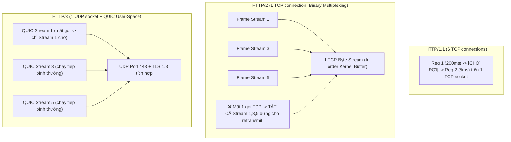

# LNX-10 · HTTP/1.1 vs HTTP/2 vs HTTP/3

> **TL;DR** — **HTTP/1.1** tuần tự hóa request/response trên mỗi TCP connection, dính **Application-layer Head-of-Line (HOL) blocking** nên trình duyệt phải mở tới **6 TCP connections/domain** đầy lãng phí. **HTTP/2** chia dữ liệu thành **binary frames** gắn `Stream ID` để **multiplex** hàng trăm request song song trên **1 kết nối TCP duy nhất** và nén header bằng **HPACK** — dứt điểm HOL ở tầng HTTP nhưng **vẫn còn sót HOL blocking ở tầng TCP** (mất 1 gói TCP là toàn bộ stream đứng hình!). **HTTP/3** chuyển sang **QUIC trên UDP** để vừa loại bỏ TCP HOL blocking (mỗi stream khôi phục mất gói độc lập), vừa gộp **TLS 1.3** xuống **1-RTT** (hoặc 0-RTT) và hỗ trợ đổi mạng qua `Connection ID` mà không đụng tường đá *ossification* của router/NAT cũ.

## 🧭 Brief

| | |
| :--- | :--- |
| **Loại** | Bài học |
| **Giai đoạn** | Năm 1 · Q1 |
| **Chủ đề** | Linux & Networking |
| **Tiên quyết** | [LNX-09](../09-time-wait-close-wait/README.md) |

**Phạm vi bắt buộc**
- head-of-line blocking
- multiplexing
- HPACK
- QUIC trên UDP
- gRPC trên HTTP/2

**Câu hỏi sâu — nội dung phải giúp trả lời được**
- HTTP/2 giải quyết HOL blocking ở tầng nào, còn sót ở đâu?
- Vì sao HTTP/3 dùng UDP?

**Ý tưởng lab / demo**
- So sánh tải nhiều resource qua HTTP/1.1 vs HTTP/2 với Nginx

**Tài liệu gốc gợi ý**
- The Linux Command Line
- Operating Systems: Three Easy Pieces
- Systems Performance (Gregg)
- High Performance Browser Networking (hpbn.co)
- TCP/IP Illustrated

**Gói đầu ra**
- [x] `README.md` — lý thuyết theo [lesson-template](../../../docs/templates/lesson-template.md)
- [x] `exercises.md` — bài tập L1/L2/L3 theo [exercises-template](../../../docs/templates/exercises-template.md)
- [x] `solutions.md` — đáp án theo [solutions-template](../../../docs/templates/solutions-template.md)
- [x] `lab/` — code demo chạy được + `lab/README.md` theo [lab-template](../../../docs/templates/lab-template.md)
- [ ] _(người học)_ `my-notes.md` — **agent không tạo**

---

<!-- Nội dung bắt đầu từ đây -->

## 1. Vấn đề: tại sao phải biết cái này?

Ba tình huống thực tế khiến bạn chọn nhầm giao thức hoặc kiến trúc load balancer bị gãy:

1. **Một API chậm kéo chết 20 asset/request nhanh bên cạnh (HOL Blocking):** Trang dashboard gọi `/api/slow-report` (`400 ms`) cùng 20 request nhỏ (`5 ms`). Qua **HTTP/1.1 trên 1 kết nối TCP**, 20 request sau phải xếp hàng chờ xong response 400 ms đầu tiên; để né, browser mở **6 TCP connections** (tốn 6 lần TCP + TLS handshake và 6 lần TCP Slow Start — xem [LNX-08](../08-tcp-handshake-states/README.md)).
2. **Đưa gRPC qua AWS NLB / Load Balancer Layer 4 làm 1 Pod gánh 100% tải:** Một team chuyển từ REST HTTP/1.1 sang **gRPC (chạy trên HTTP/2)** giữa hai microservice. Khi scale Service B lên 5 pods sau L4 LB, Pod 1 nhận `100%` request còn 4 pod kia `0%` CPU! Lý do: client mở **1 kết nối TCP HTTP/2 lâu dài** và nhồi tất cả RPC multiplex vào đúng 1 socket đó — L4 LB chỉ cân bằng tải lúc mở TCP connection, không bóc tách được frame HTTP/2!
3. **Mạng 4G mất gói `2%` làm HTTP/2 chậm hơn cả HTTP/1.1:** Trên mạng di động có packet loss, 1 gói TCP rơi làm toàn bộ 50 stream đang multiplex trên kết nối HTTP/2 bị đóng băng ở kernel để chờ retransmit.

---

## 2. Mô hình tư duy (mental model)

Hãy hình dung việc vận chuyển hàng giữa hai kho (Client ↔ Server):

- **HTTP/1.1 (1 làn đường, xe tải chạy nối đuôi không được vượt):** Mỗi chiếc xe (response) phải đi hết từ đầu tới cuối mới tới xe sau. Để nhanh hơn, bạn xây **6 làn đường song song** (6 TCP connections) — rất tốn đất và trạm thu phí (handshake).
- **HTTP/2 (1 đường ray siêu tốc, cắt nhỏ hàng thành các kiện chuẩn dán mã số `Stream ID`):** Hàng trăm đơn hàng được băm thành các **Binary Frame** nhỏ (`16 KB`), dán nhãn `Stream 1`, `Stream 3`, `Stream 5` rồi xếp xen kẽ trên **1 đường ray TCP duy nhất**! Xe hàng chậm (`Stream 1`) không cản đường các kiện hàng nhanh (`Stream 3`, `5`).
- **HTTP/3 / QUIC (Nhiều đường ray độc lập trên mặt đường UDP):** Trên HTTP/2, tuy hàng được dán nhãn nhưng vẫn đi chung một **đoàn tàu TCP** — nếu **1 toa bị trật bánh** (mất 1 gói TCP), cả đoàn tàu phải phanh đứng lại chờ kéo toa đó lên! QUIC/HTTP/3 chạy trên **UDP**, tách thành các **toa tự hành độc lập**: mất 1 gói UDP chỉ làm chậm đúng stream chứa dữ liệu đó, mọi stream khác vẫn chạy băng băng.

**Chỗ ẩn dụ không còn đúng:**
Đừng tưởng HTTP/3 chạy trên UDP là "bất chấp mất gói không cần tin cậy" như stream video UDP thô! QUIC **vẫn đảm bảo 100% truyền tin cậy, kiểm soát tắc nghẽn và mã hóa bắt buộc TLS 1.3** — chỉ là phần đó do **thư viện QUIC ở user-space** thực hiện thay vì giao cho TCP kernel!



---

## 3. Cơ chế bên trong (trọng tâm của bài)

### 3.1 Trả lời câu hỏi sâu #1: HTTP/2 giải quyết HOL blocking ở tầng nào, còn sót ở đâu?

1. **Application-layer HOL Blocking ở HTTP/1.1 (RFC 9112):**
   HTTP/1.1 truyền text tuần tự trên 1 TCP socket. Dù RFC từng đề xuất *HTTP Pipelining* (gửi nhiều request liên tiếp không đợi reply), **server vẫn bắt buộc trả response theo đúng thứ tự FIFO**, nên chỉ cần response đầu tiên chậm `500 ms` là mọi response sau bị nghẽn (*Response HOL Blocking*) — cộng với bug ở nhiều proxy cũ khiến Pipelining bị khai tử trên trình duyệt. Kết quả: browser mặc định mở **6 TCP connections mỗi origin** (và tốn gấp 6× handshake, RAM socket, chậm Slow Start).
2. **HTTP/2 giải quyết triệt để HOL Blocking ở Tầng 7 (Application / HTTP):**
   - Theo **RFC 9113**, HTTP/2 không đổi ngữ nghĩa HTTP (`GET`/`POST`, headers, status codes) mà thay lớp đóng gói truyền tải thành **Binary Framing Layer**:
     - **Connection:** 1 kết nối TCP (thường kèm TLS + ALPN thương lượng `h2`).
     - **Stream:** Luồng logic hai chiều bên trong connection (`Stream ID` lẻ `1, 3, 5...` do client khởi tạo; chẵn `2, 4, 6...` do server khởi tạo).
     - **Message:** Một request hoặc response hoàn chỉnh, gồm 1+ frames.
     - **Frame:** Đơn vị nhỏ nhất (`HEADERS`, `DATA`, `SETTINGS`, `WINDOW_UPDATE`, `PING`, `RST_STREAM`, `GOAWAY`), kích thước payload mặc định tối đa `16 KB` (`SETTINGS_MAX_FRAME_SIZE`).
   - Vì các frame của hàng chục stream khác nhau được **đan xen (interleave)** trên cùng đường truyền và ráp lại ở đầu nhận theo `Stream ID`, một stream tải payload lớn hay xử lý chậm **không chặn** các stream nhỏ khác ở tầng HTTP!
3. **Còn sót HOL Blocking ở Tầng 4 (Transport / TCP):**
   - Với Linux kernel bên dưới, toàn bộ các frame HTTP/2 chỉ là **một chuỗi byte TCP nối tiếp vô danh** thuộc cùng 1 socket `ESTABLISHED`.
   - TCP bắt buộc đảm bảo **in-order delivery** trước khi giao byte lên `recv()`/`epoll` của ứng dụng: nếu gói TCP chứa phần dữ liệu của `Stream 1` bị rớt trên mạng, những gói TCP chứa `Stream 3` và `Stream 5` bay tới sau đó **bị giữ kẹt trong Kernel TCP Receive Buffer** (Out-of-Order Queue)! App HTTP/2 **không được đọc một byte nào** cho tới khi gói của `Stream 1` được gửi lại thành công (tốn ≥ `1 RTT` hoặc timeout `RTO`)!
   - Vì HTTP/2 gom tất cả về **1 kết nối TCP** thay vì 6 kết nối như HTTP/1.1, khi packet loss vượt ngưỡng (~`1–2%`), tỷ lệ dính TCP HOL blocking cao khiến tổng thời gian tải của HTTP/2 có thể **thua ngược** 6 kết nối HTTP/1.1!

### 3.2 Nén Header: HPACK (HTTP/2) vs QPACK (HTTP/3)

- Trong HTTP/1.1, mỗi request lặp đi lặp lại `User-Agent`, `Cookie`, `Authorization`, `Accept`... dưới dạng plain-text tốn **`500–1.500 bytes`** chưa nén cho *mỗi* request.
- **HTTP/2 dùng HPACK (RFC 7541):**
  1. **Static Table:** 61 cặp header phổ biến được đánh số cố định (`:method: GET` = index `2`, `:status: 200` = `8`...). Chỉ cần gửi 1–2 byte chỉ mục!
  2. **Dynamic Table:** Bảng tra cứu động riêng cho từng kết nối (mặc định `4096 bytes`), lưu lại header vừa gặp (như `authorization: Bearer ...` hay `x-trace-id`) để request sau chỉ cần gửi mã index.
  3. **Huffman Coding:** Nén chuỗi giá trị chữ cái khi chưa có trong bảng.
- **Chi tiết sâu:** Dynamic Table của HPACK **phụ thuộc thứ tự xử lý tuần tự** (client cập nhật bảng index `62`, gói sau tham chiếu index `62`). Điều này chạy tốt trên TCP vì TCP bảo đảm đúng thứ tự, **nhưng vỡ ngay trên UDP/QUIC** vì gói tin giữa các stream có thể đến sai thứ tự! Do đó **HTTP/3 dùng QPACK (RFC 9204)**: tách 2 stream một chiều chuyên đồng bộ bảng nén riêng biệt và chỉ tham chiếu entry đã được xác nhận nhận xong.

### 3.3 Trả lời câu hỏi sâu #2: Vì sao HTTP/3 dùng UDP & kiến trúc QUIC?

Theo **RFC 9000 (QUIC)** và **RFC 9114 (HTTP/3)**:
1. **Lý do 1 — Phá bỏ TCP HOL Blocking:** Để mỗi stream HTTP/3 độc lập khi mất gói, QUIC phải tự quản lý đánh số gói, ACK, mất gói và ghép stream theo từng `Stream ID` trong **user-space** (bên trong process app/browser/Nginx) thay vì phó mặc cho TCP byte stream trong kernel.
2. **Lý do 2 — Vượt rào *Middlebox Ossification* trên Internet:**
   - Về lý thuyết, IETF hoàn toàn có thể thiết kế một giao thức IP tầng 4 mới (như SCTP từng làm) hoặc sửa TCP kernel toàn cầu.
   - Trong thực tế, hàng trăm triệu router, NAT, corporate firewall trên Internet đã **đông cứng (*ossified*)**: chúng mặc định vứt bỏ bất kỳ gói IP nào không phải giao thức phổ biến (**TCP port `80/443`** hoặc **UDP**), thậm chí còn đọc lén và làm hỏng các TCP header extension mới!
   - Vì kernel OS (như thiết bị cũ, Windows/Linux đời khác nhau) cập nhật rất chậm, chọn **UDP** — giao thức vận chuyển mỏng `8-byte` header đã thông suốt ở mọi NAT/firewall — giúp QUIC triển khai hoàn toàn ở **tầng ứng dụng (user-space)** và nâng cấp nhanh mà không cần đợi OS update! *(Lưu ý: một số firewall doanh nghiệp vẫn chặn UDP port `443` để chống DoS/tunneling, nên trình duyệt luôn có cơ chế fallback về HTTP/2 over TCP qua header `Alt-Svc: h3=":443"`).*
3. **4 đặc tính ăn tiền của QUIC (HTTP/3):**
   - **Tích hợp TLS 1.3 trực tiếp vào handshake:** Thay vì TCP handshake (`1 RTT`) + TLS 1.3 handshake (`1 RTT`) = `2 RTT`, QUIC gộp transport + crypto thành **`1 RTT`** (và **`0 RTT`** khi resume kết nối cũ!).
   - **Independent Streams:** Mất 1 UDP packet chỉ chặn đúng stream bị mất.
   - **Connection Migration (`Connection ID`):** Kết nối TCP chết ngay nếu bạn đổi IP (bước ra khỏi thang máy: Wi-Fi `192.168.1.10` → 4G `100.64.x.x`) vì 4-tuple đổi! QUIC nhận diện phiên bằng **`64-bit Connection ID`** độc lập với IP/port nguồn, nên chuyển mạng mượt mà không rớt cuộc gọi/stream!
   - **Mã hóa gần như toàn bộ header vận chuyển:** Chống middlebox can thiệp/ossify thêm một lần nữa.

### 3.4 gRPC trên HTTP/2 & Bẫy Load Balancing

- **Tại sao gRPC chọn HTTP/2 làm nền tảng mặc định?**
  1. Payload **Protobuf** nhị phân gọn nhẹ kết hợp khung **Binary Frame** của HTTP/2 (không tốn công parse HTTP text).
  2. **Multiplexing:** 1 kênh (`ManagedChannel`) giữa Service A → Service B chạy hàng nghìn RPC song song không cần mở hàng trăm TCP connections.
  3. **Streaming 2 chiều thật sự:** Hỗ trợ native Client Streaming, Server Streaming, Bidirectional Streaming.
  4. **Metadata + Deadline:** Gửi `grpc-timeout`, trace headers qua `HEADERS` frame được nén bằng HPACK.
- **Bẫy kinh điển:** Mở **1 TCP connection lâu dài** qua L4 Load Balancer (AWS NLB, HAProxy mode tcp, Kubernetes `ClusterIP` kube-proxy iptables) làm mọi request sau khi kết nối dồn hết về **1 Pod duy nhất**. Cần dùng **L7 Load Balancer hiểu HTTP/2** (Nginx `grpc_pass`, Envoy, AWS ALB gRPC) hoặc **Client-side Load Balancing** (gRPC headless service + round-robin subchannels).

---

## 4. Code minh họa

Xem mã nguồn chạy thật trên Java 21 loopback tại [HttpMultiplexingComparison.java](./lab/src/main/java/lab/linux/http/HttpMultiplexingComparison.java) và [PacketLossHolSimulator.java](./lab/src/main/java/lab/linux/http/PacketLossHolSimulator.java):

```java
// ❌ SAI: Bắt chước REST cũ mở Channel/HttpClient mới cho mỗi request -> phá hủy lợi ích multiplexing HTTP/2
for (int i = 0; i < 100; i++) {
    try (HttpClient oneOff = HttpClient.newBuilder().version(HttpClient.Version.HTTP_2).build()) {
        // Mở lại kết nối TCP+TLS liên tục, không bao giờ tận dụng được multiplexing + HPACK Dynamic Table!
    }
}
```

```java
// ✅ ĐÚNG: Dùng chung 1 HttpClient HTTP/2 duy nhất để multiplex hàng loạt concurrent request trên 1 kết nối
HttpClient sharedH2Client = HttpClient.newBuilder()
        .version(HttpClient.Version.HTTP_2)
        .connectTimeout(Duration.ofSeconds(2))
        .build();
// Gửi đồng thời CompletableFuture<HttpResponse<String>> -> chia sẻ cùng 1 socket TCP & Dynamic Table HPACK!
```

### 4.1 Legacy corner (Java 7 / JBoss AS 7.1.1)

Trên **Java 7 / JBoss AS 7.1.1**:
1. **JBoss AS 7.1.1 (JBoss Web / Tomcat 7 fork) chỉ hỗ trợ HTTP/1.1**, không có HTTP/2 (`h2` chỉ có từ WildFly / Undertow / Tomcat 8.5+ trên Java 8+, và JDK tiêu chuẩn chỉ có `HttpClient` hỗ trợ HTTP/2 từ **Java 11**!).
2. Nếu hệ thống legacy Java 7 muốn phục vụ HTTP/2 hoặc HTTP/3 cho client bên ngoài, kiến trúc chuẩn mực là **đặt Nginx / Envoy làm Reverse Proxy ở phía trước** (*TLS + HTTP/2/HTTP/3 termination* ở edge) rồi proxy vào JBoss `:8080` bằng **HTTP/1.1 Keep-Alive nội bộ** trên mạng LAN tốc độ cao (`keepalive 64`, xem [LNX-13](../13-load-balancer-nginx/README.md)) — vừa tận dụng ngay multiplexing/HPACK/QUIC cho user Internet mà không cần đụng vào JBoss 7.1.1!

---

## 5. Quan sát & đo đạc

### Phần A — Đã chạy kiểm chứng trên Windows 11 (Java 21 Loopback Multiplexing & Packet-Loss HOL Model)
Từ thư mục `lab/`:
```powershell
mvn -o -B verify
mvn -o -B compile exec:java
```
Phần Java 21 kiểm chứng 2 thí nghiệm cốt lõi:
1. **Loopback TCP thật (`1` slow resource `200 ms` + `10` fast resources `5 ms`):**
   - **HTTP/1.1 (1 kết nối TCP tuần tự):** tổng thời gian bị kẹt tuần tự (~`250+ ms`), toàn bộ 10 resource nhanh phải **chờ 200 ms** sau resource chậm (Application HOL blocking!).
   - **HTTP/1.1 (6 kết nối song song):** 10 resource nhanh né được qua 5 kết nối còn lại, nhưng phải mở **`6` TCP sockets**.
   - **HTTP/2-style Binary Frame Multiplexing (1 kết nối TCP duy nhất):** chỉ tốn **`1` kết nối TCP**, chia nhỏ message thành frames gắn `Stream ID` → 10 resource nhanh hoàn thành xong sớm (median latency ~`5–15 ms`) *trong lúc* resource `200 ms` vẫn đang truyền song song!
2. **Mô hình hóa tác động Packet Loss (`0%` vs `3%`):** Định lượng sự khác biệt khi mất 1 gói tin trên **HTTP/2** (chặn *toàn bộ* streams đang mở trên 1 TCP socket) so với **HTTP/3 QUIC** (chỉ chặn stream chứa gói tin rơi).

*(Số đo thực tế ghi nhận sau khi chạy `mvn -o -B verify` được cập nhật tại [lab/README.md §4](./lab/README.md#4-kết-quả-tham-khảo-khi-chạy).)*

### Phần B — Cần kiểm chứng trên Linux / WSL / Docker (chưa chạy được trên máy Windows soạn bài)
> ⚠️ **Cần kiểm chứng trên Linux:** Máy soạn là Windows 11 không có WSL/Docker nên phần benchmark thật giữa `curl --http1.1` vs `curl --http2` vs `curl --http3` với **Nginx** trong `scripts/nginx-http2-http3-compare.sh` **chưa được chạy kiểm chứng trực tiếp**:
- Chạy Nginx với TLS + `http2 on;` (và `http3 on;` trên Nginx `>= 1.25`) theo cấu hình mẫu `scripts/nginx-http2.conf`.
- Dùng `curl -skw ... --http1.1` vs `curl -skw ... --http2` và `nghttp -v` / Chrome DevTools Waterfall so sánh cột `Connection ID` và thời gian tải 20 resource ảnh/JSON qua mạng có giả lập độ trễ bằng `tc netem`.

---

## 6. Trade-offs & khi nào KHÔNG dùng

| Giao thức | Được gì | Mất / Đánh đổi gì | Dùng khi |
| :--- | :--- | :--- | :--- |
| **HTTP/1.1 (+ Keep-Alive)** | Đơn giản, mọi proxy/firewall/JBoss cũ đều hỗ trợ, dễ debug plain text | Bị App HOL blocking, buộc mở nhiều kết nối TCP, header lặp không nén | Giao tiếp nội bộ giữa Nginx ↔ JBoss/Tomcat trong LAN `0.2 ms` ít packet loss |
| **HTTP/2 (`h2` / gRPC)** | Multiplexing trên 1 TCP socket, nén HPACK, chuẩn bắt buộc cho gRPC & browser hiện đại | Còn **TCP HOL blocking** khi mất gói; dễ lệch tải qua L4 LB nếu quên dùng L7 LB | Web/Mobile API qua TLS, **service-to-service gRPC** (kèm L7 LB Envoy/Nginx) |
| **HTTP/3 (QUIC / UDP)** | Triệt tiêu TCP HOL blocking, TLS 1.3 `1-RTT/0-RTT`, Connection Migration | Tốn CPU user-space hơn TCP offload NIC; một số firewall công ty chặn UDP `443` | Edge CDN / Public API phục vụ **user mobile, mạng yếu mất gói**, ứng dụng di động |

---

## 7. Cạm bẫy production (ít nhất 3)

1. **Dùng L4 Load Balancer (NLB / Kubernetes `ClusterIP` mặc định) cho gRPC / HTTP/2** — *Triệu chứng:* auto-scale backend từ 1 lên 10 pods nhưng 1 pod vẫn 100% CPU, 9 pod mới `0%` traffic. *Nguyên nhân:* HTTP/2 giữ 1 persistent TCP connection; L4 LB chỉ băm theo 4-tuple lúc mở kết nối chứ không phân phối từng RPC frame. *Cách tránh:* đặt L7 proxy (Envoy, Nginx `grpc_pass`, Istio/Linkerd) hoặc bật gRPC client-side round-robin kết hợp `maxConnectionAge`.
2. **Bật HTTP/3 trên Edge nhưng Firewall chặn UDP `443` mà không giữ fallback HTTP/2** — *Triệu chứng:* user mạng văn phòng công ty tải trang bị treo hoặc rớt lỗi timeout. *Nguyên nhân:* firewall doanh nghiệp thường drop UDP port lạ ngoài DNS (53). *Cách tránh:* luôn phục vụ song song TCP `443` (HTTP/2) và UDP `443` (HTTP/3) kèm header `Alt-Svc` để client tự *Happy Eyeballs* fallback nhanh về HTTP/2.
3. **Bơm đồng thời > `MAX_CONCURRENT_STREAMS` (thường `100`–`128`) trên 1 HTTP/2 connection** — *Triệu chứng:* microservice bắn 500 concurrent RPC qua 1 gRPC channel bị nghẽn hàng đợi ngầm ở client và bật lỗi timeout dù server chưa đầy tải. *Nguyên nhân:* Nginx/Server giới hạn `http2_max_concurrent_streams` mặc định là `128` stream song song trên 1 kết nối TCP! *Cách tránh:* theo dõi metric `MAX_CONCURRENT_STREAMS` trong frame `SETTINGS` hoặc dùng pool nhỏ (ví dụ `2–4` HTTP/2 channels) cho lưu lượng cực cao.
4. **Cấu hình `http://` không TLS khi test HTTP/2 với Browser** — *Triệu chứng:* mở HTTP/2 (`h2c` cleartext) trên localhost nhưng Chrome/Firefox luôn chạy về HTTP/1.1! *Nguyên nhân:* mọi trình duyệt lớn chỉ chấp nhận HTTP/2 qua **TLS + ALPN (`h2`)**, không hỗ trợ `h2c` không mã hóa. *Cách tránh:* dùng TLS + chứng chỉ dev (hoặc test `h2c` bằng `curl --http2-prior-knowledge` / gRPC plaintext nội bộ).

---

## 8. Liên hệ thực tế công việc

Ngay tuần này trên hệ thống **JBoss AS 7.1.1 / Nginx**:
1. Kiểm tra file cấu hình Nginx đứng trước JBoss xem đã bật **`listen 443 ssl http2;`** (hoặc Nginx `>= 1.25.1` là `http2 on;`) cho người dùng bên ngoài chưa, trong khi giữ nhánh `proxy_pass` vào JBoss là HTTP/1.1 `keepalive`.
2. Nếu team dự định viết service Java mới giao tiếp nội bộ bằng **gRPC**, kiểm tra hạ tầng LB/K8s hiện tại có đang dùng L4 proxy hay L7 proxy trước khi triển khai để tránh bẫy dồn tải vào 1 instance.

---

## 9. Self-check — Explain-back

> Trả lời **không nhìn tài liệu**, nói to trong 5 phút. Không trả lời được = chưa xong. (Đáp án nằm trong [solutions.md](./solutions.md).)

1. Phân biệt rõ **Head-of-Line (HOL) blocking** ở **HTTP/1.1**, **HTTP/2**, và **HTTP/3**: HTTP/2 giải quyết HOL blocking ở tầng nào và còn sót lại ở tầng nào?
2. Giải thích cơ chế **Binary Framing & Multiplexing** của HTTP/2 (`Connection`, `Stream`, `Frame`, `Stream ID` chẵn/lẻ).
3. **HPACK** nén header bằng 3 cơ chế nào, và vì sao HTTP/3 không thể dùng nguyên xi HPACK mà phải đổi sang **QPACK**?
4. Kể **2 lý do cốt lõi** khiến HTTP/3/QUIC chọn chạy trên **UDP** thay vì sửa trực tiếp TCP hoặc tạo một giao thức IP tầng 4 mới?
5. Tại sao dùng **L4 Load Balancer** đứng trước cluster **gRPC** thường dẫn tới mất cân bằng tải nghiêm trọng, và giải pháp khắc phục là gì?

---

## 10. Cheatsheet 1 trang

| Tiêu chí | HTTP/1.1 | HTTP/2 (`h2`) | HTTP/3 (QUIC) |
| :--- | :--- | :--- | :--- |
| **Tầng vận chuyển** | TCP (+ TLS rời) | TCP (+ TLS 1.2/1.3 ALPN) | **UDP** (+ **TLS 1.3 tích hợp**) |
| **Định dạng** | Plain text | **Binary Frames** (`HEADERS`, `DATA`...) | **QUIC Packets & Frames** |
| **Multiplexing** | Không (mở **6 TCP conns**/origin) | Có (nhiều stream trên **1 TCP conn**) | Có (nhiều **QUIC stream độc lập**) |
| **HOL Blocking** | Cả App & TCP | Hết App HOL, **còn TCP HOL** | **Không còn** App & TCP HOL |
| **Nén Header** | Không | **HPACK** (Static + Dynamic + Huffman) | **QPACK** (tránh lệch thứ tự UDP) |
| **Handshake tối thiểu** | 1 TCP + 1–2 TLS = **2–3 RTT** | 1 TCP + 1–2 TLS = **2–3 RTT** | **1 RTT** (resume **0 RTT**) |
| **Đổi mạng Wi-Fi↔4G** | Đứt kết nối | Đứt kết nối | **Sống tiếp** nhờ `Connection ID` |

---

## 11. Tài liệu tham khảo

- RFC 9112 (HTTP/1.1), RFC 9113 ([HTTP/2](https://www.rfc-editor.org/rfc/rfc9113.html)), RFC 7541 (HPACK), RFC 9000 ([QUIC](https://www.rfc-editor.org/rfc/rfc9000.html)), RFC 9114 ([HTTP/3](https://www.rfc-editor.org/rfc/rfc9114.html)).
- Ilya Grigorik, [*High Performance Browser Networking (hpbn.co)* — HTTP/1.X & HTTP/2](https://hpbn.co/http2/).
- Cloudflare / Daniel Stenberg, [*HTTP/3 explained*](https://http3-explained.haxx.se/).
- gRPC Official Docs, [*gRPC on HTTP/2 & Load Balancing*](https://grpc.io/blog/grpc-load-balancing/).

---
➡️ Tiếp theo: [exercises.md](./exercises.md) · [lab/](./lab/README.md) · Bài kế: [LNX-11 · DNS resolution & troubleshooting](../11-dns-resolution/README.md)
