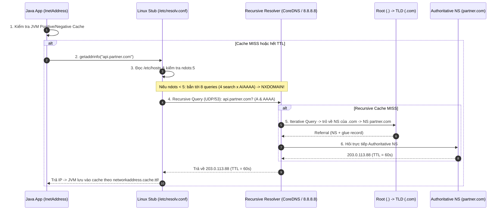

# LNX-11 · DNS resolution & troubleshooting

> **TL;DR** — Một lần gọi `api.partner.com` từ Java trên Linux/Kubernetes đi qua chuỗi nhiều tầng cache: **JVM `InetAddress` cache → OS Stub Resolver (`/etc/hosts`, `/etc/resolv.conf`, `systemd-resolved`) → Recursive Resolver (CoreDNS/VPC DNS) → Root → TLD → Authoritative NS**. Hai cú bẫy production lớn nhất của kỹ sư Java là: (1) **`networkaddress.cache.ttl = -1` khi JVM chạy kèm `SecurityManager` hoặc cấu hình cũ** khiến JVM **cache DNS vĩnh viễn** và đâm đầu mãi vào IP cũ sau khi DB/ALB failover; và (2) **`options ndots:5` mặc định trong Kubernetes Pod** biến 1 lần tra `api.partner.com` (`2` dấu chấm `< 5`) thành **`8–10` UDP queries** quét qua hàng loạt `search` domain, gây bão CoreDNS và tràn bảng `conntrack` dẫn tới cú nhảy latency đúng **5 giây**!

## 🧭 Brief

| | |
| :--- | :--- |
| **Loại** | Bài học |
| **Giai đoạn** | Năm 1 · Q1 |
| **Chủ đề** | Linux & Networking |
| **Tiên quyết** | [LNX-10](../10-http-versions/README.md) |

**Phạm vi bắt buộc**
- recursive vs authoritative
- record types
- TTL & caching (kể cả JVM DNS cache)
- /etc/resolv.conf, ndots trong K8s

**Câu hỏi sâu — nội dung phải giúp trả lời được**
- JVM cache DNS mãi mãi gây sự cố gì?
- ndots:5 trong K8s làm chậm thế nào?

**Ý tưởng lab / demo**
- dig +trace; quan sát DNS cache của JVM khi đổi record

**Tài liệu gốc gợi ý**
- The Linux Command Line
- Operating Systems: Three Easy Pieces
- Systems Performance (Gregg)
- High Performance Browser Networking (hpbn.co)
- TCP/IP Illustrated

**Gói đầu ra**
- [x] `README.md` — lý thuyết theo [lesson-template](../../../docs/templates/lesson-template.md)
- [x] `exercises.md` — bài tập L1/L2/L3 theo [exercises-template](../../../docs/templates/exercises-template.md)
- [x] `solutions.md` — đáp án theo [solutions-template](../../../docs/templates/solutions-template.md)
- [x] `lab/` — code demo chạy được + `lab/README.md` theo [lab-template](../../../docs/templates/lab-template.md)
- [ ] _(người học)_ `my-notes.md` — **agent không tạo**

---

<!-- Nội dung bắt đầu từ đây -->

## 1. Vấn đề: tại sao phải biết cái này?

Ba sự cố DNS khiến hệ thống sập diện rộng hoặc chậm ngẫu nhiên đúng **5 giây** dù backend API bên kia hoàn toàn khỏe mạnh:

1. **AWS RDS Failover / ALB đổi IP nhưng JBoss vẫn gọi mãi về IP cũ đã chết:** Sau khi Database hoặc AWS ALB scale/failover sang IP mới lúc `02:00` sáng (DNS record có `TTL = 60s`), `dig db.internal` trên cùng máy Linux đã trả IP mới sau 1 phút, nhưng **JBoss vẫn ném `SocketTimeoutException` tới tận 09:00 sáng** cho đến khi restart JVM! Nguyên nhân: **`networkaddress.cache.ttl` đang cache vĩnh viễn (`-1`)**!
2. **Đưa microservice Java lên Kubernetes thì latency `p99` nhảy bậc đúng `5.000 ms` vào giờ cao điểm:** Chỉ cần Pod gọi một API ngoài như `api.stripe.com` ở mức `500 req/s`, CoreDNS quá tải và Linux `nf_conntrack` drop gói UDP DNS port 53 → cứ 100 request lại có vài request bị kẹt đúng **`5s`** (bằng `options timeout:5` trong `/etc/resolv.conf`) vì **`ndots:5`**!
3. **DNS chớp tắt 1 giây nhưng app báo `UnknownHostException` suốt 10 giây:** Do JVM **negative DNS cache** mặc định giữ kết quả lỗi `10` giây (`networkaddress.cache.negative.ttl = 10`).

---

## 2. Mô hình tư duy (mental model)

Hãy hình dung việc tìm số điện thoại của một khách hàng tên `api.partner.com` như hệ thống **lễ tân 3 cấp**:

- **Bước 0 — Sổ tay riêng của bạn (JVM `InetAddress` Cache & `/etc/hosts`):** Nếu bạn ghi số vào sổ tay bằng mực vĩnh viễn (`TTL = -1`), dù cả thế giới đã đổi số mới, bạn vẫn bấm mãi số cũ cho tới khi xé sổ (restart JVM)!
- **Bước 1 — Tổng đài nội bộ công ty (Recursive Resolver: CoreDNS / VPC DNS `.2` / `8.8.8.8`):** Bạn không tự đi hỏi cả thế giới; bạn gọi tổng đài nội bộ và nhờ họ đi tìm giúp (*recursive query*). Tổng đài sẽ giữ kết quả lại trong đúng **`TTL` giây** cho những người sau hỏi ké.
- **Bước 2 — Hỏi dây chuyền từ Root → TLD → Authoritative:** Nếu tổng đài chưa có trong cache, tổng đài tự đi hỏi lần lượt từng nơi (*iterative queries*):
  1. **Root Nameserver (`.`):** *"Tôi không biết `api.partner.com`, nhưng hỏi `.com` ở địa chỉ X nhé."*
  2. **TLD Nameserver (`.com`):** *"Tôi không biết `api.partner.com`, hỏi Authoritative NS của `partner.com` ở địa chỉ Y nhé."*
  3. **Authoritative Nameserver (`ns1.partner.com`):** Chủ sở hữu bản ghi thật trả lời: *"IP là `203.0.113.88`, nhớ giữ tối đa `TTL = 60s` thôi!"*

**Chỗ ẩn dụ không còn đúng:**
Trong Kubernetes, trước khi tổng đài chịu đi tìm `api.partner.com`, quy tắc **`ndots:5`** ép lễ tân công ty thử đoán xem đó có phải nhân viên nội bộ hay không bằng cách gắn lần lượt 4 hậu tố phòng ban (`default.svc.cluster.local`, `svc.cluster.local`, `cluster.local`, `ec2.internal`) — mỗi lần đoán lại hỏi cả số v4 (`A`) lẫn số v6 (`AAAA`), tổng cộng tốn **8–10 cuộc gọi vô ích** trước khi chịu bấm số thật!



---

## 3. Cơ chế bên trong (trọng tâm của bài)

### 3.1 Stub Resolver, Recursive Resolver & Authoritative Nameserver

1. **Stub Resolver (trên máy chạy app):** Thư viện C (`glibc` hoặc `musl` trong Alpine container!) đọc `/etc/nsswitch.conf` (thường `hosts: files dns`), kiểm tra `/etc/hosts` trước, rồi mới gửi gói **UDP port `53`** (chỉ fallback sang **TCP port `53`** nếu response vượt quá `512 bytes` không EDNS0 hoặc cờ `TC=1` Truncated) tới địa chỉ `nameserver` trong `/etc/resolv.conf`.
2. **Recursive Resolver (`8.8.8.8`, `1.1.1.1`, AWS VPC `+2`, CoreDNS):** Nhận yêu cầu *đệ quy* từ client và chịu trách nhiệm đi dò toàn bộ cây phân cấp DNS nếu cache bị miss, đồng thời áp dụng cache theo giá trị **`TTL`** của từng bản ghi.
3. **Authoritative Nameserver (Route 53, Cloudflare DNS, BIND chính chủ zone):** Nắm bản ghi gốc (*source of truth*) của domain, gắn cờ `aa` (*Authoritative Answer*). Bản ghi trả về từ cache của Recursive sẽ **không có cờ `aa`** và TTL đếm ngược giảm dần từng giây.

### 3.2 Các loại DNS Record cốt lõi cần nắm

| Record | Ý nghĩa | Cạm bẫy cần tránh |
| :--- | :--- | :--- |
| **`A` / `AAAA`** | Map tên miền → IPv4 (`32-bit`) / IPv6 (`128-bit`) | `glibc` mặc định gọi song song cả `A` và `AAAA` (dual-stack) → gấp đôi số DNS query |
| **`CNAME`** | Bí danh (Alias) trỏ sang tên miền khác | **Không** đặt ở zone apex `@` (`example.com`), vì vi phạm RFC 1034 (apex bắt buộc có `SOA`/`NS`); **không** trỏ `MX`/`NS` tới `CNAME` |
| **`NS`** | Khai báo Authoritative Nameserver quản lý zone | Thiếu đồng bộ glue record hoặc TTL dài làm chuyển nhà cung cấp DNS chậm hàng giờ |
| **`MX`** | Mail server nhận email kèm độ ưu tiên (`priority`) | Phải trỏ về tên có record `A`/`AAAA`, không trỏ về IP hay `CNAME` |
| **`TXT`** | Chuỗi text tự do (SPF, DKIM, domain ownership) | Vượt 255 ký tự mỗi string phải tách nhiều chuỗi trong cùng TXT record |
| **`SRV`** | Khám phá dịch vụ kèm port & weight (`_http._tcp...`) | Dùng phổ biến trong Kubernetes Service discovery, Active Directory, Kafka/Consul |
| **`PTR`** | Reverse DNS (`IP → domain`, trong `in-addr.arpa`) | Cần thiết để mail server hoặc log/DB check reverse lookup không bị timeout/spam |

### 3.3 Trả lời câu hỏi sâu #1: JVM cache DNS mãi mãi gây sự cố gì?

Trong JDK, lớp `java.net.InetAddress` ủy quyền cơ chế cache cho `sun.net.InetAddressCachePolicy` dựa trên 2 Security Properties (đọc từ `$JAVA_HOME/conf/security/java.security` trên Java 9+ hoặc `$JAVA_HOME/jre/lib/security/java.security` trên Java 7/8):

1. **`networkaddress.cache.ttl` (Positive DNS Cache):**
   - **Khi `SecurityManager` được bật** (rất phổ biến trên app server Java EE/JBoss cũ, applet, hoặc startup flag bật security policy) **hoặc khi bị cấu hình `-1`**: mặc định là **`-1` (`FOREVER`)** — JVM giữ nguyên kết quả resolve `hostname -> IP` trong bộ nhớ **mãi mãi suốt vòng đời process**, bất chấp DNS server trả `TTL = 5s` hay `60s`!
   - **Khi KHÔNG có `SecurityManager` (OpenJDK hiện đại mặc định):** giá trị mặc định trong JDK là **`30` giây** (`DEFAULT_POSITIVE = 30`).
   - **Sự cố thực tế khi cache mãi mãi (`-1`):**
     - **DB Failover (AWS RDS Multi-AZ / Aurora):** Primary chết, Route 53 đổi CNAME/A của `db-prod.internal` sang Standby trong `5s–30s`. Nhưng JBoss vẫn nhớ IP cũ đã bị tắt hoặc chuyển thành Read-Only Replica! Kết quả: toàn bộ hệ thống lỗi `Connection timed out` hoặc **`Read-only transaction error`** cho tới khi restart JBoss!
     - **Blue-Green Deploy / Load Balancer Scale:** ALB AWS hoặc Cloudflare thay đổi bộ IP đằng sau domain; JVM bám mãi vào 1 IP cũ đã bị thu hồi → tỷ lệ lỗi `ConnectException` tăng dần từ 10% lên 100%!
2. **`networkaddress.cache.negative.ttl` (Negative DNS Cache):**
   - Mặc định là **`10` giây** trên JDK: nếu CoreDNS vừa khởi động lại hoặc chớp mạng 500 ms gây `UnknownHostException`, JVM tự động trả lỗi `UnknownHostException` trong **`10` giây tiếp theo** mà không hề gửi lại gói UDP hỏi DNS!
3. **Cách cấu hình chuẩn & bẫy khởi tạo:**
   - Giá trị TTL được đọc **duy nhất 1 lần** khi class `InetAddressCachePolicy` nạp static initializer! Vì vậy nếu gọi `Security.setProperty("networkaddress.cache.ttl", "5")` *sau khi* một thư viện/logger đã tra `InetAddress.getLocalHost()`, lệnh set sẽ **vô hiệu**!
   - Khuyến nghị trên production cloud: đặt ngay trong `$JAVA_HOME/.../java.security` hoặc chạy ở dòng đầu tiên của `main()` / dùng file override `-Djava.security.properties=custom.security` (giá trị **`5`–`30` giây** tùy workload AWS, và `networkaddress.cache.negative.ttl=1` hoặc `0`).

### 3.4 Trả lời câu hỏi sâu #2: `/etc/resolv.conf` và `ndots:5` trong Kubernetes làm chậm thế nào?

Mở file `/etc/resolv.conf` bên trong một Kubernetes Pod điển hình:
```text
nameserver 10.96.0.10
search prod.svc.cluster.local svc.cluster.local cluster.local ap-southeast-1.compute.internal
options ndots:5 timeout:5 attempts:2
```

- **`ndots:5` nghĩa là gì?** Nếu tên miền cần resolve chứa **ít hơn 5 dấu chấm** (`.`), stub resolver coi tên đó là *tên tương đối (chưa hoàn chỉnh)* và **phải nối lần lượt toàn bộ các hậu tố trong `search` trước**, chỉ khi tất cả trả về `NXDOMAIN` mới chịu hỏi tên gốc!
- **Phép nhân thảm họa khi Pod gọi `api.stripe.com` (`2` dấu chấm `< 5`):**
  1. `api.stripe.com.prod.svc.cluster.local` (`A` + `AAAA` → `NXDOMAIN`)
  2. `api.stripe.com.svc.cluster.local` (`A` + `AAAA` → `NXDOMAIN`)
  3. `api.stripe.com.cluster.local` (`A` + `AAAA` → `NXDOMAIN`)
  4. `api.stripe.com.ap-southeast-1.compute.internal` (`A` + `AAAA` → `NXDOMAIN`)
  5. Cuối cùng mới hỏi `api.stripe.com.` (`A` + `AAAA` → IP thật!).
- **Vì sao nó gây chậm đột biến đúng `5 giây` (tail latency spike)?**
  1. Lẽ ra chỉ cần **`2` DNS packets** (`A` + `AAAA`), nay nhân lên **`10` UDP packets** cho *mỗi một lần resolve*!
  2. Toàn bộ DNS query đều dùng **UDP**, nên mỗi packet đi qua Linux network stack đều tạo một entry trong bảng **`nf_conntrack`** của Node. Khi hàng chục Pod cùng nổ traffic DNS, bảng `conntrack` trên Linux dễ bị **đầy hoặc gặp race condition UDP insertion**, khiến kernel **âm thầm drop gói UDP DNS**!
  3. Stub resolver không nhận được reply liền chờ hết **`options timeout:5` (5 giây!)** mới gửi lại query sang `nameserver` tiếp theo — tạo ra những cú nhảy **5.000 ms**, **10.000 ms** khó hiểu trong trace APM!
- **3 cách khắc phục triệt để trong K8s:**
  1. Đặt **`ndots: 2`** trong `spec.dnsConfig.options` (vì tên service nội bộ K8s ngắn dạng `orders` hoặc `orders.prod` chỉ có `0–1` dấu chấm, còn tên ngoài Internet như `api.stripe.com` có `2` dấu chấm trở lên → đi thẳng luôn không qua `search`!).
  2. Dùng **Trailing Dot (FQDN hoàn chỉnh)** cho URL cấu hình ngoài, ví dụ `https://api.stripe.com.` — dấu chấm cuối báo cho resolver bỏ qua hoàn toàn `ndots` & `search` *(lưu ý kiểm tra TLS SNI/Host header của HTTP client có tự bỏ dấu chấm cuối không trước khi dùng)*.
  3. Triển khai **NodeLocal DNSCache** trên từng K8s Worker Node (giảm cross-node traffic, cache tại node, và giao tiếp upstream qua **TCP** thay vì UDP qua `conntrack`).

---

## 4. Code minh họa

Xem mã nguồn chạy thật trên Java 21 loopback UDP tại [MiniUdpDnsServer.java](./lab/src/main/java/lab/linux/dns/MiniUdpDnsServer.java), [JvmDnsCacheDemo.java](./lab/src/main/java/lab/linux/dns/JvmDnsCacheDemo.java), và [NdotsResolverSimulator.java](./lab/src/main/java/lab/linux/dns/NdotsResolverSimulator.java):

```java
// ❌ SAI: Gọi InetAddress trước rồi mới set TTL, hoặc để SecurityManager làm TTL thành -1 (FOREVER)
InetAddress addr = InetAddress.getByName("db.prod.internal"); // Static initializer đã đọc TTL xong!
Security.setProperty("networkaddress.cache.ttl", "10");       // Quá muộn! Có thể không còn tác dụng tùy JVM!
```

```java
// ✅ ĐÚNG: Thiết lập sớm nhất trước mọi network/InetAddress call (hoặc cấu hình trong java.security)
static {
    java.security.Security.setProperty("networkaddress.cache.ttl", "10");
    java.security.Security.setProperty("networkaddress.cache.negative.ttl", "1");
}
```

### 4.1 Legacy corner (Java 7 / JBoss AS 7.1.1)

Trên **Java 7 / JBoss AS 7.1.1**:
1. Kiểm tra ngay file **`$JAVA_HOME/jre/lib/security/java.security`** trên server Java 7 production: tìm 2 dòng `#networkaddress.cache.ttl=-1` và `networkaddress.cache.negative.ttl=10`. Trên JBoss AS 7 chạy kèm security policy hoặc cấu hình legacy cũ, nếu giá trị đang là **`-1`**, hãy đổi sang `30` (hoặc `10`) và cấu hình trong `standalone.conf` (`JAVA_OPTS`) nếu cần override file security properties (`-Djava.security.properties=/path/to/dns-override.security`).
2. Vì **JDBC URL trên JBoss** (`standalone.xml`) trỏ tới `db-prod.company.local`, sau mỗi lần DB failover hay chuyển IP, ngoài `networkaddress.cache.ttl`, phải bật kết hợp **`validation-query` / `background-validation`** trong datasource JBoss để eviction dọn sạch các kết nối JDBC cũ đã bám vào IP chết!

---

## 5. Quan sát & đo đạc

### Phần A — Đã chạy kiểm chứng trên Windows 11 (Java 21 Real Loopback UDP DNS Server RFC 1035)
Từ thư mục `lab/`:
```powershell
mvn -o -B verify
mvn -o -B compile exec:java
```
Phần Java 21 dựng hẳn một **DNS Server UDP thật (`DatagramSocket`) trên loopback `127.0.0.1`** nói đúng giao thức nhị phân RFC 1035:
1. **`JvmDnsCacheDemo` (kiểm chứng đổi IP `10.10.1.10 -> 10.10.2.20`):**
   - Với `cacheTtl = -1` (*Forever*): dù DNS server UDP đã chuyển record `db.prod.internal` sang `10.10.2.20`, client JVM cache mãi vẫn trả `10.10.1.10` (`staleHit = true`, chỉ gửi `1` UDP query duy nhất suốt đời!).
   - Với `cacheTtl = 1s`: sau khi hết TTL, client gửi UDP query mới và nhận ngay IP mới `10.10.2.20`!
2. **`NdotsResolverSimulator` (gửi UDP packets thật tới `MiniUdpDnsServer`):**
   - Resolve `api.partner.com` với K8s `ndots:5` + `4 search domains` (mỗi bước hỏi `A` + `AAAA`): bắn tổng cộng **`10` UDP DNS queries** vào server (`8` câu trả lời `NXDOMAIN` vô ích + `2` câu trả lời thật)!
   - Đổi sang `ndots:2` hoặc trailing dot `api.partner.com.`: bắn chỉ **`2` UDP queries** (**giảm `80%`** tải DNS & `conntrack`!).

*(Số đo thực tế ghi nhận sau khi chạy `mvn -o -B verify` được cập nhật tại [lab/README.md §4](./lab/README.md#4-kết-quả-tham-khảo-khi-chạy).)*

### Phần B — Cần kiểm chứng trên Linux / WSL / Docker (chưa chạy được trên máy Windows soạn bài)
> ⚠️ **Cần kiểm chứng trên Linux:** Máy soạn là Windows 11 không có WSL/Docker nên các lệnh công cụ DNS Linux (`dig`, `resolvectl`, `/etc/resolv.conf`, `tcpdump port 53`) trong `scripts/dns-troubleshoot.sh` **chưa được chạy kiểm chứng trực tiếp**:
- `dig +trace example.com` (quan sát trọn chuỗi Root `.` → TLD `.com` → Authoritative NS).
- `dig +noall +answer +ttlid api.github.com` (nhìn TTL đếm ngược khi query Recursive Resolver).
- `getent ahosts api.github.com` và `sudo tcpdump -i any -nn port 53` (bắt gói tin DNS UDP `search` domain nối tiếp do `ndots:5` trên Linux/K8s Pod).

---

## 6. Trade-offs & khi nào KHÔNG dùng

| Cấu hình | Được gì | Mất / Đánh đổi gì | Dùng khi |
| :--- | :--- | :--- | :--- |
| **JVM `networkaddress.cache.ttl = 5..30s`** | Theo kịp failover DB / ALB IP mới trong vài giây mà không phải restart app | Tăng nhẹ lượng DNS UDP query về CoreDNS/OS cache (không đáng kể nếu có local DNS cache) | **Mọi ứng dụng Java/JBoss chạy trên Cloud, K8s, hoặc DB có failover DNS** |
| **JVM `networkaddress.cache.ttl = 0` (tắt hẳn cache)** | Luôn hỏi OS mỗi lần `getByName` | Gây bão `getaddrinfo()` + UDP `53` vào CoreDNS nếu code gọi lookup ở mỗi request | **Không khuyến nghị** cho lưu lượng lớn — hãy đặt `5–30s` thay vì `0` |
| **K8s `ndots: 2`** | Loại bỏ `8` query `NXDOMAIN` thừa cho domain ngoài (`api.stripe.com`, `s3.amazonaws.com`) | Nếu gọi service nội bộ có ≥ 2 dấu chấm mà vẫn muốn ăn `search` (vd `db.sub`) thì phải ghi tên đầy đủ `db.sub.prod.svc.cluster.local` | **Mọi Pod K8s gọi nhiều API/DB ngoài**, hoặc kết hợp với NodeLocal DNSCache |
| **Trailing Dot (`https://api.stripe.com.`)** | Bỏ qua `ndots:5` ngay mà không sửa Pod YAML | Có thể làm lỗi xác thực **TLS Hostname/SNI** hoặc **HTTP `Host` header** trên một số server/HTTP client không tự cắt dấu `.` | Chỉ dùng khi đã test chắc chắn thư viện HTTP & server đích chấp nhận FQDN trailing dot |

---

## 7. Cạm bẫy production (ít nhất 3)

1. **Để mặc định `networkaddress.cache.ttl = -1` (khi bật `SecurityManager` / JBoss cũ)** — *Triệu chứng:* DB/ALB vừa failover sang IP mới nhưng app Java cứ ném `SocketTimeoutException` hàng giờ liền cho đến khi restart JVM. *Nguyên nhân:* `InetAddressCachePolicy` lưu cache positive vĩnh viễn. *Cách tránh:* đặt rõ `networkaddress.cache.ttl=10` (và `networkaddress.cache.negative.ttl=1`) trong `java.security` hoặc trước mọi `InetAddress` call.
2. **Giữ `ndots:5` mặc định trong Pod K8s gọi API ngoài ở tốc độ cao** — *Triệu chứng:* thỉnh thoảng request API ngoài có **latency spike đúng `5.000 ms`** dù API đối tác báo xử lý chỉ `20 ms`. *Nguyên nhân:* `ndots:5` nhân `5×` DNS UDP query → làm đầy/race `nf_conntrack` trên node → drop UDP port 53 → stub resolver đợi hết `timeout:5` giây mới retry! *Cách tránh:* cấu hình `ndots: "2"` trong `dnsConfig` hoặc triển khai NodeLocal DNSCache (xem chi tiết ở [INC-17](../../../03-production-troubleshooting/incident-labs/17-k8s-dns-latency/)).
3. **`musl libc` (Alpine Linux Docker image) xử lý DNS khác `glibc`** — *Triệu chứng:* chuyển base image Java sang Alpine làm tăng tỷ lệ lỗi DNS ngẫu nhiên hoặc bỏ qua một số option `resolv.conf`. *Nguyên nhân:* `musl` bắn song song toàn bộ `search` queries cùng lúc (dễ tạo burst packet làm ngập conntrack) và không hỗ trợ một số cờ `resolv.conf` như `single-request-reopen` trên các bản cũ. *Cách tránh:* ưu tiên base image Debian/Ubuntu/Distroless (`glibc`) hoặc test kỹ DNS dưới tải cao + dùng NodeLocal DNSCache.
4. **Dùng `-Dsun.net.inetaddr.ttl=...` mà không biết `Security.getProperty` ghi đè** — *Triệu chứng:* thêm `-Dsun.net.inetaddr.ttl=5` vào command line nhưng JVM vẫn cache mãi mãi! *Nguyên nhân:* Theo Java spec, nếu `networkaddress.cache.ttl` đã được định nghĩa trong `java.security`, nó có độ ưu tiên **cao hơn** system property `sun.net.inetaddr.ttl`. *Cách tránh:* cấu hình thẳng qua `networkaddress.cache.ttl` (trong `java.security`, `-Djava.security.properties`, hoặc `Security.setProperty` ở dòng đầu `main()`).

---

## 8. Liên hệ thực tế công việc

Ngay tuần này trên server **JBoss AS 7.1.1 / Java 7**:
1. Kiểm tra cấu hình `$JAVA_HOME/jre/lib/security/java.security` trên toàn bộ node JBoss xem `networkaddress.cache.ttl` đang là `-1` hay bao nhiêu, và kiểm tra `JAVA_OPTS` xem JBoss có bật `SecurityManager` không — nếu đang là `-1`, lên kế hoạch chuẩn hóa về `30` (hoặc `15`) để sẵn sàng cho các đợt failover DB/Proxy không cần restart JBoss.
2. Trên hệ thống Linux nội bộ, kiểm tra `/etc/resolv.conf` của các server app xem có bị dư thừa `search` domain hay `nameserver` đầu tiên đang chết làm mỗi lần lookup mất 5 giây chờ fallback sang `nameserver` thứ 2 không!

---

## 9. Self-check — Explain-back

> Trả lời **không nhìn tài liệu**, nói to trong 5 phút. Không trả lời được = chưa xong. (Đáp án nằm trong [solutions.md](./solutions.md).)

1. Mô tả hành trình một truy vấn DNS đi từ `InetAddress` trong Java → `/etc/hosts` → `/etc/resolv.conf` → Recursive Resolver → Root → TLD → Authoritative Nameserver.
2. Phân biệt **Recursive Resolver** và **Authoritative Nameserver**; làm sao nhìn vào output `dig` biết câu trả lời đến từ cache hay chính chủ?
3. Khi nào JVM đặt `networkaddress.cache.ttl = -1` (cache mãi mãi), và hậu quả thực tế xảy ra khi AWS RDS hoặc ALB đổi IP? Còn `networkaddress.cache.negative.ttl = 10` gây hại gì?
4. Giải thích chi tiết tại sao **`options ndots:5`** cùng danh sách `search` mặc định trong Kubernetes biến 1 lần gọi `api.stripe.com` thành **8–10 DNS UDP queries**, và làm sao nó gây ra cú nhảy latency **`5 giây`**?
5. Tại sao truyền `-Dsun.net.inetaddr.ttl=5` có thể không có tác dụng, và cần sửa cấu hình nào để chắc chắn áp dụng TTL cho JVM?

---

## 10. Cheatsheet 1 trang

| Khái niệm | Ghi nhớ nhanh |
| :--- | :--- |
| **Chuỗi phân giải** | `JVM Cache` → `/etc/hosts` → `Stub (/etc/resolv.conf)` → `Recursive (CoreDNS/8.8.8.8)` → `Root (.)` → `TLD` → `Authoritative` |
| **Record cốt lõi** | `A` (IPv4) · `AAAA` (IPv6) · `CNAME` (alias, cấm ở apex `@`) · `MX` · `TXT` · `NS` · `SRV` · `PTR` |
| **JVM DNS Cache** | `networkaddress.cache.ttl`: mặc định `30s` (không SecurityManager) hoặc **`-1` FOREVER** (có SecurityManager!); `negative.ttl = 10s` |
| **Bẫy `ndots:5` K8s** | Tên `< 5` dấu chấm bị nối thử **4 `search` domains × 2 (`A`+`AAAA`) = 8 query `NXDOMAIN`** thừa → bão CoreDNS & `conntrack` → nhảy `5s` (`timeout:5`) |
| **Sửa K8s DNS** | Đặt `dnsConfig: ndots: "2"` · bật **NodeLocal DNSCache** · cân nhắc FQDN trailing dot `.` (cẩn thận SNI/Host) |
| **Lệnh soi nhanh** | `dig +trace <domain>` · `dig +noall +answer +ttlid <domain>` · `cat /etc/resolv.conf` · `tcpdump -nn port 53` |

---

## 11. Tài liệu tham khảo

- RFC 1034 & RFC 1035 (*Domain Names — Concepts & Implementation*).
- Oracle Java SE 21 Docs, [`InetAddress` & `java.security` Networking Properties (`networkaddress.cache.ttl`)](https://docs.oracle.com/en/java/javase/21/docs/api/java.base/java/net/InetAddress.html).
- Linux man-pages, [`resolv.conf(5)` (`nameserver`, `search`, `ndots`, `timeout`, `attempts`)](https://man7.org/linux/man-pages/man5/resolv.conf.5.html) & [`dig(1)`](https://linux.die.net/man/1/dig).
- Kubernetes Official Docs, [*DNS for Services and Pods* & *NodeLocal DNSCache*](https://kubernetes.io/docs/concepts/services-networking/dns-pod-service/).

---
➡️ Tiếp theo: [exercises.md](./exercises.md) · [lab/](./lab/README.md) · Bài kế: [LNX-12 · TLS handshake & certificate chain](../12-tls-handshake/README.md)
