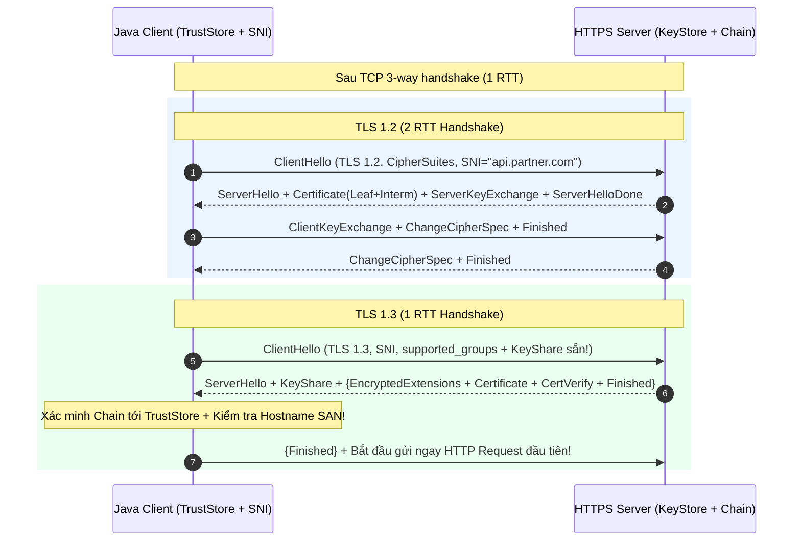

# LNX-12 · TLS handshake & certificate chain

> **TL;DR** — **TLS 1.3** rút gọn handshake từ **2 RTT** (TLS 1.2) xuống còn **1 RTT** (và `0 RTT` resume) nhờ gửi sẵn *key share* ngay trong `ClientHello` và ép dùng **ECDHE Forward Secrecy** (cùng cipher suite gọn sạch hơn). Mọi chứng chỉ server tạo thành chuỗi tin cậy **Leaf → Intermediate CA → Root CA**: server phải gửi kèm Intermediate CA, còn client chỉ giữ Root CA trong **TrustStore (`cacerts`)**; khi xác thực hai chiều (**mTLS**), server và client đều cần **KeyStore** (chứa Private Key) lẫn **TrustStore**. Lỗi kinh điển **`PKIX path building failed`** nghĩa là Java TrustStore của bạn chưa tin cậy chuỗi CA của server — cách sửa chuẩn là import đúng CA cert (hoặc bổ sung Intermediate cert ở server), **tuyệt đối cấm viết `TrustAllManager` bypass kiểm tra chứng chỉ**!

## 🧭 Brief

| | |
| :--- | :--- |
| **Loại** | Bài học |
| **Giai đoạn** | Năm 1 · Q1 |
| **Chủ đề** | Linux & Networking |
| **Tiên quyết** | [LNX-11](../11-dns-resolution/README.md) |

**Phạm vi bắt buộc**
- TLS 1.2 vs 1.3
- certificate chain
- SNI
- mTLS
- keystore/truststore Java
- lỗi PKIX path building failed

**Câu hỏi sâu — nội dung phải giúp trả lời được**
- "PKIX path building failed" sửa thế nào đúng cách?
- TLS 1.3 nhanh hơn ở đâu?

**Ý tưởng lab / demo**
- Dựng CA tự ký, cấp cert cho Nginx, cấu hình Java truststore + mTLS

**Tài liệu gốc gợi ý**
- The Linux Command Line
- Operating Systems: Three Easy Pieces
- Systems Performance (Gregg)
- High Performance Browser Networking (hpbn.co)
- TCP/IP Illustrated

**Gói đầu ra**
- [x] `README.md` — lý thuyết theo [lesson-template](../../../docs/templates/lesson-template.md)
- [x] `exercises.md` — bài tập L1/L2/L3 theo [exercises-template](../../../docs/templates/exercises-template.md)
- [x] `solutions.md` — đáp án theo [solutions-template](../../../docs/templates/solutions-template.md)
- [x] `lab/` — code demo chạy được + `lab/README.md` theo [lab-template](../../../docs/templates/lab-template.md)
- [ ] _(người học)_ `my-notes.md` — **agent không tạo**

---

<!-- Nội dung bắt đầu từ đây -->

## 1. Vấn đề: tại sao phải biết cái này?

Ba sự cố TLS làm team backend mất hàng giờ debug mỗi lần tích hợp đối tác hoặc gia hạn chứng chỉ:

1. **`SSLHandshakeException: PKIX path building failed` khi gọi API đối tác bằng Java — nhưng mở bằng Chrome lại xanh mượt:** Bạn tích hợp cổng thanh toán mới. Chrome mở `https://api.partner.vn` bình thường, nhưng JBoss ném `unable to find valid certification path to requested target`! Thủ phạm phổ biến nhất: server đối tác **gửi thiếu Intermediate CA** (Chrome tự đi tải bù qua link AIA hoặc cache sẵn), hoặc JDK của JBoss dùng `cacerts` riêng chưa có CA nội bộ.
2. **Import cert vào JDK nhưng chạy JBoss vẫn lỗi y nguyên (hoặc tắt luôn TLS verification trên prod):** Dev dùng `keytool -importcert` vào JDK 8 nhưng JBoss AS 7 lại đang chạy bằng `JAVA_HOME` JDK 7; quá vội vàng bèn copy đoạn `X509TrustManager` bỏ trống từ StackOverflow — tạo lỗ hổng **Man-in-the-Middle (MITM)** nghiêm trọng!
3. **Đổi qua kết nối HTTPS cách nửa vòng Trái Đất (`RTT = 150 ms`) thấy kết nối mới chậm gần `1 giây`:** TCP 3-way handshake (`150 ms`) + TLS 1.2 handshake (`2 × 150 ms = 300 ms`) + HTTP request (`150 ms`) = `600 ms` trở lên cho *mỗi* kết nối mới!

---

## 2. Mô hình tư duy (mental model)

Hãy hình dung **TLS Handshake** như thủ tục **xác minh thẻ căn cước và thống nhất mật mã** trước khi nói chuyện mật:

- **KeyStore (Ví đựng CMND/Private Key của chính bạn):** Bạn chỉ mở ví này khi *ai đó hỏi bạn là ai* (Server HTTPS luôn phải có KeyStore để chứng minh mình là `api.bank.vn`; Client chỉ cần KeyStore khi server bật **mTLS** yêu cầu client xuất trình thẻ).
- **TrustStore (Danh sách chữ ký các Cơ quan Công an mà bạn tin tưởng):** Bạn dùng quyển sổ này để kiểm tra xem thẻ căn cước của đối tác có phải do một **Root CA / Intermediate CA** hợp lệ ký ra hay giả mạo.
- **Certificate Chain (Chuỗi bảo lãnh 3 cấp):** Bạn không quen trực tiếp anh nhân viên `api.partner.com` (Leaf cert), nhưng giấy tờ của anh ta được **Sở Công an địa phương (Intermediate CA)** ký, và Sở Công an lại có giấy ủy quyền được **Bộ Công an (Root CA)** trong TrustStore của bạn ký!

**Chỗ ẩn dụ không còn đúng:**
Trong đời thực, bạn đưa thẻ giấy một lần cho cả hai nhìn thấy công khai; còn trên **TLS 1.3**, chỉ ngay sau `ClientHello` và `ServerHello` (1 RTT), toàn bộ phần gửi **Certificate** và **mTLS CertificateRequest** đã được **mã hóa hoàn toàn** để người nghe lén trên mạng thậm chí không thấy chứng chỉ của ai! *(Chỉ có tên miền **SNI** trong `ClientHello` vẫn ở dạng plaintext trừ khi bật ECH).*



---

## 3. Cơ chế bên trong (trọng tâm của bài)

### 3.1 Trả lời câu hỏi sâu #2: TLS 1.3 nhanh hơn TLS 1.2 ở đâu?

Theo **RFC 8446 (TLS 1.3)** và *High Performance Browser Networking*:

| Khía cạnh | TLS 1.2 (RFC 5246) | TLS 1.3 (RFC 8446) | Tác động hiệu năng & bảo mật |
| :--- | :--- | :--- | :--- |
| **Số RTT Handshake** | **`2 RTT`** (hoặc 1 RTT khi resume) | **`1 RTT`** (hoặc **`0 RTT`** với PSK Early Data) | Giảm trọn **1 RTT** ngay ở kết nối đầu tiên (cứu `50–200 ms` trên WAN/Mobile!) |
| **Cách thỏa thuận khóa** | Client gửi danh sách thuật toán → đợi Server chọn xong (`ServerHello`) mới gửi `ClientKeyExchange` ở lượt 2 | Client **đoán sẵn thuật toán** (thường `x25519` hoặc `secp256r1`) và nhét luôn **`KeyShare`** vào ngay `ClientHello` ở lượt 1! | Server tính ngay khóa phiên đối xứng ngay khi nhận `ClientHello` và gửi dữ liệu mã hóa ở ngay lượt trả về đầu tiên |
| **Forward Secrecy (PFS)** | Tùy chọn (RSA static không có PFS, ECDHE mới có) | **Bắt buộc (`ECDHE`/`DHE`)** — xóa sổ RSA key exchange tĩnh | Lộ private key server trong tương lai vẫn không giải mã được traffic `.pcap` đã bắt trước đó |
| **Cipher Suites** | Hàng chục suite yếu (RC4, 3DES, SHA-1, CBC, EXPORT) | Chỉ còn **5 AEAD suites** sạch sẽ (`TLS_AES_128_GCM_SHA256`, `TLS_AES_256_GCM_SHA384`, `TLS_CHACHA20_POLY1305_SHA256`...) | Không thể bị ép hạ cấp xuống thuật toán yếu |
| **0-RTT Early Data** | Không có (dùng Session Ticket tốn `1 RTT`) | Gửi luôn request HTTP cùng `ClientHello` nếu từng kết nối | **Cảnh báo:** `0-RTT` có thể bị **Replay Attack**! Chỉ dùng cho request **idempotent** (`GET`), cấm dùng cho `POST /transfer` |

*(Ghi chú: Nếu client đoán trật nhóm elliptic curve trong `KeyShare`, server gửi `HelloRetryRequest` tốn thêm 1 RTT — nhưng thực tế > 99% client/server đều hỗ trợ `x25519` hoặc `P-256` ngay lượt 1.)*

### 3.2 Certificate Chain, SNI & Xác minh Danh tính (Verification)

1. **Certificate Chain (Chuỗi 3 lớp) & Quy tắc kiểm tra:**
   - **Leaf Cert (`api.partner.com`):** Chứa **Public Key**, **Subject Alternative Name (`SAN`)** (bắt buộc trong TLS hiện đại — Chrome và JDK mới bỏ qua `CN` nếu thiếu `SAN`!), thời hạn `NotBefore..NotAfter`, và **chữ ký số** của Intermediate CA ký bằng Private Key của nó.
   - **Intermediate CA:** Được **Root CA** ký, nằm trung gian để nếu Intermediate lộ có thể thu hồi mà không làm gãy Root CA toàn cầu. **Server HTTPS phải cấu hình gửi kèm đủ cả Leaf + Intermediate (`fullchain.pem`)**!
   - **Root CA:** Tự ký (*self-signed*), nằm sẵn trong hệ điều hành hoặc **`$JAVA_HOME/lib/security/cacerts`** (TrustStore). Server **không cần** gửi Root CA vì client không bao giờ tự tin một Root CA do người lạ gửi qua mạng — client chỉ tin những Root CA đã nằm sẵn trong TrustStore của chính mình!
2. **Các bước Client xác minh chứng chỉ server:**
   1. Kiểm tra chữ ký toán học từ Leaf → Intermediate → tới 1 Root CA (hoặc cert tin cậy) nằm trong **TrustStore**. *(Nếu đứt xích ở bước này → nổ **`PKIX path building failed`**!)*
   2. Kiểm tra hạn dùng (`NotBefore <= now <= NotAfter`) và trạng thái thu hồi (`CRL`/`OCSP`/`OCSP Stapling`).
   3. Kiểm tra **Hostname Verification**: tên miền bạn gọi (ví dụ `api.partner.com`) có khớp với danh sách **`SAN`** (`DNS:api.partner.com` hoặc `*.partner.com`) hay không *(nếu không khớp → `SSLPeerUnverifiedException` / `CertificateException: No subject alternative DNS name matching ...`)*!
3. **SNI (Server Name Indication — RFC 6066):**
   - Trong môi trường Nginx / Cloud ALB / CDN, **1 IP + Port `443`** phục vụ hàng trăm domain khác nhau (`a.com`, `b.com`). Làm sao Nginx biết phải trả chứng chỉ nào *trước khi* HTTP `Host:` header được giải mã?
   - Nhờ extension **`SNI`** nằm bên trong **`ClientHello` (gửi dạng plaintext)**! Client báo trước *"Tôi muốn nói chuyện với `a.com`"* để server móc đúng **KeyStore/cert** của `a.com` ngay trong `ServerHello`!

### 3.3 KeyStore vs TrustStore trong Java & mTLS (Mutual TLS)

- **1-way TLS (thông thường):** Server dùng **KeyStore** xuất trình danh tính; Client dùng **TrustStore** xác minh Server.
- **mTLS (Mutual TLS — xác thực 2 chiều):** Trong hệ thống ngân hàng / Open Banking / Service Mesh (Istio), Server gửi bản tin **`CertificateRequest`** bắt buộc Client cũng phải gửi **Client Certificate** + chứng minh sở hữu Private Key (`CertificateVerify`). Khi đó:
  - Server cần **KeyStore** (cert của server) + **TrustStore** (CA tin cậy để xác minh cert của Client!).
  - Client cần **TrustStore** (CA tin cậy để xác minh cert của Server) + **KeyStore** (Private Key + Client cert của chính mình!).

### 3.4 Trả lời câu hỏi sâu #1: `"PKIX path building failed"` sửa thế nào đúng cách?

Đọc đầy đủ message lỗi Java:
`javax.net.ssl.SSLHandshakeException: PKIX path building failed: sun.security.provider.certpath.SunCertPathBuilderException: unable to find valid certification path to requested target`

Ý nghĩa: JDK `CertPathBuilder` đã dò chuỗi chứng chỉ server gửi về nhưng **không nối được tới bất kỳ anchor nào trong TrustStore đang nạp**!

**4 bước chẩn đoán và sửa ĐÚNG CÁCH:**
1. **Kiểm tra xem server có gửi thiếu Intermediate CA không (lỗi rất hay gặp!):**
   Chạy `openssl s_client -connect api.partner.com:443 -servername api.partner.com -showcerts` (hoặc `curl -v`). Nếu phần `Certificate chain` chỉ hiện có **1 chứng chỉ duy nhất (Leaf)**, hãy yêu cầu chủ server gắn đủ `fullchain.pem` (Leaf + Intermediate)!
2. **Xác định đúng `JAVA_HOME` & TrustStore mà ứng dụng đang dùng:**
   Lấy file `.crt`/`.pem` của **Root CA** (hoặc Intermediate CA nội bộ đáng tin cậy — KHÔNG tải bừa cert tự ký từ nguồn không xác minh!) và kiểm tra chứng chỉ bằng `keytool -printcert -file root-ca.crt`.
3. **Import CA cert vào TrustStore chuẩn:**
   - **Cách sạch nhất (tách riêng TrustStore cho app, không sửa `cacerts` hệ thống dễ bị mất khi nâng cấp JDK):** copy `$JAVA_HOME/lib/security/cacerts` thành `app-truststore.p12`, import CA mới bằng `keytool -importcert -alias partner-ca -file root-ca.crt -keystore app-truststore.p12 -storepass changeit -noprompt`, rồi chạy app với:
     `-Djavax.net.ssl.trustStore=/etc/app/app-truststore.p12 -Djavax.net.ssl.trustStorePassword=changeit`
   - Hoặc với Java 11+ `HttpClient`: nạp riêng `SSLContext` chỉ cho endpoint đối tác đó thay vì sửa TrustStore toàn cục!
4. **Cấm tuyệt đối:** Không viết `X509TrustManager` rỗng (`checkServerTrusted` không làm gì) hay tắt `HostnameVerifier` — làm vậy biến HTTPS thành vỏ bọc vô nghĩa trước tấn công MITM!

---

## 4. Code minh họa

Xem mã nguồn chạy thật với JDK `SSLServerSocket` + `SSLSocket` trên loopback tại [TlsLabDemo.java](./lab/src/main/java/lab/linux/tls/TlsLabDemo.java) và [CustomTrustStoreSolution.java](./lab/solutions/CustomTrustStoreSolution.java):

```java
// ❌ SAI (NGUY HIỂM CHẾT NGƯỜI): Viết TrustAllManager để "chữa cháy" PKIX path building failed!
TrustManager[] insecure = new TrustManager[] {
    new X509TrustManager() {
        public X509Certificate[] getAcceptedIssuers() { return null; }
        public void checkClientTrusted(X509Certificate[] c, String a) {}
        public void checkServerTrusted(X509Certificate[] c, String a) {} // Nhận cả cert giả mạo MITM!
    }
};
```

```java
// ✅ ĐÚNG: Tạo SSLContext với TrustStore (chứa đúng CA tin cậy) và bật Endpoint Identification (Hostname SAN)!
KeyStore trustStore = KeyStore.getInstance("PKCS12");
try (InputStream is = Files.newInputStream(trustStorePath)) {
    trustStore.load(is, password);
}
TrustManagerFactory tmf = TrustManagerFactory.getInstance(TrustManagerFactory.getDefaultAlgorithm());
tmf.init(trustStore);

SSLContext sslContext = SSLContext.getInstance("TLSv1.3");
sslContext.init(keyManagersOrNullForOneWay, tmf.getTrustManagers(), null);

SSLParameters params = socket.getSSLParameters();
params.setEndpointIdentificationAlgorithm("HTTPS"); // Bắt buộc check Hostname SAN!
params.setServerNames(List.of(new SNIHostName(expectedHost)));
socket.setSSLParameters(params);
```

### 4.1 Legacy corner (Java 7 / JBoss AS 7.1.1)

Đây là điểm đau cực lớn khi vận hành **Java 7 (`1.7.0_80`) / JBoss AS 7.1.1**:
1. **Java 7 mặc định chỉ bật `TLSv1.0` ở phía client** (`TLSv1.1` và `TLSv1.2` có trong JDK 7 nhưng **bị tắt mặc định** cho client `SSLSocket`/`HttpsURLConnection`, và **Java 7 hoàn toàn KHÔNG có `TLSv1.3`** — `TLSv1.3` chỉ có từ **JDK 11** và JDK 8u261+)!
   - Khi gọi sang ngân hàng/API mới đã tắt `TLS 1.0/1.1`, JBoss Java 7 báo `Received fatal alert: protocol_version` hoặc `Remote host closed connection during handshake`!
   - Workaround tối thiểu trên Java 7 là thêm `-Dhttps.protocols=TLSv1.2 -Djdk.tls.client.protocols=TLSv1.2` (trên bản Java 7 update cao), **nhưng nếu đối tác chỉ mở `TLSv1.3` hoặc cipher AEAD mới**, JBoss Java 7 **bắt buộc phải gọi qua Nginx/Envoy Reverse Proxy nội bộ** để Nginx làm TLS 1.3 handshake ra ngoài!
2. **Định dạng KeyStore trên Java 7 là `.jks`**, còn Java 9+ ưu tiên `PKCS12` (`.p12`). Khi debug lỗi PKIX trên JBoss, bật cờ **`-Djavax.net.debug=ssl,handshake`** trong `standalone.conf` để nhìn rõ từng cert trong chain và truststore path nào đang được nạp!

---

## 5. Quan sát & đo đạc

### Phần A — Đã chạy kiểm chứng trên Windows 11 (Java 21 `keytool` + Real `SSLServerSocket` TLS 1.3 & mTLS)
Từ thư mục `lab/`:
```powershell
mvn -o -B verify
mvn -o -B compile exec:java
```
Phần Java 21 chạy trên loopback TCP `127.0.0.1` chứng minh trực tiếp (không cần bất kỳ thư viện ngoài nào):
1. Tự sinh thật **Server KeyStore** (`CN=localhost, SAN=DNS:localhost,IP:127.0.0.1`), **Client KeyStore** (cho mTLS), và **TrustStore** bằng `keytool` của JDK đang chạy.
2. **Tái hiện thật `SSLHandshakeException: PKIX path building failed`** khi client dùng TrustStore không chứa cert của Server, sau đó chứng minh **fix đúng chuẩn** bằng TrustStore có cert tin cậy + bật `HTTPS` endpoint identification + `SNIHostName("localhost")` → đàm phán thành công **`TLSv1.3`**.
3. **Tái hiện thật mTLS (`needClientAuth = true`)**: client thiếu `KeyManagerFactory` (KeyStore) bị server từ chối handshake, còn client nạp `client-keystore.p12` được server tin cậy vượt qua handshake thành công!

*(Số đo thực tế ghi nhận sau khi chạy `mvn -o -B verify` được cập nhật tại [lab/README.md §4](./lab/README.md#4-kết-quả-tham-khảo-khi-chạy).)*

### Phần B — Cần kiểm chứng trên Linux / WSL / Docker (chưa chạy được trên máy Windows soạn bài)
> ⚠️ **Cần kiểm chứng trên Linux:** Máy soạn là Windows 11 không có WSL/Docker nên các lệnh OpenSSL & Nginx mTLS trong `scripts/gen-ca-nginx-mtls.sh` **chưa được chạy kiểm chứng trực tiếp**:
- Dựng chuỗi 3 cấp **Root CA → Intermediate CA → Leaf Cert** bằng `openssl req`/`openssl x509` và cấu hình `nginx-mtls.conf` (`ssl_verify_client on;`).
- Chạy `openssl s_client -connect localhost:8443 -servername api.lab.local -tls1_3 -showcerts` để đọc tận mắt `Certificate chain` và test mTLS bằng `curl --cert ... --key ... --cacert ...`.

---

## 6. Trade-offs & khi nào KHÔNG dùng

| Lựa chọn | Được gì | Mất / Đánh đổi gì | Dùng khi |
| :--- | :--- | :--- | :--- |
| **TLS 1.3 (`1-RTT`)** | Giảm 1 RTT handshake, ép ECDHE PFS, loại bỏ cipher yếu | Java 7 / thiết bị rất cũ không hỗ trợ; không dùng được với các tool inspect proxy kiểu RSA static cũ | **Mặc định cho mọi dịch vụ HTTPS mới (ưu tiên `TLSv1.3` + fallback `TLSv1.2`)** |
| **TLS 1.3 `0-RTT` Early Data** | Gửi request ngay ở gói đầu tiên (`0 RTT` chờ handshake) | Dễ bị **Replay Attack** nếu kẻ xấu bắt lại gói `ClientHello` và phát lại | Chỉ dùng cho API đọc thuần túy **idempotent** (`GET`), **tắt** với giao dịch tài chính (`POST`) |
| **mTLS (Mutual TLS)** | Xác thực định danh ở tầng transport cho cả 2 đầu, chống gọi lậu dù lộ API key | Vận hành phức tạp (cấp phát, gia hạn, xoay vòng client cert định kỳ — hết hạn client cert là đứt toàn bộ kết nối!) | Tích hợp B2B ngân hàng / đối tác quan trọng, hoặc tự động hóa qua Service Mesh (Istio/Linkerd) |
| **Custom TrustStore riêng cho App** | Cô lập chứng chỉ đối tác/nội bộ, không mất khi nâng cấp `JAVA_HOME/cacerts` | Phải nhớ merge cả `cacerts` gốc nếu app vừa gọi CA công cộng vừa gọi CA nội bộ | Mọi microservice Java / JBoss tích hợp CA nội bộ hoặc mTLS |

---

## 7. Cạm bẫy production (ít nhất 3)

1. **Server cấu hình chỉ gửi Leaf cert, thiếu Intermediate CA** — *Triệu chứng:* Mở trên Chrome/Edge bình thường, nhưng Java backend (`HttpClient`, JBoss) và `curl` lỗi `PKIX path building failed` hàng loạt. *Nguyên nhân:* Trình duyệt tự fetch Intermediate qua extension AIA hoặc có cache sẵn; Java và `curl` bắt buộc server gửi trọn chuỗi `Leaf + Intermediate` (`fullchain.pem`). *Cách tránh:* Luôn kiểm tra endpoint bằng `openssl s_client -showcerts` hoặc SSL Labs trước khi go-live.
2. **Quên bật Hostname Verification (`EndpointIdentificationAlgorithm("HTTPS")`) khi tự tạo `SSLContext`** — *Triệu chứng:* Code tự dựng `SSLContext` qua được kiểm tra CA chain nhưng chấp nhận luôn chứng chỉ của `evil.com` miễn do cùng CA công cộng (như Let's Encrypt) ký! *Nguyên nhân:* Trong JDK `SSLSocket` thuần, mặc định không tự kiểm tra tên miền `SAN` nếu không set `SSLParameters.setEndpointIdentificationAlgorithm("HTTPS")` (hoặc dùng `HttpsURLConnection` / `java.net.http.HttpClient`). *Cách tránh:* Luôn bật `HTTPS` endpoint identification khi làm việc với `SSLSocket`/`SSLEngine`.
3. **Gia hạn chứng chỉ đúng ngày hết hạn mà quên kiểm tra tự động → sập dây chuyền lúc nửa đêm** — *Triệu chứng:* Cả hệ thống mTLS / HTTPS đồng loạt báo `CertificateExpiredException` vào `00:00 UTC`. *Nguyên nhân:* Leaf hoặc Client cert hết hạn (thường Let's Encrypt `90` ngày, chứng chỉ công ty `1` năm). *Cách tránh:* Gắn Prometheus `probe_ssl_earliest_cert_expiry` (hoặc script cron `openssl x509 -checkend`) cảnh báo trước `30` ngày và `7` ngày; tự động hóa bằng `cert-manager` / ACME.
4. **Dùng `-Djavax.net.ssl.trustStore=...` nhưng quên rằng nó GHI ĐÈ hoàn toàn `cacerts` mặc định** — *Triệu chứng:* Import CA nội bộ vào `my-truststore.p12` thì gọi được API nội bộ, nhưng ngay sau đó gọi sang `api.github.com` hay AWS S3 lại nổ `PKIX path building failed`! *Nguyên nhân:* Nếu bạn tạo `my-truststore.p12` trống chỉ chứa 1 cert nội bộ và gán qua `-Djavax.net.ssl.trustStore`, JVM sẽ **không còn đọc `$JAVA_HOME/lib/security/cacerts` nữa**! *Cách tránh:* Luôn copy từ `cacerts` gốc ra rồi mới import thêm cert nội bộ, hoặc dùng `CompositeTrustManager` trong code.

---

## 8. Liên hệ thực tế công việc

Ngay tuần này trên hệ thống **Java 7 / JBoss AS 7.1.1**:
1. Kiểm tra danh sách chứng chỉ hết hạn sớm bằng lệnh `keytool -list -v -keystore <keystore/truststore>` cho các kết nối HTTPS/mTLS tới đối tác đang chạy trên JBoss.
2. Kiểm tra trong codebase xem có chỗ nào từng "chữa cháy" bằng `TrustManager` rỗng (`checkServerTrusted` để trống) hoặc `HostnameVerifier` luôn `return true` không — nếu có, lên ticket thay bằng TrustStore chuẩn ngay!

---

## 9. Self-check — Explain-back

> Trả lời **không nhìn tài liệu**, nói to trong 5 phút. Không trả lời được = chưa xong. (Đáp án nằm trong [solutions.md](./solutions.md).)

1. **TLS 1.3** rút ngắn handshake từ `2 RTT` xuống `1 RTT` bằng cơ chế kỹ thuật nào, và tại sao `0-RTT` lại nguy hiểm với API chuyển tiền `POST /transfer`?
2. Mô tả vai trò của **Leaf cert**, **Intermediate CA**, và **Root CA**; tại sao server phải gửi Leaf + Intermediate nhưng **không cần** gửi Root CA?
3. Giải thích khác biệt giữa **KeyStore** và **TrustStore** trong Java; với **mTLS**, mỗi bên Server và Client cần giữ loại store nào?
4. Khi gặp **`PKIX path building failed`**, trình bày 3 nguyên nhân gốc có thể xảy ra và quy trình 4 bước xử lý đúng chuẩn (không dùng `TrustAllManager`).
5. **SNI** nằm ở gói tin nào, dạng plaintext hay encrypted trong TLS 1.2/1.3, và nó giải quyết bài toán gì cho Nginx / Load Balancer?

---

## 10. Cheatsheet 1 trang

| Khái niệm | Ghi nhớ nhanh |
| :--- | :--- |
| **TLS 1.2 vs 1.3** | TLS 1.2: **2 RTT**, còn RSA static · TLS 1.3: **1 RTT** (gửi `KeyShare` sẵn trong `ClientHello`), ép ECDHE PFS, `0-RTT` tránh cho non-idempotent |
| **Certificate Chain** | `Leaf (SAN!) -> Intermediate CA (server PHẢI gửi!) -> Root CA (nằm sẵn trong TrustStore client)` |
| **SNI** | Gửi tên miền plaintext ngay trong `ClientHello` để 1 IP `:443` chọn đúng cert trước khi giải mã HTTP |
| **KeyStore vs TrustStore** | **KeyStore** (`.p12`/`.jks`): chứa **Private Key + Cert của mình** · **TrustStore** (`cacerts`): chứa **CA công khai tin cậy để verify đối tác** |
| **mTLS** | Server đòi thêm `CertificateRequest` → cả 2 bên đều phải có **KeyStore + TrustStore** |
| **Sửa `PKIX failed`** | Check `openssl s_client -showcerts` (thiếu Intermediate?) → import đúng CA vào copy của `cacerts` → gắn `-Djavax.net.ssl.trustStore` |
| **Java debug TLS** | `-Djavax.net.debug=ssl,handshake` |

---

## 11. Tài liệu tham khảo

- RFC 8446 ([The Transport Layer Security (TLS) Protocol Version 1.3](https://www.rfc-editor.org/rfc/rfc8446.html)) & RFC 5246 (TLS 1.2).
- Oracle Java SE 21 Docs, [*Java Secure Socket Extension (JSSE) Reference Guide* (`KeyStore`, `TrustStore`, `SNI`, `EndpointIdentification`)](https://docs.oracle.com/en/java/javase/21/security/java-secure-socket-extension-jsse-reference-guide.html).
- Ilya Grigorik, [*High Performance Browser Networking (hpbn.co)* — Transport Layer Security (TLS)](https://hpbn.co/transport-layer-security-tls/).
- OpenSSL Docs, [`openssl-s_client(1)`](https://www.openssl.org/docs/manmaster/man1/openssl-s_client.html).

---
➡️ Tiếp theo: [exercises.md](./exercises.md) · [lab/](./lab/README.md) · Bài kế: [LNX-13 · Load balancer L4 vs L7 & Nginx reverse proxy](../13-load-balancer-nginx/README.md)
