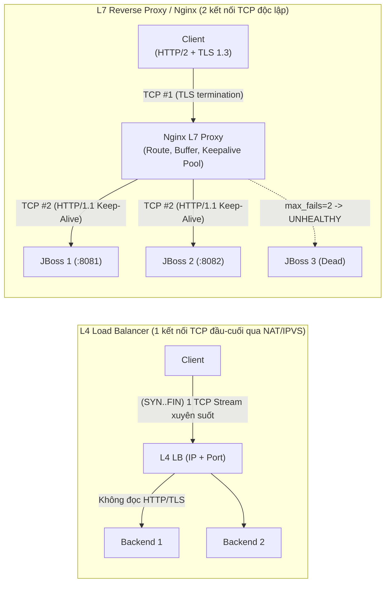

# LNX-13 · Load balancer L4 vs L7 & Nginx reverse proxy

> **TL;DR** — **Load Balancer Layer 4 (L4)** chuyển tiếp gói tin ở mức IP/Port (`SYN` đến đâu nối thẳng tới backend đó) nên cực nhanh nhưng "mù" với nội dung HTTP — không route theo URL/Header, không TLS termination, và dồn toàn bộ tải HTTP/2/gRPC dài hạn vào 1 node. **Load Balancer Layer 7 (L7)** như **Nginx** kết thúc TCP + TLS tại edge, đọc trọn request HTTP để định tuyến theo path, kiểm tra health HTTP, nén, giữ `upstream keepalive` vào JBoss, và làm **buffering** giải phóng worker thread app server khỏi client mạng chậm. Khi đặt chuỗi timeout phải giữ **Client/LB ngoài > Nginx `proxy_read_timeout` > App Handler > Downstream/DB timeout**, và tuyệt đối cảnh giác bẫy `proxy_next_upstream` tự retry request `POST` gây **xử lý trùng lặp**!

## 🧭 Brief

| | |
| :--- | :--- |
| **Loại** | Bài học |
| **Giai đoạn** | Năm 1 · Q1 |
| **Chủ đề** | Linux & Networking |
| **Tiên quyết** | [LNX-12](../12-tls-handshake/README.md) |

**Phạm vi bắt buộc**
- L4 vs L7
- thuật toán cân bằng
- health check
- sticky session
- Nginx proxy_pass, upstream, timeout, buffering

**Câu hỏi sâu — nội dung phải giúp trả lời được**
- L7 LB làm được gì mà L4 không?
- Timeout Nginx và app phải khớp thế nào?

**Ý tưởng lab / demo**
- Nginx cân tải 3 instance, kill 1 instance quan sát

**Tài liệu gốc gợi ý**
- The Linux Command Line
- Operating Systems: Three Easy Pieces
- Systems Performance (Gregg)
- High Performance Browser Networking (hpbn.co)
- TCP/IP Illustrated

**Gói đầu ra**
- [x] `README.md` — lý thuyết theo [lesson-template](../../../docs/templates/lesson-template.md)
- [x] `exercises.md` — bài tập L1/L2/L3 theo [exercises-template](../../../docs/templates/exercises-template.md)
- [x] `solutions.md` — đáp án theo [solutions-template](../../../docs/templates/solutions-template.md)
- [x] `lab/` — code demo chạy được + `lab/README.md` theo [lab-template](../../../docs/templates/lab-template.md)
- [ ] _(người học)_ `my-notes.md` — **agent không tạo**

---

<!-- Nội dung bắt đầu từ đây -->

## 1. Vấn đề: tại sao phải biết cái này?

Ba sự cố production xảy ra thường xuyên khi cấu hình Reverse Proxy & Load Balancer mà không hiểu cơ chế bên dưới:

1. **Client 3G tải chậm làm chết sạch toàn bộ JBoss worker threads:** Người dùng mở API trả về JSON `2 MB` qua mạng di động chậm mất `20 giây` để nhận xong. Nếu không có **Nginx `proxy_buffering on`** đứng trước, thread JBoss bị giữ kẹt suốt 20 giây chỉ để đẩy từng KB ra socket mạng chậm — 200 user chậm là cạn sạch `maxThreads` JBoss!
2. **`504 Gateway Timeout` ở Nginx dù JBoss vẫn commit giao dịch thanh toán thành công (và retry làm trừ tiền 2 lần!):** JBoss xử lý đơn hàng mất `65 giây`, trong khi Nginx giữ mặc định `proxy_read_timeout = 60s`. Đúng giây 60, Nginx ngắt kết nối trả `504` cho khách hàng — nhưng **JBoss vẫn chạy nốt 5 giây cuối và `COMMIT` DB**! Tệ hơn, nếu cấu hình `proxy_next_upstream http_504` hoặc `timeout`, Nginx tự bắn lại request sang JBoss #2!
3. **Kill 1 node JBoss trong cluster 3 node nhưng mất `30 giây` lỗi trước khi traffic ngừng đổ vào node chết (hoặc gRPC dồn 100% về 1 node sau L4 LB):** Do thiếu cấu hình health check hoặc chọn sai thuật toán/tầng LB.

---

## 2. Mô hình tư duy (mental model)

Hãy hình dung lưu lượng đi vào hệ thống như **khách gửi thư tới tòa nhà có nhiều bộ phận xử lý**:

- **L4 Load Balancer (Bác bảo vệ cổng chỉ nhìn địa chỉ phong bì & bấm số thứ tự):** Bác bảo vệ **không bóc phong bì** (`TLS` và `HTTP` vẫn đóng kín). Khách mở kết nối TCP, bác chỉ thẳng *"Anh đi sang phòng A"* rồi suốt toàn bộ cuộc trò chuyện TCP đó (dù gửi 1.000 tin nhắn HTTP/2 bên trong), mọi gói tin đều đi thẳng tới phòng A! Cực nhanh, nhưng không biết bên trong viết `/orders` hay `/auth`, và nếu phòng A đột tử giữa câu chuyện không rõ HTTP status là gì.
- **L7 Load Balancer / Nginx Reverse Proxy (Lễ tân bóc thư đọc nội dung rồi chuyển tiếp bằng kết nối nội bộ riêng):** Lễ tân mở lớp vỏ `TLS` và `HTTP`, đọc kỹ `Host`, `/api/v1/...`, header `Authorization`, chọn phòng phù hợp nhất (hoặc kiểm tra phòng đó còn trả lời `/healthz` `200 OK` không), thậm chí **nhận trọn tập hồ sơ từ phòng xử lý rồi tự đọc chậm rãi cho khách 3G nghe** (`proxy_buffering`) để nhân viên phòng nghiệp vụ rảnh tay làm việc khác!

**Chỗ ẩn dụ không còn đúng:**
Ở L4 dùng **Direct Server Return (DSR)**, gói tin đi vào qua LB nhưng gói trả về từ Backend đi **trực tiếp ra Router tới Client** không qua lại LB (tiết kiệm 50% băng thông chiều về tại LB!); còn L7 proxy bắt buộc cả chiều đi lẫn chiều về đều đi qua **hai kết nối TCP hoàn toàn độc lập** (`Client <-> Nginx` và `Nginx <-> Backend`).



---

## 3. Cơ chế bên trong (trọng tâm của bài)

### 3.1 Trả lời câu hỏi sâu #1: L7 LB làm được gì mà L4 không?

| Khả năng | L4 Load Balancer (NLB, LVS/IPVS, HAProxy `tcp`) | L7 Load Balancer (Nginx, Envoy, AWS ALB) |
| :--- | :--- | :--- |
| **Tầng kiểm tra gói tin** | TCP / UDP (IP nguồn/đích, Port) | HTTP/1.1, HTTP/2, HTTP/3, gRPC, WebSocket |
| **TLS Termination & mTLS** | Không (chuyển tiếp TLS nguyên đai nguyên kiện tới backend) | **Có** — giải mã TLS tập trung, giảm tải CPU & quản lý cert tại 1 nơi ([LNX-12](../12-tls-handshake/README.md)) |
| **Content-based Routing** | Không (mù URL & Header) | **Có** — route `/api/*` → JBoss, `/static/*` → S3/cache, hoặc Canary `X-Canary: true` → v2 |
| **Cân bằng gRPC / HTTP/2** | **Kém** — giữ 1 TCP connection dồn hết vào 1 backend | **Tốt** — phân phối **từng RPC request/stream** qua các backend khác nhau |
| **Header & Security** | Không đọc/sửa được HTTP headers | Gắn `X-Forwarded-For`, `X-Request-ID`, WAF, Rate limit theo `Authorization`/API key |
| **HTTP Health Check thông minh** | Chỉ check bắt tay TCP thành công (`connect()`) — app bị kẹt GC/deadlock thread vẫn pass TCP check! | Gọi `GET /healthz` kiểm tra HTTP `200 OK`, tách `upstream` theo HTTP status `502`/`503` |
| **Response Buffering & Nén** | Không | **Có** — buffer response cứu worker thread JBoss khỏi client mạng chậm; nén `gzip`/`brotli` |
| **Đánh đổi hiệu năng** | Độ trễ cực thấp (microseconds), PPS hàng triệu gói/s | Tốn CPU parse HTTP, TLS, cấp phát memory buffer (cao hơn L4 nhưng hoàn toàn dư sức cho phần lớn hệ thống web) |

### 3.2 Thuật toán cân bằng tải, Health Check & Sticky Session

1. **Các thuật toán cân bằng tải cốt lõi:**
   - **Round-Robin (mặc định Nginx):** Chia tuần tự `1 → 2 → 3 → 1...` (có thể gắn `weight=3` nếu máy khỏe hơn). *Điểm yếu:* nếu node #2 dính request nặng mất `2s` trong khi node #1 xử lý `5ms`, Round-Robin vẫn cứ đều đặn ném thêm tải cho node #2 đang nghẽn!
   - **Least Connections (`least_conn;`):** Đẩy request mới tới backend có **ít kết nối đang xử lý (*in-flight*) nhất** — tự động né được node đang chậm (rất hợp cho JBoss/Java có trộn lẫn API nặng & nhẹ!).
   - **IP Hash (`ip_hash;`) / Consistent Hash (`hash $request_uri consistent;`):** Cùng client IP hoặc cùng key cache luôn rơi về đúng 1 backend (tăng cache hit trên RAM local, nhưng làm lệch tải nếu nhiều user ngồi sau cùng 1 NAT công ty).
2. **Health Check (Passive vs Active):**
   - **Passive Health Check (có sẵn trong Nginx Open Source):** Tham số `max_fails=3 fail_timeout=10s` trên dòng `server`. Nếu Nginx gọi backend bị lỗi kết nối, timeout hoặc HTTP nằm trong `proxy_next_upstream` đủ `3` lần liên tiếp trong `10s`, Nginx đánh dấu node đó tạm nghỉ suốt `10s` rồi mới thăm dò thử lại `1` request.
   - **Active Health Check (ALB, Envoy, HAProxy, Nginx Plus):** LB chủ động gửi `GET /healthz/ready` định kỳ (vd mỗi `5s`).
   - **Cạm bẫy Deep Health Check:** Đừng để `/healthz` chạy `SELECT 1` sang DB hay check Redis rồi trả `500` khi DB chớp tắt `2 giây`! Nếu trả `500`, LB sẽ đánh dấu **toàn bộ 100% node app sập** và cắt hết traffic kể cả các endpoint không cần DB — **tách rạch ròi `/livez` (process sống) vs `/readyz`**.
3. **Sticky Session (Session Affinity):**
   - L7 LB chèn cookie `JSESSIONID` / `AWSALB` để gắn 1 user vào cố định 1 node JBoss.
   - **Cảnh báo kiến trúc:** Sticky session biến cluster thành *stateful* (mất node là rớt phiên đăng nhập, deploy rolling update làm gián đoạn user, lệch tải giữa node có user VIP). Giải pháp hiện đại: lưu session ra **Redis** hoặc dùng **stateless JWT** ([SEC-03](../../../01-software-engineering/security/03-jwt-pitfalls/README.md)), loại bỏ sticky session!

### 3.3 Giải phẫu Nginx Reverse Proxy: `proxy_pass`, `upstream`, `buffering` & Dấu `/` chết người

1. **Dấu `/` ở cuối `proxy_pass` thay đổi hoàn toàn URL gửi tới backend:**
   - **Không có `/` sau host:** `location /api/ { proxy_pass http://jboss_backend; }` → request `/api/users` được chuyển nguyên vẹn thành `/api/users`.
   - **Có `/` sau host:** `location /api/ { proxy_pass http://jboss_backend/; }` → Nginx **cắt bỏ phần `/api/`** và chuyển thành `/users`! *(Nhầm dấu `/` là lỗi HTTP 404 kinh điển sau mỗi lần chỉnh config Nginx!)*
2. **Cơ chế `proxy_buffering on;` (mặc định bật):**
   - JBoss mất `20 ms` tạo ra response `1 MB` và đẩy rất nhanh qua mạng LAN `10 Gbps` vào Nginx.
   - Nginx hút trọn `1 MB` vào RAM (`proxy_buffers`) hoặc file tạm rồi đóng vai người trả từ từ trong `15 giây` cho client mạng 3G yếu — **worker thread của JBoss được giải phóng ngay ở mili-giây thứ 20!**
   - **Khi nào phải tắt (`proxy_buffering off;`):** Endpoint trả **Server-Sent Events (SSE)**, **LLM token streaming**, hoặc download file `10 GB` (nếu bật buffering, client sẽ không thấy byte đầu tiên cho tới khi Nginx tải xong phần đầu/toàn bộ, hoặc tốn disk I/O tạm).
3. **Truyền đúng IP thật & protocol gốc:** Nginx mở TCP kết nối mới vào JBoss nên `request.getRemoteAddr()` trong JBoss thấy IP của Nginx (`127.0.0.1` / `10.0.0.5`)! Bắt buộc khai báo:
   ```nginx
   proxy_set_header Host              $host;
   proxy_set_header X-Real-IP         $remote_addr;
   proxy_set_header X-Forwarded-For   $proxy_add_x_forwarded_for;
   proxy_set_header X-Forwarded-Proto $scheme;
   ```

### 3.4 Trả lời câu hỏi sâu #2: Timeout Nginx và app phải khớp thế nào?

Nguyên tắc vàng của **Timeout Chain (từ ngoài vào trong phải giảm dần!)**:
$$\text{Client / CDN} \;>\; \text{Nginx } \texttt{proxy\_read\_timeout} \;>\; \text{App / JBoss Handler Timeout} \;>\; \text{Downstream / JDBC Socket Timeout}$$

Ví dụ chuỗi khớp chuẩn cho một API nghiệp vụ thông thường:
- Client / Mobile timeout: `35s`
- AWS ALB idle / Nginx `proxy_read_timeout`: **`30s`** (`proxy_connect_timeout 3s; proxy_send_timeout 10s;`)
- JBoss HTTP/Servlet/Transaction timeout: **`25s`**
- Downstream REST / JDBC `socketTimeout`: **`5s–10s`**

**Điều gì xảy ra nếu đặt NGƯỢC (`Nginx proxy_read_timeout = 15s` < `App timeout = 60s`)?**
1. Giây 15: Nginx hết kiên nhẫn, đóng socket tới JBoss và trả **`504 Gateway Timeout`** về cho user.
2. Nhưng JBoss **không tự dừng thread** nếu code Java không kiểm tra interrupt hay socket timeout DB! JBoss chạy tiếp thêm 45 giây nữa rồi **`COMMIT` trừ tiền vào Database** (hoặc báo `Broken pipe` khi tới bước ghi response)!
3. User nhìn thấy `504` tưởng giao dịch thất bại nên bấm thanh toán lại → **trừ tiền 2 lần**!
4. **Cẩn thận kép với `proxy_next_upstream`:** Mặc định Nginx retry sang backend kế tiếp khi gặp `error timeout` (chưa kết nối/chưa gửi hoặc chưa nhận header). Tuyệt đối kiểm soát **`proxy_next_upstream error timeout non_idempotent`** — KHÔNG bật `non_idempotent` (mặc định tắt, cấm retry `POST`/`LOCK`/`PATCH` khi đã gửi request đi rồi, trừ khi API có `Idempotency-Key`!).

---

## 4. Code minh họa

Xem mã nguồn **Mini L7 Reverse Proxy & Load Balancer** thuần Java 21 chạy trên loopback TCP tại [MiniL7ReverseProxy.java](./lab/src/main/java/lab/linux/lb/MiniL7ReverseProxy.java):

```nginx
# ✅ CẤU HÌNH NGINX CHUẨN CHO CLUSTER 3 JBOSS NODE
upstream jboss_cluster {
    least_conn;                                   # Né node đang xử lý request chậm
    server 10.10.1.11:8080 max_fails=2 fail_timeout=10s;
    server 10.10.1.12:8080 max_fails=2 fail_timeout=10s;
    server 10.10.1.13:8080 max_fails=2 fail_timeout=10s;
    keepalive 64;                                 # Tránh TIME_WAIT exhaustion (LNX-09)
}

server {
    listen 443 ssl;
    http2 on;
    location /api/ {
        proxy_pass http://jboss_cluster;          # Không dấu '/' -> giữ nguyên /api/
        proxy_http_version 1.1;
        proxy_set_header Connection "";           # Bắt buộc cho upstream keepalive!
        proxy_set_header Host $host;
        proxy_set_header X-Forwarded-For $proxy_add_x_forwarded_for;
        proxy_set_header X-Forwarded-Proto $scheme;
        proxy_connect_timeout 3s;
        proxy_read_timeout    30s;                # PHẢI lớn hơn timeout xử lý của JBoss!
        proxy_buffering       on;                 # Bảo vệ thread JBoss trước client chậm
    }
}
```

### 4.1 Legacy corner (Java 7 / JBoss AS 7.1.1)

Khi đặt **Nginx** làm Reverse Proxy trước **JBoss AS 7.1.1**:
1. Mặc định JBoss nhận request qua Nginx sẽ thấy `request.getRemoteAddr()` là IP của Nginx và `request.isSecure()` là **`false`** (vì TLS đã kết thúc tại Nginx!). Trong `standalone.xml` của JBoss AS 7 / Undertow, nếu ứng dụng cần kiểm tra `isSecure()` hay redirect đúng `https://`, phải bật cấu hình đọc **`X-Forwarded-Proto`** / **`X-Forwarded-For`** (hoặc dùng `RemoteIpValve` trên JBoss Web / Tomcat 7)!
2. **Mất đồng bộ session nếu chưa có Redis:** Nếu JBoss AS 7.1 đang lưu `HttpSession` trên RAM local của từng node mà bạn chạy Nginx Round-Robin cho 3 node JBoss mà chưa bật sticky session hoặc session replication/Redis, user vừa đăng nhập ở Node 1, request thứ 2 văng sang Node 2 sẽ bị văng về màn hình Login!

---

## 5. Quan sát & đo đạc

### Phần A — Đã chạy kiểm chứng trên Windows 11 (Java 21 Mini L7 Reverse Proxy & 3 Loopback Backends)
Từ thư mục `lab/`:
```powershell
mvn -o -B verify
mvn -o -B compile exec:java
```
Phần Java 21 dựng **1 Mini L7 Reverse Proxy** thật nối tới **3 Backend Server TCP thật trên `127.0.0.1`**, kiểm chứng trực tiếp:
1. **Least Connections vs Round-Robin khi Backend #1 chậm (`80 ms`) còn #2, #3 nhanh (`5 ms`):** Khi bắn `30` concurrent requests, `ROUND_ROBIN` vẫn chia đều `10 / 10 / 10` bất chấp node #1 đang tắc, còn `LEAST_CONNECTIONS` tự động đẩy phần lớn tải sang 2 node nhanh!
2. **Passive Health Check (`max_fails = 2`) & Failover khi kill 1 Backend:** Đóng nóng Backend #2 → Proxy ghi nhận 2 lần connect fail, tự động đánh dấu Backend #2 là `UNHEALTHY` trong `fail_timeout` và chuyển `100%` request tiếp theo sang #1 & #3 với **0% lỗi cho client**!
3. **Timeout Mismatch (`proxy_read_timeout = 80 ms` < `backend = 200 ms`):** Client nhận ngay `504 Gateway Timeout`, trong khi biến đếm `backendCompletedCommits` trên backend chứng minh backend **vẫn chạy hết `200 ms` và commit xong**!

*(Số đo thực tế ghi nhận sau khi chạy `mvn -o -B verify` được cập nhật tại [lab/README.md §4](./lab/README.md#4-kết-quả-tham-khảo-khi-chạy).)*

### Phần B — Cần kiểm chứng trên Linux / WSL / Docker (chưa chạy được trên máy Windows soạn bài)
> ⚠️ **Cần kiểm chứng trên Linux:** Máy soạn là Windows 11 không có WSL/Docker nên phần kịch bản **Nginx thật + 3 backend + `kill -9`** trong `scripts/test-nginx-failover.sh` **chưa được chạy kiểm chứng trực tiếp**:
- Khởi chạy Nginx với `scripts/nginx-lb-3backends.conf`, bắn traffic bằng `curl` / `ab`, dùng `kill -9` một backend instance và theo dõi `error.log` của Nginx (`no live upstreams` / `upstream prematurely closed connection`) và trạng thái `200 OK` liên tục ở client.

---

## 6. Trade-offs & khi nào KHÔNG dùng

| Lựa chọn | Được gì | Mất / Đánh đổi gì | Dùng khi |
| :--- | :--- | :--- | :--- |
| **L4 LB (NLB / IPVS)** | Độ trễ microsecond, throughput rất cao, không cần quản lý TLS tại LB | Không route theo URL/Header, mù với gRPC multiplexing, health check chỉ kiểm tra TCP | Pass-through mTLS đặc biệt, DNS/MQTT/TCP game server, hoặc làm tầng 1 trước L7 Ingress |
| **L7 LB (Nginx / Envoy / ALB)** | Routing URL/Header, TLS termination, Keep-Alive pool, buffering, health check HTTP, cân bằng gRPC | Tốn CPU/RAM giải mã TLS & parse HTTP, thêm 1 hop xử lý | **Hầu hết mọi hệ thống HTTP/REST/gRPC/Web** |
| **`proxy_buffering on`** | Giải phóng JBoss thread nhanh dù client mạng 3G cực chậm | Không phù hợp cho stream real-time (SSE/LLM); tốn RAM/disk tạm nếu response quá to | **Mọi API JSON/HTML bình thường** (tắt riêng ở `location /events` cho SSE) |
| **Sticky Session (Cookie)** | Dễ triển khai nhanh cụm JBoss cũ lưu `HttpSession` trong RAM | Lệch tải, đứt phiên khi restart/scale-in node | Chỉ dùng tạm thời cho legacy app chưa kịp tách Session ra Redis |

---

## 7. Cạm bẫy production (ít nhất 3)

1. **Đặt `proxy_read_timeout` nhỏ hơn thời gian xử lý API + bật retry `non_idempotent`** — *Triệu chứng:* User thấy `504`, bấm lại hoặc Nginx tự retry sang backend khác → đơn hàng/chuyển khoản thực hiện **2 lần**! *Nguyên nhân:* Nginx cắt kết nối trả `504` nhưng JBoss vẫn tiếp tục chạy tới lúc `COMMIT`. *Cách tránh:* Luôn đặt `proxy_read_timeout > app_timeout`, KHÔNG retry `POST` nếu chưa có `Idempotency-Key` ([PAT-18](../../../01-software-engineering/patterns/idempotent-consumer.md)).
2. **Nhầm dấu `/` cuối trong `proxy_pass`** — *Triệu chứng:* Đưa service sau Nginx là mọi API đồng loạt trả `404 Not Found`. *Nguyên nhân:* `location /v1/ { proxy_pass http://app/; }` cắt mất tiền tố `/v1/`, còn `proxy_pass http://app;` lại giữ nguyên! *Cách tránh:* Kiểm tra access log ở chính JBoss xem URI thật nhận được là gì ngay sau khi sửa config Nginx.
3. **Quên bật `proxy_http_version 1.1` + `proxy_set_header Connection ""` khi cấu hình `upstream keepalive`** — *Triệu chứng:* Nginx vẫn tạo hàng chục nghìn `TIME_WAIT` hướng về JBoss dù đã ghi `keepalive 64;` trong `upstream`! *Nguyên nhân:* Nginx mặc định nói chuyện với `upstream` bằng HTTP/1.0 kèm header `Connection: close`. *Cách tránh:* Luôn đi kèm cặp directive `1.1` và xóa `Connection` ở mỗi `location`.
4. **Health check `/healthz` query DB nặng hoặc đánh sập cả cụm khi DB chập chờn** — *Triệu chứng:* DB lag `2 giây` nhưng cả cluster 10 server bị LB đánh dấu `DOWN` toàn bộ mất 30–60 giây để hồi phục (*cascading outage*). *Nguyên nhân:* LB check readiness phụ thuộc DB cho mọi endpoint. *Cách tránh:* Health check LB chỉ kiểm tra app worker sống và không deadlock, hoặc tách riêng check ngoại vi.

---

## 8. Liên hệ thực tế công việc

Ngay tuần này trên cụm **Nginx + JBoss AS 7.1.1**:
1. Mở file config Nginx hiện tại kiểm tra 4 điểm: (1) có đang bật `upstream keepalive` kèm `proxy_http_version 1.1` + `Connection ""` không; (2) `proxy_read_timeout` đang là bao nhiêu giây so với JTA transaction timeout của JBoss; (3) `proxy_buffering` có đang bật để bảo vệ JBoss thread không; (4) `proxy_next_upstream` có vô tình cho phép retry `non_idempotent` (`POST`) không!
2. Nếu đang chạy nhiều node JBoss sau Nginx, kiểm tra cách xử lý `HttpSession` (sticky cookie hay Redis) và `X-Forwarded-For` trong log truy cập JBoss.

---

## 9. Self-check — Explain-back

> Trả lời **không nhìn tài liệu**, nói to trong 5 phút. Không trả lời được = chưa xong. (Đáp án nằm trong [solutions.md](./solutions.md).)

1. Nêu **5 điều L7 Load Balancer (Nginx/Envoy)** làm được mà **L4 Load Balancer** không thể làm được.
2. Phân biệt **Round-Robin**, **Least Connections**, và **IP Hash** — khi backend có request nặng `2s` trộn với request nhẹ `5ms`, thuật toán nào vượt trội hơn và tại sao?
3. Giải thích cơ chế **`proxy_buffering on`** của Nginx bảo vệ JBoss worker threads như thế nào, và trường hợp nào bắt buộc phải tắt (`off`)?
4. Chuỗi **Timeout từ Client → Nginx → JBoss → Database** phải được sắp xếp theo chiều lớn/nhỏ như thế nào? Điều gì xảy ra nếu `Nginx proxy_read_timeout < JBoss timeout`?
5. So sánh **Passive Health Check** (`max_fails` + `fail_timeout` trong Nginx OSS) và **Active Health Check**, cùng cạm bẫy khi viết `/healthz` kiểm tra DB.

---

## 10. Cheatsheet 1 trang

| Thành phần | Ghi nhớ nhanh |
| :--- | :--- |
| **L4 vs L7 LB** | **L4:** NAT/IPVS theo 4-tuple, siêu nhanh, mù HTTP/gRPC · **L7:** Terminate TCP/TLS, route URL/header, HTTP/2/gRPC LB, buffering |
| **Thuật toán LB** | `round_robin` (đều) · `least_conn` (né node chậm) · `ip_hash` / `consistent` (cache affinity) |
| **Passive Health Check** | `server 10.0.0.1:8080 max_fails=2 fail_timeout=10s;` · lỗi connect/timeout/5xx 2 lần trong 10s → tách node 10s |
| **Dấu `/` ở `proxy_pass`** | `proxy_pass http://up;` giữ nguyên path `/api/...` · `proxy_pass http://up/;` **cắt bỏ** prefix của `location`! |
| **Keepalive Upstream** | `keepalive 64;` trong `upstream` + **`proxy_http_version 1.1;`** + **`proxy_set_header Connection "";`** |
| **Timeout Chain chuẩn** | `Client > Nginx proxy_read_timeout > App Timeout > Downstream/DB Timeout` · Cẩn thận `proxy_next_upstream` retry `POST`! |
| **Buffering** | `proxy_buffering on` cứu JBoss khỏi client 3G chậm · Tắt (`off`) cho **SSE / LLM streaming** |

---

## 11. Tài liệu tham khảo

- Nginx Official Docs, [*ngx_http_proxy_module* (`proxy_pass`, `proxy_read_timeout`, `proxy_buffering`, `proxy_next_upstream`)](https://nginx.org/en/docs/http/ngx_http_proxy_module.html) & [*ngx_http_upstream_module* (`least_conn`, `keepalive`, `max_fails`)](https://nginx.org/en/docs/http/ngx_http_upstream_module.html).
- Brendan Gregg, *Systems Performance* — Network & Proxy Performance Tuning.
- Google SRE Book, [*Handling Overload & Load Balancing*](https://sre.google/sre-book/handling-overload/).

---
➡️ Tiếp theo: [exercises.md](./exercises.md) · [lab/](./lab/README.md) · Bài kế: [LNX-14 · Bắt gói tin: tcpdump & Wireshark](../14-tcpdump-wireshark/README.md)
