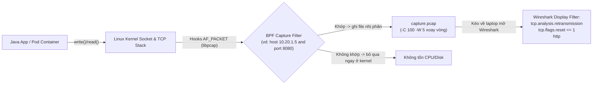

# LNX-14 · Bắt gói tin: tcpdump & Wireshark

> **TL;DR** — Khi log ứng dụng hai bên cãi nhau (*"client bảo server ngắt, server bảo không nhận được request"*), **`tcpdump`** và **Wireshark** là tòa án tối cao vì chúng chụp thẳng gói tin thực sự qua NIC Linux. Luôn bắt gói bằng cờ an toàn **`tcpdump -i any -nn -s 0 -w cap.pcap '<BPF filter>'`** (tắt DNS reverse bằng `-nn`, lọc chặt host/port, giới hạn `-c` hoặc xoay vòng `-C/-W` chống nổ ổ đĩa!). Đọc đúng **TCP Retransmission / 3 DupACKs / `win 0` / `RST`** giúp định vị chính xác lỗi nằm ở mạng, firewall hay ứng dụng; còn trong **Kubernetes Pod tối giản không có `tcpdump`**, hãy dùng **`nsenter -t <PID> -n tcpdump`** từ Node hoặc **`kubectl debug --image=nicolaka/netshoot`**.

## 🧭 Brief

| | |
| :--- | :--- |
| **Loại** | Bài học |
| **Giai đoạn** | Năm 1 · Q1 |
| **Chủ đề** | Linux & Networking |
| **Tiên quyết** | [LNX-13](../13-load-balancer-nginx/README.md) |

**Phạm vi bắt buộc**
- filter BPF
- đọc handshake, retransmission, RST
- phân tích HTTP
- capture trong container

**Câu hỏi sâu — nội dung phải giúp trả lời được**
- Thấy RST thì giả thuyết là gì?
- Bắt gói tin trong pod K8s thế nào?

**Ý tưởng lab / demo**
- Phân tích capture có retransmission và RST

**Tài liệu gốc gợi ý**
- The Linux Command Line
- Operating Systems: Three Easy Pieces
- Systems Performance (Gregg)
- High Performance Browser Networking (hpbn.co)
- TCP/IP Illustrated

**Gói đầu ra**
- [x] `README.md` — lý thuyết theo [lesson-template](../../../docs/templates/lesson-template.md)
- [x] `exercises.md` — bài tập L1/L2/L3 theo [exercises-template](../../../docs/templates/exercises-template.md)
- [x] `solutions.md` — đáp án theo [solutions-template](../../../docs/templates/solutions-template.md)
- [x] `lab/` — code demo chạy được + `lab/README.md` theo [lab-template](../../../docs/templates/lab-template.md)
- [ ] _(người học)_ `my-notes.md` — **agent không tạo**

---

<!-- Nội dung bắt đầu từ đây -->

## 1. Vấn đề: tại sao phải biết cái này?

Ba tình huống mà đọc log Java hay Nginx đều bất lực, buộc phải mở `tcpdump` / Wireshark để chốt nguyên nhân trong 5 phút:

1. **Đổ lỗi qua lại giữa JBoss & Đối tác (*"Connection reset by peer"*):** Service JBoss ném `java.net.SocketException: Connection reset`. Đội app bảo *"Mạng cắt"*, đội mạng bảo *"Firewall mở thông rồi"*, đối tác bảo *"Log bên tôi sạch sẽ"*. Chỉ một file `.pcap` 20 KB cho thấy chính xác **bên nào đã phát gói `Flags [R.]` (`RST`)** ở mili-giây thứ mấy!
2. **Request thỉnh thoảng mất `3.2 giây` dù JBoss chỉ xử lý `15 ms`:** APM thấy thời gian chờ mạng tăng đột biến đúng `200 ms`, `1.000 ms`, `3.000 ms`. `tcpdump` phơi bày ngay các gói **TCP Retransmission** hoặc **3 Duplicate ACKs** ngay giữa chặng truyền dữ liệu!
3. **Pod Kubernetes (`distroless` / `temurin-jre`) báo lỗi mạng nhưng bên trong container KHÔNG có `tcpdump`, `curl`, `bash`:** Không thể `apt install` trên production Pod đang chạy! Cần biết cách mượn Network Namespace từ ngoài vào để bắt gói sạch sẽ mà không chạm vào container image.

---

## 2. Mô hình tư duy (mental model)

Hãy hình dung **`tcpdump`** như **camera hành trình gắn ở cổng ra vào Network Interface của Kernel**, ghi lại mọi gói tin *trước khi* đi ra dây mạng và *ngay sau khi* rời khỏi card mạng (lưu ý: `tcpdump` nhìn thấy gói đi ra trước khi `iptables` hoặc NIC checksum offload sửa phần cuối nếu chưa tắt offload, và thấy gói đi vào sau driver NIC):

- **BPF Filter (*Berkeley Packet Filter*) của `tcpdump`:** Bộ lọc biên dịch thẳng xuống bytecode chạy trong kernel — chỉ copy những gói khớp điều kiện (ví dụ `host 10.20.1.5 and port 8080`) lên user-space ghi file `.pcap`, tránh làm ngạt CPU server `10 Gbps`!
- **Wireshark Display Filter:** Sau khi kéo `.pcap` về laptop, Wireshark giúp bạn vẽ biểu đồ dòng chảy (*Flow Graph*), tô màu đỏ đen từng gói `RST` / `Retransmission`, tách **TCP Stream** đọc rõ request/response HTTP, và tính toán delta time đến từng microsecond!



---

## 3. Cơ chế bên trong (trọng tâm của bài)

### 3.1 Cú pháp & Bộ lọc BPF chuẩn production của `tcpdump`

**Các cờ (flags) bắt buộc nhớ khi chạy trên Linux production:**
- **`-i any`** (hoặc `-i eth0` / `-i lo`): Bắt trên mọi interface hoặc interface cụ thể. *(Lưu ý: `-i any` trên Linux dùng cooked capture `SLL`, mất địa chỉ MAC L2 nhưng cực tiện khi chưa rõ traffic đi qua `eth0` hay `lo` hay `veth*`!)*
- **`-nn`**: **TẮT hoàn toàn phân giải DNS ngược (`PTR`) và tên port** (`/etc/services`). Thiếu `-nn`, `tcpdump` vừa bắt gói vừa bắn hàng nghìn DNS query gây lag server và làm nhiễu chính file capture!
- **`-s 0`** (snaplen không giới hạn, mặc định bản mới là `262144` bytes — đủ bắt trọn HTTP header/payload; hoặc `-s 96` nếu chỉ cần TCP/IP header cho traffic cực lớn).
- **`-S`**: In `seq` tuyệt đối thay vì `seq` tương đối (trên CLI), hữu ích khi ghép nhiều log.
- **`-w /tmp/cap.pcap -C 100 -W 5`**: Ghi thẳng binary `.pcap`, tự cắt mỗi file `100 MB` và giữ tối đa `5` file xoay vòng (`cap.pcap0..4`) — **không bao giờ lo đầy ổ đĩa production!**

**Các BPF Capture Filter thực chiến hay dùng nhất:**
```bash
# 1. Bắt mọi gói tin giữa máy này và DB/API cụ thể ở port 8080
sudo tcpdump -i any -nn -w /tmp/jboss.pcap 'host 10.20.1.5 and port 8080'

# 2. Chỉ bắt các gói có cờ SYN, FIN, hoặc RST (bắt sự cố rớt/reset kết nối siêu nhẹ!)
sudo tcpdump -i any -nn 'tcp[tcpflags] & (tcp-syn|tcp-fin|tcp-rst) != 0 and port 8080'

# 3. Bắt riêng gói DNS port 53 (LNX-11)
sudo tcpdump -i any -nn -c 100 'port 53'
```

### 3.2 Đọc chính xác Handshake, Retransmission, DupACK, ZeroWindow & `RST`

1. **Đọc 1 dòng text `tcpdump` tiêu chuẩn:**
   `14:10:01.001200 IP 10.1.1.10.52000 > 10.2.2.20.8080: Flags [P.], seq 1:85, ack 1, win 502, length 84`
   - **Cờ TCP (`Flags`):** `[S]` = `SYN`, `[S.]` = `SYN+ACK`, `[.]` = `ACK` (dấu chấm `.` luôn là `ACK`!), `[P.]` = `PSH+ACK` (đẩy payload lên ứng dụng ngay), `[F.]` = `FIN+ACK`, `[R]` / `[R.]` = `RST` / `RST+ACK`.
   - **Đo 2 khoảng trễ vàng trong 1 kết nối:**
     - `Time(SYN-ACK) - Time(SYN)` = **Network RTT** (độ trễ đường truyền vật lý 2 chiều).
     - `Time(PSH+ACK Response đầu) - Time(PSH+ACK Request)` = **Server Processing Time** (nếu RTT là `0.5 ms` mà khoảng này là `2.400 ms`, lỗi 100% ở app/DB bên server xử lý chậm, không phải tại mạng!).
2. **Dấu hiệu nghẽn mạng / mất gói trong TCP (`tcp.analysis.*` ở Wireshark):**
   - **Duplicate ACK (`Dup ACK #1, #2, #3`):** Bên nhận liên tục nhận các gói đến sau bị hổng khoảng `seq` ở giữa → gào lên gửi lặp cùng 1 số `ack` để xin lại gói thiếu → kích hoạt **Fast Retransmission**!
   - **TCP Retransmission / Spurious Retransmission:** Cùng một dải `seq:nextseq` được gửi lại do không nhận được ACK trong hạn RTO (`200 ms`, `400 ms`, `800 ms`... tăng gấp đôi — xem [LNX-08](../08-tcp-handshake-states/README.md)).
   - **TCP ZeroWindow (`win 0`):** Bên nhận gửi `win 0` báo hiệu **TCP Receive Buffer của kernel đã đầy cứng** vì **process Java/JBoss không gọi `read()` kịp** (do bị treo thread pool hoặc Full GC pause!). Bên gửi buộc phải dừng bắn data và chờ `TCP Window Update`!

### 3.3 Trả lời câu hỏi sâu #1: Thấy `RST` thì giả thuyết là gì?

Gói **`RST` (`Flags [R]` hoặc `[R.]`)** là phát súng kết thúc kết nối *ngang xương ngay lập tức* (không qua 4-way teardown `FIN/ACK`, không vào `TIME_WAIT`, ném ngay `Connection reset` / `Connection refused` ở ứng dụng). Khi thấy `RST` trong `.pcap`, kiểm tra **5 giả thuyết** theo **IP nguồn phát ra `RST`** và **thời điểm xuất hiện**:

1. **Giả thuyết 1 — Port đích đóng (không có process đang `LISTEN`):**
   - *Dấu hiệu pcap:* Client vừa gửi `SYN`, ngay sau `0.1 ms` đích trả **`Flags [R.]` (`RST+ACK`)**.
   - *Nguyên nhân:* Service chưa bật, đã crash, hoặc sai port/IP → client báo **`Connection refused`**.
2. **Giả thuyết 2 — Server/Client Crash hoặc đóng socket khi còn dữ liệu chưa đọc (`SO_LINGER = 0` hoặc unread buffer):**
   - *Dấu hiệu pcap:* Kết nối đang `ESTABLISHED` trao đổi bình thường, đột ngột 1 bên bắn `Flags [R.]` sau vài giây hoặc ngay sau khi nhận gói tiếp theo.
   - *Nguyên nhân:* Process bị `kill -9` (`SIGKILL`), OOM-killed ([LNX-03](../03-memory-pagecache-oom/README.md)), hoặc app đóng socket với `SO_LINGER=0`, hoặc bên kia gửi dữ liệu vào socket đã bị app đóng trước rồi (`close()` xong mà peer vẫn gửi data → kernel trả `RST`!).
3. **Giả thuyết 3 — Stateful Firewall / NAT / Load Balancer âm thầm xóa bảng phiên (*idle timeout*):**
   - *Dấu hiệu pcap:* Kết nối im lặng `15–60 phút`, rồi Java JDBC/HTTP pool bốc socket đó gửi `PSH+ACK`. Hoặc firewall bắn `RST` giả danh về hai phía, hoặc server mới nhận gói lạ không có trong state table nên trả `RST`!
4. **Giả thuyết 4 — Accept Queue đầy với `net.ipv4.tcp_abort_on_overflow = 1`:**
   - *Dấu hiệu pcap:* Client hoàn tất `SYN` → nhận `SYN-ACK` → gửi `ACK` thứ 3, nhưng server trả thẳng **`RST`** ngay sau `ACK` đó! *(Xem lại [LNX-08](../08-tcp-handshake-states/README.md)).*
5. **Giả thuyết 5 — Client hết Timeout nên chủ động cắt kết nối khi Server chưa trả lời xong:**
   - *Dấu hiệu pcap:* Đúng mốc `5.000s` (hay `30.000s`) kể từ `PSH+ACK` request, phía **Client** gửi `FIN` hoặc `RST`; lát sau Server gửi response `PSH+ACK` vào kết nối đã đóng nên Client trả tiếp **`RST`**!

### 3.4 Phân tích HTTP & Giải mã TLS trong Wireshark

- **Với HTTP plaintext (hoặc traffic nội bộ Nginx → JBoss `:8080`):** Trong Wireshark, chuột phải bất kỳ gói HTTP nào → **Follow → TCP Stream** để đọc toàn bộ HTTP Request/Response nối liền mạch; hoặc dùng Display Filter `http.request.method == "POST"` / `http.response.code >= 500`.
- **Với HTTPS (TLS 1.2 / 1.3):** Traffic bị mã hóa hoàn toàn — Wireshark chỉ đọc được tới `ClientHello` (thấy **SNI** và cipher suites). Trên môi trường **dev/staging**, bạn có thể xuất khóa phiên tạm qua biến môi trường **`SSLKEYLOGFILE=/tmp/sslkeys.log`** (hỗ trợ bởi `curl`, Chrome, Firefox, OpenSSL, hoặc Java agent `jSSLKeyLog`), rồi nạp file đó vào Wireshark (`Edit → Preferences → Protocols → TLS → (Pre)-Master-Secret log filename`) để giải mã sạch sẽ HTTP/2! *(Không bật `SSLKEYLOGFILE` trên production bảo mật cao).*

### 3.5 Trả lời câu hỏi sâu #2: Bắt gói tin trong Pod Kubernetes thế nào?

Container Java/JBoss production (`eclipse-temurin:21-jre-alpine` hoặc `distroless`) **không có `tcpdump`** và thường chạy user `non-root` không đủ quyền `CAP_NET_RAW`. Có **3 cách chuẩn** không phải sửa Dockerfile hay cài rác vào Pod:

1. **Cách 1 — `kubectl debug` với Ephemeral Container (khuyên dùng trên K8s `>= 1.25`):**
   Chạy một container debug tạm thời (`nicolaka/netshoot` chứa sẵn `tcpdump`, `curl`, `dig`, `ss`) gắn vào **chung Network Namespace** với Pod mục tiêu:
   ```bash
   kubectl debug -it <pod-name> -n <namespace> --image=nicolaka/netshoot --target=<container-name> -- \
     tcpdump -i eth0 -nn -s 0 -w /tmp/pod.pcap 'port 8080'
   ```
2. **Cách 2 — `nsenter` trực tiếp từ Worker Node Linux (khi cluster chưa bật ephemeral containers hoặc Pod mất quyền):**
   SSH vào Node đang chạy Pod, tìm PID chính của container trên host (`crictl inspect <container-id> | grep pid`), rồi dùng **`tcpdump` có sẵn trên Node** chui vào Network Namespace (`-n`) của PID đó:
   ```bash
   sudo nsenter -t <CONTAINER_PID> -n tcpdump -i eth0 -nn -s 0 -w /tmp/pod.pcap 'port 8080'
   ```
3. **Cách 3 — Plugin `kubectl sniff` (`ksniff`):**
   Stream trực tiếp luồng `.pcap` từ Pod/Node về **Wireshark GUI** đang mở sẵn trên máy tính cá nhân để xem live!

---

## 4. Code minh họa

Xem công cụ **PCAP Writer + Analyzer** & **Loopback TCP RST Generator** chạy thật bằng Java 21 tại [MiniPcapAnalyzer.java](./lab/src/main/java/lab/linux/pcap/MiniPcapAnalyzer.java) và [LoopbackTcpScenarioGenerator.java](./lab/src/main/java/lab/linux/pcap/LoopbackTcpScenarioGenerator.java):

```java
// ❌ SAI: Bắt tcpdump trên production không filter, không -nn, không giới hạn file
// sudo tcpdump -i eth0 -w /var/log/all.pcap  -> làm đầy ổ đĩa và tốn CPU phân giải DNS PTR!
```

```java
// ✅ ĐÚNG: Lọc chặt host/port, tắt phân giải tên (-nn), xoay vòng 5 file x 100MB, chỉ lấy header + payload cần thiết
// sudo tcpdump -i any -nn -s 0 -C 100 -W 5 -w /tmp/jboss.pcap 'host 10.20.1.5 and port 8080'
```

### 4.1 Legacy corner (Java 7 / JBoss AS 7.1.1)

Khi điều tra lỗi mạng trên **JBoss AS 7.1.1** chạy trên Linux production:
1. Nếu log JBoss báo `java.net.SocketException: Connection reset` hoặc `Broken pipe` khi gọi DB/Payment gateway: chạy `tcpdump -i any -nn -s 0 -w /tmp/jb.pcap 'host <TARGET_IP> and port <TARGET_PORT>'` trong lúc tái hiện, kéo về laptop mở bằng **Wireshark**, gõ Display Filter **`tcp.flags.reset == 1 or tcp.analysis.retransmission`** để thấy ngay IP nào bắn `RST` (JBoss tự timeout cắt ngang? Firewall ở giữa xóa idle connection? Hay DB/Partner crash?).
2. Kết hợp đối chiếu dấu thời gian trong `tcpdump` với **`kill -3 <PID>`** (thread dump của JBoss, xem [LNX-01](../01-processes-signals/README.md)) để biết chính xác tại thời điểm gói `win 0` hoặc `RST` xuất hiện thì thread JBoss đang kẹt ở dòng code nào!

---

## 5. Quan sát & đo đạc

### Phần A — Đã chạy kiểm chứng trên Windows 11 (Java 21 Real Loopback `RST` + RFC Libpcap `.pcap` Generator & Analyzer)
Từ thư mục `lab/`:
```powershell
mvn -o -B verify
mvn -o -B compile exec:java
```
Phần Java 21 thực thi trực tiếp trên Windows:
1. **`LoopbackTcpScenarioGenerator` (TCP loopback thật trên `127.0.0.1`):**
   - Kết nối vào port đã đóng → OS trả lỗi tức thì (`ConnectException: Connection refused` — tương ứng `SYN -> RST+ACK`).
   - Đóng socket server ngang với `setSoLinger(true, 0)` (bắn `RST` thật trên loopback) → client nhận chính xác `SocketException: Connection reset`.
2. **`MiniPcapAnalyzer` (sinh và phân tích file `.pcap` chuẩn định dạng libpcap `0xA1B2C3D4` — mở được trực tiếp bằng Wireshark!):**
   - Sinh 2 file capture mẫu chuẩn IPv4+TCP:
     - `http-server-rst.pcap`: Handshake (`0.40 ms` RTT) → HTTP Request → Delay `18 ms` → Server bắn `RST+ACK`!
     - `retransmission-burst.pcap`: Handshake → Data → Mất gói gây **3 Duplicate ACKs** + **TCP Retransmission** (`+205 ms` RTO/backoff) → Response!
   - `MiniPcapAnalyzer` parse lại từng packet trong `.pcap` và xuất báo cáo chuẩn đoán tự động: `networkRttMs`, `serverProcessingMs`, `retransmissionCount`, `dupAckCount`, `rstCount`, và **kết luận giả thuyết `RST` / `Retransmission`**!

*(Số đo thực tế ghi nhận sau khi chạy `mvn -o -B verify` được cập nhật tại [lab/README.md §4](./lab/README.md#4-kết-quả-tham-khảo-khi-chạy).)*

### Phần B — Cần kiểm chứng trên Linux / WSL / Docker (chưa chạy được trên máy Windows soạn bài)
> ⚠️ **Cần kiểm chứng trên Linux:** Máy soạn là Windows 11 không có WSL/Docker nên các lệnh `tcpdump`, `nsenter`, và `kubectl debug` trong `scripts/tcpdump-cheatsheet.sh` **chưa được chạy kiểm chứng trực tiếp**:
- `sudo tcpdump -i lo -nn -S -c 20 port 8080` bắt traffic sống trên Linux.
- `sudo nsenter -t <PID> -n tcpdump ...` hoặc `kubectl debug ... --image=nicolaka/netshoot` trong Kubernetes Pod.
- Mở trực tiếp 2 file `.pcap` do lab sinh ra (`target/generated-pcaps/*.pcap`) bằng **Wireshark GUI** để nhìn màu cảnh báo `tcp.analysis.retransmission` và `tcp.flags.reset == 1`.

---

## 6. Trade-offs & khi nào KHÔNG dùng

| Cách bắt / công cụ | Được gì | Mất / Đánh đổi gì | Dùng khi |
| :--- | :--- | :--- | :--- |
| **`tcpdump -nn -w file.pcap` + BPF filter** | Nhẹ, chuẩn trên mọi Linux server, phân tích sâu bằng Wireshark sau | Tốn đĩa tạm; lưu ý dữ liệu plaintext (không mã hóa) bên trong pcap | **Mọi sự cố mạng, `RST`, mất gói, nghi ngờ firewall/LB** |
| **Capture toàn bộ (`-i any` không filter)** | Không sợ lọc sót gói tin liên quan | Rất nặng CPU/disk trên server tải cao, trộn lẫn nhiễu SSH/monitoring | **KHÔNG dùng** trên production có tải — luôn lọc tối thiểu theo `host` hoặc `port` |
| **`nsenter -t <PID> -n tcpdump`** | Bắt gói cho container `distroless`/`scratch` không cần cài gì vào container | Cần quyền `root`/SSH trên Worker Node | Sự cố khẩn cấp trên Docker / Node K8s khi chưa bật ephemeral containers |
| **`kubectl debug --image=netshoot`** | Chuẩn Kubernetes, không cần SSH trực tiếp vào Node | Cần cluster K8s hỗ trợ Ephemeral Containers & quyền RBAC debug | Điều tra sự cố mạng bên trong K8s Pod chuẩn cloud-native |

---

## 7. Cạm bẫy production (ít nhất 3)

1. **Chạy `tcpdump` quên `-nn` và quên `-C/-W` (file rotation)** — *Triệu chứng:* đang debug sự cố mạng thì server nghẹt CPU hoặc cháy hết `100%` dung lượng ổ `/tmp`/`/` làm sập luôn cả JBoss & Postgres! *Nguyên nhân:* không có `-nn` khiến `tcpdump` bắn DNS reverse query cho mỗi IP mới, và không giới hạn dung lượng file ghi hàng GB chỉ trong vài phút. *Cách tránh:* luôn dùng mẫu chuẩn `tcpdump -i any -nn -C 100 -W 5 -w /tmp/cap.pcap '...'`.
2. **Thấy `tcpdump` báo `incorrect checksum` ở gói đi ra và tưởng card mạng hỏng** — *Triệu chứng:* mọi gói `SYN` / `PSH` do chính máy mình gửi đi đều bị Wireshark tô đỏ báo `TCP Checksum Incorrect`. *Nguyên nhân:* tính năng **TCP Checksum Offloading** của Linux chuyển việc tính checksum từ CPU xuống phần cứng NIC — `tcpdump` bắt gói *trước khi* gói xuống tới chip NIC nên trường checksum vẫn đang là số rác tạm! *Cách tránh:* hiểu rõ cơ chế offload (chỉ lỗi checksum trên gói *nhận vào* mới đáng ngờ mất/hỏng phần cứng).
3. **Tin 100% rằng `tcpdump` nằm *sau* `iptables` ở mọi chiều** — *Triệu chứng:* `tcpdump` vẫn nhìn thấy gói tin đi ra dù firewall `iptables OUTPUT DROP` đã chặn nó, hoặc thấy gói đi vào trước khi bị `INPUT DROP`! *Nguyên nhân:* `AF_PACKET` của `tcpdump` móc ở tầng **L2/Driver** (nằm ngoài tầng `Netfilter/iptables` — ở chiều vào, `tcpdump` thấy *trước* `iptables` drop; ở chiều ra, `iptables` drop trước nên `tcpdump` sẽ không thấy). *Cách tránh:* hiểu đúng thứ tự hook để kết hợp kiểm tra cùng `iptables -L -v -n` ([LNX-15](../15-iptables-netns/README.md)).
4. **Chia sẻ file `.pcap` có chứa HTTP `Authorization: Bearer ...` / `Cookie` / số thẻ lên ticket công khai** — *Triệu chứng:* rò rỉ token/secret production! *Nguyên nhân:* `-s 0` lưu toàn bộ payload plaintext. *Cách tránh:* chỉ dùng `-s 96` (cắt phần payload chỉ giữ header TCP/IP) hoặc xóa file `.pcap` ngay sau khi trích xong bằng chứng.

---

## 8. Liên hệ thực tế công việc

Ngay tuần này khi có ticket mạng / đối tác trên **JBoss AS 7.1.1 / Linux**:
1. Lưu sẵn câu lệnh vàng sau vào runbook cá nhân:
   `sudo tcpdump -i any -nn -S -C 50 -W 4 -w /tmp/debug.pcap 'host <PARTNER_IP> and port <PORT>'`
2. Tập thói quen mỗi khi thấy `Connection reset` hoặc latency spike không giải thích được bằng log app: bắt 30 giây `.pcap`, mở trên Wireshark lọc `tcp.flags.reset == 1 || tcp.analysis.retransmission` để kiểm tra **ai gửi `RST` trước** và **RTT vs Server Processing Time** trước khi họp chốt nguyên nhân giữa team App và Infra!

---

## 9. Self-check — Explain-back

> Trả lời **không nhìn tài liệu**, nói to trong 5 phút. Không trả lời được = chưa xong. (Đáp án nằm trong [solutions.md](./solutions.md).)

1. Nêu tác dụng của từng cờ trong lệnh `tcpdump -i any -nn -S -s 96 -C 100 -W 5 -w /tmp/cap.pcap 'host 10.1.2.3 and port 8080'`.
2. Nhìn 1 file `.pcap` giao dịch HTTP giữa client và server, bạn tính **Network RTT** và **Server Processing Time** dựa vào cặp gói tin nào?
3. Khi thấy gói **`RST` (`Flags [R.]`)** trong file `.pcap`, hãy liệt kê **4–5 giả thuyết nguyên nhân** phổ biến nhất và cách phân biệt chúng dựa theo thời điểm/hướng xuất hiện!
4. Phân biệt **3 Duplicate ACKs + Fast Retransmission** với **TCP ZeroWindow (`win 0`)** — lỗi nào do đường mạng mất gói, lỗi nào do app bên nhận bị treo?
5. Container production trên **Kubernetes** không cài `tcpdump` và không chạy root: nêu **2 cách chuẩn** để bắt được `.pcap` từ Pod đó mà không phải build lại image.

---

## 10. Cheatsheet 1 trang

| Mục | Câu lệnh / Quy tắc nhớ nhanh |
| :--- | :--- |
| **Lệnh `tcpdump` an toàn** | `sudo tcpdump -i any -nn -S -C 100 -W 5 -w /tmp/cap.pcap 'host X and port Y'` |
| **Lọc chỉ SYN / FIN / RST** | `'tcp[tcpflags] & (tcp-syn\|tcp-fin\|tcp-rst) != 0'` |
| **Wireshark Display Filters** | `tcp.flags.reset == 1` · `tcp.analysis.retransmission` · `tcp.analysis.duplicate_ack` · `tcp.analysis.zero_window` |
| **Đọc cờ `tcpdump`** | `[S]`=SYN · `[S.]`=SYN+ACK · `[.]`=ACK · `[P.]`=PSH+ACK · `[F.]`=FIN+ACK · `[R.]`=RST+ACK |
| **Đo độ trễ 2 khúc** | `Network RTT = SYN-ACK - SYN` · `Server Time = Resp(PSH+ACK) - Req(PSH+ACK)` |
| **5 giả thuyết khi thấy `RST`** | (1) Port đóng (`SYN -> RST+ACK`); (2) App crash / `SO_LINGER=0` / peer đóng trước; (3) Firewall idle state mất; (4) Accept queue đầy `tcp_abort_on_overflow=1`; (5) Client timeout cắt ngang |
| **Capture K8s Pod** | `kubectl debug -it <pod> --image=nicolaka/netshoot --target=<ctr> -- tcpdump ...` hoặc `nsenter -t <PID> -n tcpdump ...` |

---

## 11. Tài liệu tham khảo

- `tcpdump` & `pcap-filter` Manual Pages: [`tcpdump(1)`](https://www.tcpdump.org/manpages/tcpdump.1.html), [`pcap-filter(7)`](https://www.tcpdump.org/manpages/pcap-filter.7.html).
- Wireshark User's Guide, [*TCP Analysis Flags & Display Filters*](https://www.wireshark.org/docs/wsug_html_chunked/ChAdvTCPAnalysis.html).
- Kubernetes Docs, [*Debugging Running Pods with Ephemeral Containers (`kubectl debug`)*](https://kubernetes.io/docs/tasks/debug/debug-application/debug-running-pod/).
- W. Richard Stevens & Kevin Fall, *TCP/IP Illustrated, Vol. 1* (2nd ed.) — TCP Reset, Retransmission, Window Management.

---
➡️ Tiếp theo: [exercises.md](./exercises.md) · [lab/](./lab/README.md) · Bài kế: [LNX-15 · iptables/nftables & network namespace](../15-iptables-netns/README.md)
