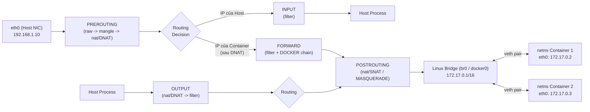

# LNX-15 · iptables/nftables & network namespace

> **TL;DR** — Một "container" ở tầng mạng thực chất chỉ là một **Network Namespace (`ip netns`)** cô lập hoàn toàn card mạng, IP và bảng route riêng, nối với thế giới ngoài bằng một sợi dây ảo hai đầu (**`veth` pair**) cắm vào Linux Bridge (`docker0`). Để container nói chuyện ra Internet hay nhận kết nối từ ngoài vào (`docker run -p 8080:80`), Linux kernel dùng **Netfilter (`iptables` / `nftables`)** thực hiện **DNAT** (ở `PREROUTING`/`OUTPUT`), **SNAT/MASQUERADE** (ở `POSTROUTING`), và lọc bảo mật (`filter` table) dựa trên bảng trạng thái **`nf_conntrack`**. Cơ chế `kube-proxy` mặc định trên Kubernetes thực chất cũng dùng `iptables` (`KUBE-SERVICES` → `KUBE-SVC-*` xác suất `1/N` → `KUBE-SEP-*` `DNAT` vào Pod IP)!

## 🧭 Brief

| | |
| :--- | :--- |
| **Loại** | Bài học |
| **Giai đoạn** | Năm 1 · Q1 |
| **Chủ đề** | Linux & Networking |
| **Tiên quyết** | [LNX-14](../14-tcpdump-wireshark/README.md) |

**Phạm vi bắt buộc**
- chain, table
- NAT
- network namespace & veth (nền của container networking)
- kube-proxy dùng iptables

**Câu hỏi sâu — nội dung phải giúp trả lời được**
- Docker publish port hoạt động bằng gì?
- Tạo 2 "container" bằng netns thủ công?

**Ý tưởng lab / demo**
- Tự dựng 2 network namespace nối bằng veth + NAT ra ngoài

**Tài liệu gốc gợi ý**
- The Linux Command Line
- Operating Systems: Three Easy Pieces
- Systems Performance (Gregg)
- High Performance Browser Networking (hpbn.co)
- TCP/IP Illustrated

**Gói đầu ra**
- [x] `README.md` — lý thuyết theo [lesson-template](../../../docs/templates/lesson-template.md)
- [x] `exercises.md` — bài tập L1/L2/L3 theo [exercises-template](../../../docs/templates/exercises-template.md)
- [x] `solutions.md` — đáp án theo [solutions-template](../../../docs/templates/solutions-template.md)
- [x] `lab/` — code demo chạy được + `lab/README.md` theo [lab-template](../../../docs/templates/lab-template.md)
- [ ] _(người học)_ `my-notes.md` — **agent không tạo**

---

<!-- Nội dung bắt đầu từ đây -->

## 1. Vấn đề: tại sao phải biết cái này?

Ba tình huống thực tế trên Docker & Kubernetes khiến kỹ sư tưởng "mạng bị ma ám" nếu không hiểu `iptables` và `network namespace`:

1. **Mở port bằng `ufw` hay `firewalld` nhưng Docker container `-p 8080:80` vẫn bị truy cập công khai từ Internet!** Nhiều kỹ sư cấu hình `ufw deny 8080` trên host Linux để chặn bên ngoài, tưởng an toàn — nhưng Docker tự chèn rule `DNAT` ở `PREROUTING` + `DOCKER` chain trong `FORWARD` **đi vòng trước chain `INPUT`** của firewall!
2. **Container mất mạng sau khi nâng cấp OS hay quên `ip_forward=1`, hoặc Kubernetes Service chậm dần khi lên 5.000 Services:** Do không bật `net.ipv4.ip_forward = 1` để kernel định tuyến gói giữa `eth0` và `veth`, hoặc do hàng chục nghìn rule tuần tự `O(N)` của `iptables` trong `kube-proxy`.
3. **Pod Kubernetes hoặc Container dính `nf_conntrack: table full, dropping packet` (đã gặp ở LNX-11):** Vì mọi rule NAT (`MASQUERADE`, `DNAT`, `kube-proxy`) đều buộc phải lưu trạng thái 2 chiều trong bảng `conntrack`!

---

## 2. Mô hình tư duy (mental model)

Hãy hình dung một **máy chủ Linux như một tòa nhà văn phòng hiện đại**:

- **Network Namespace (`netns`):** Mỗi container là **một căn phòng riêng có hệ thống điện thoại nội bộ, ổ cắm mạng (`eth0`), bảng danh bạ (routing table) và danh sách chặn riêng (`iptables`)** — đứng trong phòng `ns1` chạy `ss -lnt` sẽ *không hề thấy* port `8080` đang mở ở phòng `ns2` hay sảnh chính (`host` root namespace)!
- **`veth` pair (Dây cáp mạng xuyên tường 2 đầu):** Để phòng `ns1` nói chuyện được với sảnh chính, bạn đục lỗ xuyên tường luồn một sợi dây có **2 đầu dính liền nhau**: đầu `veth1` đặt trong phòng `ns1`, đầu kia `br-veth1` cắm vào **Switch ảo (`Linux Bridge` `docker0`)** ở sảnh chính! Bất kỳ gói tin nào ném vào đầu này sẽ chui ra ngay ở đầu kia.
- **Netfilter (`iptables` / `nftables`):** Là các **trạm kiểm soát & đổi địa chỉ (NAT)** đặt tại **5 cửa ngõ (Hook/Chain)** của nhân Linux: cửa vào tòa nhà (`PREROUTING`), cửa vào phòng lễ tân của host (`INPUT`), hành lang đi ngang chuyển sang phòng/card khác (`FORWARD`), cửa ra từ app của host (`OUTPUT`), và cửa cuối cùng trước khi ra đường phố (`POSTROUTING`).

**Chỗ ẩn dụ không còn đúng:**
Trong đời thực, 1 tòa nhà chỉ có 1 bác bảo vệ cửa; còn trong Linux Netfilter, **tại mỗi cửa ngõ (Hook)** lại có nhiều tổ chức kiểm tra xếp nối tiếp theo thứ tự bảng ưu tiên (**`raw` → `mangle` → `nat` → `filter`**)! Hơn nữa, ở gói tin quay về (reply packet), nếu đã lưu trong bảng **`nf_conntrack`**, kernel tự động thực hiện **reverse-NAT** ngay lập tức mà không cần viết rule chiều ngược lại!



---

## 3. Cơ chế bên trong (trọng tâm của bài)

### 3.1 Tables, Chains & Netfilter Packet Flow (`iptables` vs `nftables`)

Linux kernel không "chạy phần mềm `iptables`"; `iptables` và `nftables` chỉ là CLI user-space nạp luật vào **Netfilter framework** trong kernel:

1. **4 Tables phổ biến (xếp đúng thứ tự ưu tiên thực thi tại cùng 1 hook):**
   - **`raw`:** Dùng để tắt theo dõi kết nối (`NOTRACK`) cho traffic cực lớn (ví dụ DNS UDP để tránh đầy `nf_conntrack`).
   - **`mangle`:** Sửa tiêu đề gói tin (TTL, TOS, đánh dấu packet `MARK`).
   - **`nat`:** Đổi IP/Port nguồn hoặc đích (`DNAT`, `SNAT`, `MASQUERADE`, `REDIRECT`). *Chỉ chạy cho gói tin ĐẦU TIÊN của một kết nối mới (`ctstate NEW`); các gói sau của cùng kết nối tự động ăn theo `nf_conntrack`!*
   - **`filter`:** Bảng mặc định quyết định **`ACCEPT`**, **`DROP`** (im lặng vứt bỏ), hay **`REJECT`** (trả `ICMP unreachable` / `RST`).
2. **5 Chains mặc định (tương ứng 5 Netfilter hooks):**
   - `PREROUTING` (`raw, mangle, nat`): Ngay khi gói vừa chạm NIC, *trước* khi kernel biết đi đâu.
   - `INPUT` (`mangle, filter, nat`): Gói gửi vào **chính host**.
   - `FORWARD` (`mangle, filter`): Gói đi **xuyên qua host** sang interface khác (ví dụ từ `eth0` vào `docker0` → container). *Phải bật `net.ipv4.ip_forward = 1`!*
   - `OUTPUT` (`raw, mangle, nat, filter`): Gói sinh ra từ **chính host** (ví dụ `curl localhost:8080`).
   - `POSTROUTING` (`mangle, nat`): Ngay trước khi gói rời khỏi NIC cuối cùng.
3. **Từ `iptables` sang `nftables`:**
   - `iptables` cũ truyền toàn bộ bảng rule nguyên khối qua syscall (thêm 1 rule phải nạp lại hàng nghìn rule, chia tách `iptables` IPv4 / `ip6tables` IPv6 / `arptables`, lọc tuần tự).
   - **`nftables`** (mặc định trên RHEL 8+/Ubuntu 22+/Debian 10+) dùng máy ảo bytecode trong kernel, hỗ trợ bảng ghép `inet` cho cả IPv4 + IPv6, atomic rule updates, và dùng `sets`/`maps` cho tra cứu **`O(1)`** thay vì quét tuyến tính! *(Lệnh `iptables` trên Linux mới thực chất thường là wrapper `iptables-nft` dịch sang `nftables` ngầm).*

### 3.2 Trả lời câu hỏi sâu #2: Tạo 2 "Container" bằng Network Namespace & `veth` thủ công

Đây chính là cách Docker/containerd dựng mạng cho mỗi container từ con số 0 (xem script đầy đủ tại [setup-2-netns-lab.sh](./lab/scripts/setup-2-netns-lab.sh)):

1. **Tạo 2 Network Namespace tách biệt (`ns1`, `ns2`) + Switch cầu nối (`br-lab0`):**
   - `ip netns add ns1` và `ip netns add ns2` → tạo 2 ngăn mạng cô lập (mỗi bên ban đầu chỉ có `lo` đang `DOWN`).
   - `ip link add br-lab0 type bridge && ip addr add 10.200.0.1/24 dev br-lab0 && ip link set br-lab0 up` → tạo cầu nối làm Gateway cho cả 2 container.
2. **Luồn 2 sợi dây `veth` pair nối `ns1` và `ns2` vào `br-lab0`:**
   - `ip link add veth-ns1 type veth peer name br-veth1`
   - Đẩy đầu `veth-ns1` vào `ns1`: `ip link set veth-ns1 netns ns1`, gán IP `10.200.0.2/24`, kéo `lo` & `veth-ns1` lên (`up`), đặt `default via 10.200.0.1`.
   - Cắm đầu `br-veth1` vào bridge ở root namespace: `ip link set br-veth1 master br-lab0 && ip link set br-veth1 up`.
   - Làm tương tự cho `ns2` với IP `10.200.0.3/24`. Lúc này `ip netns exec ns1 ping 10.200.0.3` thông suốt ở Layer 2 qua bridge `br-lab0`!
3. **Cho `ns1`/`ns2` ra ngoài Internet (hoặc host LAN) bằng SNAT / `MASQUERADE`:**
   - Bật định tuyến giữa các interface: `sysctl -w net.ipv4.ip_forward=1`.
   - Ở `POSTROUTING` trên interface ra ngoài (`eth0`), đổi IP nguồn nội bộ `10.200.0.x` thành IP thật của máy chủ:
     `iptables -t nat -A POSTROUTING -s 10.200.0.0/24 ! -o br-lab0 -j MASQUERADE`
   - Khi gói reply quay về `eth0`, `nf_conntrack` nhớ ánh xạ và tự động đổi ngược IP đích về `10.200.0.2` chuyển lại vào `ns1`!

### 3.3 Trả lời câu hỏi sâu #1: Docker publish port (`docker run -p 8080:80`) hoạt động bằng gì?

Khi bạn chạy `docker run -p 8080:80 nginx` (giả sử container nhận IP `172.17.0.2`):
1. **Với traffic từ máy ngoài gọi tới `<Host-IP>:8080`:**
   - Gói `SYN` vào `eth0` → đi qua hook **`PREROUTING` (table `nat`)** → nhảy vào chain **`DOCKER`**.
   - Rule **DNAT**: `! -i docker0 -p tcp -m tcp --dport 8080 -j DNAT --to-destination 172.17.0.2:80`.
   - Sau `PREROUTING`, kernel tra bảng routing thấy IP đích lúc này là `172.17.0.2` (không phải IP của host!) → **GÓI TIN ĐI VÀO `FORWARD` CHỨ KHÔNG VÀO `INPUT`!** *(Đây là lý do rule chặn cổng trên chain `INPUT` của UFW/firewalld vô hiệu với Docker nếu không chặn ở `DOCKER-USER`!)*
   - Chain `FORWARD` (rule `DOCKER` accept `172.17.0.2:80`) cho phép gói đi qua bridge `docker0` → `veth` vào tới container Nginx đang nghe port `80`!
2. **Với traffic chính từ Host gọi `curl localhost:8080`:**
   - Traffic do máy tự sinh ra không đi qua `PREROUTING` mà đi qua **`OUTPUT` (table `nat`)** → nhảy vào chain `DOCKER` (có `ADDRTYPE match dst-type LOCAL` -> `DNAT` sang `172.17.0.2:80`), kết hợp rule `MASQUERADE` (`POSTROUTING`) hoặc `docker-proxy` user-space để gói reply quay về đúng đường!

### 3.4 `kube-proxy` dùng `iptables` trong Kubernetes ra sao?

Khi tạo một Kubernetes `Service` tên `orders-svc` (`ClusterIP = 10.96.10.20:80`) trỏ tới 3 Pods (`10.244.1.5:8080`, `10.244.2.8:8080`, `10.244.3.9:8080`):
1. `kube-proxy` trên **mỗi Worker Node** ghi một chuỗi rule vào `nat` table (móc từ `PREROUTING` và `OUTPUT`):
   - **`KUBE-SERVICES`:** Khớp `dst=10.96.10.20, dport=80` → nhảy sang `KUBE-SVC-XYZ`.
   - **`KUBE-SVC-XYZ` (cân bằng tải bằng xác suất thống kê!):**
     - Rule 1: `-m statistic --mode random --probability 0.33333` → nhảy `KUBE-SEP-POD1` (xác suất `1/3`).
     - Rule 2: `-m statistic --mode random --probability 0.50000` → nhảy `KUBE-SEP-POD2` (`1/2` của `2/3` còn lại = `1/3`!).
     - Rule 3: nhảy `KUBE-SEP-POD3` (`1/3` cuối cùng!).
   - **`KUBE-SEP-POD1`:** Thực hiện **`DNAT --to-destination 10.244.1.5:8080`**.
2. **Giới hạn quy mô của `iptables` mode:** Vì `KUBE-SERVICES` duyệt danh sách rule tuyến tính **`O(N)`**, khi cluster có hàng nghìn Services & Endpoints, mỗi kết nối mới và mỗi lần cập nhật Endpoint đẩy CPU + latency của `kube-proxy` tăng vọt (lúc này cần chuyển sang **`IPVS` mode** dùng hash table `O(1)` hoặc **Cilium eBPF**!).

---

## 4. Code minh họa

Xem mã nguồn **Netfilter Packet & Namespace Simulator** thuần Java 21 tại [NetfilterPacketSimulator.java](./lab/src/main/java/lab/linux/netfilter/NetfilterPacketSimulator.java):

```bash
# ❌ SAI: Mở port Docker hoặc K8s nhưng cố chặn ngoài Internet bằng chain INPUT của iptables
sudo iptables -A INPUT -p tcp --dport 8080 -j DROP
# Vô tác dụng! Vì DNAT ở PREROUTING đã đổi dst thành 172.17.0.2 -> gói đi qua FORWARD, không qua INPUT!
```

```bash
# ✅ ĐÚNG: Chặn traffic vào container Docker qua chain DOCKER-USER (nằm trong đường FORWARD)
sudo iptables -I DOCKER-USER -i eth0 ! -s 10.0.0.0/8 -p tcp --dport 8080 -j DROP
```

### 4.1 Legacy corner (Java 7 / JBoss AS 7.1.1)

Trên **RHEL 6/7 hoặc CentOS 7 chạy JBoss AS 7.1.1**:
1. Khi bạn chạy JBoss trực tiếp trên VM (nghe `:8080`) nhưng cấu hình **`iptables REDIRECT`** chuyển port `80/443` xuống `8080` để JBoss **không phải chạy quyền `root`** (vì Linux cấm non-root bind port `< 1024` trừ khi gán `CAP_NET_BIND_SERVICE`):
   ```bash
   sudo iptables -t nat -A PREROUTING -p tcp --dport 80 -j REDIRECT --to-port 8080
   ```
   Cẩn thận: rule `PREROUTING` không áp dụng cho `localhost:80` trên chính VM đó (phải thêm `OUTPUT -o lo ... REDIRECT`).
2. Luôn dùng **`ss -lnt`** / **`iptables -t nat -L -n -v`** để đếm packet counter thực tế trên từng rule mỗi khi nghi firewall nuốt mất gói `SYN` tới JBoss hoặc tới PostgreSQL/Oracle DB!

---

## 5. Quan sát & đo đạc

### Phần A — Đã chạy kiểm chứng trên Windows 11 (Java 21 Netfilter Hook & NAT/Namespace Simulator)
Từ thư mục `lab/`:
```powershell
mvn -o -B verify
mvn -o -B compile exec:java
```
Phần Java 21 mô phỏng chính xác 5 hook Netfilter (`PREROUTING → INPUT/FORWARD → OUTPUT → POSTROUTING`), bảng `nf_conntrack`, `DOCKER -p 8080:80` DNAT + `MASQUERADE`, quy tắc `DOCKER-USER` vs `INPUT` bypass trap, `kube-proxy` `1/N` probability routing, và bridge giữa 2 network namespaces (`ns1` ↔ `br-lab0` ↔ `ns2`).

*(Số đo thực tế ghi nhận sau khi chạy `mvn -o -B verify` được cập nhật tại [lab/README.md §4](./lab/README.md#4-kết-quả-tham-khảo-khi-chạy).)*

### Phần B — Cần kiểm chứng trên Linux / WSL / Docker (chưa chạy được trên máy Windows soạn bài)
> ⚠️ **Cần kiểm chứng trên Linux:** Máy soạn là Windows 11 không có WSL/Docker nên script dựng `ip netns` + `veth` + `iptables` thật trong `scripts/setup-2-netns-lab.sh` **chưa được chạy kiểm chứng trực tiếp**:
- Chạy `sudo bash scripts/setup-2-netns-lab.sh up` trên máy Linux (kernel hỗ trợ `veth` + `bridge` + `iptables`/`nftables`), kiểm chứng `sudo ip netns exec ns1 ping -c 2 10.200.0.3` và `sudo iptables -t nat -L -n -v`.
- Kiểm tra rule thật của Docker (`sudo iptables -t nat -L DOCKER -n -v`) hoặc Kubernetes (`sudo iptables -t nat -L KUBE-SERVICES -n | head`).

---

## 6. Trade-offs & khi nào KHÔNG dùng

| Cơ chế / Công cụ | Được gì | Mất / Đánh đổi gì | Dùng khi |
| :--- | :--- | :--- | :--- |
| **`iptables` (legacy / kube-proxy default)** | Phổ biến rộng rãi, tương thích kernel cũ (RHEL 7) | Quét tuần tự `O(N)` chậm khi > vài nghìn Services; thay đổi rule không atomic ở bản legacy | Server VM truyền thống hoặc cluster K8s quy mô nhỏ/vừa (`< 1.000` Services) |
| **`nftables` / `IPVS` kube-proxy** | Tra cứu hash `O(1)`, atomic updates, hợp nhất IPv4/IPv6 | Cấu trúc khác `iptables`, cần kernel & tool kiểm tra mới (`nft list ruleset`, `ipvsadm`) | Linux hiện đại (Ubuntu 22+/RHEL 8+) và K8s quy mô lớn |
| **eBPF (Cilium)** | Bỏ qua hoàn toàn `iptables` + `conntrack` ở nhiều đường đi, `O(1)` cực nhanh | Đòi hỏi kernel Linux hiện đại (`>= 5.10`), độ phức tạp vận hành cao hơn | Kubernetes production hiệu năng cao (hàng nghìn Services/Pods) |
| **`NOTRACK` trong bảng `raw`** | Không ghi vào `nf_conntrack` -> tránh tràn bảng conntrack | Mất stateful inspection & NAT cho luồng traffic đó | Traffic UDP tần suất cực cao không cần NAT (DNS/metrics nội bộ) |

---

## 7. Cạm bẫy production (ít nhất 3)

1. **Chặn cổng container Docker bằng `INPUT` chain (`ufw` / `firewalld`) nhưng cổng vẫn mở toang ra Internet** — *Triệu chứng:* Đã chạy `ufw deny 8080`, kiểm tra từ máy khác vẫn `curl <Host>:8080` vào thẳng container! *Nguyên nhân:* `PREROUTING DNAT` đổi đích thành IP container nên gói đi qua **`FORWARD`** (`DOCKER` chain), bỏ qua hoàn toàn `INPUT`! *Cách tránh:* Đặt rule chặn tại chain **`DOCKER-USER`** (chạy đầu tiên trong `FORWARD`).
2. **Dùng `-j DROP` quá tay trong mạng nội bộ làm app treo 20–127 giây chờ timeout thay vì fail fast** — *Triệu chứng:* Service A gọi Service B bị firewall chặn nhưng không báo `Connection refused` ngay mà treo đúng bằng `connectTimeout`! *Nguyên nhân:* `DROP` nuốt im lặng gói `SYN`, ép TCP client retransmit theo exponential backoff `1s, 2s, 4s...`. *Cách tránh:* Trong mạng LAN nội bộ kiểm soát được, dùng **`-j REJECT --reject-with tcp-reset`** để app nhận lỗi tức thì và failover sớm (trừ tường lửa public ngoài Internet mới nên `DROP`).
3. **Sửa rule `iptables` trực tiếp trên server đang SSH mà đặt default policy `INPUT DROP` trước khi cho phép cổng `22` / `ESTABLISHED`** — *Triệu chứng:* Gõ xong lệnh `iptables -P INPUT DROP` là màn hình SSH đứng cứng ngay lập tức! *Nguyên nhân:* Chưa có rule `-m conntrack --ctstate ESTABLISHED,RELATED -j ACCEPT` và rule `dport 22`. *Cách tránh:* Luôn cho phép `ESTABLISHED,RELATED` và port `22` **trước** khi đổi policy `DROP` (hoặc đặt hẹn giờ `at`/`sleep` rollback nếu test từ xa!).
4. **Cấp quá nhỏ `net.netfilter.nf_conntrack_max` trên node làm gateway/NAT/K8s** — *Triệu chứng:* `dmesg` báo `nf_conntrack: table full, dropping packet` khiến DNS và các kết nối mới rớt ngẫu nhiên dù CPU thấp. *Nguyên nhân:* Mọi rule NAT/stateful đều ngốn 1 slot trong `nf_conntrack`. *Cách tránh:* Theo dõi `cat /proc/sys/net/netfilter/nf_conntrack_count` vs `nf_conntrack_max`, nâng trần hợp lý và giảm bớt rule `ndots:5` DNS UDP thừa ([LNX-11](../11-dns-resolution/README.md)).

---

## 8. Liên hệ thực tế công việc

Ngay tuần này trên server Linux chạy **JBoss AS 7.1.1 / Docker**:
1. Kiểm tra xem máy chủ có đang chạy rule firewall nào không (`sudo iptables -L -n -v` hoặc `sudo nft list ruleset`) và xem `nf_conntrack_count / nf_conntrack_max` đang chiếm bao nhiêu % công suất!
2. Nếu dùng Docker trên server Linux công ty có mở `-p <port>:<port>`, kiểm tra ngay bằng `sudo iptables -t nat -L DOCKER -n -v` và kiểm từ máy ngoài xem có lỡ hở cổng database/admin ra mạng công ty bất chấp `ufw` không.

---

## 9. Self-check — Explain-back

> Trả lời **không nhìn tài liệu**, nói to trong 5 phút. Không trả lời được = chưa xong. (Đáp án nằm trong [solutions.md](./solutions.md).)

1. Vẽ lại đường đi gói tin qua **5 Netfilter chains (`PREROUTING`, `INPUT`, `FORWARD`, `OUTPUT`, `POSTROUTING`)** cho 2 trường hợp: gói tin gửi vào chính Host vs gói tin đi vào Container Docker.
2. Phân biệt 4 bảng **`raw` → `mangle` → `nat` → `filter`** theo thứ tự chạy, và giải thích tại sao rule trong bảng `nat` chỉ khớp gói tin đầu tiên của một TCP stream.
3. Giải thích cơ chế của **`docker run -p 8080:80`**, và vì sao chặn port `8080` ở chain `INPUT` lại không chặn được container Docker.
4. Trình bày từng bước lệnh để tự tay dựng **2 Network Namespace (`ns1`, `ns2`)** nối với nhau qua `veth pair` + Linux Bridge và đi ra ngoài bằng `MASQUERADE`.
5. **`kube-proxy` chế độ `iptables`** điều phối traffic tới 3 Pods như thế nào, và vì sao nó trở thành bottleneck khi cluster phình to lên hàng nghìn Services?

---

## 10. Cheatsheet 1 trang

| Thành phần | Ghi nhớ nhanh |
| :--- | :--- |
| **4 Tables (thứ tự)** | `raw` (`NOTRACK`) → `mangle` → `nat` (`DNAT`/`SNAT`/`MASQUERADE`) → `filter` (`ACCEPT`/`DROP`/`REJECT`) |
| **5 Chains** | `PREROUTING` (`DNAT`) → `INPUT` (vào host) / `FORWARD` (xuyên container) · `OUTPUT` (từ host) → `POSTROUTING` (`SNAT`/`MASQUERADE`) |
| **Docker `-p 8080:80`** | `PREROUTING` → `DOCKER` `DNAT` sang `172.17.0.x:80` → `FORWARD` (`DOCKER-USER`!) → `docker0` → `veth` |
| **2 Container thủ công** | `ip netns add` + `veth` pair + `bridge` + `sysctl net.ipv4.ip_forward=1` + `POSTROUTING MASQUERADE` |
| **`kube-proxy` iptables** | `KUBE-SERVICES` → `KUBE-SVC-*` (`-m statistic --mode random --probability 1/N`) → `KUBE-SEP-*` (`DNAT` vào Pod IP) |
| **Soi rule & conntrack** | `iptables -t nat -L -n -v` · `nft list ruleset` · `cat /proc/sys/net/netfilter/nf_conntrack_count` |

---

## 11. Tài liệu tham khảo

- Linux Kernel Netfilter & `iptables(8)` / `nft(8)` man-pages ([netfilter.org](https://www.netfilter.org/documentation/)).
- Linux man-pages, [`ip-netns(8)`](https://man7.org/linux/man-pages/man8/ip-netns.8.html) & [`veth(4)`](https://man7.org/linux/man-pages/man4/veth.4.html).
- Docker Docs, [*Packet filtering and firewalls* (`DOCKER-USER` chain)](https://docs.docker.com/engine/network/packet-filtering-firewalls/).
- Kubernetes Docs, [*Virtual IPs and Service Proxies* (`kube-proxy` iptables vs IPVS)](https://kubernetes.io/docs/reference/networking/virtual-ips/).

---
➡️ Tiếp theo: [exercises.md](./exercises.md) · [lab/](./lab/README.md) · Hoàn thành phần `LNX`! Bước sang [DSA-01 · Độ phức tạp & Big-O thực dụng](../../../00-foundations/dsa/01-complexity-analysis/README.md)
